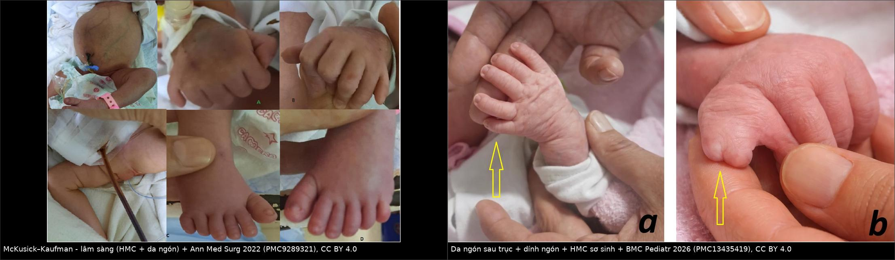
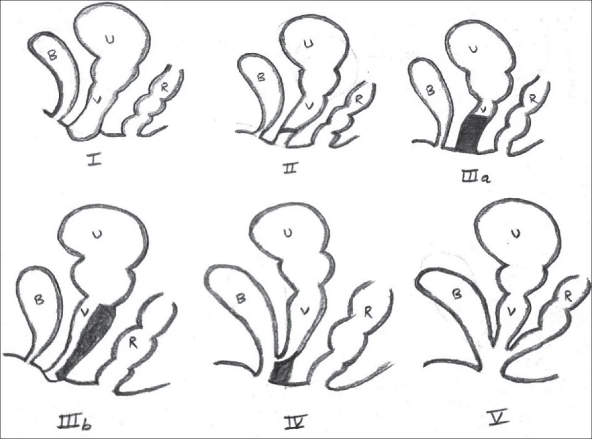
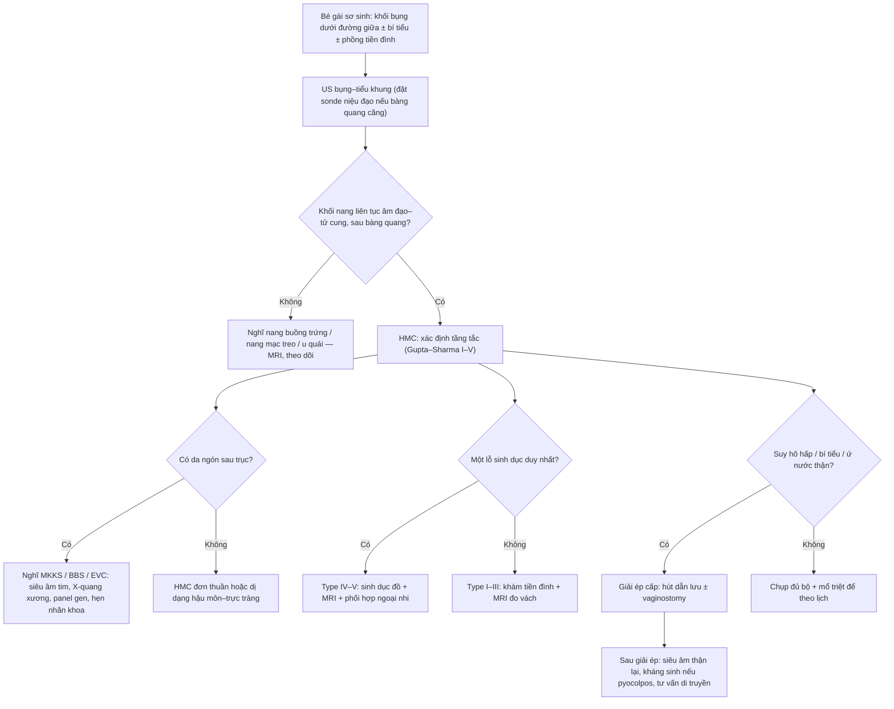
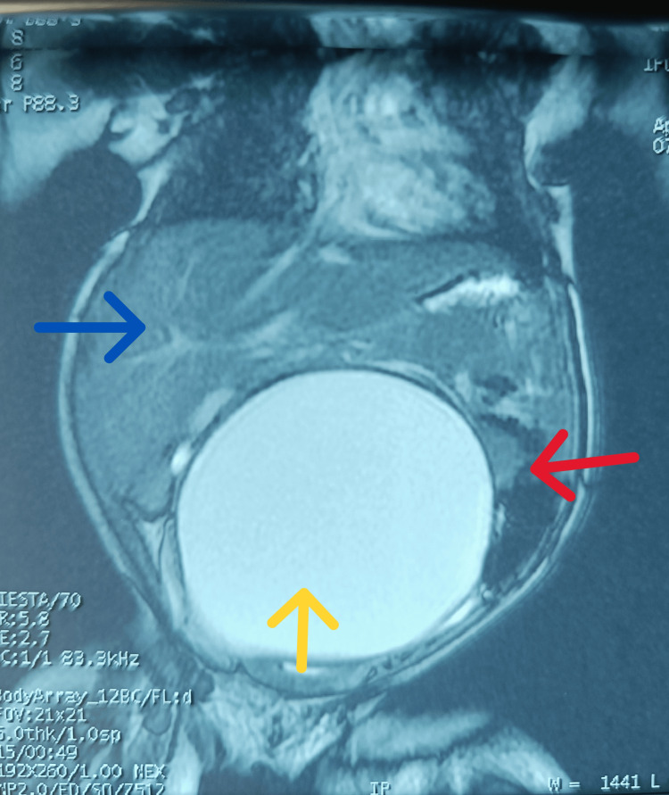
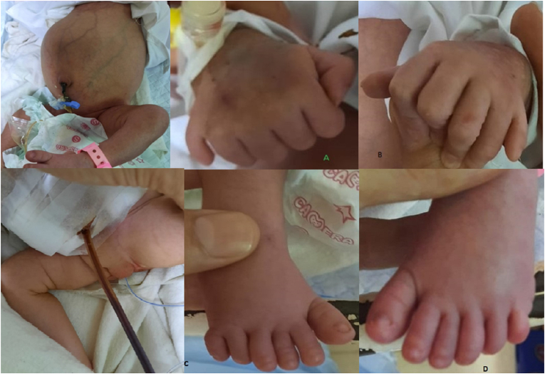
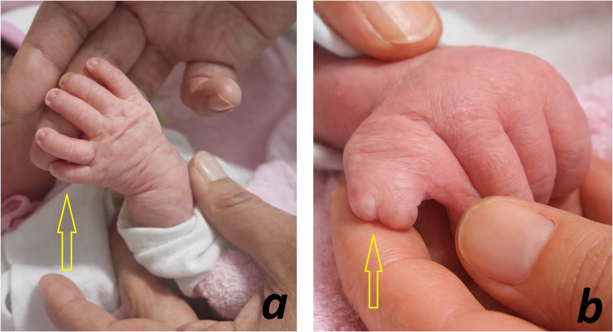

# 1745 — Hội chứng McKusick–Kaufman & ứ máu–ứ dịch âm đạo ở sơ sinh / McKusick–Kaufman syndrome and neonatal hydrometrocolpos

**Tags:** `pattern:u-dich-am-dao` `pattern:u-mau-am-dao` `pattern:da-ngon-tay` `pattern:khong-hoi-am` `vung:am-dao` `vung:tu-cung` `vung:tieu-khung` `score:Gupta-Sharma` `protocol:US-truoc-sinh` `protocol:MRI-tieu-khung` `protocol:sinh-duc-do` `incidentaloma:hydrometrocolpos`
**Mức chắc chắn (certainty):** tổng hợp y văn (literature synthesis) — số liệu dịch tễ và phân loại từ loạt 17 bệnh nhi (PMC13614824, CC BY-NC-SA); ca nguyên văn McKusick–Kaufman có số đo và kết cục (PMC9289321, CC BY); ca thứ ba của dị tật thanh quản ba thuỳ kèm ứ máu âm đạo (PMC13435419, CC BY); ca đọc nhầm thành nang mạc treo (PMC12503192, CC BY). Không có thử nghiệm lâm sàng nào cho hội chứng này — mọi ngưỡng dưới đây là ngưỡng mô tả/đồng thuận.

## 1. Tổng quan bệnh học – cơ chế hình ảnh

- **Định nghĩa:** **ứ máu–ứ dịch âm đạo (hydrometrocolpos, HMC)** là giãn âm đạo ± buồng tử cung do **tắc dòng ra âm đạo**, tích dịch nhầy/mủ/máu. Tần suất **1:16.000 trẻ gái sinh sống** (PMC13614824); **15% khối bụng ở trẻ gái sơ sinh** có nguyên nhân là tắc âm đạo (PMC9289321) — nghĩa là hễ gặp khối nang vùng chậu ở bé gái mới sinh thì HMC nằm trong 3 chẩn đoán đầu.
- **TẠI SAO sơ sinh đã ứ dịch trong khi chưa hành kinh:** estrogen của mẹ qua nhau thai kích thích **tuyến nhầy cổ tử cung – âm đạo** tiết dịch; dịch không thoát được vì tắc → ứ. Sau sinh, estrogen mẹ giảm dần nên **khối có thể nhỏ lại** nếu tắc nhẹ, còn tắc hoàn toàn thì tiếp tục to ra và chèn ép.
- **TẠI SAO hình ảnh là "nang dịch đường giữa":** dịch nhầy đặc, nghèo tế bào → **siêu âm (ultrasound, US)**: khối **trống âm (anechoic)** hoặc **giảm âm kèm hồi âm mịn lơ lửng** (nhầy đặc, tế bào bong). **CT**: **0–20 HU** với dịch nhầy loãng, có thể **20–40 HU** khi nhầy đặc/mủ; **không ngấm thuốc** phần dịch, chỉ thành ngấm. **MRI**: **T2 rất sáng** (nước tự do), **T1 thay đổi** theo nồng độ protein (nhầy đặc → T1 hơi sáng) và theo máu (methemoglobin → T1 sáng); **không có thành đặc ngấm thuốc** — đó là chốt loại u đặc.
- **Chuỗi chèn ép quyết định tiên lượng (đọc theo thứ tự giải phẫu):**
  1. khối nằm **giữa bàng quang (phía trước) và trực tràng (phía sau)** → đẩy bàng quang lên trước;
  2. **chèn niệu quản – cổ bàng quang** → **ứ nước–niệu quản hai bên (hydroureteronephrosis)**; trong loạt 17 bệnh nhi, **cả 17 đều có ứ nước thận** (PMC13614824);
  3. thai kỳ: chèn ép → **thiểu ối (oligohydramnios)** → **giảm sản phổi (lung hypoplasia)**; hiếm hơn có **phù thai (hydrops)** do chèn tĩnh mạch chủ dưới;
  4. sau sinh: **bí tiểu, nhiễm khuẩn niệu tái diễn**, táo bón, chèn trực tràng (hiếm khi thủng ruột).
- **McKusick–Kaufman (MKKS) là gì:** hội chứng **di truyền lặn nhiễm sắc thể thường**, gen **MKKS (BBS6) ở 20p12** (OMIM **604896**; locus BBS6 **605231**) — chính là **một trong các gen của Bardet–Biedl**. Tam chứng: **ứ máu–ứ dịch âm đạo + da ngón sau trục (postaxial polydactyly) + dị tật tim bẩm sinh**; ba dấu hiệu này có mặt ở **93–95%** bệnh nhân, da ngón đơn thuần gặp **~90%** (PMC9289321). Trẻ trai cùng gia đình có thể chỉ có **da ngón ± lỗ tiểu đóng thấp (hypospadias) / tinh hoàn ẩn** — không có tử cung nên không ứ dịch.
- **Con số của ca nguyên văn MKKS (PMC9289321):** sơ sinh nữ **39 tuần, 2,9 kg**, phát hiện khối bụng trên siêu âm **tuần 36** kèm **giãn não thất bên**; sau sinh có **da ngón sau trục tứ chi + bàn chân khoèo (pes cavus)**, CT/X-quang xác nhận khối nang **giữa bàng quang và trực tràng**, soi bàng quang + chụp sinh dục đồ xác nhận **vách ngang âm đạo**; siêu âm tim có **lỗ bầu dục mở (PFO)** shunt trái–phải nhỏ; **hút dưới hướng dẫn siêu âm ~1 L dịch** → hết khó thở, đặt dẫn lưu tạm, ra viện ngày 7. Đây là minh hoạ rằng **giải ép là can thiệp cứu hô hấp**, không phải "theo dõi khối lành tính".

## 2. Mẫu hình + chẩn đoán phân biệt theo tầng tắc (Gamut)

- **Mẫu hình chung:** bé gái sơ sinh **khối bụng dưới đường giữa ± bí tiểu ± phồng môi lớn/tiền đình**, siêu âm thấy **khối nang hình con nhộng sau bàng quang**; hoặc thai **25 tuần trở đi** có khối nang vùng chậu thai nữ (phát hiện sớm nhất **25 tuần**, đa số ở **ba tháng cuối hoặc sau sinh** — PMC13614824).
- **Gamut theo TẦNG tắc — phân loại Gupta–Sharma (I–V), nhớ "M – V – T – N – C":**
  1. **M**àng (thấp, màng trinh): **màng trinh kín (imperforate hymen)** — hay gặp nhất, màng phồng xanh tím ở tiền đình khi rặn;
  2. **V**ách (giữa): **vách ngang âm đạo (transverse vaginal septum)** — khối to, không thấy màng phồng;
  3. **T**eo (cao): **teo âm đạo đoạn xa (distal vaginal atresia)** — IIIa không phồng mông, **IIIb có phồng mông**;
  4. **N**ang niệu sinh dục: **teo âm đạo + còn xoang niệu sinh dục (urogenital sinus)** — âm đạo và đường niệu đổ chung một ống;
  5. **C**loaca: **cloaca tồn tại (persistent cloaca)** — **một lỗ sinh dục duy nhất**, thường kèm dị tật hậu môn–trực tràng.
- **Gamut theo NGUYÊN NHÂN HỘI CHỨNG (khi có da ngón/bất thường khác):**
  - **MKKS**: HMC + da ngón sau trục + tim bẩm sinh; không thoái hoá võng mạc lúc nhỏ;
  - **Bardet–Biedl (BBS)**: da ngón + **béo phì, suy giảm thị lực do thoái hoá võng mạc (đến mù ~20 tuổi), suy sinh dục, chậm phát triển, bất thường thận** — ở sơ sinh **chưa phân biệt được với MKKS**;
  - **Ellis–van Creveld (EVC)**: loạn sản sụn–xương sườn ngắn, da ngón, tim bẩm sinh, **không ứ máu âm đạo**;
  - **Pallister–Hall**: u mô thừa vùng dưới đồi, **thanh quản hai/ba thuỳ**, da ngón, hậu môn không lỗ;
  - **OHVIRA / Herlyn–Werner–Wunderlich**: tử cung hai sừng + **một nửa âm đạo tắc** + **thận cùng bên không có** — ứ máu **một bên**, thường lộ ở tuổi dậy thì nhưng có thể ứ ngay sơ sinh;
  - **Dị dạng hậu môn–trực tràng / cloaca**: HMC là một phần của phức hợp, không phải bệnh riêng.
- **Mnemonic "3D của HMC":** **D**ịch (nang đường giữa) – **D**a ngón (nghĩ hội chứng) – **D**ị tật tim/thận (khám và siêu âm ngay, đừng chỉ nhìn khối bụng).

## 3. Bảng so sánh phân biệt (ma trận đối chiếu)

| Thực thể (entity) | Hình ảnh điển hình | Chốt vào (rule-in) | Chốt loại (rule-out) | Gợi ý xác nhận |
|---|---|---|---|---|
| **MKKS** | Khối nang âm đạo–tử cung + **da ngón sau trục tay và chân** ± tim bẩm sinh | **HMC + da ngón sau trục ở bé gái** (hoặc bé trai da ngón có chị gái bị HMC) | Không da ngón + không tiền sử gia đình → MKKS khó đứng một mình | Gen **MKKS/BBS6 (20p12)**; siêu âm tim; khám mắt theo dõi |
| **Bardet–Biedl (BBS)** | Như MKKS + **béo phì, chậm phát triển**, bàn tay ngắn | Da ngón + **suy giảm thị lực/thoái hoá võng mạc** xuất hiện muộn | Ở sơ sinh **không loại trừ được** — phải theo dõi mắt đến tuổi thiếu niên | Panel BBS (≥ 20 gen); điện võng mạc khi hợp tác được |
| **Ellis–van Creveld** | **Xương sườn ngắn, chi ngắn** + da ngón + tim bẩm sinh | Loạn sản sụn–xương điển hình trên X-quang toàn thân | **Không có khối ứ dịch âm đạo** | X-quang xương; gen EVC/EVC2 |
| **Pallister–Hall** | Da ngón trung tâm + **u vùng dưới đồi**, thanh quản hai/ba thuỳ, hậu môn không lỗ | Nội soi thanh quản thấy **thanh quản ba thuỳ**; MRI sọ có u vùng dưới đồi | Không u vùng dưới đồi → nghĩ hội chứng khác | Nội soi + MRI sọ; gen GLI3 |
| **Màng trinh kín (type I)** | **Phồng xanh tím ở tiền đình**, khối nang thấp; tử cung ít giãn lúc đầu | **Màng phồng khi rặn + không thấy lỗ âm đạo** | Có lỗ âm đạo bình thường → không phải type I | Nhìn – sờ tiền đình; US xác nhận dịch âm đạo |
| **Vách ngang / teo âm đạo (II–III)** | Khối to hơn, **không phồng tiền đình**; có thể **phồng mông** (IIIb) | Không thấy màng ở tiền đình nhưng US có dịch âm đạo | Có màng phồng → type I | **MRI tiểu khung** đo độ dày vách; sinh dục đồ |
| **Xoang niệu sinh dục / cloaca (IV–V)** | **Một lỗ chung** ở tầng sinh môn, dịch âm đạo + **dị tật hậu môn–trực tràng** | Một lỗ sinh dục duy nhất ± hậu môn bất thường | Hai lỗ riêng biệt → loại IV–V | Sinh dục đồ, soi, MRI; phối hợp ngoại nhi |
| **OHVIRA / HWWS** | **Tử cung hai sừng**, ứ máu **một bên âm đạo**, **không thấy thận cùng bên** | Khối nang lệch một bên + **thận cùng bên không có** | Hai thận đủ + khối giữa → không nghĩ OHVIRA | US thận; MRI tiểu khung |
| **Nang buồng trứng** | Nang **lệch một bên**, có thể có mức dịch–cặn, **không liên tục với âm đạo** | Nang đơn thuần một bên, buồng trứng thấy được | Khối **liên tục từ âm đạo lên tử cung**, đè bàng quang ra trước → HMC | US ± MRI; theo dõi 3 tháng |
| **Nang mạc treo / nang ruột đôi** | Nang **di động, không cố định trong tiểu khung**, không đẩy bàng quang | Nang tách rời đường sinh dục, không thấy tử cung giãn | **Khối xuất phát từ tiểu khung, tử cung/âm đạo giãn** → HMC | MRI; **đã có ca gọi nhầm nang mạc treo** (PMC12503192) |
| **U quái cùng cụt** | Khối **cùng cụt–mông**, có thành đặc/vôi hoá/mỡ | Thành đặc + mỡ/vôi + vị trí sau cùng cụt | Khối đường giữa tiểu khung, thuần dịch → không phải u quái | MRI; AFP |

*Trái: da ngón sau trục tay và chân + khối bụng do HMC, Ann Med Surg 2022 (PMC9289321), CC BY 4.0. Phải: da ngón sau trục bàn tay trái và dính ngón bàn tay phải ở sơ sinh có HMC, BMC Pediatr 2026 (PMC13435419), CC BY 4.0. Ảnh ghép letterbox, giữ nguyên khung ảnh gốc.*

### Phân loại theo tầng tắc — nhìn một hình, nhớ năm tầng

*B = bàng quang, U = tử cung, V = âm đạo, R = trực tràng. Nguồn: J Indian Assoc Pediatr Surg 2026 (PMC13614824), CC BY-NC-SA 4.0 — **nguyên bản, không crop/ghép**.*

- **Đọc hình theo 3 câu hỏi:** (1) khối có **thông với âm đạo** không? (2) **tầng tắc ở đâu** so với sàn chậu? (3) có **một lỗ chung** (IV–V) hay **hai lỗ riêng** (I–III)? Ba câu này quyết định **đường mổ** (qua tiền đình vs qua bụng vs qua đường cùng cụt).

## 4. Protocol chụp + phân loại + xử trí

- **Trước sinh (US):** đo khối nang, mô tả **quan hệ với bàng quang (khối ở sau)**, tìm **hình "nang trong nang"/vách giữa** (hai sừng tử cung), **đếm hai thận**, **AFI**; cảnh báo **thiểu ối** vì đó là dấu hiệu giảm sản phổi. HMC có thể thấy từ **25 tuần** nhưng đa số ở **ba tháng cuối** (PMC13614824).
- **Sau sinh — thứ tự bắt buộc:**
  1. **Siêu âm bụng–tiểu khung**: nếu bàng quang căng che khối, **đặt sonde niệu đạo** rồi chụp lại — đây là mẹo phân biệt bàng quang với âm đạo ứ dịch;
  2. **Siêu âm thận** (ứ nước hai bên), **siêu âm tim** (tìm dị tật tim của MKKS), **siêu âm cột sống cùng** (dị tật ẩn);
  3. **MRI tiểu khung** khi: khối lớn, nghi tầng tắc cao (II–V), cần đo vách và tìm tử cung hai sừng — MRI là phương thức **phân tầng giải phẫu** tốt nhất ở trẻ nhỏ;
  4. **Sinh dục đồ / soi bàng quang–âm đạo** khi nghi xoang niệu sinh dục hoặc cloaca;
  5. **Di truyền**: panel **MKKS/BBS** khi có da ngón; tư vấn lặn nhiễm sắc thể thường (25% cho thai sau);
  6. **Nhãn khoa theo dõi** nếu nghĩ BBS (không loại trừ được lúc sơ sinh).
- **Ngưỡng can thiệp:** **giải ép ngay** khi có **suy hô hấp/bí tiểu** (ca PMC9289321 hút **~1 L** → hết khó thở); giải ép **không thay thế** điều trị triệt để — vẫn phải **mở thông (vaginostomy) hoặc cắt vách/màng** theo tầng tắc. Kháng sinh khi nghi **pyocolpos** (dịch đục, sốt, bạch cầu tăng).
- **Sơ đồ tiếp cận:**

## 5. Biến thể bình thường & cạm bẫy

- **"Nang mạc treo" là cạm bẫy kinh điển:** ca PMC12503192 có MRI **8,1 × 3,5 cm** dịch, đẩy quai ruột và gan, được chẩn đoán trước mổ là **nang mạc treo** — thực tế là HMC. Chốt: khối **phải nằm trong tiểu khung và liên tục với tử cung/âm đạo**, không phải "nang bụng di động".
- **Bàng quang căng che khối:** luôn **đặt sonde** rồi chụp lại; bàng quang nằm **trước**, HMC nằm **sau** bàng quang.
- **Mức dịch–dịch (fluid–fluid level) ở sơ sinh** không phải "bình thường": gợi ý **máu hoặc mủ** (pyocolpos/hematocolpos), cần kháng sinh và cân nhắc dẫn lưu.
- **Tắc nhẹ có thể tự nhỏ:** estrogen mẹ giảm sau sinh → khối nhỏ lại; **không được vì thế mà bỏ theo dõi** — tắc hoàn toàn vẫn tiến triển và tái ứ.
- **MKKS ≠ BBS ở sơ sinh:** cả hai đều có HMC + da ngón; **không được khẳng định MKKS mà không hẹn nhãn khoa/di truyền**, vì BBS sẽ mù dần và có béo phì, suy sinh dục, bệnh thận — thông tin tư vấn hoàn toàn khác.
- **Đừng bỏ qua tim–thận–cột sống:** tam chứng MKKS chỉ có ở 93–95%; **dị tật tim và ứ nước thận** là phần quyết định tiên lượng, và ứ nước thận gặp ở **17/17** bệnh nhi trong loạt trên.
- **Cạm bẫy mặt cắt:** trên CT, HMC **không ngấm thuốc** — nếu thấy thành dày ngấm thuốc mạnh, nghĩ **u âm đạo (sarcoma botryoides)** hoặc khối đặc khác, không phải HMC đơn thuần.

## 6. Tự lượng giá — Blind Quiz

**Ca 1 — Bé gái 8 ngày tuổi, khối nang bụng lớn kèm dấu hiệu tắc niệu và tiêu hoá; hình ảnh trước mổ được đọc là "nang mạc treo". Nhìn ảnh, mô tả trước khi đọc đáp án.**

- Hỏi: khối nang nằm ở đâu so với bàng quang và trực tràng? Vì sao dễ đọc nhầm thành nang mạc treo? Mổ ra thấy gì và xử trí nào đã thành công?

<b>Bấm để hiện đáp án</b>

- Khối **dịch lớn đường giữa trong tiểu khung, sau bàng quang và trước trực tràng**, đẩy quai ruột và gan lên trên — **hydrometrocolpos**, không phải nang mạc treo.
- Đọc nhầm vì khối **quá lớn, vượt khỏi tiểu khung lên bụng trên**, và cả hai ca trong loạt đều chỉ được chẩn đoán **trong mổ** (PMC12503192).
- Mổ thấy **tử cung và âm đạo trên giãn rất lớn, chứa dịch đục**, có **vách ngang trong lòng** ngăn âm đạo với tiền đình; xử trí thành công: **dẫn lưu qua bụng + mở thông tử cung–âm đạo (utero-vaginostomy) + đặt stent 2 tuần**.
- Bài học: khối nang bụng ở bé gái sơ sinh/nhũ nhi **phải loại trừ HMC trước khi gọi nang mạc treo**.
- Nguồn: Cureus 2025 (PMC12503192), CC BY 4.0.

**Ca 2 — Sơ sinh nữ 39 tuần, khối bụng phát hiện trên siêu âm tuần 36, sau sinh có da ngón tay–chân hai bên và khó thở.**

- Hỏi: bộ ba chẩn đoán là gì? Vì sao khó thở? Can thiệp đầu tiên và điều gì phải kiểm tra trước khi tư vấn tiên lượng?

<b>Bấm để hiện đáp án</b>

- Bộ ba **ứ máu–ứ dịch âm đạo + da ngón sau trục + dị tật tim bẩm sinh** → **McKusick–Kaufman** (gen MKKS/BBS6, 20p12). Trong ca này tim chỉ có **PFO shunt nhỏ**, nhưng vẫn phải siêu âm tim vì tam chứng đầy đủ chỉ ở 93–95%.
- Khó thở do **khối chèn cơ hoành** (ca gốc: hút **~1 L** dịch → hết khó thở).
- Phải kiểm tra **thận (ứ nước hai bên)**, **cột sống cùng**, và **hẹn nhãn khoa** để không bỏ **Bardet–Biedl** — BBS mù dần đến ~20 tuổi và kèm béo phì, suy sinh dục, bệnh thận.
- Nguồn: Ann Med Surg 2022 (PMC9289321), CC BY 4.0.

**Ca 3 — Sơ sinh nữ 2 ngày tuổi, bụng chướng, thiểu niệu, thở rít khi khóc, da ngón sau trục trái và dính ngón phải.**

- Hỏi: ngoài HMC và da ngón, dị tật nào giải thích **thở rít**? Vì sao phải nội soi đường thở chứ không chỉ siêu âm tim?

<b>Bấm để hiện đáp án</b>

- Ca thứ ba của **thanh quản ba thuỳ (trifid epiglottis)** — dị tật thanh quản cực hiếm, kèm **hẹp/teo mũi sau (choanal atresia)**, HMC, da ngón và **hậu môn đưa ra trước**; đây là ca sơ sinh có triệu chứng đầu tiên được báo cáo (PMC13435419).
- Thở rít khi khóc + SpO₂ 90% khí trời → **phải nội soi đường thở**, vì siêu âm tim và MRI sọ trong ca này bình thường; bỏ sót dị tật thanh quản = mất đường thở.
- Nguồn: BMC Pediatr 2026 (PMC13435419), CC BY 4.0.

## Bài liên quan chéo
- [1671 – Ứ máu âm đạo – tử cung ở trẻ vị thành niên](../1671-u-mau-am-dao-tu-cung-tre-vi-thanh-nien/lesson.md) (cùng phổ HMC, tuổi dậy thì, OHVIRA)
- [1744 – Bí tiểu cấp ở bé gái do khối chèn ép](../1744-bi-tieu-cap-be-gai/lesson.md) (HMC là nguyên nhân hàng đầu ở sơ sinh)
- [1701 – U quái cùng cụt](../1701-duong-mo-u-quai-cung-cut/lesson.md) (chẩn đoán phân biệt khối vùng chậu–cùng cụt ở sơ sinh)
- [1746 – Hội chứng gương do phù thai](../1746-hoi-chung-guong/lesson.md) (chèn tĩnh mạch chủ → phù thai)
- [500 – Tổng quan Vú & Sản phụ khoa](../500-tong-quan-vu-san-phu-khoa/lesson.md)

> Không dùng để chẩn đoán độc lập khi chưa có người hướng dẫn.
