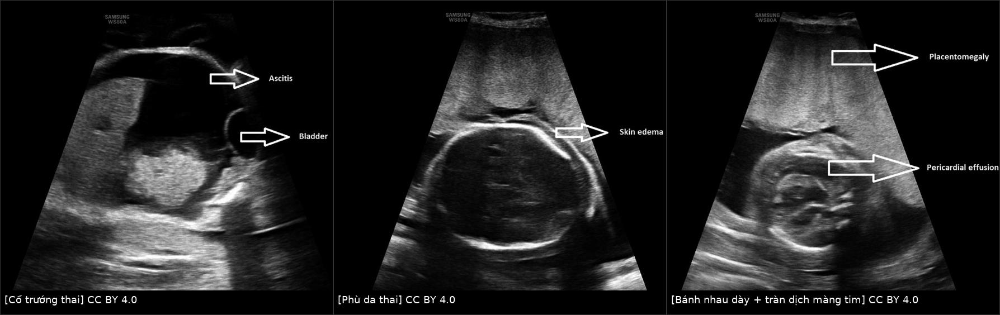
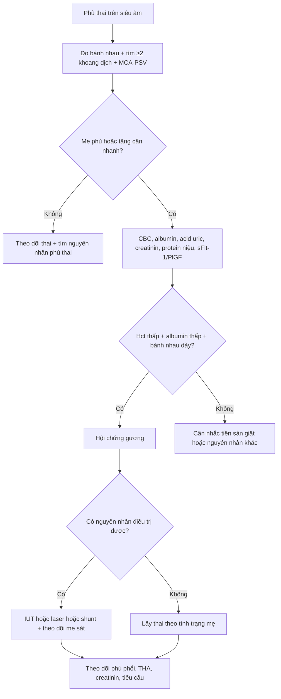
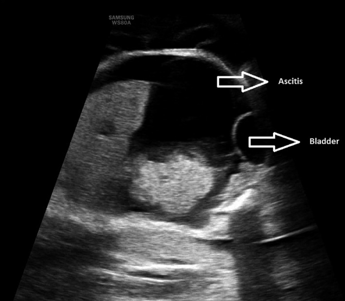
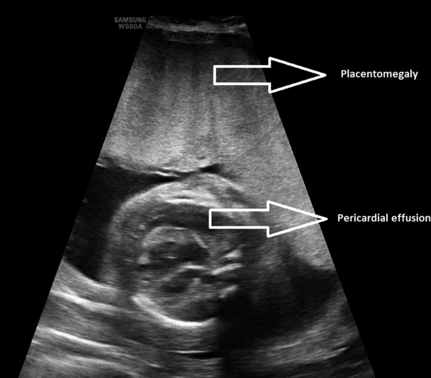
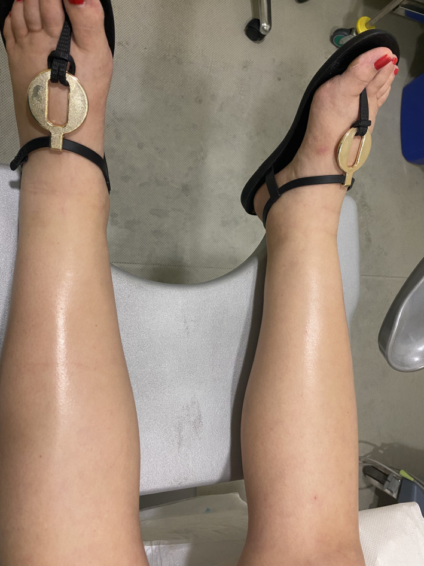

# 1746 — Hội chứng gương do phù thai: phân biệt tiền sản giật và xử trí mẹ / Mirror syndrome (Ballantyne syndrome)

**Tags:** `pattern:thai-phu` `pattern:phu-me` `pattern:banh-nhau-day` `pattern:da-oi` `pattern:thieu-mau-thai` `vung:banh-nhau` `vung:thai-nhi` `vung:tu-cung` `score:sFlt-1-PlGF` `protocol:SA-thai` `protocol:Doppler-mau` `protocol:MRI-thai`
**Mức chắc chắn (certainty):** tổng hợp y văn (literature synthesis) — số liệu từ đoàn hệ 182 ca phù thai (dẫn qua tổng quan PMC13571801), nghiên cứu bệnh–chứng 58.428 ca sinh (PMC8480018), loạt 10 ca/276 thai phù (PMC9574449) và ca nguyên văn dùng cho hình (PMC8850394). Không có RCT; khuyến cáo là tổng hợp ca – đoàn hệ.

## 1. Tổng quan bệnh học – cơ chế hình ảnh

- **Định nghĩa:** hội chứng gương (mirror syndrome, Ballantyne syndrome, "triple edema") là **phù thai + phù bánh nhau + phù mẹ** cùng lúc. Phù thai định nghĩa là **dịch ở ≥ 2 khoang** (phù da **> 5 mm**, cổ trướng, tràn dịch màng phổi, tràn dịch màng tim) (PMC8480018). **Bánh nhau dày** khi **> 40 mm ở tuổi thai ≤ 20 tuần** và **> 60 mm khi ≥ 21 tuần** (PMC9574449; PMC8480018 dùng ngưỡng 40/60 mm theo tam cá nguyệt 2/3).
- **TẠI SAO mẹ "sao chép" thai — bánh nhau là trung tâm:** nhung mao bánh nhau **phù nề** → **thiếu oxy lớp nguyên bào nuôi** → giải phóng **sFlt-1 (sVEGFR-1) và soluble endoglin** vào tuần hoàn mẹ → **rối loạn chức năng nội mô toàn thân** (giống tiền sản giật): tăng tính thấm mao mạch → **phù, tăng cân nhanh, tràn dịch**, tăng huyết áp, protein niệu, tổn thương thận – gan. Vì vậy mẹ **hết phù nhanh sau khi sinh hoặc sau khi phù thai được điều trị** — bằng chứng mạnh nhất cho vai trò bánh nhau.
- **TẠI SAO có "pha loãng máu" (khác tiền sản giật):** thể tích huyết tương mẹ **tăng** do giữ nước + rò mao mạch, trong khi khối hồng cầu không tăng tương ứng, albumin mất vào khoảng kẽ → **Hct giảm, Hb giảm, albumin giảm**. Loạt 10 ca: **Hct trung vị 20% (17–22%)**, **Hb 89 g/L (75–117)**, **albumin 18 g/L (8–29)**; **100% có pha loãng máu** (PMC9574449). Ngược lại tiền sản giật **cô đặc máu** (Hct tăng). Đây là **chốt phân biệt rẻ nhất** trên công thức máu.
- **TẠI SAO acid uric tăng ở cả hai:** tăng sản xuất do mô thiếu máu + giảm bài tiết ở thận; **70% ca gương có acid uric > 300 µmol/L, trung vị 452 µmol/L** — nên **acid uric không phân biệt được**, chỉ dùng để đánh giá độ nặng (PMC9574449).
- **Bánh nhau to = "hyperplacentation":** bánh nhau phù to giải phóng nhiều **hCG**; trong một đoàn hệ, **hCG tăng ở 100% ca gương so với 33% ca chỉ có phù thai**, và **hCG tăng đồng thời với sFlt-1/PlGF** gợi ý gương hơn tiền sản giật (PMC13571801). Một gợi ý mới: **sFlt-1/PlGF < 85** nghiêng về gương vì bánh nhau to còn tiết **PlGF**; tiền sản giật thường **> 85** — nhưng đây là dữ liệu ban đầu, **chưa phải tiêu chuẩn**.
- **Con số phải nhớ:**
  - Phù thai gặp **0,02–0,06% thai kỳ**; hội chứng gương xảy ra ở **5–30%** thai phù (PMC13571801).
  - Tần suất chung **0,024% (14/58.428 ca sinh)**, nhưng **37,8% (14/37) ca phù thai ở tam cá nguyệt 2–3** — nghĩa là khi đã có phù thai, xác suất gương **rất cao** (PMC8480018).
  - Nhóm gương so với phù thai không gương: **tăng cân 9,0 vs 5,5 kg**, **Hb 88 vs 105 g/L**, **albumin 25,8 vs 35,0 g/L**, **bánh nhau dày 85,7% vs 34,8%** (p < 0,05) (PMC8480018).
  - **Yếu tố nguy cơ:** phù thai khởi phát **≥ 24 tuần (OR 15,83; 95% CI 1,56–160,10)** và **bánh nhau dày (OR 8,63; 95% CI 1,29–57,72)** (PMC8480018).
  - **Tăng cân nhanh 1.800 g (800–2.500) trong < 1 tuần** là dấu hiệu lâm sàng rất gợi ý (PMC9574449).

## 2. Mẫu hình + chẩn đoán phân biệt theo nguyên nhân phù thai (gamut)

- **Mẫu hình chung:** thai phụ **tăng cân nhanh, phù toàn thân (mặt, cùng đồ, chi), tiểu ít**, kèm **thai phù** trên siêu âm và **bánh nhau dày**; huyết áp có thể chỉ **tăng nhẹ** hoặc **bình thường**.
- **Gamut theo nguyên nhân phù thai — vì nguyên nhân quyết định "điều trị được hay phải lấy thai":**
  1. **Miễn dịch:** bất đồng Rh, anti-Kell, anti-KPa — **điều trị được bằng truyền máu trong tử cung (IUT)**.
  2. **Nhiễm trùng:** **parvovirus B19** (thiếu máu + suy tim), CMV, coxsackie, giang mai — **B19 điều trị được bằng IUT**.
  3. **Thiếu máu – huyết sắc tố:** **alpha-thalassemia thể Bart's** — nguyên nhân hàng đầu của cả phù thai và gương trong đoàn hệ Trung Quốc (**7/11 ca gương có nguyên nhân rõ**) (PMC8480018).
  4. **Tim mạch:** HLHS, bệnh cơ tim, loạn nhịp — đoàn hệ 182 ca cho thấy **nguyên nhân tim mạch có nguy cơ tiến triển gương cao hơn** nguyên nhân không tim mạch (PMC13571801).
  5. **Bánh nhau – đa thai:** **u máu bánh nhau (chorioangioma)**, **bánh nhau bong**, **TTTS**, **TRAP**, **thai trứng** — u máu bánh nhau điều trị được bằng **laser/RFA** (xem bài 1672).
  6. **Khối u thai:** **u quái cùng cụt** (laser/RFA), **CPAM** (dẫn lưu/shunt).
  7. **Bất thường nhiễm sắc thể/di truyền:** Turner 45,X, trisomy, loạn sản xương, phù bạch mạch bẩm sinh — **không điều trị đặc hiệu**.
  8. **Không rõ nguyên nhân** — vẫn có thể gương; phải loại trừ các nhóm trên trước khi tư vấn.

## 3. Bảng so sánh phân biệt (ma trận đối chiếu)

| Thực thể (entity) | Hình ảnh / xét nghiệm điển hình | Chốt vào (rule-in) | Chốt loại (rule-out) | Gợi ý xác nhận |
|---|---|---|---|---|
| **Hội chứng gương** | **Phù thai ≥ 2 khoang** + **bánh nhau > 40 mm (≤ 20 tuần) / > 60 mm (≥ 21 tuần)** + mẹ phù; **Hct thấp, albumin thấp** | **Bộ ba phù thai – bánh nhau to – phù mẹ**, kèm **pha loãng máu (Hct ↓, albumin ↓)** | **Hct tăng (cô đặc) + phản xạ gân xương tăng** → nghiêng tiền sản giật | Siêu âm thai + bánh nhau; CBC, albumin, sFlt-1/PlGF, hCG |
| **Tiền sản giật** | Thai **chậm tăng trưởng**, Doppler rốn bất thường, **bánh nhau bình thường/giảm**; **Hct tăng**, tiểu cầu giảm | **THA + protein niệu xuất hiện sau 20 tuần**, **tăng phản xạ**, tiểu cầu giảm, **không phù thai** | **Có phù thai + bánh nhau dày** → không được chỉ gọi là tiền sản giật | Huyết áp, protein/creatinin niệu, tiểu cầu, LDH, AST/ALT |
| **Suy tim / bệnh van – cơ tim** | **Phù + khó thở + tĩnh mạch cổ nổi**, tim to, BNP tăng; **không phù thai** | **BNP tăng + siêu âm tim bất thường** | **Siêu âm tim bình thường + có phù thai** → loại | Siêu âm tim, BNP, X-quang ngực |
| **Hội chứng thận nhiễm mỡ / bệnh thận** | **Protein niệu rất cao, albumin rất thấp, phù**, có thể **thrombosis**, **không phù thai** | **Protein niệu > 3,5 g/ngày + albumin < 25 g/L** | **Có phù thai/bánh nhau dày** → nguyên nhân là thai | Protein niệu 24 giờ, albumin, chức năng thận |
| **Phù sinh lý thai kỳ / thiếu máu – giảm albumin khác** | Phù nhẹ hai chi dưới, **tăng cân chậm**, thai và bánh nhau bình thường | **Phù nhẹ + không tăng cân nhanh + thai bình thường** | **Tăng cân > 1.800 g/tuần hoặc phù mặt – cùng đồ** → không còn sinh lý | Theo dõi cân nặng, siêu âm thai, albumin |
| **Bệnh lý huyết khối tĩnh mạch sâu** | Phù **một bên**, đau bắp chân, **siêu âm Doppler tĩnh mạch** | **Phù một bên + Doppler có huyết khối** | **Phù hai bên đối xứng** → loại | Doppler tĩnh mạch chi dưới |

*Ba mặt cắt siêu âm cùng một ca: (1) **cổ trướng** (ascites) cạnh bàng quang thai, (2) **phù da** dày, (3) **bánh nhau dày (placentomegaly)** + **tràn dịch màng tim**. Nguồn: *Clinical Case Reports* 2022 (PMC8850394), CC BY 4.0. Ảnh ghép letterbox, giữ nguyên tỷ lệ.*

## 4. Protocol chụp + xử trí

- **Đánh giá mẹ (mỗi lần khám, có thể mỗi 4 giờ khi nặng):** huyết áp, **cân nặng hằng ngày**, lượng nước tiểu – dịch vào, khám phù (**mặt, cùng đồ, sacrum**), **phản xạ gân xương** (gương: **giảm/bình thường**, tiền sản giật: **tăng**), khó thở/SpO₂.
- **Xét nghiệm mẹ:** CBC (**Hct, Hb, tiểu cầu**), **albumin**, **acid uric**, **creatinin**, **LDH, AST/ALT**, **đông máu**, **protein/creatinin niệu**, nhóm máu – kháng thể, **sFlt-1/PlGF** (nếu có), **β-hCG**.
- **Siêu âm thai (bắt buộc):** xác định **≥ 2 khoang dịch**, đo **độ dày bánh nhau** theo tuổi thai, **AFI**, **MCA-PSV** (thiếu máu: **> 1,5 MoM**), **ống tĩnh mạch (ductus venosus)**, **siêu âm tim thai** nếu nghi tim; tìm **nguyên nhân** (u máu bánh nhau, u quái cùng cụt, CPAM, đa thai).
- **Chẩn đoán nguyên nhân:** kháng thể bất đồng, **parvovirus B19 PCR**, karyotype/microarray, **điện di huyết sắc tố (alpha-thal)**, TORCH theo bối cảnh.
- **Nguyên tắc xử trí:** **điều trị được nguyên nhân thì điều trị thai** — IUT (bất đồng miễn dịch/B19), **laser/RFA** (u máu bánh nhau, u quái cùng cụt), **shunt màng phổi – màng ối** (tràn dịch màng phổi chèn ép). Trong đoàn hệ, **điều trị trong tử cung làm hết phù thai ở 85%** và cải thiện mẹ; **kéo dài thai > 1/3 ca, trung bình 42 ngày** (PMC13571801).
- **Lấy thai khi:** **phù phổi cấp/giảm oxy máu**, THA không kiểm soát, **suy thận tiến triển**, **HELLP/DIC**, **suy tim**, hoặc thai **không còn khả năng điều trị** — bất kể tuổi thai. Nếu mẹ ổn và có nguyên nhân điều trị được → **ưu tiên điều trị thai để kéo dài**.
- **Flowchart:**

- **Sau sinh:** theo dõi **băng huyết (45%)**, **nhập ICU (tới 50%)**, **phù phổi**, **suy tim**, **DIC**; phù và xét nghiệm mẹ thường cải thiện **trung vị 2–13,5 ngày** (PMC13571801). Tư vấn tiên lượng thai rất xấu: **thai lưu 41%** trong 107 thai (Allarakia), **sống 7,7%** (Biswas); loạt 10 ca có **thai lưu 66,7%**, tử vong sơ sinh 25%, **sống 8,3%** (PMC9574449).

## 5. Biến thể bình thường và cạm bẫy

- **Gọi nhầm là tiền sản giật:** gương có thể **không có protein niệu (chỉ 50%)**, **không tăng phản xạ**, và **tiểu cầu có thể bình thường**. Nếu chỉ dùng tiêu chuẩn tiền sản giật, ca gương **bị bỏ sót** và điều trị sai hướng (MgSO₄, hạn chế dịch) trong khi vấn đề là **quá tải tuần hoàn**.
- **Pha loãng ≠ thiếu sắt:** **Hb 89 g/L** trong gương là **pha loãng máu**, truyền sắt/truyền máu không giải quyết; phải đánh giá **Hct và albumin cùng lúc**.
- **Bánh nhau dày theo tuổi thai:** ngưỡng **40 mm trước 20 tuần, 60 mm sau 21 tuần** — dùng một ngưỡng duy nhất sẽ **bỏ sót** hoặc **gọi nhầm**.
- **Gương có thể xuất hiện SAU khi điều trị thai thành công:** đã có ca khởi phát **tới 7 ngày sau khi điều trị tràn dịch màng phổi thai**, và **≈ 66% ca được chẩn đoán chỉ sau khi điều trị thai** (PMC13571801) → **không được ngừng theo dõi mẹ** vì "thai đã ổn".
- **sFlt-1/PlGF không phải chốt tuyệt đối:** **< 85** nghiêng gương, nhưng có chồng lấp; **không dùng một mình** để quyết định lấy thai.
- **Phù sinh lý thai kỳ:** phù nhẹ hai chi dưới, tăng cân chậm, thai và bánh nhau bình thường — **đừng chẩn đoán gương khi thiếu phù thai**.
- **Thai phù không rõ nguyên nhân vẫn có thể gương:** trong loạt 10 ca, **50% do bất thường cấu trúc** (u quái cùng cụt, CPAM, HLHS, cystic hygroma), 50% do miễn dịch/nhiễm/đa thai/thai trứng — **không có nguyên nhân "vô căn" nào được phép dừng lại** khi mẹ đã có dấu hiệu.

## 6. Tự lượng giá — Blind Quiz

**Ca 1 — Thai 29 tuần, siêu âm bụng thai:**

- Gợi ý lâm sàng: mẹ tăng 2 kg trong 5 ngày, phù mặt và hai chân.
- Câu hỏi: Dịch nằm ở khoang nào? Đây có phải phù thai đơn thuần? Cần đo gì ở bánh nhau?

<b>Bấm để hiện đáp án (findings + chẩn đoán)</b>

- Dấu hiệu: **cổ trướng (ascites)** rõ, cạnh **bàng quang thai**; phù da đi kèm (ảnh sau).
- Chẩn đoán: **phù thai** — cần **≥ 2 khoang** để gọi phù thai; kèm phù mẹ và bánh nhau dày là **hội chứng gương**.
- Việc phải làm: đo **độ dày bánh nhau** (ngưỡng **> 60 mm** ở 29 tuần), **MCA-PSV** (thiếu máu nếu **> 1,5 MoM**), **AFI**, siêu âm tim thai; xét nghiệm mẹ **Hct, albumin, acid uric, protein niệu**.
- Nguồn: *Clinical Case Reports* 2022 (PMC8850394), Fig. 1. CC BY 4.0.

**Ca 2 — Cùng ca, mặt cắt bánh nhau và tim thai:**

- Câu hỏi: Hai dấu hiệu trong ảnh? Dấu hiệu nào quyết định "hyperplacentation"? Vì sao bánh nhau to lại gây phù mẹ?

<b>Bấm để hiện đáp án</b>

- Dấu hiệu: **bánh nhau dày (placentomegaly)** và **tràn dịch màng tim (pericardial effusion)**.
- Bánh nhau dày là chốt của **hyperplacentation** — nhung mao phù tiết **sFlt-1/endoglin** và **hCG** vào tuần hoàn mẹ → rối loạn nội mô → phù, tăng huyết áp, pha loãng máu.
- Vì sao quan trọng: bánh nhau dày là **yếu tố nguy cơ độc lập** của gương (**OR 8,63**), và là dấu hiệu **điều trị được** nếu nguyên nhân là u máu bánh nhau.
- Nguồn: *Clinical Case Reports* 2022 (PMC8850394), Fig. 3. CC BY 4.0.

**Ca 3 — Mẹ của thai nhi trên, khám lâm sàng:**

- Câu hỏi: Mô tả dấu hiệu? Phân biệt với tiền sản giật bằng 3 xét nghiệm nào? Khi nào phải lấy thai?

<b>Bấm để hiện đáp án</b>

- Dấu hiệu: **phù hai chi dưới, da căng bóng** (pitting edema), đối xứng — phù toàn thân của hội chứng gương.
- Ba xét nghiệm phân biệt: **Hct (giảm = pha loãng, gương)**, **albumin (giảm mạnh)**, **tiểu cầu/phản xạ (tiền sản giật: tiểu cầu giảm, phản xạ tăng)**; thêm **sFlt-1/PlGF** (< 85 nghiêng gương).
- Lấy thai khi: **phù phổi, giảm oxy, THA không kiểm soát, suy thận, HELLP/DIC, suy tim**; nếu mẹ ổn và có nguyên nhân điều trị được → **điều trị thai trước** (85% hết phù thai, kéo dài trung bình 42 ngày).
- Nguồn: *Clinical Case Reports* 2022 (PMC8850394), Fig. 4. CC BY 4.0.

## Bài liên quan chéo
- [1672 – U máu bánh nhau lớn](../1672-u-mau-banh-nhau/lesson.md)
- [1673 – Truyền máu trong tử cung](../1673-truyen-mau-trong-tu-cung/lesson.md)
- [698 – Nang phổi bẩm sinh CPAM/CCAM](../698-nang-phoi-bam-sinh-cpam-ccam/lesson.md)
- [680 – U quái cùng cụt ở trẻ](../680-u-quai-cung-cut-o-tre/lesson.md)
- [1744 – Bí tiểu cấp ở bé gái](../1744-bi-tieu-cap-be-gai/lesson.md)
- [500 – Tổng quan Vú & Sản phụ khoa](../500-tong-quan-vu-san-phu-khoa/lesson.md)

## Ảnh
- `images/1746_hoi-chung-guong_US-thai-PMC8850394-F1.jpg` — cổ trướng thai, CC BY 4.0.
- `images/1746_hoi-chung-guong_US-thai-PMC8850394-F2.jpg` — phù da thai, CC BY 4.0.
- `images/1746_hoi-chung-guong_US-thai-PMC8850394-F3.jpg` — bánh nhau dày + tràn dịch màng tim, CC BY 4.0.
- `images/1746_hoi-chung-guong_me-PMC8850394-F4.jpg` — phù chi dưới của mẹ, CC BY 4.0.
- `images/composite_1746_phanh-thai.jpg` — ảnh ghép 3 mặt cắt thai, CC BY 4.0.
- Nguồn + giấy phép từng ảnh: `images/CREDITS.md`.

> Không dùng để chẩn đoán độc lập khi chưa có người hướng dẫn.
