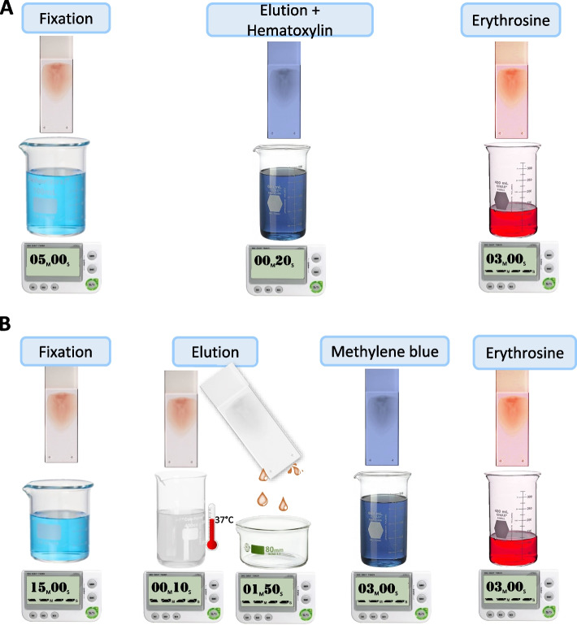
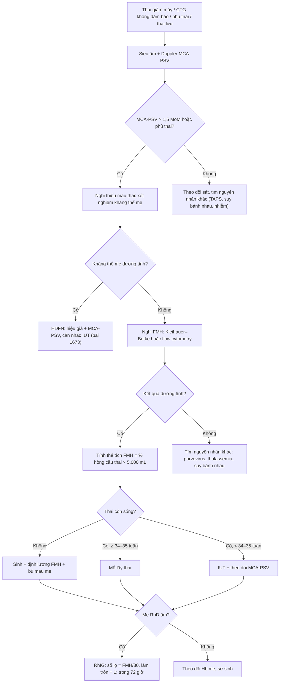
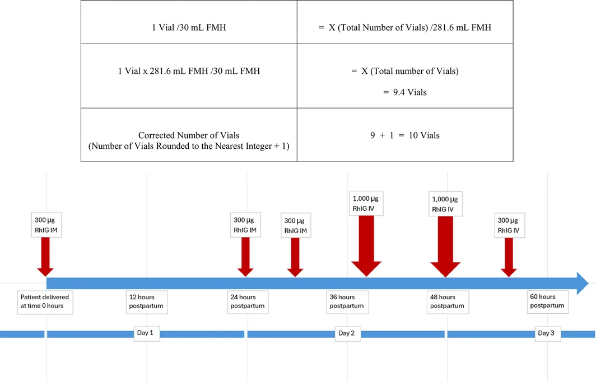
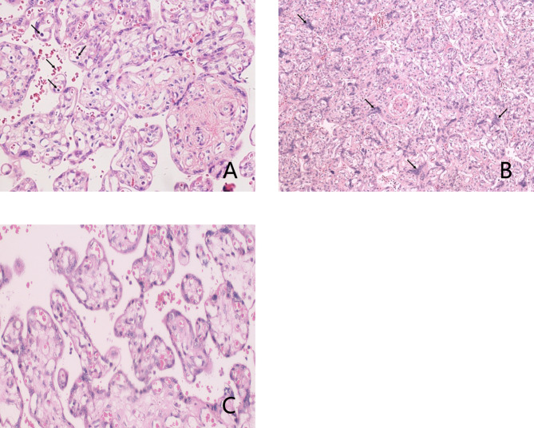
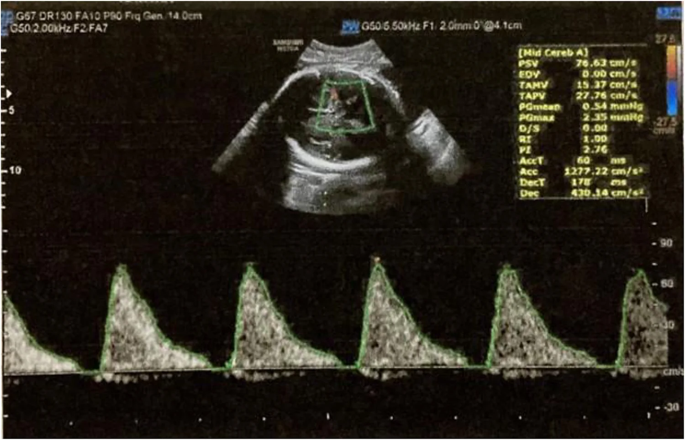

# 1747 — Xuất huyết thai–mẹ (FMH): Kleihauer–Betke, liều anti-D và khi nào truyền máu thai / Fetomaternal hemorrhage

**Tags:** `pattern:thieu-mau-thai` `pattern:thai-phu` `pattern:giam-may-thai` `pattern:thai-luu` `vung:thai-nhi` `vung:banh-nhau` `score:MCA-PSV` `protocol:Kleihauer-Betke` `protocol:flow-cytometry` `protocol:tiem-anti-D`
**Mức chắc chắn (certainty):** tổng hợp y văn (literature synthesis) — định nghĩa, tần suất và bệnh học bánh nhau từ loạt 2 ca + tổng quan (PMC10360317, CC BY); ca nguyên văn FMH khối lượng lớn với liều RhIG và theo dõi kháng thể 10 tháng (PMC13674137, CC BY-NC-ND); kỹ thuật và ngưỡng Kleihauer–Betke (PMC10823721, CC BY); ngưỡng MCA-PSV và truyền máu trong tử cung (PMC13613763, CC BY — ca HDFN do anti-D, dùng cho **dấu hiệu Doppler**, không phải ca FMH).

## 1. Tổng quan bệnh học – cơ chế hình ảnh

- **Định nghĩa:** **xuất huyết thai–mẹ (fetomaternal hemorrhage, FMH)** là máu thai đi qua **hàng rào bánh nhau** vào tuần hoàn mẹ. Lượng nhỏ gặp ở **gần như mọi thai kỳ** và không triệu chứng; chỉ khi mất **> 20% thể tích máu thai** (hoặc **> 80 mL** theo một số nguồn) mới thành **FMH khối lượng lớn (massive FMH)** và gây bệnh (PMC13674137, PMC10360317).
- **Con số phải nhớ:**
  - FMH mức **trung bình–nặng: 1–3/1.000 trẻ sinh sống**; **4,1% các ca thai lưu trước sinh** do FMH; đa số FMH khối lượng lớn xảy ra ở **ba tháng giữa và ba tháng cuối** (PMC10360317).
  - Ca nguyên văn (PMC13674137): thai lưu **40 tuần 2 ngày**, Kleihauer–Betke **5,4–6,0%** → tính ra **281,6 mL** máu thai mất, trong khi **tổng thể tích máu thai ước tính 293 mL** — tức thai mất **~96%** thể tích máu.
- **TẠI SAO thai chịu đựng kém:** thai không có dự trữ; mất máu cấp → **giảm thể tích tuần hoàn → giảm cung lượng tim → thiếu máu mô**; mất máu mạn → **thiếu máu → tăng cung lượng, giảm độ quánh** → **tăng vận tốc đỉnh động mạch não giữa (MCA-PSV)**. Đây là lý do **siêu âm Doppler là công cụ theo dõi**, không phải xét nghiệm máu thai.
- **TẠI SAO MCA-PSV tăng khi thiếu máu:** thiếu máu làm **giảm độ quánh máu và tăng cung lượng tim**, nên vận tốc dòng não tăng; mối tương quan rõ khi thiếu máu **trung bình–nặng**, còn ở thiếu máu nhẹ thì **không tương quan** (PMC13613763). Ngưỡng dùng trong thực hành: **MCA-PSV > 1,5 MoM (bội số trung vị)** dự báo thiếu máu thai trung bình–nặng; tiêu chuẩn kèm theo là **hematocrit < 30%** (PMC13613763).
- **TẠI SAO mẹ cũng bị ảnh hưởng:** mẹ mất máu → **thiếu máu, hạ huyết áp**; và nếu mẹ **RhD âm** thì máu thai RhD dương gây **miễn dịch hoá (alloimmunization)** → **bệnh tan máu thai–sơ sinh (HDFN)** ở lần mang thai sau. Vì vậy FMH là bệnh của **hai bệnh nhân**, và **liều anti-D phụ thuộc thể tích máu thai đã mất**.
- **Cơ chế hình ảnh/bệnh học bánh nhau:** tổn thương hàng rào bánh nhau → **nhồi máu mao mạch, huyết khối khoảng gian nhung mao (intervillous thrombus), tăng hồng cầu có nhân (nucleated RBC), tăng nút hợp bào (syncytial knots), nhợt nhu mô, phù nhung mao** — các dấu hiệu này **phù hợp với thiếu máu thai** chứ không đặc hiệu cho FMH (PMC10360317). Trên lâm sàng, **bánh nhau "bình thường" không loại trừ FMH**.
- **Vì sao khó chẩn đoán trước sinh:** triệu chứng **mờ nhạt** — **giảm máy thai (decreased fetal movements)**, **nhịp tim thai không đảm bảo (non-reassuring CTG)**, thai chậm tăng trưởng; nhiều ca chỉ được nhận ra khi **thai lưu** hoặc khi mổ lấy thai vì suy thai (PMC10360317, PMC13674137).

## 2. Mẫu hình + chẩn đoán phân biệt (Gamut)

- **Mẫu hình 1 — thai lưu/suy thai cấp:** thai đủ tháng, **giảm máy thai đột ngột**, CTG bất thường, siêu âm có thể **bình thường** hoặc có **phù thai**; mẹ **không có kháng thể**.
- **Mẫu hình 2 — thiếu máu thai mạn:** **phù thai (hydrops)**, **MCA-PSV > 1,5 MoM**, đa ối hoặc thiểu ối, thai chậm tăng trưởng; mẹ **không có kháng thể**.
- **Mẫu hình 3 — sơ sinh thiếu máu:** trẻ sinh ra **nhợt, Hb thấp, hồng cầu lưới tăng**, có thể **suy tuần hoàn**; mẹ **Kleihauer dương tính**.
- **Gamut "thiếu máu thai KHÔNG do kháng thể" — nhớ "FMH – PARVO – TAPS – THAL – SUY BÁNH NHAU":**
  1. **F**MH (xuất huyết thai–mẹ);
  2. **P**arvovirus B19 (ức chế tủy xương, phù thai, **có thể có IgM/IgG**);
  3. **TAPS** (hội chứng đa hồng cầu–thiếu máu ở thai đôi, **đa hồng cầu một thai – thiếu máu thai kia**, MCA-PSV lệch nhau);
  4. **T**halassemia/hemoglobin bệnh lý thai (thiếu máu mạn, **MCV thấp**);
  5. **Suy bánh nhau** (tiền sản giật, thai chậm tăng trưởng, **Doppler động mạch rốn bất thường**).
- **Nhóm CÓ kháng thể (phải loại trừ trước):** **HDFN do anti-D, anti-Kell, anti-c** — kháng thể mẹ dương tính, hiệu giá tăng; **đây là chẩn đoán khác, không phải FMH**, dù cùng biểu hiện thiếu máu thai. Ca minh hoạ Doppler trong bài (PMC13613763) chính là **HDFN do anti-D hiệu giá 1:256**, dùng để chỉ **dấu hiệu MCA-PSV**, không phải ca FMH.
- **Bảng "3 câu hỏi trước khi truyền máu thai":** (1) mẹ có kháng thể không? (2) Kleihauer/flow có dương tính không? (3) MCA-PSV có > 1,5 MoM và thai còn sống không? Trả lời xong mới quyết định **sinh ngay** hay **truyền trong tử cung**.

## 3. Bảng so sánh phân biệt (ma trận đối chiếu)

| Thực thể (entity) | Hình ảnh / xét nghiệm điển hình | Chốt vào (rule-in) | Chốt loại (rule-out) | Gợi ý xác nhận |
|---|---|---|---|---|
| **FMH** | Thai lưu/suy thai, **phù thai**, **MCA-PSV > 1,5 MoM**; **Kleihauer–Betke dương tính**, mẹ **không có kháng thể** | **Kleihauer/flow dương tính + kháng thể mẹ âm tính** | Kháng thể mẹ dương tính, hiệu giá tăng → nghĩ HDFN, không phải FMH | Kleihauer–Betke (ngưỡng **5 hồng cầu thai/10.000 hồng cầu mẹ**) hoặc **flow cytometry**; bệnh học bánh nhau |
| **HDFN (anti-D, anti-Kell…)** | Phù thai, thiếu máu, **MCA-PSV tăng**; **Coombs gián tiếp dương tính**, hiệu giá tăng theo tuần | **Kháng thể mẹ dương tính + hiệu giá tăng + MCA-PSV > 1,5 MoM** | Kháng thể âm tính nhiều lần → không nghĩ HDFN | Hiệu giá anti-D mỗi 2–4 tuần; MCA-PSV; nước ối (ΔOD450, ít dùng) |
| **Parvovirus B19** | Phù thai, **thiếu máu**, có thể **tràn dịch đa màng**, thai chậm tăng trưởng | **IgM/IgG B19 dương tính + phù thai** | Không có bằng chứng nhiễm + Kleihauer dương tính → FMH | Serology mẹ; PCR dịch ối; siêu âm tim thai |
| **TAPS** | Thai đôi: **một thai đa hồng cầu (MCA-PSV thấp), một thiếu máu (MCA-PSV cao)**, **không thiểu ối–đa ối** như TTTS | **Chênh MCA-PSV giữa hai thai + màng ghép mỏng** | Một thai đơn + Kleihauer dương → không phải TAPS | MCA-PSV hai thai; theo dõi 1–2 tuần/lần |
| **Suy bánh nhau** | Thai chậm tăng trưởng, **Doppler động mạch rốn tăng trở kháng**, ối ít, tiền sản giật | **Doppler rốn bất thường + tăng huyết áp mẹ** | Doppler rốn bình thường + Kleihauer dương → FMH | Doppler rốn–não; siêu âm tăng trưởng |
| **Thalassemia thai** | Thiếu máu mạn, **MCV thấp**, phù thai muộn | **MCV thấp + bất thường huyết sắc tố** | MCV bình thường + Kleihauer dương → FMH | Điện di huyết sắc tố; di truyền |

*Sơ đồ hai quy trình nhuộm Kleihauer–Betke; kỹ thuật mới làm giảm dương tính giả ≥ 6 lần so với Shepard. Nguồn: BMC Pregnancy Childbirth 2024 (PMC10823721), CC BY 4.0.*

## 4. Protocol + ngưỡng + sơ đồ xử trí

### 4.1 Xét nghiệm định lượng máu thai trong tuần hoàn mẹ

- **Kleihauer–Betke (KBT, nhuộm acid-elution):** hồng cầu thai chứa **HbF** kháng acid → nhuộm đậm; hồng cầu mẹ bị rửa thành **"bóng ma" (ghost cells)**. **Ngưỡng dương tính dùng trong nghiên cứu: 5 hồng cầu thai/10.000 hồng cầu mẹ (0,05%)** (PMC10823721).
- **Tính thể tích:** `thể tích FMH (mL) = % hồng cầu thai × thể tích máu mẹ` (quy ước **5.000 mL** cho mẹ trưởng thành). Ca PMC13674137: **5,4–6,0% × 5.000 ≈ 270–300 mL**, khớp với con số **281,6 mL** đã báo cáo.
- **Dương tính giả — bắt buộc loại trừ trước khi kết luận:** **tăng HbF bẩm sinh/di truyền (HPFH)**, **bệnh huyết sắc tố** (hồng cầu hình liềm, thalassemia), một số trạng thái tủy (đã báo cáo ở bệnh nhân lui bệnh bạch cầu); **truyền máu thai trước đó** cũng làm KBT không còn giá trị (PMC13674137, PMC10823721).
- **Flow cytometry** (đếm hồng cầu HbF bằng kháng thể) **chính xác hơn KBT** và là phương pháp được khuyến nghị khi cần quyết định liều anti-D lớn (PMC13674137).

### 4.2 Liều anti-D (RhIG) — công thức và thời điểm

- **Quy đổi chuẩn:** **300 µg (1.500 IU) RhIG trung hoà 15 mL hồng cầu thai = 30 mL máu thai toàn phần**; **AABB**: `số lọ = thể tích FMH/30`, **làm tròn lên rồi cộng thêm 1 lọ** để dự phòng (PMC13674137).
- **Ca minh hoạ:** FMH **281,6 mL** → 281,6/30 = **9,4** → làm tròn **9** + **1** = **10 lọ × 300 µg = 3.000 µg**; bệnh nhân thực nhận **3.200 µg** (3 lọ IM 300 µg + 2 lọ IV 1.000 µg + 1 lọ IV 300 µg) trong **3 ngày (56 giờ)** (PMC13674137).
- **Thời điểm:** anti-D dự phòng **trong 72 giờ** sau sinh/thủ thuật; nếu thể tích lớn thì **chia nhiều liều** và theo dõi; **không chờ kết quả KBT** nếu đã có chỉ định cấp cứu.
- **Sai số thực hành:** trong khảo sát năng lực xét nghiệm, **2–9% phòng xét nghiệm khuyến nghị liều THẤP hơn** liều AABB tính theo thể tích FMH — nên **tự tính lại** thay vì tin tuyệt đối vào con số của lab (PMC13674137).

### 4.3 Theo dõi thai và xử trí

- **MCA-PSV**: đo ở **đoạn gần động mạch não giữa, góc 0°** so với dòng chảy; **> 1,5 MoM** = thiếu máu trung bình–nặng (PMC13613763).
- **Thai còn sống, ≥ 34–35 tuần:** **mổ lấy thai** là lựa chọn hàng đầu (thai đã đủ trưởng thành).
- **Thai còn sống, < 34–35 tuần:** **truyền máu trong tử cung (intrauterine transfusion, IUT)** là nền tảng; lần truyền cuối thường **không quá 34–35 tuần** (PMC13613763); theo dõi sau truyền bằng MCA-PSV.
- **Thai đã lưu:** sinh (đa số khởi phát chuyển dạ), **định lượng FMH để tính anti-D**, **theo dõi Hb mẹ** và bù thể tích nếu cần.
- **Sơ sinh:** khám thiếu máu, **Hb, hồng cầu lưới, bilirubin**; truyền máu nếu thiếu máu nặng; theo dõi thần kinh (ca trong y văn có tổn thương não do thiếu máu nặng — PMC13674137 dẫn lại).
- **Sơ đồ:**

*Ví dụ 281,6 mL → 9,4 → 9 + 1 = 10 lọ. Nguồn: Transfusion 2026 (PMC13674137), CC BY-NC-ND 4.0 — **nguyên bản, không crop/ghép**.*

### 4.4 Bệnh học bánh nhau — khi nào cần gửi giải phẫu bệnh

*H&E, độ phóng đại 200×. Nguồn: BMC Pregnancy Childbirth 2023 (PMC10360317), CC BY 4.0.*

- Gửi bánh nhau **mọi ca thai lưu/suy thai không rõ nguyên nhân**: tìm **huyết khối gian nhung mao, nhồi máu, tăng hồng cầu có nhân, tăng nút hợp bào, nhợt nhu mô** — các dấu hiệu **ủng hộ thiếu máu thai**, giúp phân biệt FMH với nguyên nhân khác (PMC10360317).
- Bánh nhau **không có tổn thương** vẫn **không loại trừ** FMH: FMH có thể xảy ra qua bánh nhau "bình thường" về đại thể.

## 5. Biến thể bình thường & cạm bẫy

- **KBT dương tính nhẹ ở người có HPFH/bệnh huyết sắc tố** → đừng vội truyền anti-D liều lớn: hỏi tiền sử, làm **điện di huyết sắc tố**, ưu tiên **flow cytometry**.
- **KBT âm tính không loại trừ FMH** nếu: lấy máu **quá muộn** (hồng cầu thai đã bị đào thải), **truyền máu thai trước đó**, hoặc **mẫu bị lỗi kỹ thuật**; khi lâm sàng mạnh, **làm lại + flow**.
- **"Kháng thể anti-D dương tính sau 6 tháng" ≠ miễn dịch hoá:** sau liều RhIG rất lớn, **anti-D thụ động tồn tại nhiều tháng** (ca gốc dương đến **6 tháng**, còn nghi ngờ ở **8 tháng**, âm ở **10 tháng**) — gọi nhầm là alloimmunization sẽ dẫn tới tư vấn sai cho lần mang thai sau (PMC13674137).
- **Tính liều sai vì quên cộng 1 lọ** hoặc **nhầm mL máu toàn phần với mL hồng cầu** (300 µg cho **30 mL máu toàn phần** = 15 mL hồng cầu) — sai một bậc là thiếu liều gấp đôi.
- **Thai lưu "không rõ nguyên nhân" ở tam cá nguyệt 3**: luôn nghĩ FMH; **không có kháng thể** không có nghĩa là không thiếu máu.
- **FMH tái phát** đã được báo cáo; thai kỳ sau cần **theo dõi MCA-PSV** sớm hơn và **KBT ngay khi có triệu chứng**.
- **Cạm bẫy "bánh nhau bình thường"**: đừng bỏ gửi giải phẫu bệnh vì đại thể bình thường.

## 6. Tự lượng giá — Blind Quiz

**Ca 1 — Thai 32 tuần, mẹ có kháng thể anti-D hiệu giá 1:256. Nhìn phổ Doppler, đọc trước khi mở đáp án.**

- Hỏi: con số 76,6 cm/s tương ứng bao nhiêu MoM? Ngưỡng can thiệp là bao nhiêu? Bước tiếp theo nếu thai 32 tuần và chưa có phù?

<b>Bấm để hiện đáp án</b>

- **76,6 cm/s = 1,69 MoM** → **thiếu máu thai nặng** (ngưỡng **> 1,5 MoM**).
- Thai 32 tuần (< 34–35 tuần) → **truyền máu trong tử cung**, không chờ đến đủ tháng; ca gốc truyền lúc **33 tuần**, cân nặng ước tính **1.955 g**.
- Lưu ý phân biệt: đây là ca **HDFN do anti-D** (kháng thể dương tính) — **không phải FMH**; nhưng **dấu hiệu MCA-PSV và ngưỡng 1,5 MoM dùng chung**.
- Nguồn: Qatar Med J 2026 (PMC13613763), CC BY 4.0.

**Ca 2 — Sản phụ 40 tuần 2 ngày, thai lưu, mẹ O RhD âm đã tiêm anti-D lúc 26 tuần. KBT 5,4–6,0%.**

- Hỏi: thể tích máu thai mất ước tính? Cần bao nhiêu lọ RhIG theo AABB? Điều gì giải thích anti-D còn dương tính sau 6 tháng?

<b>Bấm để hiện đáp án</b>

- **5,4–6,0% × 5.000 mL ≈ 270–300 mL**, báo cáo chính thức **281,6 mL** — gần bằng **toàn bộ thể tích máu thai (293 mL)**.
- AABB: **281,6/30 = 9,4 → 9 + 1 = 10 lọ × 300 µg = 3.000 µg**; ca gốc nhận **3.200 µg** trong 3 ngày.
- Anti-D dương tính kéo dài là **kháng thể thụ động** từ liều RhIG lớn, **không phải alloimmunization**; ở ca gốc, anti-D âm lại lúc **10 tháng** và lần mang thai sau sinh con khoẻ.
- Nguồn: Transfusion 2026 (PMC13674137), CC BY-NC-ND 4.0 (ảnh KBT minh hoạ từ PMC10823721, CC BY 4.0).

**Ca 3 — Thai lưu đủ tháng, bánh nhau đại thể bình thường. Nhìn tiêu bản, mô tả trước.**

- Hỏi: ba dấu hiệu vi thể nào ủng hộ thiếu máu thai? Chúng có đặc hiệu cho FMH không? Còn thiếu xét nghiệm nào để chốt nguyên nhân?

<b>Bấm để hiện đáp án</b>

- **Tăng hồng cầu có nhân (nRBC) trong lòng mạch và khoảng gian nhung mao**, **tăng nút hợp bào (syncytial knots)**, **nhợt nhu mô/phù nhung mao** — phù hợp **thiếu máu thai** nhưng **không đặc hiệu** cho FMH (gặp cả trong thiếu máu do nguyên nhân khác).
- Cần **Kleihauer–Betke/flow cytometry của mẹ** để chốt FMH; kèm **kháng thể mẹ** để loại HDFN.
- Nguồn: BMC Pregnancy Childbirth 2023 (PMC10360317), CC BY 4.0.

## Bài liên quan chéo
- [1673 – Truyền máu trong tử cung](../1673-truyen-mau-trong-tu-cung/lesson.md) (kỹ thuật, thể tích, biến chứng IUT)
- [1672 – U máu bánh nhau lớn](../1672-u-mau-banh-nhau/lesson.md) (nguyên nhân bánh nhau gây thiếu máu/phù thai)
- [1746 – Hội chứng gương do phù thai](../1746-hoi-chung-guong/lesson.md) (mẹ phù do phù thai — cùng cơ chế bánh nhau)
- [1637 – TAPS sau laser TTTS](../1637-taps-sau-laser-ttts/lesson.md) (MCA-PSV lệch giữa hai thai — phân biệt với FMH)
- [500 – Tổng quan Vú & Sản phụ khoa](../500-tong-quan-vu-san-phu-khoa/lesson.md)

> Không dùng để chẩn đoán độc lập khi chưa có người hướng dẫn.
