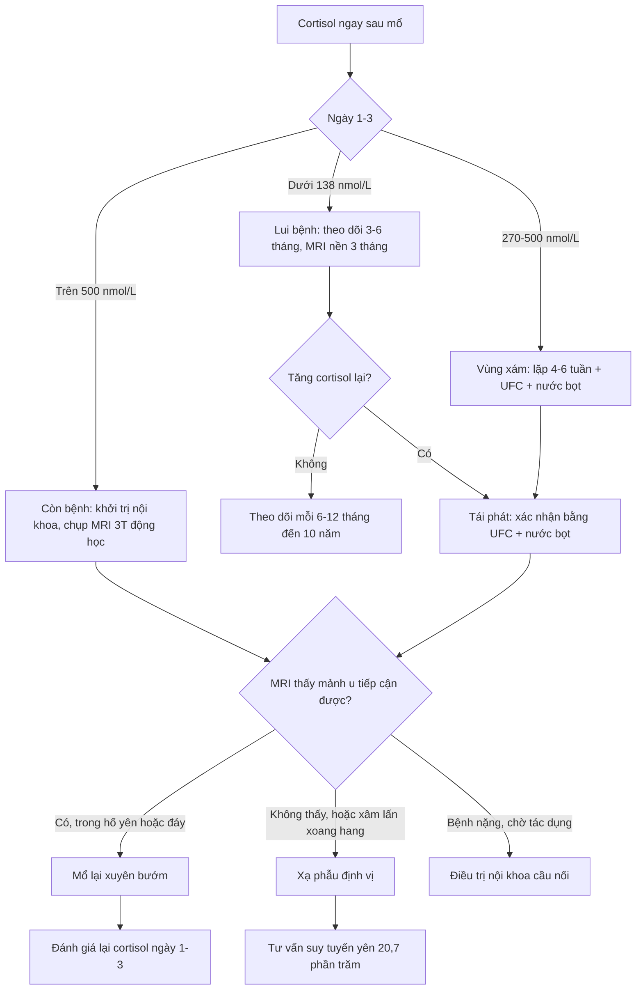
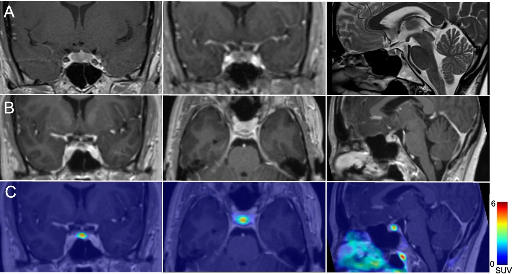
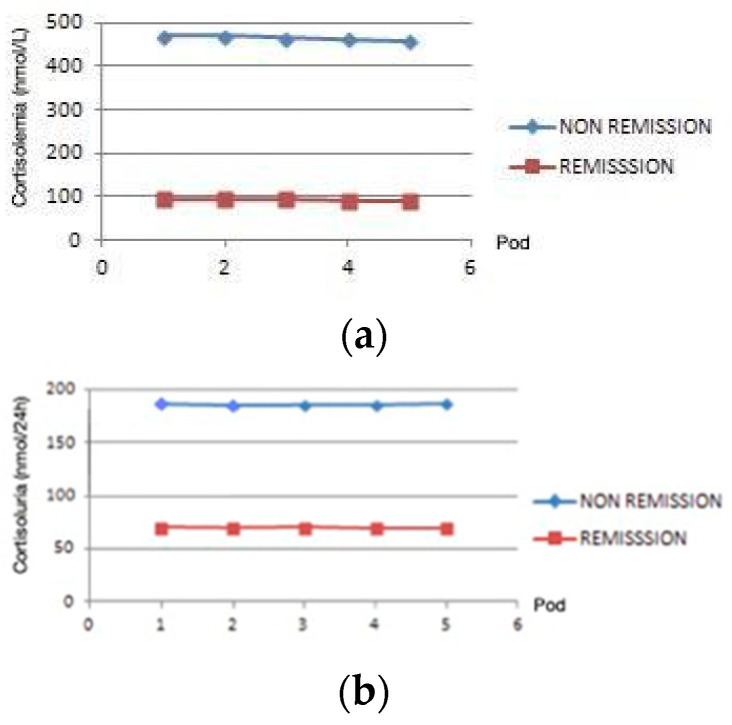
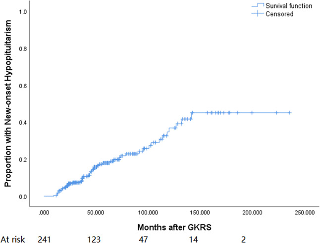

# 1748 — Cushing tái phát sau mổ xuyên bướm: cortisol ngày 1–3, MRI sau mổ đọc thế nào, và chọn mổ lại hay xạ phẫu

**Tags:** `pattern:cushing` `pattern:tai-phat` `pattern:microadenoma-tuyen-yen` `vung:tuyen-yen` `vung:ho-yen` `protocol:MRI-3T-dong-hoc` `protocol:BIPSS` `score:cortisol-ngay-1-3`
**Mức chắc chắn (certainty):** tổng hợp y văn (literature synthesis) — ghép **đoàn hệ 50 ca mổ nội soi xuyên bướm** (Medicina 2025, PMCID **PMC12193485**, CC BY), **nghiên cứu tiến cứu 33 ca với cortisol ngày 1–5** (Healthcare 2024, PMCID **PMC11430948**, CC BY), **202 ca Cushing theo nguyên nhân** (Front Endocrinol 2024, PMCID **PMC10897300**, CC BY), **hồi phục chức năng thượng thận 174 ca** (PMC12007880, CC BY-NC), **suy tuyến yên sau xạ phẫu 241 ca** (BMC Cancer 2024, PMCID **PMC11301991**, CC BY-NC-ND) và **hình ảnh MRI động học u corticotroph** (Rev Endocr Metab Disord 2026, PMCID **PMC13616001**, CC BY). Không có ca do nhóm tự chụp.

> **Kịch bản thực hành (ghép từ các đoàn hệ dưới đây, không phải ca nguyên văn):** nữ **38 tuổi**, **Cushing do u tuyến yên** đã mổ xuyên bướm **4 năm trước**, cortisol hậu phẫu từng xuống **60 nmol/L** và phải uống hydrocortisone **8 tháng**; nay tăng cân lại, mặt tròn, huyết áp khó kiểm soát. Câu hỏi: **có thật là tái phát không, đọc MRI sau mổ thế nào, và nếu tái phát thì mổ lại hay xạ phẫu?**
> Bài chốt **ba quyết định**: **(1) chẩn đoán tái phát bằng đường cong cortisol – không bằng một lần xét nghiệm: cortisol ngày 1–3 < 138 nmol/L là lui bệnh, > 500 nmol/L là còn bệnh, khoảng giữa phải chờ và lặp; (2) MRI sau mổ chỉ đáng tin từ 3 tháng vì mô sẹo và vật liệu cầm máu đều ngấm thuốc/tăng tín hiệu T1; (3) mổ lại khi thấy mảnh u còn lại còn tiếp cận được, xạ phẫu khi không thấy u hoặc u xâm lấn xoang hang — và phải tư vấn trước nguy cơ suy tuyến yên 20,7%.** Nối [1696 – Bệnh Cushing do u tuyến yên](../1696-benh-cushing-u-tuyen-yen/lesson.md), [1709 – ACTH lạc chỗ](../1709-acth-lac-cho-an/lesson.md), [1700 – Cushing chu kỳ](../1700-cushing-chu-ky/lesson.md), [1710 – Đái tháo nhạt trung ương sau mổ tuyến yên](../1710-dai-thao-nhat-trung-uong-sau-mo-tuyen-yen/lesson.md).

## 1. Tổng quan bệnh học – cơ chế hình ảnh: vì sao "lui bệnh" và "khỏi" là hai chuyện khác nhau

- **Tần suất tái phát (recurrence):** khoảng **một phần tư** bệnh nhân Cushing đã lui bệnh sau mổ sẽ tái phát; trong đoàn hệ **202 ca** Cushing nội sinh, tỉ lệ tái phát chung của u tuyến yên và u vỏ thượng thận là **25,7%** (PMC10897300). Ở đoàn hệ tiến cứu **33 ca**, lui bệnh sớm **81,2%**, trong số lui bệnh sớm **92%** duy trì lui bệnh và **7,7%** tái phát trong **81,7 tháng** (PMC11430948) — nghĩa là **tỉ lệ tái phát phụ thuộc thời gian theo dõi**, không phải một con số cố định.
- **Ai dễ tái phát:** u **≥ 1 cm** (macroadenoma), **xâm lấn xoang hang** (Knosp cao, đặc biệt **thành trong xoang hang**), **cortisol hậu phẫu không xuống thấp**, **tuổi < 50**, bệnh cảnh **chu kỳ**, và mô học **Crooke cell** hoặc **USP8** đột biến (PMC10897300, PMC12193485). Điểm chung: **còn tế bào u** — dù không thấy trên MRI.
- **TẠI SAO cortisol hậu phẫu là xét nghiệm tốt nhất:** trong Cushing, trục hạ đồi–yên–thượng thận bị **ức chế kéo dài** bởi cortisol ngoại sinh từ chính u; khi **cắt hết u**, tuyến yên bình thường **chưa kịp hồi phục** → cortisol máu **tụt**. Vì vậy **cortisol sáng ngày 1–3** phản ánh **mức độ cắt hết u**, không phản ánh chức năng tuyến yên.
- **Ngưỡng định lượng (bắt buộc thuộc):**
  - **< 138 nmol/L (< 5 µg/dL)** hoặc **UFC < 28–56 nmol/24 h (< 10–20 µg/24 h)** = **lui bệnh** theo hướng dẫn 2015 (PMC12193485).
  - **135 nmol/L** là điểm cắt tốt nhất trên đường cong ROC trong đoàn hệ 50 ca: **độ nhạy 100%, độ đặc hiệu 94%** (PMC12193485). Giá trị trung vị hậu phẫu: **57,6 nmol/L** ở nhóm lui bệnh so với **449,5 nmol/L** ở nhóm còn bệnh (p < 0,001).
  - **270–500 nmol/L**: **vùng xám** — không quyết định ngay, theo dõi và lặp xét nghiệm (PMC12193485).
  - **> 500 nmol/L (18 µg/dL)**: **còn bệnh** — khởi trị nội khoa, không chờ (PMC12193485).
  - **Cortisol hậu phẫu > 2,0 µg/dL (55 nmol/L)** làm **tăng gấp đôi** nguy cơ tái phát so với **< 2,5 µg/dL** (PMC10897300) — đây là ngưỡng **tiên lượng**, khác ngưỡng **chẩn đoán** ở trên.
- **TẠI SAO phải lấy máu TRƯỚC khi uống hydrocortisone:** hydrocortisone là cortisol ngoại sinh, **đo được** trên xét nghiệm. Nếu đã uống, phải lấy máu **≥ 6 giờ sau liều** (cách làm của PMC12193485), nếu không sẽ **"lui bệnh giả"** hoặc **"còn bệnh giả"** tùy thời điểm.
- **TẠI SAO MRI ngay sau mổ lại khó đọc:** hố yên sau mổ chứa **máu, fibrin, vật liệu cầm máu (Surgicel/Gelfoam), mỡ tự thân** — **máu bán cấp và mỡ đều T1 tăng tín hiệu**, còn **mô sẹo ngấm thuốc** trong **3–6 tháng**. Vì vậy một "nốt ngấm thuốc" ở đáy hố yên tuần đầu **không** đồng nghĩa u còn; **MRI nền (baseline) đúng là ở 3 tháng**.
- **TẠI SAO MRI động học (dynamic) lại hữu ích:** adenoma corticotroph thường **ngấm thuốc CHẬM hơn** tuyến yên bình thường và **thải thuốc chậm**, nên trên chuỗi **T1 động học** (lát 2–3 mm, 8–10 thì sau tiêm) u hiện ra như **ổ tăng tín hiệu MUỘN** so với nhu mô tuyến — đúng hình **"focus of delayed enhancement at the site of stalk insertion"** (PMC13616001). Trên **T2**, u có thể **giảm tín hiệu**; trên **T1 sau tiêm muộn**, u **bắt thuốc**.
- **TẠI SAO "không thấy u" vẫn có thể tái phát:** khoảng **30%** Cushing do tuyến yên có **MRI không xác định được u**, và tỉ lệ lui bệnh sau mổ **cao hơn > 2,5 lần** khi u **nhìn thấy** trước mổ (PMC12501498). Sau mổ, **mảnh u nằm trong thành xoang hang** có thể **dưới 2 mm** — dưới ngưỡng không gian của MRI 3T.

## 2. Mẫu hình + chẩn đoán phân biệt theo thời điểm và theo vị trí mảnh u

- **Mẫu hình theo thời gian (timeline) — đây là cách phân biệt quan trọng nhất:**
  - **Ngày 1–3:** cortisol **thấp** (< 138 nmol/L) → **lui bệnh sớm**; **cao** (> 500) → **còn bệnh (persistent)**; **vùng xám** → **chờ**.
  - **4–6 tuần:** cortisol **vẫn thấp** → củng cố lui bệnh; **tăng dần** → **còn bệnh**; **bình thường/thấp–bình thường** → làm **UFC + cortisol nửa đêm nước bọt**.
  - **3–12 tháng:** nếu **đã từng thấp rồi tăng lại** → **tái phát (recurrence)** — định nghĩa **theo thời gian**, không chỉ theo một giá trị.
  - **> 12 tháng:** tái phát muộn, có thể **nhiều năm** sau mổ (đoàn hệ theo dõi **81,7 tháng**, PMC11430948).
- **Mẫu hình theo vị trí mảnh u còn lại:**
  - **Đáy hố yên / quanh cuống yên:** dễ tiếp cận qua đường xuyên bướm → **mổ lại** thuận lợi.
  - **Thành trong xoang hang (medial wall):** vị trí **hay sót nhất**; mổ lại **nguy cơ chảy máu và tổn thương dây thần kinh sọ**, cần **nội soi mở thành xoang hang** ở trung tâm kinh nghiệm.
  - **Trên yên / quanh giao thoa thị:** nguy cơ **tổn thương thị giác**, ưu tiên **xạ phẫu** nếu u nhỏ và cách giao thoa **≥ 3–5 mm**.
  - **Xoang bướm / clivus:** hiếm, dễ nhầm với **mô sẹo** hoặc **niêm mạc viêm** sau mổ.
- **Gamut "tăng cortisol sau mổ" (không phải cứ tăng là tái phát):**
  - **Còn bệnh (persistent)** — cortisol không bao giờ xuống thấp.
  - **Tái phát (recurrence)** — có giai đoạn lui bệnh rồi tăng lại.
  - **Cushing giả (pseudo-Cushing)** — nghiện rượu, trầm cảm, béo phì, **có bệnh cấp**, cường estrogen.
  - **Do thuốc** — hydrocortisone/glucocorticoid ngoại sinh, **medroxyprogesterone**, thuốc ức chế CYP3A4 làm tăng cortisol.
  - **ACTH lạc chỗ bị bỏ sót** — nguồn ngoài sọ, thường **ACTH rất cao + hạ kali** (bài 1709).
  - **Hội chứng Nelson** — sau **cắt thượng thận hai bên**, u yên **to ra + ACTH tăng**, cortisol **thấp**.
  - **Cushing chu kỳ** — cortisol **dao động theo chu kỳ**, một lần bình thường **không loại trừ** (bài 1700).

## 3. Bảng so sánh phân biệt (ma trận đối chiếu)

| Thực thể (entity) | Hình ảnh / xét nghiệm điển hình | Chốt vào (rule-in) | Chốt loại (rule-out) | Gợi ý xác nhận |
|---|---|---|---|---|
| **Tái phát thật** | Cortisol **từng < 138 nmol/L** rồi **tăng lại**; MRI 3T động học thấy **nốt ngấm muộn** ở đáy hố yên/thành xoang hang | **Đường cong cortisol có pha thấp rồi tăng** + UFC/nước bọt tăng lại | **Không** loại trừ bằng MRI âm tính | Lặp UFC + cortisol nửa đêm; MRI 3T động học; BIPSS nếu MRI âm |
| **Còn bệnh (persistent)** | Cortisol ngày 1–3 **> 500 nmol/L**, không bao giờ thấp | **Cortisol hậu phẫu cao ngay** + UFC cao | Không có pha lui bệnh | Đo cortisol ngày 1–3 trước hydrocortisone; MRI sớm |
| **Cushing giả** | Cortisol tăng nhẹ, **mất nhịp ngày đêm**, ACTH bình thường/thấp | Bệnh cảnh (rượu, trầm cảm), **test ức chế dexamethasone có đáp ứng một phần** | **UFC nửa đêm bình thường** + không có tổn thương đích | Lâm sàng + xét nghiệm lặp sau can thiệp nguyên nhân |
| **Do glucocorticoid ngoại sinh** | Cortisol **thấp**, ACTH **thấp**, không có u | **Tiền sử dùng thuốc** (kể cả kem/thuốc xịt, medroxyprogesterone) | **ACTH bị ức chế + cortisol thấp** | Rà soát toàn bộ thuốc; ngừng thử |
| **ACTH lạc chỗ** | U phổi/tụy/tuyến ức; **ACTH rất cao**, **hạ kali**, u yên không có | **BIPSS không có gradient trung ương** + ổ u ngoài sọ | Có gradient trung ương rõ → loại trừ | CT ngực–bụng, BIPSS (bài 1709) |
| **Nelson** | Sau **cắt thượng thận hai bên**: u yên **to ra**, **ACTH tăng**, cortisol **thấp** | Tiền sử cắt thượng thận + ACTH tăng + u to | Cortisol cao → không phải Nelson | MRI yên định kỳ, ACTH |

- **Ảnh minh họa MRI động học:** `images/1748_cushing-tai-phat_MRI-dong-hoc_PMC13616001-F1.jpg` — u corticotroph nhỏ với **ổ ngấm thuốc muộn ở chỗ cuống yên bám** trên T1 động học, kèm T2 và PET/MRI.

## 4. Protocol chụp + hệ phân độ/điểm chuẩn hóa

- **Lấy máu hậu phẫu (protocol):**
  - **Cortisol sáng ngày 1–3**, lặp **6–8 giờ/lần** nếu cần; **lấy máu TRƯỚC liều hydrocortisone**, hoặc **≥ 6 giờ sau liều** (PMC12193485).
  - **UFC 24 giờ ngày 3–5**; nếu vùng xám → lặp **4–6 tuần** cùng **cortisol nửa đêm nước bọt** và **test ức chế 1 mg dexamethasone**.
  - **Đừng cắt hydrocortisone thay thế quá sớm:** sau lui bệnh, trục thượng thận **hồi phục chậm** — **37,8%** hồi phục ở 1 năm, **70,1%** ở 2 năm, **81,1%** ở 5 năm, trung vị **13,9 tháng** (PMC12007880). Cortisol thấp kéo dài là **sinh lý**, không phải thất bại điều trị.
- **MRI sau mổ (protocol):**
  - **Máy 3T**, **T1 động học** (tiêm 0,1 mmol/kg gadolinium, 8–10 thì, lát **2–3 mm**), **T2 coronal**, **T1 sau tiêm muộn fat-sat**; đánh giá **thành trong xoang hang** và **cuống yên**.
  - **Thời điểm:** **3 tháng** làm **nền**; sau đó **6–12 tháng** trong 2 năm đầu, rồi **mỗi năm** đến 5–10 năm (tái phát muộn).
  - **Không đọc MRI ngày 1–2** để kết luận còn u: **máu, mỡ, vật liệu cầm máu** đều gây dương tính giả.
- **BIPSS lần hai (khi nào):** chỉ khi **MRI âm/không kết luận** mà vẫn **ACTH phụ thuộc** và cần chứng minh nguồn trung ương trước mổ lại; **ngưỡng IPS:P ≥ 2 trước, ≥ 3 sau kích thích** và **hạn chế định bên** (xem chi tiết ở bài 1696). Sau mổ, **dẫn lưu tĩnh mạch đã thay đổi**, nên giá trị định vị **thấp hơn** lần đầu — **không mổ chỉ dựa vào BIPSS khi MRI nói khác bên**.
- **Chọn mổ lại hay xạ phẫu:**

- **Số liệu để tư vấn xạ phẫu:** trong **241** u tuyến yên được xạ phẫu dao gamma, **20,7%** xuất hiện **suy tuyến yên mới**, trung vị **44,1 tháng**; **u ≥ 5 cm³** và **u tiến triển** làm tăng nguy cơ (PMC11301991). Vì vậy xạ phẫu **không phải "lựa chọn nhẹ nhàng"** — phải theo dõi hormon **suốt đời**.

## 5. Biến thể bình thường và cạm bẫy

- **Cạm bẫy 1 — lấy máu sau khi đã uống hydrocortisone:** cho **cortisol "bình thường"** giả tạo → tưởng còn bệnh, hoặc **"lui bệnh"** giả nếu lấy ngay sau liều. Luôn ghi **giờ uống thuốc** và lấy **≥ 6 giờ sau liều**.
- **Cạm bẫy 2 — gọi tái phát ở tuần thứ 6:** cortisol có thể **dao động** vài tuần sau mổ; **tái phát cần pha lui bệnh rồi tăng lại**, không phải một lần cao.
- **Cạm bẫy 3 — đọc MRI quá sớm:** **mô sẹo, mỡ tự thân, Surgicel** đều **T1 tăng tín hiệu/ngấm thuốc**; MRI **ngày 1** dễ "thấy u" ở mọi bệnh nhân. **Nền đúng là 3 tháng**.
- **Cạm bẫy 4 — bỏ qua thai kỳ và estrogen:** **estrogen làm tăng CBG** → cortisol toàn phần tăng; đọc **cortisol tự do/nước bọt** và so với ngưỡng **theo thai kỳ**.
- **Cạm bẫy 5 — Cushing chu kỳ:** xét nghiệm lúc "pha thấp" có thể **bình thường hoàn toàn**; nếu lâm sàng mạnh mà xét nghiệm âm, **lặp nhiều lần** (bài 1700).
- **Cạm bẫy 6 — Nelson sau cắt thượng thận hai bên:** cortisol **thấp** nhưng **ACTH tăng và u yên to** — không được gọi là "lui bệnh" rồi bỏ theo dõi MRI.
- **Cạm bẫy 7 — u "im lặng" chuyển dạng:** adenoma corticotroph **im lặng** có thể **chuyển thành Cushing** nhiều năm sau (PMC13627736) — bệnh nhân đã mổ u "không chức năng" mà tăng cortisol lại thì phải nghĩ đến điều này.
- **Biến thể bình thường:** **tuyến yên "rỗng" một phần** hoặc **nốt tăng sản** sau mổ có thể **ngấm thuốc không đều** — so sánh với **MRI trước mổ** và **đường cong cortisol** trước khi kết luận.

## 6. Tự lượng giá — Blind Quiz ngay trên trang tĩnh (không cần app)

**Ca 1 — nữ 34 tuổi, Cushing chu kỳ, MRI thường quy âm tính**

- Gợi ý lâm sàng: **Cushing chu kỳ**, MRI 3T thường quy **không thấy u rõ**; ACTH phụ thuộc.
- Câu hỏi: Chuỗi nào phát hiện u, và **dấu hiệu nào** trên ảnh nói rằng đó là u corticotroph chứ không phải nhu mô tuyến bình thường?

<b>Bấm để hiện đáp án (findings + chẩn đoán)</b>

- Dấu hiệu (findings): trên **T1 động học** có **ổ ngấm thuốc MUỘN** đúng chỗ **cuống yên bám**; trên **T2** có **ổ giảm tín hiệu**; PET/MRI với **[⁶⁸Ga]PentixaFor** hội tụ về cùng vị trí.
- Chẩn đoán (diagnosis): **u corticotroph nhỏ** — adenoma ngấm thuốc **chậm hơn** nhu mô tuyến nên chỉ hiện ở **thì muộn**; đây là lý do **MRI động học** được chỉ định khi MRI thường quy âm tính.
- Nguồn ảnh: Rev Endocr Metab Disord 2026, PMCID **PMC13616001**, Fig. 1 — **CC BY 4.0**.

**Ca 2 — bệnh nhân sau mổ xuyên bướm, theo dõi cortisol ngày 1–5**

- Gợi ý lâm sàng: đo **cortisol máu** và **UFC** mỗi sáng từ ngày 1 đến ngày 5 sau mổ.
- Câu hỏi: Đường cong nào gợi ý **lui bệnh**, đường cong nào gợi ý **còn bệnh**? Vì sao **không** kết luận chỉ bằng ngày 1?

<b>Bấm để hiện đáp án (findings + chẩn đoán)</b>

- Dấu hiệu (findings): nhóm **lui bệnh** có cortisol **giảm sâu và duy trì thấp** (trung vị hậu phẫu **57,6 nmol/L**); nhóm **còn bệnh** giữ cortisol **quanh 450 nmol/L**; UFC đi cùng chiều.
- Chẩn đoán (diagnosis): **lui bệnh sớm** khi cortisol **< 138 nmol/L** và **giữ thấp**; **còn bệnh** khi **> 500 nmol/L**; vùng **270–500** phải **chờ và lặp**.
- Phản biện (critique): có ca **lui bệnh muộn** (cortisol còn cao vài ngày đầu rồi mới giảm) — nên **không mổ lại ngay** chỉ vì ngày 1 cao.
- Nguồn ảnh: Healthcare 2024, PMCID **PMC11430948**, Figure 1 — **CC BY 4.0**.

**Ca 3 — tư vấn trước xạ phẫu: cái giá phải trả**

- Gợi ý lâm sàng: bệnh nhân **tái phát**, MRI **không thấy mảnh u tiếp cận được**, đang cân nhắc **xạ phẫu**.
- Câu hỏi: Nguy cơ **suy tuyến yên mới** là bao nhiêu và xuất hiện **khi nào**? Yếu tố nào làm tăng nguy cơ, và điều đó thay đổi lựa chọn thế nào?

<b>Bấm để hiện đáp án (findings + chẩn đoán)</b>

- Dấu hiệu (findings): **20,7%** bệnh nhân có **suy tuyến yên mới** sau xạ phẫu, **trung vị 44,1 tháng**; đường cong **tăng dần theo thời gian**, không "phẳng" sau 2 năm.
- Chẩn đoán (diagnosis): xạ phẫu kiểm soát u nhưng **đánh đổi bằng suy tuyến yên** — phải **theo dõi hormon suốt đời**, và **ưu tiên mổ lại** khi mảnh u còn tiếp cận được.
- Nguồn ảnh: BMC Cancer 2024, PMCID **PMC11301991**, Fig. 1 — **CC BY-NC-ND 4.0** (nguyên bản, không chỉnh sửa).

## Bài liên quan chéo
- [1696 – Bệnh Cushing do u tuyến yên: MRI 3T động học, BIPSS](../1696-benh-cushing-u-tuyen-yen/lesson.md)
- [1709 – ACTH lạc chỗ](../1709-acth-lac-cho-an/lesson.md)
- [1700 – Cushing chu kỳ](../1700-cushing-chu-ky/lesson.md)
- [1710 – Đái tháo nhạt trung ương sau mổ tuyến yên](../1710-dai-thao-nhat-trung-uong-sau-mo-tuyen-yen/lesson.md)
- [1699 – Bệnh Cushing ở trẻ em](../1699-benh-cushing-tre-em/lesson.md)

## Ảnh
- `1748_cushing-tai-phat_MRI-dong-hoc_PMC13616001-F1.jpg` — MRI động học u corticotroph (Rev Endocr Metab Disord 2026, PMC13616001, CC BY 4.0).
- `1748_cushing-tai-phat_CortisolNgay1-5_PMC11430948-F1.jpg` — cortisol/UFC ngày 1–5 sau mổ (Healthcare 2024, PMC11430948, CC BY 4.0).
- `1748_cushing-tai-phat_KMSuyTuyenYen_PMC11301991-F1.jpg` — Kaplan-Meier suy tuyến yên sau xạ phẫu (BMC Cancer 2024, PMC11301991, CC BY-NC-ND 4.0).
- Nguồn + giấy phép từng ảnh: `images/CREDITS.md`; link gốc: `sources.md`.

> Không dùng để chẩn đoán độc lập khi chưa có người hướng dẫn.
