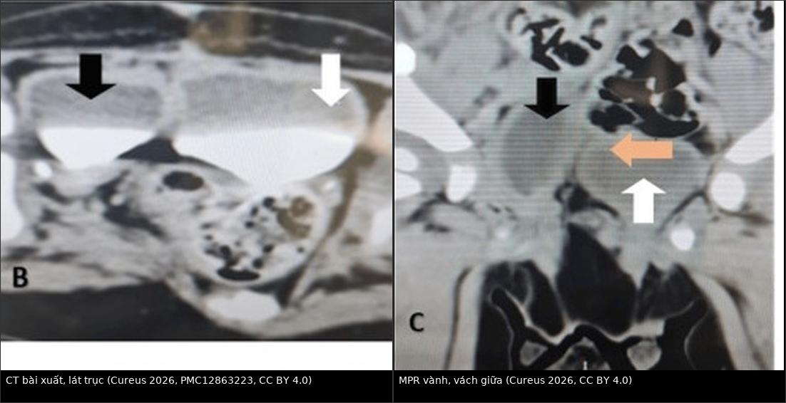
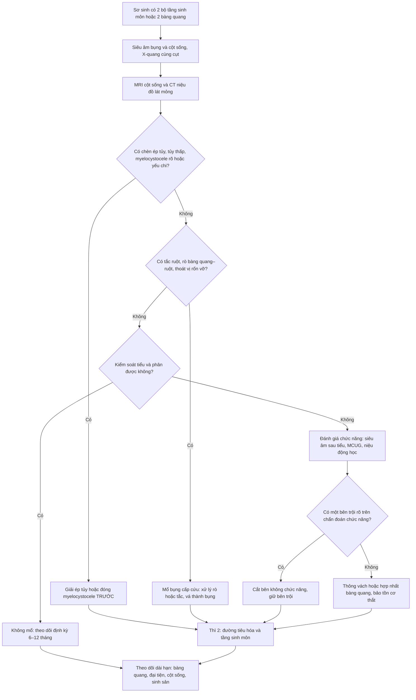
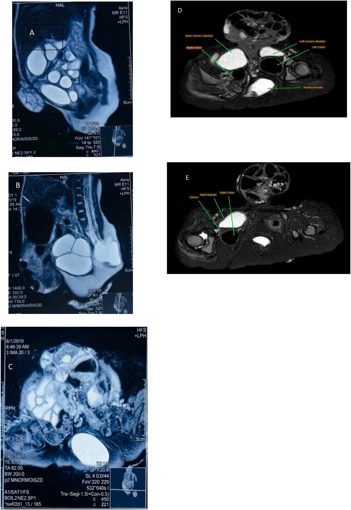
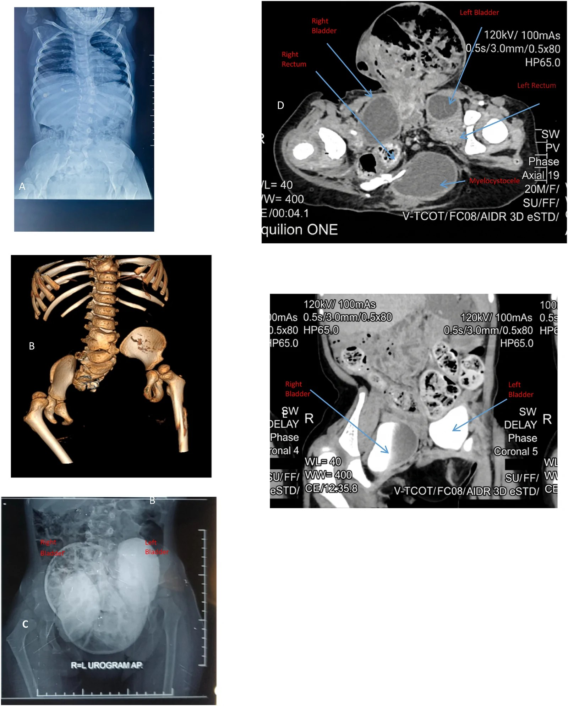
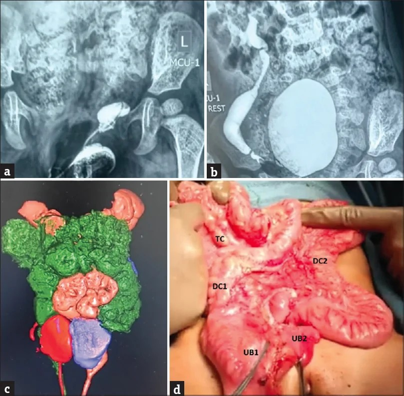

# 1749 — Hội chứng nhân đôi đuôi: hai bàng quang, hai đại tràng, một cột sống bất thường (caudal duplication syndrome)

**Tags:** `pattern:nhan-doi-duoi` `pattern:hai-bang-quang` `pattern:hai-dai-trang` `pattern:di-tat-cot-song` `pattern:tuy-thap` `pattern:khuyet-xuong-cung` `vung:bung` `vung:bang-quang` `vung:truc-trang` `vung:khung-chau` `vung:cot-song` `vung:sinh-duc` `anatomy:cot-song-cung-cut` `protocol:MRI-cot-song` `protocol:CT-nieu-do` `protocol:MCUG` `protocol:SA-so-sinh` `score:VUR`

**Mức chắc chắn (certainty):** tổng hợp y văn (literature synthesis) — **1 tổng quan hệ thống 17 bài / 23 bệnh nhân** (Medicina 2020, PMCID **PMC7759832**), **1 ca nữ 6 tuổi có đủ X-quang – MRI – CT niệu đồ** (Urol Case Rep 2026, PMCID **PMC13634463**), **1 ca nữ 15 tháng có MCUG + CT niệu đồ + dựng hình 3D** (J Indian Assoc Pediatr Surg 2026, PMCID **PMC13614799**), **1 ca nam sơ sinh có CT niệu đồ** (Cureus 2026, PMCID **PMC12863223**) và **1 tổng quan bàng quang đôi** (Urol Case Rep 2024, PMCID **PMC11033084**). Không có ca do nhóm tự chụp; chỗ suy luận được ghi rõ.

> **Câu hỏi thực hành:** bé gái **4 ngày tuổi**, đẻ đủ tháng, được chuyển đến vì **đi tiểu và đi phân từ HAI bộ lỗ tầng sinh môn cách nhau 6 cm**, kèm **khối thoát vị rốn 7 × 6 cm** và **khối gồ 2 × 2 × 5 cm vùng thắt lưng cùng**. Sáu năm sau: **không tự kiểm soát tiểu và phân**, **trào ngược niệu quản độ IV bên trái**, xạ hình thận **70% / 30%**. Gia đình hỏi: **"Mổ một lần được không? Có tự đi tiểu được sau mổ không?"**
> Bài chốt **năm quyết định**: **(1)** hội chứng nhân đôi đuôi (caudal duplication syndrome, CDS) = **nhân đôi ruột sau + đường niệu–sinh dục + cột sống/tủy**, tần suất **~1/100.000 trẻ sinh sống**, nữ : nam **2 : 1**; **(2)** chốt hình ảnh không phải "đếm hai bóng" mà là **hai hệ thống riêng biệt, KHÔNG thông nhau** (mỗi bàng quang nhận niệu quản cùng bên, có vách mô thật); **(3)** phần dễ bỏ sót nhất là **cột sống – tủy**: **60,86% (14/23)** có dị tật đốt sống và **~một nửa** có dị tật tủy trong loạt 23 ca; **(4)** thứ tự mổ theo **chức năng** (giải ép tủy, xử lý tắc ruột/rò) chứ không theo "chuẩn hoá giải phẫu"; **(5)** mổ nhiều thì hay một thì đều được — nhưng **không có triệu chứng thì không mổ**, đã có ca **31 tuổi sinh con khoẻ mạnh mà chưa từng tái tạo**.

## 1. Tổng quan bệnh học – cơ chế hình ảnh (TẠI SAO)

### 1.1 Định nghĩa, dịch tễ và phôi thai

- **Định nghĩa:** CDS được **Dominguez và cs. (1993)** xác lập là một thực thể riêng: **nhân đôi ruột sau (hindgut) + nhân đôi đường niệu–sinh dục dưới + dị tật tủy sống và đốt sống vùng cùng cụt**, mức độ rất khác nhau giữa các ca (PMC7759832). Chữ "hội chứng" ở đây là **bắt buộc**: nhân đôi bàng quang đơn thuần đã có bài riêng (bài **1719**) và **không** đồng nghĩa CDS.
- **Tần suất:** **~1/100.000 trẻ sinh sống** (PMC13634463; PMC12863223); y văn tiếng Anh có **~100 ca** (PMC13634463); tới 2020 chỉ có **23 ca nữ** được báo cáo (PMC13614799) — con số này **khác** 23 bệnh nhân của tổng quan 2020 ở trên. **Nữ : nam = 2 : 1** (PMC13634463).
- **Lịch sử đọc phim:** Ravitch (1953) gom **20 ca** nhân đôi đại tràng–sinh dục–tiết niệu, trong đó **12 ca** thoả tiêu chuẩn CDS (PMC13634463) — nghĩa là **"nhân đôi đại tràng" thuần tuý là chuyện khác**, phải tìm đủ ba trục.
- **Phôi thai — 4 giả thuyết, chưa giả thuyết nào thắng** (PMC13634463; PMC7759832):
  1. **Tổn thương khối tế bào đuôi (caudal cell mass)** — chủ yếu **trung bì**, vào **ngày 23–25** của phôi: giải thích vì sao **ruột sau, đường niệu–sinh dục và tủy cùng cụt cùng hỏng một lúc**.
  2. **Thuyết "véo" của Bremer** ở **tuần 6–7**: ống tiêu hoá đặc hoá rồi tạo khoang không đều → nhân đôi.
  3. **Dính ngoại bì–nội bì** bất thường (đường nối ống ruột–da còn sót).
  4. **Yếu tố gen:** biểu hiện sai **HOX** và **AXIN1** được nêu nhưng **chưa chứng minh**; không có gen gây bệnh xác định, **không có yếu tố gia đình** được ghi nhận (PMC13634463).
- **Vì sao dị tật lại "đối xứng hai bên đường giữa":** trục phôi đuôi tạo ra **tấm thần kinh, dây sống (notochord), ruột sau và xoang nhớp** cùng một thời điểm trong cùng một trường tín hiệu. Một tổn thương khu trú ở đây tạo ra **bản sao thứ hai song song** của tất cả các cấu trúc đó → bệnh cảnh luôn gồm **2 bộ tầng sinh môn + 2 cột sống cùng cụt bất thường**, không chỉ 2 cái bàng quang.

### 1.2 TẠI SAO hình ảnh trông như vậy (vật lý + mô bệnh)

- **Hai bàng quang "không thông":** trên **CT niệu đồ thì bài xuất (excretory phase)**, cản quang bài tiết qua **niệu quản cùng bên** rồi đổ vào **khoang cùng bên**. Vì **không có lỗ thông**, hai khoang **ngấm thuốc độc lập, không trộn** trong suốt thì bài xuất — đó là **chốt phân biệt với một bàng quang có vách** (bài 1719). Vách giữa là **cơ trơn + niêm mạc thật** — mô mềm, **không phải dịch 0–10 HU** → trên MRI là **dải tín hiệu trung gian** giữa hai túi nước tiểu **T2 rất sáng** (nước tiểu), trên siêu âm là **dải echo giữa hai khoang trống âm**.
- **Hai đại tràng:** sau khi bơm cản quang đường dưới, thuốc đi vào **hai kênh riêng** từ chỗ chia hình chữ Y; kênh **"trội" (dominant)** nhận phần lớn phân, kênh kia nhỏ hơn/teo. Trong ca PMC13614799: **manh tràng, ruột thừa, đại tràng lên DUY NHẤT**, đến **đại tràng ngang thì chia Y** thành **hai đại tràng xuống**; ca PMC13634463 thì **hai đại tràng lên** tách ngay từ manh tràng. **Vị trí chỗ chia là dữ kiện mổ, không phải chi tiết vô nghĩa.**
- **Tủy sống:** dịch não tủy **T2 rất sáng**, tủy là cấu trúc **T2 trung gian**; **mỡ** trong u mỡ/filum mỡ **T1 rất sáng và TẮT tín hiệu trên T1 fat-sat** — đây là lý do **bắt buộc có T1 không fat-sat** khi tìm u mỡ tủy. **Myelocystocele** = túi dịch não tủy **thông với ống sống** ra sau qua khuyết cung sau, thành túi có da/màng → khác **nang cùng cụt** (không thông ống sống).
- **Xương cùng:** trẻ nhỏ có **nhiều sụn, ít calci** → **X-quang thẳng nghiêng** đủ thấy **khuyết cung sau, giảm sản/thiếu đốt cùng, dãn khớp mu**; **3D-CT xương** là bước trả lời "còn bao nhiêu xương cùng để neo khung chậu". Trong ca PMC13634463: **chỉ có S1 và S2 phát triển một phần**, **L3–L4 dính hoàn toàn**, **L4–L5 dính một phần**, **đốt D9 hình nêm**, **dãn khớp mu 6 cm**.

### 1.3 Ngưỡng định lượng và dịch tễ hình ảnh (loạt 23 ca)

| Dữ kiện | Số liệu | Nguồn |
|---|---|---|
| Dị tật **đốt sống** (dính đốt, nửa đốt sống) | **14/23 = 60,86%** | PMC7759832 |
| Dị tật **tủy** (myelomeningocele, tủy thấp, u mỡ tủy, giãn ống trung tâm) | **~một nửa số ca** | PMC7759832 |
| **Hẹp hậu môn–trực tràng (ARM) MỘT bên** | **7/23 = 30,43%** | PMC7759832 |
| **ARM HAI bên** | **7/23 = 30,43%** | PMC7759832 |
| Nhân đôi đại tràng lan tới **đại tràng ngang** | **5/23 = 21,73%** | PMC7759832 |
| Nhân đôi đại tràng lan tới **manh tràng** | **4/23 = 17,39%** | PMC7759832 |
| Nhân đôi đại tràng lan tới **hồi tràng tận** | **2/23 = 8,69%** | PMC7759832 |
| Được đánh giá **trong năm đầu** | **19/23 = 82,60%** | PMC7759832 |
| Có **siêu âm thai**, và **chẩn đoán trước sinh** | **2 ca**, **0 ca** | PMC7759832 |
| Nhân đôi **bàng quang + niệu đạo** | **luôn ở mặt phẳng DỌC**, gặp ở mọi ca trừ 2 ca nữ | PMC7759832 |
| Nhân đôi **sinh dục ngoài** | nam **5/7**; nữ **toàn bộ** | PMC7759832 |

- **Con số "cột sống 15%" KHÔNG mâu thuẫn:** trong **40 ca bàng quang đôi đơn thuần** của Kossow, **15%** có spina bifida/meningocele (dẫn lại ở bài 1719); còn trong **CDS** — tức là đã có nhân đôi ruột sau — tỉ lệ dị tật đốt sống lên **60,86%** (PMC7759832). **Càng nhiều trục bị nhân đôi, cột sống càng chắc chắn bất thường.**
- **Tiên lượng kiểm soát tiểu/phân KHÔNG phụ thuộc số tạng được tái tạo**, mà phụ thuộc **mức tổn thương tủy–xương cùng**: ca PMC13634463 tái tạo giải phẫu thành công nhưng **vẫn không kiểm soát**, đúng như dự báo của tủy thấp L4 + xương cùng gần như mất; ca PMC13614799 tuy có lipomeningocele nhưng **không có tủy thấp rõ** và **đi tiểu tốt ở 6 tháng** (thể tích tiểu tối đa **90 mL**).

## 2. Mẫu hình + chẩn đoán phân biệt theo vị trí (Gamut)

CDS không đến phòng chụp với một "dấu hiệu" mà với **một trong bốn mẫu hình**. Nhận đúng mẫu hình quyết định **chụp gì tiếp theo**.

- **Mẫu hình A — "hai bộ tầng sinh môn" (mẫu hình chỉ điểm):** **hai lỗ hậu môn, hai lỗ tiểu, hai bộ phận sinh dục ngoài** cách nhau vài cm. Đây là lý do **82,60%** được phát hiện trong năm đầu. Gamut: **CDS**, **nhân đôi bàng quang/niệu đạo/sinh dục đơn thuần** (bài 1719), **phức hợp lỗ tiểu trên – lộ bàng quang (epispadias–exstrophy)**, **dị tật hậu môn–trực tràng (ARM) thể phức tạp** (bài 3075).
- **Mẫu hình B — "hai bàng quang trên CT/MRI":** gamut: **CDS** (kèm ruột sau + cột sống), **bàng quang đôi hoàn toàn/không hoàn toàn** (1719), **túi thừa Hutch hai bên** ("Mickey Mouse" — hai túi **ngoài** thành, bài 1706), **bàng quang đôi trong lộ bàng quang/nhớp lộ**.
- **Mẫu hình C — "khối nang vùng cùng cụt + dị tật hậu môn":** gamut: **tam chứng Currarino** (xương cùng hình liềm + khối trước cùng + ARM), **CDS**, **u quái cùng cụt**, **màng não tủy trước cùng (anterior sacral meningocele)**, **nang nhân đôi ruột trước cùng**.
- **Mẫu hình D — "hai kênh đại tràng":** gamut: **CDS**, **nang/ống nhân đôi ruột (enteric duplication cyst)** đơn thuần, **dị tật xoay ruột**, **túi thừa Meckel khổng lồ**.
- **Checklist 4 trục (bắt buộc ghi trong kết luận, kể cả khi chỉ thấy 1 trục):**
  1. **SD – Sinh dục:** số bộ phận sinh dục ngoài, tử cung/âm đạo, tinh hoàn.
  2. **TN – Tiết niệu:** số bàng quang, số niệu đạo, **niệu quản đổ vào đâu**, trào ngược, chức năng từng thận.
  3. **TH – Tiêu hoá:** chỗ chia đại tràng, vị trí hậu môn, **kênh nào là kênh trội**, có rò bàng quang–ruột.
  4. **CS – Cột sống/tủy:** đốt sống, xương cùng, **vị trí tủy tận cùng**, mỡ/filum, myelocystocele.
- **Mnemonic "2-3-4":** **2** bộ tầng sinh môn, **3** trục nhân đôi (ruột–niệu dục–cột sống), **4** nhóm chụp (siêu âm, X-quang, CT niệu đồ, MRI cột sống).

## 3. Bảng so sánh phân biệt (ma trận đối chiếu)

| Thực thể (entity) | Hình ảnh điển hình | Chốt vào (rule-in) | Chốt loại (rule-out) | Gợi ý xác nhận |
|---|---|---|---|---|
| **CDS** | **Hai bàng quang không thông** (mỗi bên nhận niệu quản cùng bên) + **hai kênh đại tràng** + **bất thường xương cùng/tủy** | **Đủ 3 trục: ruột sau + niệu–sinh dục dưới + cột sống/tủy** | Chỉ có 1 trục (ví dụ chỉ bàng quang đôi) → **không gọi CDS** | CT niệu đồ thì bài xuất + MRI tủy + X-quang cùng cụt |
| **Bàng quang đôi đơn thuần** (bài 1719) | Vách **trong lòng** chia 2 nửa; hoàn toàn = 2 niệu đạo, không hoàn toàn = 1 niệu đạo | **Vách trong lòng + hai lỗ niệu đạo riêng** | **Có nhân đôi đại tràng hoặc tủy thấp kèm theo → chuyển sang CDS** | VCUG đặt catheter **cả hai lỗ**, CT/MRI niệu |
| **Túi thừa Hutch hai bên** (bài 1706) | Hai "tai" **ngoài** thành bàng quang, cổ túi hẹp | **Túi phình ra NGOÀI đường viền bàng quang** | **Vách nằm TRONG lòng → không phải túi thừa** | VCUG thì đi tiểu, siêu âm |
| **Tam chứng Currarino** | **Xương cùng hình liềm**, **khối trước cùng** (màng não tủy trước cùng/u mỡ/u quái), **ARM** | **Đủ bộ ba + khối trước cùng thông ống sống** | **Có nhân đôi bàng quang/đại tràng → CDS chứ không phải Currarino đơn thuần** | MRI cùng cụt + X-quang cùng cụt; gen **MNX1** nếu gia đình |
| **Màng não tủy trước cùng** | Khối nang **T2 sáng**, **cổ thông với ống sống**, xương cùng khuyết | **Thấy cổ thông ống sống trên MRI** | Không thông ống sống → nang nhân đôi ruột/u quái | MRI T2 sagittal + CT xương |
| **Nang nhân đôi ruột** | Cấu trúc **dạng ống/nang**, thành có **lớp cơ**, dính vào ruột | **Thành cơ + niêm mạc ruột, đồng vận động với ruột** | **Hai kênh có hậu môn riêng + xương cùng bất thường → CDS** | Siêu âm, CT/MRI bụng |
| **U quái cùng cụt** | Khối **hỗn hợp đặc–nang**, **có calci/mỡ**, đẩy trực tràng | **Mỡ + calci + không thông ống sống** | **Không có mỡ/calci, có 2 bàng quang → không phải u quái** | MRI + AFP |
| **Lộ bàng quang – lỗ tiểu trên (exstrophy–epispadias)** | Bàng quang **hở ra thành bụng**, dãn khớp mu rộng, dương vật ngắn/vẹo | **Thành bụng trước khuyết + bàng quang lộ** | **Thành bụng kín, bàng quang nằm trong khung chậu → không phải exstrophy** | Lâm sàng + X-quang khung chậu |
| **Dị tật hậu môn–trực tràng phức tạp** (bài 3075) | Một hậu môn lạc chỗ/rò, **không có 2 bộ tầng sinh môn** | **Một lỗ hậu môn duy nhất** | **Hai lỗ hậu môn + hai bàng quang → CDS** | Khám dưới gây mê, MRI khung chậu |

*Trái: lát trục — hai khoang bàng quang ngấm thuốc **riêng rẽ** (mũi tên đen và trắng), vách mô mềm ở giữa. Phải: MPR vành — vách giữa (mũi tên cam) tách hai bàng quang; mỗi bên nhận niệu quản cùng bên. Ảnh cắt từ Hình 1 (panel B, C) của Cureus 2026, PMCID PMC12863223, **CC BY 4.0**; ghép letterbox bằng `tools/make_composite.py`.*

### Ba dấu hiệu "chốt" đọc nhanh trên một lát cắt

- **Dấu vách trong lòng (intravesical septum):** vách liên tục, **có tín hiệu mô**, không mất khi đổi thì → **bàng quang đôi thật**.
- **Dấu "hai niệu quản – hai bàng quang cùng bên":** mỗi niệu quản đổ vào **khoang cùng phía** — trên CT bài xuất muộn, **không có dòng thuốc chéo sang bên kia**.
- **Dấu "cột sống không bao giờ bình thường":** nếu bạn đã thấy 2 bàng quang + 2 đại tràng mà **chưa chụp cột sống – tủy**, kết luận còn thiếu một nửa chẩn đoán.

## 4. Protocol chụp + phân độ, thang điểm

### 4.1 Trước sinh và 72 giờ đầu

- **Siêu âm thai:** có thể thấy **hai bàng quang, hai trực tràng, khối cùng cụt, dãn khớp mu** — nhưng trong loạt 23 ca **chỉ 2 ca có siêu âm thai và KHÔNG ca nào được chẩn đoán trước sinh** (PMC7759832). Vì vậy **không có "hình ảnh trước sinh bình thường" nào loại trừ CDS**.
- **Siêu âm sau sinh (đầu tay):** bụng + **cột sống qua thóp/lưng** (thấy tủy thấp, mỡ filum, myelocystocele) + khung chậu. **Siêu âm tủy chỉ còn giá trị trong ~3–6 tháng đầu**, trước khi cung sau cốt hoá — sau mốc này **bắt buộc MRI**.
- **X-quang cột sống cùng cụt thẳng + nghiêng:** khuyết cung sau, số đốt cùng còn lại, dãn khớp mu. Trong ca PMC13634463 phim bụng đứng đã đủ thấy **khối thoát vị rốn** và **bất thường đốt sống** trước khi làm MRI.

### 4.2 CT niệu đồ (CT urography) — "bài thi chính" của CDS

- **Chỉ định:** đã xác định hoặc nghi nhân đôi đường niệu–sinh dục; cần **bản đồ niệu quản – bàng quang trước mổ**.
- **Kỹ thuật:** lát **≤ 1 mm**, tái tạo **MPR vành + sagittal + dựng hình 3D**; cản quang tĩnh mạch **1,5–2 mL/kg** (tối đa theo cân nặng); **thì bài xuất 5–15 phút** sau tiêm (nhũ nhi có thể cần **20–30 phút** vì độ lọc cầu thận còn thấp).
- **Đọc theo thứ tự:** (1) **số bàng quang và vách**; (2) **niệu quản đổ vào khoang nào**; (3) **thận hai bên** (số đơn vị, ứ nước); (4) **chỗ chia đại tràng**; (5) **xương cùng/khung chậu** trên cửa sổ xương.
- **Liều:** tuân thủ **ALARA**; ghi **CTDIvol và DLP**, đối chiếu DRL theo tuổi (bài **937** về SSDE/DRL ở trẻ).

### 4.3 MRI cột sống – khung chậu (không thể bỏ)

- **Chuỗi bắt buộc:** **T2 sagittal toàn cột sống**, **T1 sagittal không fat-sat**, **T1 fat-sat**, **T2 axial** qua chỗ tận cùng tủy; **T2 axial khung chậu** để đếm bàng quang/trực tràng/tử cung. Lát **3 mm**, FOV phủ từ hành não tới xương cùng.
- **Ngưỡng đọc (thông lệ, không phải số của loạt CDS):** **tủy tận cùng bình thường ở ngang hoặc trên đĩa L2–L3**; **tủy thấp** khi tận cùng **dưới L2–L3** sau 3 tháng tuổi; **filum ≥ 2 mm** hoặc **có mỡ trong filum** = nguy cơ dính tủy; **myelocystocele** = túi dịch **thông ống sống**.
- **TẠI SAO phải T1 không fat-sat:** mỡ **T1 sáng**, nhưng trên **T1 fat-sat mỡ TỐI** — nếu chỉ có fat-sat, u mỡ/filum mỡ **biến mất** và bạn kết luận "không có mỡ", một lỗi kinh điển.

### 4.4 Phân độ dùng trong báo cáo

- **Bàng quang đôi — Abrahamson:** **hoàn toàn** = **vách cơ + hai niệu đạo riêng**; **không hoàn toàn** = **vách + một niệu đạo chung**; thêm **mặt phẳng dọc (thường gặp) hay vành** (PMC11033084; bài 1719).
- **Trào ngược niệu quản — độ I–V** (International Reflux Study): độ **IV** = niệu quản + bể thận giãn, **gấp khúc**, còn nhú nhện; độ **V** = mất nhú. Ca PMC13634463 có **độ IV bên trái** và **chức năng thận 70% / 30%** trên xạ hình.
- **Hậu môn–trực tràng — Krickenbeck** (bài 3075) để mô tả thể và kết cục đại tiện.
- **Rò bàng quang–ruột:** chẩn đoán **bằng soi bàng quang + bơm thuốc**, không bằng CT — ca Cureus 2026 có **rò bàng quang–đại tràng không thấy trên hình ảnh ban đầu**, chỉ phát hiện khi soi (PMC12863223).

### 4.5 Thuật toán một lượt: mổ gì trước?

- **Nguyên tắc "chức năng trước giải phẫu":** ưu tiên **giải ép tủy** và **xử lý rò/tắc** vì đây là thứ **không thể phục hồi nếu muộn**; tạo hình sinh dục và "chuẩn hoá hình dáng" có thể **hoãn tới tuổi dậy thì** để bệnh nhân tự quyết (PMC12863223; PMC7759832).
- **Không triệu chứng thì không mổ:** y văn đã ghi nhận ca **31 tuổi sinh con khoẻ mạnh bằng mổ lấy thai mà chưa từng tái tạo**, cùng nhiều ca nữ trưởng thành chỉ được phát hiện khi mang thai (tuổi **22–39**) (PMC13634463; PMC7759832).

## 5. Biến thể bình thường và cạm bẫy

- **Bàng quang đôi KHÔNG hoàn toàn (chỉ có vách) có thể không cần mổ** nếu hai nửa dẫn lưu tốt, không trào ngược, không nhiễm trùng — **đừng "sửa cho đẹp"**.
- **Nhầm "hai túi thừa" với "hai bàng quang":** túi thừa Hutch nằm **ngoài** đường viền, cổ hẹp; bàng quang đôi có **vách trong lòng**. Cắt nhầm túi thừa trong CDS = **bỏ mất một nửa bàng quang thật** (bài 1706, 1719).
- **Bỏ sót rò bàng quang–ruột:** hình ảnh có thể **âm tính**; bệnh nhân đi tiểu ra **phân/hơi**, hoặc nhiễm trùng tiểu tái diễn. **Chốt bằng soi bàng quang + bơm thuốc**, không bằng CT (PMC12863223).
- **Siêu âm tủy sau 6 tháng:** cung sau cốt hoá → **âm giả**. Trẻ > 6 tháng hoặc đã có bất thường xương cùng: **MRI, không tranh luận**.
- **Chỉ đọc T2 mà bỏ T1:** mỡ tủy/filum mỡ **T1 sáng, T2 cũng sáng** → dễ gọi là "dịch"; và ngược lại **T1 fat-sat làm mỡ tối** → dễ kết luận "không mỡ". Luôn đọc **cả hai**.
- **Thoả mãn tìm kiếm (satisfaction of search):** thấy hai bộ phận sinh dục là "đủ chẩn đoán" → **bỏ tủy thấp, bỏ khuyết xương cùng, bỏ dị tật tim/thành bụng**. Trong CDS, **dị tật ngoài vùng đuôi** (thoát vị rốn, tim bẩm sinh, xoay ruột, Meckel, teo tá tràng) được ghi nhận với tỉ lệ **không hằng định** — phải khám toàn thân.
- **"Kênh trội" không đoán bằng mắt:** kênh nào lớn hơn trên hình **chưa chắc** là kênh có chức năng tốt hơn — cần **đối chiếu nội soi, xạ hình, niệu động học** trước khi cắt (PMC13614799; PMC13634463).
- **Dãn khớp mu:** gặp ở cả exstrophy và CDS; **một mình dãn khớp mu không định chẩn đoán**, phải đọc cùng bàng quang và xương cùng.

## 6. Tự lượng giá — Blind Quiz

**Ca 1 — Nam sơ sinh, hai dương vật, hai hậu môn, đi tiểu từ cả hai.**

- Gợi ý lâm sàng: đủ tháng, không dị tật thấy trước sinh; khám thấy **hai dương vật, bìu đôi, hai lỗ hậu môn**.
- Câu hỏi: Hai khoang ngấm thuốc là gì? Chúng có thông nhau không — dựa vào dấu hiệu nào? Còn phải chụp gì trước khi mổ?

<b>Bấm để hiện đáp án (findings + chẩn đoán)</b>

- **Dấu hiệu:** hai khoang bàng quang **ngấm thuốc độc lập**, **vách mô mềm** ở giữa; mỗi bên nhận **niệu quản cùng bên**; **không có dòng thuốc chéo** trong thì bài xuất.
- **Chẩn đoán:** **hội chứng nhân đôi đuôi** — bàng quang đôi hoàn toàn (Abrahamson) + nhân đôi đại tràng + **tủy thấp**; ca này còn **rò bàng quang–đại tràng** chỉ phát hiện khi soi bàng quang.
- **Vì sao:** hai khoang **không thông** nên cản quang bài tiết qua hai niệu quản **không trộn** — đó là chốt phân biệt với bàng quang có vách.
- **Việc còn lại:** **MRI cột sống** (tủy thấp, mỡ filum), **siêu âm tim**, soi bàng quang; thứ tự mổ: **giải ép tủy → xử lý rò/đại tràng → tạo hình niệu–dục**.
- **Nguồn ảnh:** Cureus 2026, PMCID **PMC12863223** (Hình 1, panel B–C), **CC BY 4.0**; cắt và ghép letterbox.

**Ca 2 — Bé gái 6 tuổi, thoát vị rốn 7 × 6 cm lúc sinh, hai bộ lỗ tầng sinh môn cách 6 cm, gồ vùng thắt lưng cùng.**

- Gợi ý: hiện **không kiểm soát tiểu/phân**, đi lại cần hỗ trợ; siêu âm thận trái ứ nước.
- Câu hỏi: Có mấy bàng quang, mấy đại tràng? Tủy tận cùng ở đâu? Dấu hiệu nào giải thích **không kiểm soát được** dù đã tái tạo?

<b>Bấm để hiện đáp án (findings + chẩn đoán)</b>

- **Dấu hiệu:** **hai bàng quang** cạnh nhau, **hai đại tràng**, **túi dịch thông ống sống sau** (myelocystocele) ở vùng thắt lưng cùng, **tủy tận cùng thấp (L4)**; xương cùng chỉ còn **S1 + một phần S2**, **dãn khớp mu 6 cm**.
- **Chẩn đoán:** **CDS** với **tủy thấp + myelocystocele + thiểu sản xương cùng**; bàng quang đôi hoàn toàn, mỗi bên một niệu quản cùng bên; **trào ngược độ IV trái**, chức năng thận **70% / 30%**.
- **Vì sao không kiểm soát:** **kiểm soát tiểu/phân phụ thuộc tủy và xương cùng**, không phụ thuộc việc "nối hai bàng quang cho đẹp". Đây là điểm phải nói trước mổ với gia đình.
- **Việc còn lại:** **niệu động học**, cân nhắc **bàng quang tăng cường / Mitrofanoff** nếu dung tích–áp lực không đạt; theo dõi **bàng quang thần kinh**, táo bón, và **chuyển tuyến phụ khoa khi trưởng thành**.
- **Nguồn ảnh:** Urol Case Rep 2026, PMCID **PMC13634463** (Hình 2), **CC BY-NC-ND 4.0** — nguyên bản.

**Ca 3 — Cùng bệnh nhi ở Ca 2, phim trước mổ: bụng chướng, gồ vùng thắt lưng cùng, đi lại cần hỗ trợ.**

- Gợi ý: đã biết có hai bàng quang và hai đại tràng trên MRI; cần trả lời **còn bao nhiêu xương cùng** và **khung chậu có vững** để lên kế hoạch mổ.
- Câu hỏi: Xương cùng còn mấy đốt? Có dấu hiệu nào của **thiểu sản xương cùng** và **dãn khớp mu**? Niệu đồ ngược dòng cho thấy gì?

<b>Bấm để hiện đáp án (findings + chẩn đoán)</b>

- **Dấu hiệu:** **xương cùng gần như mất** (chỉ còn **S1 và một phần S2**); **L3–L4 dính hoàn toàn**, **L4–L5 dính một phần**; **đốt D9 hình nêm** gây vẹo; **dãn khớp mu 6 cm**, khung chậu hẹp, **đầu trên xương đùi phải lệch lên trên–ra ngoài**; niệu đồ: **hai bàng quang** đổ đầy riêng, **trào ngược độ IV bên trái**.
- **Chẩn đoán:** **CDS** với **thiểu sản xương cùng nặng + dãn khớp mu + bất thường đốt sống thắt lưng**; đi kèm **tủy thấp L4 + myelocystocele tận** (đã thấy trên MRI ở Ca 2).
- **Vì sao 3D-CT xương quan trọng:** nó trả lời **khung chậu còn đủ xương để neo hay không** — quyết định có làm **tạo hình khung chậu** hay chấp nhận **dáng đi và kiểm soát tiểu kém**; đây cũng là dữ kiện tư vấn tiên lượng, không phải hình minh hoạ.
- **Nguồn ảnh:** Urol Case Rep 2026, PMCID **PMC13634463** (Hình 3), **CC BY-NC-ND 4.0** — nguyên bản.

**Ca 4 — Bé gái 15 tháng, hai bộ phận sinh dục ngoài, đi cầu qua hậu môn lạc chỗ bên trái.**

- Gợi ý: bàng quang trái **không đặt được catheter**; bụng chướng nhẹ, không nôn; đã xác định nhân đôi tầng sinh môn.
- Câu hỏi: Trên dựng hình 3D có **mấy khối đại tràng, mấy khối bàng quang**? Chỗ chia đại tràng ở đâu? MCUG cho biết gì mà CT không cho?

<b>Bấm để hiện đáp án (findings + chẩn đoán)</b>

- **Dấu hiệu:** dựng hình 3D tách **hai hệ đại tràng (DC1, DC2)** và **hai bàng quang (UB1, UB2)**; **manh tràng – ruột thừa – đại tràng lên DUY NHẤT**, đến **đại tràng ngang (TC)** chia **hình Y** thành **hai đại tràng xuống**; MCUG: **xoang niệu dục trái teo, túi cùng không đặt được catheter**, **xương cùng chẻ đôi**; bên phải: bàng quang hình dạng bình thường, **trào ngược niệu quản độ 4**.
- **Chẩn đoán:** **CDS** thể **bàng quang đôi + đại tràng đôi**, **bên trái không chức năng về niệu** → cắt bàng quang trái + **niệu quản trái nối sang phải**, cắt đại tràng trái, **kéo đại tràng phải xuống làm hậu môn mới**, tạo hình tầng sinh môn một thì.
- **Vì sao cần cả hai:** CT/3D cho **giải phẫu và số mạch nuôi từng kênh**; MCUG cho **chức năng và trào ngược** — hai câu hỏi khác nhau, **không thay thế nhau**.
- **Nguồn ảnh:** J Indian Assoc Pediatr Surg 2026, PMCID **PMC13614799** (Hình 2), **CC BY-NC-ND 4.0** — nguyên bản.

## Bài liên quan chéo
- [600 – Tổng quan Hệ Nhi khoa](../600-tong-quan-nhi-khoa/lesson.md) (bảng DDx bắt buộc)
- [1719 – Bàng quang đôi, vách bàng quang & nang niệu rốn](../1719-bang-quang-doi-va-nang-nieu-ron/lesson.md) (nhân đôi MỘT trục)
- [1706 – Túi thừa bàng quang & hội chứng "Mickey Mouse"](../1706-tui-thua-bang-quang-o-tre/lesson.md) (hai "tai" NGOÀI thành)
- [3075 – Dị tật hậu môn–trực tràng ở sơ sinh](../3075-di-tat-hau-mon-truc-trang-so-sinh/lesson.md) (ARM, phân loại và thì mổ)
- [635 – Dị tật tiết niệu nhi: SFU, VUR, PUV](../635-di-tat-tiet-nieu-nhi-SFU-VUR-PUV/lesson.md) (phân độ trào ngược)
- [691 – Soi bàng quang và soi quanh catheter ở trẻ](../691-soi-bang-quang-va-soi-quanh-catheter-o-tre/lesson.md) (chốt rò bàng quang–ruột)
- [937 – Liều CT ở trẻ: SSDE & DRL](../937-lieu-ct-tre-ssde-drl/lesson.md) (ALARA khi chụp lặp lại)

## Ảnh
- Tên file theo quy ước `NNN_slug_Modality_SourceID.jpg`; nguồn + giấy phép từng ảnh trong `images/CREDITS.md`.
- **Không** cắt/ghép ảnh **CC BY-NC-ND** (PMC13634463, PMC13614799) — giữ nguyên bản, kể cả nhãn tiếng Anh trên hình.
- Ảnh **CC BY 4.0** (PMC12863223) được cắt hai panel CT và ghép letterbox bằng `tools/make_composite.py`, có ghi rõ phái sinh.

> Không dùng để chẩn đoán độc lập khi chưa có người hướng dẫn.
