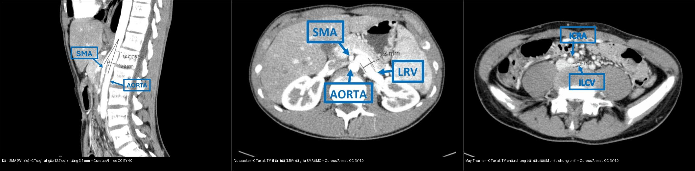
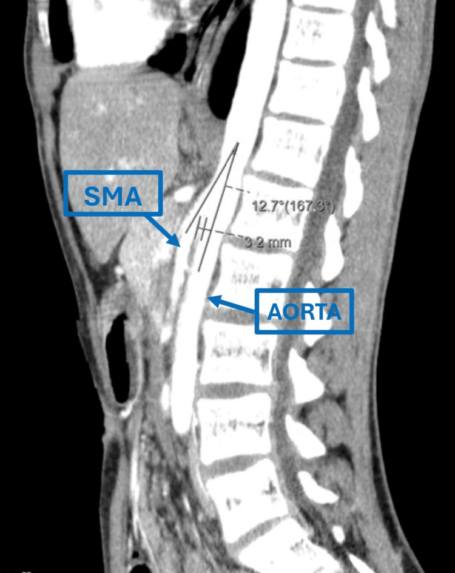
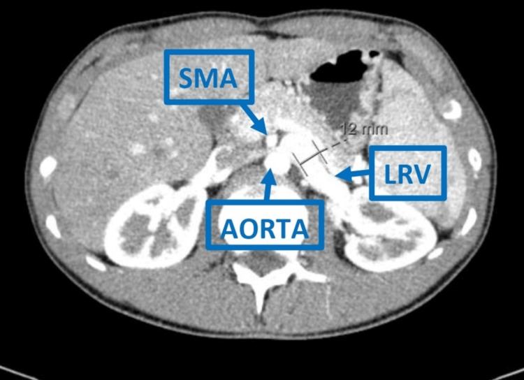
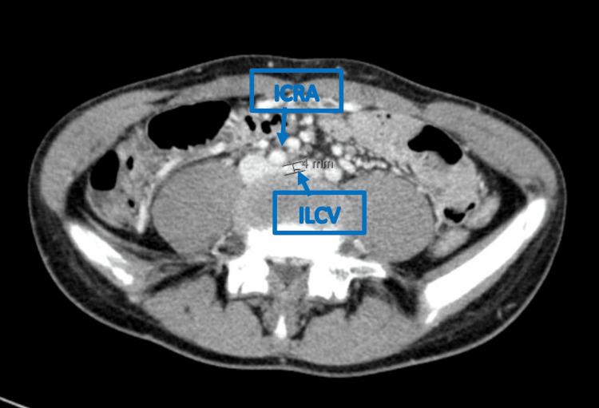

# 175 — Chèn ép mạch bụng & nút mạch tạng / Compression syndromes & Embolization

**Tags:** `pattern:chen-ep-mach` `vung:mach-tang`
**Mức chắc chắn (certainty):** tổng hợp y văn (literature synthesis) — nhóm tự biên từ y văn mở, chưa gắn ca nguyên văn đơn lẻ.

## 1. Tổng quan — góc kẹp + số đo chẩn đoán

- **Nguyên lý chung (TẠI SAO):** mọi hội chứng kẹp mạch đều do **một mạch bị ép giữa hai cấu trúc cứng (ĐMC/cột sống/xương) và một cấu trúc mềm di động (mạc treo/ĐM/dây chằng)**. Mất đệm mỡ (sụt cân, gầy, dậy thì tăng trưởng nhanh) làm góc kẹp hẹp lại → hẹp động mạch (thiếu máu) hoặc hẹp tĩnh mạch (ứ trệ/giãn trước hẹp).
- **Kìm SMA (mạc treo tràng trên, Wilkie):** góc ĐMC–SMA **< 22°** + khoảng cách **< 8 mm** + tá tràng D3 kẹt + dạ dày giãn. Ca minh họa (dưới): góc **12,7°** (tương ứng 167,3°) + khoảng cách **3,2 mm**.
- **Nutcracker (kẹp TM thận trái — LRV):** TM thận trái kẹt giữa ĐMC–SMA + giãn trước hẹp (đoạn giãn ~**12 mm**) + tiểu máu/đau hông trái; **tỷ số đường kính giãn/hẹp > 4–5**.
- **MALS (hội chứng dây chằng cung giữa):** thân tạng (celiac trunk) gập chữ J + **hẹp thì thở ra, giãn thì hít vào** + đau sau ăn + sụt cân ở người trẻ gầy.
- **May-Thurner (kẹp TM chậu chung trái):** TM chậu chung trái (ILCV) bị ĐM chậu chung phải (ICRA) ép vào thân đốt sống (**đoạn hẹp ~4 mm**) → huyết khối tĩnh mạch sâu chi dưới trái + phù/đau chân ở người trẻ.
- **Nút mạch tạng:** chảy máu (giả phình ĐM lách/gan), u (HCC/TACE), chấn thương thoát thuốc — DSA + vật liệu nút (coil/hạt/keo).

## 2. Gamut đau sau ăn + sụt cân + mạch bị kẹp

- **MALS:** thân tạng gập + đau sau ăn + trẻ gầy — giải phóng dây chằng.
- **Kìm SMA:** tá tràng D3 kẹt + dạ dày giãn + gầy cấp — sonde + dinh dưỡng + tăng cân.
- **Nutcracker:** TM thận trái kẹt + tiểu máu + đau hông trái — theo dõi/stent/mổ.
- **May-Thurner:** huyết khối TM sâu chi dưới trái + phù chân ở người trẻ — chống đông ± stent.
- **Chảy máu tạng:** thoát thuốc/giả phình + tụt HA — nút mạch cấp cứu.

## 3. Bảng số đo + ma trận đối chiếu

| Hội chứng | Số đo chốt / hình ảnh điển hình | Chốt vào (rule-in) | Chốt loại (rule-out) | Xử trí |
|---|---|---|---|---|
| Kìm SMA (Wilkie) | **Góc ĐMC–SMA < 22°** + khoảng cách **< 8 mm**; dạ dày + D3 giãn, D3 cắt cụt | **Góc < 22° + D3 cắt cụt + sụt cân/nôn** | Góc bình thường (20–70°) → không phải kìm | Sonde + dinh dưỡng + tăng cân |
| Nutcracker | **Tỷ số giãn/hẹp TM thận trái > 4–5**; "beak" + giãn trước hẹp (~12 mm) | **Tiểu máu + đau hông trái + beak** | Không triệu chứng → biến thể, đừng stent | Theo dõi / stent / mổ |
| MALS | **Thân tạng gập chữ J, hẹp thì thở ra** | **Hẹp thì thở ra + đau sau ăn + sụt cân** | Hẹp cố định mọi thì → xơ vữa | Giải phóng dây chằng |
| May-Thurner | **TM chậu chung trái kẹt dưới ĐM chậu chung phải** (đoạn hẹp ~4 mm) | **Huyết khối TM sâu trái + người trẻ** | Huyết khối do nguyên nhân khác (ung thư, đông máu) | Chống đông ± stent |
| Chảy máu tạng | **Thoát thuốc / giả phình** trên CTA-DSA | **Tụt HA + ổ chảy máu trên CTA** | Không thoát thuốc → theo dõi | Nút mạch (coil/keo/hạt) |

*Cùng một bệnh nhân trẻ (14–18 tuổi) có **ba hội chứng kẹp mạch cùng lúc**. Trái: kìm SMA — CT sagittal, góc động–mạc treo tràng **12,7°**, khoảng cách **3,2 mm**. Giữa: nutcracker — TM thận trái kẹt giữa SMA và ĐMC. Phải: May-Thurner — TM chậu chung trái kẹt dưới ĐM chậu chung phải (đoạn hẹp ~4 mm). Nguồn: Andrade M et al., Cureus 2025 Fig. 1–3, CC BY 4.0 (ảnh ghép letterbox).*

## 4. Protocol CTA mạch tạng

- CTA động mạch + MPR sagittal (góc ĐMC–SMA, thân tạng) + đo góc/khoảng cách.
- DSA khi can thiệp (nút mạch/chẩn đoán thiếu máu mạc treo mạn).

## 5. Cạm bẫy

- **Góc hẹp sinh lý ở người gầy** không triệu chứng — số + lâm sàng mới chẩn đoán.
- **Nutcracker không triệu chứng** — đừng stent vội khi tình cờ.
- **Đau bụng mạn gán nhầm MALS** — loại trừ tiêu hóa trước khi mổ dây chằng.

## 6. Tự lượng giá — Blind Quiz

**Ca 1 — Nam 14 tuổi, nôn sau ăn 6 tháng + sụt cân nhiều, bụng trên giãn. Đọc CT sagittal.**

- Gợi ý: đo góc giữa ĐMC và mạc treo tràng trên, đo khoảng cách hai mạch tại ngang tá tràng D3.
- Hỏi: chẩn đoán? Ngưỡng số đo? Xử trí đầu tay?

<b>Bấm để hiện đáp án (findings + chẩn đoán)</b>

- Dấu hiệu (findings): góc động–mạc treo tràng (aortomesenteric angle) **12,7°** (< 22°) + khoảng cách **3,2 mm** (< 8 mm), tá tràng D3 bị kẹp.
- Chẩn đoán (diagnosis): **hội chứng kìm mạc treo tràng trên (SMA syndrome, Wilkie)** — vì mất đệm mỡ mạc treo sau sụt cân → góc hẹp → kẹp D3.
- Xử trí: **sonde + nuôi dưỡng + tăng cân trước**; mổ (gastrojejunostomy) chỉ khi thất bại điều trị nội.
- Nguồn ảnh: Andrade M et al., Cureus 2025 Fig. 1, CC BY 4.0.

**Ca 2 — Cùng bệnh nhân, tiểu máu + đau hông trái. Đọc CT axial.**

- Hỏi: mạch nào bị kẹp? Dấu hiệu chốt? Khi nào can thiệp?

<b>Bấm để hiện đáp án (findings + chẩn đoán)</b>

- Dấu hiệu (findings): **TM thận trái (LRV) kẹt giữa mạc treo tràng trên (SMA) và ĐMC**, giãn trước chỗ hẹp (đoạn giãn ~12 mm) — dấu "beak".
- Chẩn đoán (diagnosis): **hội chứng nutcracker** — tỷ số đường kính giãn/hẹp > 4–5; tăng áp lực tĩnh mạch thận → tiểu máu.
- Xử trí: theo dõi nếu nhẹ; **stent/ghép mạch** khi đau nặng hoặc thiếu máu kéo dài.
- Nguồn ảnh: Andrade M et al., Cureus 2025 Fig. 2, CC BY 4.0.

**Ca 3 — Cùng bệnh nhân, phù và đau chân trái. Đọc CT axial khung chậu.**

- Hỏi: mạch nào ép mạch nào? Hậu quả lâm sàng? Xử trí?

<b>Bấm để hiện đáp án (findings + chẩn đoán)</b>

- Dấu hiệu (findings): **TM chậu chung trái (ILCV) bị ĐM chậu chung phải (ICRA) ép vào thân đốt sống** (đoạn hẹp ~4 mm).
- Chẩn đoán (diagnosis): **hội chứng May-Thurner** → ứ trệ → huyết khối tĩnh mạch sâu chi dưới trái ở người trẻ.
- Xử trí: **chống đông**, cân nhắc stent tĩnh mạch khi hẹp có triệu chứng/huyết khối tái phát.
- Nguồn ảnh: Andrade M et al., Cureus 2025 Fig. 3, CC BY 4.0.

**Ca 4 — Ba chuỗi CT ghép cạnh nhau: gọi đúng tên từng hội chứng và số đo chốt của mỗi hình.**

<b>Bấm để hiện đáp án (findings + chẩn đoán)</b>

- Trái = **kìm SMA** (góc 12,7°, khoảng 3,2 mm); Giữa = **nutcracker** (LRV kẹt giữa SMA–ĐMC); Phải = **May-Thurner** (ILCV < ICRA).
- Điểm cần nhớ: **ba hội chứng kẹp mạch có thể cùng tồn tại** — thấy một cái phải chủ động tìm hai cái còn lại (nhất là người trẻ gầy sụt cân).
- Nguồn: Andrade M et al., Cureus 2025, CC BY 4.0 (ảnh ghép letterbox).

## Bài liên quan chéo
- [100 – Tổng quan hệ Bụng](../100-tong-quan-he-bung/lesson.md)
- [140 – Chấn thương tạng (đã có)](../140-lach-tang-dac/lesson.md) (nút mạch chảy máu)
- [170 – Phình ĐMC bụng](../170-phinh-DMC-bung/lesson.md) (can thiệp mạch)

> Không dùng để chẩn đoán độc lập khi chưa có người hướng dẫn.
