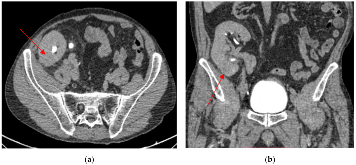
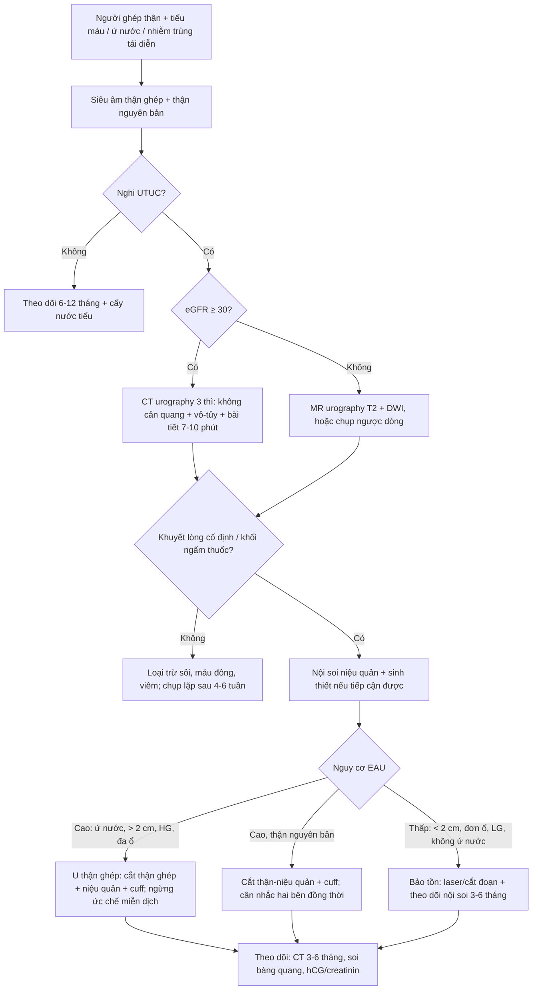
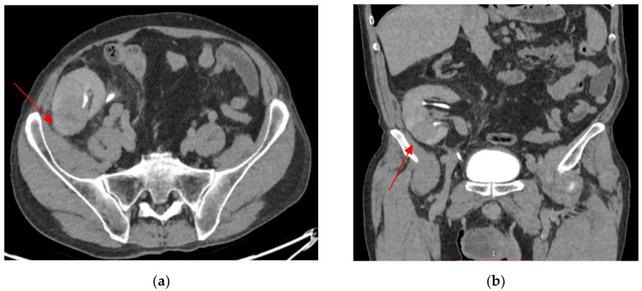
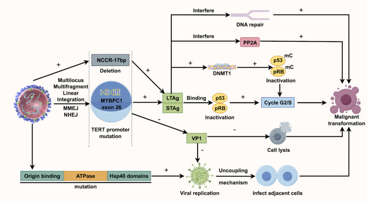

# 1750 — UTUC ở bệnh nhân thận ghép: khuyết lòng bể thận ghép & kẻ bắt chước "viêm thận–bể thận" / Upper tract urothelial carcinoma in kidney transplant recipients

**Tags:** `pattern:khuyet-long` `pattern:u-nieu-mac` `pattern:gia-viem` `pattern:u-nuoc-than` `vung:than-ghep` `vung:nieu-quan` `vung:bang-quang` `vung:tieu-khung` `score:TNM-UTUC` `score:EAU-risk` `protocol:CT-urography` `protocol:MR-urography` `protocol:noi-soi-nieu-quan` `incidentaloma:than-ghep`
**Mức chắc chắn (certainty):** tổng hợp y văn (literature synthesis) — 1 đoàn hệ quốc gia Hà Lan **30 ca/24.270 lần ghép** (PMC12206317), 1 đoàn hệ 30 năm **97 ca UTUC sau ghép** (PMC10148563), 1 đoàn hệ **24 ca UTUC có/không BK virus** (PMC13093527), 1 tổng quan kể chuyện (PMC12740875) và 1 ca nguyên văn có ảnh (PMC12109492). Bằng chứng chủ yếu là hồi cứu và ca báo cáo; câu nào là suy luận được ghi **[suy luận]**.

## 1. Tổng quan bệnh học – cơ chế hình ảnh

- **Định nghĩa:** UTUC (upper tract urothelial carcinoma) là ung thư biểu mô niệu mạc của **bể thận – niệu quản**. Ở người ghép thận, u có thể nằm ở **thận ghép** (bể thận ghép, niệu quản ghép nối vào bàng quang) hoặc ở **thận nguyên bản** (native kidney) — thường đã mất chức năng, ứ nước, đôi khi có **bệnh thận nang mắc phải (ACKD)**.
- **Vì sao nguy cơ tăng — 4 cơ chế chồng lên nhau:**
  1. **Giảm giám sát miễn dịch:** thuốc ức chế miễn dịch làm tế bào u thoát khỏi tiêu diệt; nguy cơ ung thư chung sau ghép **gấp 2–3 lần** dân số chung.
  2. **Độc chất trực tiếp lên DNA:** thuốc ức chế calcineurin (CNI: cyclosporine, tacrolimus) và thuốc ức chế mTOR gây tổn thương DNA; **acid aristolochic (aristolochic acid, AA)** trong một số thuốc Nam/Trung tạo **adduct DNA (dA-AL-I)** — đây là lý do UTUC chiếm ưu thế ở người ghép Trung Quốc/Đài Loan.
  3. **Virus sinh u:** **BK polyomavirus (BKPyV)** tái hoạt động; **kháng nguyên T lớn (large T antigen, LTag)** gắn và bất hoạt **p53, pRB** → tế bào mất điểm kiểm soát chu kỳ. Ở một đoàn hệ Anh, **BKPyV+ có 90,9% UTUC nguy cơ cao so với 30,8% ở BKPyV− (p = 0,005)**; SV40 LTag dương ở **33,3%**, tất cả đều độ 3 (PMC13093527).
  4. **Ứ nước – viêm mạn:** nước tiểu ứ tạo môi trường độc và viêm; **ứ nước thận nguyên bản là yếu tố dự báo độc lập mạnh nhất** cho UTUC sau ghép với **OR 35,32 (95% CI 17,99–69,36)**; **68,7%** người có UTUC có ứ nước so với **4,8%** người không có u (dẫn qua PMC12740875).
- **Dịch tễ — con số cụ thể:**
  - Hà Lan, 1991–2023: **30 UTUC/24.270 lần ghép**; tỉ lệ tích lũy **124/100.000 ca ghép (0,12%)**, tốc độ **3,7/100.000 người–năm** — so với **3,3/100.000** ở dân số chung (RESR), tức **chỉ cao hơn nhẹ** ở Tây Âu (PMC12206317).
  - Nhưng ở châu Á, mức tăng lớn hơn nhiều: một nghiên cứu châu Á dẫn trong tổng quan 2025 báo **UTUC 129,5 lần** và **ung thư bàng quang 25,5 lần** dân số chung; tại Trung Quốc UTUC/ung thư niệu mạc chiếm **> 40%** toàn bộ ung thư sau ghép (PMC12740875).
  - **67%** UTUC sau ghép nằm ở **thận ghép**; trung vị **91 tháng** (IQR 62–115) sau ghép; **87%** độ mô học cao; **47%** đã **pT3** lúc chẩn đoán (PMC12206317). UTUC trên thận ghép ước tính **0,019%** người ghép (PMC12109492).
  - Loạt 97 ca: **52,6% UTUC**, **17,5% bàng quang**, **29,9% cả hai**; sống 5 năm UTUC ≤ T1 **88,2%**, UTUC + bàng quang ≤ T1 **57,7%**, UTUC ≥ T2 **90,2%**, UTUC + bàng quang ≥ T2 **48,2%** (PMC10148563).
- **TẠI SAO hình ảnh trông như vậy (vật lý + mô bệnh):**
  - U niệu mạc là **mô mềm 30–50 HU** trước tiêm, ngấm thuốc **+20–40 HU** ở thì vỏ–tủy/ngấm thuốc, nên trên **thì bài tiết** (7–10 phút) nó hiện thành **khuyết lòng (filling defect)** được viền bởi nước tiểu cản quang dày — nguyên lý của dấu **goblet/stipple** (xem bài 1724).
  - Ở **thận ghép**, niệu quản **rất ngắn** sau nối niệu quản–bàng quang; u ở đoạn nối hoặc bể thận ghép dễ bị bỏ sót nếu không chụp **thì muộn qua hố chậu**. Khi **eGFR thấp**, thận ghép bài tiết kém → **không có cản quang trong bể thận**, khuyết lòng "biến mất" dù u vẫn còn.
  - U lành tính/viêm có thể **giả viêm**: phù nề niêm mạc, thâm nhiễm tế bào viêm và xơ → **giảm ngấm, bờ mờ, không có khối đặc rõ**, rất giống **viêm thận–bể thận** hoặc **áp-xe**. Ca nguyên văn dưới đây bị điều trị như "viêm thận ghép" **gần 2 năm** trước khi chẩn đoán (PMC12109492).
  - **Không có ngưỡng β-hCG/CRP nào loại trừ u.** Cytology nước tiểu **âm tính ở cả 3 lần** trong ca nguyên văn — độ nhạy thấp, nhất là khi u ở trên cao và nước tiểu ít.

## 2. Mẫu hình + chẩn đoán phân biệt theo VỊ TRÍ (Gamut)

**Mẫu hình:** (a) **khuyết lòng** trong bể thận/niệu quản ghép ± ứ nước; (b) **khối thay thế nhu mô** thận ghép, bờ mờ, ngấm thuốc kém ("giả viêm"); (c) **hẹp niệu quản** đoạn dài ± ứ nước; (d) **nhiều ổ** ở đường niệu trên (field change) ± bàng quang.

- **Theo vị trí:**
  - **Bể thận ghép/thận ghép:** UTUC thận ghép (0,019%), **u tuyến thận sinh (renal cell carcinoma, RCC) thận ghép** (đa số trong nhu mô, giàu mạch), **viêm thận–bể thận/áp-xe thận ghép**, **bệnh BK (BK nephropathy)** + hẹp niệu quản, **nhồi máu ổ khuyết** (segmental infarct), **máu tụ/cục máu đông** trong bể thận.
  - **Niệu quản ghép/đoạn nối:** hẹp miệng nối do thiếu máu (bài 3011), **hẹp do BK virus** (lan tỏa, thành dày — cũng trong bài 3011), **UTUC tại miệng nối**, **sỏi** (bài 190), **nấm/kén khí**.
  - **Thận nguyên bản:** UTUC trên **thận mất chức năng + ứ nước** (OR 35,32), **RCC/ACKD**, **sỏi san hô**, **viêm xơ hóa**, **di căn** (hiếm).
  - **Bàng quang:** UTUC **đồng thời/tái phát** sau UTUC (field change) — phải nội soi bàng quang trong cùng đợt; **77,7%** tái phát 5 năm sau TURBT ở người ghép so với **38%** không ghép (PMC12740875).
- **Theo hình thái (giúp nhớ nhanh):**
  - **Khuyết lòng di động, đổi vị trí:** cục máu đông, nấm, mảnh niêm mạc bong.
  - **Khuyết lòng cố định + ngấm thuốc:** UTUC, u nhú niệu mạc, **nephrogenic adenoma** (lành, cũng cho dấu goblet — bài 1724).
  - **Khối đặc thay nhu mô, ngấm kém, bờ mờ:** UTUC thể thâm nhiễm, **giả viêm**; RCC thường **giàu mạch, ngấm mạnh thì vỏ**.
  - **Hẹp đoạn dài, thành dày, không khối trong lòng:** **BK virus**, hẹp do thiếu máu, xơ sau can thiệp.
  - **Tăng đậm độ > 200 HU, không ngấm:** sỏi.

## 3. Bảng so sánh phân biệt (ma trận đối chiếu)

| Thực thể (entity) | Hình ảnh điển hình (CT/MRI) | Chốt vào (rule-in) | Chốt loại (rule-out) | Gợi ý xác nhận |
|---|---|---|---|---|
| **UTUC thận ghép (bể thận/niệu quản)** | Khuyết lòng **cố định**, ngấm thuốc, ± ứ nước; hoặc khối thay nhu mô **bờ mờ, ngấm kém**; ± hạch hố chậu | **Khuyết lòng cố định + ngấm thuốc trên CT thì bài tiết**; **ứ nước thận ghép**; tiền sử UTUC bàng quang | Không khuyết lòng, không ngấm, đổi vị trí → máu/nấm; **có sỏi cản quang > 200 HU** → sỏi | CTU 3 thì; nội soi niệu quản + sinh thiết; GATA3/p63 |
| **Viêm thận–bể thận/áp-xe thận ghép** | Thận to, phù quanh, **ổ dịch/khí trong nhu mô**, ngấm viền; giảm ngấm hình nêm | **Sốt + đau hố chậu + CRP tăng + cấy nước tiểu (+)**, ổ dịch/khí | **Không có ổ dịch/khí, khối đặc ngấm thuốc tồn tại sau 4–6 tuần kháng sinh** → không phải viêm đơn thuần | Siêu âm/CT lặp sau kháng sinh; chọc hút nếu có ổ |
| **Bệnh BK (BK nephropathy) + hẹp niệu quản** | **Hẹp đoạn dài/lan tỏa**, thành niệu quản dày, thận ghép phù; không khối trong lòng | **BK viral load (+)**, hẹp không có khối, đáp ứng giảm ức chế miễn dịch | **Khối đặc trong lòng hoặc khuyết lòng cố định** → nghĩ UTUC | PCR BK; SV40; nội soi thấy hẹp không u |
| **Cục máu đông/nấm trong bể thận** | Khuyết lòng **di động**, không ngấm, thay đổi giữa 2 lần chụp | **Đổi vị trí/tan sau rửa**, không ngấm | **Cố định + ngấm sau tiêm** → u | Chụp lặp 24–48 giờ; rửa bể thận |
| **Sỏi thận ghép** | **> 200 HU** (calci), không ngấm; ± bóng cản quang | **Tăng đậm độ rất cao, không ngấm**, ± sỏi san hô | Không thấy cấu trúc cản quang; **khuyết lòng mềm** → u | CT không cản quang; X-quang; siêu âm |
| **RCC thận ghép** | Khối **trong nhu mô**, giàu mạch, ngấm mạnh thì vỏ–tủy, ± hoại tử | **Ngấm mạnh thì động mạch + washout**, không xuất phát từ bể thận | **Tổn thương trung tâm bể thận, ngấm kém** → UTUC | CT 4 thì; MRI; sinh thiết |
| **Phản ứng hạt BCG (sau bơm bàng quang)** | Thành bàng quang/niệu quản dày, hẹp, **ổ hạt nhỏ**, không khối lớn | **Tiền sử BCG + cấy nước tiểu vô khuẩn + tổn thương lan tỏa đối xứng** | **Khối đặc khu trú, lớn dần** → không phải phản ứng BCG | Ngừng BCG, chụp lặp; sinh thiết nếu nghi |
| **Nephrogenic adenoma (lành)** | Khuyết lòng nhỏ, **giống UTUC**, có thể dấu goblet | **Tiền sử can thiệp niệu quản + tổn thương nhỏ, không xâm lấn** | **Xâm lấn cơ/xơ hóa quanh, hạch** → UTUC | Sinh thiết (chẩn đoán mô học) |

*CT thận ghép (a: trục, b: coronal): tổn thương **29/26 mm** ở cực dưới thận ghép, giảm đậm độ, bờ mờ — hình ảnh "giả viêm" của UTUC thận ghép. Nguồn: Moldoveanu O et al., Biomedicines 2025 (PMC12109492), Fig. 2, CC BY 4.0.*

### Ba câu hỏi trước khi gọi "viêm thận ghép"

- **Tổn thương có nằm trong lòng đường niệu không?** (khuyết lòng cố định = u; ổ dịch trong nhu mô = viêm/áp-xe).
- **Sau 4–6 tuần kháng sinh đúng, tổn thương có nhỏ lại không?** Không nhỏ, hoặc **to lên**, phải loại trừ u — ca nguyên văn tăng từ **29/26 mm lên 41/38 mm** (PMC12109492).
- **Có ứ nước thận ghép/thận nguyên bản không?** Ứ nước là **OR 35,32** cho UTUC — không được coi là "biến chứng ghép" đơn thuần.

## 4. Protocol chụp + phân độ/điểm chuẩn hóa

- **Siêu âm:** bước đầu, đo **bề dày nhu mô, bể thận, độ giãn đài bể thận**; siêu âm **hằng năm** để phát hiện **ứ nước thận nguyên bản** (dấu hiệu cảnh báo mạnh nhất) và bất thường thận ghép.
- **CT urography (CTU) 3 thì — chuẩn chẩn đoán:**
  - **Không cản quang:** phát hiện **sỏi > 200 HU**, vôi hóa, nang.
  - **Thì vỏ–tủy 30–40 giây** (hoặc 60–70 giây): đánh giá **nhu mô thận ghép**, khối đặc, hạch.
  - **Thì bài tiết 7–10 phút:** **bắt buộc** để thấy **khuyết lòng** trong bể thận/niệu quản ghép; lát **≤ 1 mm**, **MPR coronal/sagittal** qua hố chậu.
  - Với thận ghép: đặt cửa sổ qua **hố chậu**, không chỉ qua thận nguyên bản; **không bỏ thì muộn** vì niệu quản ghép rất ngắn.
  - Hiệu năng chung của CTU cho UTUC: **Se ~92%, Sp ~95%**, nhưng u **< 3 mm chỉ Se ~40%** (bài 1724).
- **Khi eGFR < 30 mL/min/1,73 m²** (thận ghép thường suy):
  - **MR urography (MRU)** chuỗi T2 (không cần gadolinium) + T1/T2 + DWI; gadolinium **tránh** khi eGFR < 30 vì nguy cơ xơ hóa hệ thống do gadolinium (NSF).
  - **Chụp ngược dòng/qua da (retrograde/antegrade pyelography)** nếu cần, nhưng **tránh đặt nephrostomy xuyên qua u** (nguy cơ gieo mầm đường hầm) [suy luận].
  - **Siêu âm + CT không cản quang** vẫn có giá trị theo dõi ứ nước và sỏi.
- **Phân độ TNM (AJCC 8th) — UTUC:**
  - **Ta:** u nhú không xâm lấn; **T1:** xâm lấn lớp đệm (lamina propria); **T2:** xâm lấn cơ (muscularis); **T3:** xâm lấn mỡ quanh bể thận/mỡ quanh thận; **T4:** xâm lấn cơ quan lân cận.
  - **N0/N+:** hạch; **M0/M1:** di căn.
  - **Độ mô học WHO 2004/2016:** **LG/HG**; **87%** UTUC sau ghép là **HG** (PMC12206317).
- **Phân tầng nguy cơ EAU (2023) — dùng để chọn bảo tồn hay cắt:**
  - **Nguy cơ thấp:** u **< 2 cm**, **đơn ổ**, **LG trên sinh thiết**, **không ứ nước**, không có variant mô học.
  - **Nguy cơ cao (bất kỳ yếu tố):** **ứ nước**, **> 2 cm**, **HG/variant**, **đa ổ**, tiền sử **cắt bàng quang**, **suy thận**, **UTUC hai bên**.
  - Ở người ghép, phần lớn rơi vào **nguy cơ cao** (HG 87%, pT3 47%) → **cắt thận–niệu quản triệt để + cuff bàng quang** là chuẩn; **bảo tồn qua nội soi** chỉ khi **bắt buộc** (thận ghép độc nhất, u nhỏ LG đơn ổ, không ứ nước) và phải theo dõi nội soi sát.
- **Điều trị — nguyên tắc:**
  - **UTUC thận ghép:** **cắt thận ghép + niệu quản + cuff bàng quang (graft nephroureterectomy)**, **ngừng ức chế miễn dịch**, chuyển về lọc máu; ca nguyên văn đạt **pT4N0M1**, di căn phổi **thoái triển sau 3 tháng** khi ngừng ức chế miễn dịch (PMC12109492).
  - **UTUC thận nguyên bản:** cắt thận–niệu quản + cuff bàng quang; cân nhắc **cắt hai bên đồng thời (SBRNU)** ở người nguy cơ cao (AA, nữ, đa ổ) — còn tranh luận, **không làm thường quy** (PMC12740875).
  - **Bảo tồn:** nội soi niệu quản **laser ablation**/cắt đoạn niệu quản cho u nhỏ, LG, đơn ổ; **BCG bơm ngược dòng** còn tranh luận vì nguy cơ nhiễm BK toàn thân ở người ức chế miễn dịch.
  - **Hóa trị bổ trợ:** **gemcitabine + cisplatin (GC)** hoặc **GCa (carboplatin)** cho ≥ T2; ở người ghép **độc tính huyết học nặng hơn**: DFS 5 năm **45,7% vs 70,2%**, OS **62,8% vs 77,6%** so với người không ghép (PMC12740875).
  - **Điều trị đích/miễn dịch:** **ức chế điểm kiểm soát (ICI)** có thể gây **thải ghép** — chỉ dùng khi có kinh nghiệm đa chuyên khoa; **enfortumab vedotin** và **erdafitinib** còn ít dữ liệu ở người ghép.
  - **Điều chỉnh ức chế miễn dịch:** giảm liều, **chuyển CNI → sirolimus** (mTOR) có thể làm chậm tiến triển UTUC giai đoạn ≥ T2 (PFS tốt hơn, p = 0,026 — PMC10148563) nhưng **không thay thế phẫu thuật**.

## 5. Biến thể bình thường và cạm bẫy

- **Cytology âm tính không loại trừ:** cả **3 lần** cytology âm trong ca nguyên văn; độ nhạy thấp vì nước tiểu ít và u ở cao (PMC12109492).
- **Không tiếp cận được niệu quản ghép:** nội soi niệu quản **thất bại** vì không vào được lỗ nối; đừng coi "không soi được" là "không có u" — chuyển **sinh thiết thận ghép qua da** hoặc **MRI**.
- **"Viêm thận–bể thận" kéo dài:** tổn thương **không nhỏ sau 4–6 tuần kháng sinh**, hoặc **to lên**, phải chụp lại và loại trừ u; **BCG trước đó** càng dễ che lấp (phản ứng hạt BCG).
- **Thận ghép không đau:** mảnh ghép mất cảm giác thần kinh → **tiểu máu/creatinin tăng** là tín hiệu, không chờ đau như thận nguyên bản.
- **Sỏi vs u:** sỏi **> 200 HU**, không ngấm; u mềm **30–50 HU**, ngấm **+20–40 HU** — đừng đo trên thì đã có cản quang trong bể thận.
- **Cục máu đông:** đổi vị trí/tan sau rửa; **khuyết lòng cố định qua 2 lần chụp** mới đáng lo.
- **Bỏ sót thận nguyên bản:** ứ nước thận nguyên bản **OR 35,32**; phải khảo sát **cả hai bên**, không chỉ thận ghép.
- **Đa ổ/hai bên:** UTUC sau ghép là **bệnh của toàn bộ niệu mạc (field change)**; **77,7%** tái phát 5 năm sau TURBT — soi bàng quang và chụp toàn bộ đường niệu trong cùng đợt.
- **Đừng dùng tỉ lệ 3,3/100.000 của dân số chung để trấn an:** ở nhóm **châu Á/AA**, nguy cơ UTUC tăng tới **129,5 lần**; hỏi kỹ **thuốc Nam/Trung có acid aristolochic**, nghề nghiệp, sỏi/ứ nước.
- **Không chọc/nephrostomy xuyên u** nếu có thể tránh — nguy cơ gieo mầm đường hầm [suy luận]; ưu tiên đường nội soi hoặc mổ.

## 6. Tự lượng giá — Blind Quiz

**Ca 1 — Nam 67 tuổi, ghép thận 10 năm, tiểu máu đại thể; trước đó đã cắt u bàng quang pTa LG và bơm BCG 1 năm. Sáu tháng sau ngừng BCG: sốt, đau hố chậu phải, tiểu máu vi thể. Ảnh CT dưới đây.**

- Hỏi: mô tả tổn thương? Ba chẩn đoán phân biệt? Bước tiếp theo và điều gì khiến bạn không yên tâm với chẩn đoán "viêm thận ghép"?

<b>Bấm để hiện đáp án (findings + chẩn đoán)</b>

- **Findings:** tổn thương **29/26 mm** cực dưới thận ghép, giảm đậm độ, bờ mờ, không có ổ khí; bể thận không giãn rõ. Cytology nước tiểu **âm tính**.
- **Chẩn đoán ban đầu (sai):** viêm thận–bể thận thận ghép/viêm do BCG; kháng sinh levofloxacin 750 mg × 10 ngày, triệu chứng hết nhưng **tổn thương vẫn còn**.
- **Vì sao không yên tâm:** tổn thương **không biến mất** sau kháng sinh; 6 tháng sau **to lên 41/38 mm**, xâm lấn xoang thận/mỡ quanh thận; xuất hiện **nốt phổi 20/19 mm**.
- **Chẩn đoán đúng:** **UTUC thận ghép pT4N0M1, độ cao** (CK7+, GATA3+, p63+); cắt thận ghép + niệu quản + cuff bàng quang; **ngừng ức chế miễn dịch**, lọc máu; nốt phổi **thoái triển sau 3 tháng**, PET/CT âm tính.
- Nguồn ảnh: Moldoveanu O et al., Biomedicines 2025 (PMC12109492), Fig. 2, CC BY 4.0.

**Ca 2 — Cùng bệnh nhân, 24 tháng sau TURBT: tổn thương tiến triển và nốt phổi.**

- Hỏi: dấu hiệu nào cho biết đã **xâm lấn ra ngoài thận**? Vì sao không chọn bảo tồn?

<b>Bấm để hiện đáp án (findings + chẩn đoán)</b>

- **Findings:** khối **41/38 mm** cực dưới thận ghép, **xâm lấn xoang thận và mỡ quanh thận**, bờ không đều; không tái phát bàng quang; **nốt phổi đơn độc 20/19 mm**.
- **Vì sao không bảo tồn:** u **> 2 cm**, **xâm lấn mỡ quanh thận (pT3–T4)**, **di căn phổi** → nguy cơ cao, phải **cắt thận ghép + niệu quản + cuff**; bảo tồn chỉ đặt ra với u nhỏ, LG, đơn ổ, không ứ nước.
- **Điểm học:** UTUC thận ghép có thể **di căn phổi** dù u tại chỗ trông "khu trú"; sau cắt + ngừng ức chế miễn dịch, di căn có thể **thoái triển** (tái lập giám sát miễn dịch) — nhưng không được dùng điều này để trì hoãn mổ.
- Nguồn ảnh: Moldoveanu O et al., Biomedicines 2025 (PMC12109492), Fig. 3, CC BY 4.0.

**Ca 3 — Cơ chế BK virus gây UTUC: nhìn sơ đồ và trả lời.**

- Hỏi: LTag tác động lên hai gen ức chế u nào? Vì sao BK+ có tiên lượng xấu hơn? Điều này thay đổi theo dõi thế nào?

<b>Bấm để hiện đáp án (findings + chẩn đoán)</b>

- **Cơ chế:** BKPyV tích hợp → **LTag** gắn và bất hoạt **p53** và **pRB** → tế bào qua điểm kiểm soát G1/S, tăng đột biến và bất ổn định; **VP1** giảm → virus không ly giải tế bào, tiếp tục lây lan.
- **Hệ quả lâm sàng:** BKPyV+ có **90,9% UTUC nguy cơ cao** (so với 30,8% ở BK−, p = 0,005), **độ mô học cao hơn** (p = 0,013); SV40 LTag+ đều **G3** và xu hướng giai đoạn cao hơn (PMC13093527). UTUC liên quan BK thường **đa ổ, có thành phần micropapillary** (60% ở người có tiền sử BKPyV — PMC12740875).
- **Theo dõi:** với BK+ dai dẳng, **đo BK viral load định kỳ**, soi bàng quang, siêu âm/CT đường niệu; **giảm ức chế miễn dịch** là can thiệp đầu tay, nhưng phải cân với nguy cơ thải ghép.
- Nguồn ảnh: Li L et al., Front Immunol 2025 (PMC12740875), Fig. 2, CC BY 4.0.

## Bài liên quan chéo
- [1724 – UTUC: dấu goblet & stipple, CTU 3 thì, phân tầng EAU](../1724-utuc-goblet-sign/lesson.md)
- [190 – Sỏi niệu quản ở thận ghép & bàng quang thần kinh](../190-soi-nieu-quan-than-ghep-bang-quang-than-kinh/lesson.md)
- [3011 – Biến chứng niệu quản sau ghép thận: hẹp, rò, BK](../3011-bien-chung-nieu-quan-sau-ghep-than/lesson.md)
- [1825 – Hội chứng gan nhỏ & suy mảnh ghép](../1825-hoi-chung-gan-nho/lesson.md)
- [1759 – Thai trong cơ tử cung không sẹo](../1759-thai-trong-co-tu-cung-khong-seo/lesson.md)

> Không dùng để chẩn đoán độc lập khi chưa có người hướng dẫn.
