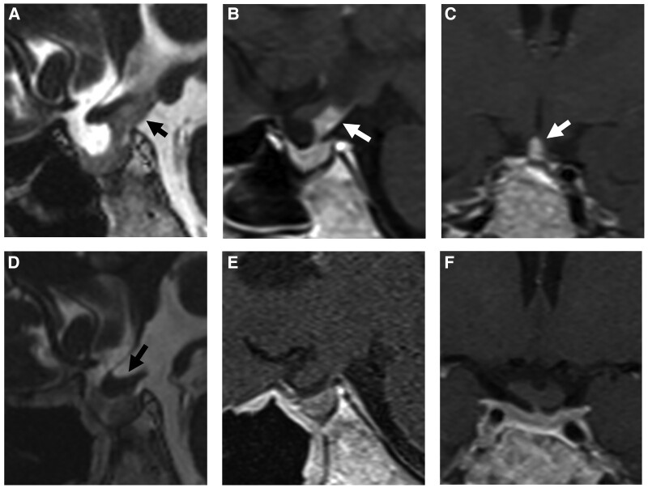
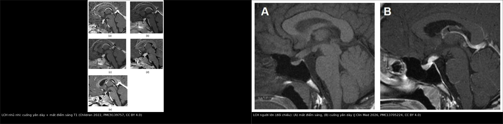
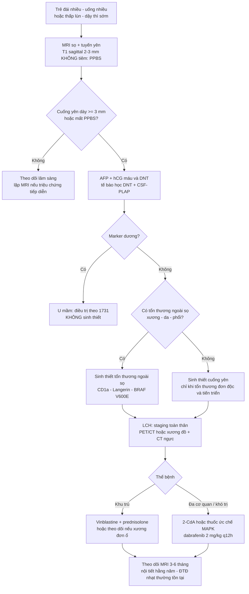
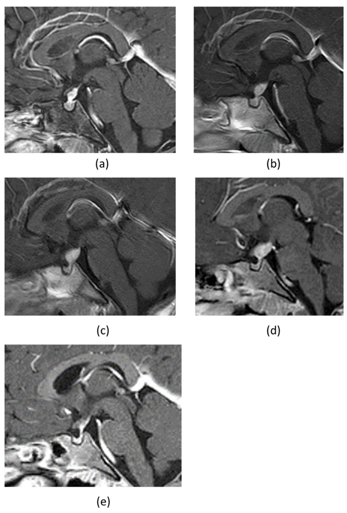
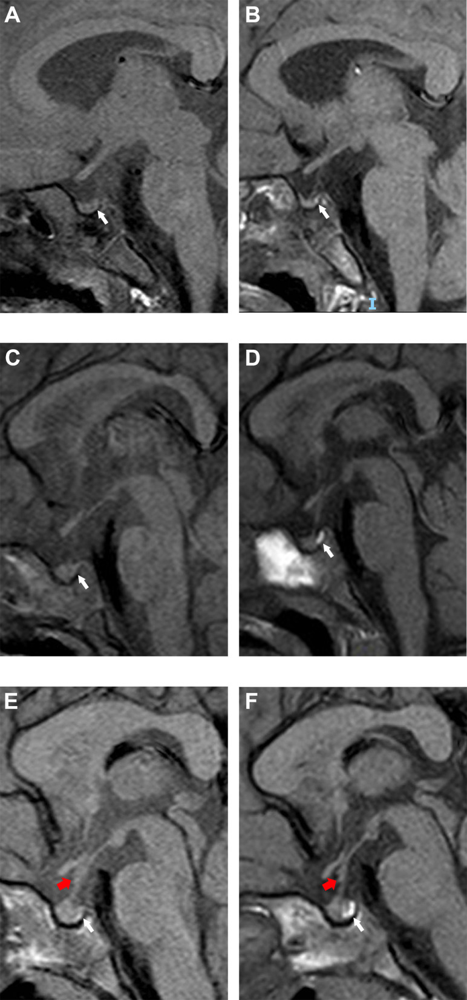
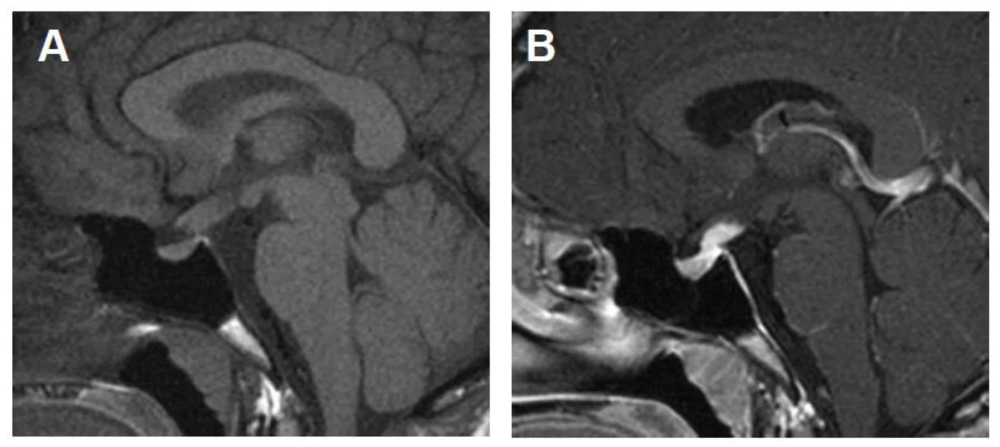

# 1751 — Bệnh mô bào Langerhans vùng dưới đồi–tuyến yên ở trẻ / Pediatric hypothalamic–pituitary Langerhans cell histiocytosis (LCH)

**Tags:** `pattern:cuong-yen-day` `pattern:mat-diem-sang-T1` `pattern:khong-vung-duoi-doi` `pattern:ngam-thuoc` `vung:tuyen-yen` `vung:so-yen` `vung:nao` `protocol:MRI-tuyen-yen` `protocol:sang-loc-noi-tiet` `protocol:sinh-thiet` `incidentaloma:khong`

**Mức chắc chắn (certainty):** tổng hợp y văn (literature synthesis) — 1 đoàn hệ đa trung tâm về tổn thương trục dưới đồi–tuyến yên trong LCH (Pituitary 2025, PMC12474694), 1 nghiên cứu dân số về tỉ lệ mắc (Br J Haematol 2022, PMC9826274), 2 đoàn hệ cuống yên dày ở trẻ (Front Endocrinol 2022, PMC9163297; Cancers 2023, PMC10417368), 1 đoàn hệ LCH xương đơn thuần của LCH-III (Blood Adv 2026, PMC13355188), 2 nghiên cứu về LCH thoái hóa thần kinh (Haematologica 2026, PMC13136826; HemaSphere 2026, PMC13242968), 1 nghiên cứu thực hành về thuốc ức chế MAPK (Int J Cancer 2026, PMC12996742) và 4 báo cáo ca có ảnh (Children 2022, PMC9139757; OncoTargets Ther 2020, PMC7719342; JCEM Case Rep 2025, PMC11809238; J Clin Med 2026, PMC13705224). Không có ca nguyên văn do nhóm tự viết; mọi ca trong quiz đều là ca có ảnh từ bài gốc, ghi rõ PMCID.

> **Câu chốt:** ở một trẻ **đái nhiều – uống nhiều**, bộ ba cần tìm trên MRI là **cuống yên dày ≥ 3 mm**, **mất điểm sáng T1 thùy sau tuyến yên** và **khối vùng dưới đồi**. Nhưng **hình ảnh không định được nguyên nhân**: u mầm, LCH và viêm tuyến yên–cuống yên tăng sinh lympho (LINH) có thể **giống hệt nhau**. Sai lầm chết người là **cho corticoid trước khi lấy marker và trước khi có mô bệnh** — corticoid làm **teo cả u mầm lẫn LCH**, mất dấu vết chẩn đoán; và **gọi "LINH" rồi theo dõi** trong khi tổn thương là u. Ngược lại, **không phải ca cuống yên dày nào cũng cần sinh thiết cuống yên**: ưu tiên sinh thiết **tổn thương ngoài sọ** (xương, da) nếu có.

## 1. Tổng quan bệnh học – cơ chế hình ảnh

### 1.1 Bệnh học và dịch tễ

- **LCH** là một bệnh tăng sinh **tế bào tua kiểu Langerhans** (Langerhans-type dendritic cells) mang đột biến **đường MAPK** — **BRAF V600E** gặp ở **khoảng một nửa** số ca (PMC9139757). Bệnh có thể **một ổ**, **nhiều ổ một cơ quan** hoặc **nhiều cơ quan (multisystem)**; vì vậy **chẩn đoán hình ảnh không dừng ở sọ**.
- **Tỉ lệ mắc ở trẻ < 15 tuổi: 4,46/1 triệu trẻ/năm** (KTC 95% 3,99–4,98; Anh 2013–2019, 324/658 ca là trẻ em); **sống 1 năm 99%** ở trẻ (PMC9826274). Đây là bệnh **hiếm nhưng không cực hiếm** — mỗi trung tâm nhi lớn gặp vài ca mỗi năm.
- **Vị trí nội sọ hay gặp nhất là trục dưới đồi–tuyến yên**, biểu hiện sớm nhất thường là **đái tháo nhạt trung ương (central diabetes insipidus, CDI)**. Trong đoàn hệ 48 bệnh nhân có tổn thương trục dưới đồi–tuyến yên: **69% có thiếu arginine vasopressin (AVD)** ngay lúc chẩn đoán, **42% thiếu gonadotropin**, **25% suy giáp trung ương**, **12,5% suy thượng thận**, **12% thiếu GH**; MRI thấy **bất thường thùy sau/cuống yên ở 73%** (PMC12474694).
- **Di chứng thoái hóa thần kinh (neurodegenerative LCH, ND-LCH)** gặp ở **10% (63/637)** bệnh nhân LCH trong sổ bộ Ý — và **60% trong số đó không có triệu chứng** lúc phát hiện (PMC13136826). Đây là lý do phải **theo dõi MRI não dài hạn**, không chỉ MRI tuyến yên.

### 1.2 TẠI SAO hình ảnh lại như vậy

- **Điểm sáng T1 thùy sau tuyến yên (posterior pituitary bright spot, PPBS):** thùy sau chứa **hạt bài tiết chứa vasopressin/oxytocin gắn neurophysin** — phức hợp protein–phospholipid có **thời gian T1 ngắn**, nên **sáng tự nhiên trên T1 không tiêm**. Khi tế bào mô bào xâm nhập và phá hủy thùy sau/cuống yên, **hạt bài tiết mất → mất điểm sáng**, đồng thời **mất khả năng cô đặc nước → đái tháo nhạt**. Vì vậy **mất PPBS là dấu hiệu sớm**, có thể xuất hiện **trước khi có khối lớn** và trước khi T1 sau tiêm bất thường.
- **Cuống yên dày:** do **thâm nhiễm tế bào mô bào + phù nề** dọc trục dưới đồi–tuyến yên. Cần nhớ **vùng median eminence–thùy sau không có hàng rào máu–não**, nên **ngấm thuốc ở cuống yên là sinh lý**; yếu tố bệnh lý là **độ dày**, không phải "có ngấm".
- **Khối vùng dưới đồi:** khối tế bào + phù nề quanh u; ngấm thuốc **không đồng nhất**; có thể chèn ép giao thoa thị giác, gây **giảm thị lực** và **rối loạn chức năng dưới đồi** (mất khát, rối loạn điều nhiệt).
- **Tổn thương ND-LCH:** hình ảnh **tăng tín hiệu T2/FLAIR đối xứng ở nhân răng (dentate nuclei), hạch nền, chất trắng quanh não thất**, kèm **teo tiểu não** — bản chất là **viêm–thoái hóa chất trắng và nhân xám do phản ứng miễn dịch kéo dài**, không phải di căn. Vì vậy **không sinh thiết** các ổ này khi bệnh cảnh LCH đã rõ.
- **Vì sao chẩn đoán muộn:** đái nhiều – uống nhiều **tiến triển âm thầm**, trẻ vẫn ăn ngủ bình thường; MRI ban đầu có thể chỉ **dày cuống yên 3–4 mm** — dễ đọc là "giới hạn bình thường". Trong u mầm trên yên, **thời gian từ MRI đầu đến điều trị có trung vị 312 ngày** (PMC11246258, bài 1731); LCH cũng thường bị **theo dõi "viêm" nhiều tháng trước khi sinh thiết**.

### 1.3 Ngưỡng định lượng trụ cột

| Đại lượng | Con số | Nguồn |
|---|---|---|
| Tỉ lệ mắc LCH ở trẻ < 15 tuổi | **4,46/1 triệu trẻ/năm** (3,99–4,98); sống 1 năm **99%** | PMC9826274 |
| Cuống yên dày (định nghĩa dùng trong đoàn hệ nhi) | **≥ 3 mm tại chỗ bám tuyến yên** và/hoặc **≥ 4 mm tại giao thoa thị giác** | PMC11460958 |
| Ngưỡng cuống yên dày dự báo nguyên nhân tân sinh | **≥ 6,5 mm** (cùng với CDI và **≥ 2 thiếu hụt hormone**) | PMC10417368 |
| Tỉ lệ nguyên nhân tân sinh trong cuống yên dày ở trẻ | **50% (14/28)** ở Hong Kong: **u mầm 46%**, **LCH 4%**; Warsaw: **u mầm 73,9%**, **LCH 13% (3/23)** | PMC10417368 · PMC9163297 |
| Trong LCH có tổn thương trục dưới đồi–tuyến yên | **AVD 69%**, gonadotropin **42%**, TSH **25%**, ACTH **12,5%**; MRI bất thường thùy sau/cuống yên **73%** | PMC12474694 |
| Diễn tiến trong theo dõi (trung vị 15,8 năm) | **27%** phát triển AVD mới; **5** bệnh nhân thêm thiếu hụt hormone trước yên; **không tử vong do bệnh** | PMC12474694 |
| ND-LCH trong tổng số LCH | **10% (63/637)**; **60% không triệu chứng** lúc chẩn đoán; MRI tiến triển **21%** (trung vị 1,5 năm) | PMC13136826 |
| LCH xương đơn thuần (LCH-III, 381 ca đánh giá được) | **EFS 5 năm 71%**, **OS 100%**; **tỉ lệ mắc CDI tích lũy 5 năm 5%** (cao hơn khi có tổn thương xương "nguy cơ thần kinh" + nhiều ổ xương) | PMC13355188 |
| Thuốc ức chế MAPK ở LCH trẻ (thực hành thực tế, 36 trẻ) | **Đáp ứng khách quan 94,4% (34/36)** lúc 3 tháng; **DAS trung vị 5 → 1**; **13 trẻ còn ĐTĐ nhạt/xơ hóa đường mật** | PMC12996742 |
| Thuốc ức chế MAPK ở ND-LCH (60 trẻ) | **Cải thiện lâm sàng 55%**, ổn định **39%**, tiến triển **6%**; **MRI cải thiện 74%**; biến cố bất lợi **52%** (phần lớn nhẹ) | PMC13242968 |

## 2. Mẫu hình + chẩn đoán phân biệt theo vị trí (Gamut)

- **Cuống yên dày đơn độc (kèm hoặc không kèm mất PPBS):**
  - Gamut: **LCH** · **u mầm (germinoma/NGGCT)** · **viêm tuyến yên–cuống yên tăng sinh lympho (lymphocytic infundibuloneurohypophysitis, LINH)** · **bệnh Erdheim–Chester (ECD)** · **di căn/leukemia** · **lao, sarcoid** · **u sọ hầu (craniopharyngioma)**.
  - Gợi nhớ **LIGER**: **L**CH · **I**nfundibuloneurohypophysitis · **G**erminoma · **E**rdheim–Chester · **R**ải (di căn/leukemia).
- **Mất điểm sáng T1 thùy sau tuyến yên:**
  - Gamut: **LCH** · **u mầm** · **LINH** · **sau chấn thương/phẫu thuật/xạ** · **tuyến yên lạc chỗ bẩm sinh (ectopic posterior pituitary)** — thể bẩm sinh thường kèm **cuống yên đứt/mảnh tuyến yên lạc chỗ ở sàn não thất III**, không có bệnh cảnh viêm tiến triển.
- **Khối vùng dưới đồi – trên yên:**
  - Gamut: **LCH** · **u thần kinh đệm đường thị/dưới đồi (thường NF1)** · **u sọ hầu** · **u mầm** · **ECD** · **u lympho** · **di căn**.
- **Tổn thương đối xứng hạch nền – nhân răng – chất trắng (ND-LCH):**
  - Gamut: **ND-LCH** · **bệnh chất trắng do xạ trị (bài 261)** · **bệnh mạch nhỏ** · **di căn đa ổ** · **viêm não tự miễn**.
  - Chốt: **tiền sử LCH + tổn thương T2/FLAIR đối xứng nhân răng/hạch nền, không choán chỗ, không ngấm** → **ND-LCH**, **không sinh thiết**.

*Bệnh nhân LCH người trẻ: (A) T2W sagittal, (B) T1W sau tiêm sagittal, (C) T1W sau tiêm coronal — **khối vùng trên yên/dưới đồi ngấm thuốc**, áp sát cuống yên và giao thoa thị giác (mũi tên); (D–F) sau điều trị bằng cytarabine, tổn thương **thu nhỏ rõ**. Ảnh nguyên bản, không crop (JCEM Case Rep 2025, PMC11809238, CC BY-NC-ND 4.0).*

## 3. Bảng so sánh phân biệt (ma trận đối chiếu)

| Thực thể (entity) | Hình ảnh điển hình | Chốt vào (rule-in) | Chốt loại (rule-out) | Gợi ý xác nhận |
|---|---|---|---|---|
| **LCH trục dưới đồi–tuyến yên** | **Cuống yên dày ≥ 3 mm**, **mất PPBS**, có thể khối dưới đồi; **tổn thương xương/da/phổi** ngoài sọ | **Trẻ đái nhiều + cuống yên dày + tổn thương ngoài sọ (xương dạng "punched-out", ban da, nang phổi)**; **CD1a/Langerin dương** | Chỉ có cuống yên dày đơn độc, không tổn thương ngoài sọ, marker u mầm âm → **vẫn chưa loại được** (phải theo dõi/sinh thiết) | Sinh thiết **tổn thương ngoài sọ** nếu có; **CD1a/CD207**, BRAF V600E |
| **U mầm trên yên (germinoma)** | Khối **đồng nhất**, ngấm **mạnh–đồng nhất**, **ADC thấp**, **mất PPBS**; có thể **hai ổ tùng + trên yên** | **AFP > 25 ng/mL và/hoặc hCG > 50 IU/L**; **CSF-PLAP ≥ 8 pg/mL**; trẻ **10–19 tuổi** | Marker âm + khối dị thể (nang/máu) → nghĩ NGGCT/LCH, không loại trừ u tinh bào | Marker + MRI toàn trục tủy; sinh thiết nếu marker âm (bài 1731) |
| **LINH (viêm tuyến yên–cuống yên tăng sinh lympho)** | Cuống yên dày **đối xứng, nhẵn**, **mất PPBS**, **không có khối rời**, tự thu nhỏ theo thời gian | **Đái nhiều cấp + cuống yên dày nhẵn + không tổn thương ngoài sọ + tự cải thiện** | **Tổn thương xương/da + cuống yên dày tiến triển** → LCH; **khối lớn/tăng dần** → u | Theo dõi MRI 3–6 tháng; **không sinh thiết vội** |
| **U sọ hầu (craniopharyngioma)** | Khối **hỗn hợp đặc–nang**, **vôi hóa vỏ trứng**, trên/dưới yên, giãn não thất | **Nang + vôi hóa + trẻ 5–15 tuổi** | Khối đặc, không vôi hóa, **mất PPBS** → LCH/u mầm | MRI + CT (vôi hóa); mô bệnh |
| **U thần kinh đệm đường thị/dưới đồi** | **Phì đại đường thị/dưới đồi**, T2 cao, **ngấm thuốc ít**, thường **NF1** | **NF1 + đường thị to + không mất PPBS** | Ngấm mạnh + mất PPBS + tổn thương ngoài sọ → LCH | MRI; sinh thiết khi cần |
| **Erdheim–Chester (ECD)** | Cuống yên dày + **mô mỡ quanh hốc mắt**, **xơ hóa sau phúc mạc**, "**hairy kidney**", xương cứng | **Đau xương hai bên + mô mỡ quanh thận + BRAF V600E** | Chỉ tổn thương sọ, không xơ hóa tạng → LCH | Sinh thiết; **CD1a âm, CD68+/CD163+** |
| **Di căn/leukemia** | Cuống yên dày, khối dưới đồi, **nhiều ổ**, tổn thương tủy xương | **Bệnh máu đã biết + nhiều ổ + LDH tăng** | Tổn thương đơn độc + xương "punched-out" → LCH | Tủy đồ, sinh thiết |
| **Tuyến yên lạc chỗ bẩm sinh** | **Mất PPBS + cuống yên đứt + mảnh tuyến yên lạc chỗ ở sàn não thất III** | **Trẻ thấp lùn bẩm sinh, không đái nhiều tiến triển** | **Cuống yên dày liên tục** → bệnh lý mắc phải | MRI sagittal mỏng; không sinh thiết |
| **ND-LCH** | **T2/FLAIR tăng đối xứng nhân răng, hạch nền, chất trắng quanh não thất**; teo tiểu não | **Tiền sử LCH + tổn thương đối xứng, không choán chỗ, không ngấm** | **Tổn thương không đối xứng, ngấm thuốc, choán chỗ** → di căn/u thứ phát | MRI não; **không sinh thiết ổ ND-LCH** |

*Trái: LCH khởi phát ở nhũ nhi — chuỗi MRI sagittal T1 sau tiêm theo thời gian cho thấy **cuống yên dày** và **mất điểm sáng thùy sau tuyến yên** (Children 2022, PMC9139757, CC BY 4.0). Phải: LCH người lớn (đối chiếu) — (A) T1W không tiêm **không thấy điểm sáng thùy sau**, (B) sau tiêm **cuống yên dày, ngấm thuốc** (J Clin Med 2026, PMC13705224, CC BY 4.0). Ảnh ghép letterbox, không crop/kéo giãn.*

### Ba dấu hiệu đọc đúng trên một phim sagittal T1

- **Điểm sáng thùy sau:** có/không, **so với mô não xung quanh** ở **lát 2–3 mm không tiêm**. Đừng đánh giá trên ảnh sau tiêm (thuốc làm mất tương phản sinh lý).
- **Độ dày cuống yên:** đo **vuông góc với trục cuống**, tại **chỗ bám tuyến yên** và **sát giao thoa thị giác**; ghi **mm** và **vị trí đo** — vì ngưỡng khác nhau (3 mm vs 4 mm).
- **Đường bờ cuống:** **nhẵn, đối xứng** gợi LINH/LCH sớm; **gồ ghề, lệch, có nốt rời** gợi u mầm/di căn.

## 4. Protocol chụp + hệ phân độ/điểm chuẩn hóa

### 4.1 MRI — chuỗi xung tối thiểu

- **MRI sọ + vùng tuyến yên**, không và có gadolinium:
  - **T1W sagittal không tiêm, lát 2–3 mm** qua tuyến yên–cuống yên: **bắt buộc** để đánh giá **PPBS**;
  - **T1W sau tiêm sagittal + coronal lát 2–3 mm**; **T2W**; **FLAIR**; **DWI/ADC** (không đặc hiệu, nhưng giúp loại nhồi máu/áp-xe);
  - **MRI toàn trục tủy** khi nghi u mầm (bài 1731) — không cần thường quy cho LCH đã có mô bệnh.
- **Đánh giá toàn thân (vì LCH là bệnh hệ thống):** **PET/CT toàn thân** hoặc **xương đồ + CT ngực**; trong đoàn hệ HEROS, **46% có tổn thương xương** và **42% có tổn thương phổi** lúc chẩn đoán (PMC12474694).
- **Theo dõi:** MRI sọ–tuyến yên **3–6 tháng/lần** trong 2 năm đầu, sau đó thưa dần; **MRI não** để phát hiện **ND-LCH** (nhân răng, hạch nền, chất trắng).

### 4.2 Xét nghiệm trước và sau MRI

- **Trước mọi can thiệp:** **AFP, hCG (huyết thanh + dịch não tủy)** — loại u mầm; **tế bào học dịch não tủy**; **CSF-PLAP** nếu có.
- **Chẩn đoán ĐTĐ nhạt:** **Na máu, osmolality máu/niệu**, **nghiệm pháp nhịn nước + desmopressin**; **không** chẩn đoán chỉ bằng "uống nhiều".
- **Trục trước yên:** **IGF-1, FT4/TSH, cortisol sáng/ACTH, LH/FSH, prolactin**; đánh giá **dậy thì sớm** (trong LCH có thể do kích thích trục gonadotropin).

### 4.3 Chẩn đoán mô bệnh — nguyên tắc "không sinh thiết cuống yên nếu còn lựa chọn"

- **Sinh thiết tổn thương ngoài sọ** (xương, da, hạch) là lựa chọn đầu: trong HEROS, **chẩn đoán mô bệnh được xác nhận ở tất cả bệnh nhân, chủ yếu từ tổn thương ngoài tuyến yên**; chỉ **5 ca sinh thiết qua đường sọ** và **2 ca qua xoang bướm** (PMC12474694).
- Sinh thiết cuống yên **chỉ khi tổn thương khu trú đơn độc và tiến triển**, sau khi đã loại u mầm bằng marker; ca nhũ nhi trong PMC9139757 được sinh thiết cuống yên vì tổn thương **đơn độc, lớn dần trong 1 năm**.
- **Hóa mô miễn dịch:** **CD1a, Langerin (CD207)**, CD68, S100; **BRAF V600E** (IHC/PCR) — vừa chẩn đoán, vừa mở đường **điều trị đích**.

### 4.4 Điều trị (khung thực hành)

- **Tuyến đầu:** **vinblastine + prednisolone** theo phác đồ LCH-III/IV; ở LCH xương đơn thuần điều trị **V-P 6 tháng**, **đáp ứng sớm lúc tuần 6 là 83%**, **EFS 5 năm 71%** (PMC13355188).
- **Tái phát/khó trị:** **cladribine (2-CdA)** — ca nhũ nhi PMC9139757 có **cuống yên thu nhỏ nhanh** sau 2-CdA; ca người lớn PMC13705224 giảm khối và phù nhưng **ức chế tủy độ 4** buộc ngừng.
- **BRAF V600E dương/khó trị:** **dabrafenib 2 mg/kg mỗi 12 giờ** (± trametinib) — 3 trẻ trong PMC7719342 **điểm sáng T1 thùy sau xuất hiện lại sau 1 và 3 tháng** điều trị; thực hành thực tế 36 trẻ cho **đáp ứng 94,4%** lúc 3 tháng (PMC12996742).
- **ND-LCH:** thuốc ức chế MAPK cho **cải thiện MRI 74%**, **lâm sàng 55%** (PMC13242968); **không** dùng xạ trị như liệu pháp đầu cho tổn thương ND-LCH.

## 5. Biến thể bình thường và cạm bẫy

- **"Mất điểm sáng T1 = LCH" là sai.** Mất PPBS còn gặp ở **u mầm, LINH, sau chấn thương/phẫu thuật**, và **tuyến yên lạc chỗ bẩm sinh**; một số người **không bệnh** cũng có thể mất (tỉ lệ chính xác **chưa rõ — cần tra**). Luôn đọc **cùng độ dày cuống yên + bệnh cảnh**.
- **Cuống yên < 3 mm không loại trừ LCH sớm.** Tổn thương có thể khởi đầu chỉ **2–3 mm**; nếu trẻ **đái nhiều thật sự**, **lặp MRI 3–6 tháng** thay vì kết luận "vô căn".
- **Corticoid trước marker/mô bệnh:** làm **teo u mầm và LCH**, mất mô để chẩn đoán, **âm tính giả marker**. Chỉ dùng khi có **tăng áp lực nội sọ nguy hiểm** và **đã lấy máu/DNT**.
- **Sinh thiết cuống yên không phải "xét nghiệm đầu tay":** nguy cơ tổn thương trục dưới đồi, tỉ lệ lấy được mô chẩn đoán thấp; **ưu tiên tổn thương ngoài sọ**. Trong HEROS, chẩn đoán chủ yếu từ **xương/da/phổi** (PMC12474694).
- **Gọi "LINH" quá sớm:** LINH là chẩn đoán **loại trừ + theo dõi**; nếu tổn thương **tăng dần** hoặc xuất hiện **tổn thương ngoài sọ**, phải sinh thiết lại — đã có ca u mầm bị chẩn đoán nhầm là LINH/LCH (PMC10417368).
- **ĐTĐ nhạt do LCH thường KHÔNG hồi phục:** trong đoàn hệ HP-LCH, **27% phát triển AVD mới** trong theo dõi và đa số vẫn còn AVD (PMC12474694); ngoại lệ là **trẻ được điều trị đích trước khi có ĐTĐ lâm sàng** — 3 ca PMC7719342 **điểm sáng T1 trở lại**. Do đó **không hứa "khỏi ĐTĐ"** và **không ngừng desmopressin theo MRI**.
- **ĐTĐ nhạt kèm mất khát (adipsic DI)** là cạm bẫy chết người: tổn thương dưới đồi làm **mất cảm giác khát** → trẻ **không uống bù**, có thể **tăng Na máu nặng**; ca báo cáo có **Na 170 mEq/L** và tử vong do ngừng tim (PMC13705224). **Không dựa vào "trẻ có uống nhiều"** để đánh giá an toàn.
- **ND-LCH bị đọc là di căn:** tổn thương **đối xứng nhân răng/hạch nền**, **không choán chỗ, không ngấm**, thường **không triệu chứng (60%)** — **không sinh thiết**, không đổi phác đồ vì "di căn" (PMC13136826).
- **Ngấm thuốc cuống yên là sinh lý:** vùng không có hàng rào máu–não; đừng gọi "viêm" chỉ vì cuống yên ngấm thuốc.

## 6. Tự lượng giá — Blind Quiz ngay trên trang tĩnh

**Ca 1 — Bé gái 2 tuổi 9 tháng, đái nhiều – uống nhiều khởi phát đột ngột. MRI sọ sagittal T1 sau tiêm theo thời gian.**

- Gợi ý lâm sàng: trẻ nhỏ, đái nhiều – uống nhiều, không tổn thương ngoài sọ rõ.
- Câu hỏi: Cuống yên có dày không? Điểm sáng thùy sau tuyến yên còn không? Ba chẩn đoán phân biệt và bước tiếp theo?

<b>Bấm để hiện đáp án (findings + chẩn đoán)</b>

- **Cuống yên dày, ngấm thuốc** và **mất điểm sáng T1 thùy sau tuyến yên**; tổn thương **lớn dần** qua các lần chụp (a → e).
- Chẩn đoán: **LCH khu trú vùng thần kinh–tuyến yên** — được xác nhận bằng **sinh thiết cuống yên** (CD1a/Langerin dương); **BRAF V600E âm** trong ca này.
- Phân biệt: **u mầm**, **LINH**; cần **AFP/hCG máu + DNT** trước khi sinh thiết.
- Điều trị trong ca: **desmopressin uống** cho ĐTĐ nhạt; **2-CdA** làm **cuống yên thu nhỏ nhanh**.
- Nguồn ảnh: *Children* 2022, Fig. 1 — PMC9139757, CC BY 4.0.

**Ca 2 — Ba trẻ có LCH đa cơ quan mang BRAF V600E, tổn thương tuyến yên. So sánh MRI sagittal T1 trước và sau điều trị đích.**

- Câu hỏi: Dấu hiệu nào cho thấy tuyến yên bị tổn thương? Sau điều trị đích, dấu hiệu nào thay đổi? Điều đó nói gì về "cửa sổ" điều trị?

<b>Bấm để hiện đáp án (findings + chẩn đoán)</b>

- (A, C) **Mất điểm sáng T1 thùy sau tuyến yên**; (E) **điểm sáng giảm + cuống yên dày** (mũi tên đỏ).
- Sau **dabrafenib 2 mg/kg mỗi 12 giờ**: (B) điểm sáng **xuất hiện lại sau 3 tháng**; (D) **sau 1 tháng**; (F) tổn thương cải thiện.
- Ý nghĩa: tổn thương tuyến yên do LCH **có thể hồi phục về hình ảnh** nếu điều trị **trước khi ĐTĐ lâm sàng**; nhưng vẫn có thể **tái phát sau khi ngừng thuốc** (bài báo nêu ca tái phát khi còn cfBRAF V600E dương).
- Nguồn ảnh: *OncoTargets Ther* 2020, Fig. 1 — PMC7719342, CC BY-NC 4.0 (nguyên bản, không chỉnh sửa).

**Ca 3 — Bệnh nhân LCH có ĐTĐ nhạt, sau đó mất khát và rối loạn điều nhiệt; MRI sọ có khối vùng dưới đồi 25 mm.**

- Câu hỏi: (A) và (B) cho thấy gì? Vì sao "mất khát" lại nguy hiểm hơn "đái nhiều"?

<b>Bấm để hiện đáp án (findings + chẩn đoán)</b>

- (A) T1W không tiêm: **mất điểm sáng thùy sau tuyến yên**; (B) sau tiêm: **cuống yên dày/khối vùng dưới đồi ngấm thuốc**.
- Chẩn đoán: **LCH vùng dưới đồi–tuyến yên có hội chứng dưới đồi** (ĐTĐ nhạt **kèm mất khát**).
- Vì sao nguy hiểm: mất khát → trẻ **không uống bù** dù mất nước; ca này **Na 170 mEq/L**, tử vong do ngừng tim do mất nước. Phải **theo dõi Na và cân nặng**, không chỉ dựa vào triệu chứng khát.
- Nguồn ảnh: *J Clin Med* 2026, Fig. 3 — PMC13705224, CC BY 4.0.

## Bài liên quan chéo
- [600 – Tổng quan Hệ Nhi khoa](../600-tong-quan-nhi-khoa/lesson.md)
- [1731 – U mầm nội sọ vùng trên yên ở trẻ](../1731-u-mam-noi-so-vung-tren-yen-o-tre/lesson.md) (đối thủ số 1 của cuống yên dày ở trẻ)
- [1644 – Đái tháo nhạt trung ương ở trẻ](../1644-dai-thao-nhat-trung-uong-o-tre/lesson.md)
- [432 – Vùng yên–giao thoa: adenoma vs đột quỵ tuyến yên](../432-vung-yen/lesson.md)
- [261 – Bệnh não chất trắng do xạ trị](../261-benh-nao-chat-trang-do-xa-tri/lesson.md) (DDx của ND-LCH)
- [1710 – Đái tháo nhạt trung ương sau mổ tuyến yên](../1710-dai-thao-nhat-trung-uong-sau-mo-tuyen-yen/lesson.md) (DDx mất điểm sáng T1 sau can thiệp)

## Ảnh
- `1751_lch-cuong-yen_MRI_PMC9139757-F1.jpg` — LCH nhũ nhi: cuống yên dày + mất điểm sáng T1 (5 lát theo thời gian).
- `1751_lch-bright-spot_MRI_PMC7719342-F1.jpg` — 3 trẻ BRAF V600E+: mất điểm sáng T1 và hồi phục sau dabrafenib.
- `1751_lch-vung-duoi-doi_MRI_PMC11809238-F1.jpg` — khối vùng dưới đồi ngấm thuốc, thu nhỏ sau cytarabine.
- `1751_lch-mat-bright-spot_MRI_PMC13705224-F3.jpg` — người lớn (đối chiếu): mất điểm sáng + cuống yên dày.
- `composite_lch_brightspot_stalk.jpg` — ảnh ghép 2 ô từ nguồn **CC BY 4.0**, tạo bằng `tools/make_composite.py`.
- Nguồn + giấy phép từng ảnh: xem `images/CREDITS.md` và `sources.md`.

> Không dùng để chẩn đoán độc lập khi chưa có người hướng dẫn.
