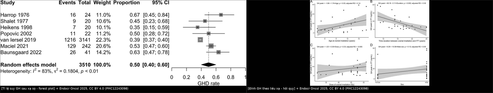
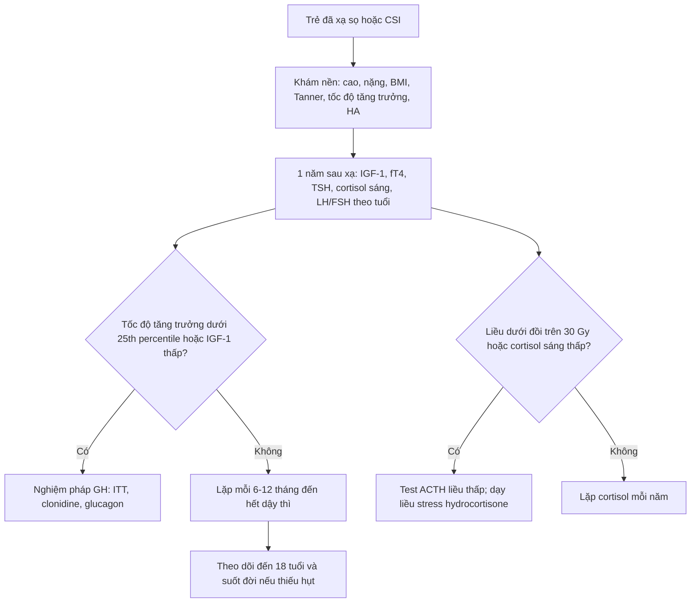
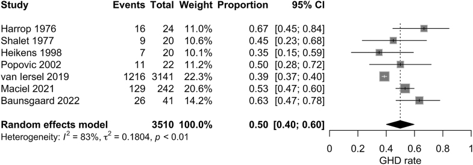
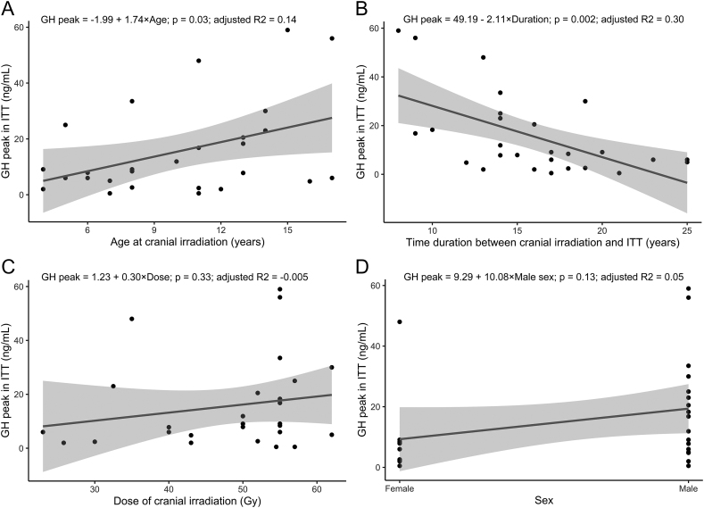
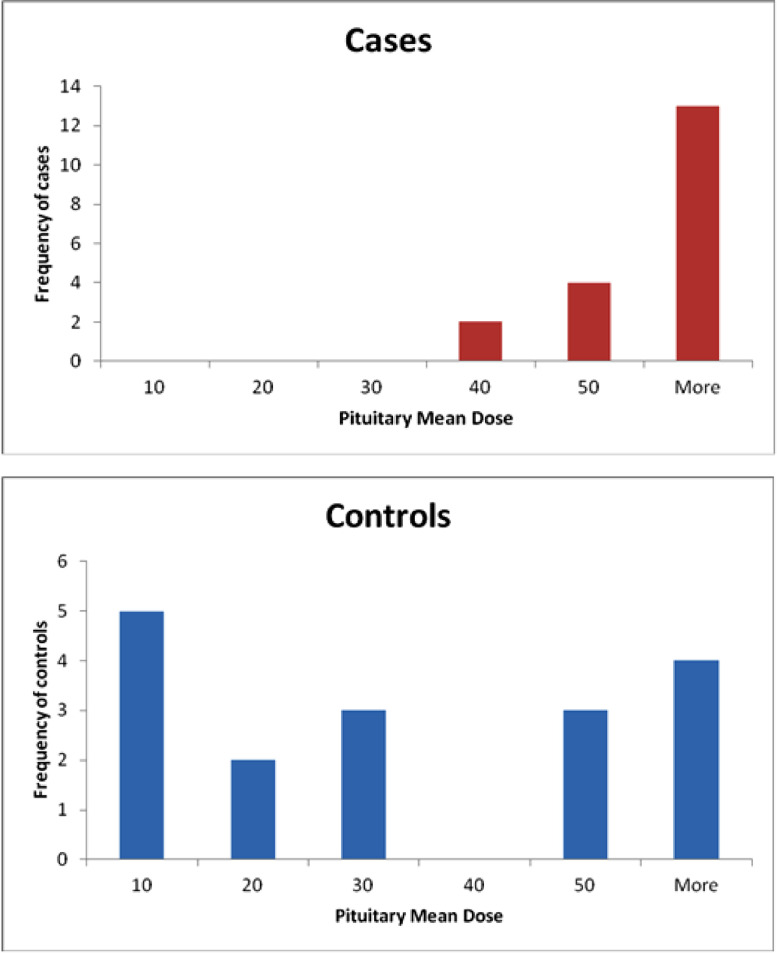

# 1752 — Suy tuyến yên sau xạ trị sọ ở trẻ / Radiation-induced hypopituitarism in children

**Tags:** `pattern:suy-tuyen-yen` `pattern:thieu-hut-hormone` `pattern:cham-tang-truong` `vung:tuyen-yen` `vung:nao` `protocol:sang-loc-noi-tiet` `protocol:xa-tri` `score:lieu-nguong` `incidentaloma:khong`

**Mức chắc chắn (certainty):** tổng hợp y văn (literature synthesis) — 1 meta-analysis tỉ lệ suy GH sau xạ sọ (Endocr Oncol 2025, PMC12243098, CC BY 4.0), 1 đoàn hệ trẻ ALL 18–24 Gy (Indian J Med Paediatr Oncol 2013, PMC3715991, CC BY-NC-SA 3.0), 1 case–control liều–đáp ứng người lớn (Adv Radiat Oncol 2021, PMC8184512, CC BY-NC-ND 4.0), và 1 tổng quan cơ chế–y văn (Endocr Connect 2022, PMC9716369, CC BY-NC 4.0) tổng hợp các đoàn hệ Vatner 2018, Chemaitilly 2015, van Iersel 2019/2020. **Không có ca nguyên văn do nhóm tự viết** (bài không có ảnh lâm sàng bệnh nhi); quiz dùng chính các biểu đồ của bài gốc.

> **Câu chốt:** sau xạ sọ ở trẻ, **GH là trục mất đầu tiên và hay nhất** — gộp **50% (95% CI 40–60)** người sống sót u não bị suy GH; nhưng **liều xạ một mình không dự báo được đỉnh GH** (hồi quy p = 0,33) trong khi **thời gian sau xạ thì có** (p = 0,002, R² = 0,30). Vì vậy **không được ngừng theo dõi ở trẻ "liều thấp"**: 27 trẻ ALL chỉ **18–24 Gy** đã có **44% suy GH**, và một nửa trong số đó xuất hiện **trong năm đầu**.

## 1. Tổng quan bệnh học – cơ chế hình ảnh

### 1.1 TẠI SAO xạ trị làm mất hormone — và tại sao GH trước

- **Tổn thương nguyên phát:** tia xạ gây **đứt chuỗi kép DNA** ở tế bào tuyến yên đang phân chia và ở **nơ-ron vùng dưới đồi**; hậu quả là **apoptosis + viêm** (thực nghiệm chuột: chiếu toàn đầu **6 Gy một lần** ≈ **BED 12 Gy** khi chia 2 Gy, sau **20 tuần** ACTH, TSH, GH giảm có ý nghĩa — PMC9716369). Ở người, tổn thương diễn ra **âm thầm trong nhiều tháng–nhiều năm**: mất tế bào → **xơ hóa + giảm mạng mao mạch cửa** → tuyến không còn đáp ứng tín hiệu dưới đồi.
- **Vì sao GH mất sớm nhất:** tế bào hướng sinh dục (somatotroph) **chiếm ~50% tế bào tuyến yên**, có **tốc độ phân chia và tổng hợp protein cao nhất** → nhạy cảm nhất với tổn thương DNA; đồng thời **nhân cung dưới đồi** (nguồn GHRH) nằm trong trường chiếu của hầu hết kế hoạch xạ sọ. Vì vậy **trục GH mất ở liều thấp hơn 2–3 lần** so với ACTH.
- **Vì sao có "trễ" nhiều năm:** mô đệm và mạch máu tuyến yên bị xơ hóa tiến triển chậm; tế bào còn sống **bù trừ** cho tới khi mất > 70–80% dự trữ. Đây là lý do **tỉ lệ phát hiện tăng theo thời gian theo dõi** (meta-analysis: thời gian từ xạ đến nghiệm pháp là yếu tố duy nhất còn ý nghĩa sau đa biến, p = 0,04 — PMC12243098).
- **Trên hình ảnh:** không có dấu hiệu CT/MRI đặc hiệu sớm. Muộn có thể thấy **tuyến yên nhỏ/teo**, **cuống yên mảnh**, tín hiệu T1 không đồng nhất sau xạ — nhưng **MRI bình thường không loại trừ** suy tuyến yên; chẩn đoán là **sinh hóa**, không phải hình ảnh. (Đây là điểm khác biệt với u/viêm cuống yên ở bài 1751/1753.)

### 1.2 Số liệu định lượng phải thuộc

| Đại lượng | Con số | Nguồn |
|---|---|---|
| Suy GH gộp ở người sống sót u não (7 nghiên cứu) | **50% (95% CI 40–60), I² = 83%** | PMC12243098 |
| Trẻ ALL xạ toàn não **18–24 Gy**, theo dõi 2 tháng–9 năm | suy GH **44% (12/27)**; **100% (5/5) ở 24 Gy** vs **31,8% (7/22) ở 18 Gy**; **50% ca suy GH xuất hiện < 1 năm** | PMC3715991 |
| Người lớn, case–control liều tuyến yên | **không ca nội tiết nào khi liều trung bình tuyến yên < 30 Gy**; thời gian trung vị đến suy nội tiết **265 ngày (8,8 tháng)** | PMC8184512 |
| Vatner 2018 (189 trẻ, proton; trung vị dưới đồi **26 Gy**, tuyến yên **24,3 Gy**) | **48,8%** có ≥ 1 thiếu hụt; **78,8%** ca suy GH nhận **≥ 40 Gy** vs **9%** nhận **≤ 20 Gy**; TSH **20,5%**, ACTH **6,9%**, LH/FSH **4,1%** | PMC9716369 (tổng hợp) |
| van Iersel 2019 (1.086 trẻ) | GH, TSH, LH/FSH tăng nguy cơ **ở mọi liều**; **ACTH chỉ khi > 30 Gy** | PMC9716369 |
| van Iersel 2020 (355 trẻ, 50,4–59,4 Gy) | suy GH **37,2%**, LH/FSH **17,7%**, TSH **14,9%**, ACTH **10,3%**; **liều trung bình dưới đồi ≥ 36 Gy** → tăng nguy cơ bất kỳ thiếu hụt | PMC9716369 |
| Littley (bệnh nhân xạ u tuyến yên, 5 năm) | thiếu TSH **9% ở 20 Gy**, **22% ở 35–37 Gy**, **35% ở 40 Gy**, **52% ở 42–45 Gy** | PMC8184512 (trích) |
| Chemaitilly 2015 (748 trẻ, theo dõi trung bình **27,3 năm**) | suy GH phổ biến nhất; **99,7% ca suy GH và 78,5% ca suy LH/FSH KHÔNG được điều trị** | PMC9716369 |
| Tuổi nguy cơ cao nhất | **6–10 tuổi** lúc xạ | PMC9716369 |

- **Đọc con số cho đúng:** "50%" là **gộp mọi liều và mọi thời gian theo dõi**, không phải nguy cơ của một bệnh nhi cụ thể. Nguy cơ cá nhân = **liều tại dưới đồi/tuyến yên × tuổi lúc xạ × thời gian đã trôi qua × có/không hóa trị và phẫu thuật vùng trên yên**.
- **Phản biện (bắt buộc):** chính meta-analysis cho thấy **liều xạ không tương quan với đỉnh GH** trong phân tích đơn biến (p = 0,33; R² hiệu chỉnh = −0,005), trong khi **tuổi lúc xạ** (p = 0,03) và **khoảng thời gian sau xạ** (p = 0,002) thì có. Nghĩa là: **đừng dùng một ngưỡng liều duy nhất để quyết định có/không theo dõi** — hãy dùng liều để **xếp tầng tần suất**, và thời gian để **quyết định thời điểm xét nghiệm**.

## 2. Mẫu hình + chẩn đoán phân biệt theo trục (gamut)

- **Mẫu hình 1 — đơn độc GH, khởi phát sớm (1–3 năm):** trẻ **vẫn cao bình thường** nhưng **tốc độ tăng trưởng tụt** (< 25th percentile hoặc < 4–5 cm/năm sau 4 tuổi), **tuổi xương chậm**, IGF-1 thấp. Đây là thể hay bị bỏ qua nhất vì "trông không giống bệnh".
- **Mẫu hình 2 — nhiều trục, khởi phát muộn (3–10 năm):** mệt, sợ lạnh, táo bón, chậm phát triển (TSH); **hạ Na, hạ HA, hạ đường huyết** (ACTH); **không dậy thì/tiến triển dậy thì chậm** (LH/FSH).
- **Mẫu hình 3 — suy thượng thận cấp là thể nguy hiểm:** sau xạ + **stress (sốt, mổ, nôn)** → tụt HA, hạ Na, hạ đường huyết; **có thể là biểu hiện ĐẦU TIÊN** của suy tuyến yên sau xạ. Bỏ sót = tử vong.
- **Mẫu hình 4 — dậy thì sớm trung ương (central precocious puberty):** hay gặp ở **bé gái xạ vùng dưới đồi–trên yên, đặc biệt < 8 tuổi**; biểu hiện **tăng tốc chiều cao sớm rồi cốt hóa sớm → chiều cao cuối thấp**. Lưu ý: đây là **thể "ngược" của suy sinh dục** và có thể **đi kèm** suy GH. *(Tỉ lệ chính xác sau xạ: chưa rõ trong các nguồn đã đọc — cần tra thêm, không bịa số.)*
- **Gamut theo thời gian:** < 1 năm → GH (một nửa ca trong loạt 27 trẻ — PMC3715991); 1–5 năm → GH ± TSH; > 5 năm → thêm ACTH, LH/FSH, và **di chứng chuyển hóa** (béo phì, loãng xương, rối loạn lipid).

## 3. Bảng so sánh phân biệt (ma trận đối chiếu)

| Thực thể (entity) | Hình ảnh / xét nghiệm điển hình | Chốt vào (rule-in) | Chốt loại (rule-out) | Gợi ý xác nhận |
|---|---|---|---|---|
| **Suy GH do xạ** | MRI bình thường hoặc tuyến nhỏ; **tốc độ tăng trưởng giảm**, IGF-1 thấp, tuổi xương chậm | **Tiền sử xạ sọ + tốc độ tăng trưởng < 25th percentile hoặc IGF-1 thấp + đỉnh GH thấp khi kích thích** | IGF-1 bình thường **không loại trừ** (béo phì/dậy thì làm IGF-1 "giả bình thường") | Nghiệm pháp **ITT / clonidine / glucagon / arginine**; theo dõi 6–12 tháng |
| **Suy giáp trung ương do xạ** | **fT4 thấp + TSH thấp/bình thường**; chậm tăng trưởng, táo bón, sợ lạnh | **fT4 thấp kèm TSH không tăng** | TSH cao → suy giáp nguyên phát (Hashimoto), không phải do xạ | fT4 + TSH; **không dùng TSH đơn độc** |
| **Suy thượng thận trung ương do xạ** | **Cortisol sáng thấp + ACTH không tăng**; hạ Na, hạ HA, hạ glucose | **Cortisol sáng thấp + đáp ứng kém với ACTH kích thích (liều thấp)** | Cortisol bình thường lúc nghỉ **không loại trừ** khi đang stress | Cortisol sáng 8h; test ACTH liều thấp; **điều trị thử hydrocortisone** |
| **Suy sinh dục trung ương do xạ** | LH/FSH thấp, không dậy thì/tiến triển chậm, tuổi xương chậm | **LH/FSH thấp + không dậy thì đúng tuổi** | Dậy thì muộn thể tạng (bone age chậm nhưng LH tăng sau kích thích) | LH/FSH nền + GnRH test; theo dõi Tanner |
| **Dậy thì sớm trung ương sau xạ** | Tăng tốc chiều cao + Tanner sớm + **tuổi xương vượt tuổi thực** | **Dậy thì < 8 tuổi (nữ)/< 9 tuổi (nam) + LH đỉnh cao sau GnRH** | Dậy thì sớm ngoại biên (LH thấp, estrogen/androgen cao) | GnRH test, MRI dưới đồi, siêu âm tử cung–buồng trứng |
| **Suy tuyến yên do u/viêm cuống yên** (bài 1751/1753) | **Cuống yên dày, mất điểm sáng T1 thùy sau**, ĐTĐ nhạt | **Bất thường MRI vùng trên yên** | MRI bình thường → nghi do xạ đơn thuần | MRI tuyến yên; marker (CD1a, AFP/hCG, anti-rabphilin-3A) |

*Trái: forest plot 7 nghiên cứu — suy GH gộp **50% (40–60)**. Phải: đỉnh GH sau ITT theo **tuổi lúc xạ** (A), **thời gian sau xạ** (B), **liều xạ** (C) và giới (D) — chỉ thời gian sau xạ còn ý nghĩa sau đa biến. Nguồn: Endocr Oncol 2025, CC BY 4.0 (PMC12243098); ảnh ghép letterbox.*

## 4. Protocol chụp/xạ trị + hệ phân tầng theo liều

### 4.1 Khi lập kế hoạch xạ — "dự phòng bằng liều"

- **Định nghĩa OAR bắt buộc:** tuyến yên, **cuống yên**, **vùng dưới đồi** (gồm nhân cung và vùng quanh giao thoa), **nhân bụng–giữa** (nếu xạ toàn não thất). Ghi **Dmean và Dmax** cho từng cấu trúc, không chỉ liều u.
- **Nguyên tắc:** **giảm liều trung bình dưới đồi** quan trọng hơn giảm liều điểm; **liều trung bình dưới đồi ≥ 36 Gy** làm tăng nguy cơ bất kỳ thiếu hụt (PMC9716369). Với **CSI/proton**, liều dưới đồi có thể giảm nhưng **không về 0** → vẫn phải theo dõi.
- **Phân tầng theo liều (dùng để chọn lịch xét nghiệm, không để loại trừ):**
  - **< 18 Gy** tại trục: nguy cơ thấp nhưng **không bằng 0** (27 trẻ 18 Gy vẫn **31,8%** suy GH) → sàng lọc lâm sàng + IGF-1 hằng năm.
  - **18–30 Gy:** nguy cơ GH ± TSH; **ACTH ít gặp** (ngưỡng > 30 Gy).
  - **> 30 Gy:** nguy cơ **tất cả các trục**, gồm **ACTH**; theo dõi sát và huấn luyện gia đình về **liều stress**.

### 4.2 Lịch sàng lọc (sau khi kết thúc xạ)

- **Vì sao khám ở 1 năm:** một nửa ca suy GH trong loạt 18–24 Gy xuất hiện **< 1 năm**; case–control người lớn có thời gian trung vị đến suy nội tiết **8,8 tháng**.
- **Vì sao không dừng ở 5 năm:** 748 trẻ theo dõi **27,3 năm** vẫn phát hiện thiếu hụt mới; **99,7% ca suy GH chưa được điều trị** — nghĩa là vấn đề lớn nhất là **không ai theo dõi**, không phải thiếu thuốc.

### 4.3 Liều thay thế (liều tham chiếu thực hành — kiểm tra guideline địa phương)

| Hormone | Liều khởi đầu | Ghi chú an toàn |
|---|---|---|
| **Hydrocortisone** | **8–12 mg/m²/ngày** chia 3 lần | **Điều trị TRƯỚC levothyroxine** nếu có suy giáp kèm; liều stress **50–100 mg/m²/ngày** khi sốt/mổ |
| **Levothyroxine** | **2–3 µg/kg/ngày** (trẻ nhỏ cao hơn) | Chỉ bắt đầu sau khi đã bù cortisol; theo dõi fT4, không theo TSH |
| **GH (rhGH)** | **0,025–0,05 mg/kg/ngày** tiêm tối | Theo dõi chiều cao, IGF-1, đường huyết; **không khởi trị khi còn thiếu cortisol/giáp chưa bù** |
| **Sex steroid** | Khởi trị **12–13 tuổi (nữ)/13–14 tuổi (nam)** nếu không dậy thì tự nhiên | Tăng liều dần để mô phỏng dậy thì; theo dõi tuổi xương |

- **An toàn bắt buộc:** mọi trẻ suy tuyến yên sau xạ phải có **thẻ/giấy xác nhận suy thượng thận** + **ống hydrocortisone tiêm** tại nhà/trường; dạy gia đình **tăng liều gấp 2–3 lần khi sốt** và **tiêm ngay khi nôn không uống được**.

## 5. Biến thể bình thường và cạm bẫy

- **"Cao bình thường" không loại trừ:** trẻ suy GH sau xạ vẫn có thể cao trong vài năm nhờ **cột sống tiếp tục dài**; dấu hiệu sớm là **tốc độ tăng trưởng giảm** và **tuổi xương chậm**, không phải chiều cao tuyệt đối.
- **IGF-1 bình thường trong béo phì/dậy thì:** dinh dưỡng và estrogen làm IGF-1 tăng giả tạo → **phải dùng nghiệm pháp kích thích** khi nghi ngờ, không dựa IGF-1 đơn thuần.
- **TSH bình thường trong suy giáp trung ương:** TSH có thể **bình thường hoặc hơi cao** nhưng **không đủ**; chốt bằng **fT4 thấp + TSH không tăng tương xứng**.
- **Suy thượng thận bị che bởi "hạ Na do SIADH":** sau xạ sọ, hạ Na có thể do **SIADH** (bài 1755/1757) hoặc do **suy thượng thận** — **cortisol sáng phải làm trước khi hạn chế dịch**, vì hạn chế dịch ở suy thượng thận làm bệnh nặng hơn.
- **Bắt đầu levothyroxine trước hydrocortisone** → **cơn suy thượng thận cấp** (tăng chuyển hóa cortisol). Luôn **bù cortisol trước**.
- **Gán mọi chậm tăng trưởng cho "di chứng xạ"** mà bỏ qua **dậy thì sớm** (cao nhanh rồi cốt hóa sớm) hoặc **suy giáp** — hai nguyên nhân chữa được, ảnh hưởng chiều cao cuối.
- **Theo dõi chỉ bằng MRI:** MRI không đánh giá chức năng; một MRI đẹp **không được** thay thế lịch xét nghiệm hormone.

## 6. Tự lượng giá — Blind Quiz

**Ca 1 — Bé gái 7 tuổi, medulloblastoma, xạ sọ–tủy 23,4 Gy + boost hố sau; 14 tháng sau xạ, cao thêm 3,2 cm/năm (trước đó 6 cm/năm).**

- Hỏi: hình ảnh MRI có thể bình thường — dấu hiệu nào quyết định? Cần xét nghiệm gì trước khi kết luận? Còn trục nào phải kiểm tra dù chưa có triệu chứng?

<b>Bấm để hiện đáp án (findings + chẩn đoán)</b>

- **Dấu hiệu chốt:** **tốc độ tăng trưởng tụt từ 6 → 3,2 cm/năm** sau xạ, dù chiều cao tuyệt đối có thể còn trong kênh bình thường. Đây là biểu hiện sớm nhất của suy GH.
- **Chẩn đoán:** **suy GH do xạ** — gộp **50% (40–60)** người sống sót u não; ở trẻ xạ 18–24 Gy là **44%**, một nửa xuất hiện **< 1 năm**.
- **Xét nghiệm:** IGF-1 + **nghiệm pháp kích thích GH** (ITT/clonidine/glucagon); đồng thời **fT4/TSH, cortisol sáng, LH/FSH, Tanner, tuổi xương** — vì "không triệu chứng" không loại trừ thiếu hụt trục khác.
- **Bẫy:** MRI bình thường không loại trừ; IGF-1 bình thường ở trẻ béo/dậy thì không loại trừ.
- Nguồn ảnh: Tselovalnikova T và cs., *Endocr Oncol* 2025, CC BY 4.0 (PMC12243098).

**Ca 2 — Bé trai 13 tuổi, xạ 54 Gy vùng trên yên vì u sọ hầu; nhập viện vì nôn–sốt 2 ngày, HA 78/45, Na 128, glucose 3,1 mmol/L.**

- Hỏi: 3 chẩn đoán phân biệt? Xét nghiệm nào làm ngay? Thứ tự điều trị hormone?

<b>Bấm để hiện đáp án</b>

- **Phân biệt:** **suy thượng thận trung ương cấp** (sốc + hạ Na + hạ glucose), **SIADH** (hạ Na nhưng HA bình thường/thừa cân, không hạ glucose), **nhiễm trùng huyết** (sốt + sốc, nhưng cortisol vẫn phải kiểm tra).
- **Chốt:** **cortisol sáng thấp + ACTH không tăng** → suy thượng thận trung ương; đây là biểu hiện **đầu tiên** có thể gặp của suy tuyến yên sau xạ, và nguy cơ **tăng rõ khi liều dưới đồi > 30 Gy** (van Iersel 2019: ACTH chỉ tăng ở **> 30 Gy**).
- **Điều trị:** **hydrocortisone tiêm ngay** (liều stress) + dịch–glucose; **không truyền NaCl 3% máy móc** khi chưa loại trừ suy thượng thận; **bù cortisol TRƯỚC levothyroxine**.
- **Bẫy:** hạ Na bị quy cho SIADH → hạn chế dịch → tụt HA nặng hơn.
- Nguồn ảnh: Tselovalnikova T và cs., *Endocr Oncol* 2025, CC BY 4.0 (PMC12243098).

**Ca 3 — Đọc biểu đồ: vì sao "liều xạ cao hơn" không đồng nghĩa "đỉnh GH thấp hơn" trong hình C?**

- Hỏi: hình cho thấy điều gì về ngưỡng liều? Vì sao vẫn phải theo dõi trẻ liều thấp? Hạn chế của cách đọc "ngưỡng 30 Gy"?

<b>Bấm để hiện đáp án</b>

- **Findings:** ca bệnh (đỏ) tập trung ở **≥ 40 Gy** và **không có ca nào < 30 Gy liều trung bình tuyến yên**; chứng (xanh) trải rộng từ **10 Gy**. Đây là nền tảng của ngưỡng "không có độc tính nội tiết dưới 30 Gy" ở người lớn.
- **Phản biện:** ngưỡng này **không chuyển nguyên sang trẻ** — trẻ ALL **18–24 Gy** đã có **44% suy GH**, và **31,8%** ngay ở **18 Gy**. Trong meta-analysis, **liều không tương quan với đỉnh GH** (p = 0,33), còn **thời gian sau xạ** thì có (p = 0,002) → **ngưỡng liều chỉ để xếp tầng, không để loại trừ**.
- **Kết luận thực hành:** trẻ **bất kỳ liều nào** vào trục dưới đồi–tuyến yên đều cần **theo dõi tăng trưởng hằng năm**; liều **> 30 Gy** thêm **sàng lọc ACTH**.
- Nguồn ảnh: Vakilian S và cs., *Adv Radiat Oncol* 2021, CC BY-NC-ND 4.0 (PMC8184512) — ảnh nguyên bản, không crop/ghép.

## Bài liên quan chéo
- [1751 – LCH vùng dưới đồi–tuyến yên ở trẻ](../1751-lch-vung-duoi-doi-tuyen-yen-o-tre/lesson.md) (cuống yên dày, ĐTĐ nhạt)
- [1753 – Viêm tuyến yên–cuống yên tăng sinh lympho (LINH)](../1753-viem-tuyen-yen-cuong-yen-tang-sinh-lympho-o-tre/lesson.md)
- [1754 – Hội chứng dưới đồi ở trẻ](../1754-hoi-chung-duoi-doi-o-tre/lesson.md)
- [1755 – Hạ Na sau mổ vùng trên yên: SIADH vs CSWS](../1755-csws/lesson.md)
- [1757 – Hạ Na muộn sau xuất viện](../1757-ha-natri-mau-muon-sau-xuat-vien/lesson.md)
- [1758 – U thần kinh đệm đường thị trong NF1](../1758-glioma-duong-thi-nf1/lesson.md)
- [1731 – U mầm vùng tuyến tùng/trên yên](../1731-u-mam-noi-so-vung-tren-yen-o-tre/lesson.md)
- [600 – Tổng quan Nhi khoa](../600-tong-quan-nhi-khoa/lesson.md)

## Ảnh
- `1752_hypopituitarism_forest_PMC12243098.jpg`, `1752_gh-peak-dose_PMC12243098.jpg` — *Endocr Oncol* 2025, **CC BY 4.0** (PMC12243098).
- `1752_pituitary-dose_PMC8184512.jpg` — *Adv Radiat Oncol* 2021, **CC BY-NC-ND 4.0** (PMC8184512) — nguyên bản, **không** dùng trong composite.
- `composite_ghd-va-lieu-xa.jpg` — ghép 2 ảnh CC BY 4.0 của PMC12243098 bằng `tools/make_composite.py`.

> Không dùng để chẩn đoán độc lập khi chưa có người hướng dẫn.
