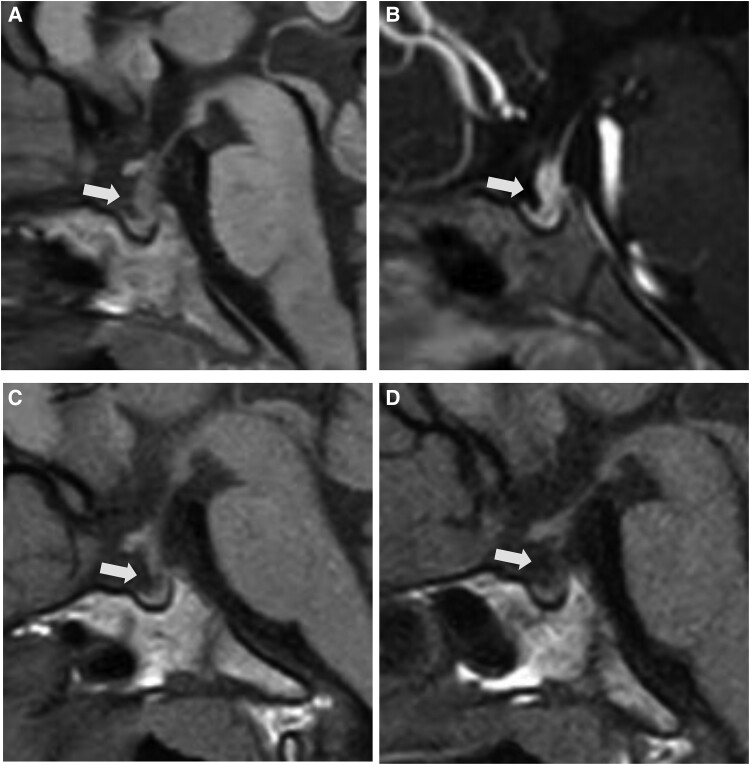
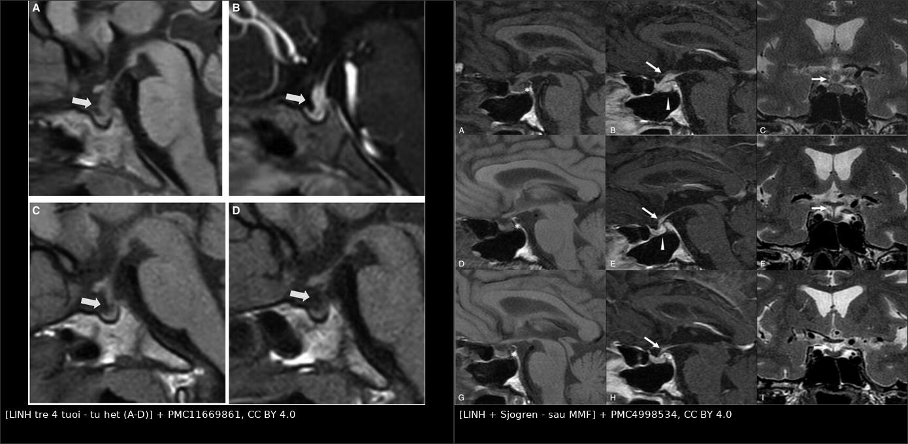
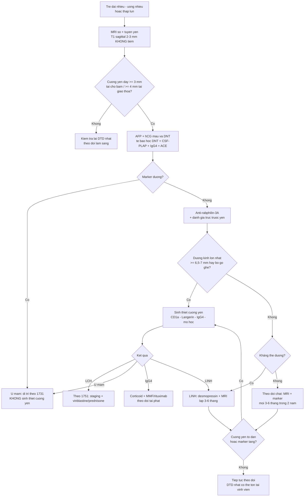
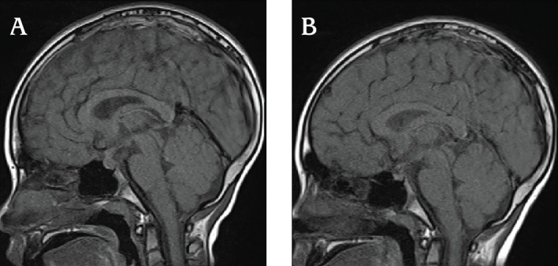
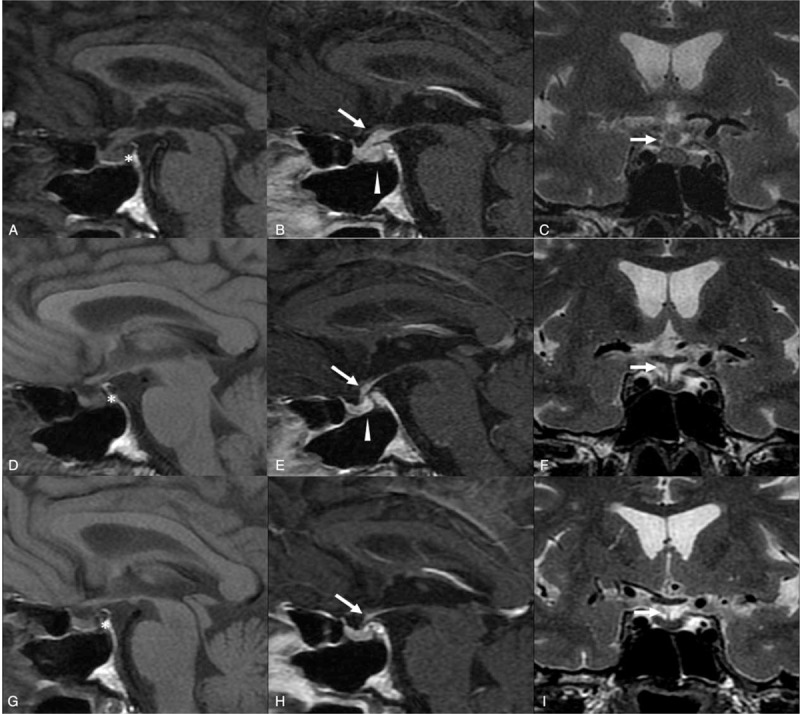

# 1753 — Viêm tuyến yên–cuống yên tăng sinh lympho ở trẻ / Lymphocytic infundibuloneurohypophysitis (LINH)

**Tags:** `pattern:cuong-yen-day` `pattern:mat-diem-sang-T1` `pattern:ngam-thuoc` `pattern:tu-thoai` `vung:tuyen-yen` `vung:so-yen` `vung:nao` `protocol:MRI-tuyen-yen` `protocol:sinh-thiet` `protocol:theo-doi` `incidentaloma:khong`

**Mức chắc chắn (certainty):** tổng hợp y văn (literature synthesis) — 3 báo cáo ca có ảnh (JCEM Case Rep 2025, PMC11669861; J Clin Res Pediatr Endocrinol 2025, PMC12372633; Medicine 2016, PMC4998534), 2 đoàn hệ cuống yên dày ở trẻ (Arch Endocrinol Metab 2024, PMC11460958; Cancers 2023, PMC10417368), 1 tổng quan về nguyên nhân và chỉ định sinh thiết (Pediatr Endocrinol Diabetes Metab 2022, PMC10214961) và 1 đoàn hệ IgG4 viêm tuyến yên có mô bệnh (Acta Neurochir 2022, PMC9338115). **Không có ca nguyên văn do nhóm tự viết**; mọi ca trong quiz là ca có ảnh từ bài gốc, ghi rõ PMCID.

> **Câu chốt:** trẻ **đái nhiều – uống nhiều**, MRI có **cuống yên dày nhẵn, mất điểm sáng T1 thùy sau** — ba khả năng chính là **u mầm, LCH, LINH**. LINH là chẩn đoán **loại trừ + theo dõi**, và **kháng thể anti-rabphilin-3A** giúp bỏ sinh thiết ở một phần ca. Nhưng kháng thể **không phải chứng minh**: nó **dương giả ở u mầm** và có thể **dương ở người khỏe**, trong khi **âm tính vẫn không loại LINH** (độ nhạy chỉ 76–88,9% khi chẩn đoán lâm sàng). Sai lầm chết người theo **hai chiều**: (a) **sinh thiết cuống yên ngay** khi chỉ cần theo dõi, (b) **gọi "LINH" rồi ngừng theo dõi** trong khi đó là **u mầm đang lớn dần** — đã có ca "LINH" có mô bệnh rồi vẫn lộ ra u mầm khi cuống yên to thêm và marker tăng.

## 1. Tổng quan bệnh học – cơ chế hình ảnh

### 1.1 Bệnh học và dịch tễ

- **LINH** là viêm **tăng sinh lympho–tương bào** khu trú ở **cuống yên (infundibulum) và thùy sau tuyến yên**, dẫn tới **thiếu arginine vasopressin (AVP)** — tức **đái tháo nhạt trung ương (central diabetes insipidus, CDI)**. Thể lan sang tuyến yên trước gọi là **viêm tuyến yên tăng sinh lympho (lymphocytic panhypophysitis, LPH)**.
- **Cơ chế tự miễn:** kháng thể **anti-rabphilin-3A** nhắm vào **rabphilin-3A** — protein hiệu ứng của **Rab3** trên **túi bài tiết thần kinh**, cần cho việc **giải phóng AVP**. Kháng thể làm hỏng khâu giải phóng túi → **đái nhiều** dù tuyến yên sau còn tế bào. Đây là lý do **kháng thể này vừa là marker, vừa là bằng chứng cơ chế** (PMC11669861).
- **Dịch tễ:** tuổi khởi phát trung bình ở người lớn **42 tuổi**; **ca nhi rất hiếm**. Tính đến 2025, y văn nhi chỉ có vài ca: **7 tuổi** (Morota, J Pediatr Endocrinol Metab 2022), **10 tuổi** (phát hiện kháng thể **9 năm sau khởi phát** — Kume, Clin Pediatr Endocrinol 2021), **12 và 13 tuổi** (Murai, 2022), **8 tuổi** (PMC12372633) và **4 tuổi 3 tháng** — **ca nhỏ nhất có kháng thể dương** (PMC11669861).
- **Liên quan bệnh tự miễn khác:** viêm tuyến giáp mạn (Hashimoto), suy thượng thận tự miễn, **lupus**, **hội chứng Sjögren** — ca người lớn trong PMC4998534 là **LINH + Sjögren nguyên phát**, điều trị **mycophenolate mofetil (MMF)** không corticoid.

### 1.2 TẠI SAO hình ảnh lại như vậy

- **Mất điểm sáng T1 thùy sau (posterior pituitary bright spot, PPBS):** thùy sau chứa **hạt bài tiết AVP/oxytocin gắn neurophysin**; phức hợp **protein–phospholipid** này có **thời gian T1 ngắn** nên **sáng tự nhiên trên T1 không tiêm**. Lympho xâm nhập phá hủy hạt → **mất điểm sáng**, và mất luôn khả năng cô đặc nước. Vì vậy **mất PPBS xuất hiện sớm**, trước khi có khối lớn.
- **Cuống yên dày:** **thâm nhiễm lympho + phù nề** dọc trục dưới đồi–tuyến yên. Vùng **median eminence–thùy sau không có hàng rào máu–não**, nên **ngấm thuốc ở cuống yên là sinh lý**; cái bệnh lý là **độ dày** và **tính chất ngấm** (ngấm **mạnh, đồng nhất, kéo dài** hơn cuống bình thường).
- **Vì sao "nhẵn, đối xứng, không có nhân rời":** viêm lan tỏa theo trục giải phẫu, **không tạo khối đẩy mô** như u. Ngược lại **u mầm/LCH** thường **không đều, lệch bên, có nốt tách rời** hoặc **xâm lấn sàn não thất III**. Tuy vậy **hình ảnh đơn thuần không phân biệt được** — đây là điểm quan trọng nhất của bài.
- **Vì sao LINH tự thu nhỏ:** viêm tự giới hạn, phù nề rút dần và mô xơ thay thế; trên MRI thấy **cuống yên mỏng dần về bình thường trong 4–9 tháng** (PMC11669861: hết dày sau **4–5 tháng**; PMC12372633: thu nhỏ sau **9 tháng**; PMC4998534: hết sau **9 tháng MMF**). **Nhưng ĐTĐ nhạt thường tồn tại** vì tế bào bài tiết đã mất — **hình ảnh hồi phục không có nghĩa là ngừng desmopressin**.
- **Vì sao chẩn đoán muộn:** đái nhiều – uống nhiều **âm thầm**, trẻ vẫn chơi bình thường; MRI đầu có thể chỉ **dày 3–4 mm**, dễ đọc là "giới hạn bình thường". Trong u mầm trên yên, **trung vị 312 ngày** từ MRI đầu đến điều trị (PMC11246258, dẫn ở bài 1731) — con số cho thấy giá của việc "theo dõi mà không có mốc".

### 1.3 Ngưỡng định lượng trụ cột

| Đại lượng | Con số | Nguồn |
|---|---|---|
| Định nghĩa cuống yên dày ở trẻ | **≥ 3 mm tại chỗ bám tuyến yên** và/hoặc **≥ 4 mm tại giao thoa thị giác** | PMC11460958 |
| Ngưỡng **sinh thiết** theo đồng thuận Anh 2021 | **đường kính tổn thương cuống yên ≥ 6,5–7 mm** | PMC10214961 |
| Nguyên nhân cuống yên dày ở trẻ | **u mầm, LCH, LINH** là 3 nguyên nhân hàng đầu; sarcôid/Lao/u hạt hiếm (ca lẻ) | PMC10214961 |
| Đoàn hệ Chile 2020–2022 (n = 9, tuổi TB **10,36**, 2,4–17) | **8/9 u mầm**, **1/9 LCH**, **0 LINH**; **100%** đái nhiều – uống nhiều, **77,8%** thấp lùn; **4/9 phải sinh thiết lần 2** | PMC11460958 |
| Đoàn hệ Hồng Kông (n = 28) | **50% (14/28) do tân sinh**: u mầm **46%**, LCH **4%**; cuống yên **≥ 6,5 mm** + CDI + **≥ 2 thiếu hụt hormone** dự báo tân sinh | PMC10417368 |
| Độ nhạy anti-rabphilin-3A | **100%** ở LINH có mô bệnh; **76%** ở LINH chẩn đoán lâm sàng (báo cáo đầu); gộp lại: **100% LINH**, **80% LPH có AVP-D**, **88,9%** LINH + LPH | PMC11669861 |
| Dương giả / nhiễu của anti-rabphilin-3A | **1 ca u mầm có mô bệnh vẫn dương kháng thể** (2022); **5/41 (12%)** mẫu người khỏe dương ở một nghiên cứu; độ nhạy **11,1%** ở viêm tuyến yên trước đơn thuần | PMC11669861 · PMC12372633 |
| Diễn tiến cuống yên | Hết dày sau **4–5 tháng** (ca 4 tuổi); thu nhỏ sau **9 tháng** (ca 8 tuổi); hết sau **9 tháng MMF** (ca Sjögren) | PMC11669861 · PMC12372633 · PMC4998534 |
| IgG4 viêm tuyến yên (n = 8, tuổi trung vị **51**) | Sau mổ: khối giảm **7/7 (100%)**, **cuống yên còn dày 5/7 (71,4%)**, suy tuyến yên trước **4/8 (50%)**, panhypopituitarism + ĐTĐ nhạt **3/8 (37,5%)** | PMC9338115 |

## 2. Mẫu hình + chẩn đoán phân biệt theo vị trí (Gamut)

- **Cuống yên dày đơn độc, không khối rời:**
  - **LINH/LPH** · **u mầm** · **LCH** · **IgG4 viêm tuyến yên** · **bệnh Erdheim–Chester (ECD)** · **sarcôid** · **lao** · **di căn/leukemia/lympho**.
  - Gợi nhớ **LIGER**: **L**CH · **I**nfundibuloneurohypophysitis · **G**erminoma · **E**rdheim–Chester · **R**ải (di căn/leukemia). Thêm **I**gG4 và **S**arcôid khi có bệnh cảnh gợi ý.
- **Cuống yên dày + mất điểm sáng T1 thùy sau (đái tháo nhạt):**
  - **LINH** · **u mầm** · **LCH** · **sau chấn thương/phẫu thuật/xạ** · **tuyến yên lạc chỗ bẩm sinh** (thể bẩm sinh có **cuống yên đứt**, không dày liên tục).
- **Cuống yên dày + khối tuyến yên trước (suy nhiều trục):**
  - **LPH (thể lan tỏa)** · **IgG4 viêm tuyến yên** · **u tuyến yên** (hiếm ở trẻ) · **LCH** · **lympho** · **di căn**.
- **Theo tuổi:** trẻ **10–19 tuổi** + cuống yên dày → **ưu tiên u mầm**; trẻ **< 6 tuổi** + tổn thương xương/da → **ưu tiên LCH**; trẻ **có bệnh tự miễn khác** (Hashimoto, Sjögren, lupus) → nghĩ **LINH/LPH**.
- **Theo hình thái cuống yên:** **nhẵn, đối xứng, dày đều** = viêm (LINH) hoặc LCH sớm; **gồ ghề, lệch, nốt rời, xâm lấn sàn não thất** = u (u mầm/di căn); **dày + phì đại cuống thị** = u thần kinh đệm đường thị/NF1.

*Bé trai 4 tuổi 3 tháng, đái nhiều – uống nhiều: (A) T1W 1 tháng sau khởi phát — **mất điểm sáng thùy sau** và **cuống yên dày** (mũi tên); (B) sau tiêm 2 tháng — cuống yên **dày thêm nhẹ**; (C) 4 tháng — **hết dày**; (D) 5 tuổi — cuống yên bình thường. Ảnh nguyên bản, không crop (JCEM Case Rep 2025, PMC11669861, CC BY 4.0).*

## 3. Bảng so sánh phân biệt (ma trận đối chiếu)

| Thực thể (entity) | Hình ảnh điển hình | Chốt vào (rule-in) | Chốt loại (rule-out) | Gợi ý xác nhận |
|---|---|---|---|---|
| **LINH (bài này)** | Cuống yên **dày nhẵn, đối xứng**, **mất PPBS**, ngấm **mạnh đồng nhất**, **không khối rời**; tự mỏng dần 4–9 tháng | **CDI + cuống yên dày nhẵn + anti-rabphilin-3A dương + tự cải thiện** | **Tổn thương xương/da, cuống yên to dần, marker tăng** → không phải LINH | Kháng thể + MRI lặp **3–6 tháng**; sinh thiết chỉ khi tiến triển |
| **U mầm trên yên (germinoma)** | Khối **đồng nhất**, ngấm **mạnh**, **ADC thấp**, có thể **hai ổ tùng + trên yên**; cuống yên **gồ ghề/lệch** | **AFP > 25 ng/mL và/hoặc hCG > 50 IU/L**; **CSF-PLAP ≥ 8 pg/mL**; trẻ **10–19 tuổi** | Marker âm **không loại** (thể marker âm); cần sinh thiết/theo dõi | Marker máu + DNT, MRI toàn trục tủy (bài 1731) |
| **LCH trục dưới đồi–tuyến yên** | Cuống yên **≥ 3 mm**, **mất PPBS**, khối dưới đồi; **tổn thương xương "punched-out", ban da, nang phổi** | **Tổn thương ngoài sọ + CD1a/Langerin dương** | Chỉ cuống yên đơn độc, không tổn thương ngoài sọ → chưa loại được | Sinh thiết **tổn thương ngoài sọ**; BRAF V600E (bài 1751) |
| **IgG4 viêm tuyến yên** | Cuống yên dày **+ khối tuyến yên**, ngấm đồng nhất; **cuống yên còn dày sau mổ 71,4%** | **IgG4 huyết thanh cao**, tổn thương **tụy/tuyến nước bọt/hạch/thận**, mô bệnh **IgG4+/IgG > 40%** | Không có tổn thương ngoài tuyến yên + kháng thể LINH dương → nghĩ LINH | IgG4 máu, sinh thiết; **hay tái phát, cần theo dõi dài** |
| **Erdheim–Chester (ECD)** | Cuống yên dày + **mô mỡ quanh hốc mắt**, **xơ hóa sau phúc mạc**, xương cứng | **Đau xương hai bên + "hairy kidney" + BRAF V600E** | Chỉ tổn thương sọ, không xơ hóa tạng → LCH | Sinh thiết: **CD1a âm, CD68+/CD163+** |
| **Sarcôid/Lao vùng dưới đồi** | Cuống yên dày, **ngấm màng não**, tổn thương phổi/hạch rốn phổi | **ACE tăng, tổn thương phổi/hạch, lao IGRA dương** | Phổi sạch + không tổn thương ngoài sọ → ít nghĩ | CT ngực, IGRA, sinh thiết |
| **Lympho/di căn/leukemia** | Cuống yên dày **+ nhiều ổ**, tổn thương tủy xương, hạch | **Bệnh máu đã biết, LDH tăng, tổn thương nhiều ổ** | Tổn thương đơn độc, không hạch → ít nghĩ | Tủy đồ, LDH, sinh thiết |
| **U sọ hầu** | Khối **hỗn hợp đặc–nang**, **vôi hóa vỏ trứng**, trên/dưới yên, giãn não thất | **Nang + vôi hóa + trẻ 5–15 tuổi** | Khối đặc, không vôi, mất PPBS → LINH/u | MRI + CT (vôi hóa) |
| **Tuyến yên lạc chỗ bẩm sinh** | **Mất PPBS + cuống yên đứt + mảnh tuyến yên ở sàn não thất III** | **Thấp lùn bẩm sinh, không đái nhiều tiến triển** | **Cuống yên dày liên tục** → bệnh mắc phải | MRI sagittal mỏng; **không sinh thiết** |
| **ĐTĐ nhạt "vô căn"** | MRI **bình thường hoặc cuống yên 2–3 mm** | Chẩn đoán loại trừ, marker âm, kháng thể âm | **Cuống yên to dần/marker xuất hiện** → đã bỏ sót u | **Theo dõi MRI + marker 3–6 tháng** |

*Trái: LINH ở trẻ 4 tuổi — cuống yên dày (A, B) rồi **tự hết** (C, D) (PMC11669861, CC BY 4.0). Phải: LINH + hội chứng Sjögren ở người lớn — **mất điểm sáng (\*) + cuống yên dày ngấm mạnh** trước điều trị (A–C), và **về bình thường sau 9 tháng MMF** (G–I) (PMC4998534, CC BY 4.0). Ảnh ghép letterbox, không crop/kéo giãn.*

### Ba phép đo quyết định trên một phim sagittal T1

- **PPBS:** đọc trên **T1 không tiêm, lát 2–3 mm**, so với mô não; **không** đánh giá trên ảnh sau tiêm.
- **Độ dày cuống yên:** đo **vuông góc trục cuống** ở **2 mốc** — chỗ bám tuyến yên (ngưỡng **3 mm**) và sát giao thoa thị giác (ngưỡng **4 mm**); ghi **mm + mốc đo**.
- **Đường bờ và tính đối xứng:** **nhẵn/đối xứng** → viêm; **gồ/lệch/nốt rời** → u. Kèm **đường kính lớn nhất**: **≥ 6,5–7 mm** là ngưỡng **cân nhắc sinh thiết**.

## 4. Protocol chụp + hệ phân độ/điểm chuẩn hóa

### 4.1 MRI — chuỗi xung tối thiểu

- **MRI sọ + tuyến yên** trước và sau gadolinium:
  - **T1W sagittal không tiêm, lát 2–3 mm** qua tuyến yên–cuống yên: **bắt buộc** cho PPBS;
  - **T1W sau tiêm sagittal + coronal lát 2–3 mm**; **T2W**, **FLAIR**, **DWI/ADC**;
  - **MRI toàn trục tủy** khi nghi u mầm; **CT sọ** khi nghi u sọ hầu (vôi hóa).
- **Lặp lại:** **3–6 tháng/lần** trong 2 năm đầu ở ca chưa có mô bệnh — đây là **"sinh thiết bằng thời gian"**.

### 4.2 Xét nghiệm phải lấy TRƯỚC khi dùng corticoid

- **Chẩn đoán ĐTĐ nhạt:** Na, osmolality máu/niệu, **nghiệm pháp nhịn nước + desmopressin**.
- **Loại u mầm:** **AFP, hCG (máu + DNT)**, tế bào học DNT, **CSF-PLAP**.
- **LINH:** **anti-rabphilin-3A** (huyết thanh, Western blot); **IgG4 huyết thanh**; **ACE**; **IGRA**; ANA/anti-SSA-SSB nếu nghi Sjögren/lupus.
- **Trục trước yên:** IGF-1, FT4/TSH, cortisol sáng/ACTH, LH/FSH, prolactin.

### 4.3 Khi nào sinh thiết cuống yên

- **Không sinh thiết** khi: cuống yên **< 6,5 mm**, bờ nhẵn, marker âm, kháng thể dương, và **đang thu nhỏ** trên MRI lặp.
- **Sinh thiết** khi: **≥ 6,5–7 mm**, **to dần**, **bờ gồ ghề/xâm lấn**, **marker tăng**, hoặc **xuất hiện thiếu hụt tuyến yên trước** mà không giải thích được.
- **Sinh thiết cuống yên có giá**: nguy cơ tổn thương trục dưới đồi, **lấy mô không đại diện** — đoàn hệ Chile **4/9 ca phải sinh thiết lần 2** (PMC11460958). Vì vậy **thà theo dõi có mốc** còn hơn sinh thiết sớm mà mù mờ.

### 4.4 Điều trị

- **Desmopressin** cho ĐTĐ nhạt — **không ngừng** chỉ vì MRI hết dày; theo dõi Na, đặc biệt khi trẻ **mất khát**.
- **Corticoid:** bằng chứng **yếu**, không có thử nghiệm; một số ca **thoái triển hoàn toàn** với corticoid (PMC12372633 dẫn lại), nhưng **không dùng corticoid trước khi lấy marker**.
- **Ức chế miễn dịch khi tái phát/không đáp ứng:** **MMF** (ca Sjögren: hồi phục hoàn toàn trục trước yên, ĐTĐ nhạt **hồi phục một phần** — PMC4998534), **azathioprine**, **rituximab** (ca IgG4).
- **Theo dõi dài hạn:** nội tiết **1–2 lần/năm**; **tái phát** có thể xảy ra dù lần đầu tự khỏi.

## 5. Biến thể bình thường và cạm bẫy

- **"Cuống yên dày = u" là sai, "cuống yên tự hết = lành" cũng sai.** LINH tự hết, **nhưng cuống yên của u mầm cũng có thể thoáng thu nhỏ** khi có phù/đáp ứng corticoid; mốc phân biệt là **marker và diễn tiến dài hạn**, không phải một lần chụp.
- **Kháng thể âm không loại LINH:** độ nhạy chỉ **76%** ở LINH chẩn đoán lâm sàng (và **88,9%** khi gộp LINH + LPH) — **âm tính vẫn phải theo dõi** (PMC11669861).
- **Kháng thể dương không chứng minh LINH:** **u mầm có mô bệnh vẫn dương** kháng thể (2022), và **5/41 (12%)** mẫu người khỏe dương trong một nghiên cứu — vì vậy phải **kèm marker và diễn tiến** (PMC11669861 · PMC12372633).
- **Corticoid trước khi lấy marker** làm **teo u mầm/LCH**, **âm tính giả marker**, và mất mô để chẩn đoán. Chỉ dùng khi **tăng áp lực nội sọ nguy hiểm**, sau khi đã lấy máu/DNT.
- **Sinh thiết cuống yên không phải "xét nghiệm đầu tay":** nguy cơ tổn thương trục dưới đồi và **lấy mô không đại diện** — **4/9 ca** trong đoàn hệ Chile phải sinh thiết lần 2 (PMC11460958).
- **"LINH có mô bệnh" vẫn có thể là u mầm:** đã có ca sinh thiết ra LINH, sau đó **cuống yên to lại + marker tăng** → chẩn đoán cuối là **u mầm tế bào mầm (GCT)** (PMC12372633 dẫn lại). Vì vậy **không đóng hồ sơ sau một lần sinh thiết**.
- **Cuống yên 2–3 mm không loại trừ bệnh:** ngưỡng **3 mm** là ngưỡng **hành động**, không phải ngưỡng sinh học; trẻ **đái nhiều thật** mà MRI "bình thường" → **lặp MRI** thay vì kết luận vô căn.
- **ĐTĐ nhạt tồn tại dù MRI hết dày:** đừng ngừng desmopressin theo hình ảnh; nguy cơ **tăng Na máu** nếu trẻ **mất khát** (bài 1751: ca Na **170 mEq/L**, tử vong).
- **IgG4 "chỉ ở tuyến yên" hiếm:** trong đoàn hệ có mô bệnh, **71,4%** còn cuống yên dày sau mổ và **37,5%** panhypopituitarism + ĐTĐ nhạt — cần theo dõi dài, không hứa "mổ là khỏi" (PMC9338115).

## 6. Tự lượng giá — Blind Quiz ngay trên trang tĩnh

**Ca 1 — Bé trai 4 tuổi 3 tháng, đái nhiều – uống nhiều, sụt cân. Chuỗi MRI sagittal T1 theo thời gian.**

- Gợi ý lâm sàng: trẻ nhỏ, **không** tổn thương xương/da, kháng thể anti-rabphilin-3A **dương**.
- Câu hỏi: Dấu hiệu chính trên (A) và (B)? (C) và (D) nói gì? Có cần sinh thiết cuống yên không?

<b>Bấm để hiện đáp án (findings + chẩn đoán)</b>

- (A) **Mất điểm sáng thùy sau** + **cuống yên dày**; (B) sau tiêm: cuống yên **dày thêm nhẹ**; (C) **hết dày sau 4 tháng**; (D) 5 tuổi: bình thường.
- Chẩn đoán: **LINH** (probable) — **không sinh thiết** vì kháng thể dương + marker âm + diễn tiến tự thoái.
- Bài học: **"sinh thiết bằng thời gian"** an toàn hơn sinh thiết cuống yên ở trẻ nhỏ.
- Nguồn ảnh: *JCEM Case Reports* 2025, Fig. 1 — PMC11669861, CC BY 4.0.

**Ca 2 — Bé trai 8 tuổi, đái nhiều – uống nhiều 2 tháng. MRI trước và sau điều trị.**

- Gợi ý lâm sàng: marker u mầm âm, kháng thể anti-rabphilin-3A dương **3 tháng** sau chẩn đoán ĐTĐ nhạt.
- Câu hỏi: Mô tả (A) và (B). Diễn tiến này **loại được** u mầm chưa?

<b>Bấm để hiện đáp án (findings + chẩn đoán)</b>

- (A) trước: **mất điểm sáng thùy sau + cuống yên dày lan tỏa**; (B) sau: **cuống yên thu nhỏ** (MRI 9 tháng sau chẩn đoán).
- Chẩn đoán: **LINH** — chẩn đoán dựa vào **kháng thể + diễn tiến**, không có mô bệnh.
- **Chưa loại được u mầm tuyệt đối**: phải **lặp MRI + marker**, vì đã có ca "LINH" sau đó lộ u mầm.
- Nguồn ảnh: *J Clin Res Pediatr Endocrinol* 2025, Fig. 3 — PMC12372633, CC BY-NC-ND 4.0 (nguyên bản, không chỉnh sửa).

**Ca 3 — Nam 60 tuổi (đối chiếu người lớn), hội chứng Sjögren, đái nhiều + suy nhiều trục. MRI trước và sau 9 tháng MMF.**

- Câu hỏi: (A–C) cho thấy gì? Sau MMF, dấu hiệu nào hồi phục — và dấu hiệu nào **không**?

<b>Bấm để hiện đáp án (findings + chẩn đoán)</b>

- (A–C) **mất điểm sáng T1 thùy sau (\*)**, **cuống yên dày ngấm thuốc mạnh**, ngấm cả vùng dưới đồi.
- Sau **9 tháng MMF**: (G–I) **cuống yên về bình thường**, ngấm bình thường; **trục trước yên hồi phục hoàn toàn**, **ĐTĐ nhạt chỉ hồi phục một phần**.
- Ý nghĩa: LINH có thể điều trị **không cần corticoid** khi có bệnh tự miễn nền; nhưng **ĐTĐ nhạt có thể tồn tại**.
- Nguồn ảnh: *Medicine* 2016, Fig. 1 — PMC4998534, CC BY 4.0.

## Bài liên quan chéo
- [600 – Tổng quan Hệ Nhi khoa](../600-tong-quan-nhi-khoa/lesson.md)
- [1751 – LCH vùng dưới đồi–tuyến yên ở trẻ](../1751-lch-vung-duoi-doi-tuyen-yen-o-tre/lesson.md) (đối thủ số 1 ở trẻ nhỏ)
- [1731 – U mầm nội sọ vùng trên yên ở trẻ](../1731-u-mam-noi-so-vung-tren-yen-o-tre/lesson.md) (đối thủ số 1 ở tuổi dậy thì)
- [1644 – Đái tháo nhạt trung ương ở trẻ](../1644-dai-thao-nhat-trung-uong-o-tre/lesson.md)
- [1710 – Đái tháo nhạt trung ương sau mổ tuyến yên](../1710-dai-thao-nhat-trung-uong-sau-mo-tuyen-yen/lesson.md)
- [432 – Vùng yên–giao thoa: adenoma vs đột quỵ tuyến yên](../432-vung-yen/lesson.md)
- [1754 – Hội chứng dưới đồi ở trẻ](../1754-hoi-chung-duoi-doi-o-tre/lesson.md) (khi tổn thương lan ra ngoài trục tuyến yên)

## Ảnh
- `1753_linh_MRI_PMC11669861-F1.jpg` — trẻ 4 tuổi: cuống yên dày rồi tự hết (A–D).
- `1753_linh-sjogren_MRI_PMC4998534-F1.jpg` — LINH + Sjögren: trước và sau 9 tháng MMF.
- `1753_linh-8tuoi_MRI_PMC12372633-F3.jpg` — trẻ 8 tuổi: trước và sau điều trị.
- `composite_linh_tu-thoai_vs_dieu-tri.jpg` — ảnh ghép 2 ô từ nguồn **CC BY 4.0**, tạo bằng `tools/make_composite.py`.
- Nguồn + giấy phép từng ảnh: xem `images/CREDITS.md` và `sources.md`.

> Không dùng để chẩn đoán độc lập khi chưa có người hướng dẫn.
