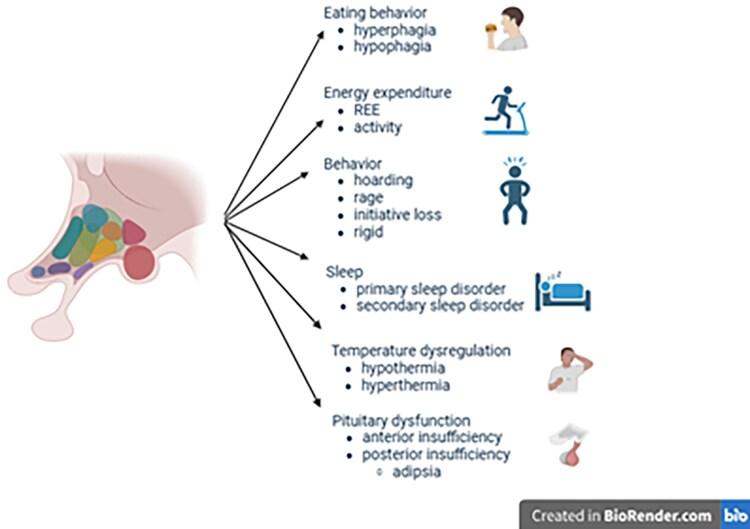
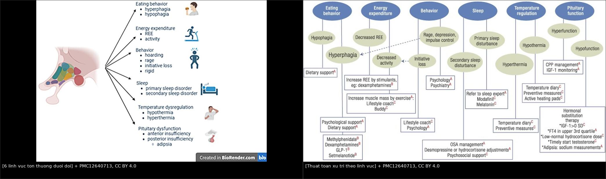
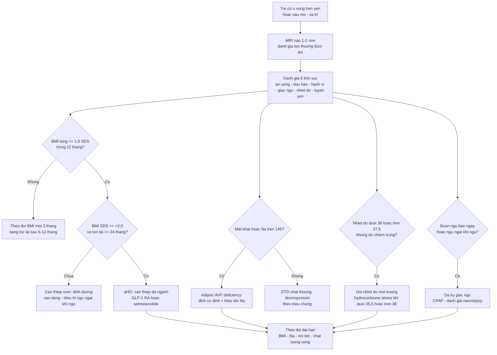
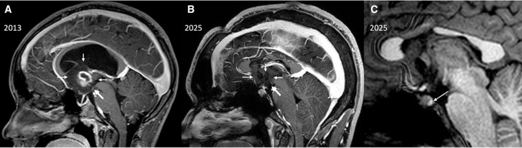
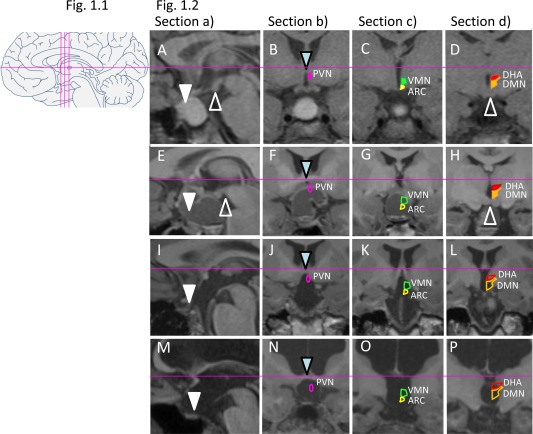
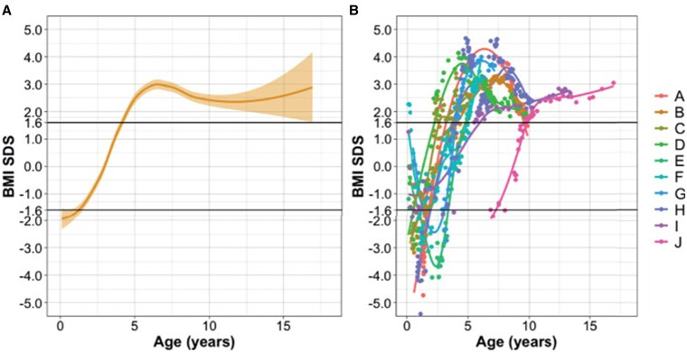

# 1754 — Hội chứng dưới đồi ở trẻ sau tổn thương trục dưới đồi–tuyến yên / Acquired hypothalamic syndrome in children

**Tags:** `pattern:ton-thuong-duoi-doi` `pattern:beo-phi-sau-mo` `pattern:mat-khat` `pattern:roi-loan-dieu-nhiet` `vung:nao` `vung:tuyen-yen` `protocol:MRI-nao` `protocol:sang-loc-noi-tiet` `score:chi-so-ton-thuong-duoi-doi` `incidentaloma:khong`

**Mức chắc chắn (certainty):** tổng hợp y văn (literature synthesis) — 3 bài tổng quan/thuật toán 2025–2026 có ảnh (Endocr Rev 2025, PMC12640713; JCEM 2026, PMC13466942; J Clin Res Pediatr Endocrinol 2026, PMC13325933), 2 tài liệu đồng thuận (Endocr J 2026 về tiêu chuẩn béo phì dưới đồi, PMC12895118; Eur J Endocrinol 2023 về tiêu chuẩn hội chứng dưới đồi — dẫn qua PMC12673360), 1 đoàn hệ điểm tổn thương dưới đồi trên MRI (Obesity 2015, PMC5029599) và 2 báo cáo ca có ảnh (JCEM Case Rep 2026, PMC13213079; J Clin Med 2015, PMC4600159). **Không có ca nguyên văn do nhóm tự viết**; mọi ca trong quiz là ca có ảnh từ bài gốc, ghi rõ PMCID.

> **Câu chốt:** **béo phì sau mổ u vùng trên yên không phải "do corticoid" hay "do ăn nhiều"** — đó là **tổn thương nhân dưới đồi**, và chỉ số quyết định là **tốc độ tăng BMI**: **+1,0 SDS trong 12 tháng đầu**, **tồn tại ≥ 24 tháng**, đạt **BMI SDS ≥ +2,0** = **béo phì dưới đồi mắc phải (aHO)**. Nhưng béo phì chỉ là **1 trong 6 lĩnh vực**: bỏ sót **mất khát** (tăng Na máu, có thể tử vong), **hạ nhiệt độ**, **rối loạn giấc ngủ** hay **hành vi** là sai lầm ngang với bỏ sót khối u. Câu hỏi đúng trên mọi MRI sau mổ không phải "còn u không" mà là **"còn bao nhiêu vùng dưới đồi lành"** — vì **vị trí tổn thương (thể vú, sàn não thất III, vùng sau) dự báo béo phì mạnh hơn kích thước u**.

## 1. Tổng quan bệnh học – cơ chế hình ảnh

### 1.1 Bệnh học và dịch tễ

- **Hội chứng dưới đồi (hypothalamic syndrome, HS)** là tập hợp hậu quả của **tổn thương vùng dưới đồi** — do **u**, **phẫu thuật**, **xạ trị**, **chấn thương sọ**, hoặc bệnh **viêm/thâm nhiễm**. Biểu hiện **không chỉ thiếu hormone tuyến yên** mà còn **béo phì dưới đồi**, **rối loạn giấc ngủ–nhịp sinh học**, **rối loạn điều nhiệt**, **rối loạn hành vi–nhận thức** (PMC13466942).
- **Nguyên nhân hàng đầu ở trẻ là u sọ hầu (craniopharyngioma)** — tỉ lệ mắc **0,5–2,0 ca/triệu người/năm**; các nguyên nhân khác: **u mầm, u thần kinh đệm, nang khe Rathke, LCH**, chấn thương sọ, **ROHHAD**, **Prader–Willi** (PMC13325933).
- **Tần suất rối loạn chức năng dưới đồi rất khác nhau: 20–100%** tùy nguyên nhân, tuổi, thời gian theo dõi và mức độ phẫu thuật (PMC12640713). Ở u sọ hầu trẻ, **khoảng một nửa** bệnh nhân có tổn thương dưới đồi phát triển **béo phì dưới đồi** (PMC13325933).
- **Tiêu chuẩn chẩn đoán HS ở trẻ (2023)** chia thành các lĩnh vực: **tăng ăn (hyperphagia)**, **giảm ăn (hypophagia)**, **BMI**, **vấn đề hành vi**, **rối loạn giấc ngủ**, **rối loạn điều nhiệt**, **suy tuyến yên**, **đánh giá hình ảnh dưới đồi** và **hội chứng di truyền dưới đồi**. Áp dụng cho **120 bệnh nhân**: **52,5%** đạt tiêu chuẩn HS; trong đó **76,7% suy tuyến yên**, **32,5% tăng ăn**, **40% rối loạn giấc ngủ**, **14,2% rối loạn điều nhiệt** (van Santen 2023, Eur J Endocrinol 188:214 — dẫn qua PMC12673360).
- **Béo phì dưới đồi mắc phải (acquired hypothalamic obesity, aHO)** — tiêu chuẩn đồng thuận quốc tế 2026: **tổn thương dưới đồi thấy trên MRI** + **BMI tăng nhanh trong 12 tháng đầu** (người lớn **≥ 5%**; trẻ **≥ +1,0 SDS**) + **tồn tại ≥ 24 tháng** + **béo phì** (trẻ **BMI SDS ≥ +2,0**) (PMC12895118).
- **Hậu quả dài hạn:** ở u sọ hầu trẻ, **béo phì nặng (BMI > 3 SDS) gặp 45,4%** lúc theo dõi cuối; **tăng cân quá mức/tăng ăn tăng từ 39% ở 10 năm lên 67% ở 20 năm**; **tử vong chuẩn hóa (SMR) 2,88–9,28**, **tử vong tim mạch cao gấp 3–19 lần** dân số chung (PMC13325933).

### 1.2 TẠI SAO hình ảnh và lâm sàng lại như vậy

- **Béo phì dưới đồi không phải "tội" của ý chí:** tổn thương **nhân cung (arcuate nucleus)** phá **hệ POMC–MC4R** (tín hiệu no) và **nhân bụng–giữa (ventromedial)** mất tín hiệu no → **tăng ăn**; đồng thời mất **điều hòa giao cảm** → **giảm chuyển hóa nghỉ (REE)** và **giảm vận động**. Trong **67 trẻ** có hội chứng dưới đồi, **67,2% có REE đo được < 90% REE dự đoán**, thấp nhất ở tổn thương **vùng sau/thể vú** (PMC13325933). Vì vậy **cắt calo đơn thuần thất bại** — phải can thiệp cả **chuyển hóa** và **hành vi**.
- **Vì sao BMI tăng nhanh trong 12 tháng đầu:** sau mổ, **phù nề + mất ức chế giao cảm + leptin/insulin đề kháng** tạo **"cửa sổ" tăng cân**; mô mỡ tăng nhanh rồi **tự duy trì** qua viêm mô mỡ. Đây là lý do tiêu chuẩn aHO dùng **tốc độ** (≥ 1,0 SDS/12 tháng) chứ không chỉ **giá trị tuyệt đối**.
- **Vì sao mất khát lại chết người:** **osmoreceptor ở vùng quanh não thất trước** và **nhân trên thị** vừa tiết **AVP** vừa tạo **cảm giác khát**. Tổn thương cả hai → **đái nhiều + không khát** → trẻ **không uống bù**, **tăng Na máu**. Ca 21 tuổi sau mổ u sao bào lông: **Na 158 mEq/L**, osmolality máu **317 mOsm/kg**, **hoàn toàn không khát** khi truyền NaCl 3%, **copeptin 3,2 pmol/L** (PMC13213079). Đây là thể **adipsic AVP deficiency** — **không** giống ĐTĐ nhạt thông thường.
- **Vì sao hạ nhiệt độ:** nhân **trước thị (preoptic)** là "trung tâm điều nhiệt"; mất nó → **poikilothermia** (nhiệt độ chạy theo môi trường): **hạ < 36 °C** hoặc **tăng > 37,5 °C** không do nhiễm trùng (PMC12640713).
- **Vì sao rối loạn giấc ngủ:** **nhân trên thị (SCN)** mất nhịp sinh học → **hypersomnia, đảo nhịp ngày–đêm, buồn ngủ ban ngày** — báo cáo **30%** u sọ hầu trẻ có **buồn ngủ quá mức**, gồm **hypersomnia và narcolepsy thứ phát** (PMC13325933).
- **Vì sao hình ảnh phải đọc "theo nhân":** trên MRI, **tổn thương sàn não thất III, thể vú, vùng trước/giữa và đặc biệt vùng sau** liên quan chặt với béo phì; **điểm tổn thương dưới đồi (hypothalamic lesion score, HLS)** tương quan với **mức tăng BMI z-score lúc 12 tháng (r = 0,34; P = 0,03)** và **30 tháng (r = 0,40; P = 0,02)**, kể cả sau khi hiệu chỉnh giới, tuổi mổ, não úng thủy (PMC5029599). Đái tháo nhạt còn là **marker nội tiết của nguy cơ béo phì**.

### 1.3 Ngưỡng định lượng trụ cột

| Đại lượng | Con số | Nguồn |
|---|---|---|
| Tiêu chuẩn **aHO** (đồng thuận 2026) | BMI tăng **≥ 1,0 SDS (trẻ)** trong **12 tháng**; **tồn tại ≥ 24 tháng**; **BMI SDS ≥ +2,0** | PMC12895118 |
| Tần suất HS khi áp tiêu chuẩn 2023 (n = 120) | **52,5%** HS; suy tuyến yên **76,7%**, tăng ăn **32,5%**, rối loạn giấc ngủ **40%**, rối loạn điều nhiệt **14,2%** | van Santen 2023 (dẫn qua PMC12673360) |
| Béo phì dưới đồi ở u sọ hầu trẻ | **~50%**; **BMI > 3 SDS: 45,4%** lúc cuối; tăng cân **39% (10 năm) → 67% (20 năm)** | PMC13325933 · PMC4600159 |
| Giảm chuyển hóa | **67,2%** có **REE < 90%** dự đoán; thấp nhất ở tổn thương **vùng sau/thể vú** | PMC13325933 |
| Điểm tổn thương dưới đồi (HLS, 4 lát chuẩn) | **n = 45** (41 u sọ hầu); HO **22/45 (48,9%)**; **thể vú/sàn não thất III/vùng sau** liên quan HO (**P < 0,01** vùng sau); **r = 0,34** (12 tháng), **r = 0,40** (30 tháng) | PMC5029599 |
| Rối loạn điều nhiệt | **hạ < 36 °C**, **tăng > 37,5 °C** không do nhiễm; **cân nhắc hydrocortisone liều stress khi < 35,5 °C hoặc > 38 °C** | PMC12640713 |
| Buồn ngủ quá mức ở u sọ hầu trẻ | **30%** (hypersomnia, narcolepsy thứ phát) | PMC13325933 |
| Điểm loạn điều hòa tự chủ (bổ sung 2025) | thang **0–10**: **0–3 không**, **4–6 nhẹ**, **7–10 nặng** | PMC12673360 |
| Setmelanotide trong aHO (pha 3, 52 tuần) | BMI **−16,5%** (n = 81) vs **+3,3%** (n = 39); **80%** giảm ≥ 5% BMI | PMC13325933 |
| Setmelanotide pha 2 (aHO) | BMI **−15 ± 10%**, cải thiện tăng ăn và chất lượng sống | PMC13325933 |
| Tử vong | **SMR 2,88–9,28**; tử vong tim mạch **3–19 lần** | PMC13325933 |

## 2. Mẫu hình + chẩn đoán phân biệt theo vị trí (Gamut)

- **Béo phì tăng nhanh sau mổ u vùng trên yên:**
  - **aHO do tổn thương dưới đồi** · **béo phì do corticoid** · **suy giáp trung ương chưa điều trị** · **béo phì đơn thuần** · **hội chứng Prader–Willi** · **ROHHAD** · **hội chứng Cushing** (bài 1699).
- **Suy tuyến yên + đái tháo nhạt sau mổ:**
  - **tổn thương trục dưới đồi–tuyến yên** · **ĐTĐ nhạt sau mổ tuyến yên** (bài 1710) · **hội chứng dưới đồi kèm mất khát** · **hội chứng tiết ADH không thích hợp (SIADH)** — có thể **xen kẽ** trong cùng một bệnh nhân.
- **Mất khát + tăng Na máu:**
  - **adipsic AVP deficiency** · **adipsic SIADH** · **tổn thương osmoreceptor do xạ** · **không uống đủ do rối loạn hành vi**.
- **Rối loạn điều nhiệt:**
  - **poikilothermia dưới đồi** · **nhiễm trùng** (phải loại trừ trước) · **suy thượng thận** · **suy giáp** · **thuốc**.
- **Rối loạn giấc ngủ–nhịp sinh học:**
  - **mất nhịp SCN** · **narcolepsy thứ phát** (thiếu orexin do tổn thương vùng sau) · **trầm cảm** · **ngưng thở khi ngủ do béo phì**.
- **Trẻ nhỏ sụt cân + nôn + rung giật nhãn cầu (ngược với béo phì):**
  - **hội chứng gian não (diencephalic syndrome)** do u thần kinh đệm đường thị/dưới đồi — **giảm ăn (hypophagia)**, **BMI SDS đi từ −2 lên +3** khi tổn thương tiến triển (Hình 6, PMC12640713).
- **Theo vị trí tổn thương trên MRI:**
  - **thể vú/sàn não thất III** → béo phì + rối loạn trí nhớ; **vùng sau (thể vú, nhân bụng–giữa)** → béo phì nặng + giảm REE; **nhân trên thị** → mất nhịp sinh học; **nhân trên thị + cạnh não thất** → mất khát/ĐTĐ nhạt; **nhân trước thị** → rối loạn nhiệt.

*Sáu lĩnh vực tổn thương dưới đồi: **ăn uống** (tăng/giảm ăn), **tiêu hao năng lượng** (REE, vận động), **hành vi** (tích trữ, giận dữ, mất kiểm soát xung), **giấc ngủ**, **điều nhiệt**, **chức năng tuyến yên** (suy trước yên, suy sau yên gồm **mất khát**). Ảnh nguyên bản (Endocr Rev 2025, PMC12640713, CC BY 4.0).*

## 3. Bảng so sánh phân biệt (ma trận đối chiếu)

| Thực thể (entity) | Hình ảnh/lâm sàng điển hình | Chốt vào (rule-in) | Chốt loại (rule-out) | Gợi ý xác nhận |
|---|---|---|---|---|
| **aHO do tổn thương dưới đồi (bài này)** | Tổn thương **thể vú/sàn não thất III/vùng sau** trên MRI; BMI tăng **nhanh**; tăng ăn; **giảm REE**; có thể kèm ĐTĐ nhạt | **BMI +1,0 SDS trong 12 tháng, tồn tại 24 tháng, BMI SDS ≥ +2,0** + tổn thương dưới đồi trên MRI | **Tăng cân từ từ đều, không tổn thương dưới đồi** → béo phì thông thường | HLS trên MRI; theo dõi BMI **mỗi 3 tháng** |
| **Béo phì do corticoid** | Tăng cân **toàn thân**, mặt tròn, **không tăng ăn kiểu dưới đồi**; **teo cơ**; tăng HA | **Tiền sử corticoid liều cao kéo dài + cortisol bị ức chế** | **Cortisol không bị ức chế** + tổn thương dưới đồi → aHO | Lịch sử liều, cortisol/ACTH (bài 1694) |
| **Suy giáp trung ương** | Tăng cân, **chậm chạp, táo bón, da khô**; FT4 thấp, TSH thấp/không tăng | **FT4 thấp + TSH không tăng** | FT4 bình thường → không phải nguyên nhân chính | FT4/TSH; điều trị thử |
| **Hội chứng Cushing** | Béo **thân**, mặt tròn, **vân tím**, tăng HA, chậm tăng trưởng | **UFC/cortisol nửa đêm tăng; test 1 mg dexamethasone không ức chế** | Cortisol bình thường | Bài 1699, 1696 |
| **Prader–Willi** | Béo phì + **giảm trương lực cơ sơ sinh**, chậm phát triển, **tăng ăn**, bàn tay–chân nhỏ | **Mất đoạn 15q11–q13 (methyl hóa)** | Không có bất thường gen + tổn thương dưới đồi trên MRI | Methyl hóa/MS-MLPA |
| **ROHHAD** | Béo phì **khởi phát nhanh 1,5–10 tuổi** + **giảm thông khí khi ngủ** + loạn điều hòa tự chủ + u mô thần kinh | **Tam chứng béo phì–giảm thông khí–loạn tự chủ**, điểm loạn tự chủ **0–10** | Không giảm thông khí, không u thần kinh → ít nghĩ | Đa ký giấc ngủ, điểm tự chủ (PMC12673360) |
| **Hội chứng gian não (diencephalic syndrome)** | Trẻ **nhỏ, gầy teo**, **giảm ăn**, nôn, **rung giật nhãn cầu**, hưng phấn; u đường thị/dưới đồi | **U thần kinh đệm dưới đồi + BMI SDS rất thấp (−2)** | **BMI tăng nhanh + tăng ăn** → aHO | MRI; BMI SDS theo thời gian |
| **Hội chứng dưới đồi sau chấn thương sọ** | Tăng cân, mất khát, mệt mỏi, rối loạn giấc ngủ sau TBI | **Tiền sử TBI + tổn thương dưới đồi trên MRI** | Không tiền sử chấn thương → nguyên nhân khác | Tiền sử, MRI, sàng lọc nội tiết |
| **Adipsic AVP deficiency** | **Đái nhiều nhưng không khát**; **Na máu cao**; có thể **không đa niệu** | **Na > 145 mEq/L + không khát khi tăng Na + AVP thấp/copeptin thấp** | **Khát bình thường + Na bình thường** → không phải adipsia | Test truyền NaCl 3%, copeptin (PMC13213079) |

*Trái: 6 lĩnh vực tổn thương. Phải: thuật toán xử trí theo từng lĩnh vực — từ **hỗ trợ ăn uống**, **tăng REE bằng thuốc kích thích/vận động**, **tâm lý–hành vi**, **điều trị ngưng thở khi ngủ**, **kiểm soát nhiệt độ**, đến **thay thế hormone** và **quản lý Na ở người mất khát**. Cả hai từ PMC12640713, CC BY 4.0; ảnh ghép letterbox, không crop.*

## 4. Protocol chụp + hệ phân độ/điểm chuẩn hóa

### 4.1 MRI — phải trả lời "còn bao nhiêu vùng dưới đồi"

- **MRI sọ có tiêm gadolinium**, lát **1–2 mm**:
  - **T1W sagittal** qua đường giữa (thể vú, sàn não thất III, cuống yên, tuyến yên);
  - **T1W sau tiêm sagittal + coronal** (đánh giá phần u còn lại, màng não);
  - **T2W coronal** qua vùng dưới đồi; **FLAIR**; **DWI/ADC**;
  - **MRI toàn trục tủy** khi nghi u mầm (bài 1731).
- **Đọc theo 4 lát chuẩn của HLS:** 1 lát **sagittal giữa** + **3 lát coronal** qua **nhân cạnh não thất (PVN)**, **nhân cung (ARC)/nhân bụng–giữa (VMN)**, **vùng sau (DMN/thể vú)** — vẽ/ghi **nhân nào còn, nhân nào mất** (PMC5029599).
- **Phân độ tổn thương sau mổ (3 bậc):**
  - **0** — không tổn thương dưới đồi;
  - **1** — tổn thương **vùng trước/giữa** (không tới thể vú);
  - **2** — tổn thương **vùng sau/thể vú** → nguy cơ béo phì nặng nhất (PMC5029599 · PMC13325933).

### 4.2 Sàng lọc 6 lĩnh vực (làm mỗi lần khám)

- **Ăn uống:** tăng ăn, ăn đêm, thèm ngọt; **giảm ăn** ở trẻ nhỏ.
- **Tiêu hao:** **REE đo được** (nếu có), mức vận động.
- **Hành vi:** tích trữ thức ăn, giận dữ, mất kiểm soát xung, sa sút trí nhớ.
- **Giấc ngủ:** buồn ngủ ban ngày, đảo nhịp, ngưng thở khi ngủ (**đa ký giấc ngủ**).
- **Điều nhiệt:** đo nhiệt độ trung tâm khi có triệu chứng; ghi **hạ < 36 °C** hoặc **tăng > 37,5 °C**.
- **Tuyến yên:** FT4/TSH, cortisol sáng/ACTH, IGF-1, LH/FSH, prolactin; **Na, osmolality** cho trục sau yên.

### 4.3 Thuật toán xử trí

- **Béo phì:** can thiệp **sớm** (trước khi BMI tăng quá nhanh) — **chế độ ăn cân đối (30% béo, 45% carb, 25% protein)** hoặc chế độ chặt hơn **8–10 kcal/cm chiều cao/ngày**, tăng vận động, **điều trị ngưng thở khi ngủ**.
- **Thuốc:** **GLP-1 RA (semaglutide)** — giảm BMI trung vị **~17%** ở thanh thiếu niên béo phì nói chung (không riêng aHO); **setmelanotide (MC4R agonist)** — **pha 3 aHO: −16,5% vs +3,3%**, **80%** giảm ≥ 5% BMI; **pha 2: −15 ± 10%** (PMC13325933).
- **Phẫu thuật giảm béo:** cân nhắc cuối, **không hồi phục** — thận trọng ở trẻ.
- **Mất khát:** **lượng dịch cố định theo cân nặng + theo dõi Na** (không dựa vào "uống theo nhu cầu"); giáo dục gia đình như bảng theo dõi cân–Na hằng ngày (PMC8686629).
- **Hạ nhiệt độ:** làm ấm, đo nhiệt độ trung tâm; **hydrocortisone liều stress khi < 35,5 °C hoặc > 38 °C**; **loại trừ nhiễm trùng trước**.
- **Suy tuyến yên:** thay thế **FT4, cortisol, GH, testosterone/estrogen** theo tuổi; **tránh bỏ sót suy thượng thận** khi trẻ mệt, hạ Na.

## 5. Biến thể bình thường và cạm bẫy

- **"Béo lên vì corticoid" là giải thích quá dễ:** corticoid gây tăng cân nhưng **không gây tăng ăn kiểu dưới đồi**; nếu BMI tăng **> 1 SDS trong 12 tháng** sau mổ u vùng trên yên, phải nghĩ **aHO** dù bệnh nhân đang dùng corticoid (PMC12895118).
- **"MRI sạch = không có hội chứng dưới đồi":** tổn thương **vi mô do mổ/xạ** có thể không thấy rõ; chẩn đoán dựa **lâm sàng + BMI + HLS**, không chỉ "còn u hay không".
- **Mất khát là cạm bẫy chết người:** trẻ **đái nhiều nhưng không khát** có thể **không đa niệu** rõ khi mất nước; ca 21 tuổi có **Na 158 mEq/L** mà **không hề khát** (PMC13213079). **Không hỏi "con có khát không" để quyết định bù dịch** — phải **đo Na**.
- **Bỏ sót hạ nhiệt độ vì "trẻ lạnh là bình thường":** hạ < 36 °C không do nhiễm trùng là dấu hiệu **tổn thương nhân trước thị**; ngược lại **tăng > 37,5 °C** có thể bị nhầm là sốt nhiễm trùng và **dùng kháng sinh vô ích** (PMC12640713).
- **Nhầm rối loạn giấc ngủ với trầm cảm/lười:** **30%** u sọ hầu trẻ có buồn ngủ quá mức; cần **đa ký giấc ngủ** trước khi kết luận tâm lý (PMC13325933).
- **Hội chứng gian não (diencephalic syndrome) là thể NGƯỢC:** trẻ **gầy, giảm ăn**; nếu chỉ tìm béo phì sẽ bỏ sót u dưới đồi ở trẻ nhỏ — **BMI SDS đi từ −2 lên +3** khi bệnh tiến triển (PMC12640713 Fig. 6).
- **Đừng hứa "mổ hết u là hết béo phì":** tổn thương dưới đồi **không hồi phục**; **tăng cân vẫn tiếp diễn 20 năm** (39% → 67%), và **tử vong tim mạch cao 3–19 lần** (PMC13325933).
- **Can thiệp muộn kém hiệu quả:** chế độ ăn đơn thuần **thất bại** khi REE giảm; cần **đa ngành sớm** (dinh dưỡng, vận động, tâm lý, thuốc, giấc ngủ).

## 6. Tự lượng giá — Blind Quiz ngay trên trang tĩnh

**Ca 1 — Nam 21 tuổi, tiền sử mổ u sao bào lông vùng dưới đồi, nhập viện mất nước. MRI trước mổ (2013) và sau mổ (2025).**

- Gợi ý lâm sàng: **Na 158 mEq/L**, osmolality máu **317 mOsm/kg**, bệnh nhân **phủ nhận khát**, **không đa niệu**.
- Câu hỏi: (A) và (B) cho thấy gì? Vì sao bệnh nhân **không khát** mà vẫn tăng Na? Cần theo dõi gì?

<b>Bấm để hiện đáp án (findings + chẩn đoán)</b>

- (A) 2013: **u sao bào lông vùng dưới đồi** lồi vào não thất III (mũi tên nhỏ), **thể vú** (mũi tên lớn); (B) 2025: sau mổ, **mô dưới đồi mất/thay đổi**, còn di chứng.
- Chẩn đoán: **adipsic AVP deficiency** — tổn thương **osmoreceptor + trung tâm khát**; **copeptin 3,2 pmol/L** khi truyền NaCl 3%, **khát không đổi**.
- Điều trị: **lượng dịch cố định**, theo dõi **Na và cân nặng**; **không** dựa vào cảm giác khát.
- Nguồn ảnh: *JCEM Case Reports* 2026, Fig. 1 — PMC13213079, CC BY-NC-ND 4.0 (nguyên bản, không chỉnh sửa).

**Ca 2 — Bốn trẻ sau mổ u sọ hầu, MRI 4 lát chuẩn đánh giá tổn thương dưới đồi.**

- Câu hỏi: Nhân nào bị tổn thương ở từng bệnh nhân (A–D)? Tổn thương vùng nào dự báo **béo phì dưới đồi** mạnh nhất?

<b>Bấm để hiện đáp án (findings + chẩn đoán)</b>

- Hình 1.1: sơ đồ **4 lát chuẩn** (1 sagittal giữa + 3 coronal) với các nhân: **PVN** (tím), **ARC** (xanh), **VMN** (vàng), **DMN/thể vú** (cam).
- Hình 1.2: mỗi hàng là một bệnh nhân; **hình đặc = nhân còn**, **hình rỗng = nhân mất**.
- **Chốt:** tổn thương **thể vú, sàn não thất III, vùng trước/giữa** liên quan HO (P < 0,05), **vùng sau mạnh nhất (P < 0,01)**; HLS tương quan với **ΔBMI z lúc 12 và 30 tháng**.
- Nguồn ảnh: *Obesity (Silver Spring)* 2015, Fig. 1 — PMC5029599, CC BY-NC 4.0 (nguyên bản, không chỉnh sửa).

**Ca 3 — Trẻ u thần kinh đệm cấp thấp vùng dưới đồi: BMI SDS theo tuổi.**

- Câu hỏi: Đường BMI SDS nói gì về hai thể đối lập của tổn thương dưới đồi? Điều này thay đổi cách bạn đọc "trẻ gầy" thế nào?

<b>Bấm để hiện đáp án (findings + chẩn đoán)</b>

- (A) Trung bình: BMI SDS **khoảng −2 lúc nhỏ** rồi **tăng vượt +2 sau 5–6 tuổi** và duy trì **~+2,5 đến +3**.
- (B) Từng bệnh nhân: có trẻ **khởi đầu rất gầy (BMI SDS −4 đến −5)** rồi **tăng vọt**.
- Ý nghĩa: **hội chứng gian não (giảm ăn, gầy)** và **béo phì dưới đồi (tăng ăn)** là **hai đầu của cùng một tổn thương** — trẻ gầy có u dưới đồi vẫn phải theo dõi **BMI lâu dài**.
- Nguồn ảnh: *Endocrine Reviews* 2025, Fig. 6 — PMC12640713, CC BY 4.0.

## Bài liên quan chéo
- [600 – Tổng quan Hệ Nhi khoa](../600-tong-quan-nhi-khoa/lesson.md)
- [1731 – U mầm nội sọ vùng trên yên ở trẻ](../1731-u-mam-noi-so-vung-tren-yen-o-tre/lesson.md) (nguyên nhân HS hay gặp thứ hai)
- [1751 – LCH vùng dưới đồi–tuyến yên ở trẻ](../1751-lch-vung-duoi-doi-tuyen-yen-o-tre/lesson.md) (thể thâm nhiễm + mất khát)
- [1753 – Viêm tuyến yên–cuống yên tăng sinh lympho ở trẻ](../1753-viem-tuyen-yen-cuong-yen-tang-sinh-lympho-o-tre/lesson.md)
- [1644 – Đái tháo nhạt trung ương ở trẻ](../1644-dai-thao-nhat-trung-uong-o-tre/lesson.md)
- [1710 – Đái tháo nhạt trung ương sau mổ tuyến yên](../1710-dai-thao-nhat-trung-uong-sau-mo-tuyen-yen/lesson.md)
- [1699 – Bệnh Cushing ở trẻ em](../1699-benh-cushing-tre-em/lesson.md) (béo phì + tăng HA: DDx bắt buộc)

## Ảnh
- `1754_hs_domains_PMC12640713-F2.jpg` — 6 lĩnh vực của hội chứng dưới đồi.
- `1754_hs_algorithm_PMC12640713-F5.jpg` — thuật toán xử trí theo lĩnh vực.
- `1754_hs_bmi-sds_PMC12640713-F6.jpg` — BMI SDS từ gầy (gian não) sang béo (aHO).
- `1754_hls_MRI_PMC5029599-F1.jpg` — 4 lát chuẩn + ví dụ HLS ở 4 bệnh nhân.
- `1754_adipsic_MRI_PMC13213079-F1.jpg` — u sao bào lông dưới đồi trước/sau mổ, ca mất khát.
- `composite_hs_6-linh-vuc_va_thuat-toan.jpg` — ảnh ghép 2 ô từ nguồn **CC BY 4.0**.
- Nguồn + giấy phép từng ảnh: xem `images/CREDITS.md` và `sources.md`.

> Không dùng để chẩn đoán độc lập khi chưa có người hướng dẫn.
