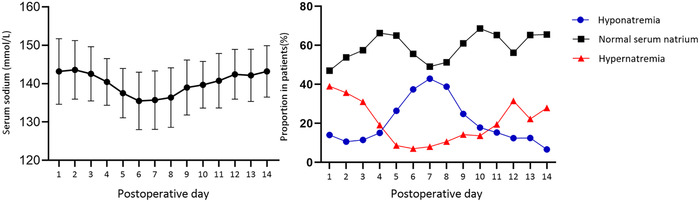
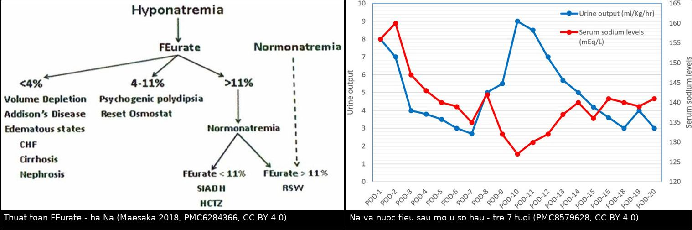
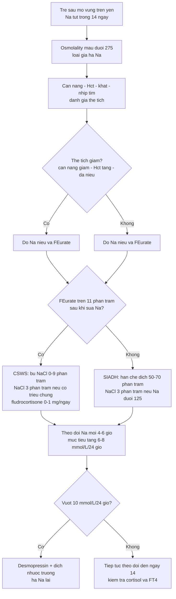
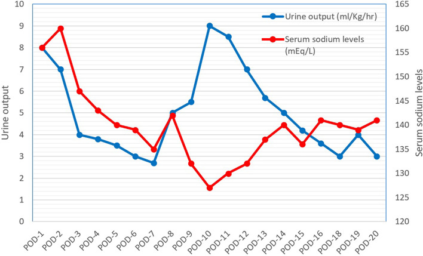
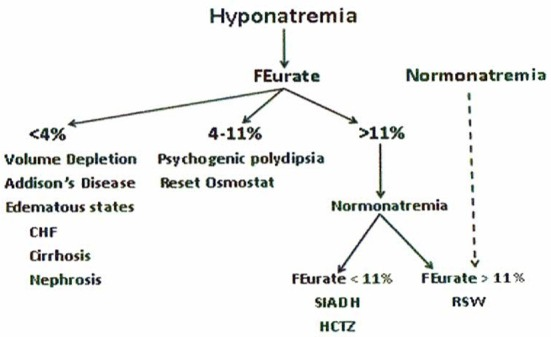
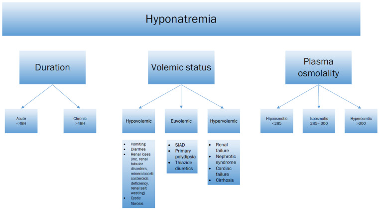

# 1755 — Hạ natri máu sau mổ u vùng trên yên ở trẻ: SIADH hay mất muối não / Postoperative hyponatremia in children: SIADH versus cerebral salt wasting

**Tags:** `pattern:ha-natri-mau` `pattern:siadh` `pattern:csws` `pattern:da-nieu` `vung:tuyen-yen` `vung:nao` `protocol:dien-giai-na` `protocol:MRI-tuyen-yen` `score:feurate` `incidentaloma:khong`

**Mức chắc chắn (certainty):** tổng hợp y văn (literature synthesis) — 1 đoàn hệ lớn hồi cứu **202 trẻ mổ u sọ hầu** có biểu đồ Na theo ngày (Brain Behav 2024, PMC10909694, CC BY 4.0), 1 ca nguyên văn **trẻ 7 tuổi vừa ĐTĐ nhạt vừa mất muối não** sau mổ u sọ hầu có ảnh đường cong Na/nước tiểu (BMC Pediatr 2021, PMC8579628, CC BY 4.0), 1 bài tổng quan cơ chế với **thuật toán FEurate** (Front Med 2018, PMC6284366, CC BY 4.0), 1 tổng quan nhi khoa 2026 về Na–nước (J Clin Med 2026, PMC12841650, CC BY 4.0) và 1 tổng quan điều trị hạ Na (J Clin Med 2026, PMC13705694, CC BY 4.0). **Không có ca nguyên văn do nhóm tự viết**; ca trong quiz là ca có ảnh từ bài gốc, ghi rõ PMCID.

> **Câu chốt:** hạ natri máu sau mổ vùng trên yên **không phải một bệnh** mà là **hai trạng thái ngược nhau trên cùng một bệnh nhân**: **SIADH** (nước dư, thể tích bình thường → **hạn chế dịch**) và **mất muối não** (muối mất thật, thể tích giảm → **truyền muối + bù dịch**). Điều trị sai hướng **làm nặng thêm** rối loạn. Ba con số phải thuộc: hạ Na gặp ở **72,8%** trẻ mổ u sọ hầu trong 14 ngày đầu, đáy trung bình **135,5 mmol/L vào ngày 6**, và **57,4%** có kiểu **ba pha** (tăng → giảm → tăng). Vì vậy **đo Na mỗi 6–12 giờ trong 2 tuần**, chứ không phải "đo khi có triệu chứng".

## 1. Tổng quan bệnh học – cơ chế hình ảnh

### 1.1 Bệnh học và dịch tễ

- **Vùng mổ quyết định rối loạn:** u sọ hầu (craniopharyngioma) trẻ nằm sát **cuống yên, thùy sau yên và sàn não thất III**; phẫu tích u **cắt ngang sợi trục tiết ADH** đang chạy từ nhân trên thị/nhân cạnh não thất xuống thùy sau → mất kiểm soát phóng thích ADH **theo từng đợt**, không theo áp lực thẩm thấu.
- **Tần suất (đoàn hệ 202 trẻ, 2 trung tâm, 2018–2019):** trong **14 ngày** sau mổ, **tăng Na 66,3%**, **hạ Na 72,8%**; thể nặng (**Na > 150** hoặc **< 130 mmol/L**) lần lượt **37,1%** và **40,6%**. Tuổi trung bình **8,35 ± 4,35**; **91,6%** mổ qua đường sọ, **8,4%** qua xoang bướm nội soi; **95,1%** là u sọ hầu thể răng (adamantinomatous) (PMC10909694).
- **Kiểu ba pha (triphasic response)** — **57,4%** bệnh nhân có kiểu này trên đường cong Na, dù chỉ **15,3%** đạt đủ tiêu chuẩn chẩn đoán (ĐTĐ nhạt → hạ Na → ĐTĐ nhạt trở lại) (PMC10909694).
- **Hạ Na là biến cố của tuần đầu–tuần thứ hai, không phải ngày đầu:** khởi phát trung vị **ngày 4 (2–6)**, kéo dài **3,12 ± 1,99 ngày**, đỉnh tần suất **ngày 7 (42,9%)**; trong khi tăng Na khởi phát **ngày 1 (1–2)** và có **hai đỉnh** (ngày 1: 39,0%; ngày 12: 31,5%) (PMC10909694).
- **Yếu tố nguy cơ hạ Na nặng (đa biến):** **không có thiếu hụt hormone tuyến yên trước mổ → OR 2,031 (1,027–4,020), p = 0,042**; **mổ qua đường sọ → OR 5,52 (1,198–25,431), p = 0,028**; u nguyên phát **OR 2,095 (0,938–4,679), p = 0,071** (xu hướng). Tỉ lệ hạ Na nặng: **44,9% vs 29,1%** (không/không có thiếu hụt trước mổ, p = 0,042), **43,2% vs 11,8%** (đường sọ vs xoang bướm, p = 0,011), **44,4% vs 25,0%** (u nguyên phát vs tái phát, p = 0,025) (PMC10909694).
- **Ngưỡng định nghĩa dùng trong đoàn hệ:** hạ Na **< 135**, nặng **< 130**; tăng Na **> 145**, nặng **> 150 mmol/L**; ĐTĐ nhạt = nước tiểu **> 3 L/m²/ngày** + osmolality máu **> 300 mOsm/kg** + osmolality nước tiểu **< 300 mOsm/kg** hoặc tỉ trọng **< 1,010** (PMC10909694).

### 1.2 TẠI SAO Na lại tụt — hai cơ chế trái ngược

- **SIADH — "nước dư, không phải muối thiếu":** ADH gắn **thụ thể V2** ở ống góp → tăng **AQP2** → tái hấp thu nước tự do → **pha loãng Na máu**. Tổng Na cơ thể **bình thường**, thể tích ngoại bào **bình thường/không phù**. Vì vậy **truyền muối đẳng trương không chữa được** (muối vào rồi ra theo nước tiểu), còn **hạn chế dịch** thì chữa được (PMC6284366).
- **CSWS — "mất muối thật":** sau tổn thương não, **giảm trương lực giao cảm** và **tăng peptide lợi niệu (ANP/BNP/CNP, urodilatin)** → ức chế tái hấp thu Na ở ống lượn gần → **natriuresis** + đa niệu → **giảm thể tích ngoại bào** → ADH tăng **thứ phát** vì giảm thể tích (không "inappropriate"). Vì vậy **hạn chế dịch làm bệnh nặng lên**, còn **bù muối + thể tích** thì cải thiện (PMC6284366, PMC8556096).
- **Vì sao hai thể giống nhau đến vậy:** cả hai đều có **hạ Na giảm thẩm thấu**, **nước tiểu cô đặc** (Uosm > Posm), **Na niệu > 30 mmol/L**, **hypouricemia** và **tăng FEurate** — tức là **5/5 xét nghiệm "kinh điển" không phân biệt được**. Khác biệt duy nhất là **thể tích**, và thể tích **không đo được bằng mắt** (PMC6284366).
- **Vì sao FEurate phân biệt được:** urate được tái hấp thu ở ống lượn gần **cùng chỗ với Na**. Khi thể tích giảm (CSWS) → tăng tái hấp thu Na **và** urate → **FEurate tăng > 11%** và **không trở về bình thường** sau khi sửa Na. Trong SIADH, FEurate tăng **do pha loãng** nhưng **về < 11%** khi Na được sửa. **FEurate bình thường 4–11%**; **< 4%** gợi ý giảm thể tích/Addison/phù (PMC6284366).
- **Vì sao "Na niệu cao = mất muối" là sai:** **10/24** bệnh nhân mất muối thận trong loạt 62 người có **Na niệu < 20 mmol/L**; ngược lại, SIADH khi ăn nhạt cũng có Na niệu thấp. Na niệu **không dùng một mình** để phân biệt (PMC6284366).
- **Vì sao phải sửa Na chậm:** não thích nghi bằng cách **mất osmolyte nội bào** trong 24–48 giờ; sửa quá nhanh → **phù tế bào não thoáng qua** rồi **hủy myelin cầu (ODS)**. Giới hạn: **≤ 8–10 mmol/L/24 giờ** và **≤ 18 mmol/L/48 giờ** ở hạ Na mạn; nếu có triệu chứng nặng thì **nâng 4–6 mmol/L** trước để cắt cơn co giật (PMC13705694). Ở trẻ, tổng quan nhi khoa dùng **6–8 mmol/L/ngày** (PMC12841650).

### 1.3 Ngưỡng định lượng trụ cột

| Đại lượng | Con số | Nguồn |
|---|---|---|
| Hạ Na sau mổ u sọ hầu ở trẻ (14 ngày) | **72,8%** hạ Na; **40,6%** Na **< 130**; **66,3%** tăng Na | PMC10909694 |
| Đường cong Na trung bình | đỉnh **ngày 2: 143,6 ± 7,6**; đáy **ngày 6: 135,5 ± 7,5**; đỉnh **ngày 14: 143,2 ± 6,7** mmol/L | PMC10909694 |
| Kiểu ba pha | **57,4%** có kiểu; **15,3%** đủ tiêu chuẩn | PMC10909694 |
| Thời điểm | hạ Na khởi phát **ngày 4 (2–6)**, kéo dài **3,12 ± 1,99 ngày**, đỉnh **ngày 7 (42,9%)** | PMC10909694 |
| Nguy cơ hạ Na nặng | không thiếu hụt hormone trước mổ **OR 2,031**; đường sọ **OR 5,52** | PMC10909694 |
| FEurate | bình thường **4–11%**; **> 11%** sau sửa Na = mất muối thận/CSWS; **< 11%** = SIADH | PMC6284366 |
| Natri niệu | **> 30 mmol/L** ở **cả hai** — không phân biệt được; **10/24** ca CSWS có **< 20 mmol/L** | PMC6284366 |
| Nước tiểu | SIADH: Uosm **> 100 mOsm/kg** (thường **> 300**); CSWS: Uosm cao nhưng **thể tích nước tiểu nhiều** | PMC12841650 |
| Sửa Na an toàn | **≤ 8–10 mmol/L/24 giờ**, **≤ 18 mmol/L/48 giờ**; trẻ: **6–8 mmol/L/ngày** | PMC13705694 · PMC12841650 |
| NaCl 3% khi có triệu chứng | **3–5 mL/kg trong 10–15 phút** → nâng **2,5–4 mmol/L** | PMC12841650 |
| Công thức thiếu hụt Na | **(135 − Na) × 0,6** (nhũ nhi **0,7**) **× cân nặng** + nhu cầu **1–2 mmol/kg/ngày** | PMC12841650 |
| Fludrocortisone trong CSWS | **0,1 mg/ngày** (ca trẻ 7 tuổi); có ca **50 → 150 µg/ngày** | PMC8579628 · PMC8556096 |

*Trái: Na trung bình **ba pha** — đỉnh **143,6** (ngày 2) → đáy **135,5** (ngày 6) → đỉnh **143,2** (ngày 14). Phải: tần suất tăng Na (hai đỉnh: ngày 1 **39,0%**, ngày 12 **31,5%**) và hạ Na (một đỉnh **ngày 7: 42,9%**). Đây là lý do phải đo Na **đến ngày 14**, không phải chỉ 48 giờ đầu. Ảnh nguyên bản (Brain Behav 2024, PMC10909694, CC BY 4.0).*

## 2. Mẫu hình + chẩn đoán phân biệt theo vị trí (Gamut)

- **Hạ Na trong 2 tuần đầu sau mổ vùng trên yên, thể tích bình thường:**
  - **SIADH sau mổ** · **hội chứng tiết ADH không thích hợp do thuốc** (opioid, carbamazepine, SSRI) · **suy thượng thận** (cortisol thấp → ADH không bị ức chế) · **suy giáp** · **reset osmostat** · **uống nước quá nhiều do khát tâm lý**.
- **Hạ Na + đa niệu + dấu hiệu giảm thể tích:**
  - **CSWS** · **CSWS sau ĐTĐ nhạt** (thể xen kẽ — ca 7 tuổi) · **lợi niệu do mannitol/thuốc** · **suy thận mất muối** · **nôn/tháo tháo** · **suy thượng thận cấp**.
- **Hạ Na + nước tiểu cô đặc nhưng không giảm thể tích và FEurate thấp:**
  - **SIADH** · **reset osmostat** · **giả hạ Na** (protein/lipid máu cao) · **tăng đường huyết** (hạ Na giả do pha loãng).
- **Đường cong Na theo thời gian sau mổ (đọc như "dấu hiệu hình ảnh"):**
  - **Ngày 1–2 tăng Na** → ĐTĐ nhạt do mất ADH cấp;
  - **Ngày 4–10 tụt Na** → **SIADH** (ADH phóng thích từ đầu sợi trục thoái hóa) hoặc **CSWS** (thể tích giảm);
  - **Ngày 12–14 tăng Na lại** → ĐTĐ nhạt vĩnh viễn (PMC10909694).
- **Theo vị trí tổn thương trên MRI:** **cuống yên bị cắt** → nguy cơ ĐTĐ nhạt + ba pha cao nhất; **sàn não thất III/thể vú** → kèm hội chứng dưới đồi (béo phì, mất khát — bài 1754); **tuyến yên còn lại bình thường** → nguy cơ hạ Na nặng **cao hơn** (OR 2,031) vì trục còn phản ứng được (PMC10909694).

## 3. Bảng so sánh phân biệt (ma trận đối chiếu)

| Thực thể (entity) | Hình ảnh/lâm sàng điển hình | Chốt vào (rule-in) | Chốt loại (rule-out) | Gợi ý xác nhận |
|---|---|---|---|---|
| **SIADH sau mổ (bài này)** | Hạ Na **ngày 4–10**; **cân nặng không giảm**, không khát, niêm mạc ẩm; nước tiểu cô đặc; thường **sau khi đã giảm/ngừng desmopressin** | **Thể tích bình thường + Uosm > 100 + FEurate về < 11% sau sửa Na + cortisol/TSH bình thường** | **Đa niệu > 3 mL/kg/giờ + cân nặng giảm + FEurate > 11% kéo dài** → không phải SIADH | FEurate; cân nặng 2 lần/ngày; thử hạn chế dịch |
| **CSWS (bài này)** | Hạ Na **kèm đa niệu**, khát nhiều, **cân nặng giảm**, **Hct/Hb tăng**, nhịp tim nhanh; Na niệu rất cao | **Thể tích giảm + Na niệu > 40 mmol/L + FEurate > 11% (kể cả sau khi sửa Na)** | **Cân nặng ổn định + FEurate < 11% sau sửa Na** → không phải CSWS | Siêu âm TM chủ dưới (đường kính < 5 mm gợi ý giảm thể tích) |
| **ĐTĐ nhạt trung ương** | Đa niệu **> 3 L/m²/ngày**, Na **tăng**, Uosm **< 300**, tỉ trọng **< 1,010** | **Na > 145 + Uosm thấp + đáp ứng desmopressin** | **Na thấp** → không phải ĐTĐ nhạt đơn thuần | Theo dõi Na–nước tiểu mỗi 6 giờ |
| **Suy thượng thận cấp** | Hạ Na + **tăng K**, hạ HA, mệt, hạ đường huyết; có thể **không đa niệu** | **Cortisol sáng thấp + ACTH cao (hoặc không tăng nếu trung ương)** | **Cortisol bình thường** → loại | Cortisol/ACTH; thử hydrocortisone |
| **Suy giáp trung ương** | Hạ Na nhẹ, chậm chạp, táo bón; FT4 thấp, TSH không tăng | **FT4 thấp + TSH thấp/không tăng** | FT4 bình thường → loại | FT4/TSH |
| **Reset osmostat** | Hạ Na **ổn định, không triệu chứng**, không thay đổi theo dịch; FEurate **4–11%** | **Na ổn định nhiều tuần + Uosm thay đổi được theo nước** | **Na dao động mạnh theo ngày** → không phải | Theo dõi 1–2 tuần, không điều trị |
| **Hạ Na do desmopressin quá liều** | Đang dùng desmopressin, **giảm đa niệu**, cân nặng **tăng**, Na tụt nhanh trong 24 giờ | **Ngừng desmopressin → Na tăng** | **Na tiếp tục giảm dù đã ngừng** → nghĩ CSWS | Ngừng thuốc thử; cân nặng |
| **Hạ Na giả (pseudohyponatremia)** | Không triệu chứng, osmolality máu **bình thường** | **Osmolality máu bình thường** | **Osmolality máu thấp** → hạ Na thật | Đo osmolality trực tiếp |

*Trái: **thuật toán FEurate** — hạ Na → FEurate **< 4%** (giảm thể tích, Addison, phù) / **4–11%** (uống nhiều tâm lý, reset osmostat) / **> 11%** → sau khi sửa Na: **< 11% = SIADH**, **> 11% = mất muối thận (CSWS)**. Phải: **đường cong thực tế ở trẻ 7 tuổi** sau mổ u sọ hầu — Na **156 mmol/L, nước tiểu 8 mL/kg/giờ** (POD1) → hạ Na **127 mmol/L** kèm nước tiểu **9 mL/kg/giờ** (POD10) rồi hồi phục. Ảnh ghép letterbox, không crop; cả hai nguồn **CC BY 4.0** (PMC6284366 Fig. 1; PMC8579628 Fig. 2).*

## 4. Protocol chụp + hệ phân độ/điểm chuẩn hóa

### 4.1 Theo dõi Na–nước (quan trọng hơn "chụp gì")

- **Na máu mỗi 6–12 giờ** trong **48 giờ đầu**, rồi **mỗi 12–24 giờ đến ngày 14** — kể cả khi bệnh nhân không triệu chứng, vì **đáy trung bình rơi vào ngày 6** (PMC10909694).
- **Nước tiểu 24 giờ hoặc theo giờ** khi có đa niệu; **cân nặng 1–2 lần/ngày** (công cụ rẻ nhất để phân biệt SIADH với CSWS); **Hct/Hb** (tăng = cô đặc máu = giảm thể tích).
- **Cặp xét nghiệm mỗi lần Na tụt:** osmolality máu + osmolality nước tiểu + **Na niệu** + **FEurate** + **cortisol sáng/ACTH + FT4/TSH**.
- **Tính FEurate:** `FEurate (%) = (urate niệu × creatinin máu) / (urate máu × creatinin niệu) × 100`. Lấy **trước** và **sau khi sửa Na** — giá trị **sau** mới phân biệt được (PMC6284366).

### 4.2 MRI vùng trên yên (khi cần giải thích rối loạn kéo dài)

- **MRI sọ có gadolinium, lát 1–2 mm:** T1W sagittal giữa (cuống yên, thùy sau, sàn não thất III), T2W coronal, T1W sau tiêm sagittal + coronal, DWI.
- **Đọc 3 điểm:** (1) **cuống yên còn hay đã cắt** — dự báo ĐTĐ nhạt/ba pha; (2) **phần u còn lại** và **màng não**; (3) **sàn não thất III/thể vú** — nếu tổn thương → kèm hội chứng dưới đồi (bài 1754).
- **Không dùng MRI để chẩn đoán SIADH/CSWS** — MRI chỉ giải thích **cơ chế** và loại trừ **tái phát u/giãn não thất** gây nôn và hạ Na.

### 4.3 Thuật toán xử trí

- **Bước 1 — xác nhận hạ Na thật:** osmolality máu **< 275 mOsm/kg**; loại giả hạ Na.
- **Bước 2 — đánh giá thể tích:** cân nặng so với trước mổ, Hct/Hb, khát, niêm mạc, nhịp tim, siêu âm TM chủ dưới.
- **Bước 3 — FEurate** (và cortisol/FT4 để loại suy thượng thận/suy giáp).
- **SIADH:** **hạn chế dịch 50–70% nhu cầu**; nếu Na **< 125** hoặc có co giật → **NaCl 3% 3–5 mL/kg** rồi tính lại; **không** dùng NaCl 0,9% đơn thuần (có thể làm Na tụt tiếp); xem xét **urea** hoặc **tolvaptan** ở ca khó (chuyên khoa).
- **CSWS:** **bù thể tích bằng NaCl 0,9%** + **NaCl 3%** nếu có triệu chứng; **fludrocortisone 0,1 mg/ngày** (có ca 50–150 µg/ngày); theo dõi Na niệu để chỉnh liều; **không hạn chế dịch**.
- **Luôn tuyến tính hóa tốc độ sửa:** đặt mục tiêu **+6 đến +8 mmol/L/24 giờ**, kiểm tra lại sau mỗi 4–6 giờ; nếu vượt **10 mmol/L/24 giờ** → **truyền desmopressin + dịch nhược trương** để hạ lại (PMC13705694).
- **Khi có cả ĐTĐ nhạt và CSWS:** **không tăng desmopressin khi Na đang giảm** — đây là bẫy chết người trong ca 7 tuổi (PMC8579628).

## 5. Biến thể bình thường và cạm bẫy

- **"Na niệu cao là mất muối" — sai:** Na niệu **> 30 mmol/L** ở **cả SIADH và CSWS**; **10/24** ca mất muối thận có Na niệu **< 20 mmol/L** (PMC6284366). Chỉ dựa vào Na niệu sẽ truyền muối cho bệnh nhân SIADH.
- **"Cân nặng không đổi nghĩa là không mất muối":** cân nặng có thể bị che bởi **dịch truyền duy trì**; phải so với **cân nặng trước mổ** và nhìn **Hct/Hb** (tăng = cô đặc) (PMC8579628).
- **Bẫy desmopressin:** ở trẻ vừa ĐTĐ nhạt, **đa niệu tái xuất hiện** dễ bị hiểu là "thiếu desmopressin" và **tăng liều** — trong khi Na đang **127** và đa niệu là do **CSWS**. Ca 7 tuổi: ngừng desmopressin, truyền NaCl 3%, fludrocortisone **0,1 mg/ngày** → Na về bình thường (PMC8579628).
- **Bẫy "đo Na một lần là đủ":** đáy Na ở **ngày 6**, đỉnh tăng Na thứ hai ở **ngày 12–14**; xuất viện sớm mà không hẹn đo Na là bỏ sót (PMC10909694).
- **Bẫy "u nguyên phát ít nguy cơ":** thực tế **u nguyên phát** có hạ Na nặng **44,4%** so với **25,0%** ở u tái phát (p = 0,025) — vì trục còn phản ứng (PMC10909694).
- **Bẫy "mổ nội soi an toàn tuyệt đối":** hạ Na nặng **11,8%** sau xoang bướm so với **43,2%** sau mở sọ — nhưng **11,8% vẫn không nhỏ**; vẫn phải theo dõi như nhau (PMC10909694).
- **Bẫy sửa Na quá nhanh:** hạ Na mạn + sửa **> 10 mmol/L/24 giờ** → **ODS**; nếu đã vượt, **hạ Na lại bằng desmopressin + dịch nhược trương** chứ không "chờ xem" (PMC13705694).
- **Đừng quên suy thượng thận:** cortisol thấp gây hạ Na **và** làm ADH không bị ức chế; nếu chỉ hạn chế dịch mà không thay cortisol thì Na không lên (PMC12841650).

## 6. Tự lượng giá — Blind Quiz ngay trên trang tĩnh

**Ca 1 — Trẻ 7 tuổi, u sọ hầu 3 × 2 × 0,5 cm, cắt u + hy sinh cuống yên. Đường cong Na và nước tiểu sau mổ.**

- Gợi ý lâm sàng: POD1 đa niệu **8 mL/kg/giờ**, Na **156 mmol/L**, Uosm **175 mOsm/kg** → dùng desmopressin. POD10: li bì, Na **127 mmol/L**, **nước tiểu 9 mL/kg/giờ**.
- Câu hỏi: (1) POD1 là chẩn đoán gì? (2) POD10 Na **127** mà nước tiểu vẫn nhiều — SIADH hay CSWS? (3) Dấu hiệu nào trên xét nghiệm chốt chẩn đoán?

<b>Bấm để hiện đáp án (findings + chẩn đoán)</b>

- POD1–2: **ĐTĐ nhạt trung ương** — Na **156 → 160**, Uosm **175**, nước tiểu **8 → 7 mL/kg/giờ**; đáp ứng desmopressin.
- POD9–10: **CSWS**, không phải SIADH — Na **132 → 127**, nhưng nước tiểu **9 mL/kg/giờ**, **Na niệu 218 mmol/L** (trong khi Na máu 127), **Hct/Hb tăng** (cô đặc máu = giảm thể tích), plasma osm **261**, Uosm **615**. SIADH điển hình **giảm** nước tiểu và **không** cô đặc máu.
- Điều trị: **ngừng desmopressin**, **NaCl 3%** bolus rồi truyền, **fludrocortisone 0,1 mg/ngày**; Na về bình thường, Uosm **300**, Na niệu **25 mmol/L**; sau đó **khởi động lại desmopressin** vì đa niệu do ĐTĐ nhạt.
- Bài học: **đa niệu không đồng nghĩa thiếu desmopressin**; phải nhìn **Na + Hct** trước khi tăng liều.
- Nguồn ảnh: *BMC Pediatrics* 2021, Fig. 2 — PMC8579628, CC BY 4.0 (nguyên bản, không chỉnh sửa).

**Ca 2 — Thuật toán FEurate: ba bệnh nhân hạ Na, ba hướng điều trị khác nhau.**

- Gợi ý lâm sàng: (A) FEurate **2%**; (B) FEurate **7%**, Na ổn định nhiều tuần, không triệu chứng; (C) FEurate **14%** lúc hạ Na và **12%** sau khi sửa Na.
- Câu hỏi: Mỗi bệnh nhân thuộc nhóm nào? Ai cần **hạn chế dịch**, ai cần **bù muối**?

<b>Bấm để hiện đáp án (findings + chẩn đoán)</b>

- (A) **< 4%** → giảm thể tích thật / Addison / phù — tìm nguyên nhân mất dịch ngoài thận hoặc suy thượng thận.
- (B) **4–11%** → **uống nhiều tâm lý hoặc reset osmostat** — **không hạn chế dịch**, không truyền muối; theo dõi.
- (C) **> 11% cả trước và sau sửa Na** → **mất muối thận/CSWS** → **bù muối + thể tích**.
- Ngược lại, nếu FEurate **14% lúc hạ Na nhưng < 11% sau sửa** → **SIADH** → **hạn chế dịch**.
- Nguồn ảnh: *Frontiers in Medicine* 2018, Fig. 1 — PMC6284366, CC BY 4.0 (nguyên bản, không chỉnh sửa).

**Ca 3 — Phân loại hạ Na theo thời gian, thể tích và osmolality: đặt bệnh nhân vào đúng ô.**

- Gợi ý lâm sàng: trẻ sau mổ **36 giờ**, Na **128**, co giật; một trẻ khác Na **128** nhưng tỉnh, biết từ 10 ngày trước.
- Câu hỏi: Hai trẻ khác nhau ở trục nào? Điều này thay đổi **tốc độ sửa Na** thế nào?

<b>Bấm để hiện đáp án (findings + chẩn đoán)</b>

- Trục **thời gian**: **cấp < 48 giờ** (nguy cơ phù não, cần nâng **4–6 mmol/L** ngay) vs **mạn > 48 giờ** (nguy cơ ODS, sửa **6–8 mmol/L/24 giờ**).
- Trục **thể tích**: giảm (CSWS, nôn, lợi niệu) / bình thường (SIADH, uống nhiều, reset osmostat) / tăng (suy tim, xơ gan, thận) — quyết định **bù hay hạn chế dịch**.
- Trục **osmolality**: **< 285** = hạ Na thật; **285–300** = giả hạ Na; **> 300** = hạ Na do tăng đường huyết/mannitol.
- Trẻ co giật: **NaCl 3% 3–5 mL/kg trong 10–15 phút**; sau đó **tính lại** và giữ **≤ 8–10 mmol/L/24 giờ**.
- Nguồn ảnh: *Journal of Clinical Medicine* 2026, Fig. 4 — PMC12841650, CC BY 4.0 (nguyên bản, không chỉnh sửa).

## Bài liên quan chéo
- [600 – Tổng quan Hệ Nhi khoa](../600-tong-quan-nhi-khoa/lesson.md)
- [1754 – Hội chứng dưới đồi ở trẻ](../1754-hoi-chung-duoi-doi-o-tre/lesson.md) (mất khát, béo phì, rối loạn điều nhiệt sau cùng tổn thương)
- [1751 – LCH vùng dưới đồi–tuyến yên ở trẻ](../1751-lch-vung-duoi-doi-tuyen-yen-o-tre/lesson.md) (ĐTĐ nhạt + cuống yên dày)
- [1753 – Viêm tuyến yên–cuống yên tăng sinh lympho ở trẻ](../1753-viem-tuyen-yen-cuong-yen-tang-sinh-lympho-o-tre/lesson.md)
- [1731 – U mầm nội sọ vùng trên yên ở trẻ](../1731-u-mam-noi-so-vung-tren-yen-o-tre/lesson.md)
- [1710 – Đái tháo nhạt trung ương sau mổ tuyến yên](../1710-dai-thao-nhat-trung-uong-sau-mo-tuyen-yen/lesson.md)
- [1644 – Đái tháo nhạt trung ương ở trẻ](../1644-dai-thao-nhat-trung-uong-o-tre/lesson.md)
- [092 – Suy thượng thận & suy tuyến yên quanh mổ](../092-suy-thuong-than-suy-tuyen-yen-quanh-mo/lesson.md) (hạ Na do cortisol thấp)

## Ảnh
- `1755_csws_sodium-uo_PMC8579628-F2.jpg` — đường cong Na và nước tiểu sau mổ u sọ hầu (ĐTĐ nhạt → CSWS).
- `1755_feurate-algorithm_PMC6284366-F1.jpg` — thuật toán FEurate phân biệt SIADH và mất muối thận.
- `1755_sodium-trend_PMC10909694-F2.jpg` — Na trung bình theo ngày ở 202 trẻ mổ u sọ hầu (ba pha).
- `1755_hyponatremia-class_PMC12841650-F4.jpg` — phân loại hạ Na theo thời gian/thể tích/osmolality.
- `composite_feurate_va_duong-cong-na.jpg` — ảnh ghép 2 ô, cả hai nguồn **CC BY 4.0**.
- Nguồn + giấy phép từng ảnh: xem `images/CREDITS.md` và `sources.md`.

> Không dùng để chẩn đoán độc lập khi chưa có người hướng dẫn.
