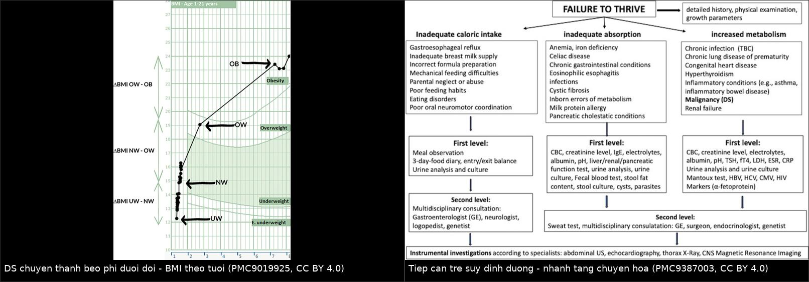
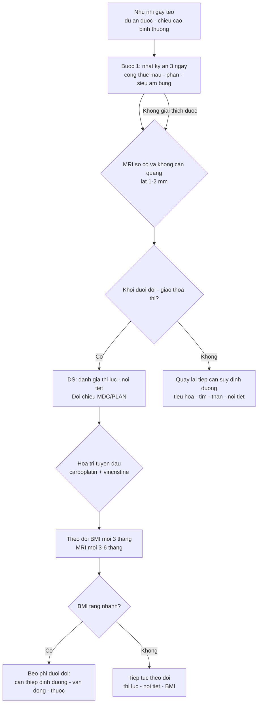
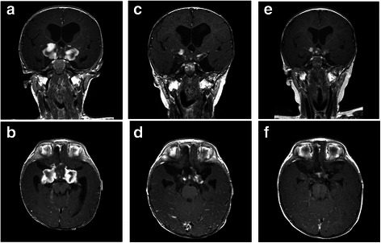
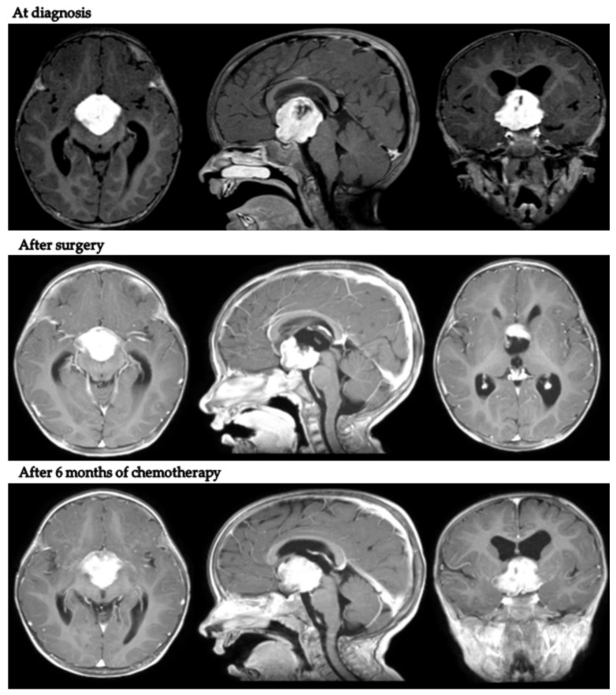
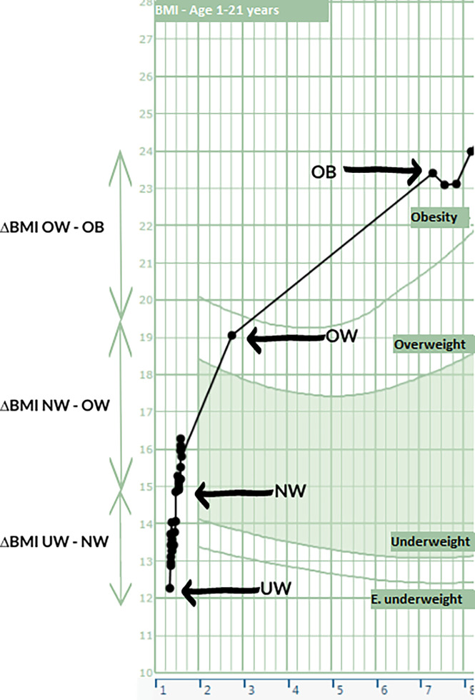

# 1756 — Hội chứng gian não ở nhũ nhi: sụt cân – tăng động – u đường thị/dưới đồi / Diencephalic syndrome of infancy

**Tags:** `pattern:suy-dinh-duong` `pattern:gay-teo` `pattern:u-duong-thi` `pattern:u-doi-thi` `pattern:beo-phi-duoi-doi` `vung:nao` `vung:tuyen-yen` `protocol:MRI-nao` `protocol:nhan-trac` `score:BMI-SDS` `incidentaloma:khong`

**Mức chắc chắn (certainty):** tổng hợp y văn (literature synthesis) — 1 bài tổng quan hệ thống 2026 về hội chứng gian não (Children 2026, PMC12939502, CC BY 4.0), 1 miniseries + tổng quan 100 ca trong 70 năm (Ital J Pediatr 2022, PMC9387003, CC BY 4.0), 1 loạt 9 trẻ có ảnh MRI trước–sau điều trị (Diagnostics 2022, PMC8947184, CC BY 4.0), 1 loạt 10 trẻ chuyển từ **gầy teo sang béo phì dưới đồi** có biểu đồ BMI (Front Endocrinol 2022, PMC9019925, CC BY 4.0) và 1 ca nguyên văn nhũ nhi 5 tháng có MRI nối tiếp (BMC Cancer 2015, PMC4559913, CC BY 4.0). **Không có ca nguyên văn do nhóm tự viết**; ca trong quiz là ca có ảnh từ bài gốc, ghi rõ PMCID.

> **Câu chốt:** một đứa trẻ **gầy teo nhưng vẫn ăn, vẫn cao lên, vẫn tăng động và vui vẻ** không phải "trẻ kén ăn" — đó là **khối u vùng dưới đồi**. Chẩn đoán dựa trên **4 dấu hiệu**: (1) **cân nặng < bách phân vị 3** hoặc **tụt ≥ 2 đường bách phân vị** dù ăn đủ; (2) **chiều cao vẫn đi theo kênh bình thường**; (3) **tăng động + hưng phấn**; (4) **MRI có khối ở vùng dưới đồi–giao thoa thị**. Chậm chẩn đoán trung bình **11 tháng** — và trong 11 tháng đó **thị thần kinh đã teo không hồi phục**. Trong 100 ca được tổng hợp, **96% có BMI hoặc tỉ lệ cân/chiều < bách phân vị 5** nhưng **rung giật nhãn cầu chỉ 43%** và **nôn 35%** — tức là **triệu chứng thần kinh xuất hiện MUỘN**, không được chờ.

## 1. Tổng quan bệnh học – cơ chế hình ảnh

### 1.1 Bệnh học và dịch tễ

- **Định nghĩa (Russell 1951):** hội chứng gian não (diencephalic syndrome, DS) = **suy dinh dưỡng nặng kiểu teo mỡ dưới da** ở nhũ nhi, **ăn đủ hoặc hơi giảm**, **chiều cao vẫn tăng bình thường**, kèm **tăng động, hưng phấn**, do **u vùng dưới đồi/giao thoa thị**.
- **Hiếm:** **< 200 ca** được báo cáo trong **70 năm** (1951–2024) (PMC12939502). Vì hiếm nên bác sĩ nhi **không nghĩ tới**, và **chậm chẩn đoán trung bình 11 tháng** (PMC12939502).
- **Tuổi:** **~90% khởi phát trước 24 tháng**, **trung vị 6–7 tháng**; đa số **trước 12 tháng** (PMC12939502). Trong 100 ca tổng hợp: tuổi khởi phát trung bình **30,6 tháng (0–191)**, nhưng khi do **u thần kinh đệm** thì chỉ **7–14 tháng**; khi do **u sọ hầu** thì **92 tháng (26–191)** (PMC9387003).
- **Bệnh nền:** **u thần kinh đệm cấp thấp vùng dưới đồi–giao thoa thị**, chủ yếu **u sao bào lông (pilocytic astrocytoma, WHO độ I)**; có thể **u sao bào thể nhầy–lông (pilomyxoid)**, **u tế bào hạch**, và hiếm khi **u sao bào độ ác cao** (ca 5 tháng tuổi: **u sao bào thể ác tính WHO III**) (PMC12939502, PMC4559913).
- **NF1:** **50–60%** u đường thị nằm trong NF1, nhưng **DS rất hiếm gặp ở NF1**; khi có, tuổi khởi phát **muộn hơn** — **21,2 tháng (14–26) vs 10 tháng (3–17), p = 0,015** (PMC12939502, PMC8947184).
- **Tiên lượng:** sống 5 năm **90–100%**, nhưng **PFS 5 năm chỉ 10–40%**; trong nghiên cứu HIT-LGG-1996, trẻ **< 1 tuổi** có DS có **OS 10 năm chỉ 42,7%**. Loạt 9 trẻ: **không ca nào tử vong**, nhưng **100% tiến triển** với **PFS 5 năm 11,1%** (PMC12939502, PMC8947184).

### 1.2 TẠI SAO trẻ gầy teo mà vẫn cao lên

- **Không phải thiếu ăn — mà là "đốt cháy" quá mức:** tổng quan mô tả **tăng chuyển hóa nghỉ (REE)** dù ăn đủ; cân nặng **< bách phân vị 1** trong nhiều ca dù phụ huynh mô tả **ăn ngon miệng** (PMC12939502).
- **Trục GH bị "lệch":** GH **tăng** nhưng **ức chế bằng glucose bất thường** → **đề kháng GH một phần**; IGF-1 **cao ở trẻ gầy** — trung vị **2,8 SDS** ở trẻ nhẹ cân so với **0,20 SDS** ở trẻ bình thường/thừa cân, và **IGF-1 SDS tương quan nghịch với BMI SDS (r = −0,37; p < 0,001)** (PMC9019925). Đây là lý do **chiều cao vẫn giữ** trong khi mô mỡ biến mất.
- **Ly giải mỡ do peptide:** **β-lipotropin** (có tính ly giải mỡ) tăng trong một số ca; giả thuyết **"đề kháng GH + tăng ly giải mỡ"** giải thích kiểu **"teo mỡ nhưng cơ và xương vẫn phát triển"** (PMC12939502).
- **Vì sao lại có giai đoạn béo phì sau này:** cùng một tổn thương dưới đồi, **mất nhân cung/nhân bụng–giữa** → mất tín hiệu no → **tăng ăn + giảm REE** → **béo phì dưới đồi (HO)**. Loạt 10 trẻ: BMI SDS **−2,64** lúc chẩn đoán u, **thừa cân ở 4,5 tuổi (2,2–9,8)**, tổng chênh **+5,75 SDS (4,5–8,7)** (PMC9019925). Vì vậy **DS và HO là hai đầu của cùng một phổ** (bài 1754).
- **Vì sao chậm chẩn đoán:** cân nặng tụt được quy cho **trào ngược, dị ứng đạm sữa bò, celiac, kén ăn**; trong 3 ca miniseries đều đã **thử đổi sữa, xét nghiệm phân, siêu âm bụng** trước khi chụp MRI. Sơ đồ tiếp cận suy dinh dưỡng đặt **"malignancy (DS)"** ở nhánh **tăng chuyển hóa** — nhánh **ít được nghĩ tới nhất** (PMC9387003).

### 1.3 Ngưỡng định lượng trụ cột

| Đại lượng | Con số | Nguồn |
|---|---|---|
| Định nghĩa cân nặng | **< bách phân vị 3** hoặc **tụt ≥ 2 đường bách phân vị** dù ăn đủ; BMI **< −2 SDS** | PMC12939502 · PMC9387003 |
| Chiều cao | **vẫn trong kênh bình thường** (chiều cao/age bình thường) | PMC12939502 |
| Tuổi khởi phát | **trung vị 6–7 tháng**; **~90% < 24 tháng**; u thần kinh đệm **7–14 tháng**; u sọ hầu **92 tháng** | PMC12939502 · PMC9387003 |
| Triệu chứng trong 100 ca | BMI/tỉ lệ cân–chiều **< bách phân vị 5: 96%**; **nôn 35%**; **tăng động 26%**; **rung giật nhãn cầu 43%** | PMC9387003 |
| Chậm chẩn đoán | **~11 tháng** | PMC12939502 |
| Loạt 9 trẻ | tuổi trung vị **14 tháng (3–26)**; **giãn não thất cần dẫn lưu 4/9 (43%)**; **PFS 5 năm 11,1%**; **OS 5 năm 100%** | PMC8947184 |
| Loạt 10 trẻ DS → HO | BMI SDS **−2,64** → thừa cân ở **4,5 tuổi**; chênh **+5,75 SDS**; **70% có rối loạn tuyến yên**; **2 ca dậy thì sớm** | PMC9019925 |
| Rối loạn nội tiết | suy thượng thận **20–30%**; ĐTĐ nhạt **20–35%**; béo phì dưới đồi **30–50%** | PMC12939502 |
| Tiên lượng | OS 5 năm **90–100%**; PFS 5 năm **10–40%**; trẻ **< 1 tuổi OS 10 năm 42,7%** | PMC12939502 |
| IGF-1 | **2,8 SDS** (gầy) vs **0,20 SDS** (bình thường/thừa cân); **r = −0,37** với BMI SDS | PMC9019925 |
| Kích thước u trong miniseries | **44 × 40 × 38 mm** và **40 × 36 × 31 mm** | PMC9387003 |

## 2. Mẫu hình + chẩn đoán phân biệt theo vị trí (Gamut)

- **Suy dinh dưỡng ở nhũ nhi + chiều cao bình thường:**
  - **DS do u dưới đồi–đường thị** · trào ngược dạ dày–thực quản · dị ứng đạm sữa bò · bệnh celiac · xơ nang · bệnh tim bẩm sinh · suy thận mạn · nhiễm trùng mạn (lao, HIV) · cường giáp · bệnh ác tính khác.
- **Suy dinh dưỡng + tăng động/hưng phấn:**
  - **DS** · cường giáp · ngộ độc (amphetamine, caffeine) · rối loạn phát triển/thần kinh · sang thương dưới đồi khác (u mầm, LCH, u sọ hầu).
- **Suy dinh dưỡng + rung giật nhãn cầu/lác/teo thị:**
  - **DS** · u mầm trên yên (bài 1731) · LCH vùng dưới đồi–tuyến yên (bài 1751) · u sọ hầu · giãn não thất · bệnh thoái hóa thần kinh.
- **U vùng dưới đồi/giao thoa thị trên MRI ở trẻ:**
  - **U sao bào lông (pilocytic)** · **u sao bào thể nhầy–lông** · u thần kinh đệm thị (NF1) · u mầm · LCH · u sọ hầu · glioma thần kinh thị–dưới đồi dạng lan · **u sao bào độ cao (hiếm)**.
- **Trẻ đã DS rồi chuyển sang béo:**
  - **Béo phì dưới đồi (HO)** · béo phì do corticoid · suy giáp trung ương · dậy thì sớm trung ương · **tăng cân do điều trị** (bài 1754).
- **Theo vị trí trên MRI:**
  - **Giao thoa thị/đường thị** → giảm thị lực, lác, teo thị; **vùng dưới đồi trước/nhân cung** → chán ăn/teo mỡ; **vùng sau/thể vú** → về sau béo phì nặng; **não thất III** → giãn não thất, nôn.

## 3. Bảng so sánh phân biệt (ma trận đối chiếu)

| Thực thể (entity) | Hình ảnh/lâm sàng điển hình | Chốt vào (rule-in) | Chốt loại (rule-out) | Gợi ý xác nhận |
|---|---|---|---|---|
| **Hội chứng gian não (bài này)** | Nhũ nhi **gầy teo**, ăn đủ, **cao bình thường**, **tăng động–hưng phấn**; khối **dưới đồi–giao thoa thị** ngấm thuốc | **Cân < bách phân vị 3 (hoặc BMI < −2 SDS) + chiều cao bình thường + tăng động/hưng phấn + khối trên MRI** | **Có triệu chứng tiêu hóa rõ + MRI bình thường** → loại DS | MRI sọ có/không cản quang; BMI SDS; IGF-1 |
| **Suy dinh dưỡng do nuôi dưỡng/kén ăn** | Cân và **chiều cao cùng tụt**; ăn ít, không tăng động; MRI bình thường | **Đáp ứng tăng cân khi tăng năng lượng nhập** | **Vẫn tụt cân dù ăn đủ và đã tăng năng lượng** → không phải | Nhật ký ăn 3 ngày; cân nặng hàng tuần |
| **Bệnh celiac / dị ứng đạm sữa bò** | Tiêu chảy, chướng bụng, thiếu máu, IgA-tTG dương (celiac) | **IgA-tTG dương + sinh thiết tá tràng** | **Xét nghiệm âm, không triệu chứng tiêu hóa** → loại | IgA-tTG, nội soi (PMC9387003) |
| **Cường giáp** | Gầy, **tăng động**, tim nhanh, bướu giáp, mắt lồi | **TSH thấp + FT4/FT3 cao** | **TSH/FT4 bình thường** → loại | TSH, FT4, FT3 |
| **U mầm trên yên** | Đái tháo nhạt, **mất điểm sáng T1 thùy sau**, AFP/hCG tăng | **AFP > 25 ng/mL hoặc hCG > 50 IU/L**; mất điểm sáng T1 **> 90%** | **AFP/hCG âm + điểm sáng T1 còn** | MRI + marker (bài 1731) |
| **LCH vùng dưới đồi–tuyến yên** | Cuống yên **≥ 3 mm**, mất điểm sáng T1, ĐTĐ nhạt; tổn thương xương/da | **CD1a/Langerin dương ở tổn thương ngoài sọ** | **Sinh thiết âm + không tổn thương ngoài sọ** | MRI + sinh thiết (bài 1751) |
| **U sọ hầu** | Trẻ **lớn hơn** (92 tháng), vôi hóa, nang, suy tuyến yên | **Vôi hóa + thành phần nang trên CT/MRI** | **Không vôi hóa, u đặc ngấm đều** | CT xương sọ + MRI (bài 1731) |
| **Béo phì dưới đồi (giai đoạn sau)** | BMI tăng nhanh sau điều trị, **tăng ăn**, giảm REE | **BMI +1,0 SDS/12 tháng, tồn tại ≥ 24 tháng, BMI SDS ≥ +2,0** | **BMI ổn định/giảm** → chưa phải HO | Theo dõi BMI 3 tháng (bài 1754) |

*Trái: **ca DS chuyển thành béo phì dưới đồi** — BMI đi từ vùng **gầy (E. underweight)** lên **thừa cân** rồi **béo phì** theo tuổi; đây là lý do phải theo dõi BMI **nhiều năm**, không chỉ đến khi hết gầy. Phải: **sơ đồ tiếp cận trẻ suy dinh dưỡng** — nhánh **tăng chuyển hóa** có **"malignancy (DS)"**, nhánh duy nhất phải chụp **MRI sọ**. Ảnh ghép letterbox, không crop; cả hai nguồn **CC BY 4.0** (PMC9019925 Fig. 1; PMC9387003 Fig. 2).*

## 4. Protocol chụp + hệ phân độ/điểm chuẩn hóa

### 4.1 Chỉ định chụp — "gầy teo không rõ nguyên nhân" là chỉ định MRI

- **Chụp MRI sọ khi:** suy dinh dưỡng **không giải thích được** sau bước 1 (nhật ký ăn, xét nghiệm phân/máu, siêu âm bụng), **đặc biệt nếu chiều cao vẫn bình thường**, có **tăng động/hưng phấn**, **rung giật nhãn cầu/lác**, hoặc **nôn tái diễn** (PMC9387003, PMC12939502).
- **Không chờ có triệu chứng thần kinh:** trong 100 ca, **rung giật nhãn cầu chỉ 43%**, **nôn 35%**; **96%** chỉ có dấu hiệu **cân nặng** (PMC9387003).

### 4.2 Protocol MRI

- **MRI sọ có và không cản từ, lát 1–2 mm**, gồm:
  - **T1W sagittal + coronal** qua **giao thoa thị, đường thị, vùng dưới đồi, tuyến yên**;
  - **T2W/FLAIR** (u thường **tăng T2**);
  - **T1W sau tiêm gadolinium** 3 mặt phẳng (u sao bào lông ngấm **không đồng nhất**, có thành phần nang);
  - **DWI/ADC** để phân biệt u tế bào cao (hạn chế khuếch tán) với u cấp thấp;
  - **MRI tủy sống** chỉ khi nghi **lan màng não/u mầm**, không thường quy cho u thần kinh đệm đường thị (PMC12939502).
- **Đặc điểm hình ảnh điển hình:** khối **dưới đồi–giao thoa thị**, **T1 giảm/đồng tín hiệu**, **T2 tăng**, **ngấm thuốc thay đổi**; u sao bào lông **ngấm không đồng nhất**; có thể kèm **giãn não thất** (PMC12939502).
- **Phân loại u đường thị:** dùng **phân loại Dodge sửa đổi (modified Dodge classification, MDC)**, còn gọi **PLAN** — mô tả vị trí theo **đường thị, giao thoa, dải thị, vùng dưới đồi** (PMC8947184).

### 4.3 Đánh giá kèm theo (bắt buộc trước/ngay sau chẩn đoán)

- **Nhân trắc:** cân nặng, chiều cao, **BMI SDS**, vòng đầu, **biểu đồ tăng trưởng theo tuổi** (phải thấy **chiều cao không tụt**).
- **Mắt:** thị lực theo tuổi, thị trường, **soi đáy mắt** (teo thị), khúc xạ.
- **Nội tiết:** FT4/TSH, cortisol sáng/ACTH, IGF-1, LH/FSH, prolactin, **Na/osmolality** (ĐTĐ nhạt); theo dõi **dậy thì sớm** (PMC12939502, PMC9019925).
- **Thần kinh:** vòng đầu, dấu hiệu giãn não thất; **nôn** là dấu hiệu giãn não thất, không phải "do gầy".

### 4.4 Điều trị và theo dõi

- **Hóa trị là tuyến đầu** ở u thần kinh đệm cấp thấp trẻ nhỏ (**carboplatin + vincristine**, hoặc phác đồ LGG); **tránh xạ trị** ở trẻ < 3 tuổi vì di chứng thần kinh–nội tiết.
- **Hỗ trợ dinh dưỡng:** tăng năng lượng, **nuôi qua ống khi cần**; cân nặng thường cải thiện **trong 12 tháng** điều trị (PMC8947184).
- **Thuốc đích:** **ức chế BRAF/MEK** (dabrafenib/trametinib, selumetinib) khi có **BRAF V600E** hoặc u đường thị trong NF1 (PMC12939502).
- **Phẫu thuật:** chủ yếu **giải áp não thất** hoặc **sinh thiết**; **không cố lấy toàn bộ** u dưới đồi để tránh tổn thương trục dưới đồi–tuyến yên (PMC12939502).
- **Theo dõi dài hạn:** MRI mỗi 3–6 tháng trong 2 năm đầu; **BMI mỗi 3 tháng** (vì có thể đảo sang béo phì); thị lực và nội tiết mỗi 6–12 tháng.

## 5. Biến thể bình thường và cạm bẫy

- **"Trẻ vẫn cao lên nên không sao" — sai:** **chiều cao bình thường là một phần của định nghĩa DS**, không phải dấu hiệu an toàn. Ngược lại, nếu **cân và chiều cùng tụt** thì mới nghiêng về suy dinh dưỡng do nuôi dưỡng (PMC12939502).
- **"Trẻ vui vẻ, tăng động là bình thường":** **hưng phấn + tăng động không tương xứng với mức gầy** là dấu hiệu **kinh điển** của DS; trẻ **không chậm phát triển**, thậm chí **hoạt bát hơn bình thường** (PMC12939502).
- **Xét nghiệm tiêu hóa âm không loại trừ DS:** 3 ca miniseries đã **thử đổi sữa, xét nghiệm phân, siêu âm bụng** trước khi chụp MRI; nếu **vẫn tụt cân dù đã điều chỉnh**, phải chụp (PMC9387003).
- **Chờ rung giật nhãn cầu là chờ quá muộn:** chỉ **43%** có rung giật nhãn cầu, và dấu hiệu này **xuất hiện muộn**; **teo thị** có thể đã hình thành khi chưa có triệu chứng (PMC9387003).
- **Bẫy NF1:** trẻ NF1 có u đường thị **thường không có DS**, và khi có thì **muộn hơn** (21,2 vs 10 tháng); **không loại trừ DS chỉ vì trẻ đã có chẩn đoán NF1** (PMC8947184).
- **Bẫy u sọ hầu ở trẻ lớn:** cùng là "u vùng trên yên" nhưng DS do u sọ hầu xuất hiện ở **92 tháng**, không phải nhũ nhi; ở trẻ lớn **gầy + suy tuyến yên** cần nghĩ u sọ hầu (PMC9387003).
- **Đừng "ăn mừng" khi trẻ tăng cân:** **30–50%** sống sót chuyển thành **béo phì dưới đồi**; loạt 10 trẻ chênh **+5,75 SDS**. Tăng cân nhanh sau điều trị là **tổn thương dưới đồi**, không phải "hồi phục dinh dưỡng" (PMC12939502, PMC9019925).
- **Ảnh MRI "u to nhưng ít phù":** u cấp thấp có thể **rất lớn** (44 × 40 × 38 mm) mà trẻ chỉ **gầy teo**, không dấu hiệu thần kinh khu trú; **kích thước u không tương quan với mức gầy** (PMC9387003).

## 6. Tự lượng giá — Blind Quiz ngay trên trang tĩnh

**Ca 1 — Nhũ nhi 5 tháng, cân nặng < bách phân vị 3, không triệu chứng tiêu hóa. MRI có và sau tiêm gadolinium.**

- Gợi ý lâm sàng: da khô nhợt, **mất mỡ dưới da**, mặt tam giác, thóp trước lõm, **tăng động–hưng phấn**, **rung giật nhãn cầu + lác trong mắt trái**; xét nghiệm phân, siêu âm bụng bình thường.
- Câu hỏi: (1) Mô tả tổn thương trên (a) và (b). (2) Vì sao trẻ gầy teo nhưng không có triệu chứng tiêu hóa? (3) Chẩn đoán và bước tiếp theo?

<b>Bấm để hiện đáp án (findings + chẩn đoán)</b>

- (a) coronal, (b) axial sau tiêm: **khối lớn vùng dưới đồi–giao thoa thị ngấm thuốc mạnh**, **giãn não thất bên** (sừng thái dương giãn).
- (c–d) sau hóa trị: **giảm thể tích u, não thất nhỏ lại**; (e–f) ổn định sau **27 tháng**.
- Chẩn đoán: **hội chứng gian não do u sao bào thể ác tính vùng dưới đồi (WHO III)** — ca hiếm; sinh thiết xác nhận, **hóa trị liều cao + truyền tế bào gốc**, không xạ trị.
- Vì sao gầy: **tăng chuyển hóa + rối loạn trục GH/ly giải mỡ do tổn thương dưới đồi**, không phải kém hấp thu.
- Nguồn ảnh: *BMC Cancer* 2015, Fig. 2 — PMC4559913, CC BY 4.0 (nguyên bản, không chỉnh sửa).

**Ca 2 — Trẻ 14 tháng, u dưới đồi–giao thoa thị: MRI trước điều trị, sau mổ và sau 6 tháng hóa trị.**

- Gợi ý lâm sàng: **cân nặng < −2 SDS**, chiều cao bình thường, **tăng động**; **giãn não thất** cần dẫn lưu.
- Câu hỏi: Dấu hiệu nào trên MRI giúp phân biệt **u cấp thấp** với **u tế bào cao**? Vì sao không cố lấy toàn bộ u?

<b>Bấm để hiện đáp án (findings + chẩn đoán)</b>

- Hàng 1: **khối lớn vùng trên yên/dưới đồi ngấm thuốc mạnh, không đồng nhất**, **giãn não thất bên**.
- Hàng 2: sau mổ **giảm thể tích**, não thất giảm; hàng 3: sau **6 tháng hóa trị** u **ổn định/giảm nhẹ**.
- U cấp thấp: **T2 tăng, ngấm không đồng nhất, không hạn chế khuếch tán**; u tế bào cao: **hạn chế khuếch tán (ADC thấp)**, phù xung quanh nhiều hơn.
- Không lấy toàn bộ vì u **dính vùng dưới đồi–giao thoa thị**; cắt nhiều → **suy tuyến yên, ĐTĐ nhạt, béo phì dưới đồi** không hồi phục.
- Nguồn ảnh: *Diagnostics* 2022, Fig. 2 — PMC8947184, CC BY 4.0 (nguyên bản, không chỉnh sửa).

**Ca 3 — Biểu đồ BMI của một trẻ DS: từ "gầy" sang "béo".**

- Gợi ý lâm sàng: trẻ được chẩn đoán u thần kinh đệm trên yên lúc **1,5 tuổi**, BMI SDS **−2,64**; 3 năm sau **tăng cân nhanh** dù không đổi chế độ ăn.
- Câu hỏi: (1) Đọc các mốc **UW → NW → OW → OB**. (2) Đây là "hồi phục dinh dưỡng" hay bệnh mới? (3) Cần theo dõi gì?

<b>Bấm để hiện đáp án (findings + chẩn đoán)</b>

- Các mốc: **E. underweight → UW → NW → OW → OB**; BMI tăng liên tục theo tuổi, **vượt kênh thừa cân** rồi **béo phì**.
- Đây là **béo phì dưới đồi (HO)** — tổn thương nhân cung/nhân bụng–giữa; **không phải hồi phục dinh dưỡng**. Loạt 10 trẻ: chênh **+5,75 SDS**, thừa cân ở **4,5 tuổi**.
- Theo dõi: **BMI SDS mỗi 3 tháng**, đường huyết/lipid, **đa ký giấc ngủ** (ngưng thở khi ngủ), nội tiết (FT4, cortisol, dậy thì); can thiệp **dinh dưỡng + vận động sớm**, thuốc khi BMI tăng nhanh.
- Nguồn ảnh: *Frontiers in Endocrinology* 2022, Fig. 1 — PMC9019925, CC BY 4.0 (nguyên bản, không chỉnh sửa).

## Bài liên quan chéo
- [600 – Tổng quan Hệ Nhi khoa](../600-tong-quan-nhi-khoa/lesson.md)
- [1754 – Hội chứng dưới đồi ở trẻ](../1754-hoi-chung-duoi-doi-o-tre/lesson.md) (đầu kia của phổ: béo phì dưới đồi)
- [1731 – U mầm nội sọ vùng trên yên ở trẻ](../1731-u-mam-noi-so-vung-tren-yen-o-tre/lesson.md)
- [1751 – LCH vùng dưới đồi–tuyến yên ở trẻ](../1751-lch-vung-duoi-doi-tuyen-yen-o-tre/lesson.md)
- [1753 – Viêm tuyến yên–cuống yên tăng sinh lympho ở trẻ](../1753-viem-tuyen-yen-cuong-yen-tang-sinh-lympho-o-tre/lesson.md)
- [630 – U nguyên bào thần kinh ở trẻ](../630-u-bung-nhi-neuroblastoma-vs-wilms/lesson.md)
- [1755 – Hạ natri máu sau mổ vùng trên yên ở trẻ](../1755-csws/lesson.md) (biến chứng nội tiết–điện giải của cùng vùng mổ)

## Ảnh
- `1756_ds-to-ho_PMC9019925-F1.jpg` — biểu đồ BMI từ gầy (DS) sang béo phì dưới đồi.
- `1756_mri-ds_PMC8947184-F2.jpg` — MRI u dưới đồi–giao thoa thị trước mổ, sau mổ, sau 6 tháng hóa trị.
- `1756_mri-infant_PMC4559913-F2.jpg` — MRI nối tiếp ở nhũ nhi 5 tháng (u sao bào độ III).
- `1756_ftt-algorithm_PMC9387003-F2.jpg` — sơ đồ tiếp cận trẻ suy dinh dưỡng (nhánh tăng chuyển hóa → DS).
- `composite_bmi_va_tiep-can-ftt.jpg` — ảnh ghép 2 ô, cả hai nguồn **CC BY 4.0**.
- Nguồn + giấy phép từng ảnh: xem `images/CREDITS.md` và `sources.md`.

> Không dùng để chẩn đoán độc lập khi chưa có người hướng dẫn.
