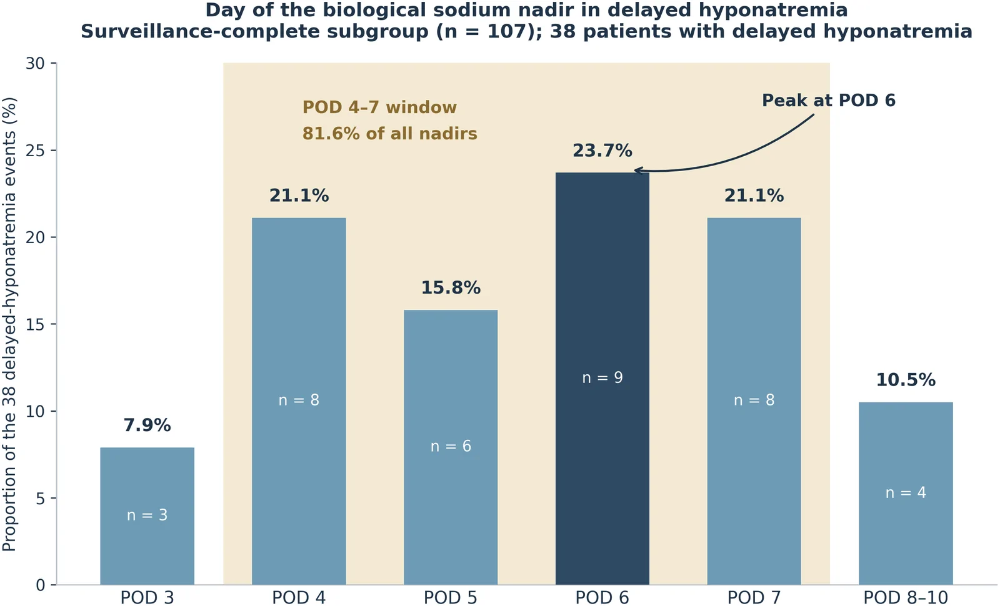
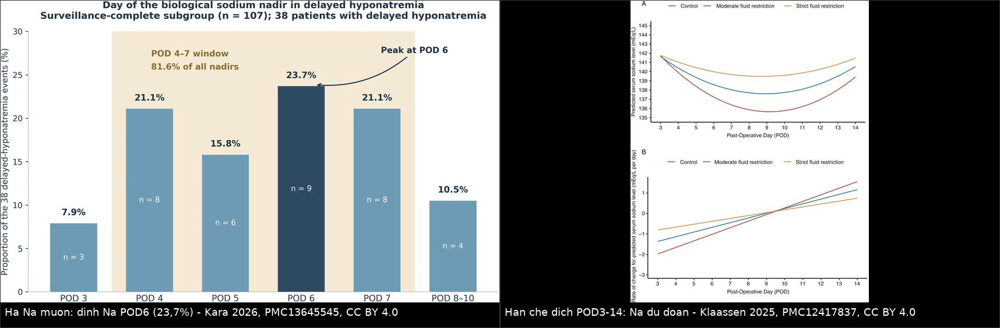
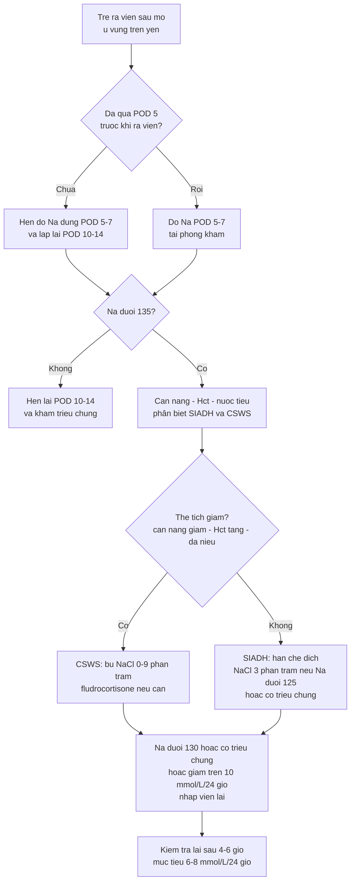
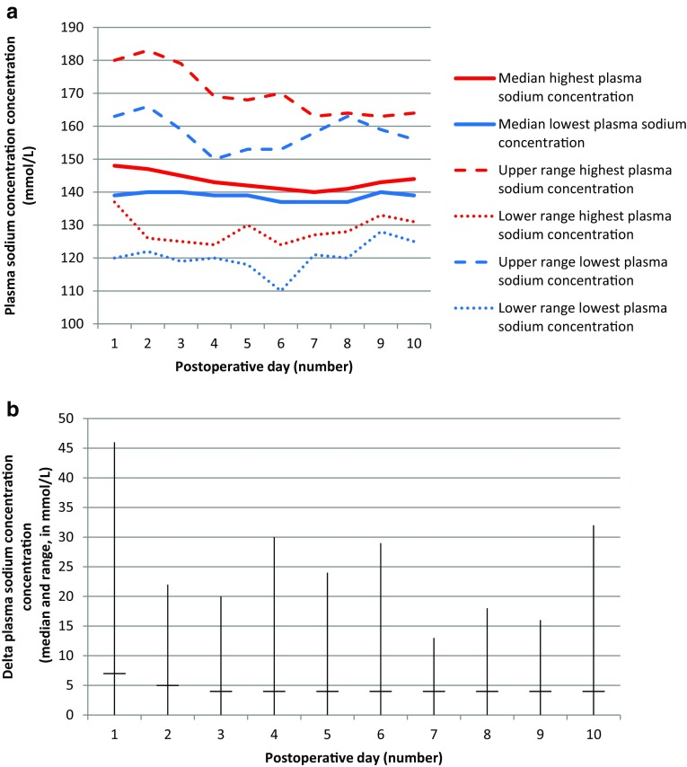
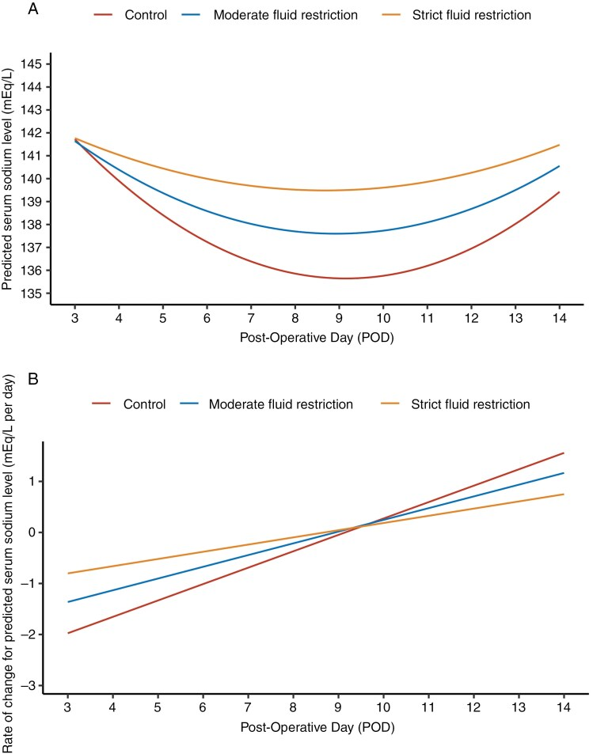

# 1757 — Hạ natri máu MUỘN sau xuất viện ở trẻ mổ vùng trên yên / Delayed post-discharge hyponatremia after pediatric suprasellar surgery

**Tags:** `pattern:ha-natri-mau` `pattern:siadh` `pattern:da-nieu` `vung:tuyen-yen` `vung:nao` `protocol:dien-giai-na` `protocol:theo-doi-ngoai-tru` `score:feurate` `incidentaloma:khong`

**Mức chắc chắn (certainty):** tổng hợp y văn (literature synthesis) — 1 đoàn hệ người lớn phân tích **ảnh hưởng của cường độ theo dõi** lên tỉ lệ phát hiện hạ Na muộn (Front Endocrinol 2026, PMC13645545, CC BY 4.0), 1 RCT **hạn chế dịch** sau mổ (Neuro-Oncology 2025, PMC12417837, CC BY 4.0), 2 đoàn hệ nhi khoa về dao động Na sau mổ u vùng trên yên (Pituitary 2018, PMC6018586; Pituitary 2026, PMC13033463 — CC BY 4.0), và số liệu đường cong Na trong 14 ngày của 202 trẻ đã tổng hợp ở bài **1755** (PMC10909694). **Không có ca nguyên văn do nhóm tự viết**; ca trong quiz là ca có ảnh từ bài gốc, ghi rõ PMCID.

> **Câu chốt:** hạ Na muộn **không phải biến cố của ngày đầu** mà của **ngày 4–10, đỉnh ngày 6** — đúng lúc **bệnh nhi đã ra viện** (trung vị nằm viện chỉ **4 ngày**). Ba con số phải thuộc: **81,6%** các đáy Na rơi vào **POD 4–7**; ở người lớn, ai **không được đo Na POD 5–7** có nguy cơ **được ghi nhận** hạ Na muộn **thấp hơn 11,4 lần** (tỉ lệ "quan sát được" nhảy **16,4% → 35,5% → 57,5%** chỉ tùy lịch đo); và **cân nặng không tăng, không đa niệu** chính là SIADH — **hạn chế dịch**, không truyền muối.

## 1. Tổng quan bệnh học – cơ chế hình ảnh

### 1.1 Vì sao Na tụt vào ngày 5–7 mà không phải ngày 1

- **Ngày 1–2 — ĐTĐ nhạt:** phẫu tích u vùng trên yên **cắt ngang sợi trục** từ nhân trên thị/nhân cạnh não thất xuống thùy sau yên → **mất phóng thích ADH** → đa niệu, **Na tăng** (PMC10909694).
- **Ngày 4–10 — SIADH:** các sợi trục bị cắt **thoái hóa kiểu Waller**, túi chứa ADH vỡ ra và **phóng thích ADH không điều hòa** vào tuần hoàn → **tái hấp thu nước tự do** ở ống góp (qua **AQP2**) → **pha loãng Na**. ADH tiết ra theo kiểu "xả hàng loạt", **không theo áp lực thẩm thấu** → đây là lý do **hạn chế dịch hiệu quả** còn truyền NaCl 0,9% thì muối vào rồi ra theo nước tiểu (PMC10909694, PMC12417837).
- **Vì sao đỉnh lại ở đúng ngày 6:** thời gian **thoái hóa sợi trục + giải phóng túi ADH** mất **4–7 ngày**, trùng với thời gian não **thải osmolyte nội bào (24–48 giờ)** để thích nghi — nên Na tụt nhanh trong 24–48 giờ quanh đáy. Trong đoàn hệ người lớn có theo dõi đầy đủ, **đáy Na tập trung ở POD 6 (23,7%)** và **POD 4–7 chiếm 81,6%** toàn bộ đáy; **POD 8–10 chỉ còn 10,5%** (PMC13645545).
- **Ngày 12–14 — ĐTĐ nhạt vĩnh viễn:** ADH không hồi phục → **Na tăng lại**. Vì vậy **đường cong Na có hai đỉnh và một đáy**, và đáy nằm **sau cửa sổ nội trú thông thường** (PMC10909694).

### 1.2 Vì sao "tỉ lệ hạ Na muộn" trong y văn dao động 5–30% — đó là **thiên lệch phát hiện**, không phải sinh học

- Cùng một phẫu thuật viên, cùng một định nghĩa (Na **< 135 mmol/L** ở **POD 3–10**), tỉ lệ "quan sát được" là: **16,4%** ở cả đoàn hệ (n = 281) → **35,5%** ở nhóm có **theo dõi đầy đủ** (có ít nhất 1 lần đo trong POD 5–7, n = 107) → **57,5%** ở nhóm **có đo đúng ngày 7** (PMC13645545).
- Ai **không được đo POD 5–7** có **odds được ghi nhận hạ Na muộn thấp hơn 11,4 lần** (p < 0,001). Phân tích chuẩn hóa trực tiếp cho thấy **~83%** "xu hướng tăng qua hai thập kỷ" chỉ là do **tăng cường độ đo**, không phải bệnh nặng lên (PMC13645545).
- Lý do cơ học: **trung vị nằm viện 4 ngày**; **99%** bệnh nhân không có xét nghiệm POD 5–7 là vì **đã ra viện trước POD 5**. Đáy sinh học mở **POD 4** — tức là bệnh nhi ra viện **đúng lúc cửa sổ nguy cơ bắt đầu** (PMC13645545).
- Hệ quả lâm sàng: hạ Na muộn là **nguyên nhân hàng đầu gây tái nhập viện không dự kiến** sau mổ tuyến yên qua xoang bướm; ở trẻ, **hạ Na muộn (SIADH) và ĐTĐ nhạt là hai nguyên nhân hàng đầu của tái nhập viện trong 30 ngày** (PMC6018586 trích lại, PMC13645545).

### 1.3 Vì sao trẻ khác người lớn — số liệu nhi khoa

| Đại lượng | Con số | Nguồn |
|---|---|---|
| Tỉ lệ hạ Na sau mổ u sọ hầu ở trẻ (14 ngày) | **72,8%**; nặng **< 130** ở **40,6%** | PMC10909694 (bài 1755) |
| Đường cong Na ở trẻ | đỉnh **143,6 ± 7,6** (ngày 2) → **đáy 135,5 ± 7,5 (ngày 6)** → đỉnh **143,2 ± 6,7** (ngày 14) | PMC10909694 |
| Đỉnh tần suất hạ Na | **ngày 7: 42,9%**; khởi phát trung vị **ngày 4 (2–6)** | PMC10909694 |
| ĐTĐ nhạt sau mổ (7 trung tâm, Hà Lan) | **67,5%** (81/120 trẻ) | PMC6018586 |
| Dao động Na **≥ 10 mmol/L/24 giờ** khi có ĐTĐ nhạt | **75,3%**; biên độ tối đa **46 mmol/L/24 giờ** | PMC6018586 |
| Biến chứng thần kinh khi có ĐTĐ nhạt | rối loạn tri giác **23,5% vs 5,1%** (p = 0,009); co giật liên quan **hạ Na** | PMC6018586 |
| Sau tập trung hóa điều trị (2018–2023, 73 trẻ) | ĐTĐ nhạt **69,7%**; dao động ≥ 10 mmol/L/24 giờ **49,1%**; biên độ tối đa **30 → 14 mmol/L/24 giờ** (2023) | PMC13033463 |
| Yếu tố nguy cơ hạ Na nặng ở trẻ (đa biến) | mở sọ **OR 5,52**; không thiếu hụt hormone trước mổ **OR 2,031**; u nguyên phát **OR 2,095** (xu hướng) | PMC10909694 |
| Yếu tố nguy cơ ở người lớn | hạ Na sớm **ngày 0–2**: **46,9% vs 12,4%** sẽ có hạ Na muộn (**RR 3,77**, **OR 6,14**; đa biến **OR 2,83**, KTC 0,86–9,33); **nữ OR 2,73**; tương tác tuổi × giới **p = 0,010** (nam nguy cơ tăng theo tuổi) | PMC13645545 |
| Mô hình dự báo | AUC hiệu chỉnh optimism **0,645** — **chưa dùng được lâm sàng** | PMC13645545 |

*Đáy Na ở 38 bệnh nhân hạ Na muộn: **POD 6 = 23,7%** (n = 9), **POD 4–7 = 81,6%** toàn bộ đáy, POD 8–10 chỉ 10,5%. Đây là "cửa sổ" phải đo Na ngoại trú. Ảnh nguyên bản (Front Endocrinol 2026, PMC13645545, CC BY 4.0).*

## 2. Mẫu hình + chẩn đoán phân biệt theo vị trí (Gamut)

- **Hạ Na xuất hiện 4–10 ngày sau mổ, bệnh nhi đã ra viện, không sốt, vết mổ tốt:**
  - **SIADH sau mổ** (thể hay gặp nhất) · **CSWS** (nếu kèm đa niệu, cân nặng giảm) · **ĐTĐ nhạt đang dùng desmopressin quá liều** · **suy thượng thận** (cortisol thấp) · **suy giáp trung ương** · **uống nhiều nước do khát** (nhất là trẻ lớn, hội chứng dưới đồi) · **reset osmostat**.
- **Hạ Na + đa niệu + cân nặng giảm + Hct tăng:**
  - **CSWS** sau ĐTĐ nhạt (thể xen kẽ, bài 1755) · **lợi niệu do mannitol/thuốc** · **nôn/táo bón kéo dài** · **suy thượng thận cấp**.
- **Hạ Na + co giật/li bì ngay tại nhà (cấp tính < 48 giờ):**
  - **SIADH nặng** · **ngộ độc nước** · **hạ Na do desmopressin liều cao** — đây là nhóm cần **NaCl 3%** ngay.
- **Theo thời điểm trên trục ngày mổ (đọc như "dấu hiệu hình ảnh"):**
  - **POD 1–2: Na tăng** → ĐTĐ nhạt; **POD 4–10: Na giảm** → SIADH/CSWS; **POD 12–14: Na tăng lại** → ĐTĐ nhạt vĩnh viễn (PMC10909694).

## 3. Bảng so sánh phân biệt (ma trận đối chiếu)

| Thực thể (entity) | Hình ảnh/lâm sàng điển hình | Chốt vào (rule-in) | Chốt loại (rule-out) | Gợi ý xác nhận |
|---|---|---|---|---|
| **SIADH muộn sau mổ (bài này)** | Na tụt **POD 4–10**, đỉnh **ngày 6–7**; **cân nặng không giảm**, niêm mạc ẩm, không khát; nước tiểu cô đặc | **Thể tích bình thường + Uosm > 100 mOsm/kg + FEurate về < 11% sau sửa Na + cortisol/FT4 bình thường** | **Đa niệu > 3 mL/kg/giờ + cân nặng giảm + FEurate > 11% kéo dài** → không phải SIADH | Cân nặng 2 lần/ngày; FEurate; thử hạn chế dịch |
| **CSWS** | Hạ Na **kèm đa niệu**, khát, **cân nặng giảm**, **Hct/Hb tăng**, nhịp nhanh | **Thể tích giảm + Na niệu > 40 mmol/L + FEurate > 11% cả sau khi sửa Na** | **Cân nặng ổn định + FEurate < 11% sau sửa Na** | FEurate; siêu âm TM chủ dưới |
| **ĐTĐ nhạt + desmopressin quá liều** | Na tụt **nhanh trong 24 giờ**, cân nặng **tăng**, nước tiểu giảm đột ngột sau khi tăng liều | **Ngừng/giảm desmopressin → Na tăng** | **Na tiếp tục giảm dù đã giảm liều** → nghĩ CSWS | Ngừng liều thử + cân nặng |
| **Suy thượng thận cấp** | Hạ Na + **tăng K**, hạ HA, mệt, hạ đường huyết; sau mổ vùng trên yên rất dễ gặp | **Cortisol sáng thấp + ACTH không tăng (trung ương)** | **Cortisol bình thường** | Cortisol/ACTH; thử hydrocortisone |
| **Suy giáp trung ương** | Hạ Na nhẹ, chậm chạp, táo bón; FT4 thấp, TSH không tăng | **FT4 thấp + TSH thấp/không tăng** | FT4 bình thường | FT4/TSH |
| **Uống nhiều nước do khát (hội chứng dưới đồi)** | Trẻ lớn, khát nhiều, **Na dao động**, nước tiểu rất loãng | **Uosm < 100 mOsm/kg + Na tăng khi hạn chế nước** | **Uosm > 300** → không phải uống nhiều | Nhật ký nước tiểu 24 giờ |
| **Reset osmostat** | Na **ổn định 125–130 nhiều tuần**, không triệu chứng, nước tiểu thay đổi được theo lượng nước | **Na ổn định + Uosm thay đổi theo nước + FEurate 4–11%** | **Na tụt nhanh theo ngày** | Theo dõi 1–2 tuần, không điều trị |
| **Hạ Na giả (pseudohyponatremia)** | Không triệu chứng; gặp khi **protein/lipid máu cao** hoặc mẫu **tan máu** | **Osmolality máu bình thường** | **Osmolality máu thấp** → hạ Na thật | Đo osmolality trực tiếp, lấy lại mẫu |

*Trái: **81,6% đáy Na rơi vào POD 4–7** (PMC13645545). Phải: Na dự đoán POD 3–14 theo nhóm **uống tự do** vs **hạn chế dịch vừa** vs **hạn chế dịch chặt** — nhóm chặt giữ Na cao hơn **1,81 mmol/L** và **0% hạ Na nặng** (PMC12417837). Ảnh ghép letterbox, không crop; cả hai nguồn **CC BY 4.0**.*

## 4. Protocol chụp + hệ phân độ/điểm chuẩn hóa

### 4.1 Lịch đo Na — phần "chụp" quan trọng nhất ở bài này là **thời điểm lấy máu**

- **Nội trú:** Na mỗi **6–12 giờ** trong **48 giờ đầu**, rồi **mỗi 12–24 giờ đến ngày 14** (bài 1755).
- **Trước khi ra viện (bắt buộc):** nếu **chưa qua POD 5** → **hẹn đo Na ngoại trú đúng POD 5–7**, không dựa vào "lúc ra viện Na bình thường".
- **Ngoại trú:** đo Na tại **POD 5–7 (cửa sổ chính)** và **lặp ở POD 10–14** nếu: có hạ Na sớm ngày 0–2, u sọ hầu/mở sọ, ĐTĐ nhạt, hoặc bất kỳ triệu chứng nào. Đo lại **48 giờ sau mỗi lần đổi liều desmopressin**.
- **Cùng một phòng xét nghiệm, cùng phương pháp** (điện cực chọn lọc ion) để tránh "nhảy" giả; mẫu **không bị tan máu** (tan máu làm Na giả tăng, nhưng mẫu để lâu có thể sai cả hai chiều).
- **Dấu hiệu gọi ngay:** nôn, đau đầu, li bì, co giật, **tăng cân nhanh** (nước dư) — không chờ đến lịch hẹn.

### 4.2 Ngưỡng xử trí

- **Na < 135** = hạ Na; **< 130** = nặng (đoàn hệ trẻ dùng ngưỡng này); **< 125** hoặc **có triệu chứng thần kinh** = cấp cứu.
- **Sửa Na an toàn:** **≤ 8–10 mmol/L/24 giờ**, **≤ 18 mmol/L/48 giờ**; trẻ dùng **6–8 mmol/L/ngày**; nếu có co giật thì nâng **4–6 mmol/L** trước bằng **NaCl 3% 3–5 mL/kg** (bài 1755).
- **Hạn chế dịch (chỉ khi KHÔNG có ĐTĐ nhạt):** bắt đầu **POD 3** sau khi đã loại trừ ĐTĐ nhạt; **1,8–2 L/ngày** (người lớn) hoặc **1–1,2 L/ngày** nhóm chặt; kết quả RCT: hạ Na chung **31,9% → 28,2% → 21,0%**, hạ Na nặng **7,4% → 5,1% → 0%**, **tái nhập viện 6,4% → 1,6%** (PMC12417837).
- **Chống chỉ định tuyệt đối của hạn chế dịch:** đang ĐTĐ nhạt/Na tăng — hạn chế dịch lúc này gây **tăng Na nặng**; đây là lý do RCT loại trừ bệnh nhân còn ĐTĐ nhạt ở POD 3.

### 4.3 Thuật toán ngoại trú

## 5. Biến thể bình thường và cạm bẫy

- **"Na lúc ra viện bình thường nghĩa là an toàn"** — sai: đáy ở **POD 6**, trung vị nằm viện **4 ngày**; **99%** ca không có xét nghiệm POD 5–7 là vì đã ra viện trước đó (PMC13645545).
- **"Tỉ lệ thấp nghĩa là bệnh nhẹ"** — tỉ lệ **5–30%** trong y văn chủ yếu phản ánh **lịch đo**, không phản ánh sinh học; cùng một nhóm mổ, "tỉ lệ" nhảy **16,4% → 57,5%** chỉ do thêm một lần đo ngày 7 (PMC13645545).
- **"Hạn chế dịch là vô hại"** — nguy hiểm nếu bệnh nhi còn **ĐTĐ nhạt**: hạn chế dịch đẩy Na lên, có thể gây **tăng Na nặng**; phải xác nhận **không đa niệu, cân nặng không giảm** trước khi hạn chế (PMC12417837).
- **Bẫy "uống nhiều vì khát"** ở trẻ có hội chứng dưới đồi (bài 1754): hạ Na do **uống nhiều** chứ không phải SIADH — hạn chế dịch vẫn đúng nhưng **nguyên nhân và lời khuyên khác**, và **mất khát** đi kèm thì ngược lại (nguy cơ **tăng Na**).
- **Bẫy "Na niệu cao = CSWS"** — Na niệu **> 30 mmol/L** ở **cả hai**; **10/24** ca mất muối thận có Na niệu **< 20** (bài 1755).
- **Bẫy desmopressin** — đa niệu tái xuất hiện bị hiểu là "thiếu desmopressin" và **tăng liều**, trong khi Na đang tụt vì CSWS (bài 1755).
- **Bẫy mô hình dự báo** — AUC **0,645** nghĩa là **không thể** dùng tuổi/giới/Na sớm để quyết định "khỏi cần đo"; hiện **chưa có công cụ nào thay được việc đo Na POD 5–7** (PMC13645545).

## 6. Tự lượng giá — Blind Quiz ngay trên trang tĩnh

**Ca 1 — Trẻ 9 tuổi, u sọ hầu, ra viện POD 4 với Na 139. Đêm POD 6 nôn và li bì.**

- Gợi ý lâm sàng: không đa niệu từ POD 3, cân nặng tăng 0,8 kg trong 2 ngày, niêm mạc ẩm.
- Câu hỏi: (1) Vì sao Na tụt đúng lúc này? (2) SIADH hay CSWS? (3) Bước tiếp theo trong 30 phút và trong 24 giờ?

<b>Bấm để hiện đáp án (findings + chẩn đoán)</b>

- Đáy Na muộn tập trung **POD 4–7 (81,6%)**, đỉnh **POD 6 (23,7%)** — bệnh nhi ra viện POD 4 là **ra viện trước khi cửa sổ mở**.
- **SIADH**: cân nặng tăng, không đa niệu, niêm mạc ẩm; xác nhận bằng **Uosm > 100 mOsm/kg** và **FEurate < 11% sau sửa Na**.
- Cấp cứu: nếu **co giật** → **NaCl 3% 3–5 mL/kg** trong 10–15 phút; sau đó **hạn chế dịch 50–70% nhu cầu**, mục tiêu **6–8 mmol/L/24 giờ**; **không** truyền NaCl 0,9% đơn thuần.
- Nguồn ảnh: *Frontiers in Endocrinology* 2026, Fig. 2 — PMC13645545, CC BY 4.0 (nguyên bản).

**Ca 2 — Trẻ 6 tuổi sau mổ u sọ hầu: Na theo ngày và biên độ dao động.**

- Gợi ý lâm sàng: 120 trẻ, 7 trung tâm; ĐTĐ nhạt **67,5%**.
- Câu hỏi: (1) Đọc đỉnh và đáy của "median lowest Na". (2) Biên độ dao động lớn nhất là bao nhiêu và ở ngày nào? (3) Vì sao trẻ có ĐTĐ nhạt vĩnh viễn dao động mạnh hơn?

<b>Bấm để hiện đáp án (findings + chẩn đoán)</b>

- Đường **thấp nhất** có đáy quanh **ngày 6** (~136–138 mmol/L), đường **cao nhất** giảm dần từ ~180 xuống ~165 → **dao động hai chiều** trong cùng một ngày.
- Biên độ tối đa **46 mmol/L/24 giờ**, lớn nhất ở **ngày 1** (chênh giữa đường cao nhất và thấp nhất), sau đó **thu hẹp dần** đến ngày 10.
- Trẻ **ĐTĐ nhạt vĩnh viễn** có tần suất và mức độ dao động **cao hơn** trẻ ĐTĐ nhạt thoáng qua/không ĐTĐ nhạt (**p = 0,007**); rối loạn tri giác **23,5% vs 5,1%** (p = 0,009).
- Ý nghĩa: **một lần đo Na không đại diện cho cả ngày** — phải đọc xu hướng và đo lặp.
- Nguồn ảnh: *Pituitary* 2018, Fig. 1 — PMC6018586, CC BY 4.0 (nguyên bản).

**Ca 3 — Quyết định "có nên hạn chế dịch cho mọi trẻ ra viện" hay không.**

- Gợi ý lâm sàng: RCT 300 bệnh nhân dự kiến, 3 nhóm: uống tự do (n = 94), hạn chế vừa 1,8–2 L/ngày (n = 39), hạn chế chặt 1–1,2 L/ngày (n = 62), từ POD 3–14.
- Câu hỏi: (1) Nhóm nào có đáy Na thấp nhất? (2) Lợi ích định lượng của nhóm chặt? (3) Ai **không** được vào phác đồ này?

<b>Bấm để hiện đáp án (findings + chẩn đoán)</b>

- Nhóm **uống tự do** có đáy thấp nhất (~135,7), nhóm chặt giữ đáy cao nhất (~139,6); hiệu số **+1,81 mmol/L** (KTC 0,34–3,27; p = 0,02).
- Hạ Na chung **31,9% / 28,2% / 21,0%**; hạ Na **nặng** (Na < 125) **7,4% / 5,1% / 0%**; **tái nhập viện 6,4% → 1,6%**.
- **Không** áp dụng cho bệnh nhân **còn ĐTĐ nhạt ở POD 3**, suy thận mạn, suy tim, hạ Na mạn, suy thượng thận/suy giáp chưa điều trị (đều là tiêu chuẩn loại trừ của RCT).
- Nguồn ảnh: *Neuro-Oncology* 2025, Fig. 2 — PMC12417837, CC BY 4.0 (nguyên bản).

## Bài liên quan chéo
- [600 – Tổng quan Hệ Nhi khoa](../600-tong-quan-nhi-khoa/lesson.md)
- [1755 – Hạ Na sau mổ u vùng trên yên: SIADH vs CSWS](../1755-csws/lesson.md) (cơ chế + FEurate + xử trí nội trú)
- [1754 – Hội chứng dưới đồi ở trẻ](../1754-hoi-chung-duoi-doi-o-tre/lesson.md) (mất khát → nguy cơ **tăng** Na; uống nhiều → hạ Na)
- [1756 – Hội chứng gian não ở nhũ nhi](../1756-hoi-chung-gian-nao/lesson.md) (u đường thị/dưới đồi)
- [1710 – ĐTĐ nhạt trung ương sau mổ tuyến yên](../1710-dai-thao-nhat-trung-uong-sau-mo-tuyen-yen/lesson.md)
- [1644 – ĐTĐ nhạt trung ương ở trẻ](../1644-dai-thao-nhat-trung-uong-o-tre/lesson.md)
- [092 – Suy thượng thận & suy tuyến yên quanh mổ](../092-suy-thuong-than-suy-tuyen-yen-quanh-mo/lesson.md)

## Ảnh
- `1757_delayed-hyponatremia-nadir_PMC13645545-F2.jpg` — ngày của đáy Na (POD 6 = 23,7%; POD 4–7 = 81,6%).
- `1757_pediatric-sodium_PMC6018586-F1.jpg` — Na cao nhất/thấp nhất theo ngày ở 81 trẻ có ĐTĐ nhạt + biên độ dao động.
- `1757_fluid-restriction_PMC12417837-F2.jpg` — Na dự đoán POD 3–14 theo nhóm hạn chế dịch.
- `composite_dinh-na-pod6_va_han-che-dich.jpg` — ảnh ghép 2 ô, cả hai nguồn **CC BY 4.0**.
- Nguồn + giấy phép từng ảnh: xem `images/CREDITS.md` và `sources.md`.

> Không dùng để chẩn đoán độc lập khi chưa có người hướng dẫn.
