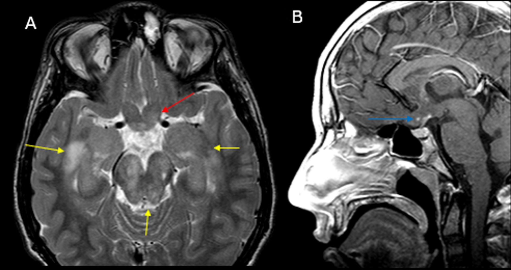
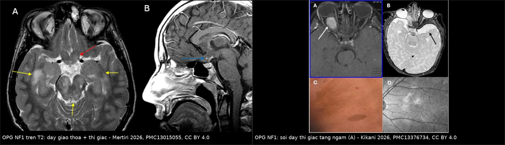
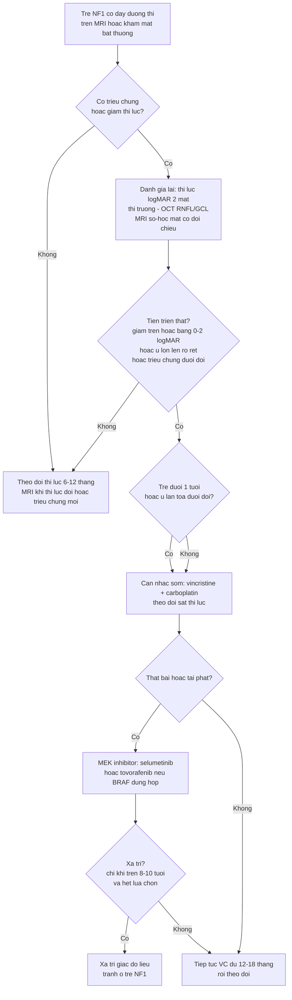
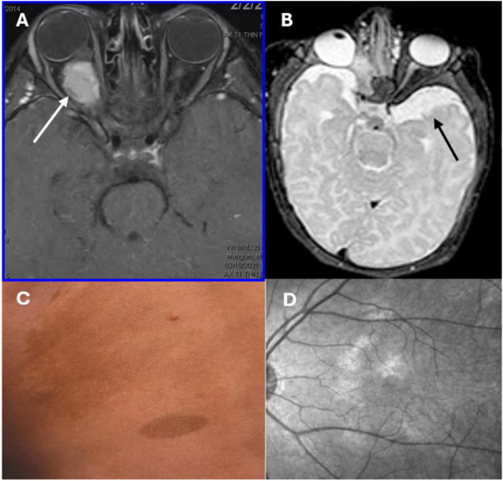
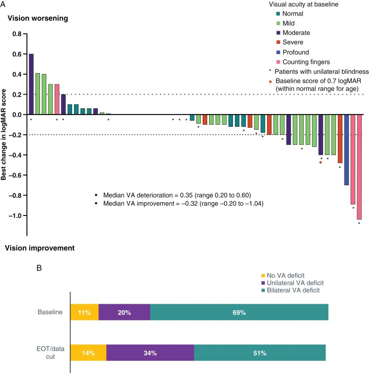

# 1758 — U thần kinh đệm đường thị trong NF1: theo dõi bằng MRI hay bằng thị lực, khi nào điều trị, vai trò MEK inhibitor / Optic pathway glioma in NF1

**Tags:** `pattern:u-duong-thi` `pattern:day-giao-thoa` `vung:than-kinh-thi` `vung:nao` `protocol:MRI-hoc-mat` `protocol:sang-loc-thi-luc` `score:RANO-LGG` `incidentaloma:khong`

**Mức chắc chắn (certainty):** tổng hợp y văn (literature synthesis) — 1 **guideline quốc tế** về giám sát u ở NF1 (ERN GENTURIS, EClinicalMedicine 2023, PMC9845795, CC BY), 1 **đoàn hệ toàn quốc Hà Lan** 197 trẻ u đường thị/dưới đồi (Cancers 2025, PMC11898773, CC BY), 1 **đoàn hệ 115 bệnh nhân/168 mắt** về kết cục thị lực (Front Surg 2022, PMC9478197, CC BY), 1 **đoàn hệ đa trung tâm** về vị trí/độ lan của LGG–NF1 (Neuro-Oncol Adv 2025, PMC12035607, CC BY), các bài tổng quan điều trị (Brain Sci 2025, PMC12385051; Neuro-Oncol Adv 2026, PMC13123696 — CC BY/CC BY-NC), 1 bài **đồng thuận nhi khoa** về u ở NF1 (Curr Oncol 2025, PMC12731700, CC BY), và 1 **phân tích nhóm OPG của thử nghiệm FIREFLY-1** (Neuro-Oncology 2025, PMC12187376, CC BY). **Không có ca nguyên văn do nhóm tự viết**; ca trong quiz là ca có ảnh từ bài gốc, ghi rõ PMCID.

> **Câu chốt:** phần lớn OPG ở NF1 là **bệnh "câm" và không cần điều trị**: **15–30%** trẻ NF1 có OPG nhưng **chỉ 30–50%** có triệu chứng, và trong một loạt 83 bệnh nhân **52% hoàn toàn không triệu chứng**. Vì vậy câu hỏi thực hành **không phải "MRI có phát hiện được không"** mà là **"theo dõi bằng gì"**: guideline châu Âu (ERN GENTURIS 2023) khuyến cáo **sàng lọc bằng THỊ LỰC/đáy mắt mỗi 6–12 tháng đến 8 tuổi, hằng năm đến tuổi trưởng thành** và **KHÔNG chụp MRI sàng lọc** — MRI chỉ khi **khám mắt gợi ý OPG**. Ba con số phải thuộc: **40%** OPG–NF1 cần điều trị (trung vị **10 tháng** từ chẩn đoán tới điều trị); **thị lực giảm ≥ 0,2 logMAR** là ngưỡng "tiến triển"; và **không sinh thiết** để chẩn đoán OPG ở trẻ NF1.

## 1. Tổng quan bệnh học – cơ chế hình ảnh

### 1.1 Bệnh học và dịch tễ

- **NF1 là bệnh u sợi thần kinh type 1** do đột biến **NF1** (17q11.2) → mất **neurofibromin**, một **GAP** của RAS → **RAS–MAPK hoạt hóa liên tục** → u tăng sinh. Khối u đường thị là **u tế bào hình sao thể lông (pilocytic astrocytoma, WHO độ 1)** với **sợi Rosenthal** và **thể hạt ưa eosin**; ở NF1 thường **không có dung hợp BRAF–KIAA1549** (khác thể lẻ tẻ) (PMC10649937, PMC13123696).
- **Tần suất:** OPG xuất hiện ở **15–30%** trẻ NF1 (PMC10649937, PMC12731700); bài tổng quan hình ảnh dùng **15–20%** (PMC13015055). OPG chiếm **30–50%** tổng số OPG ở trẻ; ngược lại NF1 có mặt ở **30–50%** trẻ OPG (PMC11898773).
- **Tuổi:** **trung vị 4 tuổi**; **đại đa số trước 8 tuổi** (tuổi chẩn đoán trung bình **4,5 tuổi**) (PMC13015055, PMC9845795). U **ngoài đường thị** (thân não, tiểu não, tủy) chỉ **1–2%** bệnh nhân NF1 (PMC13015055).
- **Triệu chứng — phần lớn không có:** **chỉ 30–50%** OPG–NF1 có triệu chứng; **> 50%** không giảm thị lực (PMC10649937). Loạt 83 bệnh nhân: **52% không triệu chứng**, **30% một triệu chứng mắt**, **18% nhiều triệu chứng** (PMC10649937). Nói cách khác: **OPG trên MRI ≠ bệnh cần điều trị**.
- **Điều trị — thiểu số:** trong đoàn hệ toàn quốc **197 trẻ OPHG**, **59 (29,9%) không bao giờ điều trị** và **91,5% số đó là NF1**; **40%** OPG–NF1 cần điều trị, **trung vị 10 tháng** từ chẩn đoán đến điều trị (PMC11898773, PMC9478197).

### 1.2 TẠI SAO thấy được trên MRI — và tại sao **thị lực quan trọng hơn ảnh**

- **T2/FLAIR tăng tín hiệu:** u là mô **giàu nước, tăng tế bào, phá vỡ myelin** → tăng thời gian **T2**; vì vậy **dày + tăng tín hiệu T2** ở dây thị/giao thoa là dấu hiệu nhạy nhất, **không cần** ngấm thuốc.
- **Ngấm thuốc sau gadolinium thì biến thiên:** u độ 1 có **hàng rào máu–thần kinh thị bị phá vỡ không hoàn toàn** → ngấm **ít hoặc từng phần**; trong ảnh mẫu ở mục 3, thành phần giao thoa chỉ **ngấm tối thiểu**. Vì vậy **"không ngấm" không loại trừ OPG** và **"ngấm nhiều" không đồng nghĩa ác tính**.
- **TẠI SAO thị lực là tiêu chuẩn vàng:** sợi trục **không hồi phục**; u có thể **ổn định trên MRI trong khi thị lực đã giảm**. Đoàn hệ 168 mắt: điều trị giúp **cải thiện 13%**, **giữ nguyên 62%**, **xấu đi 25%** — nghĩa là **mất thị lực xảy ra ở 1/4 số mắt dù đã điều trị**, và **thời gian chờ** là yếu tố quyết định (PMC9478197).
- **Ngưỡng "tiến triển thị lực" dùng trong thử nghiệm:** **giảm ≥ 0,2 logMAR** (≈ **2 dòng**) so với ban đầu, xác nhận ở **2 lần khám liên tiếp cách ~12 tuần** (PMC12187376). Tương đương mức "suy giảm vừa–nặng": **20/40 hoặc kém hơn** ở cả hai mắt (PMC9478197).
- **TẠI SAO không xạ trị ở trẻ NF1:** NF1 là bệnh **đột biến tạo u**, xạ làm tăng **u ác thứ phát** trong trường chiếu và **bệnh mạch não muộn** (bài 262); xạ chỉ dành cho **trẻ > 8–10 tuổi** hoặc thất bại mọi thuốc (PMC12385051).

### 1.3 Ngưỡng định lượng trụ cột

| Đại lượng | Con số | Nguồn |
|---|---|---|
| Tỉ lệ OPG ở trẻ NF1 | **15–30%** (hình ảnh: **15–20%**); **30–50%** OPG toàn bộ có NF1 | PMC10649937 · PMC13015055 · PMC11898773 |
| Triệu chứng | **30–50%** có triệu chứng; **> 50%** không giảm thị lực; **52%** không triệu chứng (loạt 83 ca) | PMC10649937 |
| Tuổi chẩn đoán | trung vị **4 tuổi**; trung bình **4,5 tuổi**; gần như tất cả **< 8 tuổi** | PMC13015055 · PMC9845795 |
| Cần điều trị | **40%** OPG–NF1; **10 tháng** từ chẩn đoán đến điều trị | PMC9478197 |
| Sàng lọc mắt | **0–8 tuổi: ≥ mỗi 12 tháng** (mỗi 6 tháng nếu làm được); **> 8 tuổi: hằng năm đến tuổi trưởng thành** | PMC9845795 |
| Chỉ định MRI | **chỉ khi khám mắt gợi ý OPG**; hoặc trẻ **> 2 tuổi** khám **nhiều lần không kết luận/không tin cậy** | PMC9845795 |
| Ngưỡng tiến triển thị lực | **≥ 0,2 logMAR** (≈ 2 dòng), xác nhận **2 lần liên tiếp ~12 tuần** | PMC12187376 |
| Điều trị bậc 1 | **vincristine + carboplatin**: PFS 3 năm **61,8%**, 5 năm **48,4%** (đoàn hệ); PFS 3 năm **77%**, 5 năm **69%** (tổng quan) | PMC11898773 · PMC12385051 |
| Tuổi khởi trị là yếu tố nguy cơ | **< 1 tuổi** = yếu tố **duy nhất** độc lập dự báo tiến triển sau VC | PMC11898773 |
| Selumetinib (MEK) | PFS 2 năm **78% (± 8,5%)**; **PR 24%**, **SD 56%**, **tiến triển 20%**; thị lực **cải thiện 21% / ổn định 68% / xấu 11%** | PMC12385051 |
| Tovorafenib (RAF II) — nhóm OPG FIREFLY-1 | ORR **64%** (RANO-HGG) / **50%** (RAPNO) / **55%** (RANO-LGG); thị lực giữ được **80% bệnh nhân / 87% mắt** | PMC12187376 |
| Sinh thiết | **không khuyến cáo** để xác nhận OPG ở trẻ NF1 (đồng thuận **100%**) | PMC12731700 |

*Trái: **T2 axial** — dày và tăng tín hiệu **giao thoa thị + đoạn trước giao thoa** (mũi tên đỏ); các ổ tăng tín hiệu trắng chất (mũi tên vàng) là **FASI** của NF1, **không** phải u. Phải: **T1 sau tiêm sagittal** — thành phần giao thoa chỉ **ngấm tối thiểu** (mũi tên xanh), nên **không ngấm không loại trừ OPG**. Ảnh nguyên bản (Cancer Imaging 2026, PMC13015055, CC BY 4.0).*

## 2. Mẫu hình + chẩn đoán phân biệt theo vị trí (Gamut)

- **Dày/tăng tín hiệu MỘT dây thị (prechiasmatic):**
  - **OPG–NF1** (thường hai bên, hình thoi) · **OPG lẻ tẻ** · **viêm thị thần kinh** (ngấm, đau khi liếc, tự hồi phục) · **bao mô mỡ quanh thị (meningioma bao thị — tram-track)** · **giả u viêm hốc mắt** · **di căn/leukemia**.
- **Dày GIAO THOA THỊ ± đường thị:**
  - **OPG (NF1 hoặc lẻ tẻ)** · **u thần kinh đệm dưới đồi** (thể lan tỏa, tiên lượng thị lực xấu hơn) · **LCH** (kèm cuống yên dày, ĐTĐ nhạt — bài 1751) · **u mầm** (hCG/AFP, mất điểm sáng T1 thùy sau) · **sarcoid/viêm màng bồ đào thần kinh** · **bệnh mạch (NMOSD/MOGAD)**.
- **Dày giao thoa + vùng dưới đồi + sụt cân ở nhũ nhi:**
  - **hội chứng gian não** (bài 1756) — thể **ngược** của béo phì dưới đồi.
- **Tăng tín hiệu T2 KHÔNG choán chỗ, không ngấm, ở đồi thị/hạch nền/thân não:**
  - **FASI (focal areas of signal intensity)** của NF1 — **không phải u**, giảm dần theo tuổi (PMC13015055).
- **Theo độ lan trên MRI (phân loại Dodge/sửa đổi — "MDC"):** dây thị đơn thuần → giao thoa → đường thị; **lan tỏa (MDC 2–3) ở 64%** và **dưới đồi 62,5%** trong đoàn hệ điều trị → **tiên lượng thị lực xấu hơn** (PMC11898773).

## 3. Bảng so sánh phân biệt (ma trận đối chiếu)

| Thực thể (entity) | Hình ảnh điển hình (MRI) | Chốt vào (rule-in) | Chốt loại (rule-out) | Gợi ý xác nhận |
|---|---|---|---|---|
| **OPG–NF1 (bài này)** | Dày **hình thoi** dây thị/giao thoa, **T2 tăng**, ngấm **ít–biến thiên**; hai bên; kèm **FASI**, u sợi thần kinh, đốm café-au-lait | **NF1 đã chẩn đoán + dày đường thị + thị lực/khám mắt bất thường** | **Khối choán chỗ đơn độc, ngấm mạnh, không tiêu chuẩn NF1** → nghĩ u khác | MRI sọ–hốc mắt + khám thần kinh nhãn khoa; **không sinh thiết** |
| **OPG lẻ tẻ** | Cùng hình ảnh nhưng **một bên nhiều hơn**, không FASI, không tiêu chuẩn NF1 | **U đường thị không có NF1 + dày lan tỏa** | **Có ≥ 2 tiêu chuẩn NF1** → xếp NF1 | Tiêu chuẩn NF1 2021; mô bệnh nếu cần |
| **Meningioma bao dây thị** | **Tram-track**: hai đường ngấm **quanh** dây thị tối, **vôi hóa**, người lớn | **Tram-track + vôi hóa + tuổi lớn** | **Dày TRONG trục, không vôi, trẻ em** | CT thấy vôi hóa; MRI sau tiêm (bài 431) |
| **Viêm thị thần kinh** | Dày + **ngấm mạnh**, **đau khi liếc**, thị trường ám điểm trung tâm; hồi phục | **Ngấm mạnh + đau + hồi phục nhanh + không có NF1** | **Không ngấm, tiến triển nhiều tháng, có FASI** | OCT (RNFL), kháng thể NMO/MOG, đáp ứng corticoid |
| **LCH vùng dưới đồi–tuyến yên** | **Cuống yên dày** + mất điểm sáng T1 thùy sau, có thể dày giao thoa | **ĐTĐ nhạt + tổn thương xương/da + CD1a/Langerin** | **Không có ĐTĐ nhạt, không tổn thương ngoài thần kinh** | Sinh thiết **xương/da** (bài 1751) |
| **U mầm vùng trên yên** | Khối giao thoa/dưới đồi, **mất điểm sáng T1 thùy sau**, hCG/AFP tăng | **Marker tăng + mất điểm sáng T1** | Marker âm + không mất điểm sáng T1 | hCG/AFP dịch não tủy; MRI toàn trục (bài 1731) |
| **FASI của NF1** | Ổ **T2/FLAIR tăng**, **không choán chỗ**, **không ngấm**, đồi thị/hạch nền/thân não | **Bờ không rõ, không hiệu ứng khối, ổn định/giảm theo tuổi** | **Dày đường thị + hiệu ứng khối + giảm thị lực** | So sánh nhiều lần; không điều trị |
| **U thần kinh đệm dưới đồi lan tỏa** | Khối lớn dưới đồi ± giao thoa, **hội chứng gian não** hoặc béo phì dưới đồi | **Sụt cân ở nhũ nhi hoặc béo phì dưới đồi + khối dưới đồi** | **Chỉ dày đường thị, BMI bình thường** | BMI SDS, nội tiết (bài 1754/1756) |

*Trái: **T2** — dày giao thoa thị và đoạn trước giao thoa, tăng tín hiệu (PMC13015055). Phải: **T1 sau tiêm** — dây thị phải **dày và ngấm thuốc** (A), kèm đốm café-au-lait (C) và nốt hắc mạc (D) của NF1 (PMC13376734). Hai kiểu ngấm khác nhau → **không dựa vào ngấm thuốc để chẩn đoán**. Ảnh ghép letterbox, cả hai nguồn **CC BY 4.0**.*

## 4. Protocol chụp + hệ phân độ/điểm chuẩn hóa

### 4.1 Sàng lọc: **mắt trước, MRI sau**

- **Bắt đầu ngay khi chẩn đoán/xác định NF1**, khám mắt **cơ sở** ở mọi tuổi: thị lực, thị trường, phản xạ đồng tử, vận nhãn, **đáy mắt** (PMC9845795).
- **0–8 tuổi: ≥ 12 tháng/lần (6 tháng nếu làm được)**; **> 8 tuổi: hằng năm đến tuổi trưởng thành**; **OCT RNFL/GCL** khi làm được (PMC9845795).
- **MRI chỉ khi:** khám mắt **gợi ý OPG**, hoặc trẻ **> 2 tuổi** có khám **nhiều lần không kết luận/không tin cậy** (do tuổi, thiếu chú ý); khám bất thường/không tin cậy phải **lặp lại sớm** (PMC9845795).
- **Phản biện (quan trọng):** nhiều trung tâm vẫn **chụp MRI sàng lọc** cho mọi trẻ NF1 mới chẩn đoán. Guideline châu Âu **không** khuyến cáo vì **không có bằng chứng** rằng phát hiện u không triệu chứng cải thiện thị lực, trong khi **dương tính giả (FASI)** gây lo lắng và điều trị oan (PMC9845795). Bài này chọn lập trường **theo guideline** nhưng ghi rõ **thực hành địa phương có thể khác**.
- **Không** chụp MRI lặp lại định kỳ cho u **ổn định, không triệu chứng** — theo dõi bằng **thị lực** (PMC9845795). Khi có chỉ định chụp: **MRI sọ + hốc mắt, T1W sau tiêm + T2W/FLAIR, lát mỏng ≤ 3 mm**, đọc **3 mặt phẳng** và đo **đường kính lớn nhất ở giao thoa** trên cùng mặt phẳng với lần trước (ngưỡng kỹ thuật, không phải ngưỡng chẩn đoán).

### 4.2 Hệ phân độ/đánh giá đáp ứng

- **Dodge/sửa đổi (MDC):** dây thị → giao thoa → đường thị; **lan tỏa (2–3) và có dưới đồi** = tiên lượng xấu hơn (PMC11898773).
- **RANO-LGG (và RAPNO cho trẻ):** đáp ứng dựa trên **thay đổi kích thước T2/FLAIR và ngấm thuốc**; **ORR** khác nhau tùy tiêu chuẩn — trong FIREFLY-1 nhóm OPG: **64% / 50% / 55%** theo RANO-HGG / RAPNO / RANO-LGG (PMC12187376). Vì vậy **không so sánh "tỉ lệ đáp ứng" giữa hai nghiên cứu dùng tiêu chuẩn khác nhau**.
- **Thị lực là tiêu chí ngang hàng với ảnh:** "tiến triển" = **giảm ≥ 0,2 logMAR xác nhận 2 lần ~12 tuần**; "đáp ứng" = **tăng ≥ 0,2 logMAR** (PMC12187376).

### 4.3 Thuật toán điều trị

## 5. Biến thể bình thường và cạm bẫy

- **FASI không phải u:** ổ T2 tăng tín hiệu ở **đồi thị, hạch nền, thân não, tiểu não** — **không choán chỗ, không ngấm, giảm dần theo tuổi**; gọi nhầm là "OPG lan tỏa" dẫn tới **điều trị hóa chất không cần thiết** (PMC13015055).
- **"Không ngấm thuốc = không phải u"** — sai: thành phần giao thoa trong ảnh mẫu chỉ **ngấm tối thiểu**; ngấm thuốc **không** dùng để chẩn đoán hay phân độ (PMC13015055).
- **"MRI ổn định = bệnh ổn định"** — sai: u có thể **ổn định trên ảnh trong khi thị lực đã giảm**; và **25% mắt xấu đi dù đã điều trị** (PMC9478197). Điều trị theo **thị lực**, không theo ảnh đơn thuần.
- **"Sinh thiết để chắc chắn"** — ở trẻ NF1 có OPG điển hình, **sinh thiết không được khuyến cáo** (đồng thuận **100%**): nguy cơ tổn thương thị giác/thần kinh mà **không đổi điều trị** (PMC12731700).
- **"U nhỏ thì lành"** — tuổi **< 1 tuổi** khi bắt đầu điều trị là **yếu tố duy nhất** độc lập dự báo tiến triển; **u ở trẻ nhỏ nguy hiểm hơn** kích thước (PMC11898773).
- **"Điều trị xong là khỏi"** — OPG–NF1 là bệnh **mạn**: **40%** cần điều trị, nhiều trẻ cần **nhiều đợt**, và **NF1** cần theo dõi **suốt đời** (u ác thứ phát, bệnh mạch, nội tiết) (PMC9478197).
- **Bẫy "thị lực khó đo ở trẻ < 3 tuổi"** — dùng **VEP/OCT** và **khám lặp lại**; guideline cho phép **MRI** khi khám **nhiều lần không kết luận** ở trẻ **> 2 tuổi** (PMC9845795).
- **Bẫy "NF1 là chống chỉ định xạ"** — không tuyệt đối: xạ **có thể** dùng khi **> 8–10 tuổi** và **hết lựa chọn**, nhưng phải cân nhắc **u ác thứ phát** (PMC12385051).

## 6. Tự lượng giá — Blind Quiz ngay trên trang tĩnh

**Ca 1 — Trẻ 5 tuổi NF1, khám mắt định kỳ thấy thị lực mắt trái giảm. MRI T2 axial hốc mắt.**

- Gợi ý lâm sàng: không đau, không đỏ mắt; da có nhiều đốm nâu; thị lực phải 20/25, trái 20/70.
- Câu hỏi: (1) Mô tả 2 loại tổn thương tăng tín hiệu. (2) Cái nào là u, cái nào không? (3) Có cần sinh thiết không?

<b>Bấm để hiện đáp án (findings + chẩn đoán)</b>

- **Mũi tên đỏ:** **giao thoa thị và đoạn trước giao thoa dày, tăng tín hiệu T2** → **OPG**.
- **Mũi tên vàng:** các ổ tăng tín hiệu **không choán chỗ** ở chất trắng/bán cầu → **FASI** của NF1, **không phải u**, không điều trị.
- **Không sinh thiết**: NF1 + OPG điển hình + thị lực giảm một bên → chẩn đoán đủ; sinh thiết chỉ đổi điều trị khi hình ảnh không điển hình/không có NF1.
- Hướng đi: **điều trị theo thị lực** (đã giảm ≥ 0,2 logMAR) — **vincristine + carboplatin**; theo dõi thị lực mỗi 3 tháng trong đợt điều trị.
- Nguồn ảnh: *Cancer Imaging* 2026, Fig. 2 — PMC13015055, CC BY 4.0 (nguyên bản).

**Ca 2 — Trẻ 4 tuổi, đốm café-au-lait từ 1 tuổi. MRI T1 sau tiêm: dây thị phải dày, ngấm thuốc.**

- Gợi ý lâm sàng: chưa có triệu chứng thị giác; khám mắt bình thường; mẹ hỏi "có phải chụp MRI mỗi năm không?".
- Câu hỏi: (1) Chẩn đoán? (2) Có chỉ định điều trị ngay? (3) Trả lời mẹ thế nào về lịch theo dõi?

<b>Bấm để hiện đáp án (findings + chẩn đoán)</b>

- **OPG–NF1 một bên** (dày + ngấm thuốc dây thị); đốm café-au-lait và **nốt hắc mạc** là tiêu chuẩn NF1.
- **Chưa điều trị**: không triệu chứng, thị lực bình thường → **theo dõi**, vì **chỉ 30–50%** OPG–NF1 có triệu chứng và **> 50%** không giảm thị lực.
- Trả lời: **khám mắt 6–12 tháng/lần đến 8 tuổi, sau đó hằng năm đến tuổi trưởng thành**; **MRI không cần lặp định kỳ** nếu thị lực ổn — chỉ chụp khi khám mắt bất thường hoặc có triệu chứng mới (ERN GENTURIS 2023).
- Nguồn ảnh: *Frontiers in Cell and Developmental Biology* 2026, Fig. 1 — PMC13376734, CC BY 4.0 (nguyên bản).

**Ca 3 — Nhóm OPG tái phát/khó trị trong FIREFLY-1: đọc đáp ứng THỊ LỰC.**

- Gợi ý lâm sàng: trẻ OPG BRAF-altered đã thất bại ≥ 1 phác đồ; điều trị tovorafenib; đo thị lực mỗi ~12 tuần.
- Câu hỏi: (1) Trục tung là gì và chiều nào là tốt? (2) Ngưỡng "đáp ứng" và "tiến triển"? (3) Tỉ lệ giữ được thị lực?

<b>Bấm để hiện đáp án (findings + chẩn đoán)</b>

- Trục tung = **thay đổi logMAR** so với ban đầu; **giảm logMAR (cột âm) = thị lực TỐT LÊN** (logMAR nhỏ = thị lực tốt).
- **Đáp ứng:** giảm **≥ 0,2 logMAR** xác nhận **2 lần liên tiếp ~12 tuần**; **tiến triển:** tăng **≥ 0,2 logMAR**.
- Kết quả nhóm OPG: thị lực **cải thiện 31% bệnh nhân / 27% mắt**, **ổn định 49% / 60%** → **giữ được thị lực 80% bệnh nhân / 87% mắt**; ORR u **50–64%** tùy tiêu chuẩn RANO/RAPNO.
- Bài học: **đáp ứng thị lực và đáp ứng u không song hành hoàn toàn** — phải báo cả hai.
- Nguồn ảnh: *Neuro-Oncology* 2025, Fig. 3 — PMC12187376, CC BY 4.0 (nguyên bản).

## Bài liên quan chéo
- [400 – Tổng quan Mắt & thị giác](../400-tong-quan-mat-thi-giac/lesson.md)
- [431 – U thần kinh thị: glioma vs meningioma](../431-u-than-kinh-thi/lesson.md) (phân biệt hình ảnh trong trục vs tram-track)
- [600 – Tổng quan Hệ Nhi khoa](../600-tong-quan-nhi-khoa/lesson.md)
- [1756 – Hội chứng gian não ở nhũ nhi](../1756-hoi-chung-gian-nao/lesson.md) (u đường thị/dưới đồi thể gầy teo)
- [1754 – Hội chứng dưới đồi ở trẻ](../1754-hoi-chung-duoi-doi-o-tre/lesson.md) (béo phì dưới đồi sau tổn thương)
- [1751 – LCH vùng dưới đồi–tuyến yên](../1751-lch-vung-duoi-doi-tuyen-yen-o-tre/lesson.md) (cuống yên dày + ĐTĐ nhạt)
- [1731 – U mầm nội sọ vùng trên yên](../1731-u-mam-noi-so-vung-tren-yen-o-tre/lesson.md)
- [262 – Bệnh mạch máu lớn do xạ trị não (moyamoya)](../262-benh-mach-mau-lon-do-xa-tri-moyamoya/lesson.md) (lý do tránh xạ ở trẻ NF1)

## Ảnh
- `1758_opg_T2_PMC13015055-F2.jpg` — T2 axial: dày giao thoa thị + FASI; T1 sagittal sau tiêm: ngấm tối thiểu.
- `1758_opg-screening_PMC13376734-F1.jpg` — T1 sau tiêm dây thị dày ngấm thuốc + đốm café-au-lait + nốt hắc mạc.
- `1758_visual-response_PMC12187376-F3.jpg` — waterfall thay đổi thị lực (logMAR) ở nhóm OPG FIREFLY-1.
- `composite_opg_mri.jpg` — ảnh ghép 2 ô, cả hai nguồn **CC BY 4.0**.
- Nguồn + giấy phép từng ảnh: xem `images/CREDITS.md` và `sources.md`.

> Không dùng để chẩn đoán độc lập khi chưa có người hướng dẫn.
