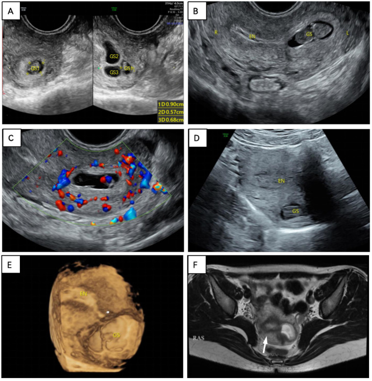
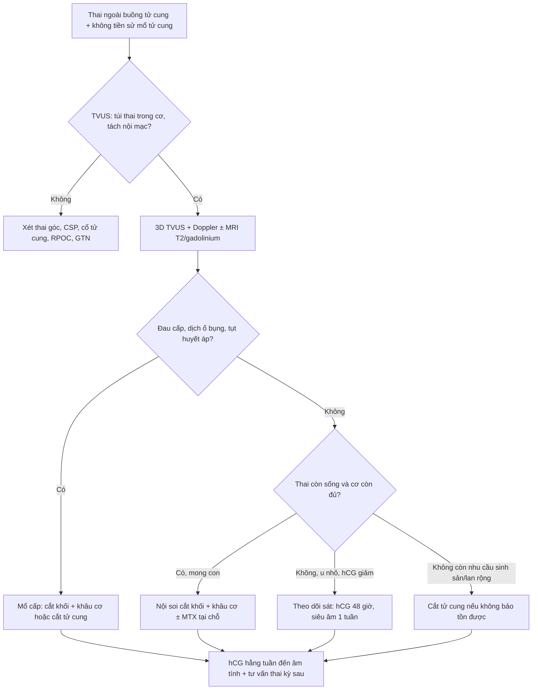
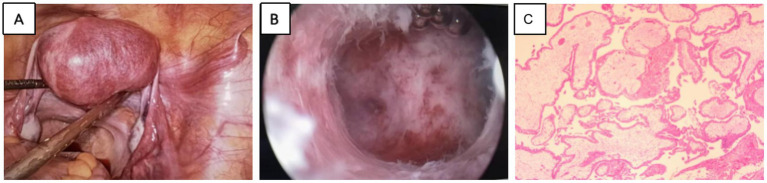

# 1759 — Thai trong cơ tử cung không sẹo (intramural ectopic pregnancy, IMP) / Intramural ectopic pregnancy without uterine scar

**Tags:** `pattern:thai-ngoai-tu-cung` `pattern:tui-thai-trong-co` `pattern:khong-thong-buong-tu-cung` `pattern:do-ngam-mach` `pattern:chay-mau` `vung:tu-cung` `vung:tieu-khung` `score:beta-hCG` `protocol:SA-dau-do` `protocol:MRI-tieu-khung` `protocol:noi-soi-tieu-khung`
**Mức chắc chắn (certainty):** tổng hợp y văn (literature synthesis) — 1 tổng quan dữ liệu bệnh nhân cá thể **82 ca/27 quốc gia** (PMC10805919), 1 loạt 2 ca HIMP có ảnh siêu âm 3D + MRI (PMC12521109), 1 ca tồn dư nguyên bào nuôi sau mổ (PMC11647785) và 1 ca phải cắt tử cung (PMC11007569). Bằng chứng là ca báo cáo; câu nào là suy luận được ghi **[suy luận]**.

## 1. Tổng quan bệnh học – cơ chế hình ảnh

- **Định nghĩa:** thai trong cơ tử cung (intramural pregnancy, IMP) là túi thai (gestational sac, GS) làm tổ **trong lớp cơ tử cung**, **được cơ bao quanh một phần hoặc hoàn toàn**, **tách khỏi buồng tử cung và vòi trứng** (PMC10805919). Đây là thể **hiếm nhất** của thai ngoài tử cung, chiếm **~1%** các thai ngoài tử cung; thể **không sẹo** (không tiền sử mổ tử cung) là nhóm còn hiếm hơn và **không được lẫn với thai trên sẹo bóc u xơ** (bài 1727).
- **Vì sao phôi vào được lớp cơ — 3 giả thuyết chính (PMC10805919):**
  1. **Đường hầm giả (false tract)** giữa nội mạc và cơ, tạo ra do **can thiệp buồng tử cung** (nạo, hút, đặt dụng cụ) — yếu tố nguy cơ hay gặp nhất.
  2. **IVF – chuyển phôi (embryo transfer)** đưa phôi **nhầm vào lớp cơ** qua đường hầm giả hoặc do đầu catheter làm tổn thương nội mạc.
  3. **Adenomyosis** làm cơ tử cung "nhận" phôi tốt hơn (tăng tính thụ nhận của cơ).
  - Ngoài ra: **tăng hoạt tính ly giải của nguyên bào nuôi (syncytiotrophoblast)** + **decidual hóa khiếm khuyết** → phôi xâm nhập cơ; **di chuyển ngoài (external migration)** sau khi qua vòi.
- **Dịch tễ — 82 ca (PMC10805919):**
  - Tuổi mẹ **32,07 ± 5,67** (19–44); tuổi thai **9,27 ± 5,68 tuần** (4–37 tuần).
  - Yếu tố nguy cơ: **nạo/hút buồng tử cung 36,58%** (30 ca) · **cắt vòi trứng 12,19%** (10) · **IVF–chuyển phôi 12,19%** (10) · **mổ lấy thai 10,97%** (9) · **bóc u xơ 9,75%** · **adenomyosis 4,88%**; **2 ca không có yếu tố nguy cơ nào**.
  - **21,69%** (18 ca) **không có triệu chứng** — chỉ phát hiện khi siêu âm.
  - **Vỡ 14,63%** (12 ca), tuổi thai lúc vỡ **5 tuần 6 ngày – 26 tuần 0 ngày** (trung bình **15,11 ± 6,18 tuần**); **tử vong ~2,5%**.
  - Chẩn đoán xác định: **mô bệnh học 26,83%**, **MRI 17,07%**, **mổ mở 14,63%**, **nội soi ổ bụng 12,19%**.
- **TẠI SAO hình ảnh trông như vậy (vật lý + mô bệnh):**
  - **Túi thai/dịch ối** giàu nước → **T2 rất cao**, **T1 thấp/đồng tín hiệu**; **cơ tử cung** T2 trung gian; **vùng chuyển tiếp (junctional zone, JZ)** là dải **T2 thấp** ngay dưới nội mạc — nên MRI T2 là cách tốt nhất trả lời "túi thai nằm **ngoài** JZ hay **trong** buồng tử cung".
  - **Nguyên bào nuôi là mô mạch** → ngấm thuốc sau gadolinium, **tăng sinh mạch dữ dội** trên Doppler ("ring of fire") và trên **CEUS** (bơm cản quang siêu âm): ngấm **sớm ~9 giây**, kéo dài **11–28 giây**, thải muộn hơn cơ; ranh giới túi thai–nội mạc rõ ở pha muộn **~29 giây** (dữ liệu 1 ca — PMC10805919).
  - **Lớp cơ/thanh mạc mỏng ≤ 3 mm** là dấu hiệu **nguy cơ vỡ** vì thành còn lại ít; u mạch máu dưới thanh mạc rất mỏng, dễ vỡ khi túi thai lớn lên.
  - **Túi thai trong cơ không có "cổ" thông với buồng tử cung** (khác thai góc/cornual có interstitial line) — nhưng **có thể có đường hầm nhỏ (sinus tract)** nối với nội mạc, thấy trên siêu âm 2D/3D độ phân giải cao hoặc MRI.
- **Phân loại theo ESHRE (dẫn trong PMC12521109):** **thể hoàn toàn (complete)** — túi thai **hoàn toàn trong cơ**, không thông buồng tử cung; **thể không hoàn toàn (incomplete)** — **một phần** túi thai trong cơ, còn thông với nội mạc. Thể không hoàn toàn dễ bị bỏ sót hơn vì vẫn thấy "túi thai trong buồng".
- **Ca nguyên văn dùng cho quiz (PMC12521109, ca 1):** nữ **30 tuổi**, G3P0, vô kinh **2 tháng**, β-hCG **> 5.000 mIU/mL**; siêu âm đầu dò âm đạo (TVUS) thấy **3 ổ giảm âm ở đáy tử cung**, ổ lớn có **phôi 3,9 mm**; hút buồng tử cung → mô học có gai nhau; **1 tuần sau β-hCG tăng lên 14.676 mIU/mL**, siêu âm lặp: **túi thai ở đáy, có tim thai**, **mất liên tục với nội mạc**; 3D thấy **đáy tử cung lồi ra ngoài**; MRI T2 xác nhận túi thai **ngoài nội mạc, trong cơ**; mổ nội soi + nội soi buồng tử cung lấy túi thai; **ngày 4 sau mổ β-hCG 1.672**, về bình thường sau **3 tuần**.

## 2. Mẫu hình + chẩn đoán phân biệt theo VỊ TRÍ (Gamut)

**Mẫu hình:** **túi thai/khối hỗn hợp trong cơ tử cung**, bờ được cơ bao quanh, **không thông với buồng tử cung** (thể hoàn toàn) hoặc **thông một phần** (thể không hoàn toàn); ± **vòng mạch nuôi**, ± **lồi thanh mạc**, ± **dịch ổ bụng**.

- **Theo vị trí trong tử cung:**
  - **Đáy tử cung (fundus):** hay gặp; dễ nhầm **thai trong buồng bình thường** khi túi thai nằm sát nội mạc; 3D giúp thấy **đáy lồi**.
  - **Sừng/góc tử cung (cornual):** dễ nhầm **thai góc/interstitial** — khác biệt ở **vị trí so với vòi trứng và lớp cơ bao quanh**.
  - **Thân tử cung (trước/sau):** hay gặp ở người có **nạo/hút trước đó**; dễ nhầm **u xơ thoái triển**.
  - **Gần sẹo cũ (nhưng không có tiền sử mổ):** có ca IMP trên **sẹo do dụng cụ tử cung (IUD) xuyên thủng** — vẫn là "không sẹo mổ" nhưng có đường hầm.
  - **Cổ tử cung:** **không** thuộc IMP — đó là thai cổ tử cung; phân biệt bằng giải phẫu.
- **Theo bệnh cảnh "túi thai ngoài buồng tử cung":**
  - **Thai góc/sừng (interstitial/cornual):** lệch một bên, **lớp cơ bao quanh < 5 mm**, **interstitial line sign**.
  - **Thai trên sẹo mổ lấy thai (CSP):** vị trí **đoạn dưới**, tiền sử mổ lấy thai, **RMT ≤ 3 mm**, **sliding sign âm** (bài 552).
  - **Thai trên sẹo bóc u xơ (MSP):** tiền sử bóc u xơ, sẹo ở thân/đáy/sừng, **có thể thông buồng tử cung** (bài 1727).
  - **Thai cổ tử cung:** túi thai trong kênh cổ, **eo tử cung phình (hourglass)**, không có cơ bao quanh.
  - **Thai trong buồng tử cung lệch bên (angular):** vẫn **trong nội mạc**, cơ bao quanh dày; khác IMP.
  - **Bệnh nguyên bào nuôi thai nghén (GTN):** hCG rất cao, **không có túi thai có phôi**, hình "bão tuyết"/khối tăng sinh mạch; có thể **choriocarcinoma trong cơ** (đã báo cáo).
  - **U xơ thoái triển (degenerating fibroid):** khối trong cơ, **không vòng mạch**, hCG âm/thấp; có thể T1 cao do xuất huyết.
  - **Sót sản phẩm thụ thai (RPOC):** khối trong **buồng tử cung**, liên tục với nội mạc, hCG thấp và giảm.
  - **Adenomyosis khu trú:** ổ dịch nhỏ trong cơ, **không có phôi/tim thai**, hCG âm.

## 3. Bảng so sánh phân biệt (ma trận đối chiếu)

| Thực thể (entity) | Hình ảnh điển hình (US/MRI) | Chốt vào (rule-in) | Chốt loại (rule-out) | Gợi ý xác nhận |
|---|---|---|---|---|
| **IMP thể hoàn toàn** | Túi thai **hoàn toàn trong cơ**, không thấy đường thông; cơ bao quanh; ± vòng mạch | **Túi thai trong cơ + buồng tử cung rỗng + không thấy vòi trứng chứa thai** | Có đường thông rộng với nội mạc → thể không hoàn toàn/thai trong buồng | MRI T2 sagittal + 3D TVUS; mô bệnh sau mổ |
| **IMP thể không hoàn toàn** | Túi thai **một phần trong cơ**, **thông với buồng tử cung** qua đường hầm | **Đường hầm nội mạc–cơ + túi thai nằm ngoài nội mạc** | Túi thai hoàn toàn trong nội mạc → thai bình thường | 3D TVUS (mặt cắt qua JZ); MRI |
| **Thai góc/sừng (interstitial)** | Túi thai lệch bên ở sừng, **cơ bao quanh < 5 mm**, interstitial line | **Interstitial line sign + < 5 mm cơ quanh + lệch ngoài buồng** | Cơ bao quanh dày, túi thai trong buồng → không phải góc | MRI; nội soi; β-hCG |
| **Thai sẹo mổ lấy thai (CSP)** | Túi thai **đoạn dưới**, **RMT ≤ 3 mm**, sliding sign âm | **Tiền sử mổ lấy thai + vị trí đoạn dưới + RMT ≤ 3 mm** | Sẹo ở thân/đáy + tiền sử bóc u xơ → MSP; không sẹo → IMP | TVUS + Doppler; MRI nếu mơ hồ (bài 552) |
| **Thai cổ tử cung** | Túi thai trong kênh cổ, eo phình, mạch nuôi từ ĐM tử cung | **Túi thai trong kênh cổ + không có cơ bao quanh** | Túi thai trong thân/sừng → không phải cổ | TVUS; MRI |
| **GTN / choriocarcinoma trong cơ** | Khối tăng sinh mạch, **không có túi thai/phôi**, hCG rất cao | **hCG rất cao + không phôi + khối mạch máu** | Có phôi/tim thai, hCG tăng theo thai → IMP | hCG chuỗi; MRI; mô bệnh |
| **U xơ thoái triển** | Khối trong cơ, **không vòng mạch**, T1 có thể cao | **Không phôi, không vòng mạch, hCG âm/thấp** | Có phôi/tim thai + vòng mạch + hCG tăng → thai | Siêu âm lặp; MRI |
| **RPOC** | Khối echo trong **buồng tử cung**, liên tục nội mạc | **Khối trong buồng + hCG thấp/giảm sau sẩy** | Khối trong **cơ**, tách nội mạc → IMP | TVUS; hCG; nội soi buồng tử cung |

*Sáu panel của ca 1: (A) TVUS ban đầu — 3 ổ giảm âm ở đáy, ổ lớn có phôi 3,9 mm; (B) sau hút 1 tuần — túi thai ở đáy, mất liên tục với nội mạc; (C) CDFI — mạch dữ dội giữa túi thai và nội mạc; (D) siêu âm bụng; (E) 3D — đáy tử cung lồi ra ngoài; (F) MRI T2 — túi thai ngoài nội mạc, trong cơ. Nguồn: Zhang J et al., Front Med 2025 (PMC12521109), Fig. 1, CC BY 4.0.*

### Ba câu hỏi trước khi can thiệp

- **Túi thai có thật trong buồng tử cung không?** (loại thai trong buồng, RPOC, GTN; kiểm tra túi thai thứ hai — **thai đôi khác buồng** có thể đồng thời).
- **Túi thai nằm trong cơ hay ngoài nội mạc?** (thể hoàn toàn/không hoàn toàn; **JZ trên MRI** và **3D TVUS** là chốt).
- **Có vỡ/chảy máu ổ bụng không?** (đau cấp, dịch ổ bụng, tụt huyết áp → mổ cấp, không chờ hCG).

## 4. Protocol chụp + phân độ/điểm chuẩn hóa

- **Siêu âm đầu dò âm đạo (TVUS) — bước 1:** khảo sát **toàn bộ tử cung** theo mặt cắt dọc/ngang từ cổ đến đáy, **không chỉ mặt cắt thường quy**. Ghi nhận: **vị trí túi thai so với nội mạc**, **độ dày cơ/thanh mạc còn lại (mm)**, **vòng mạch**, **phôi/tim thai**, **đường hầm** nối với buồng tử cung. Ở 82 ca, siêu âm được làm **97,56%**, nhưng **chỉ 29/66 ca có mô tả là chẩn đoán/gợi ý đúng** (PMC10805919).
- **Siêu âm 3D:** dựng **mặt phẳng qua vùng chuyển tiếp (JZ)** và **render bề mặt** để thấy **đáy/sừng lồi**, **mất liên tục nội mạc–cơ**; giúp phân biệt **IMP với thai góc** và **thể không hoàn toàn**. Dùng ở **4,88%** ca trong tổng quan (PMC10805919).
- **CEUS (nếu có):** ngấm **sớm ~9 giây**, kéo dài **11–28 giây**, thải muộn; ranh giới túi thai–nội mạc rõ ở pha muộn **~29 giây** — dữ liệu **1 ca**, chưa đủ để thành tiêu chuẩn.
- **MRI tiểu khung — khi siêu âm mơ hồ hoặc trước mổ:**
  - **T2 sagittal + coronal** (vị trí túi thai so với **JZ**, buồng tử cung, vòi trứng), **T1** (máu), **T1 fat-sat sau gadolinium** (ngấm của nguyên bào nuôi), **DWI** nếu cần phân biệt khối đặc.
  - Trên MRI: túi thai **T2 cao**, **T1 thấp/đồng**; có thể thấy **mạch xoắn quanh túi thai** (cấu trúc ống tín hiệu cao/tín hiệu trống); **đường hầm** nối buồng tử cung–túi thai ở **2 ca** (PMC10805919).
  - MRI được dùng ở **21,95%** ca; được đề xuất là **"chuẩn vàng"** chẩn đoán IMP [ý kiến tác giả, chưa có nghiên cứu so sánh].
- **Xét nghiệm:** **β-hCG định lượng + lặp 48 giờ**; **không có ngưỡng hCG nào** chứng minh để chọn methotrexate (MTX) trong IMP. hCG **có thể âm** ở 2 ca IMP đã chết và thoái triển (PMC10805919) — **hCG âm không loại trừ hoàn toàn**.
- **Chẩn đoán xác định:** **mô bệnh học** sau mổ là chuẩn: **gai nhau (chorionic villi) được bao quanh bởi cơ trơn tử cung, thâm nhiễm nguyên bào nuôi, không thấy vòi trứng** (PMC10805919).
- **Phân độ:** **không có hệ phân độ/RADS được kiểm chứng cho IMP**; dùng **ESHRE complete/incomplete** (mô tả, chưa chứng minh tiên lượng) + **độ dày cơ còn lại** và **vị trí** để quyết định [suy luận].
- **Điều trị — số liệu 82 ca:**
  - **Phẫu thuật là chính:** **nội soi ổ bụng 25,61%** (21) · **mổ mở 23,17%** (19) — **cắt khối + khâu phục hồi cơ**; **cắt tử cung 13,41%** (11, trong đó 1 ca choriocarcinoma).
  - **Nội khoa 23,17%** (19): MTX toàn thân/tại chỗ hoặc **KCl tại chỗ**; **thất bại 31,58%** (6/19) phải mổ — tỉ lệ thành công **~68,42%**; **tuổi thai càng lớn, tỉ lệ thành công càng giảm**.
  - **Theo dõi đơn thuần (conservative) 3,65%** (3 ca) — chỉ chọn khi **ổn định, u nhỏ, hCG giảm**, có theo dõi sát.
  - **Nút mạch tử cung (UAE)** trước mổ đã được báo cáo để **giảm chảy máu** (1 ca); **hút buồng tử cung dưới hướng dẫn nội soi** ở thể không hoàn toàn (1 ca).
  - **Sau mổ:** theo dõi **β-hCG hằng tuần đến âm tính**; **siêu âm kiểm tra**; **thai kỳ sau siêu âm ở 5–6 tuần** để chẩn đoán sớm tái phát (khuyến cáo của tổng quan).
  - **Nguy cơ tồn dư nguyên bào nuôi:** đã có ca **hCG tăng lại sau mổ**, cần **MTX tại chỗ** và theo dõi mạch máu tại chỗ (PMC11647785) — không dừng theo dõi khi hCG chưa âm.

## 5. Biến thể bình thường và cạm bẫy

- **Siêu âm 2D dễ sai:** **13/66 ca (19,7%)** bị chẩn đoán nhầm là **thai góc/sừng/interstitial** trên siêu âm đầu; **thể không hoàn toàn** còn dễ bị gọi là "thai trong buồng bình thường" (PMC10805919).
- **Hút buồng tử cung không chữa được IMP:** ca 1 vẫn còn túi thai sống sau hút, hCG **tăng từ > 5.000 lên 14.676**; **nạo mù** còn có nguy cơ **thủng tử cung/chảy máu** [suy luận cơ học, phù hợp khuyến cáo phẫu thuật].
- **Thai đôi khác buồng (heterotopic):** có thể có **một thai trong buồng bình thường + một IMP**; sau hút thấy hCG không giảm/tăng lại phải nghĩ đến túi thai thứ hai — đây chính là bẫy của ca 1 và của loạt 2 ca HIMP (PMC12521109).
- **hCG âm/thấp không loại trừ:** đã có 2 ca IMP được chứng minh mô học với **β-hCG âm** (thai chết, không tiêu hết) (PMC10805919).
- **Nhầm u xơ thoái triển/adenomyosis:** khối trong cơ + ổ dịch nhỏ, **không phôi, không vòng mạch**; hCG âm và theo dõi siêu âm giúp phân biệt; **đừng chọc/dẫn lưu** khi chưa loại trừ thai.
- **Nhầm GTN/choriocarcinoma:** hCG **rất cao** + khối mạch máu **không có túi thai/phôi**; cần mô bệnh — đã có ca **choriocarcinoma trong cơ** được chẩn đoán sau cắt tử cung.
- **Vỡ thường sau 12 tuần:** vỡ hay gặp ở thai **> 12 tuần** (trung bình **15,1 tuần**), nhưng đã có ca vỡ từ **5 tuần 6 ngày** — không được trấn an bằng tuổi thai nhỏ.
- **"Không sẹo" không có nghĩa "không đường hầm":** IMP có thể xảy ra sau **IUD xuyên thủng** hoặc **nạo trước đó** — hỏi kỹ **mọi can thiệp tử cung**, không chỉ mổ bóc u xơ/mổ lấy thai.
- **Tồn dư sau mổ:** hCG có thể **tăng lại** sau cắt khối do nguyên bào nuôi còn sót → theo dõi hCG và **MTX tại chỗ** nếu cần (PMC11647785); đừng kết thúc theo dõi quá sớm.
- **Phân biệt "IMP một phần" với placenta percreta:** tổng quan nêu tranh luận — mô tả "sản phẩm thai bám một phần trong cơ sau sinh" giống **placenta percreta** hơn là IMP; cần mô bệnh và bối cảnh (PMC10805919).

## 6. Tự lượng giá — Blind Quiz

**Ca 1 — Nữ 30 tuổi, G3P0, vô kinh 2 tháng, β-hCG > 5.000 mIU/mL. Siêu âm đầu tiên thấy 3 ổ giảm âm ở đáy tử cung. Ảnh dưới đây là diễn tiến 1 tuần sau hút buồng tử cung.**

- Hỏi: vì sao β-hCG lại **tăng** sau hút? Panel nào chứng minh túi thai **ngoài nội mạc**? Ba chẩn đoán phân biệt và bước xác nhận?

<b>Bấm để hiện đáp án (findings + chẩn đoán)</b>

- **Findings:** (A) 3 ổ giảm âm ở đáy, ổ lớn có **phôi 3,9 mm**; (B) sau hút 1 tuần — túi thai ở đáy, **mất liên tục với nội mạc**; (C) Doppler — **mạch dữ dội** giữa túi thai và nội mạc; (E) 3D — **đáy tử cung lồi ra ngoài**; (F) MRI T2 — **túi thai ngoài nội mạc, trong cơ**, JZ còn nguyên.
- **Chẩn đoán:** **thai trong cơ tử cung (IMP)**, thể hoàn toàn; hCG **> 5.000 → 14.676** vì túi thai trong cơ **không được hút ra** và tiếp tục phát triển (có tim thai).
- **Phân biệt:** thai góc/interstitial (interstitial line, cơ quanh < 5 mm), thai sẹo mổ lấy thai (RMT ≤ 3 mm, tiền sử mổ), GTN (hCG rất cao, không phôi).
- **Xử trí:** nội soi ổ bụng + nội soi buồng tử cung cắt túi thai + khâu cơ; **ngày 4 hCG 1.672**, về bình thường sau **3 tuần**.
- Nguồn ảnh: Zhang J et al., Front Med 2025 (PMC12521109), Fig. 1, CC BY 4.0.

**Ca 2 — Cùng bệnh nhân, hình ảnh trong mổ và mô bệnh.**

- Hỏi: vì sao phải **nội soi ổ bụng + nội soi buồng tử cung** thay vì chỉ hút? Mô bệnh phải thấy gì để xác nhận?

<b>Bấm để hiện đáp án (findings + chẩn đoán)</b>

- **Findings:** (A) nội soi — **khối lồi ra ở cơ tử cung**, mạch máu dưới thanh mạc; (B) nội soi buồng tử cung — **túi thai nằm trong cơ**, lấy được sau khi rạch cơ dưới quan sát nội soi; (C) mô bệnh — **gai nhau** trong mô cơ.
- **Vì sao không chỉ hút:** túi thai **không thông với buồng tử cung**; hút chỉ lấy được nội mạc, **không tiếp cận túi thai**, còn làm tăng nguy cơ thủng/chảy máu.
- **Mô bệnh xác nhận:** **gai nhau (chorionic villi) được bao quanh bởi cơ trơn tử cung, thâm nhiễm nguyên bào nuôi, không thấy vòi trứng** — tiêu chuẩn của IMP (PMC10805919).
- Nguồn ảnh: Zhang J et al., Front Med 2025 (PMC12521109), Fig. 2, CC BY 4.0.

**Ca 3 — Nữ 41 tuổi, tiền sử 2 lần hút thai trong 2 năm, sẩy thai nội khoa 2 tháng trước; β-hCG 67.055 → 2.469 → 3.069 mIU/mL.**

- Hỏi: hCG **tăng lại** sau khi đã "sạch" gợi ý gì? Cần làm gì trước khi kết luận GTN?

<b>Bấm để hiện đáp án (findings + chẩn đoán)</b>

- **Gợi ý:** còn **mô nguyên bào nuôi hoạt động** — có thể **IMP bị bỏ sót**, **thai đôi khác buồng**, hoặc **GTN**; không được mặc định là GTN và bắt đầu hóa trị.
- **Bước tiếp theo:** siêu âm lặp + **3D TVUS/CDFI**, **MRI** để tìm túi thai trong cơ; **hCG lặp 48 giờ**; nếu còn khối trong cơ → **nội soi buồng tử cung/ổ bụng** lấy mô; **mô bệnh** là chốt (gai nhau trong cơ).
- **Điểm học:** sau mọi can thiệp buồng tử cung, **hCG không giảm như kỳ vọng** phải chụp lại toàn bộ tử cung, không chỉ đọc "buồng tử cung trống".
- Nguồn ca: Zhang J et al., Front Med 2025 (PMC12521109), ca 2, CC BY 4.0 (không dùng ảnh riêng cho ca này).

## Bài liên quan chéo
- [552 – Chửa ở sẹo mổ lấy thai & chửa góc: RMT ≤ 3 mm, sliding sign, interstitial line](../552-chua-ngoai-tu-cung-seo-mo-lay-thai-va-chua-goc/lesson.md)
- [1727 – Thai trên sẹo bóc u xơ tử cung: phân 3 thể, vỡ 11,4%, PAS 29,5%](../1727-thai-tren-seo-boc-u-xo/lesson.md)
- [1717 – Vỡ tử cung trên sẹo mổ lấy thai: 22,7% không đau](../1717-vo-tu-cung-tren-seo-mo-lay-thai/lesson.md)
- [520 – U xơ tử cung FIGO & adenomyosis nội mạc](../520-tu-cung-u-xo-FIGO-adenomyosis-noi-mac/lesson.md)
- [532 – U xơ trong thai kỳ & thoái triển đỏ](../532-u-xo-trong-thai-ky-thoai-trien-do/lesson.md)
- [1624 – Polyp nhau/khối trong buồng tử cung sau sinh](../1624-polyp-nhau-khoi-buong-tu-cung-sau-sinh/lesson.md)
- [1750 – UTUC ở bệnh nhân thận ghép](../1750-utuc-than-ghep/lesson.md)

> Không dùng để chẩn đoán độc lập khi chưa có người hướng dẫn.
