# 176 — TIPS/DIPS: chỉ định, kỹ thuật & theo dõi shunt (thông – hẹp – huyết khối, bệnh não gan) / Transjugular intrahepatic portosystemic shunt

**Tags:** `pattern:shunt-cua-chu` `vung:gan` `vung:mach-cua` `score:PPG` `protocol:Doppler-sieu-am` `protocol:DSA-do-ap-luc`
**Mức chắc chắn (certainty):** tổng hợp y văn (literature synthesis) — nhóm tự biên từ y văn mở (CVIR Endovasc 2024 PMC10781922; Sci Rep 2022 PMC8894460; Diagnostics 2021 PMC8472159; Ultrasound Int Open 2024 PMC11863994; Liver Int 2026 PMC13562823; Liver Int 2026 PMC12717333; Clin Transl Gastroenterol 2026 PMC13593234; JHEP Rep 2026 PMC13000493; Diagnostics 2025 PMC12650949; BMC Surg 2026 PMC13214368; Front Radiol 2026 PMC13469255; J Vasc Surg Cases 2026 PMC13099945; JKSR 2026 PMC13062374; BMJ Open Gastroenterol 2026 PMC13599983; Cureus PMC13645364), số liệu lấy nguyên từ bài gốc.

> **Câu hỏi gốc của bài:** bệnh nhân **xơ gan đã đặt TIPS** (hoặc đang được chỉ định TIPS) quay lại với **tái xuất huyết/tái báng bụng**, hoặc ngược lại **bệnh não gan (hepatic encephalopathy – HE)** — làm sao trên **siêu âm Doppler, CT và chụp mạch đo áp lực** trả lời được **shunt còn thông hay đã hẹp/tắc**, **hẹp ở đâu**, và **khi nào cần nong/đặt thêm stent**?
> **Điểm tựa:** TIPS là **ống nối nhân tạo giữa tĩnh mạch gan và tĩnh mạch cửa**. Mọi bất thường đều quy về 3 câu hỏi: **(1) gradient áp lực cửa–chủ (portosystemic pressure gradient – PPG/PSG) còn dưới ngưỡng không? (2) stent có thông suốt không, hẹp ở đầu nào? (3) máu đi tắt qua gan nhiều quá gây HE chưa?**

## 1. Tổng quan bệnh học – cơ chế hình ảnh

**A. TIPS/DIPS là gì – cơ chế hạ áp lực cửa:**
- **TIPS (transjugular intrahepatic portosystemic shunt – shunt cửa–chủ trong gan qua đường tĩnh mạch cảnh):** luồn ống qua **tĩnh mạch cảnh trong → tĩnh mạch chủ dưới (IVC) → tĩnh mạch gan → xuyên nhu mô gan → nhánh tĩnh mạch cửa** (thường nhánh phải), rồi đặt **stent phủ (covered stent-graft)** giữ thông đường hầm. **DIPS (direct intrahepatic portosystemic shunt):** đường hầm đi **thẳng từ IVC** xuyên nhu mô gan vào tĩnh mạch cửa (giữ lại khi không tiếp cận được tĩnh mạch gan thuận lợi).
- **TẠI SAO hạ được áp lực cửa:** shunt mở một **"van xả" từ hệ cửa áp lực cao sang hệ chủ áp lực thấp**, làm giảm **gradient áp lực cửa–chủ (PPG/PSG)**. Tăng áp cửa có ý nghĩa lâm sàng (**CSPH**) khi **HVPG ≥ 10 mmHg**; biến chứng (vỡ giãn tĩnh mạch, báng) bùng phát khi **HVPG ≥ 12 mmHg** (PMC13645364). **Đích sau TIPS: PPG < 12 mmHg**; **rối loạn huyết động (hemodynamic dysfunction – HD) định nghĩa là PPG ≥ 12 mmHg** (PMC11863994).
- **TẠI SAO hình ảnh lại như vậy:** stent là **kim loại + màng ePTFE** → trên **CT** là cấu trúc dải tăng đậm độ có **giả ảnh (artifact)**; trên **siêu âm Doppler** là **tín hiệu dòng tốc độ cao** trong nhu mô gan, phụ thuộc **góc chùm tia**; trên **DSA** là đường hầm cản quang nối tĩnh mạch gan–tĩnh mạch cửa, cho phép **đo trực tiếp PPG** (hiệu áp giữa tĩnh mạch cửa và tĩnh mạch chủ dưới/tĩnh mạch gan).

**B. Chỉ định (số liệu từ các cohort dưới):**
- **Dự phòng thứ phát xuất huyết giãn tĩnh mạch** (chỉ định hàng đầu — **83,7%** trong một cohort 86 bệnh nhân) và **báng bụng kháng trị/tái phát (31,4%)** (PMC11863994).
- **Huyết khối tĩnh mạch cửa (portal vein thrombosis – PVT):** PVT gặp ở **~1% dân số** nhưng **tới 44% ứng viên ghép gan**; **vận tốc dòng cửa < 15 cm/s** là yếu tố dự báo độc lập trong xơ gan. **PVR-TIPS (tái thông cửa + TIPS)** đạt **thành công kỹ thuật 75–100%**, giúp nối cửa–cửa khi ghép gan **96–100%** (PMC13469255). Cohort TIPS cho PVT (36 bệnh nhân): **thành công đặt 100%**, **thời gian thông (patency) trung bình 40,3 ± 40,2 tháng**, **rối loạn 30,3%**, **trẻ em nguy cơ cao hơn (HR 4,85)** (PMC12650949).
- Các chỉ định khác trong gamut: **hội chứng Budd-Chiari**, **hội chứng tắc xoang gan (SOS/HSOS)**, **tràn dịch màng phổi do gan (hepatic hydrothorax)**, **hội chứng gan thận** (PMC13593234, PMC13469255).
- **Chỉ định cấp trong suy gan cấp–mạn (ACLF):** TIPS giảm **tử vong 28 ngày 5,1% vs 22,0%** (HR 0,22 [0,06–0,77]) nhưng **hết lợi sau 90 ngày** → coi là **cầu nối tới ghép gan** (PMC13593234).

**C. TẠI SAO TIPS lại hại – bệnh não gan (HE):**
- Máu tắt qua gan giảm **khử amoniac tại gan** → HE. Meta-analysis **27 nghiên cứu / 3.934 bệnh nhân / 862 ca HE** (PMC13214368): yếu tố nguy cơ **tuổi (MD +4,12 năm)**, **Child-Pugh C (OR 2,87)**, **tiền sử HE (OR 3,28)**, **tăng amoniac trước mổ (MD +8,02 µmol/L)**, **hạ natri (MD −3,85 mmol/L)**, **tràn dịch màng phổi (OR 2,45)**, **giảm PPG không đủ (MD +2,31 mmHg)**; **Child-Pugh A (OR 0,45)** và **stent đường kính ≥ 8 mm (OR 0,58)** là yếu tố bảo vệ.
- **Mâu thuẫn có thật (phản biện theo Argon):** phân tích gộp quan sát nói **stent ≥ 8 mm bảo vệ** (OR 0,58), nhưng **RCT chất lượng cao** lại cho **stent 7 mm giảm HE**: HE rõ (overt HE) **20,7% (7 mm) vs 35,9% (8 mm)**, tích lũy 2 năm **21,4% vs 37,2% (p = 0,02)** mà **rối loạn shunt không khác (8,7% vs 8,7%)** và **tái xuất huyết không khác (10,9% vs 9,8%)** (PMC13562823). → Trên thực hành: **chọn đường kính/giãn bóng "vừa đủ" theo cơ địa gan** (gan nhỏ, nguy cơ HE cao → ưu tiên 7 mm hoặc **shunt bị hạn chế đường kính cTIPS**).
- **cTIPS (constrained TIPS – đặt stent 6 mm bên trong để hạn chế đường kính):** PPG sau TIPS **7 mmHg (cTIPS) vs 6 mmHg (sTIPS)**; **HE ít hơn (4 vs 14, p = 0,042)** nhưng **rối loạn/nong lại nhiều hơn (rối loạn 9 vs 1; nong lại 13 vs 7)** (PMC12717333) → đánh đổi "giảm HE ↔ tăng huyết khối/tái can thiệp".

**D. Ngưỡng định lượng mấu chốt (Argon – cửa 1):**
- **Đích PPG < 12 mmHg;** HD = PPG **≥ 12 mmHg** (PMC11863994).
- **Siêu âm Doppler:** HD có **vận tốc tĩnh mạch cửa (PVV) thấp hơn** — **35 (20–45) vs 40,5 (35–50) cm/s, p = 0,02**; **ΔPVV so với ngay sau TIPS** giảm **−8,2 ± 20,2 cm/s** khi HD vs **+6,08 ± 19,8 cm/s** khi không HD. **Cut-off PVV 40,5 cm/s → AUROC 0,705**; **thêm ΔPVV (cut-off 9,5 cm/s) → AUROC 0,78** (PMC11863994).
- **HD xảy ra ở 43% ca**, trong đó **67,5% không có triệu chứng** → **"shunt hỏng âm thầm"** rất thường gặp, phải theo dõi hình ảnh chứ không chỉ theo triệu chứng (PMC11863994).
- **Rối loạn shunt ≤ 20% trong 1 năm** (stent-graft Fluency) (PMC10781922).
- **Sau nong lại/nâng cấp:** PSG **18,5 mmHg → 8 mmHg** (p < 0,001) (PMC10781922).

## 2. Mẫu hình + chẩn đoán phân biệt theo vị trí (Gamut)

**Gamut theo VỊ TRÍ hẹp trên stent (4 kiểu DAF — dysfunctional-associated features):**
- **Type 1 — hẹp ĐẦU GAN (cranial/hepatic vein end), ngay sau đuôi stent:** hay gặp nhất **69,7%** → do **stent không phủ đủ lên hợp lưu tĩnh mạch gan–IVC**. (PMC10781922)
- **Type 2 — hẹp TRONG stent ở đoạn tĩnh mạch gan: 15,2%.** (PMC10781922)
- **Type 3 — hẹp/gấp khúc (kink) đoạn trong nhu mô hoặc đầu cửa: 6,1%.** (PMC10781922)
- **Type 4 — TẮC HOÀN TOÀN shunt: 9,1%.** (PMC10781922)
- **Thời gian tới nong lại trung vị 10,4 tháng** (PMC10781922).

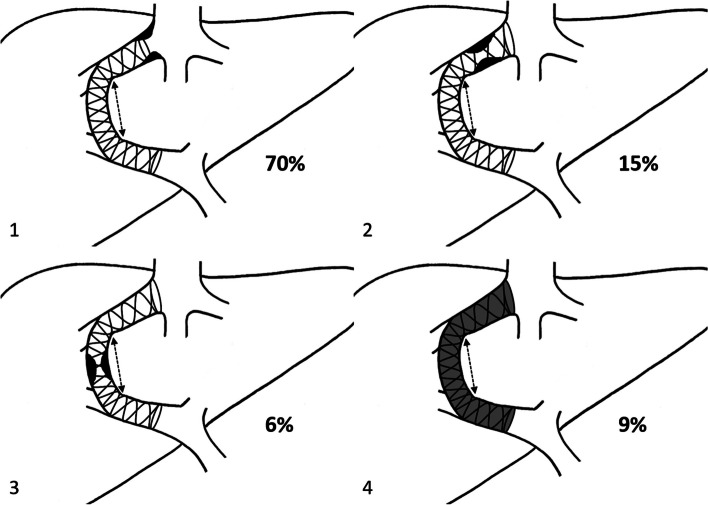
*Sơ đồ phân bố 4 kiểu rối loạn TIPS liên quan đến vị trí hẹp: type 1 (đầu gan), type 2 (trong stent đoạn tĩnh mạch gan), type 3 (trong nhu mô/đầu cửa), type 4 (tắc hoàn toàn). Nguồn: CVIR Endovasc 2024 (PMC10781922), CC BY 4.0.*

**Gamut theo BỐI CẢNH lâm sàng:**
- **Tái xuất huyết/tái báng + PPG ≥ 12 → hẹp/tắc shunt** (thường đầu gan).
- **HE mới/xấu đi (không có hẹp):** shunt "quá tốt" (đường kính lớn) hoặc **cTIPS chưa giãn đủ**; xét **giảm đường kính (reduction)** hoặc chỉnh thuốc.
- **Sốt/nhiễm trùng stent:** viêm nội mạc stent (hiếm), **"endotipsitis"**.
- **Nhu mô gan xung quanh:** **ung thư biểu mô tế bào gan (HCC)** có thể xâm lấn/tắc shunt; **u tân sinh** khác.
- **Giải phẫu:** **shunt cửa–chủ tự phát (spontaneous portosystemic shunt – SPSS)** tồn tại song song — **thuyên tắc SPSS làm GIẢM rối loạn TIPS (HR 0,319)** (PMC8894460); **giãn tĩnh mạch dạ dày (GV)** gặp ở **20%** người tăng áp cửa, đường vào/ra (phân loại Kiyosue) quyết định chọn TIPS vs thuyên tắc ngược (RTO) (PMC13599983).

**Mnemonic "STENT" cho TIPS rối loạn:** **S**tenosis đầu gan (type 1) · **T**hrombosis/tắc (type 4) · **E**ncephalopathy (HE do shunt quá lớn) · **N**arrowing trong stent (type 2–3) · **T**umour/PVT (HCC, huyết khối cửa).

## 3. Bảng so sánh phân biệt (ma trận đối chiếu)

| Thực thể (entity) | Hình ảnh điển hình (US/CT/DSA) | Chốt vào (rule-in) | Chốt loại (rule-out) | Gợi ý xác nhận |
|---|---|---|---|---|
| **TIPS thông tốt** | Doppler: dòng liên tục trong stent, đồng nhất; CT: stent thẳng, lòng thấm thuốc | **PPG sau TIPS < 12 mmHg + dòng Doppler đồng nhất + hết triệu chứng** | Không đánh giá chỉ bằng hình thái — **phải đối chiếu PPG** | Doppler ± CEUS định kỳ; chỉ chụp mạch khi nghi |
| **Hẹp ĐẦU GAN (type 1)** | Hẹp ngay **sau đuôi stent trong tĩnh mạch gan**; DSA thấy chỗ thắt + PPG tăng | **PPG ≥ 12 mmHg + hẹp đầu gan trên DSA; khoảng cách đuôi cranial–IVC ≥ 1 cm** (PMC8894460) | Hẹp trong nhiều thì cố định mới thật (không phải co thắt) | **Nong bóng + nối dài stent (extension) tới gần IVC** |
| **Hẹp TRONG stent / kink (type 2–3)** | Hẹp dọc thân stent hoặc gấp khúc đoạn nhu mô/đầu cửa | **Hẹp trong stent + PPG tăng + tái phát triệu chứng** | Bỏ sót **huyết khối non** (thấy rõ trên CEUS) | Nong bóng + stent trong stent |
| **Tắc hoàn toàn (type 4)** | Doppler: **mất/không có tín hiệu dòng**; CEUS: **không có vi bọt trong stent** (PMC8472159) | **Mất dòng trên CDUS/CEUS + PPG rất cao** | Dòng rất chậm có thể giả "tắc" → **CEUS/CT xác nhận** | **Tái thông (thrombectomy) + stent mới** |
| **HE do shunt quá lớn** | Stent thông tốt, **không hẹp**; PPG thấp; stent đường kính lớn | **HE mới sau TIPS + shunt thông + nguyên nhân khác loại trừ** | **Hẹp/tắc shunt KHÔNG gây HE thêm** — đừng đi tìm hẹp | Điều trị HE; xét **giảm đường kính shunt** nếu nặng |
| **Huyết khối cửa (PVT) kèm** | CT/DSA: khuyết thuốc trong tĩnh mạch cửa; cavernoma | **Khuyết thuốc cửa + tăng áp cửa + chỉ định TIPS/PVR-TIPS** | **Khí cửa không do huyết khối** (thiếu máu ruột) | PVR-TIPS; CT cản quang thì cửa |

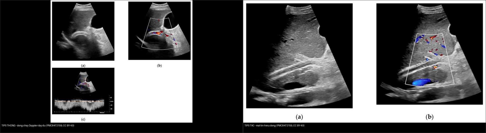
*Trái: **TIPS thông** — tín hiệu dòng Doppler đầy trong stent, dòng liên tục. Phải: **TIPS tắc** — mất tín hiệu dòng trong lòng stent. Nguồn: Diagnostics 2021 (PMC8472159), CC BY 4.0. Ảnh ghép letterbox.*

### Bốn dấu hiệu hay bị đọc nhầm
- **Hẹp "đầu gan" là do stent quá ngắn, không phải do huyết khối:** khoảng cách **đuôi cranial stent–IVC phải < 1 cm** trên chụp mạch 2D; vị trí đuôi cranial **dự báo độc lập rối loạn (HR 2,300)** (PMC8894460).
- **Thuyên tắc SPSS tồn tại song song làm GIẢM rối loạn TIPS** (HR 0,319) — nghịch trực giác nhưng do giảm "cạnh tranh" dòng ra (PMC8894460).
- **"Shunt hỏng âm thầm" chiếm 2/3 số HD** — không chờ triệu chứng (PMC11863994).
- **Stent kim loại trên CT có giả ảnh** che lòng mạch thật — đối chiếu Doppler/CEUS/DSA.

## 4. Protocol chụp + hệ phân độ/điểm chuẩn hóa

- **Theo dõi siêu âm Doppler (giao thức):** sau TIPS đo **vận tốc trong stent**, **vận tốc tĩnh mạch cửa (PVV)** và **chiều dòng nhánh cửa trong gan**, so với **ngay sau thủ thuật**. **PVV ≤ 40,5 cm/s** và **ΔPVV ≥ 9,5 cm/s** là gợi ý rối loạn huyết động (AUROC **0,705 → 0,78**) (PMC11863994, PMC8472159).
- **CEUS (siêu âm cản âm):** quan sát **vi bọt (microbubble) trong lòng stent** ở độ phân giải không–thời gian cao → phân biệt **thông / huyết khối một phần / tắc hoàn toàn**. Đồng thuận với CDUS **92,5%**, CT **95,3%**, MRI **87,9%**; tránh bức xạ khi CDUS/CT không rõ (PMC8472159).
- **CT bụng–chậu cản quang đa thì:** đánh giá vị trí/đường kính stent, hẹp, huyết khối cửa, SPSS, HCC, biến chứng (máu tụ, mật). Lưu ý **giả ảnh kim loại**.
- **DSA (chụp mạch số hóa xóa nền) + đo PPG:** **tiêu chuẩn vàng** — đo **áp lực tĩnh mạch cửa và tĩnh mạch chủ dưới/tĩnh mạch gan** → tính PPG; nong bóng/stent khi **PPG ≥ 12 mmHg**. Sau nong: PSG **18,5 → 8 mmHg** (PMC10781922).
- **Chọn stent/đường kính (step-up):** chuẩn **8 mm** nhưng **7 mm giảm HE** mà không tăng tái xuất huyết ở gan nhỏ (PMC13562823); **shunt giãn dần (underdilated)** bắt đầu 6 mm; **hạn chế đường kính (cTIPS)** cho người nguy cơ cao (PMC12717333, PMC13448517).
- **Kỹ thuật khi giải phẫu khó:** **"gun-sight"** — đặt snare ở **tĩnh mạch gan và tĩnh mạch cửa**, luồn kim qua cả hai snare dưới huỳnh quang (khi xơ gan nặng/biến dạng mạch) (PMC13062374).
- **Nối dài cranial khi hẹp đầu gan:** có thể dùng **stent tĩnh mạch chuyên dụng**, **nối dài trung bình 11,25 ± 2,2 mm**, giảm PPG **8,5 ± 2,1 mmHg**, không biến chứng (PMC13099945).

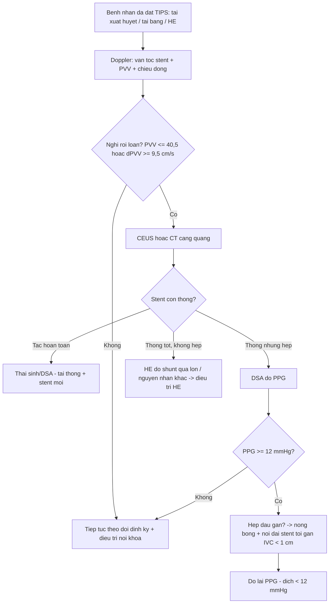

## 5. Biến thể bình thường và cạm bẫy

- **Biến thể bình thường:** **dòng trong stent thay đổi theo nhịp thở/tư thế** và **góc chùm Doppler** — luôn hiệu chỉnh **góc ≤ 60°** và đo nhiều điểm; **bóng khí nhỏ sau thủ thuật** không phải huyết khối. **SPSS tồn tại song song** là bình thường về giải phẫu nhưng ảnh hưởng huyết động (thuyên tắc làm giảm rối loạn TIPS) (PMC8894460).
- **Cạm bẫy 1 — hẹp giả do góc/co thắt mạch:** hẹp chỉ **thật** nếu **cố định mọi thì và kèm PPG tăng**.
- **Cạm bẫy 2 — mất dòng giả "tắc":** dòng rất chậm có thể không thấy trên CDUS → **dùng CEUS/CT** trước khi kết luận tắc (PMC8472159).
- **Cạm bẫy 3 — "thỏa mãn tìm kiếm":** thấy stent thông là dừng → bỏ sót **huyết khối cửa tiến triển, SPSS, HCC, HE không do hẹp**. Đánh giá đồng thời **PPG + nhu mô gan + cửa**.
- **Cạm bẫy 4 — sai ngưỡng đường kính:** "to hơn = tốt hơn" là SAI với HE; **7 mm** giảm HE ở gan nhỏ; **cTIPS** giảm HE nhưng tăng huyết khối/tái can thiệp (PMC13562823, PMC12717333).
- **Cạm bẫy 5 — CT bị che bởi giả ảnh kim loại:** đối chiếu Doppler/CEUS/DSA; **4D flow MRI** là hướng mới đánh giá huyết động định lượng khi các phương thức khác không rõ (PMC13457754).
- **Cạm bẫy 6 — HE không phải lúc nào cũng do shunt "quá lớn":** trước tiên loại trừ **nguyên nhân khác (xuất huyết tiêu hóa, nhiễm trùng, mất nước, thuốc, suy thận)** rồi mới nghĩ giảm đường kính.

## 6. Tự lượng giá — Blind Quiz ngay trên trang tĩnh (không cần app)

**Ca 1 — Bệnh nhân sau TIPS, siêu âm Doppler: đọc dòng trong stent trước, so với đối chứng.**

- Gợi ý lâm sàng (clinical context): tái xuất huyết tiêu hóa/tái báng bụng; không rõ shunt còn thông.
- Câu hỏi: Hai ảnh khác nhau ở điểm nào? Nếu là ảnh tắc, cần xác nhận bằng gì và đo gì?

<b>Bấm để hiện đáp án (findings + chẩn đoán)</b>

- **Dấu hiệu (findings):** trái — **dòng Doppler đồng nhất, liên tục trong stent** (TIPS thông). Phải — **mất tín hiệu dòng trong lòng stent** (TIPS tắc/mất dòng).
- **Chẩn đoán (diagnosis):** **TIPS tắc hoàn toàn (type 4)** — máu không còn đi qua shunt, áp lực cửa tăng lại → tái xuất huyết/tái báng.
- **Xác nhận & xử trí:** **CEUS** (tìm vi bọt) hoặc **CT/DSA**; đo **PPG** (đích < 12 mmHg); **tái thông (thrombectomy) + stent mới**.
- Nguồn ảnh: Marschner CA, Geyer T et al., *Diagnostics* 2021, PMC8472159 (Fig. 1 vs Fig. 2), CC BY 4.0. Ảnh ghép letterbox.

**Ca 2 — Bệnh nhân sau TIPS: hẹp ở đâu? (chụp mạch)**

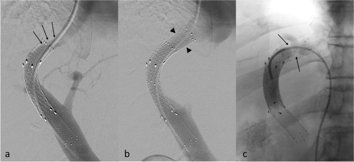

- Gợi ý: PPG ≥ 12 mmHg; tái phát triệu chứng.
- Câu hỏi: Mô tả vị trí hẹp so với đuôi stent; vì sao đây là kiểu "type 1"?

<b>Bấm để hiện đáp án (findings + chẩn đoán)</b>

- **Dấu hiệu (findings):** (a) DSA: **chỗ thắt (stenosis) nằm NGAY SAU đuôi stent, trong tĩnh mạch gan** (type 1 DAF). (b) sau khi **đặt thêm stent nối dài (bare stent, đầu mũi tên)** — lòng thông trở lại.
- **Chẩn đoán (diagnosis):** **rối loạn TIPS type 1 (hẹp đầu gan)** — chiếm **69,7%** các rối loạn, do **stent không phủ đủ lên hợp lưu tĩnh mạch gan–IVC**.
- **Xử trí:** **nong bóng + nối dài stent cranial** tới gần IVC; đích **PPG < 12 mmHg** (sau nong: PSG 18,5 → 8 mmHg).
- Nguồn ảnh: Gravel G, Artru F et al., *CVIR Endovasc* 2024, PMC10781922 (Fig. 3), CC BY 4.0.

**Ca 3 — Đo vận tốc cửa trên Doppler có phát hiện "shunt hỏng âm thầm" không?**

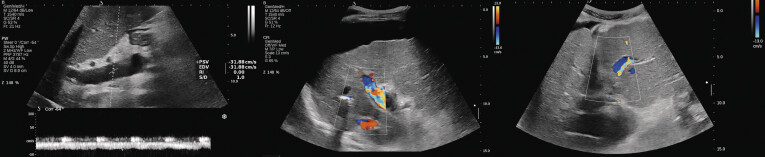

- Gợi ý: bệnh nhân **không có triệu chứng** nhưng PPG ≥ 12 mmHg.
- Câu hỏi: Thông số nào gợi ý rối loạn huyết động? Ngưỡng là bao nhiêu?

<b>Bấm để hiện đáp án (findings + chẩn đoán)</b>

- **Dấu hiệu (findings):** (trái) đo **vận tốc tĩnh mạch cửa (PVV)**; (giữa/phải) đánh giá **chiều dòng nhánh cửa trong gan**.
- **Chẩn đoán gợi ý:** **rối loạn huyết động (PPG ≥ 12 mmHg)** dù **67,5% không có triệu chứng** — "shunt hỏng âm thầm" ở 43% ca.
- **Ngưỡng:** **PVV ≤ 40,5 cm/s** (AUROC 0,705) và **ΔPVV ≥ 9,5 cm/s** (AUROC lên 0,78).
- Nguồn ảnh: Crăciun R, Ștefănescu H et al., *Ultrasound Int Open* 2024, PMC11863994 (Fig. 1), CC BY-NC-ND 4.0 (giữ nguyên bản).

**Ca 4 — Siêu âm thường không thấy dòng; siêu âm cản âm nói gì?**

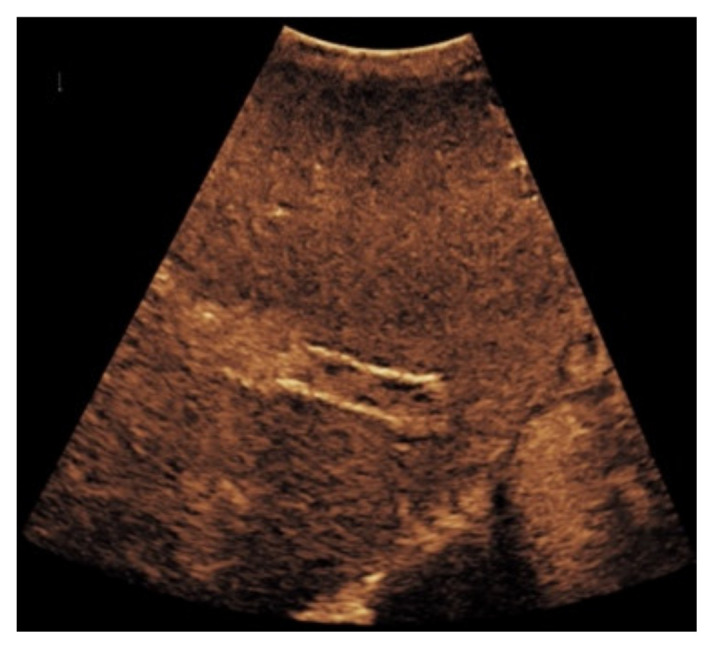

- Câu hỏi: Vì sao thêm siêu âm cản âm (CEUS) lại hữu ích khi Doppler màu không rõ? Hình gợi ý gì?

<b>Bấm để hiện đáp án (findings + chẩn đoán)</b>

- **Dấu hiệu (findings):** **tín hiệu dòng chỉ chiếm một phần** trong stent, viền/vùng giảm hồi âm ở bờ = **lắng đọng huyết khối**.
- **Chẩn đoán (diagnosis):** **huyết khối một phần trong stent** (thông một phần nhưng dòng bị hạn chế) → có thể tiến triển thành tắc.
- **Vì sao CEUS:** CEUS quan sát **từng vi bọt** ở phân giải cao → phân biệt **thông/thông một phần/tắc**; đồng thuận CT 95,3%, CDUS 92,5% (PMC8472159).
- Nguồn ảnh: Marschner CA, Geyer T et al., *Diagnostics* 2021, PMC8472159 (Fig. 6), CC BY 4.0.

**Ca 5 — "Gun-sight": khi đường vào cửa quá khó.**

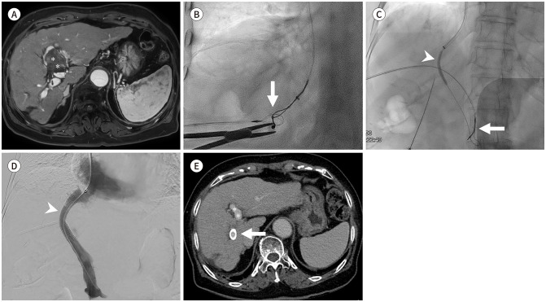

- Gợi ý: xơ gan nặng/giải phẫu biến dạng; kỹ thuật thường quy thất bại.
- Câu hỏi: Kỹ thuật này làm gì khác cách thường quy (snare/needle)?

<b>Bấm để hiện đáp án (findings + chẩn đoán)</b>

- **Dấu hiệu (findings):** (A) MRI/CT: **tĩnh mạch cửa trái giãn dạng phình có huyết khối trong lòng**; (B) huỳnh quang: **kim (Colapinto needle)** ở tĩnh mạch gan phải và **snare** ở tĩnh mạch cửa — hướng "gun-sight" để kim xuyên đúng hai snare.
- **Chẩn đoán (diagnosis):** **tạo TIPS bằng kỹ thuật gun-sight** — chỉ định khi **không tiếp cận được tĩnh mạch cửa bằng cách thường quy** (giải phẫu biến dạng, xơ gan nặng).
- **Ý nghĩa:** tăng tỉ lệ thành công kỹ thuật khi cách chuẩn thất bại; vẫn dựa trên **snare 2 đầu + kim dưới huỳnh quang**.
- Nguồn ảnh: Nam IC, Lee HN et al., *J Korean Soc Radiol* 2026, PMC13062374 (Fig. 1), CC BY-NC 4.0 (giữ nguyên bản).

**Ca 6 — TIPS cho huyết khối tĩnh mạch cửa (PVT).**

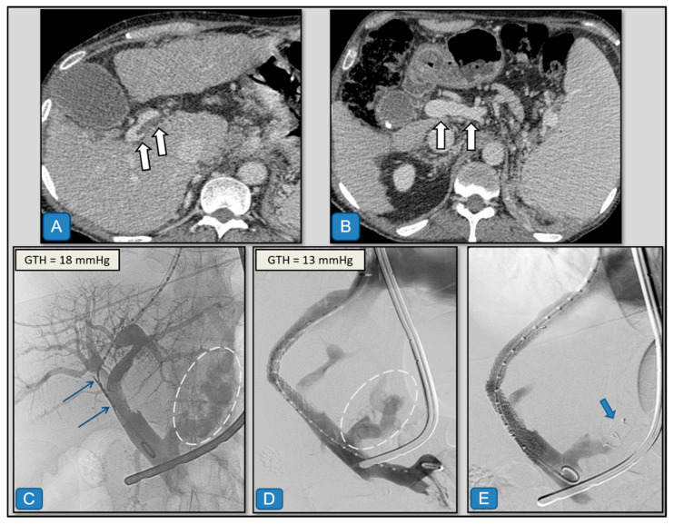

- Gợi ý: xơ gan + giãn tĩnh mạch thực quản–dạ dày chảy máu + huyết khối cửa.
- Câu hỏi: Mục tiêu của TIPS ở đây khác dự phòng xuất huyết thông thường ở điểm nào?

<b>Bấm để hiện đáp án (findings + chẩn đoán)</b>

- **Dấu hiệu (findings):** (A, B) **CT cản quang thì cửa**: huyết khối cửa và tuần hoàn bàng hệ; sau đó **chụp mạch** tạo đường hầm TIPS.
- **Chẩn đoán (diagnosis):** **PVR-TIPS** — tái thông tĩnh mạch cửa **đồng thời** tạo shunt; **thành công 75–100%**, giúp nối cửa–cửa khi ghép gan **96–100%** (PMC13469255). Cohort PVT: **thành công đặt 100%**, **thông trung bình 40,3 tháng**, **rối loạn 30,3%**, **trẻ em nguy cơ cao (HR 4,85)** (PMC12650949).
- Nguồn ảnh: Barranco Acosta S et al., *Diagnostics* 2025, PMC12650949 (Fig. 2), CC BY 4.0.

**Ca 7 — Giãn tĩnh mạch dạ dày: vì sao phải hiểu giải phẫu trước khi chọn TIPS?**

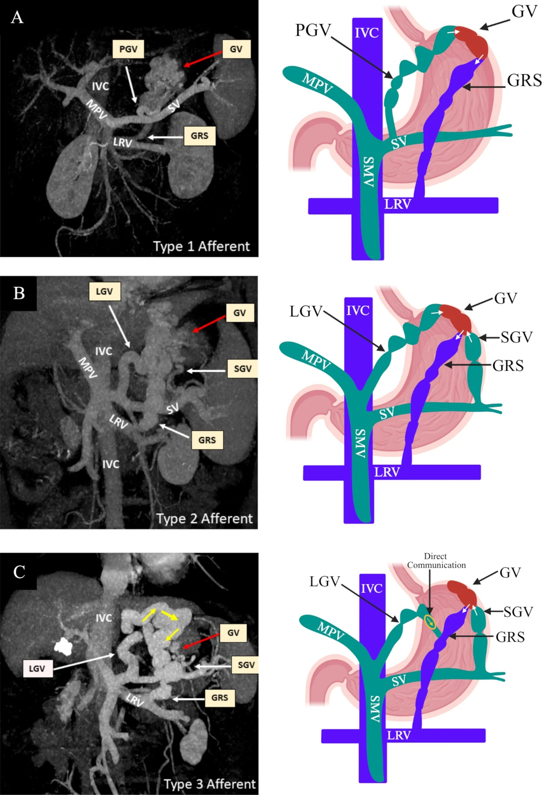

- Câu hỏi: Phân loại đường vào (afferent) quyết định chọn TIPS hay thuyên tắc ngược thế nào?

<b>Bấm để hiện đáp án (findings + chẩn đoán)</b>

- **Dấu hiệu (findings):** sơ đồ **đường vào tĩnh mạch của GV theo phân loại Kiyosue** kèm **ảnh MIP-portography thì cửa** tương ứng.
- **Chẩn đoán/ý nghĩa:** **GV gặp ở 20%** người tăng áp cửa, chảy máu ít nhưng mất máu/nhu cầu truyền máu/tử vong **cao hơn** giãn tĩnh mạch thực quản. **TIPS** đi qua **đường cửa**; **RTO** đi qua **tĩnh mạch thận trái**. Chọn theo **đường vào/ra** (Kiyosue) và bối cảnh (báng, HE) (PMC13599983).
- Nguồn ảnh: Biswas S, Gupta S et al., *BMJ Open Gastroenterol* 2026, PMC13599983 (Fig. 2), CC BY-NC 4.0 (giữ nguyên bản).

**Ca 8 — Shunt cửa–chủ tự phát (SPSS): vì sao lại ảnh hưởng TIPS?**

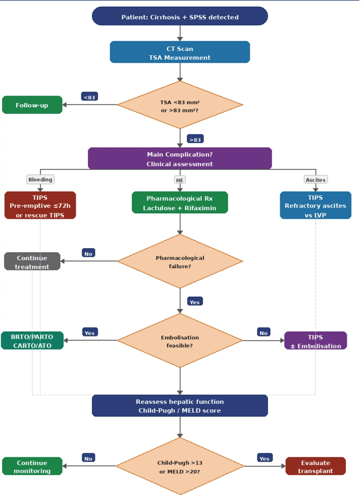

- Câu hỏi: SPSS lớn liên quan thế nào đến rối loạn TIPS, và hướng xử trí trên sơ đồ?

<b>Bấm để hiện đáp án (findings + chẩn đoán)</b>

- **Dấu hiệu (findings):** sơ đồ/ thuật toán cho bệnh nhân xơ gan có **SPSS lớn**, có nhánh **TIPS** và **TSA (tổng diện tích shunt)**.
- **Chẩn đoán/ý nghĩa:** **SPSS tồn tại song song làm GIẢM rối loạn TIPS** (HR 0,319) nhưng là yếu tố của **HE**; **thuyên tắc SPSS** được cân nhắc để giảm HE (PMC8894460, PMC13645364).
- Nguồn ảnh: Ntalaoutis A, Troupis T et al., *Cureus*, PMC13645364 (Fig. 3), CC BY 4.0.

**Ca 9 — Hình học stent trên chụp mạch 2D: đuôi cranial cách IVC bao xa?**

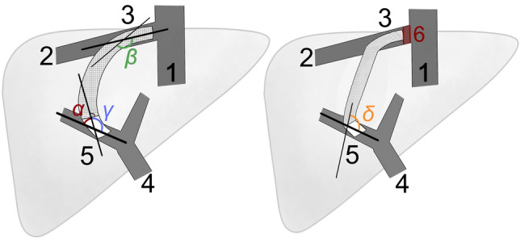

- Câu hỏi: Thông số hình học nào dự báo độc lập rối loạn TIPS? Ngưỡng khoảng cách?

<b>Bấm để hiện đáp án (findings + chẩn đoán)</b>

- **Dấu hiệu (findings):** sơ đồ đo các **góc/góc uốn** và **vị trí đuôi cranial stent** (1: IVC; 2: tĩnh mạch gan; 3: đuôi cranial; 4: tĩnh mạch cửa; 5: đuôi xa).
- **Chẩn đoán/ý nghĩa:** **vị trí đuôi cranial** dự báo độc lập rối loạn TIPS (**HR 2,300**); khuyến nghị **khoảng cách đuôi cranial–IVC < 1 cm** trên chụp mạch 2D (PMC8894460).
- Nguồn ảnh: Meyer C, Paar Pérez AM et al., *Sci Rep* 2022, PMC8894460 (Fig. 2), CC BY 4.0.

**Ca 10 — Hẹp đầu gan: chụp mạch trước và sau khi nối dài cranial.**

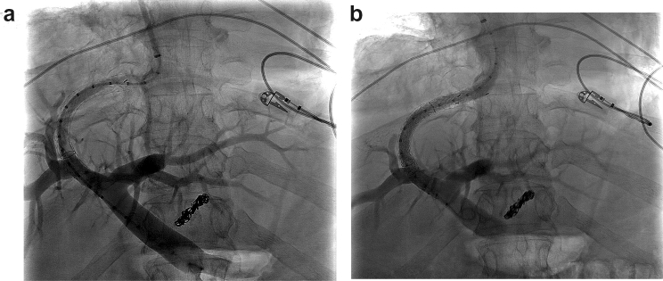

- Câu hỏi: Mô tả thay đổi trước–sau; vì sao nối dài cranial lại giải quyết hẹp type 1?

<b>Bấm để hiện đáp án (findings + chẩn đoán)</b>

- **Dấu hiệu (findings):** (a) DSA trước nong: **hẹp ở đầu cranial stent**; (b) sau **nong thành công + nối dài cranial**: lòng thông rộng ra.
- **Chẩn đoán (diagnosis):** **rối loạn TIPS do hẹp đầu gan** — nối dài cranial đưa đuôi stent về gần IVC → **PPG giảm**.
- **Xử trí bổ sung:** có thể dùng **stent tĩnh mạch chuyên dụng**: nối dài **11,25 ± 2,2 mm**, giảm PPG **8,5 ± 2,1 mmHg** (PMC13099945).
- Nguồn ảnh: Meyer C, Paar Pérez AM et al., *Sci Rep* 2022, PMC8894460 (Fig. 3), CC BY 4.0.

**Ca 11 — Nối dài cranial bằng stent tĩnh mạch chuyên dụng (khi hẹp tái phát).**

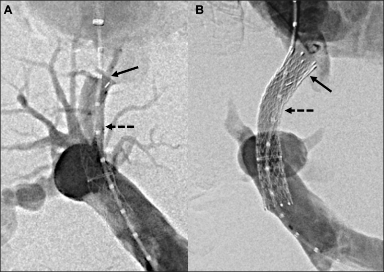

- Gợi ý: báng bụng kháng trị tái phát 149 ngày sau TIPS.
- Câu hỏi: Vì sao phải nối dài về phía IVC, và dùng stent gì?

<b>Bấm để hiện đáp án (findings + chẩn đoán)</b>

- **Dấu hiệu (findings):** chụp mạch TIPS + đặt **stent tĩnh mạch chuyên dụng (Venovo/Abre)** nối dài shunt về phía **IVC**.
- **Chẩn đoán (diagnosis):** **rối loạn TIPS do tắc nghẽn dòng ra ở đầu tĩnh mạch gan** — do **stent không phủ đủ cranial**.
- **Xử trí:** nối dài cranial **11,25 ± 2,2 mm**, giảm PPG **8,5 ± 2,1 mmHg**, không biến chứng (PMC13099945).
- Nguồn ảnh: Cyphers ED, Chau SS et al., *J Vasc Surg Cases Innov Tech* 2026, PMC13099945 (Fig. 2), CC BY-NC-ND 4.0 (giữ nguyên bản).

## Bài liên quan chéo
- [100 – Tổng quan hệ Bụng](../100-tong-quan-he-bung/lesson.md)
- [124 – Bệnh mạch máu gan: Budd-Chiari, SOS/VOD & huyết khối tĩnh mạch cửa](../124-benh-mach-mau-gan/lesson.md)
- [125 – Gan mỡ & xơ hóa gan](../125-gan-mo-xo/lesson.md)
- [126 – Đo thể tích gan & điều trị nội khoa PLD](../126-the-tich-gan-dieu-tri-noi-khoa-PLD/lesson.md)
- [127 – Gan tim (cardiac hepatopathy) & tăng áp cửa trước xoang](../127-gan-tim-suy-tim-phai/lesson.md)
- [135 – Viêm tụy cấp (Atlanta)](../135-viem-tuy-Atlanta/lesson.md)
- [140 – Lách & chấn thương tạng đặc](../140-lach-tang-dac/lesson.md)
- [163 – Pylephlebitis & huyết khối tĩnh mạch mạc treo](../163-pylephlebitis-huyet-khoi-tm-mac-treo/lesson.md)
- [175 – Chèn ép mạch & nút mạch](../175-chen-ep-mach/lesson.md)
- [910 – Dẫn lưu (áp-xe, PTBD & thận qua da)](../910-abscess-biliary-nephrostomy/lesson.md)
- [930 – TACE/LR-TR (can thiệp u gan)](../930-hepatic-oncology-tace-rfa/lesson.md)

## Ảnh
- Tên file: `176_slug_Modality_SourceID.jpg`. Nguồn + giấy phép (license) từng ảnh trong `images/CREDITS.md`.
- Ảnh **CC BY 4.0** được phép ghép letterbox (composite); ảnh **CC BY-NC 4.0 / CC BY-NC-ND 4.0** giữ **nguyên bản**, không crop/không ghép.
- AuntMinnie (Case of the Day): **chỉ dẫn link, không tải**.

> Không dùng để chẩn đoán độc lập khi chưa có người hướng dẫn.
