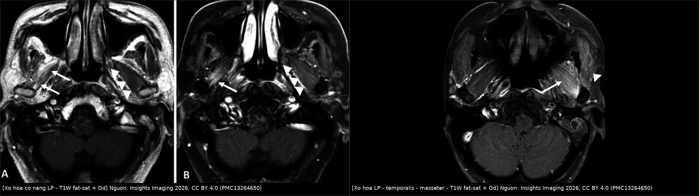
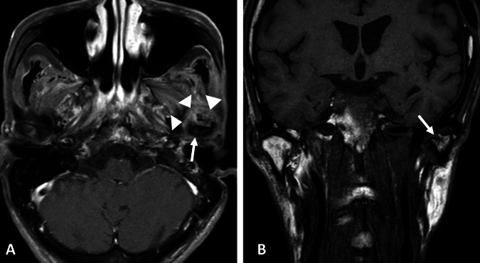
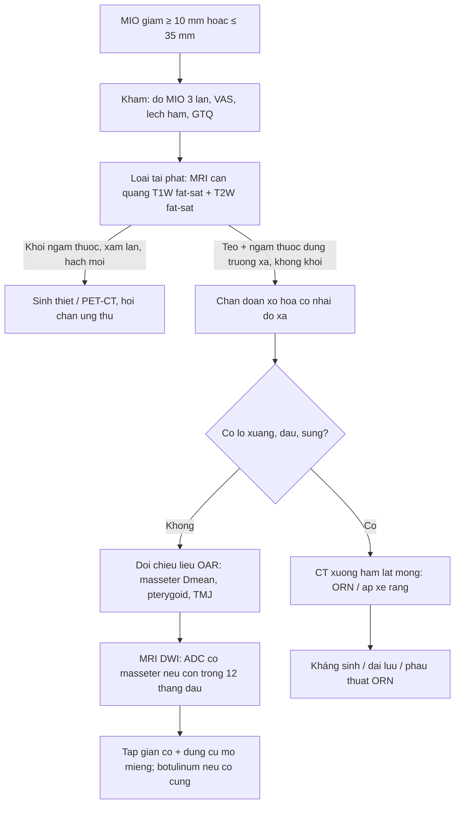
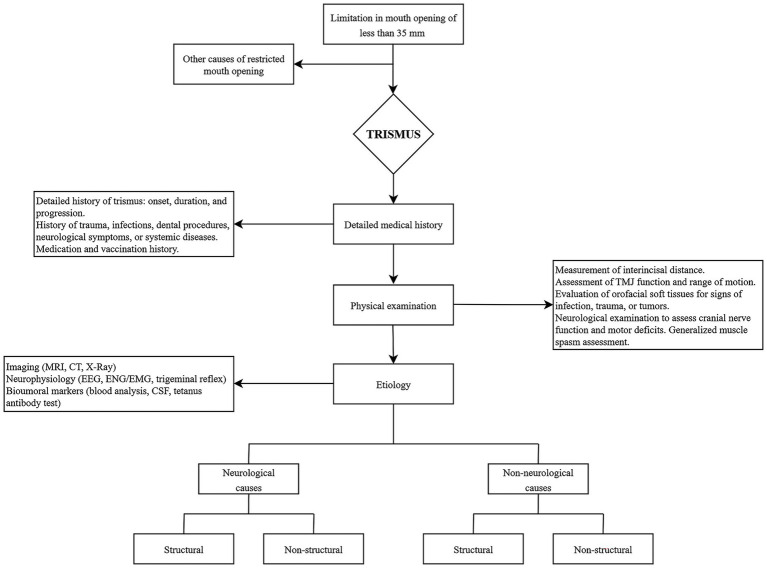
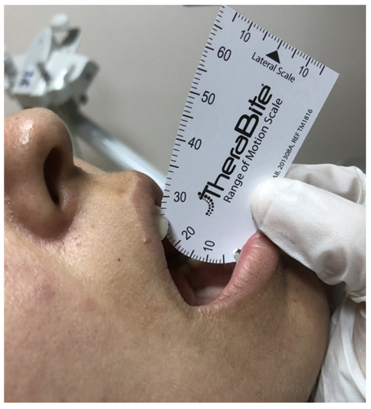
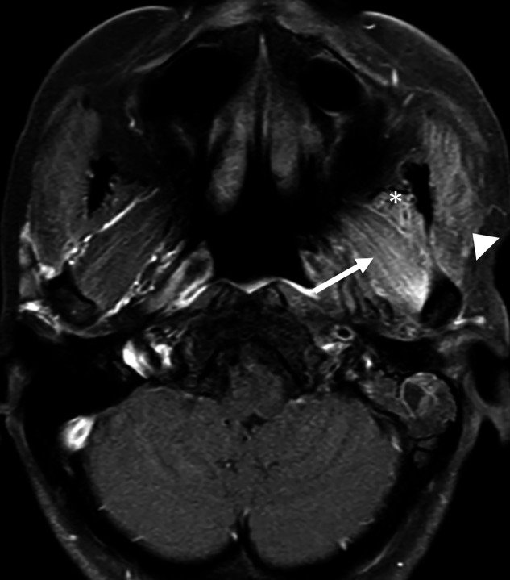
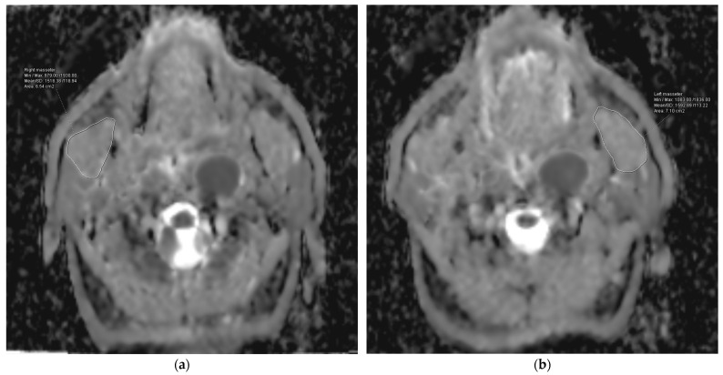

# 1761 — Trismus sau xạ trị đầu cổ / Radiation-induced trismus (RIT)

**Tags:** `pattern:trismus` `pattern:xo-hoa` `pattern:teo-co` `vung:dau-co` `vung:ham-mat` `vung:khop-thai-duong-ham` `protocol:MRI` `protocol:lieu-OAR` `score:GTQ` `score:RTOG` `incidentaloma:khong`

**Mức chắc chắn (certainty):** tổng hợp y văn (literature synthesis) — 1 tổng quan hệ thống hình ảnh 11 nghiên cứu/282 bệnh nhân (*Insights Imaging* 2026, PMC13264650, CC BY 4.0), 1 đoàn hệ 77 bệnh nhân ung thư vòm họng (NPC) với **ADC cơ masseter** và **liều cơ masseter** (*Diagnostics* 2024, PMC11505873, CC BY 4.0), 1 phân tích liều–đáp ứng 60 bệnh nhân VMAT (*Technol Cancer Res Treat* 2025, PMC12576174, CC BY-NC), 1 tổng quan điều trị (*Front Neurol* 2026, PMC13053315, CC BY 4.0), 1 meta-analysis hóa–xạ (*J Clin Exp Dent* 2024, PMC11078508, CC BY 2.5), 2 RCT tập cơ hàm (PMC11635747, PMC13038768), 1 meta 21 RCT phục hồi chức năng (PMC13609679) và 1 tổng quan cơ chế xơ hóa do xạ (PMC12731690). **Không có ca nguyên văn của nhóm** — 3 ca trong quiz là **ca dựng từ ảnh + số liệu công bố**, ghi rõ nguồn từng ảnh.

> **Câu chốt:** trismus sau xạ **không phải "cứng hàm do già"** mà là **xơ hóa cơ nhai do xạ (radiation-induced fibrosis, RIF)**. Ba con số phải thuộc: ngưỡng chẩn đoán **MIO ≤ 35 mm** (bình thường **40–60 mm**); tỉ lệ gặp **tới 60%** sau xạ đầu cổ (**44,7%** trong đoàn hệ có chụp hình), và **thêm hóa trị làm tăng nguy cơ gấp 2,55 lần** (OR 2,55; 95% CI 1,53–4,23); **liều trung bình cơ masseter ≥ 37,5 Gy** làm nguy cơ **45,7% so với 11,9%** (HR 4,89) — nên **giảm liều cơ nhai ngay từ kế hoạch**, và **tập cơ hàm dự phòng không chứng minh được lợi ích** (chênh **+2,85 mm**, khoảng tin cậy sau hiệu chỉnh mẫu nhỏ **vắt qua 0**).

## 1. Tổng quan bệnh học – cơ chế hình ảnh

### 1.1 TẠI SAO cơ nhai bị xơ hóa: chuỗi RIF

- **Định nghĩa lâm sàng:** trismus = **giảm khả năng mở miệng chủ động tối đa**, đo bằng **MIO (maximal interincisal opening)** — khoảng cách giữa **bờ răng cửa trên và dưới** khi bệnh nhân mở hết sức. Ngưỡng dùng trong hầu hết nghiên cứu xạ trị: **≤ 35 mm** (Dijkstra; áp dụng ở PMC13038768, PMC13264650); người bình thường **40–60 mm** (PMC13053315), một số tài liệu ghi **36–55 mm** (PMC11078508). **Tranh cãi:** một số nhóm dùng **≤ 40 mm**, nên **luôn ghi ngưỡng đã dùng** khi so sánh tỉ lệ giữa các bài.
- **Cơ chế (vì sao hình ảnh lại như vậy):** xạ → **mất mao mạch + thiếu oxy mô** → **nguyên bào sợi biệt hóa thành nguyên bào cơ (myofibroblast)** → tăng tổng hợp **collagen I/III** và **ức chế men phân hủy collagen (MMP)** → **mô xơ co rút, cơ mất đàn hồi và ngắn lại**. Đồng thời có **tổn thương thần kinh V3 (nhánh vận động)** và **xơ hóa bao khớp** → giảm cả biên độ lẫn lực mở miệng. RIF gặp ở **tới 50%** bệnh nhân ung thư đầu cổ sau xạ; **xơ hóa độ 2–3 theo RTOG ở 30–50%** (PMC12731690).
- **Trên hình ảnh:** cơ trong trường xạ **teo nhỏ, mất mặt phẳng mỡ, tăng tín hiệu T2 (phù/xơ) và ngấm thuốc T1 sau tiêm** so với bên đối diện; muộn hơn là **thay mỡ (T1 sáng, T2 sáng, mất tín hiệu trên fat-sat)**. Bao khớp và đĩa khớp có thể **dày, dính, mất tín hiệu**, lồi cầu **bào mòn, xẹp, xơ hóa**. Thời điểm **sớm nhất ghi nhận được thay đổi tín hiệu cơ trên MRI: 5 tháng sau xạ**; trong tổng quan 282 ca, thời gian chụp **trung vị 6,7 năm (5 tháng – 22 năm)** (PMC13264650).
- **Điều quan trọng cho bác sĩ CĐHA:** trismus là **chẩn đoán lâm sàng (đo mm)**; hình ảnh **không chẩn đoán thay** mà trả lời 2 câu: **(1) có tái phát u xâm lấn khoang nhai không? (2) cơ nào bị xơ hóa/teo và mức độ bao nhiêu** để chọn nơi tiêm botulinum hoặc mổ.

### 1.2 Số liệu định lượng phải thuộc

| Đại lượng | Con số | Nguồn |
|---|---|---|
| Ngưỡng trismus (MIO) | **≤ 35 mm**; bình thường **40–60 mm** | PMC13264650 / PMC13053315 |
| Tỉ lệ trismus sau xạ đầu cổ | **tới 60%**; **44,7% (126/282)** trong đoàn hệ có chụp hình | PMC13264650 |
| Theo kỹ thuật xạ (cùng tổng quan) | xạ quy ước **37,5%** · IMRT **40,6%** · không ghi rõ **54,5%** | PMC13264650 |
| Trismus tồn tại **2 năm** sau hóa–xạ | **~30%** (nuốt khó cùng thời điểm **40–70%**) | PMC11635747 |
| Thêm hóa trị vào xạ | **OR 2,55 (1,53–4,23), p = 0,0003**, I² = 59% (1.474 vs 858 bệnh nhân) | PMC11078508 |
| RIF ở ung thư đầu cổ | **tới 50%**; xơ hóa RTOG độ 2–3 **30–50%** | PMC12731690 |
| Liều trung bình **cơ masseter ≥ 37,5 Gy** | trismus **45,71% vs 11,90%**; **HR 4,89 (2,66–7,93)** | PMC11505873 |
| **ADC trung bình cơ masseter trước hóa–xạ > 1.381,30 × 10⁻⁶ mm²/s** | trismus **71,42% vs 6,12%**; **HR 11,17 (5,63–18,76)**; AUC **94,0%**, Se **87,0%**, Sp **85,2%** | PMC11505873 |
| T3–4 / 2–3 chu kỳ hóa đồng thời | **HR 1,84 (1,26–3,18)** / **HR 1,67 (1,21–2,06)** | PMC11505873 |
| Ngưỡng liều đề xuất cho cơ **mở** hàm (VMAT, n = 60) | **cơ nhị thân Dmean ≤ 26 Gy** (AUC 0,70), **cơ hàm–móng ≤ 28 Gy** (AUC 0,60) | PMC12576174 |
| Tập cơ hàm **dự phòng** (RCT 89 bệnh nhân) | **không khác biệt**: MIO ≤ 35 mm ở 6 tháng **5,6% vs 18,4%** (p = 0,15), 12 tháng **7% vs 3%** | PMC13038768 |
| Meta 21 RCT phục hồi chức năng | chênh MIO **+2,85 mm (0,38–5,32)** nhưng **hiệu chỉnh Hartung–Knapp: −2,58 đến 8,27**; trismus **RR 0,87 (0,53–1,42)** | PMC13609679 |
| Thay đổi hình ảnh sớm nhất | **5 tháng** sau xạ (MRI tín hiệu cơ) | PMC13264650 |

- **Đọc con số cho đúng:** "44,7%" đến từ **đoàn hệ hồi cứu có chỉ định chụp hình** (chủ yếu NPC giai đoạn muộn, 63,5% u vòm) → **thiên lệch chọn mẫu**, không dùng để nói "một nửa bệnh nhân xạ đầu cổ bị trismus". Con số thực hành đúng hơn: **~30% ở 2 năm** sau hóa–xạ (PMC11635747) và **tới 60%** ở nhóm nguy cơ cao (u vòm/hầu họng, T3–4, hóa trị đồng thời).
- **Phản biện (cửa 3):** nghiên cứu liều–đáp ứng PMC12576174 chỉ có **60 bệnh nhân, 1 trung tâm, theo dõi 1 năm**, và hệ số hồi quy của **cơ nhị thân âm** (liều tăng → nguy cơ giảm) — **nghịch lý sinh học**, dấu hiệu **nhiễu do tương quan liều giữa các cơ**; do đó **ngưỡng 26 Gy/28 Gy là giả thuyết**, chưa phải hằng số. Ngược lại, ngưỡng **masseter ≥ 37,5 Gy** có HR rõ và **phù hợp sinh lý** (cơ đóng hàm bị xơ → hạn chế mở), nên dùng làm **mốc ưu tiên giảm liều**.

## 2. Mẫu hình + chẩn đoán phân biệt theo vị trí (gamut)

- **Theo cơ/cấu trúc bị tổn thương:**
  - **Cơ masseter** — hạn chế **mở** nhiều nhất, sờ thấy **dải cứng, đau khi há**, teo rõ trên MRI/CT; đây là cơ được khuyến cáo giảm liều đầu tiên.
  - **Cơ pterygoid trong (medial)** — hạn chế **mở + lệch hàm sang bên đối diện**; nằm sát **khoang cạnh hầu** nên dễ bị liều cao ở u vòm.
  - **Cơ pterygoid ngoài (lateral)** — hạn chế **há + đưa hàm ra trước/lệch bên**; trên MRI thấy **ngấm thuốc lan tỏa + teo** (ảnh mục 3).
  - **Cơ temporalis** — hạn chế **mở cuối biên độ**, đau vùng thái dương; **teo một bên** rất dễ thấy trên T1W.
  - **Khớp thái dương hàm (TMJ)** — lồi cầu **bào mòn, xẹp, xơ hóa**, đĩa khớp dày/dính; hạn chế cả **há và chuyển động sang bên**.
  - **Thần kinh V3** — teo cơ nhai **một bên đối xứng theo phân bố thần kinh**, không có khối, không đau nhiều.
  - **Xương hàm dưới** — **hoại tử xương do xạ (ORN)** gây đau, sưng, **lộ xương**, có thể kèm trismus do viêm mô quanh.
- **Theo thời gian (giúp phân biệt cơ chế):**
  - **< 3 tháng:** **viêm niêm mạc + phù** → hạn chế mở do **đau**, hồi phục; **không gọi là trismus do xơ hóa**.
  - **3–12 tháng:** xơ hóa bắt đầu; MRI đã thấy **tăng tín hiệu T2/ngấm thuốc** (sớm nhất 5 tháng).
  - **1–5 năm:** **tiến triển chậm**, đây là giai đoạn can thiệp tập/giãn có ý nghĩa nhất.
  - **> 5 năm:** **teo cơ + thay mỡ + biến dạng lồi cầu**, đáp ứng điều trị kém.
- **Gợi nhớ FIBROSIS** (nguyên nhân hạn chế mở miệng ở bệnh nhân đã xạ đầu cổ): **F**ibrosis (RIF) · **I**nfiltration (tái phát u khoang nhai) · **B**one (ORN/xẹp lồi cầu) · **R**adicular (tổn thương V3) · **O**ther (áp-xe răng, TMD, tetanus, loạn trương lực) · **S**kin/scar (sẹo bỏng, vạt xơ, xơ cổ) · **I**nterincisal error (đo sai) · **S**ystemic (xơ cứng bì, bệnh cơ viêm).

## 3. Bảng so sánh phân biệt (ma trận đối chiếu)

| Thực thể (entity) | Hình ảnh / lâm sàng điển hình | Chốt vào (rule-in) | Chốt loại (rule-out) | Gợi ý xác nhận |
|---|---|---|---|---|
| **Xơ hóa cơ nhai do xạ (RIF)** | Cơ **teo + tăng T2 + ngấm thuốc đối xứng trong trường xạ**; MIO giảm **từ từ theo tháng–năm** | **Đúng trường xạ + teo/ngấm thuốc cơ không có khối + MIO giảm đều** | Có **khối choán chỗ, xâm lấn, hạch mới** → không phải RIF đơn thuần | MRI T1W fat-sat + T2W fat-sat sau tiêm; so **bên đối diện** |
| **Tái phát u xâm lấn khoang nhai** | **Khối ngấm thuốc không đều, phá vỡ mặt phẳng mỡ, xâm lấn cơ/xương**, hạch hoại tử | **Khối + bất đối xứng tiến triển + đau tăng nhanh** | Teo đều, không khối, ổn định ≥ 12 tháng → nghi RIF | MRI ± PET/CT; **sinh thiết** khi còn nghi |
| **ORN xương hàm dưới / lồi cầu** | **Lộ xương, tiêu xương, mảnh xương chết, khí trong mô mềm**, dày màng xương | **Lộ xương > 3 tháng + đau + hình ảnh tiêu xương** | Xương liên tục, không lộ xương → loại | CT xương hàm lát mỏng; khám miệng |
| **Áp-xe răng / nhiễm trùng khoang nhai** | **Sưng nóng đỏ, đau dữ dội, sốt**; CT có **ổ dịch viền ngấm thuốc**, khí | **Sốt + sưng cấp + ổ dịch** | Không sốt, không ổ dịch, diễn tiến tháng → loại | CT cản quang; khám răng; CRP/bạch cầu |
| **Rối loạn khớp thái dương hàm (TMD) / thoái hóa** | **Lồi cầu bào mòn, hẹp khe khớp, xơ hóa**, lệch đĩa; **click, đau khớp** | **Đau khớp + tiếng click + hẹp khe khớp** | Cơ teo lan tỏa không đau khớp → nghi RIF | MRI TMJ (đĩa, dịch khớp), OPG |
| **Tổn thương thần kinh V3 do xạ** | **Teo toàn bộ nhóm cơ nhai một bên** theo phân bố V3, **không khối**, có thể kèm **tê vùng V3** | **Teo đúng phân bố V3 + không khối + tê mặt** | Teo khu trú trong trường xạ → RIF | MRI nền sọ (lỗ bầu dục), khám thần kinh |
| **Sẹo/vạt xơ vùng mặt–cổ** | **Dải xơ da–dưới da co kéo**, hạn chế mở do **cơ ngoài khớp**; tiền sử bỏng/mổ/vạt | **Co kéo da rõ + hạn chế không tương xứng tổn thương cơ** | Da mềm, cơ teo là chính → RIF | Khám lâm sàng; MRI mô mềm |
| **Nguyên nhân ngoài xạ (tetanus, loạn trương lực, xơ cứng bì)** | **Co cứng toàn thân/khu trú, không có tiền sử xạ vùng hàm**; hình ảnh cơ bình thường | **Co cứng cấp + không tiền sử xạ + hình ảnh âm** | Có tiền sử xạ + teo cơ trên MRI → RIF | Lâm sàng, EMG, xét nghiệm tự miễn |

*Trái: NPC xạ 4 năm — **cơ pterygoid ngoài phải** ngấm thuốc lan tỏa và **nhỏ hơn bên đối diện** (mũi tên), gợi ý teo–xơ. Phải: u cơ biểu mô tuyến mang tai xạ 1 năm — hiệu ứng xạ ở **pterygoid ngoài (mũi tên), temporalis (dấu sao), masseter (đầu mũi tên)** so với bên lành. Nguồn: *Insights Imaging* 2026, CC BY 4.0 (PMC13264650); ảnh ghép letterbox.*

### Ba dấu hiệu cần đọc đúng trên MRI sau xạ

- **Mất cân xứng cơ là bình thường trong trường xạ:** cơ **bên xạ luôn nhỏ hơn và ngấm thuốc hơn** bên đối diện; **đừng** gọi là "khối" nếu không có **hiệu ứng choán chỗ** và **bờ không đều tiến triển**.
- **Ngấm thuốc muộn kéo dài nhiều năm:** trong tổng quan 282 ca, hình ảnh được chụp **trung vị 6,7 năm** sau xạ vẫn còn **tín hiệu bất thường ở 43 bệnh nhân**, **teo 20**, **phì đại 20** (PMC13264650) — nên **ngấm thuốc đơn thuần không đồng nghĩa tái phát**.
- **Lồi cầu:** **bào mòn 11 ca, bờ không đều 12 ca, xơ hóa 6 ca**; **không** nghiên cứu nào mô tả **ORN trực tiếp của TMJ** — nếu thấy tiêu xương lồi cầu rõ, phải **nghĩ ORN hoặc u**, không quy cho "di chứng xạ".

*NPC xạ **hơn 20 năm**: mô mềm kiểu tổ chức quanh lồi cầu hàm dưới trái dày lên (đầu mũi tên), bờ lồi cầu không đều và **lồi cầu trái nhỏ hơn bên đối diện** — di chứng viêm–xơ hóa muộn, **không phải khối u**. Nguồn: *Insights Imaging* 2026, CC BY 4.0 (PMC13264650).

## 4. Protocol chụp/đánh giá + ngưỡng liều

### 4.1 Đo MIO — chuẩn hóa để không đọc sai

- **Dụng cụ:** thước cứng hoặc **thang đo TheraBite** (ảnh quiz ca 1), bệnh nhân **ngồi thẳng**, đo **3 lần** lấy trị số lớn nhất, ghi **mm**.
- **Mốc đo:** **bờ răng cửa trên → bờ răng cửa dưới** (không đo từ lợi, không đo qua khe hở răng).
- **Ghi kèm:** **MIO nền trước xạ** (bắt buộc — vì "35 mm" là ngưỡng tuyệt đối, còn **sụt ≥ 10 mm so với nền** là tín hiệu sớm hơn), **đau khi há (VAS)**, **lệch đường giữa khi há**, **bảng hỏi Gothenburg Trismus Questionnaire (GTQ-S)**, **EORTC QLQ-H&N35**.
- **Lịch đo:** **nền trước xạ → cuối xạ → 1, 3, 6, 12 tháng → hằng năm** (theo PMC13038768). Nếu **MIO giảm ≥ 10 mm** hoặc **≤ 35 mm** ở bất kỳ mốc nào → **chụp hình + can thiệp sớm**, không chờ mốc kế tiếp.

### 4.2 Lập kế hoạch xạ — dự phòng bằng liều (phần quan trọng nhất)

- **OAR bắt buộc ghi Dmean/Dmax:** **masseter, pterygoid trong, pterygoid ngoài, temporalis, cơ nhị thân, cơ hàm–móng, TMJ (lồi cầu + bao khớp)**.
- **Ngưỡng có bằng chứng:** **masseter Dmean < 37,5 Gy** (trên ngưỡng này trismus **45,7% vs 11,9%**, HR 4,89 — PMC11505873). Đây là **mốc ưu tiên số 1** vì cơ đóng hàm bị xơ chính là cơ chế hạn chế mở.
- **Ngưỡng đề xuất (còn yếu):** **cơ nhị thân Dmean ≤ 26 Gy**, **cơ hàm–móng ≤ 28 Gy** (PMC12576174, n = 60, AUC 0,70/0,60) — dùng khi còn dư liều, **không đánh đổi độ phủ PTV**.
- **Chưa có ngưỡng đồng thuận cho pterygoid và TMJ** trong các nguồn đã đọc → ghi rõ "chưa rõ — cần tra" trong báo cáo kế hoạch, không bịa số.
- **Giảm liều không đủ nếu bệnh nhân có hóa trị:** thêm hóa trị làm **OR 2,55**, và **2–3 chu kỳ đồng thời HR 1,67** → nhóm này cần **theo dõi MIO sát hơn** (3 tháng/lần trong năm đầu).

### 4.3 Chẩn đoán hình ảnh khi MIO giảm

*Thuật toán tiếp cận trismus của PMC13053315: khởi đầu bằng **đo MIO < 35 mm**, rồi phân nhánh theo vị trí đau, khối, khớp và nguyên nhân ngoài cơ — dùng như khung hỏi bệnh, không thay thế hình ảnh. Nguồn: *Frontiers in Neurology* 2026, CC BY 4.0 (PMC13053315).*

- **MRI là phương thức chính** (7/11 nghiên cứu trong tổng quan dùng MRI — PMC13264650): **T1W không fat-sat** (teo, thay mỡ), **T1W fat-sat sau tiêm** (ngấm thuốc cơ/bao khớp), **T2W fat-sat** (phù/xơ), **DWI** (ADC cơ masseter).
- **ADC cơ masseter trước hóa–xạ** có giá trị **dự báo** (AUC **94,0%**, ngưỡng **1.381,30 × 10⁻⁶ mm²/s**, HR **11,17** — PMC11505873): dùng khi **đã có MRI trước xạ** (nhiều trung tâm chụp mô phỏng bằng MRI) để **phân tầng theo dõi**, chưa đủ để thay đổi chỉ định điều trị.
- **CT** khi nghi **ORN/áp-xe/nhiễm trùng** (xương, khí trong mô mềm); **PET/CT** khi nghi **tái phát** nhưng MRI không kết luận.
- **Siêu âm** có thể đo **độ dày cơ masseter** và đánh giá **độ cứng** (elastography) — trong tổng quan chỉ 1 nghiên cứu dùng, **chưa đủ chuẩn hóa**.

### 4.4 Điều trị — điều gì có bằng chứng, điều gì không

- **Tập cơ hàm dự phòng (trong và ngay sau xạ):** **không chứng minh lợi ích** — RCT 89 bệnh nhân: MIO ≤ 35 mm ở 6 tháng **5,6% vs 18,4%** (p = 0,15), 12 tháng **7% vs 3%**; tuân thủ **62%** (PMC13038768); RCT trước đó (89 bệnh nhân, đánh giá 1 tháng sau xạ) cũng **âm** (PMC11635747). Meta 21 RCT: **+2,85 mm** nhưng **khoảng tin cậy hiệu chỉnh mẫu nhỏ vắt qua 0**, trismus **RR 0,87 (0,53–1,42)** (PMC13609679).
- **Trismus đã hình thành:** **giãn thụ động + dụng cụ mở miệng (TheraBite/Restorabite)** là trụ cột; hiệu quả **lớn hơn ở trismus đã có** so với dự phòng. **Duy trì tập sau khi đạt biên độ là yếu tố quyết định** — ngừng tập là nguyên nhân tái co hàng đầu.
- **Botulinum toxin A** vào **cơ masseter/pterygoid** khi có **co cứng/đau** (dùng như giãn cơ giảm đau, không phải "chữa xơ hóa") — PMC12731690 xếp BTA vào nhóm điều trị triệu chứng.
- **Pentoxifylline + vitamin E (PENTOX):** giảm **diện tích xơ hóa**, nhưng **chưa loại bỏ hoàn toàn** xơ hóa (PMC12731690); bằng chứng mạnh nhất ở xơ hóa da/mô mềm, **không có RCT riêng cho trismus**.
- **Ngoại khoa (coronoidectomy, myotomy, cắt xơ, thay khớp)** chỉ khi **thất bại nội khoa ≥ 6 tháng** và **đã loại tái phát**; **phục hồi chức năng sau mổ là bắt buộc**, nếu không sẽ tái co.
- **Đường thở:** trismus nặng là **yếu tố làm khó đặt nội khí quản** (nguy cơ trong cấp cứu) — phải ghi vào hồ sơ và **chuẩn bị ống nhỏ/ống soi mềm** trước mọi thủ thuật cần gây mê.

## 5. Biến thể bình thường và cạm bẫy

- **Đo MIO sai:** đo **khi bệnh nhân chưa mở hết sức vì đau**, đo **từ lợi** thay vì bờ răng, hoặc dùng **thước dây mềm** → sai 3–5 mm, đủ để **bỏ sót** hoặc **chẩn đoán oan** trismus. Luôn đo **3 lần, cùng một người, cùng một dụng cụ**.
- **Chỉ dùng ngưỡng 35 mm mà bỏ mất xu hướng:** bệnh nhân từ **48 mm xuống 37 mm** là **mất 11 mm** dù chưa "trismus" — đây là **thời điểm vàng để can thiệp**; ngược lại người **nền 36 mm** bị gọi trismus oan.
- **Gọi trismus ở 1–3 tháng sau xạ:** giai đoạn này là **viêm niêm mạc + phù + đau**, hồi phục; chẩn đoán xơ hóa sớm dẫn tới **điều trị quá mức** và bỏ qua **kiểm soát đau/viêm**.
- **Bỏ sót tái phát vì "đã biết là di chứng xạ":** dấu hiệu cảnh báo **khối choán chỗ, xâm lấn mặt phẳng mỡ, hạch mới, đau tăng nhanh, MIO giảm nhanh trong vài tuần**. **Teo đơn thuần tiến triển chậm qua năm** mới là RIF.
- **Quy mọi ngấm thuốc cơ cho tái phát:** ngấm thuốc sau xạ **tồn tại nhiều năm** (trung vị chụp 6,7 năm vẫn bất thường — PMC13264650); thiếu **khối và hiệu ứng choán chỗ** thì **không sinh thiết mù**.
- **Bỏ sót ORN khi chỉ nhìn mô mềm:** **lộ xương, đau, sưng, khí trong mô mềm** trên CT là chốt; MRI một mình dễ bỏ sót mảnh xương chết.
- **Bỏ sót sặc/nuốt khó đi kèm:** trismus và **nuốt khó muộn** cùng trường xạ, cùng cơ chế xơ hóa; bệnh nhân không mở miệng được cũng **không vệ sinh răng được** → **sâu răng, ORN, viêm phổi hít sặc**. Hỏi và đánh giá nuốt (bài 1684) ở **mọi** ca trismus.
- **Hứa "tập là khỏi":** bằng chứng dự phòng **âm** (PMC13038768, PMC11635747); hãy nói rõ **tập duy trì biên độ**, không phải **ngăn xơ hóa**.
- **Cạm bẫy mặt cắt:** trên lát **axial**, **cơ pterygoid ngoài bên xạ nhỏ hơn** là bình thường; nhưng nếu **mất hoàn toàn mặt phẳng mỡ cạnh hầu** và **bờ sau xâm lấn vào khoang cạnh hầu** → nghi **u**, không phải teo. Trên **coronal**, **lệch lồi cầu** do mất cân bằng cơ **không đồng nghĩa** trật khớp.

## 6. Tự lượng giá — Blind Quiz

**Ca 1 — Nam 58 tuổi, ung thư hầu họng T3N2, hóa–xạ 14 tháng trước; ăn cơm phải cắt nhỏ, không đánh răng được hàm trong, há miệng thấy căng đau.**

- Hỏi: trị số trên hình là bao nhiêu? Ngưỡng chẩn đoán? Hai hậu quả sớm cần phòng? Bước tiếp theo?

<b>Bấm để hiện đáp án (findings + chẩn đoán)</b>

- **Findings:** thang đo TheraBite đặt giữa hai bờ răng cửa, đầu 0 ở bờ răng dưới; trị số đọc được **26 mm** → **MIO 26 mm ≤ 35 mm** = **trismus** (bình thường 40–60 mm).
- **Chẩn đoán:** **trismus sau xạ (RIT)** — xơ hóa cơ nhai (masseter/pterygoid) ± xơ bao khớp; đây là ca **điển hình** của PMC11505873 (MIO 26 mm ở lần khám theo dõi).
- **Hai hậu quả sớm:** (1) **không vệ sinh răng hàm trong** → sâu răng, viêm quanh răng, **tăng nguy cơ ORN**; (2) **suy dinh dưỡng** do ăn hạn chế. Thêm: **khó đặt nội khí quản** khi cấp cứu.
- **Bước tiếp theo:** MRI **T1W fat-sat sau tiêm + T2W fat-sat** để (a) loại **tái phát khoang nhai**, (b) xác định **cơ nào xơ hóa**; đo **MIO nền** (nếu có) để tính mức sụt; **khởi động giãn thụ động + dụng cụ mở miệng**, đánh giá nuốt (bài 1684), khám răng.
- Nguồn ảnh: Pehlivan UA et al., *Diagnostics* 2024, CC BY 4.0 (PMC11505873).

**Ca 2 — Nữ 47 tuổi, NPC xạ 4 năm trước, há miệng 30 mm, không đau, không sờ thấy khối; MRI axial T1W fat-sat sau tiêm.**

- Hỏi: mô tả tổn thương? Chốt vào/chốt loại tái phát dựa vào đâu? Có cần sinh thiết?

<b>Bấm để hiện đáp án</b>

- **Findings:** **cơ pterygoid ngoài phải ngấm thuốc lan tỏa, nhỏ hơn bên đối diện** (mũi tên), **không có khối choán chỗ**, **mặt phẳng mỡ cạnh hầu còn**, **không hạch hoại tử**. (Ảnh gốc: NPC xạ **4 năm**, Fig. 4 của PMC13264650.)
- **Chẩn đoán:** **xơ hóa–teo cơ nhai do xạ (RIF)**; MIO 30 mm phù hợp.
- **Chốt vào:** **teo + ngấm thuốc đúng trường xạ, đối xứng với bên lành theo kiểu "mờ dần", không hiệu ứng choán chỗ**. **Chốt loại tái phát:** không khối, không xâm lấn mặt phẳng mỡ, không hạch mới, lâm sàng **không đau tăng nhanh**.
- **Sinh thiết:** **không** — sinh thiết mù trong mô xạ hỏng gây **loét không lành, ORN**. Theo dõi MRI **6–12 tháng** nếu còn nghi; chỉ sinh thiết khi có **khối/bất đối xứng tiến triển**.
- Nguồn ảnh: Nalley A et al., *Insights Imaging* 2026, CC BY 4.0 (PMC13264650).

**Ca 3 — Nam 62 tuổi, NPC T4, đang lập kế hoạch VMAT; MRI trước xạ có ADC trung bình cơ masseter 1.450 × 10⁻⁶ mm²/s; kế hoạch cũ cho masseter Dmean 62 Gy.**

- Hỏi: hai yếu tố nguy cơ trong ca này? Ngưỡng liều nên đặt? Vì sao ADC lại dự báo được?

<b>Bấm để hiện đáp án</b>

- **Hai yếu tố nguy cơ:** **ADC > 1.381,30 × 10⁻⁶ mm²/s** (nhóm này trismus **71,42%** so với **6,12%**, **HR 11,17**) và **masseter Dmean ≥ 37,5 Gy** (trismus **45,71% vs 11,90%**, **HR 4,89**); thêm **T4** (HR 1,84) và nếu có **≥ 2 chu kỳ hóa đồng thời** (HR 1,67) — PMC11505873.
- **Ngưỡng nên đặt:** **masseter Dmean < 37,5 Gy** là mốc ưu tiên (62 Gy là **quá cao**); cân nhắc thêm **cơ nhị thân ≤ 26 Gy**, **cơ hàm–móng ≤ 28 Gy** (PMC12576174, bằng chứng yếu); **chưa có ngưỡng đồng thuận cho pterygoid/TMJ**.
- **Vì sao ADC dự báo được:** ADC thấp = **mô đặc, nhiều tế bào/sợi**; ADC cao = **nhiều nước tự do, phù kẽ, mô thoái hóa/già, ít sợi cơ khỏe** → cơ **ít dự trữ**, dễ chuyển thành xơ hóa khi xạ. Đây là **giả thuyết cơ chế** (nghiên cứu đầu tiên, 77 ca) — **cần ngoại kiểm** trước khi dùng để đổi chỉ định.
- **Kế hoạch:** giảm liều masseter, **ghi MIO nền**, lịch đo **1–3–6–12 tháng**, và **không hứa** rằng tập dự phòng sẽ ngăn được (bằng chứng âm).
- Nguồn ảnh: Pehlivan UA et al., *Diagnostics* 2024, CC BY 4.0 (PMC11505873).

## Bài liên quan chéo
- [1684 – Nuốt khó sau xạ trị đầu cổ](../1684-nuot-kho-sau-xa-tri-dau-co/lesson.md) (cùng trường xạ, cùng cơ chế xơ hóa)
- [081 – Sặc & rối loạn nuốt: VFSS/FEES, viêm phổi hít sặc](../081-sac-va-roi-loan-nuot/lesson.md)
- [1718 – Gãy xương cung sau xạ trị](../1718-gay-xuong-cung-sau-xa-tri/lesson.md) (biến chứng xương cùng trường xạ)
- [268 – Bệnh tủy do xạ trị](../268-benh-tuy-do-xa-tri/lesson.md) (mô hình "di chứng muộn theo liều")
- [1713 – Cholesteatoma xương đá ở trẻ](../1713-cholesteatoma-xuong-da-o-tre/lesson.md) *(đối chiếu cách đọc tổn thương ngấm thuốc sau xạ/viêm)*

## Ảnh
- `1761_pterygoid-masseter_MRI_PMC13264650.jpg`, `1761_tmj-lp-teo_MRI_PMC13264650.jpg`, `1761_condyle-20nam_MRI_PMC13264650.jpg` — *Insights into Imaging* 2026, **CC BY 4.0** (PMC13264650).
- `1761_mio-26mm_ANH_PMC11505873.jpg`, `1761_adc-masseter_MRI_PMC11505873.jpg` — *Diagnostics* 2024, **CC BY 4.0** (PMC11505873).
- `1761_thuat-toan_SO-DO_PMC13053315.jpg` — *Frontiers in Neurology* 2026, **CC BY 4.0** (PMC13053315).
- `composite_xo-hoa-co-nhai.jpg` — ghép 2 ảnh CC BY 4.0 của PMC13264650 bằng `tools/make_composite.py`.

> Không dùng để chẩn đoán độc lập khi chưa có người hướng dẫn.
