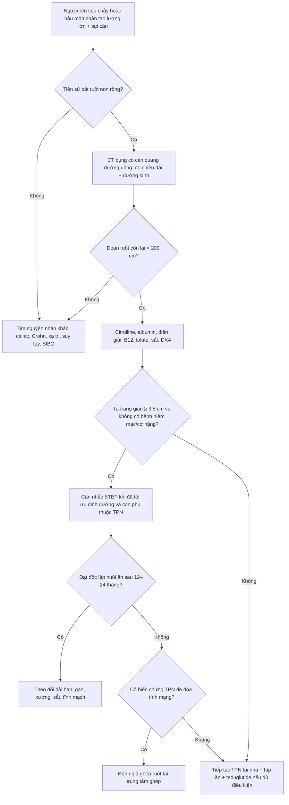
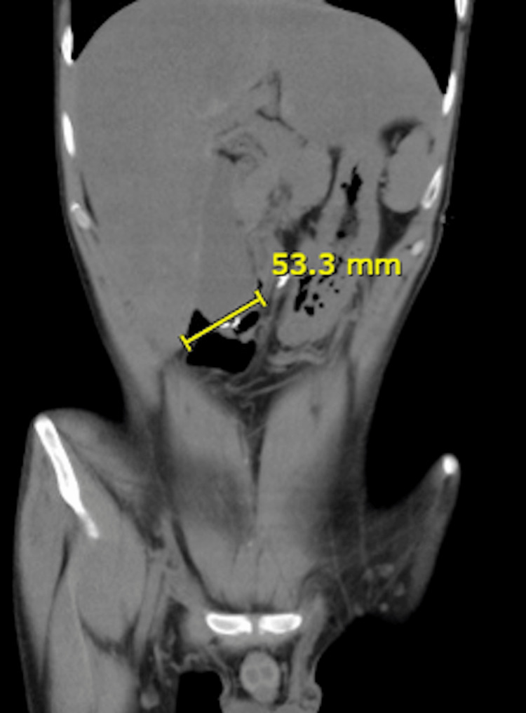
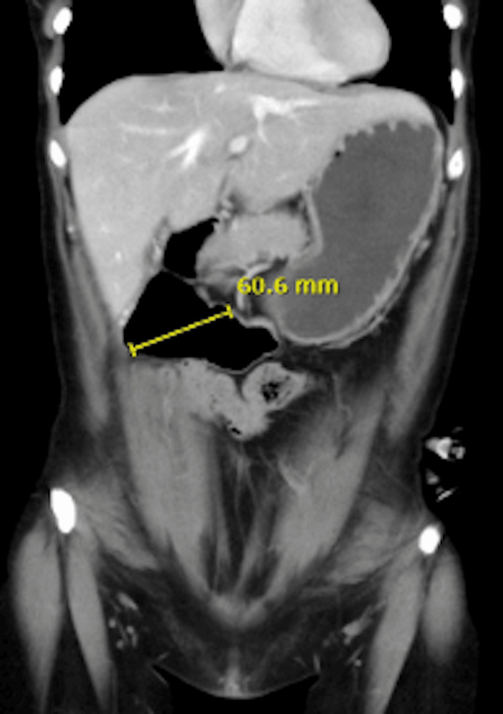
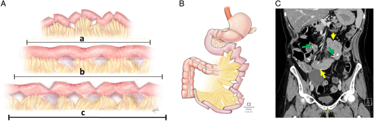

# 1762 — Hội chứng ruột ngắn ở người lớn: đoạn ruột còn lại, teduglutide, STEP và chỉ định ghép

**Tags:** `pattern:ruot-ngan` `pattern:gian-ta-trang` `pattern:mat-doan-ruot` `vung:ruot-non` `vung:ta-trang` `vung:dai-trang` `vung:bung` `anatomy:ruot-non` `protocol:CT-bung-can-quang` `protocol:MR-enterography` `protocol:do-dai-ruot` `score:citrulline` `score:STEP`
**Mức chắc chắn (certainty):** tổng hợp y văn (literature synthesis) — ghép **loạt 64 bệnh nhân / 81 lần STEP ở người lớn** (Ann Surg 2026, PMCID **PMC13258089**), **3 ca ultra-short bowel được STEP tá tràng** (Cureus 2025, PMCID **PMC12119115**), **tổng quan dinh dưỡng SBS–IF người lớn** (Nutrients 2026, PMCID **PMC13666838**) và **meta-analysis 17 nghiên cứu về teduglutide** (2025, PMCID **PMC12505948**). Không có ca do nhóm tự chụp.

> **Câu hỏi thực hành:** nam **27 tuổi**, hoại tử ruột non diện rộng sau huyết khối mạc treo, còn **tá tràng + đại tràng xuống**, đang nuôi ăn tĩnh mạch toàn phần (total parenteral nutrition, TPN) tại nhà **6 tháng**. CT bụng thấy **tá tràng giãn 53,3 mm**, không còn quai hỗng tràng. Bệnh nhân hỏi: **"Tôi có bỏ được dịch truyền không? Có mổ kéo dài ruột được không? Khi nào phải ghép ruột?"**
> Bài chốt **năm quyết định**: **(1) ruột ngắn (short bowel syndrome, SBS) ở người lớn = đoạn ruột non còn lại < 200 cm; (2) kiểu giải phẫu quyết định tiên lượng — còn đại tràng thì cứu được ~1.000 kcal/ngày; (3) tá tràng giãn ≥ 3,5 cm là tiền đề để kéo dài ruột bằng STEP, nhưng giãn do tắc thì không; (4) citrulline < 20 µmol/L dự báo phụ thuộc TPN lâu dài; (5) ghép ruột chỉ đặt ra khi TPN gây biến chứng đe dọa tính mạng, không phải khi "chán truyền".**

## 1. Tổng quan bệnh học – cơ chế hình ảnh: vì sao mất ruột lại thay đổi cả hình ảnh lẫn sinh lý

- **Định nghĩa và dịch tễ:** SBS ở người lớn là **chiều dài ruột non còn lại < 200 cm** sau cắt đoạn rộng (Nutrients 2026, PMC13666838); đây là cơ chế thường gặp nhất của **suy ruột mạn (chronic intestinal failure, CIF)**, chiếm **~2/3** số ca CIF người lớn. Nguyên nhân hàng đầu: **bệnh Crohn, thiếu máu mạc treo, viêm ruột do xạ, biến chứng mổ, xoắn ruột**.
- **Ba kiểu giải phẫu — ba bệnh cảnh khác nhau** (cùng một chẩn đoán "SBS" nhưng xử trí và hình ảnh khác):
  - **Hỗng tràng tận – hậu môn nhân tạo (end jejunostomy):** không còn đại tràng nối tiếp. Niêm mạc hỗng tràng **thấm nước và natri tự do**, nên truyền dịch nhược trương hoặc ưu trương đều kéo nước vào lòng ruột → bệnh nhân **"tiết ròng" (net secretor)**, dịch hậu môn nhân tạo có thể **nhiều hơn lượng ăn vào**.
  - **Hỗng–đại tràng (jejunocolic):** đại tràng trở thành cơ quan tiêu hóa: lên men carbohydrate không hấp thu thành **axit béo chuỗi ngắn (short-chain fatty acids, SCFA)**, cứu được **tới ~1.000 kcal/ngày**; đồng thời "phanh hồi–đại tràng" (ileo-colonic brake qua peptide-YY/GLP-2) làm chậm nhu động. Cái giá: **sỏi calci oxalat** và **nhiễm toan lactic D**.
  - **Hỗng–hồi–đại tràng (jejunoileocolic):** giữ **> ~10 cm hồi tràng tận** + đại tràng → còn phanh hồi tràng, tái hấp thu muối mật và vitamin B₁₂; đây là nhóm **tiên lượng tốt nhất**, hiếm khi cần hỗ trợ tĩnh mạch dài hạn.
- **Thích nghi (adaptation) theo ba pha — mốc thời gian quyết định kỳ vọng:**
  - **Pha cấp/tăng tiết (3–4 tuần đầu):** mất dịch–điện giải ồ ạt, tăng tiết acid dạ dày; TPN là biện pháp cứu mạng.
  - **Pha thích nghi (vài tuần đến 1–2 năm):** nhung mao cao hơn, hốc tuyến sâu hơn, nhu động chậm lại; đây là **"cửa sổ vàng"** để nuôi ăn sớm và tập ăn.
  - **Pha ổn định (> 1–2 năm):** đạt trạng thái hấp thu mới; lúc này mới phân biệt được **"suy ruột được bù trừ"** (ăn nhiều, không cần truyền) với **CIF thật sự**.
- **TẠI SAO bệnh nhân lại ăn nhiều:** SBS gây **tăng cân nặng ăn (adaptive hyperphagia) 1,5–2 lần** nhu cầu năng lượng nghỉ; hấp thu ròng tương quan với **tổng lượng ăn vào** mạnh hơn là với "tỷ lệ hấp thu". Vì vậy hạn chế ăn là sai lầm kinh điển.
- **TẠI SAO CT thấy tá tràng giãn và "mất" ruột non:** sau cắt, đoạn ruột còn lại chịu toàn bộ lưu lượng và **giãn bù trừ**; trên CT có cản quang đường uống, dịch–khí làm lòng ruột căng, thành ruột mỏng, các quai còn lại **không thấy ở phần bụng dưới**. Đo đường kính tá tràng trên **lát cắt ngang vuông góc với trục ruột** hoặc **MPR coronal**; đo chiều dài ruột bằng cách **lần theo lòng ruột từ góc Treitz đến hậu môn nhân tạo/miệng nối** trên chuỗi lát mỏng.
- **Vì sao tá tràng giãn lại là dấu hiệu "tốt" cho phẫu thuật:** ruột giãn mới có đủ "chất liệu" để tạo các nhánh ngang nối tiếp (STEP). Trong loạt 64 ca STEP người lớn, **đoạn ruột giãn ≥ 3,5 cm là tiền đề kỹ thuật** của phần lớn ca mổ nguyên phát (PMC13258089).
- **Vì sao citrulline là mốc sinh học:** citrulline do tế bào ruột tổng hợp, không có trong thức ăn; **< ~20 µmol/L** tương quan với **suy ruột vĩnh viễn** và xác suất thấp đạt độc lập với truyền (PMC13666838). Trong loạt STEP, citrulline nền **22 ± 12 µmol/L** (PMC13258089).
- **Tiên lượng thực tế:** khoảng **một nửa** người lớn SBS đạt **độc lập nuôi ăn (enteral autonomy)** và đa số trong **2 năm đầu**; trong đoàn hệ 472 bệnh nhân bắt đầu TPN tại nhà vì CIF lành tính, **36,5% cai được hỗ trợ tĩnh mạch trong 5 năm**, **4/5 trong số đó cai ngay năm đầu** (PMC13666838).
- **TẠI SAO phải theo dõi gan và xương:** TPN dài hạn gây **bệnh gan liên quan suy ruột (IFALD)**; trong đoàn hệ 90 người lớn, **ứ mật mạn 65%** và **bệnh gan có biến chứng 41,5%**, liên quan lượng lipid **≥ 1 g/kg/ngày**; đồng thời gây **loãng xương** và **huyết khối tĩnh mạch trung tâm**.

## 2. Mẫu hình + chẩn đoán phân biệt theo hình thái (Gamut)

- **Nhóm 1 — "chỉ còn tá tràng":** CT coronal thấy **tá tràng giãn 5–6 cm** rồi tận cùng bằng miệng nối xuống đại tràng hoặc hậu môn nhân tạo; không thấy quai hỗng tràng. Ví dụ trong bài: **53,3 mm** (Hình 1) và **60,6 mm** (Hình 2) trên hai bệnh nhân ultra-short bowel (PMC12119115).
- **Nhóm 2 — "hỗng tràng ngắn + đại tràng":** vài quai hỗng tràng giãn nhẹ, đại tràng chứa nhiều hơi–phân; hay gặp **sỏi thận oxalat** và **sỏi mật** (mất muối mật → giảm hòa tan cholesterol).
- **Nhóm 3 — "còn hồi tràng tận":** đại tràng + hồi tràng > 10 cm; hình ảnh gần bình thường, chẩn đoán dựa vào **tiền sử cắt ruột + chiều dài đo được**, không dựa vào "hình thái lạ".
- **Nhóm 4 — "sau STEP":** ruột non dài ra nhưng **gấp khúc hình răng cưa**, có **các đường kẹp ngang (staple line)**; cần phân biệt **giãn bù trừ bình thường** với **hẹp/lei/rò tại đường kẹp**.
- **Nhóm 5 — biến chứng trên nền SBS (mẫu hình "đừng bỏ sót"):**
  - **Bệnh gan do TPN (IFALD):** gan **giảm đậm độ lan tỏa**, có thể **gan nhiễm mỡ** hoặc **ứ mật**; đánh giá trên **CT không cản quang**.
  - **Huyết khối tĩnh mạch trung tâm:** tĩnh mạch cảnh trong/dưới đòn **không ngấm thuốc, có huyết khối trong lòng**, tuần hoàn bàng hệ thành ngực.
  - **Sỏi mật – sỏi thận:** thường **không triệu chứng**, phát hiện tình cờ.
  - **Nhiễm khuẩn huyết liên quan catheter (CRBSI):** ổ nhiễm không thấy trên hình ảnh; **sốt là dấu hiệu duy nhất**.
- **Chẩn đoán phân biệt của "tá tràng giãn":**
  - **Hội chứng động mạch mạc treo tràng trên (SMA syndrome):** giãn **đến D3**, có **mức chặn (transition point)** tại chỗ ĐM mạc treo trên bắt ngang; bệnh nhân **gầy sút** nhưng còn đủ ruột non.
  - **Giả tắc ruột mạn (chronic intestinal pseudo-obstruction):** giãn nhiều đoạn, **không có điểm chuyển tiếp**, nhu động kém; khác SBS ở chỗ **không mất đoạn ruột**.
  - **Hẹp/dính thực thể:** có **điểm chuyển tiếp rõ**, quai trên giãn, quai dưới xẹp.
  - **Vòng thắt tá tràng, web tá tràng, tụy vòng:** bẩm sinh, thường phát hiện ở trẻ.
- **Chẩn đoán phân biệt của "tiêu chảy mạn + sụt cân" khi chưa rõ tiền sử cắt ruột:** viêm ruột do xạ, Crohn, bệnh celiac, **tiêu chảy muối mật**, **suy tụy ngoại tiết**, **SIBO**, cường giáp, bệnh mô liên kết — mỗi nguyên nhân có hình ảnh và xét nghiệm khác.
- **Ba nhóm "đừng bỏ sót" vì đổi hoàn toàn xử trí:** **tắc thực thể** (mổ), **IFALD nặng** (đánh giá ghép), và **huyết khối tĩnh mạch trung tâm** (mất đường truyền → nguy cơ tử vong).

## 3. Bảng so sánh phân biệt (ma trận đối chiếu)

| Thực thể (entity) | Hình ảnh điển hình (CT/MR) | Chốt vào (rule-in) | Chốt loại (rule-out) | Gợi ý xác nhận |
|---|---|---|---|---|
| SBS thể chỉ còn tá tràng (ultra-short) | Tá tràng giãn **53,3–60,6 mm**, không thấy quai hỗng tràng, miệng nối xuống đại tràng | **Tiền sử cắt ruột + đoạn ruột còn lại < 200 cm + tá tràng giãn bù trừ** | Còn > 200 cm hoặc giãn do điểm chặn thực thể → không phải SBS đơn thuần | Đo chiều dài trên MPR coronal, đối chiếu biên bản mổ |
| SBS thể hỗng–đại tràng | Vài quai hỗng tràng giãn nhẹ; đại tràng đầy hơi; sỏi thận/mật | **Còn đại tràng nối tiếp + chiều dài ngắn** | Mất toàn bộ đại tràng → thể end-jejunostomy | CT bụng, siêu âm thận, xét nghiệm oxalate niệu |
| SBS thể hỗng–hồi–đại tràng | Gần bình thường; hồi tràng tận > 10 cm | **Còn > 10 cm hồi tràng tận + đại tràng** | Không còn hồi tràng → mất phanh hồi tràng, tiên lượng kém hơn | Đo chiều dài + B₁₂, muối mật |
| SMA syndrome (giãn tá tràng) | Giãn **D1–D3**, **điểm chặn tại ĐM mạc treo trên**, khoảng chủ–mạc treo hẹp | **Điểm chuyển tiếp tại ĐM mạc treo trên + sụt cân** | Không có điểm chặn, giãn lan tỏa → nghĩ giả tắc | CT có cản quang, chụp lưu thông |
| Giả tắc ruột mạn | Giãn nhiều đoạn, thành mỏng, **không điểm chặn**, ứ dịch–khí | **Giãn lan tỏa không giải thích được + nhu động kém** | Có điểm chặn rõ → tắc cơ học | Manometry, đối chiếu lâm sàng |
| Hẹp/dính sau mổ | **Điểm chuyển tiếp** rõ, quai trên giãn, quai dưới xẹp | **Điểm chuyển tiếp + triệu chứng tắc từng đợt** | Giãn đều không điểm chặn → giả tắc/SBS bù trừ | CT cản quang, chụp lưu thông |
| Sau STEP có biến chứng | Đường kẹp ngang, **rò/kén khí quanh miệng nối**, hẹp tại đường kẹp | **Khí ngoài lòng + dịch quanh đường kẹp sau mổ** | Chỉ thấy đường kẹp đều, không dịch/khí bất thường → hậu phẫu bình thường | CT có cản quang, theo dõi sát |
| IFALD | Gan **giảm đậm độ** (nhiễm mỡ) hoặc **ứ mật**, lách to, cổ trướng | **Bilirubin tăng + hình ảnh gan nhiễm mỡ/ứ mật trên TPN kéo dài** | Gan bình thường trên CT không loại trừ IFALD sớm | Xét nghiệm gan, elastography, sinh thiết khi cần |
| Huyết khối tĩnh mạch trung tâm | Tĩnh mạch **không ngấm thuốc**, huyết khối trong lòng, tuần hoàn bàng hệ | **Mất tín hiệu/không đổ đầy một đoạn tĩnh mạch trung tâm** | Tĩnh mạch đổ đầy đều → không huyết khối | CTV/MRV, siêu âm Doppler |

## 4. Protocol chụp + hệ phân loại/điểm chuẩn hóa

### 4.1 CT bụng–chậu có cản quang đường uống (CT enterography)

- **Chuẩn bị:** nhịn ăn 4–6 giờ; uống **dung dịch trung tính (polyethylene glycol hoặc nước) 1,5–2 L** chia nhiều lần trong 45–60 phút để làm căng lòng ruột; **không dùng cản quang baryt** nếu đang xét tắc.
- **Kỹ thuật:** lát mỏng **1–2 mm**, tái tạo **MPR coronal/sagittal**; tiêm cản quang tĩnh mạch, chụp **thì tĩnh mạch cửa (70–80 giây)**; thêm **thì không cản quang** nếu cần đánh giá gan nhiễm mỡ.
- **Đo chiều dài:** lần theo lòng ruột từ **góc Treitz** đến **hậu môn nhân tạo/miệng nối**, cộng các đoạn; ghi rõ **phương pháp và mặt phẳng** vì CT thường **đo ngắn hơn chiều dài đo trong mổ** (ruột xẹp, gấp khúc).
- **Đo đường kính:** đo **vuông góc với trục ruột** tại chỗ giãn nhất của tá tràng/hỗng tràng; ghi **mm**; **≥ 3,5 cm** là mốc để cân nhắc STEP trong loạt 64 ca (PMC13258089).
- **Đánh giá kèm:** gan (đậm độ, ứ mật, lách to), **đường mật (sỏi)**, **thận (sỏi oxalat, ứ nước)**, **tĩnh mạch trung tâm**, **ổ bụng (dịch, khí ngoài lòng)**.

### 4.2 MR enterography — khi nào thay CT

- Chỉ định khi cần **theo dõi lặp lại nhiều lần** (trẻ, phụ nữ tuổi sinh sản) hoặc **không dùng được cản quang iod**; MR không bức xạ nhưng **kém hơn CT về đo chiều dài** và dễ bị ảnh hưởng nhu động.
- Chuỗi cơ bản: **T2 HASTE/SSFSE coronal + axial**, **T1 fat-sat sau tiêm**, lát **3–4 mm**; dùng **chất cản quang đường uống trung tính** (mannitol/polyethylene glycol).

### 4.3 Ngưỡng sinh học và chỉ định điều trị

- **Citrulline < 20 µmol/L:** dự báo **suy ruột vĩnh viễn**, xác suất thấp đạt độc lập với truyền; **≥ 20 µmol/L** là nhóm còn khả năng cai (PMC13666838).
- **Cai TPN:** đạt **độc lập nuôi ăn** khi ăn đủ mà không cần dịch truyền; trong đoàn hệ 472 ca, **36,5% cai trong 5 năm**, **4/5 cai trong năm đầu**.
- **Teduglutide (đồng vận GLP-2 kháng DPP-IV):** liều **0,05 mg/kg dưới da, 1 lần/ngày**; trong nghiên cứu then chốt **STEPS**, **63%** giảm **20–100%** thể tích hỗ trợ tĩnh mạch so với **30%** ở nhóm placebo; tác dụng phụ hay gặp: **tiêu chảy/bụng to (49%)**, nhiễm trùng hô hấp trên **29%**, sốt **23%**, nhiễm khuẩn huyết **22%** (PMC12505948). Không dùng khi có **bệnh ác tính đang hoạt động** hoặc **bệnh ruột viêm tiến triển**.
- **STEP (serial transverse enteroplasty):** tạo các đường kẹp ngang so le, mỗi đường dài **1,5–4 cm**, để ruột dài ra và hẹp lại theo trục còn lại. Trong loạt 64 ca: chiều dài **79 ± 47 cm → 105 ± 23 cm** (**+33 ± 12 cm**, tăng **33%**), **13 ± 9** đường kẹp, thời gian nằm viện trung vị **17 ngày (10–24)**; **sống 5 năm 91%**, **đạt độc lập nuôi ăn 80%** (PMC13258089).
- **Chống chỉ định/không phù hợp STEP:** **tá tràng không giãn**, **bệnh niêm mạc đang hoạt động**, **bệnh ruột bẩm sinh/di truyền**, **rối loạn cơ–thần kinh nguyên phát**, **bệnh gan nặng**, **ung thư tiến xa** (PMC13258089).
- **Ghép ruột:** chỉ khi **CIF không hồi phục + biến chứng đe dọa tính mạng của TPN** — **IFALD tiến triển**, **mất dần đường tĩnh mạch trung tâm**, **nhiễm khuẩn huyết liên quan catheter tái diễn**; đánh giá tại trung tâm ghép chuyên biệt (PMC13666838).

### 4.4 Thuật toán một lượt khám

## 5. Biến thể bình thường và cạm bẫy

- **Đo chiều dài trên CT ngắn hơn trong mổ:** ruột xẹp và gấp khúc → **không dùng con số CT để quyết định STEP hay ghép**; phải đối chiếu biên bản mổ và đo trong mổ.
- **Tá tràng giãn do tắc bị đọc là "giãn bù trừ":** nếu có **điểm chặn** (SMA syndrome, dính, vòng thắt) thì kéo dài ruột là **chống chỉ định tương đối**; phải tìm điểm chuyển tiếp trước.
- **Bỏ sót đại tràng còn nối tiếp:** đại tràng cứu **~1.000 kcal/ngày** và đổi hoàn toàn tiên lượng — luôn ghi rõ **còn hay mất đại tràng** trong kết luận.
- **Gan nhiễm mỡ trên CT có cản quang bị đánh giá sai:** dùng **CT không cản quang** (gan **< 40 HU** hoặc tỷ lệ gan/lách **< 1,0**) hoặc MRI PDFF.
- **Sỏi thận/mật bị bỏ qua vì chỉ nhìn ruột:** SBS thể còn đại tràng có **tăng oxalate niệu**; thể mất hồi tràng có **sỏi mật cholesterol** — phải đọc cả thận và túi mật.
- **Sốt ở bệnh nhân TPN không phải lúc nào cũng do "nhiễm trùng ổ bụng":** nghĩ **CRBSI** trước, cấy máu qua catheter và cấy đầu catheter.
- **D-lactic acidosis:** bệnh nhân SBS còn đại tràng có thể vào viện với **lú lẫn, mất thăng bằng, nói khó**; **lactate thường không tăng**, toan chuyển hóa tăng anion gap; điều trị bằng **ngừng carbohydrate nhanh hấp thu**, không phải truyền bicarbonate đơn thuần.
- **Sau STEP, "quai giãn" là bình thường:** đừng gọi là tắc nếu không có **điểm chuyển tiếp** và không có triệu chứng; ngược lại, **khí ngoài lòng quanh đường kẹp** là dấu hiệu rò, cần CT cản quang và mổ.
- **Teduglutide không thay thế dinh dưỡng:** chỉ hiệu quả khi **đã tối ưu ăn uống**; ngừng thuốc thì lợi ích mất dần, và **không dùng khi nghi ung thư**.

## 6. Tự lượng giá — Blind Quiz

**Ca 1 — Nam 27 tuổi, hoại tử ruột non sau huyết khối mạc treo, còn tá tràng + đại tràng xuống, TPN 6 tháng.**

- Gợi ý lâm sàng: hậu môn nhân tạo ra 2,5 L dịch/ngày; cân nặng giảm 8 kg; citrulline 18 µmol/L.
- Câu hỏi: Hình ảnh và citrulline gợi ý gì? Bệnh nhân có phải ứng viên STEP không? Cần đánh giá thêm gì?

<b>Bấm để hiện đáp án (findings + chẩn đoán)</b>

- Dấu hiệu: **tá tràng giãn 53,3 mm**, không thấy quai hỗng tràng; citrulline **18 µmol/L** (< 20).
- Chẩn đoán: **SBS thể ultra-short, phụ thuộc TPN**, còn đại tràng nối tiếp.
- Vì sao: tá tràng giãn **≥ 3,5 cm** là tiền đề kỹ thuật cho STEP; citrulline **< 20 µmol/L** dự báo khó cai TPN → cần **đánh giá khả năng STEP** và **theo dõi gan/xương/tĩnh mạch**, không hứa "cai truyền" trước 12–24 tháng.
- Nguồn ảnh: Cureus 2025, PMCID PMC12119115, CC BY 4.0.

**Ca 2 — Nữ 42 tuổi, xoắn ruột thai kỳ đã cắt từ D4 đến đại tràng ngang; CT coronal thấy tá tràng 60,6 mm.**

- Gợi ý lâm sàng: đang TPN tại nhà, 3 đợt nhiễm khuẩn huyết trong 12 tháng; không sốt hiện tại.
- Câu hỏi: Đường kính tá tràng 60,6 mm có phải "giãn bù trừ" không? Ba đợt nhiễm khuẩn huyết thay đổi thứ tự ưu tiên thế nào?

<b>Bấm để hiện đáp án (findings + chẩn đoán)</b>

- Dấu hiệu: **tá tràng 60,6 mm** không có điểm chặn, không thấy quai ruột non; phù hợp **giãn bù trừ sau cắt rộng**.
- Chẩn đoán: **SBS thể jejuno/duodenocolic**; **CRBSI tái diễn** là biến chứng TPN.
- Vì sao: nhiễm khuẩn huyết tái diễn là một trong **ba chỉ định đánh giá ghép ruột** (cùng IFALD và mất đường tĩnh mạch); trước khi ghép vẫn phải **tối ưu catheter, khóa taurolidine/ethanol** và xem lại khả năng STEP.
- Nguồn ảnh: Cureus 2025, PMCID PMC12119115, CC BY 4.0.

**Ca 3 — Bệnh nhân 35 tuổi, SBS sau cắt ruột, được STEP; hình minh họa kỹ thuật và CT hậu phẫu.**

- Gợi ý lâm sàng: sau STEP 6 tháng, vẫn còn 40% nhu cầu calo qua TPN; không sốt, không nôn.
- Câu hỏi: Kỹ thuật STEP làm gì? Kỳ vọng kết quả nào là hợp lý, và dấu hiệu nào trên CT sau mổ là bất thường?

<b>Bấm để hiện đáp án (findings + chẩn đoán)</b>

- Dấu hiệu: các **đường kẹp ngang so le** chia lòng ruột thành nhiều đoạn hẹp–giãn xen kẽ, làm tăng chiều dài và giảm đường kính; trung bình **+33 ± 12 cm** trong loạt 64 ca.
- Chẩn đoán: **hậu STEP không biến chứng**; còn phụ thuộc TPN một phần là kỳ vọng hợp lý.
- Vì sao: **80%** đạt độc lập nuôi ăn trong loạt người lớn, nhưng cần **12–24 tháng**; bất thường cần loại trừ là **khí ngoài lòng/dịch quanh đường kẹp** (rò) và **hẹp tại đường kẹp**.
- Nguồn ảnh: Ann Surg 2026, PMCID PMC13258089, CC BY-NC-ND 4.0 (nguyên bản, không chỉnh sửa).

## Bài liên quan chéo
- [100 – Tổng quan hệ Bụng](../100-tong-quan-he-bung/lesson.md)
- [3006 – Ruột ngắn & IFALD ở trẻ](../3006-ruot-ngan-ifald-o-tre/lesson.md) (cùng bệnh cảnh, khác ngưỡng tuổi và phác đồ)
- [3053 – Phẫu thuật kéo dài ruột STEP/LILT](../3053-phau-thuat-keo-dai-ruot-step-lilt/lesson.md) (kỹ thuật chi tiết ở trẻ)
- [162 – Tắc ruột non](../162-tac-ruot/lesson.md) (điểm chuyển tiếp, phân biệt tắc cơ học)
- [165 – Dày thành ruột: Crohn vs ung thư](../165-day-thanh-ruot/lesson.md)
- [1825 – Hội chứng gan nhỏ](../1825-hoi-chung-gan-nho/lesson.md) (biến chứng gan sau cắt/ghép)

> Không dùng để chẩn đoán độc lập khi chưa có người hướng dẫn.
