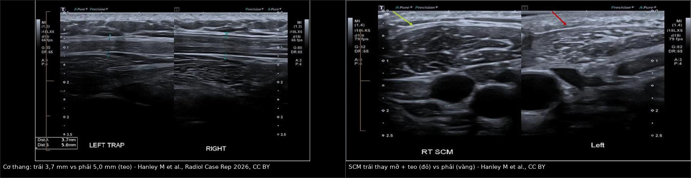
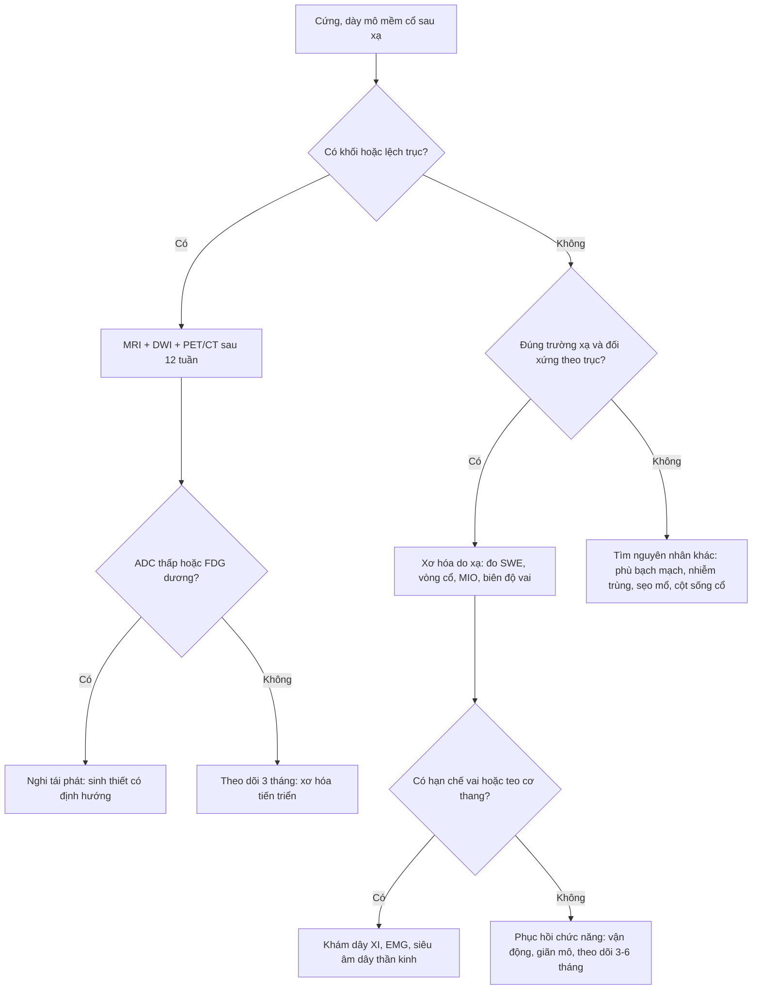
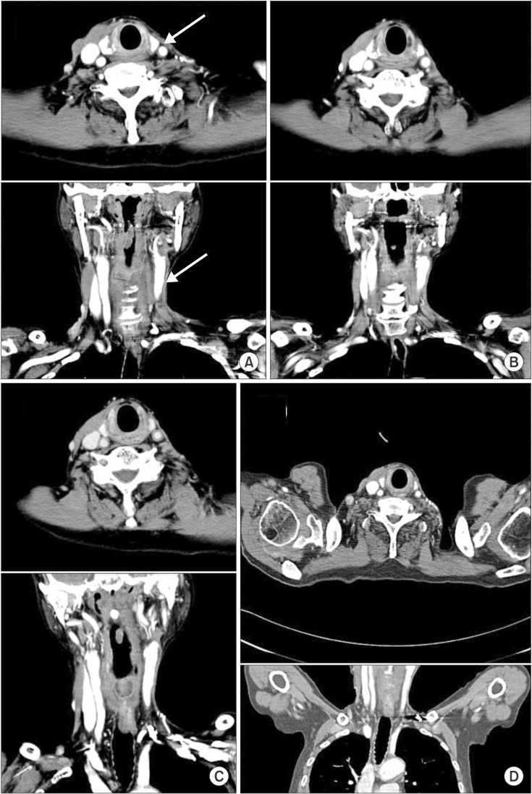
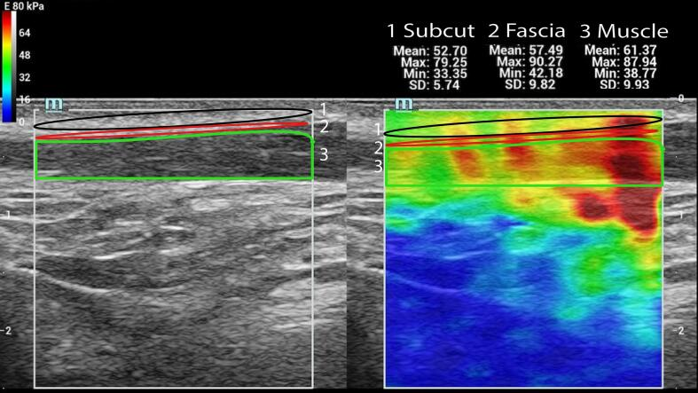
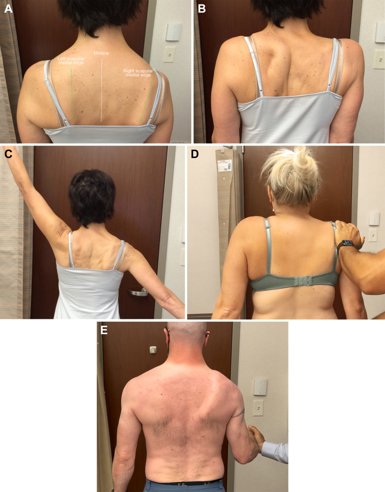
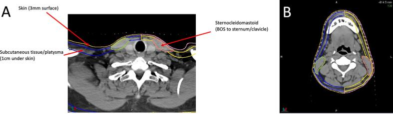
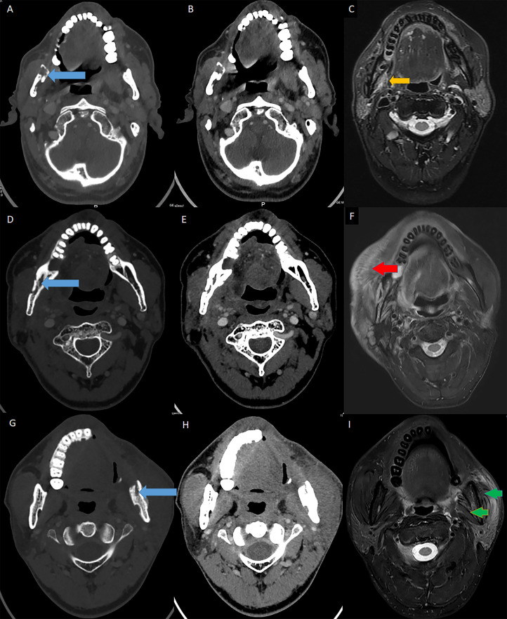

# 1763 — Xơ hóa mô mềm cổ sau xạ trị & hội chứng vai–cổ / Radiation-induced neck fibrosis & shoulder syndrome

**Tags:** `pattern:xo-hoa-sau-xa` `pattern:day-da` `pattern:teo-co` `pattern:thay-mo` `pattern:han-che-van-dong` `vung:dau-co` `vung:co` `protocol:CT` `protocol:MRI` `protocol:sieu-am-SWE` `protocol:lieu-OAR` `score:RTOG` `score:CTCAE` `incidentaloma:khong`

**Mức chắc chắn (certainty):** tổng hợp y văn (literature synthesis) — 1 nghiên cứu PRO–NTCP 95 bệnh nhân với mô hình Lyman–Kutcher–Burman cho da/mô dưới da/cơ ức đòn chũm (*Clin Transl Radiat Oncol* 2026, PMC13448427, CC BY-NC-ND), 1 đoàn hệ dọc 56 bệnh nhân đo độ cứng cơ bằng siêu âm đàn hồi sóng biến dạng (*Cancers* 2026, PMC13297288, CC BY), 1 nghiên cứu đối chứng 16 + 16 bệnh nhân với siêu âm đàn hồi (*Phys Imaging Radiat Oncol* 2026, PMC13241838, CC BY), 1 đoàn hệ ung thư vòm họng 36 bệnh nhân (*Oncol Lett* 2025, PMC12004034, CC BY-NC-ND), 1 nghiên cứu vai–cổ tiến cứu 96 bệnh nhân (*Medicine* 2015, PMC4554123, CC BY), 1 RCT bảo tồn level IIb (*World J Surg Oncol* 2025, PMC12261729, CC BY-NC-ND), 1 tổng quan hệ thống 67 nghiên cứu (*Life* 2025, PMC12112850, CC BY), 1 ca giải phẫu tử thi có CT (*Radiat Oncol J* 2015, PMC4707218, CC BY-NC), 1 tổng quan hình ảnh hậu trị (*Br J Radiol* 2024, PMC11573130, CC BY) và 1 loạt 47 ca hoại tử xương hàm có MRI mô mềm (*Front Oncol* 2021, PMC8113699, CC BY). **Không có ca nguyên văn của nhóm** — 3 ca trong quiz là **ca dựng từ ảnh công bố**, ghi rõ nguồn từng ảnh.

> **Câu chốt:** "cứng cổ, dày da, teo cơ, đau vai" sau xạ **không phải di chứng mơ hồ** mà là **xơ hóa do xạ (radiation-induced fibrosis, RIF)** — một chuỗi **TGF-β → nguyên bào cơ → collagen I/III** làm mô **dày, cứng, mất đàn hồi và teo**. Ba con số phải thuộc: **30–50%** người sống lâu sau xạ đầu cổ có xơ hóa **có ý nghĩa lâm sàng** (tới **69,4%** ở đoàn hệ ung thư vòm họng); độ cứng cơ ức đòn chũm trên siêu âm đàn hồi **46,98 vs 28,10 kPa** so với người không xạ và **tăng 14–16% trong 12 tháng đầu**; và trên kế hoạch xạ, **TD50 của da là 40,2 Gy (không mổ) so với 8,4 Gy (đã mổ cổ)** — nghĩa là **một lần mổ cổ làm ngưỡng dung nạp da tụt gần 5 lần**.

## 1. Tổng quan bệnh học – cơ chế hình ảnh

### 1.1 TẠI SAO mô cổ sau xạ lại dày, cứng rồi teo

- **Định nghĩa:** RIF là biến chứng muộn (> 90 ngày) của xạ trị, biểu hiện **dày da, cứng mô dưới da, xơ hóa mạc và cơ, hạn chế quay cổ – nâng vai, phù bạch mạch và đau**. Khởi phát **3–6 tháng**, **tiến triển trong 1–2 năm đầu** rồi chững lại (PMC13297288). Một số tác giả ghi nhận **> 50% bệnh nhân bị trong khoảng 1–8 năm** sau điều trị (PMC13297288, dẫn nguồn tổng quan).
- **Chuỗi sinh học (vì sao hình ảnh lại như vậy):** xạ → **tổn thương mao mạch + thiếu oxy mô** → hoạt hóa **TGF-β**, TNF-α, interleukin → nguyên bào sợi biệt hóa thành **nguyên bào cơ (myofibroblast)** → **tăng tổng hợp collagen I/III**, **ức chế men phân hủy collagen (MMP)** và tăng ức chế mô (TIMP) → **ma trận ngoại bào dày đặc, mô co rút**. Hệ quả trên hình ảnh:
  - **CT:** da dày, **dải tăng đậm độ dạng lưới (reticular stranding)** trong mô dưới da, **mất các mặt phẳng mỡ** giữa cơ và mạc, cơ **giảm thể tích** nhưng **đậm độ tăng nhẹ**; tổn thương **ôm theo trường chiếu**, không có khối.
  - **MRI:** collagen làm **T2 ngắn → tín hiệu T2 thấp** (xơ), **T1 thấp–trung tính**; giai đoạn sớm còn **phù → T2 cao**; giai đoạn muộn **thay mỡ → T1 cao, mất tín hiệu khi fat-sat**. Mô xơ **ngấm thuốc chậm, đều, không tạo khối**.
  - **Siêu âm:** mô **dày lớp bì, tăng hồi âm, mất lớp mỡ dưới da**, và **tăng độ cứng (stiffness)** đo được bằng **siêu âm đàn hồi sóng biến dạng (shear-wave elastography, SWE)** — đây là cách **định lượng** tốt nhất hiện có, vì độ cứng phản ánh **mật độ liên kết chéo collagen**, không phản ánh triệu chứng.
- **Vì sao "cứng mà teo" không mâu thuẫn:** sợi collagen thay thế nhu mô cơ và mỡ → **thể tích giảm** nhưng **mô đặc và cứng hơn**. Đây là lý do **không được dùng "teo" để loại trừ xơ hóa**, và ngược lại **không dùng "dày" để chẩn đoán tái phát**.

### 1.2 Số liệu định lượng phải thuộc

| Đại lượng | Con số | Nguồn |
|---|---|---|
| Xơ hóa cổ **có ý nghĩa lâm sàng** ở người sống lâu | **30–50%** | PMC13448427 (dẫn tổng quan) |
| Ung thư vòm họng sau hóa–xạ (n = 36, liều u **68,64 Gy**, trung vị **4 chu kỳ** cisplatin 40 mg/m²) | **69,4% (25/36)** xơ hóa cổ; biến chứng muộn chung **83,3%**, chủ yếu **độ ≤ 2** | PMC12004034 |
| Phân bố mức độ theo bộ câu hỏi PRO (n = 90, trung vị **24,5 tháng** sau xạ) | **64,4% nhẹ** (0–20 điểm) · **20,0% vừa** (21–40) · **15,6% nặng** (≥ 41) | PMC13448427 |
| Liều cơ ức đòn chũm trong thực hành | **Dmean 57,5 Gy** (IQR 55,3–60,3) · **Dmax 73,6 Gy** · **V60 38,6%** · **V70 2,3%** | PMC13448427 |
| **TD50** (liều gEUD gây 50% nguy cơ) — da | **40,2 Gy** (95% CI 34,1–50,7) nếu **không mổ** · **8,4 Gy** (6,5–13,2) nếu **đã mổ cổ** | PMC13448427 |
| **TD50** — mô dưới da | **40,9 Gy** (37,8–45,5) không mổ · **13,5 Gy** (10,0–24,1) đã mổ | PMC13448427 |
| **TD50** — cơ ức đòn chũm | **70,9 Gy** (68,2–76,2) không mổ · **81,8 Gy** (66,5–109,4) đã mổ | PMC13448427 |
| Độ cứng cơ ức đòn chũm (SWE) so với người không xạ | **46,98 vs 28,10 kPa** (trái) · **46,75 vs 21,52 kPa** (phải); **mạc: 46,41 vs 25,47 kPa** | PMC13241838 |
| Tiến triển độ cứng trong 12 tháng (n = 56, vận tốc sóng biến dạng) | **4,12 → 4,38 → 4,32 → 4,76 → 4,92 m/s** (1 tuần, 6 tuần, 12 tuần, 6 tháng, 12 tháng); **+14%** ở 6 tháng (p = 0,007), **+16%** ở 12 tháng (p = 0,012) | PMC13297288 |
| Triệu chứng tự khai so với độ cứng | **Không tương quan** trong cùng bệnh nhân (**r = −0,13**, p = 0,498) | PMC13297288 |
| Biên độ quay cổ | Giảm **~5°** — **không có ý nghĩa** dù mô cứng hơn và mỏng hơn | PMC13241838 |
| Hội chứng vai (thang điểm vai UW-QoL, 100 = tốt nhất) | **Xạ đơn thuần 96,3** · **mổ cổ 71,6** · **mổ + xạ 65,3** (hai nhóm mổ khác nhau **p = 0,304**) | PMC4554123 |
| Bảo tồn level IIb so với mổ cổ kinh điển (RCT, n = 32) | Tổn thương dây XI trên **EMG: 50% vs 95%**; hồi phục trên EMG/đo góc ở 6–12 tháng nhưng **NDII vẫn khác biệt ở 12 tháng** | PMC12261729 |
| Mổ cổ cải biên + vạt (n = theo nhóm) | **57,5%** hạn chế vai lúc 3 tháng → **33,8%** lúc 6 tháng sau phục hồi chức năng | PMC12112850 |
| Đo vòng cổ so với đo độ dày da bằng siêu âm | Vòng cổ **ICC 0,958–0,994**; **độ dày da ICC 0,136–0,354** (không đáng tin) | PMC12110547 |
| Thời gian xuất hiện các biến chứng muộn khác trong cùng trường xạ | Hoại tử niêm mạc **6–12 tháng**, trismus **12–18 tháng**, hẹp/loét **1–10 năm** | PMC11573130 |

### 1.3 "Hội chứng vai–cổ" là gì và vì sao phải tách khỏi xơ hóa cổ

- **Hội chứng vai sau điều trị đầu cổ (shoulder syndrome)** gồm: **vai xệ, xương bả vai di lệch ra ngoài, hạn chế dạng tay, đau vai–cánh tay** do **mất chức năng cơ thang** (thần kinh phụ XI) ± xơ hóa mô mềm vùng cổ bên. Ba nguyên nhân chồng lấp: **(1) tổn thương dây XI trong mổ cổ**, **(2) xơ hóa cơ thang/mạc trong trường xạ**, **(3) bệnh lý cơ–xương vai cổ sẵn có** (chóp xoay, cột sống cổ).
- **Con số quyết định:** xạ **đơn thuần** (không mổ) chỉ gây **suy giảm nhẹ** (UW-QoL **96,3** so với 100 trước điều trị, p = 0,046) và **không làm nặng thêm** vai ở người đã mổ cổ (71,6 → 65,3; p = 0,304) — nghĩa là **ở bệnh nhân đã mổ cổ, thủ phạm chính là cuộc mổ, không phải tia** (PMC4554123). Ngược lại, **bảo tồn level IIb** giảm tổn thương dây XI trên EMG từ **95% xuống 50%** (PMC12261729).
- **Hệ quả thực hành:** đau vai ở bệnh nhân **xạ đơn thuần** phải **tìm nguyên nhân khác** trước khi quy cho xơ hóa; đau vai ở bệnh nhân **mổ cổ + xạ** thì mặc định là **hội chứng sau mổ cổ**, cần **khám cơ thang và đo biên độ** chứ không chỉ chụp cổ.

## 2. Mẫu hình + chẩn đoán phân biệt theo lớp mô và theo vị trí (Gamut)

- **Cách đọc:** luôn trả lời **4 câu** trước khi gọi tên: **(1) tổn thương có đúng trong trường xạ không? (2) có khối/mass effect không? (3) có đối xứng theo trục cổ không? (4) có hạn chế khuếch tán/tăng chuyển hóa không?**
- **Gamut theo lớp mô (từ nông đến sâu):**

| Lớp | Mẫu hình thường gặp | Gamut chính |
|---|---|---|
| **Da** | Dày da, mất đàn hồi, giãn mạch, giảm sắc tố | Xơ hóa do xạ · viêm da mạn do xạ · phù bạch mạch · tái phát da (ung thư biểu mô) |
| **Mô dưới da** | Dải tăng đậm độ dạng lưới, mất lớp mỡ, dính da–cơ | Xơ hóa do xạ · phù bạch mạch · viêm mô tế bào · di căn da (carcinoma erysipeloides) |
| **Mạc cổ – bao cảnh** | Mô mềm đặc ôm quanh mạch cảnh, **không tách được** khỏi cơ | Xơ hóa "cổ đông cứng" (frozen neck) · tái phát hạch dính vỏ · huyết khối tĩnh mạch cảnh trong |
| **Cơ ức đòn chũm / cơ vùng cổ** | Teo + thay mỡ + đậm độ/tín hiệu tăng | Xơ hóa–teo do xạ · teo do mất thần kinh (XI, XII, V3) · myositis · tái phát xâm lấn cơ |
| **Cơ thang / dây XI** | Teo cơ thang, vai xệ, xương bả vai xoay ngoài | Hội chứng vai sau mổ cổ · xơ hóa cơ thang do xạ · tổn thương dây XI đơn thuần · bệnh lý chóp xoay |
| **Mạch – bạch mạch** | Dày bao quanh mạch, hẹp tĩnh mạch, phù mô | Xơ hóa quanh mạch · hẹp/huyết khối tĩnh mạch cảnh · phù bạch mạch · tái phát quanh mạch cảnh |

- **Gamut theo mức độ (phân loại 3 bậc dùng trong mổ, PMC8113699):** **độ 1** = xơ hóa dưới da nhẹ, **tĩnh mạch cảnh ngoài chưa hẹp**; **độ 2** = xơ hóa cơ trung bình, **bắt đầu hẹp tĩnh mạch cảnh ngoài/động mạch mặt**; **độ 3** = **"cổ đông cứng" — bao xơ dính liền không tách được**, tĩnh mạch cảnh ngoài hẹp. Đây là thang **lâm sàng – phẫu thuật**, dùng để tiên lượng **mức khó khi mổ lại** và **nguy cơ hoại tử vạt**.
- **Gợi nhớ 4 bước chống bỏ sót: "DA–MỠ–CƠ–DÂY"** — **D**a (dày), **A**trophy (teo cơ), **M**ỡ mất (mất lớp mỡ dưới da), **D**ây thần kinh (XI, XII, V3) — nếu chỉ nhìn "cứng cổ" sẽ bỏ sót **hội chứng vai** và **bệnh thần kinh muộn**.

## 3. Bảng so sánh phân biệt (ma trận đối chiếu)

| Thực thể (entity) | Hình ảnh điển hình (CT/MRI/US) | Chốt vào (rule-in) | Chốt loại (rule-out) | Gợi ý xác nhận |
|---|---|---|---|---|
| **Xơ hóa mô mềm cổ do xạ (RIF)** | Da dày, dải tăng đậm độ dạng lưới trong mô dưới da, **mất mặt phẳng mỡ**, cơ teo + thay mỡ; MRI T2 thấp, ngấm thuốc đều, **không khối** | **Đúng trường xạ + đối xứng theo trục + không mass effect + DWI không hạn chế** | **Có khối, bờ không đều, xâm lấn mỡ cạnh hầu, hạch mới → không phải RIF** | So phim trước xạ; SWE (46,98 vs 28,10 kPa); theo dõi 3–6 tháng |
| **Tái phát u/hạch tại chỗ** | Khối đặc **lệch trục**, bờ tua gai, ngấm thuốc mạnh, **ADC thấp**, FDG dương, lớn dần | **Khối + lớn lên trên 2 lần chụp + ADC thấp/FDG dương** | **Xơ hóa đối xứng, ổn định ≥ 6 tháng, không hạn chế khuếch tán** | MRI + DWI; PET/CT sau ≥ 12 tuần; **sinh thiết chỉ khi có khối** |
| **Phù bạch mạch cổ (external lymphedema)** | Dày da–dưới da **lan tỏa**, phù mềm, mô dưới da tăng hồi âm, **không co kéo** | **Ấn lõm (pitting), giảm khi kê cao/đeo băng ép, vòng cổ tăng** | **Mô xơ rắn, không lõm, không đổi theo tư thế** | Đo vòng cổ (ICC 0,958–0,994); đáp ứng điều trị |
| **Sẹo xơ sau mổ cổ (không xạ)** | Dải mô mềm theo đường mổ, co kéo da, **khu trú**, không theo trường xạ | **Khu trú đúng đường mổ + không dày da lan tỏa** | **Lan tỏa theo trường chiếu + dày da ngoài đường mổ** | Hỏi mốc mổ, so phim cũ |
| **Hoại tử xương hàm do xạ lan mô mềm (ORN)** | Tiêu xương, mảnh xương chết, **phản ứng mô mềm quanh xương**, có thể dò da–miệng | **Tiêu xương + mảnh xương chết + dò ≥ 3 tháng, liều > 60 Gy** | **Xương nguyên vẹn, không dò** | CT xương hàm lát mỏng; MRI mô mềm |
| **Liệt cơ thang do tổn thương dây XI** | Teo cơ thang **một bên**, vai xệ, xương bả vai xoay ngoài, dạng tay hạn chế | **Vai xệ + xương bả vai di lệch + EMG dây XI** | **Teo cơ thang đối xứng do xơ hóa trường xạ hai bên** | Khám lâm sàng (ảnh C), EMG, siêu âm dây XI |
| **Đau vai do cột sống cổ / chóp xoay** | Cột sống thoái hóa, gai, hẹp lỗ liên hợp; gân chóp xoay dày/rách | **Đau theo nghiệm pháp, hạn chế động tác chủ động, hình ảnh khớp/gân** | **Không có bất thường cột sống/gân và đau đúng trường xạ** | MRI cột sống cổ/khớp vai khi nghi ngờ |
| **Nhiễm trùng mô mềm / viêm mô tế bào** | Dày da, phù, **khí trong mô**, tăng đậm độ không theo trường xạ | **Đỏ nóng, sốt, bạch cầu tăng, khí trong mô** | **Không sốt, không khí, đối xứng theo trường xạ** | Lâm sàng + CRP; siêu âm tìm ổ dịch |

*Trái: siêu âm cơ thang — bên trái **3,7 mm** so với bên phải **5,0 mm** (teo). Phải: cơ ức đòn chũm trái **thay mỡ + teo** (mũi tên đỏ) so với bên phải (mũi tên vàng). Nguồn: Hanley M et al., *Radiol Case Rep* 2026 (PMC12964213), CC BY. Ảnh ghép letterbox, giữ nguyên tỉ lệ.*

### 3.1 Ba dấu hiệu định lượng dùng để "chốt" trên hình ảnh

1. **Độ cứng (SWE):** cơ ức đòn chũm sau xạ **46,98 kPa** so với **28,10 kPa** ở người không xạ; mạc **46,41 vs 25,47 kPa** (PMC13241838). Theo thời gian, vận tốc sóng biến dạng **4,12 → 4,92 m/s** sau 12 tháng (PMC13297288) — **tăng dần đều, không nhảy bậc**, nên **một lần đo không đủ để chẩn đoán**.
2. **Hình thái:** **dày da + mất lớp mỡ dưới da + teo cơ** cùng lúc, **đúng trường xạ**, **không khối** — đây là bộ ba mô tả trong đoàn hệ ung thư vòm họng: **"dày da và chắc mô, teo cơ, mất mỡ dưới da"** ở **69,4%** bệnh nhân (PMC12004034).
3. **Tính đối xứng theo trục:** mô xơ **ôm quanh trục cổ** (trước–sau, hai bên), còn tái phát **lệch trục**, **đẩy lệch** mạch cảnh/khí quản. Đây là **chốt loại mạnh nhất trên CT** vì không cần đo.

## 4. Protocol chụp + hệ phân độ/điểm chuẩn hóa

### 4.1 Kế hoạch xạ: vẽ OAR mô mềm cổ (bắt buộc, đừng chỉ vẽ tuyến nước bọt)

- **Ba cấu trúc phải vẽ** (theo PMC13448427, Hình 1):
  - **Da (skin):** dải **3 mm** phía trong đường viền ngoài cơ thể.
  - **Mô dưới da + cơ bám da cổ (subcutaneous tissue/platysma):** lớp **1 cm** ngay dưới da, **trừ da và cơ ức đòn chũm**.
  - **Cơ ức đòn chũm (SCM):** từ **nền sọ đến xương ức/xương đòn**.
- **Ngưỡng liều đề xuất (giả thuyết, cần xác nhận tiền cứu):**
  - **Đã mổ cổ:** da **V15 < 20%**, mô dưới da **V15 < 25%**.
  - **Không mổ:** cơ ức đòn chũm **V70 < 25%**, mô dưới da **V65 < 2%**; **gEUD 30 Gy** cho da/mô dưới da và **60 Gy** cho cơ ức đòn chũm.
  - **TD50 tham chiếu:** da **40,2 Gy** / mô dưới da **40,9 Gy** (không mổ); **8,4 / 13,5 Gy** (đã mổ) — **mổ cổ làm ngưỡng tụt mạnh**.
- **Lợi ích mô phỏng khi lập lại kế hoạch:** NTCP xơ hóa giảm từ **27,9% → 11,6–17,8%** (da), **70,2% → 8,0–15,1%** (cơ ức đòn chũm), **41,6% → 10,6–19,4%** (mô dưới da) khi hạ liều u từ 70 Gy xuống 56–63 Gy (PMC13448427) — bằng chứng gián tiếp rằng **giảm liều mô mềm cổ là can thiệp dự phòng thật**.

### 4.2 Chẩn đoán hình ảnh khi bệnh nhân đến vì "cứng cổ/đau vai"

- **MRI cổ (ưu tiên):** **T1W**, **T2W fat-sat**, **T1W fat-sat sau tiêm**, **DWI (b = 0/800/1000) + ADC**. Cần **cả hai bên** và **cả trên–dưới ổ tổn thương** để đánh giá tính đối xứng theo trục.
- **CT cổ có cản quang:** khi cần đánh giá mạch cảnh, hạch, xương hàm; **cửa sổ mô mềm 1–2 mm**. Đo **độ dày da** và **đường kính cơ ức đòn chũm** ở cùng mức đốt sống để so sánh hai bên và so phim cũ.
- **Siêu âm:** B-mode đo **độ dày cơ/da**, **SWE** đo độ cứng (kPa hoặc m/s) — **cùng một vị trí, cùng một tư thế**, vì độ cứng thay đổi theo điểm đo.
- **PET/CT:** chỉ đáng tin **sau ≥ 12 tuần** vì viêm mô sau xạ có thể dương giả; dùng **Hopkins/NI-RADS** để phân tầng nguy cơ.
- **Đo chức năng (phải ghi vào hồ sơ, không chỉ mô tả ảnh):** **mở miệng tối đa (MIO)**, **biên độ quay cổ**, **dạng tay chủ động**, **thang điểm vai (NDII/DASH/Constant)**, **vòng cổ** (ICC 0,958–0,994 — đáng tin hơn đo độ dày da bằng siêu âm, ICC chỉ **0,136–0,354**).

### 4.3 Phân độ

- **RTOG/EORTC (biến chứng muộn, mô mềm):** độ 1 = dày da nhẹ, giảm đàn hồi; độ 2 = dày da rõ, co kéo, hạn chế vận động nhẹ; độ 3 = co kéo nặng, hạn chế vận động rõ; độ 4 = hoại tử/cần can thiệp.
- **CTCAE v5 – fibrosis mô mềm:** độ 1 = mô cứng nhẹ, không ảnh hưởng chức năng; độ 2 = hạn chế vận động vừa; độ 3 = hạn chế nặng, cần can thiệp.
- **Ba bậc mô tả trong mổ (PMC8113699):** độ 1 dưới da nhẹ → độ 2 xơ hóa cơ → **độ 3 "cổ đông cứng"**.

## 5. Biến thể bình thường và cạm bẫy

- **Xơ hóa không đối xứng là bình thường:** trường xạ thường **không đối xứng** (một bên cổ liều cao hơn), nên **bất đối xứng nhẹ đúng theo kế hoạch xạ không phải tái phát**. Cần **đối chiếu bản đồ liều** trước khi kết luận.
- **Phù T2 cao trong 3–6 tháng đầu:** giai đoạn sớm mô xơ còn **phù**, T2 **tăng tín hiệu** và ngấm thuốc — rất dễ đọc thành "u tiến triển". **Không sinh thiết trong mô xạ nếu không có khối**, vì (a) mô xạ **liền sẹo kém, nguy cơ hoại tử**, (b) **lấy mẫu sai** vì xơ hóa xen kẽ u.
- **"Khối giả" do xơ hóa:** mô xơ co kéo tạo **nốt đặc giả** quanh mạch cảnh. Phân biệt bằng **không mass effect, không hạn chế khuếch tán, ổn định ≥ 6 tháng**.
- **Đau vai ở bệnh nhân xạ đơn thuần:** chỉ **4 bệnh nhân** trong 96 ca báo suy giảm nhẹ, điểm vai **96,3/100** (PMC4554123) — đừng quy mọi đau vai cho xạ; **khám cột sống cổ, chóp xoay, dây XI** trước.
- **Dùng "độ dày da" trên siêu âm làm chỉ số theo dõi:** **ICC 0,136–0,354**, không đáng tin (PMC12110547). Dùng **vòng cổ** hoặc **SWE cùng vị trí**.
- **Độ cứng tăng nhưng triệu chứng không tăng:** cùng bệnh nhân **r = −0,13** (p = 0,498) — **điều trị theo triệu chứng và chức năng**, không theo con số kPa.
- **Teo cơ do xạ so với teo do mất thần kinh:** cả hai đều **teo + thay mỡ**; phân biệt bằng **phân bố theo dây** (XI → cơ thang; XII → lưỡi; V3 → cơ nhai) và **thời gian tiềm tàng**; xem [1764 – bệnh thần kinh V3 sau xạ](../1764-v3-sau-xa-tri-dau-co/lesson.md).
- **Bỏ sót thứ hai (satisfaction of search):** đã thấy xơ hóa rồi **ngừng tìm hạch** — luôn đọc lại **toàn bộ chuỗi hạch** theo NI-RADS ([750](../750-cervical-lymph-nodes-nirads/lesson.md)).

*Bốn mốc CT (A–D) của cùng bệnh nhân sau mổ cổ cải biên + xạ 63 Gy: **teo cơ ức đòn chũm trái** (mũi tên trắng) và **giảm rõ lớp mỡ dưới da bên trái** — mô xơ thay mỡ, không có khối. Nguồn: Kim J et al., *Radiat Oncol J* 2015 (PMC4707218), CC BY-NC.*

## 6. Tự lượng giá — Blind Quiz ngay trên trang tĩnh

**Ca 1 — Nam 70 tuổi, ung thư sàn miệng trái đã mổ + xạ 63 Gy, 2 năm sau đến vì "cổ bên trái cứng và nhỏ lại". Nhìn 4 mốc CT, mô tả trước.**

- Gợi ý lâm sàng: không sốt, không khối mới, da vùng cổ trái dày và khó véo.
- Câu hỏi: Cơ nào teo? Lớp mô nào biến mất? Có dấu hiệu nào của khối không? Ba chẩn đoán phân biệt và một dấu hiệu để loại tái phát?

<b>Bấm để hiện đáp án (findings + chẩn đoán)</b>

- Dấu hiệu: **cơ ức đòn chũm trái teo** (mũi tên trắng, lát cắt ngang và lát cắt trán), **mất lớp mỡ dưới da** vùng cổ trái, mô mềm còn lại **đậm độ tăng nhẹ, không tạo khối**, không đẩy lệch mạch cảnh.
- Chẩn đoán: **xơ hóa – teo mô mềm cổ do xạ (RIF)**, đúng trường chiếu.
- Vì sao: collagen thay mỡ và sợi cơ → **thể tích giảm nhưng đậm độ tăng**, mặt phẳng mỡ mất; **không có mass effect** là chốt loại tái phát trên CT.
- Nguồn ảnh: Kim J et al., *Radiat Oncol J* 2015 (PMC4707218), CC BY-NC. Đây là **ca tử thi** trong bài gốc, dùng làm hình minh họa chuỗi thời gian.

**Ca 2 — Nữ 58 tuổi, xạ hai bên cổ 66 Gy vì ung thư hạch vùng cổ, 14 tháng sau: cổ cứng, khó quay đầu. Siêu âm đàn hồi tại cơ ức đòn chũm cho kết quả dưới đây.**

- Câu hỏi: Ba vùng được đo là gì? Vùng nào cứng nhất và vì sao? Ngưỡng nào giúp phân biệt với mô lành?

<b>Bấm để hiện đáp án (findings + chẩn đoán)</b>

- Dấu hiệu: ba vùng đo **mô dưới da (1)**, **mạc (2)**, **cơ (3)**; giá trị trung bình **52,70 / 57,49 / 61,37 kPa** — **cơ cứng nhất**.
- Chẩn đoán: **xơ hóa cơ–mạc do xạ**, mức độ nặng theo độ cứng.
- Ngưỡng tham chiếu: cơ ức đòn chũm sau xạ **46,98 kPa** so với **28,10 kPa** ở người không xạ; mạc **46,41 vs 25,47 kPa** (PMC13241838) — **mô xơ cứng gần gấp đôi**.
- Cạm bẫy: **độ cứng không tương quan với triệu chứng** (r = −0,13) → đo để theo dõi, không để quyết định mức đau.
- Nguồn ảnh: Dapper H et al., *Phys Imaging Radiat Oncol* 2026 (PMC13241838), CC BY.

**Ca 3 — Bệnh nhân sau mổ cổ trái + xạ, 8 tháng: vai trái xệ, không giơ tay lên đầu được. Ảnh chụp lâm sàng bên dưới.**

- Câu hỏi: Dấu hiệu nào trên ảnh cho thấy mất chức năng cơ thang? Cơ nào bị mất chi phối? Phân biệt với xơ hóa cơ ức đòn chũm đơn thuần?

<b>Bấm để hiện đáp án (findings + chẩn đoán)</b>

- Dấu hiệu: **khoảng cách đường giữa–bờ trong xương bả vai tăng** (A), **xương bả vai xoay ngoài và nhô ra sau** (B), **hạn chế dạng tay chủ động** (C–E).
- Chẩn đoán: **liệt cơ thang do tổn thương thần kinh phụ (XI)** — thành phần "hội chứng vai" của cổ sau điều trị.
- Phân biệt: xơ hóa cơ ức đòn chũm gây **cứng cổ, hạn chế quay cổ**, **không gây xệ vai/xoay xương bả vai**; hội chứng vai do **dây XI** gây **mất dạng tay và đau vai**.
- Con số: ở bệnh nhân đã mổ cổ, **điểm vai UW-QoL 65,3** (mổ + xạ) so với **96,3** (xạ đơn thuần) — **cuộc mổ là yếu tố chính**, không phải tia (PMC4554123).
- Nguồn ảnh: O'Driscoll J et al., *JSES Rev Rep Tech* 2024 (PMC11329012), CC BY-NC-ND — **ca minh họa liệt cơ thang trong bài tổng quan, không phải bệnh nhân xạ**; ảnh dùng nguyên bản, không cắt/ghép.

*Ba OAR mới phải vẽ khi lập kế hoạch xạ đầu cổ: **da 3 mm**, **mô dưới da + cơ bám da cổ 1 cm**, **cơ ức đòn chũm từ nền sọ đến xương ức/xương đòn**. Nguồn: Azzam GA et al., *Clin Transl Radiat Oncol* 2026 (PMC13448427), CC BY-NC-ND — ảnh nguyên bản, không cắt/ghép.*

*CT (A, B, D, E, G, H) và MRI (C, F, I) ở bệnh nhân hoại tử xương hàm do xạ: ngoài tổn thương xương, mô cơ lân cận có **phì đại**, **phù (T2 sáng)** và **teo thay mỡ** — chính là phổ "xơ hóa mô mềm do xạ" mà bài này bàn. Nguồn: Ma C et al., *Front Oncol* 2021 (PMC8113699), CC BY.*

## Bài liên quan chéo
- [700 – Tổng quan Đầu Mặt Cổ](../700-head-neck-overview/lesson.md)
- [1761 – Trismus sau xạ trị đầu cổ](../1761-trismus-sau-xa-tri-dau-co/lesson.md) (xơ hóa cơ nhai — cùng chuỗi RIF nhưng khác trục chức năng)
- [1764 – Bệnh thần kinh V3 sau xạ trị đầu cổ](../1764-v3-sau-xa-tri-dau-co/lesson.md) (teo cơ do mất thần kinh, phân biệt với teo do xơ hóa)
- [1684 – Nuốt khó sau xạ trị đầu cổ](../1684-nuot-kho-sau-xa-tri-dau-co/lesson.md) (cùng trường xạ, cùng cơ chế xơ hóa)
- [750 – Hạch cổ & NI-RADS](../750-cervical-lymph-nodes-nirads/lesson.md) (phân tầng hạch sau điều trị)

## Ảnh
- 6 ảnh + 1 ảnh ghép; nguồn và giấy phép từng ảnh trong `images/CREDITS.md`.
- Ảnh `1763_vai-lenh_MR_PMC11329012.jpg` và `1763_oar-contour_CT_PMC13448427.jpg` là **CC BY-NC-ND** → dùng **nguyên bản, không crop, không ghép**.
- Không có ảnh open-access nào chụp đúng "cổ đông cứng độ 3" của bệnh nhân xạ → bài **không bịa ảnh**, dùng ảnh minh họa từng cơ chế và ghi rõ nguồn từng ảnh.

> Không dùng để chẩn đoán độc lập khi chưa có người hướng dẫn.
