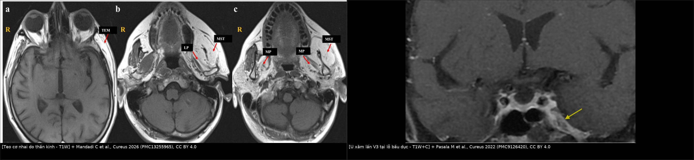
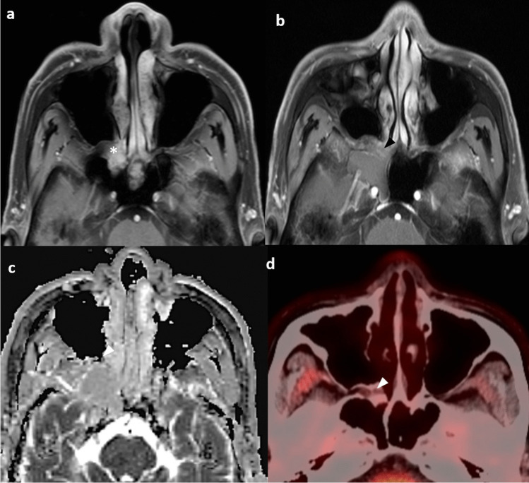
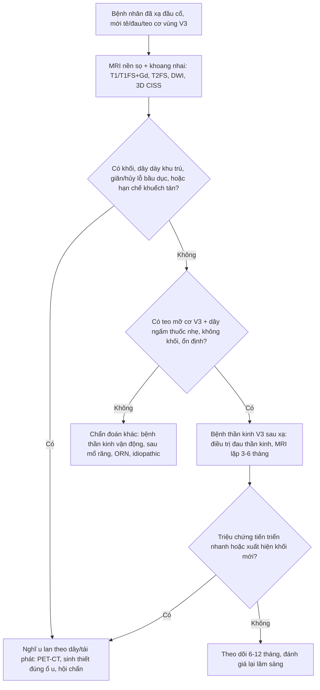
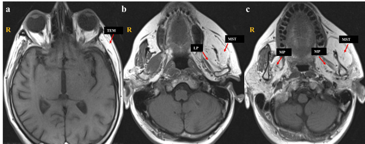
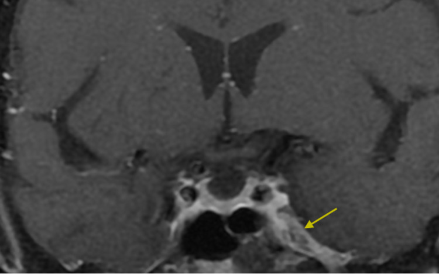
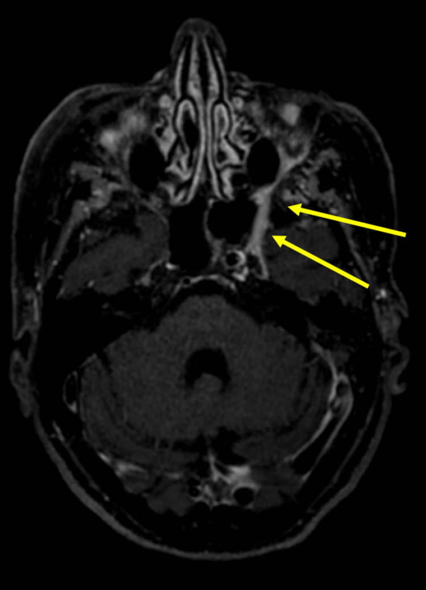
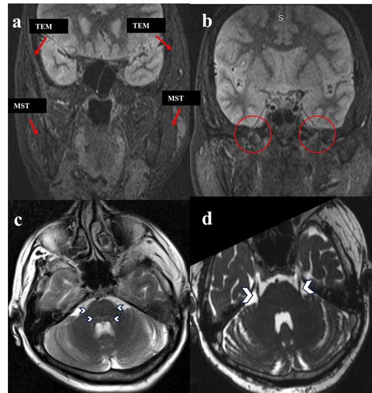
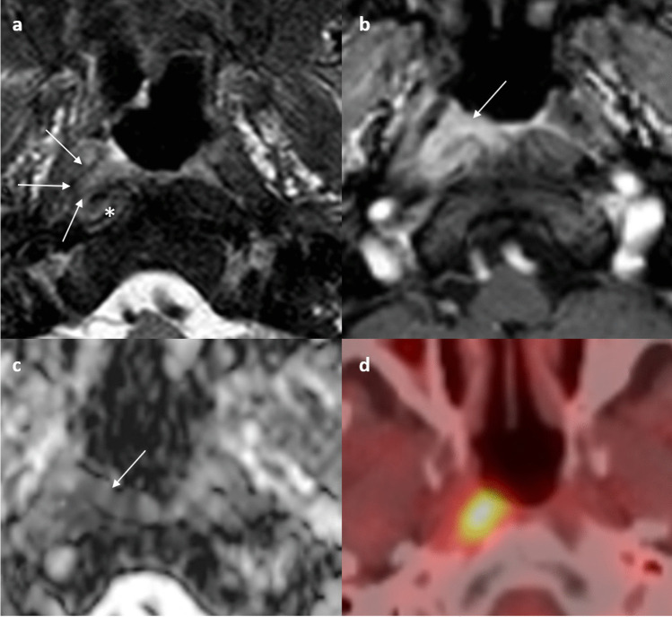

# 1764 — Bệnh thần kinh sinh ba V3 sau xạ trị đầu cổ / Radiation-induced trigeminal neuropathy (V3)

**Tags:** `pattern:teo-co` `pattern:benh-than-kinh` `pattern:xo-hoa-sau-xa` `pattern:ngam-thuoc` `vung:dau-co` `vung:nen-so` `vung:khoang-nhai` `protocol:MRI` `protocol:DWI` `protocol:lieu-OAR` `score:CTCAE` `incidentaloma:khong`

**Mức chắc chắn (certainty):** tổng hợp y văn (literature synthesis) — ghép các nguồn sau.

**Nguồn có PMCID (tên tác giả đã đối chiếu):**
- Li KY et al., *Neuroradiology* 2025 — **PMC12041163**, CC BY 4.0.
- Tashlykov V et al., *Pain Rep* 2026 — **PMC12915720**, CC BY 4.0.
- Mandadi C et al., *Cureus* 2026 — **PMC13255965**, CC BY 4.0.
- Wang C et al., *Medicine* 2018 — **PMC6112862**, CC BY 4.0.
- Pasala M et al., *Cureus* 2022 — **PMC9126420**, CC BY 4.0.
- Nalley A et al., *Insights Imaging* 2026 — **PMC13264650**, CC BY 4.0.

**Nguồn chỉ dùng số liệu (không PMCID):** Kong L et al., *Int J Radiat Oncol Biol Phys* 2011 (PMID 20605344); Luk YS et al., *Oral Oncol* 2013 (PMID 22892236); Duru Birgi S et al., *Head Neck* 2023 (PMID 37740459); Chow JCH et al., *Radiother Oncol* 2019 (PMID 31252300); Kato K et al., *Magn Reson Med Sci* 2002 (PMID 16082138); Shin HY et al., *Clin Neurophysiol* 2013 (PMID 23022037); Mousavi SH et al., *J Neurosurg* 2017 (PMID 27471888).

**Không có ca nguyên văn của nhóm** — 3 ca trong quiz là **ca dựng từ ảnh + số liệu công bố**, ghi rõ nguồn từng ảnh.

> **Câu chốt:** bệnh thần kinh V3 sau xạ **không phải "tê do răng"** và cũng **không phải tái phát u** cho đến khi chứng minh ngược. Ba con số phải thuộc: với **liệt dây sọ nói chung** sau xạ vòm (**nhóm dây trên chứa V chiếm 13,9%**), **thời gian tiềm tàng trung vị 7,6 năm** (0,3–34 năm) và **nguy cơ tích lũy 44,5% ở 20 năm** trong đoàn hệ xạ quy ước (Kong 2011); với xạ điều biến hiện đại, liệt dây sọ **3,7% (36/965)** nhưng vẫn xuất hiện sau **8,9 năm** (Luk 2013); và **riêng V3**, trong xạ tuyến mang tai, **Dmax 66 Gy / D1cc 62,7 Gy** là mốc bắt đầu có độc tính cảm giác (61% độ I–II), còn **teo cơ nhai một bên không khối** trên MRI là **dấu hiệu mất thần kinh**, không phải chẩn đoán nguyên nhân — phải soi **chính dây V3 và lỗ bầu dục**, không sinh thiết mù. **Chưa có nghiên cứu riêng đủ lớn về tỉ lệ V3 đơn thuần** — đây là giới hạn bằng chứng của bài.

## 1. Tổng quan bệnh học – cơ chế hình ảnh

### 1.1 V3 làm gì và đi qua đâu (giải phẫu quyết định cách đọc phim)

- **V3 là dây hỗn hợp.** Nhánh **cảm giác** chi phối da vùng dưới ổ mắt–má–cằm, **răng dưới**, **lợi và sàn miệng**, **2/3 trước lưỡi** (dây lưỡi), **niêm mạc má** (dây má), **khớp thái dương hàm** và **ống tai ngoài** (dây tai–thái dương). Nhánh **vận động** chi phối **cơ masseter, temporalis, pterygoid trong, pterygoid ngoài**, thêm **cơ hàm–móng, bụng trước cơ nhị thân, tensor veli palatini, tensor tympani**.
- **Đường đi:** nhân vận động ở **cầu não** → rễ cảm giác đi vào **hạch Gasser (Meckel's cave)** → **V3** thoát qua **lỗ bầu dục (foramen ovale)** vào **khoang nhai** → chia **thân trước** (masseter, temporalis, pterygoid ngoài, dây má) và **thân sau** (dây tai–thái dương, dây lưỡi, dây ổ răng dưới, pterygoid trong, nhánh cho cơ hàm–móng/tensor).
- **Ba đoạn "phải soi" trên MRI:** (1) **Meckel's cave – xoang hang**, nơi u có thể chạm dây trước khi ra khỏi sọ; (2) **lỗ bầu dục**, nơi dây đi qua ống xương hẹp và là nơi **u lan theo thần kinh (perineural spread, PNS)** để lại dấu **giãn lỗ, mất mỡ quanh dây**; (3) **khoang nhai – xương hàm dưới**, nơi dây phân nhánh và nơi **xạ trị vòm họng/tuyến mang tai** đặt liều cao nhất.
- **Vì sao phải thuộc giải phẫu:** mức tổn thương quyết định **kiểu teo cơ**. Tổn thương **tại hoặc trước lỗ bầu dục** → teo **cả 4 cơ nhai + tensor**; tổn thương **một nhánh** → teo **một cơ** hoặc chỉ mất cảm giác một vùng. Đọc "teo cơ nhai" mà không mô tả **cơ nào** là bỏ mất thông tin định khu quan trọng nhất.

### 1.2 TẠI SAO xạ gây bệnh thần kinh: chuỗi xơ hóa – thiếu máu – hủy myelin

- **Tổn thương mạch máu nhỏ là bước đầu.** Xạ → **apoptosis tế bào nội mô**, mất mao mạch, **thiếu oxy mô kéo dài** → **TGF-β** tăng, nguyên bào sợi biệt hóa thành **nguyên bào cơ (myofibroblast)**, tổng hợp **collagen I/III** và ức chế men phân hủy collagen (MMP). Kết quả là **xơ hóa mô mềm quanh dây**, dây bị **chèn ép trong ống xương** và **nuôi dưỡng kém**.
- **Trên dây thần kinh:** phù myelin, **hủy myelin từng đoạn**, mất sợi trục, rồi **thoái hóa sợi trục**; các sợi cảm giác lớn có myelin dày bị ảnh hưởng sớm. Vì vậy triệu chứng thường bắt đầu bằng **dị cảm/tê** rồi mới **đau rát** hoặc **yếu cơ** — khác với **đau điện giật từng cơn** kinh điển của đau dây V nguyên phát.
- **TẠI SAO tiềm tàng lâu:** xạ không "cắt" dây ngay. Dây là mô **hậu phân bào, chuyển hóa chậm**; tổn thương tích lũy qua **nhiều tháng–nhiều năm** mới đủ mất bù. Vì thế **bệnh nhân ung thư vòm sống 10–20 năm** mới là nhóm trả giá; trong đoàn hệ xạ quy ước, **22,4% liệt dây sọ ở 10 năm** và **44,5% ở 20 năm** (Kong 2011).
- **Yếu tố làm nặng:** **tổng liều**, **liều mỗi phân đoạn**, **hóa trị đồng thời**, **đái tháo đường**, **xơ hóa cổ trên**; ở đoàn hệ vòm, **liệt dây sọ lúc chẩn đoán** là yếu tố tiên lượng độc lập (Kong 2011). Ở dây hạ thiệt, **đái tháo đường** và **T giai đoạn muộn** cũng là yếu tố nguy cơ độc lập (Chow 2019).
- **Vì sao hình ảnh lại "teo + ngấm thuốc" chứ không phải "khối":** xơ hóa và viêm quanh dây làm **tăng tín hiệu T2 và ngấm thuốc** ở mô đệm quanh dây, nhưng **không tạo khối tế bào**; cơ thì teo vì **mất nuôi dưỡng thần kinh**, không phải vì u. Đây là nền tảng để phân biệt với **u lan theo dây** — u tạo **khối/giãn dây/lỗ**, xạ chỉ tạo **xơ và teo**.

### 1.3 TẠI SAO teo cơ nhai không khối: chuỗi mất thần kinh

- **Mất thần kinh → mất tín hiệu dinh dưỡng cơ** (myogenin/MyoD, yếu tố sinh tồn) → **phân hủy protein** nhanh hơn tổng hợp → teo sợi cơ; tế bào vệ tinh không đủ bù → **mô mỡ thay thế**. Trên MRI, mỡ thay thế có **T1W sáng, T2W sáng, mất tín hiệu trên fat-sat** — đây là "teo mỡ" (fatty atrophy), không phải phù.
- **Chuỗi thời gian (Kato 2002, 6 ca, theo dõi 6–44 tháng):**
  - **≤ 3 tháng:** cơ **tăng tín hiệu T2W** và **ngấm thuốc T1W sau tiêm**, **T1W chưa đổi**, **chưa teo** → giai đoạn **phù mất thần kinh cấp**; dễ bị đọc nhầm là **viêm cơ/u**.
  - **> 3 tháng:** **T1W và T2W đều tăng tín hiệu** (mỡ), **thể tích giảm**, ngấm thuốc giảm → giai đoạn **teo mỡ mạn**.
- **Hệ quả thực hành:** một MRI **bình thường ở tháng thứ 1–2 không loại trừ** tổn thương thần kinh; nếu nghi ngờ, **chụp lại sau 3–6 tháng** để thấy teo mỡ. Ngược lại, **teo mỡ đơn thuần không cho biết nguyên nhân**: xạ, u, chấn thương, phẫu thuật, bệnh thần kinh vận động đều cho hình ảnh giống nhau. **Nguyên nhân nằm ở dây và lỗ bầu dục, không nằm ở cơ.**

### 1.4 Số liệu định lượng phải thuộc

| Đại lượng | Con số | Nguồn |
|---|---|---|
| Liệt dây sọ sau xạ vòm họng (xạ quy ước, theo dõi **11,4 năm**) | **30,9% (98/317)**; tiềm tàng **trung vị 7,6 năm** (0,3–34) | Kong 2011, PMID 20605344 |
| Nguy cơ tích lũy liệt dây sọ | **10,4% / 22,4% / 35,5% / 44,5%** ở **5 / 10 / 15 / 20 năm** | Kong 2011 |
| Nhóm dây "trên" (gồm V) so với dây "dưới" | **13,9% vs 25,5%** (p < 0,001) | Kong 2011 |
| Liệt dây sọ sau xạ vòm hiện đại | **3,7% (36/965)**, theo dõi **8,9 năm**; dây XII hay gặp nhất | Luk 2013, PMID 22892236 |
| Độc tính thần kinh sinh ba sau xạ tuyến mang tai | **61% độ I–II** (I **22%**, II **39%**), theo dõi **29,5 tháng** | Duru Birgi 2023, PMID 37740459 |
| Triệu chứng trong 18 ca đó | **tê cằm 3**, **khó cử động hàm 3**, **dị cảm 5** | Duru Birgi 2023 |
| Ngưỡng liều V3 (phân tích ROC, 18 ca) | **Dmax 66 Gy** · PTV-TN Dmax **65,5 Gy** · D0.1cc **65,25 Gy** · D0.5cc **63,6 Gy** · D1cc **62,7 Gy** | Duru Birgi 2023 |
| Mô hình dây hạ thiệt (797 bệnh nhân, IMRT) | **8,7% (69/797)**; **D1cc < 74 Gy EQD2 → 2,4% vs 20,8%**; AUC **0,826** | Chow 2019, PMID 31252300 |
| Tiềm tàng dây sọ dưới (6 ca, EMG) | **trung vị 61 tháng** (20–118); tiến triển chậm nhiều năm; **myokymia 3/6**, điện cơ **5/6** | Shin 2013, PMID 23022037 |
| Chuỗi mất thần kinh trên MRI | **≤ 3 tháng: T2 sáng + ngấm thuốc, T1 chưa đổi**; **> 3 tháng: T1/T2 sáng + teo** | Kato 2002, PMID 16082138 |
| ADC tái phát vòm họng tại chỗ | **0,887 × 10⁻³ mm²/s**; AUC **0,967**, Se **87,2%**, Sp **94,1%** (MRI thường AUC **0,732**) | Wang 2018, PMC6112862 |
| ADC tái phát nền sọ (clivus) | **1,018 × 10⁻³ mm²/s**; AUC **0,984**, Se **95,5%**, Sp **91,7%** | Wang 2018 |
| ADC trung bình NPC nguyên phát | **871,7 ± 84,4 × 10⁻⁶ mm²/s** | Li 2025, PMC12041163 |
| Xơ hóa cơ nhai sau xạ (tổng quan 282 ca) | **xơ hóa 48,9%**, **teo 12,8%**, **phù 53,2%**, **phì đại 34%** | Nalley 2026, PMC13264650 |

- **Đọc con số cho đúng:** "30,9%" là của **xạ quy ước thập niên 1960–1990**, không dùng để hù bệnh nhân IMRT ngày nay; nhưng "3,7%" vẫn là **36 người bị liệt dây sọ vĩnh viễn** trong 965 ca, và **thời gian tiềm tàng 8,9 năm** nghĩa là theo dõi ngắn sẽ bỏ sót. Con số **61% độc tính V3** trong xạ tuyến mang tai đến từ **18 bệnh nhân, hồi cứu, theo dõi 29,5 tháng** → **không phải tỉ lệ chung**, mà là cảnh báo rằng **V3 nằm trong vùng liều cao** khi u sát lỗ bầu dục/khoang nhai.
- **Phản biện (cửa 3):** ngưỡng **62,7–66 Gy** được suy ra từ **18 bệnh nhân** và **chưa được xác nhận tiền cứu**; không được trình bày như hằng số. Ngược lại, mô hình dây hạ thiệt **D1cc 74 Gy EQD2** có **797 bệnh nhân**, AUC **0,826**, là mốc tham chiếu tốt hơn cho nguyên lý "giới hạn liều điểm nóng trên dây", nhưng **không thay thế** dữ liệu V3. Trong bài này, **62,7–66 Gy là "vùng cảnh báo"**, không phải ngưỡng bắt buộc.

## 2. Mẫu hình + chẩn đoán phân biệt theo vị trí (gamut)

### 2.1 Mẫu hình lâm sàng

- **Chỉ cảm giác:** tê/dị cảm **môi dưới–cằm**, **răng dưới**, **2/3 trước lưỡi**, **niêm mạc má**; đau **rát liên tục** hoặc **điện giật** chồng lên; **không yếu cơ**, không teo rõ.
- **Chỉ vận động:** **yếu cắn**, **lệch hàm khi há** (về phía tổn thương), **teo thái dương/masseter** nhìn thấy, **không tê** — thể hiếm, dễ bị chẩn đoán nhầm là **rối loạn khớp thái dương hàm** hoặc **bệnh cơ**.
- **Hỗn hợp:** vừa tê vừa teo — thể điển hình của **tổn thương tại lỗ bầu dục hoặc trước đó**; nếu do xạ, thường xuất hiện **muộn** và **tiến triển chậm**.
- **Đau thần kinh chiếm ưu thế:** rát bỏng, dị cảm, đau khi chạm nhẹ (allodynia), **không đáp ứng carbamazepine** như đau dây V nguyên phát — gợi ý **tổn thương thần kinh thực thể**.

### 2.2 Gamut theo đoạn giải phẫu

- **Meckel's cave / xoang hang:** schwannoma V, meningioma, di căn, lymphoma, sarcoid, IgG4, **u lan ngược từ vòm họng**.
- **Lỗ bầu dục:** **u lan theo thần kinh** (NPC, ung thư biểu mô tuyến dạng nang, SCC da), schwannoma, meningioma, **xơ hóa sau xạ**, **giãn lỗ bầu dục bẩm sinh**.
- **Khoang nhai:** u lan theo V3 từ vòm họng/tuyến mang tai, **xơ hóa – teo cơ sau xạ**, viêm mô tế bào do răng, sarcoma, di căn.
- **Nhánh ngoại vi (dây lưỡi, ổ răng dưới, dây má, tai–thái dương):** **phẫu thuật răng khôn/hàm**, cấy ghép, chấn thương, **viêm tủy xương hàm**, u xương hàm, **di căn xương hàm**.

### 2.3 Gamut theo kiểu teo cơ (định khu)

- **Cả 4 cơ nhai + tensor veli palatini/tensor tympani** → tổn thương **tại hoặc trước lỗ bầu dục** (V3 thân chính).
- **Chỉ masseter + temporalis** → tổn thương **thân trước** hoặc nhánh vận động tương ứng.
- **Chỉ pterygoid trong + cơ hàm–móng/nhị thân** → tổn thương **thân sau** hoặc nhánh sớm.
- **Chỉ một vùng cảm giác, cơ bình thường** → tổn thương **nhánh ngoại vi** sau khi V3 đã chia; ít khi do xạ toàn vùng.

## 3. Bảng so sánh phân biệt (ma trận đối chiếu)

| Thực thể (entity) | Hình ảnh điển hình (MRI/CT) | Chốt vào (rule-in) | Chốt loại (rule-out) | Gợi ý xác nhận |
|---|---|---|---|---|
| **Bệnh thần kinh V3 sau xạ** | Dây V3 **ngấm thuốc nhẹ–vừa**, có thể dày nhẹ; **teo mỡ** một hoặc nhiều cơ V3 **trong trường xạ**; **không khối**, **không giãn lỗ bầu dục**; DWI **không hạn chế** | **Tiền sử xạ đúng vùng + tiềm tàng ≥ 6–12 tháng + teo cơ theo phân bố V3 + không khối + ổn định 3–6 tháng** | Có **khối** trong khoang nhai/lỗ bầu dục, **giãn/hủy lỗ**, **hạn chế khuếch tán**, hoặc **tiến triển nhanh** → không phải xạ đơn thuần | Đối chiếu **bản đồ liều** (V3 Dmax/D1cc); MRI lặp 3–6 tháng; EMG nếu cần |
| **U lan theo thần kinh (PNS)** | Dây **dày, ngấm thuốc mạnh**, **mất mỡ quanh dây trong lỗ bầu dục**, có thể **giãn lỗ**; ổ u nguyên phát (vòm họng/tuyến mang tai/da); teo cơ thứ phát | **Dày + ngấm thuốc dây liên tục từ u đến lỗ bầu dục**, **giãn lỗ**, **hạn chế khuếch tán** tại u, **tiến triển** | Dây mảnh, không khối, lỗ bình thường, ổn định nhiều tháng → nghiêng xạ | MRI 3T T1FS+Gd đa bình diện; DWI; PET/CT; sinh thiết **đúng ổ u**, không sinh thiết dây mù |
| **U nền sọ tại lỗ bầu dục/Meckel's cave** | Khối **bờ rõ**, đồng nhất hoặc có vôi hóa, **tái tạo/xói xương**, đẩy dây; schwannoma **T2 sáng**, meningioma **T2 trung tính + đuôi màng não** | **Khối đặc + hiệu ứng khối + xói/tái tạo xương** | Không khối, chỉ teo cơ và ngấm thuốc dây → không phải u | MRI + CT xương nền sọ; theo dõi 6–12 tháng; sinh thiết/mổ khi có chỉ định |
| **Bệnh thần kinh vận động V3 đơn thuần / bệnh nơ-ron vận động** | **Teo mỡ cả 4 cơ nhai**, **không ngấm thuốc**, **không khối**, dây V3 **bình thường**; có thể **hai bên** hoặc kèm teo lưỡi/giật cơ | **Teo vận động đơn thuần, không tê, không đau, không khối, điện cơ có thoái hóa sợi trục** | Có **tê/đau** rõ, tổn thương dây trên MRI, hoặc khối → không phải thể đơn thuần | EMG/điện cơ; MRI toàn bộ trục V3; theo dõi tiến triển |
| **Tổn thương sau mổ răng/hàm hoặc chấn thương** | Khuyết xương/hốc răng, **dị vật**, dây bị đứt/ẹp tại ống răng dưới; teo cơ **khu trú** theo nhánh | **Tiền sử can thiệp/chấn thương đúng vị trí**, khuyết xương/dị vật, triệu chứng xuất hiện ngay–vài tuần | Tiền sử xa, teo nhiều cơ, không khuyết xương → không phải nguyên nhân ngoại vi | CT xương hàm (0,5–1 mm); hỏi kỹ nha khoa; MRI nếu cần |
| **Viêm tủy xương hàm / hoại tử xương do xạ (ORN)** | **Tiêu xương, mảnh xương chết, khí trong mô, phản ứng màng xương**, có thể áp-xe cạnh dây | **Đau + sưng + lộ xương/khí + tiêu xương**; ORN có **tiền sử xạ, vùng xương hàm** | Không tiêu xương, không khí, không viêm mô → không phải ORN | CT xương hàm; CRP/bạch cầu; nội soi răng miệng; MRI mô mềm |

- **Ảnh ghép đối chiếu — cùng một "teo cơ nhai", hai nguyên nhân khác nhau:**

*Trái (a–c): **teo mỡ** temporalis, masseter, pterygoid trong/ngoài bên trái, không có khối dọc V3 — hình thái của **mất thần kinh mạn**. Phải: **dây hàm dưới ngấm thuốc mạnh tại lỗ bầu dục** (mũi tên vàng) do **u xâm lấn** — hình thái của **u lan theo dây**. Ảnh nguyên bản, không crop; ghép letterbox bằng `tools/make_composite.py`. Nguồn: Mandadi C et al., Cureus 2026 (PMC13255965, Fig. 1), CC BY 4.0; Pasala M et al., Cureus 2022 (PMC9126420, Fig. 1), CC BY 4.0.*

### 3.1 Ba câu hỏi trên MRI quyết định chẩn đoán

1. **Dây V3 có khối/thickening khu trú hay không?** U lan theo dây thường **dày không đều, ngấm thuốc mạnh, liên tục** từ ổ u đến lỗ bầu dục; xạ cho **ngấm thuốc nhẹ–vừa, dây mảnh hoặc hơi dày đều**, không có ổ u.
2. **Lỗ bầu dục có giãn/hủy xương không?** Giãn lỗ là dấu **u lan theo dây** hoặc u nguyên phát; **xạ không làm giãn lỗ** (trừ khi có ORN/loãng xương do xạ, nhưng khi đó có tiêu xương lan tỏa, không phải giãn lỗ đơn độc).
3. **Có hạn chế khuếch tán không?** ADC thấp trong ổ nghi u hỗ trợ **tái phát/u**; **xơ hóa sau xạ** thường không hạn chế. Ngưỡng tham chiếu cho NPC tái phát tại chỗ là **ADC 0,887 × 10⁻³ mm²/s** (AUC 0,967), nhưng **chưa có ngưỡng riêng cho dây V3** — dùng định tính + đối chiếu ổ nguyên phát, đừng áp ngưỡng mù.

### 3.2 "Ngấm thuốc dây" một mình không phải tái phát

- Sau xạ, **dây thần kinh có thể ngấm thuốc tồn tại nhiều tháng–nhiều năm** do viêm/xơ hóa. Trong 59 bệnh nhân xạ phẫu dây V (liều cao 70–80 Gy), **53% có ngấm thuốc dây** tại lần xạ lại; nhóm này **đáp ứng đau kém hơn** (27% vs 76% ở 5 năm) và **mất cảm giác nhiều hơn** (75% vs 26%) — nghĩa là ngấm thuốc là **dấu hiệu tổn thương thần kinh**, không phải dấu hiệu u (Mousavi 2017, PMID 27471888).
- **Quy tắc thực hành (suy luận từ nguyên lý, không có thử nghiệm riêng):** **ngấm thuốc + teo cơ + không khối + lỗ bầu dục bình thường + ổn định ≥ 6 tháng** → **bệnh thần kinh do xạ**, không sinh thiết. **Ngấm thuốc + dày dây + khối/giãn lỗ + tiến triển** → **tìm u**, sinh thiết ổ u.

*Bốn ô của một ổ **sẹo xơ sau xạ** (không phải u): T2FS (a), T1FS+Gd (b), ADC (c), PET/CT (d) — **không hạn chế khuếch tán**, **không ngấm FDG**; đối chiếu với ảnh tái phát ở mục 6. Nguồn: Li KY et al., Neuroradiology 2025 (PMC12041163, Fig. 9), CC BY 4.0.*

## 4. Protocol chụp/đánh giá + ngưỡng liều

### 4.1 MRI nền sọ – khoang nhai (bắt buộc khi có triệu chứng V3 mới)

- **Máy 3T** (1,5T được nhưng kém chi tiết dây), cuộn đầu–cổ 64 kênh; **lát ≤ 1 mm** cho chuỗi 3D.
- **Chuỗi bắt buộc:**
  - **Axial T2W fat-sat** (phù cơ, mô đệm quanh dây).
  - **Axial T1W không fat-sat** (mỡ quanh dây, teo mỡ, thay tủy xương).
  - **Axial + coronal T1W fat-sat sau tiêm** (ngấm thuốc dây, khoang nhai, Meckel's cave).
  - **DWI b ≥ 800 s/mm² + ADC** (ổ nghi u/tái phát).
  - **3D CISS/FIESTA** (đoạn bể não/Meckel's cave, dây mảnh).
  - **Tái tạo coronal/sagittal dọc V3** từ chuỗi 3D T1 sau tiêm (đường từ cầu não → Meckel's cave → lỗ bầu dục → khoang nhai).
- **Phạm vi:** từ **cầu não/tuyến yên** đến **xương hàm dưới**, gồm **hai bên** để so sánh; luôn chụp **cả ổ nguyên phát** (vòm họng, tuyến mang tai, da) vì PNS có thể "nhảy" đoạn.
- **Đối chiếu bản đồ liều:** chồng hình MRI lên **CT xạ trị** để xem V3/lỗ bầu dục có nằm trong **vùng liều cao** không; đây là bằng chứng hỗ trợ mạnh cho nguyên nhân xạ, và giúp phát hiện **điểm nóng ngoài kế hoạch**.

### 4.2 CT và PET/CT

- **CT xương nền sọ 0,5–1 mm**: đánh giá **giãn/hủy lỗ bầu dục**, vôi hóa, ORN, dị vật răng. CT **không** đánh giá dây mềm — không dùng để loại trừ bệnh thần kinh.
- **FDG-PET/CT**: hữu ích khi MRI **không kết luận** hoặc có **ổ nghi tái phát**; giá trị loại trừ cao với khối không ngấm FDG, nhưng **dương giả sau xạ/viêm** và **âm giả với u nhỏ/thể lepidic**. Không dùng PET đơn thuần để chẩn đoán bệnh thần kinh.

### 4.3 Ngưỡng liều tham chiếu (cần đọc kèm mức chắc chắn)

| Cấu trúc | Ngưỡng / mô hình | Ý nghĩa thực hành | Nguồn |
|---|---|---|---|
| **V3** (xạ tuyến mang tai) | **Dmax 66 Gy**, D1cc **62,7 Gy**, D0.5cc **63,6 Gy**, D0.1cc **65,25 Gy** | "Vùng cảnh báo" để rà soát kế hoạch; **chưa phải constraint chính thức** (n = 18, hồi cứu) | Duru Birgi 2023 |
| **Dây hạ thiệt** (mô hình tốt hơn) | **D1cc < 74 Gy EQD2** → liệt **2,4% vs 20,8%**; AUC **0,826** | Nguyên lý: giới hạn **liều điểm nóng trên dây**, không chỉ Dmax | Chow 2019 |
| **V3 sau xạ phẫu** (tham khảo cơ chế) | Liều **70–80 Gy** → **53%** ngấm thuốc dây; ngấm thuốc liên quan **mất cảm giác** và **đáp ứng đau kém** | Ngấm thuốc = tổn thương thần kinh, không đồng nghĩa u | Mousavi 2017 |

### 4.4 Khi nào chụp lại — sơ đồ quyết định

### 4.5 Phân độ và theo dõi

- **Phân độ:** nghiên cứu xạ tuyến mang tai dùng **CTCAE v4.0** cho độc tính thần kinh sinh ba; dưới đây là **cách gộp thực hành** (không phải nguyên văn CTCAE) để theo dõi: **độ I** = dị cảm/tê nhẹ, không hạn chế sinh hoạt; **độ II** = đau/dị cảm ảnh hưởng ăn, nói, ngủ hoặc cần thuốc thường xuyên; **độ III** = đau kháng trị, không ăn được, teo cơ rõ/không vệ sinh răng miệng. Ghi rõ **ngưỡng đã dùng** khi so sánh các nghiên cứu vì định nghĩa chưa đồng nhất.
- **Lịch theo dõi:** khám lâm sàng mỗi **3 tháng** trong năm đầu sau triệu chứng, rồi **6–12 tháng**; MRI lặp **3–6 tháng** nếu chưa kết luận, sau đó **12 tháng** nếu ổn định. Đo **mức mở miệng (MIO)** và **lực cắn** nếu có teo cơ; phối hợp bài 1761 nếu kèm trismus.

## 5. Biến thể bình thường và cạm bẫy

- **Bất đối xứng mỡ cơ nhai do tuổi/nhai một bên:** người già, mất răng, nghiến răng có thể teo **một bên** mà không có bệnh thần kinh; đối chiếu **tất cả cơ cùng phân bố** và **tín hiệu dây** trước khi kết luận.
- **Đám rối tĩnh mạch pterygoid bất đối xứng:** ngấm thuốc mạnh ở khoang nhai có thể giả "khối"; so sánh thì **tĩnh mạch**, thì **muộn**, và trên **T2** không phải mô đặc.
- **Hiệu ứng thể tích tại lỗ bầu dục:** lát cắt dày làm dây "dày" giả; luôn dùng **lát ≤ 1 mm** và tái tạo vuông góc với dây.
- **Artifact kim loại răng/hàm:** gây tối/tín hiệu giả quanh dây và khoang nhai; dùng **SEMAC/MAVRIC** hoặc CT khi cần đánh giá xương.
- **Ngấm thuốc tồn tại sau xạ:** đã nêu ở mục 3.2 — **không** tự động gọi tái phát; và ngược lại, **không** tự động gọi xạ nếu dây **dày lên theo thời gian**.
- **"Satisfaction of search":** đã thấy teo cơ nhai rồi dừng, bỏ sót **u nguyên phát ở vòm họng/tuyến mang tai** hoặc **hạch cổ**; luôn đọc lại ổ u và chuỗi hạch.
- **PNS "nhảy" đoạn:** u có thể bỏ qua một đoạn dây trên hình ảnh; **độ chính xác mô tả toàn bộ đường lan chỉ ~63%** so với mô bệnh (Li 2025). Vì vậy **MRI âm tại một điểm không loại trừ** PNS; cần đọc cả đường từ u đến lỗ bầu dục.
- **Teo cơ xuất hiện muộn:** MRI sớm có thể **bình thường**; nếu lâm sàng mạnh, lặp lại sau **3–6 tháng**, đừng kết luận "không có gì".
- **Teo cơ hai bên:** ngoài xạ trường hai bên (vòm họng), nghĩ **bệnh nơ-ron vận động (ALS), Kennedy, bệnh cơ**; đừng gán cho xạ nếu phân bố không khớp trường chiếu.

## 6. Tự lượng giá — Blind Quiz

**Ca 1 — Nữ 54 tuổi, bất đối xứng mặt trái tăng dần 3 năm, yếu cắn, không tê, không đau.**

- Gợi ý lâm sàng: không tiền sử xạ, không chấn thương, không đau; khám thấy **teo thái dương–masseter trái**, há hàm lệch trái.
- Câu hỏi: Mẫu hình teo cơ? Ba chẩn đoán phân biệt? Dấu hiệu nào **loại trừ u** tại lỗ bầu dục?

<b>Bấm để hiện đáp án (findings + chẩn đoán)</b>

- **Findings:** teo mỡ gần hoàn toàn **temporalis, masseter, pterygoid trong và ngoài bên trái**; **không khối**, **không ngấm thuốc bất thường** dọc V3; các cơ vùng V3 khác bên phải bình thường (trừ một ít mỡ ở pterygoid trong phải — phát hiện cận lâm sàng).
- **Chẩn đoán:** **bệnh thần kinh vận động V3 đơn thuần (pure trigeminal motor neuropathy)** — thể hiếm, chẩn đoán loại trừ; MRI là chìa khóa để **loại u** và **loại tổn thương dây**.
- **Vì sao không phải u:** không có khối dọc dây, **không giãn lỗ bầu dục**, dây V3 đoạn bể não **đối xứng**, không ngấm thuốc bất thường; điện cơ xác nhận thoái hóa sợi trục vận động.
- **Lưu ý:** ảnh này là **ca bệnh thần kinh vận động V3 đơn thuần**, không phải ca xạ; dùng để nhận diện **hình thái teo mỡ do mất thần kinh** — cùng hình thái có thể do xạ hoặc do u, nên phải đọc dây/lỗ.
- Nguồn ảnh: Mandadi C et al., Cureus 2026 (PMC13255965, Fig. 1), CC BY 4.0.

**Ca 2 — Nữ 80 tuổi, đau giật vùng giữa mặt trái tái diễn nhiều tháng, tê nửa mặt, khó nhai; tiền sử u tế bào đáy vùng mặt cắt 20 năm trước.**

- Gợi ý: đau có thể giống đau dây V nguyên phát; khám có **giảm cảm giác V2–V3**, yếu cơ nhai nhẹ.
- Câu hỏi: Dấu hiệu chốt trên ảnh? Vì sao **không** được gọi là "di chứng xạ"? Bước tiếp theo?

<b>Bấm để hiện đáp án (findings + chẩn đoán)</b>

- **Findings:** **dây hàm dưới ngấm thuốc mạnh, dày, tại lỗ bầu dục trái** (mũi tên vàng); ảnh axial cho thấy **lan theo nhánh** trong khoang nhai; không có tiền sử xạ.

*Cùng ca: u lan theo nhánh V3 (mũi tên vàng) — đối chiếu với hình thái **teo cơ không khối** của bệnh thần kinh. Nguồn: Pasala M et al., Cureus 2022 (PMC9126420, Fig. 2), CC BY 4.0.*
- **Chẩn đoán:** **u lan theo thần kinh (perineural tumor spread)** — nhiều khả năng từ **u tế bào đáy** đã cắt 20 năm trước; đau giật là triệu chứng của **bệnh thần kinh do u**, không phải đau dây V nguyên phát.
- **Vì sao không phải di chứng xạ:** **không có tiền sử xạ**; dây **dày + ngấm thuốc mạnh + có ổ u**, khác hình thái ngấm thuốc nhẹ–vừa không khối của xạ.
- **Bước tiếp theo:** MRI 3T đa bình diện + DWI; PET/CT; **sinh thiết ổ u** (không sinh thiết dây mù); hội chẩn đầu–cổ–xạ trị.
- Nguồn ảnh: Pasala M et al., Cureus 2022 (PMC9126420, Fig. 1), CC BY 4.0.

**Ca 3 — Nam 62 tuổi, ung thư vòm họng xạ hóa trị 6 năm trước; nay tê môi dưới–cằm trái, rát bỏng, không khối; MRI không thấy u, có teo mỡ cơ nhai trái; bản đồ liều cho V3 Dmax 68 Gy.**

- Gợi ý: triệu chứng khởi phát **từ từ**, không sốt, không chảy máu; nội soi vòm họng sạch.
- Câu hỏi: Chẩn đoán? Có nên sinh thiết dây V3? Theo dõi thế nào? Dấu hiệu nào sẽ buộc đổi chẩn đoán?

<b>Bấm để hiện đáp án (findings + chẩn đoán)</b>

- **Findings:** **teo mỡ cơ nhai trái** (temporalis, masseter) **không phù**, đường V3 **không có khối/không giãn lỗ bầu dục**, dây đoạn bể não đối xứng; DWI **không hạn chế**; liều V3 **68 Gy** nằm trong vùng cảnh báo.
- **Chẩn đoán:** **bệnh thần kinh V3 sau xạ** (radiation-induced trigeminal neuropathy) — chẩn đoán lâm sàng–hình ảnh, **loại trừ tái phát** bằng MRI + DWI và theo dõi.
- **Có sinh thiết không?** **Không**, khi không có khối/không có ổ hạn chế khuếch tán: sinh thiết dây trong mô xạ **ít giá trị**, có nguy cơ làm nặng thêm tổn thương thần kinh (suy luận từ nguyên lý, không phải khuyến cáo từ thử nghiệm).
- **Theo dõi:** MRI lặp **3–6 tháng**; nếu **ổn định ≥ 6–12 tháng** → củng cố chẩn đoán; điều trị **đau thần kinh** (gabapentinoid/SNRI/TCA), tránh can thiệp phá hủy hạch Gasser.
- **Dấu hiệu buộc đổi chẩn đoán:** **khối mới**, **dây dày lên**, **giãn/hủy lỗ bầu dục**, **hạn chế khuếch tán**, hoặc **tiến triển nhanh** → quay lại nhánh u/tái phát (xem ảnh đối chiếu dưới).
- **Lưu ý nguồn ảnh:** ảnh coronal STIR ở trên lấy từ **ca bệnh thần kinh vận động V3 đơn thuần** (PMC13255965), không phải ca xạ; dùng để thấy **hình thái đường V3 không khối**, không đại diện cho bệnh nhân trong câu chuyện.
- **Ảnh đối chiếu — tái phát thật:** khối vòm họng **T2 trung tính, ngấm thuốc, ADC tối, FDG dương** — đây là hình thái **không** được bỏ qua khi theo dõi.

*Bốn ô: T2FS (a), T1FS+Gd (b), ADC (c), PET/CT (d) của **u vòm họng tái phát** — ADC tối và FDG dương là dấu hiệu tế bào đặc, khác mô xơ. Nguồn: Li KY et al., Neuroradiology 2025 (PMC12041163, Fig. 8), CC BY 4.0.*

## Bài liên quan chéo

- [700 – Tổng quan Đầu Cổ](../700-head-neck-overview/lesson.md)
- [1761 – Trismus sau xạ trị đầu cổ](../1761-trismus-sau-xa-tri-dau-co/lesson.md) (xơ hóa cơ nhai, MIO ≤ 35 mm)
- [1684 – Nuốt khó sau xạ trị đầu cổ](../1684-nuot-kho-sau-xa-tri-dau-co/lesson.md) (di chứng muộn của cùng trường xạ)
- [750 – Bản đồ hạch cổ & NI-RADS](../750-cervical-lymph-nodes-nirads/lesson.md) (theo dõi sau xạ, phân biệt tái phát)
- [740 – U tuyến nước bọt](../740-salivary-gland-tumors/lesson.md) (xạ tuyến mang tai – vùng liều V3)
- [253 – Viêm xương nền sọ giữa](../253-viem-xuong-nen-so-giua-khong-do-tai/lesson.md) (đau + liệt dây sọ + clivus)

## Ảnh

- `1764_teo-co-nhai_MRI_PMC13255965.jpg` — MRI T1W axial: teo mỡ 4 cơ nhai trái (Mandadi C et al., Cureus 2026, PMC13255965, Fig. 1, **CC BY 4.0**).
- `1764_khong-khoi-V3_MRI_PMC13255965.jpg` — MRI coronal STIR + axial T2/3D-CISS: teo mỡ không phù, đường V3 không khối (cùng nguồn, Fig. 3, **CC BY 4.0**).
- `1764_xam-lan-V3_MRI_PMC9126420.jpg` — MRI T1W coronal sau tiêm: dây hàm dưới ngấm thuốc mạnh tại lỗ bầu dục do u xâm lấn (Pasala M et al., Cureus 2022, PMC9126420, Fig. 1, **CC BY 4.0**).
- `1764_xam-lan-lan-toa_MRI_PMC9126420.jpg` — MRI T1W axial sau tiêm: u lan theo nhánh V3 trong khoang nhai (cùng nguồn, Fig. 2, **CC BY 4.0**).
- `1764_tai-phat-DWI_MRI_PMC12041163.jpg` — 4 ô T2FS/T1FS+Gd/ADC/PET: u vòm họng tái phát (Li KY et al., Neuroradiology 2025, PMC12041163, Fig. 8, **CC BY 4.0**).
- `1764_seo-khong-han-che_MRI_PMC12041163.jpg` — 4 ô: sẹo xơ sau xạ **không** hạn chế khuếch tán, không ngấm FDG (cùng nguồn, Fig. 9, **CC BY 4.0**).
- `composite_teo-co-vs-xam-lan.jpg` — ghép letterbox: teo cơ do mất thần kinh vs u xâm lấn dây; chỉ ghép từ ảnh **CC BY 4.0**, giữ nguyên tỉ lệ, không crop.

> Không dùng để chẩn đoán độc lập khi chưa có người hướng dẫn.
