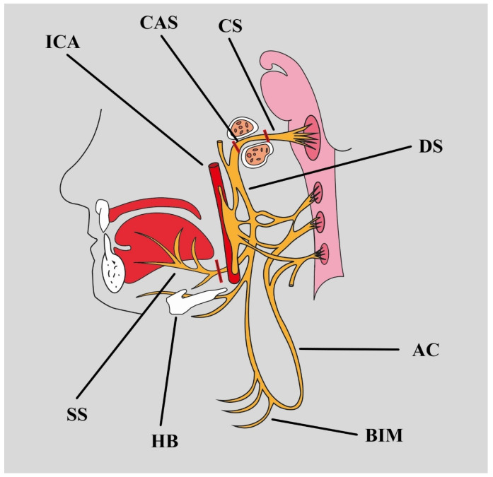
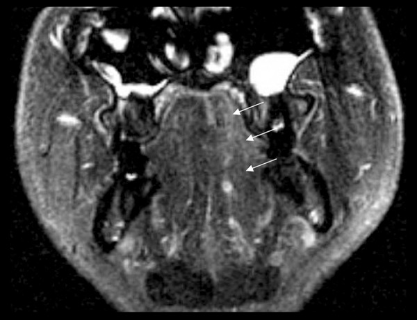
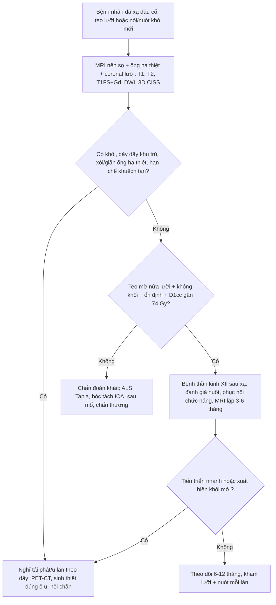
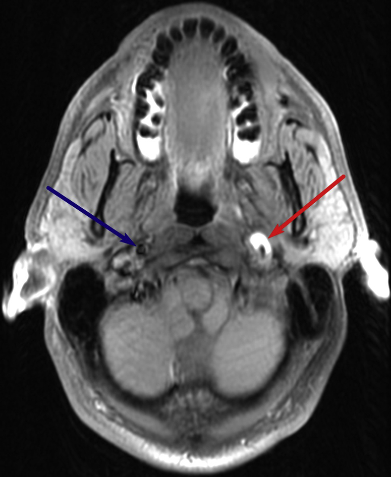
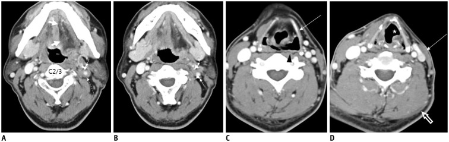

# 1765 — Bệnh thần kinh hạ thiệt XII sau xạ trị đầu cổ / Radiation-induced hypoglossal neuropathy (CN XII)

**Tags:** `pattern:teo-co` `pattern:teo-luoi` `pattern:benh-than-kinh` `pattern:xo-hoa-sau-xa` `pattern:lech-luoi` `pattern:trong-truong-chieu` `vung:dau-co` `vung:nen-so` `vung:loi` `vung:co` `protocol:MRI` `protocol:lieu-OAR` `score:CTCAE` `incidentaloma:khong`

**Mức chắc chắn (certainty):** tổng hợp y văn (literature synthesis) — 2 đoàn hệ xạ trị vòm họng (Chow 2019, 797 bệnh nhân; Luk 2013, 965 bệnh nhân), 1 nghiên cứu điện cơ ở bệnh nhân nuốt khó muộn (McMillan 2026, 13 ca), 1 ca nguyên văn có ảnh (Alqahtani 2016), 1 tổng quan giải phẫu–nguyên nhân (Węgiel 2024) và 1 bài hình ảnh thần kinh cổ (Lee 2017).

**Nguồn có PMCID (tên tác giả đã đối chiếu):**
- Alqahtani SA, Agha C, Rothstein T, *Am J Case Rep* 2016 — **PMC4968431**, **CC BY-NC-ND 4.0**.
- Węgiel A, Zielinska N, Głowacka M, Olewnik Ł, *Biomedicines* 2024 — **PMC11048189**, **CC BY 4.0**.
- Cruciata G, Parikh R, Pradhan M, Shah J, Greif E, Stein EG, *Radiol Case Rep* 2017 — **PMC5417729**, **CC BY-NC-ND 4.0**.
- Lee JH, Cheng KL, Choi YJ, Baek JH, *Korean J Radiol* 2017 — **PMC5240499**, **CC BY-NC 3.0**.
- McMillan H et al., *Head Neck* 2026 — **PMC12621234**, **CC BY-NC-ND 4.0** (chỉ số liệu, không dùng ảnh).

**Nguồn chỉ dùng số liệu (không PMC open access):** Chow JCH et al., *Radiother Oncol* 2019 (PMID 31252300); Luk YS et al., *Oral Oncol* 2013 (PMID 22892236); Kong L et al., *Int J Radiat Oncol Biol Phys* 2011 (PMID 20605344); Shin HY et al., *Clin Neurophysiol* 2013 (PMID 23022037); Kato K et al., *Magn Reson Med Sci* 2002 (PMID 16082138).

> **Câu chốt:** XII **là dây sọ bị tổn thương thường gặp nhất sau xạ vòm họng** — **30/36 ca (83%)** liệt dây sọ do xạ trong đoàn hệ Luk 2013 là XII. Ba con số phải thuộc: **(1)** liệt XII sau IMRT triệt căn là **8,7% (69/797)** với theo dõi trung vị **8,1 năm** (Chow 2019) — không phải biến cố hiếm; **(2) D1cc < 74 Gy EQD2** hạ nguy cơ từ **20,8% xuống 2,4%** (AUC **0,826**); **(3)** hình ảnh chốt không phải "khối" mà là **teo mỡ nửa lưỡi**: lưỡi **lệch VỀ BÊN LIỆT** khi thè ra, **T1W sáng** do mỡ thay sợi cơ, **mất tín hiệu trên fat-sat**. Nếu có **khối** hoặc **dày/hủy ống hạ thiệt** → đó không phải di chứng xạ, mà là **tái phát/u lan theo dây**.

## 1. Tổng quan bệnh học – cơ chế hình ảnh

### 1.1 XII đi qua đâu — giải phẫu quyết định cách đọc phim

- **Nhân vận động** nằm ở **hành não**, sát sàn não thất IV; sợi trục đi ra **rãnh trước–bên hành não** (giữa trám hành và tháp hành), rồi chạy trong **bể não trước** (đoạn bể não, *cisternal segment*).
- **Ống hạ thiệt (hypoglossal canal)** là một ống xương dài **~5 mm** ở phần bên lỗ chẩm, **không phải một lỗ tròn**; trong ống, XII đi cùng **nhánh màng não của động mạch đốt sống** và **đám rối tĩnh mạch**. Đây là điểm hẹp giải phẫu: u nhỏ, di căn hay xơ hóa trong ống đều gây liệt mà **không cần khối lớn**.
- Ra khỏi ống, XII vào **khoang cảnh sau (carotid space)**, chạy **giữa động mạch cảnh trong (ICA) phía trước–trong và tĩnh mạch cảnh trong (IJV) phía sau–ngoài**, rồi **vòng ra trước** trên **sừng bé xương móng**, chui **giữa cơ móng–lưỡi và cơ hàm–móng** vào sàn miệng.
- **Chi phối:** **genioglossus** (nhô lưỡi ra trước), **hyoglossus** (hạ và kéo lưỡi ra sau), **styloglossus** (kéo lưỡi lên–ra sau), **các cơ lưỡi nội tại** (thay đổi hình dạng lưỡi); nhánh **C1** đi kèm XII chi phối **geniohyoid** và **cơ giáp–móng**.
- **Hệ quả lâm sàng — quy tắc vàng:** **genioglossus bên liệt không đẩy được lưỡi sang bên đối diện**, nên khi thè lưỡi, lưỡi **lệch VỀ PHÍA TỔN THƯƠNG** (bên liệt). Tổn thương **bó vỏ–nhân (UMN)** cho lệch **về phía ĐỐI DIỆN**. Đây là câu hỏi khám 30 giây phân biệt **tổn thương dây XII** với **đột quỵ**.

*Sơ đồ giải phẫu: XII từ **đoạn bể não (CS)** → **đoạn trong ống hạ thiệt (CAS)** → **đoạn xuống (DS)**; các nhánh cùng quai cổ (AC) và nhánh cơ dưới móng (BIM). Nguồn: Węgiel A et al., Biomedicines 2024 (PMC11048189, Fig. 2), CC BY 4.0.*

### 1.2 TẠI SAO xạ làm liệt XII — chuỗi mạch máu nhỏ → xơ → hủy myelin

- **Tổn thương nguyên phát ở vi mạch nuôi dây.** Xạ gây **apoptosis tế bào nội mô**, mất mao mạch quanh dây, **thiếu oxy mô kéo dài**; TGF-β tăng → nguyên bào sợi → **myofibroblast** → lắng đọng **collagen I/III**, ức chế MMP. Kết quả là **bao xơ quanh dây** và **chèn ép trong ống hạ thiệt** — nơi dây không có chỗ giãn.
- **Trên sợi trục:** phù myelin → **hủy myelin từng đoạn** → mất sợi trục → **thoái hóa sợi trục**. Sợi vận động có myelin dày bị ảnh hưởng sớm, nên biểu hiện là **yếu–teo lưỡi** chứ không phải đau (khác V3 — bài 1764).
- **TẠI SAO tiềm tàng nhiều năm:** dây là mô **hậu phân bào, chuyển hóa chậm**; tổn thương tích lũy qua **nhiều năm** mới mất bù. Trong đoàn hệ vòm họng, **liệt dây sọ xuất hiện trung vị 7,6 năm** sau xạ và **nguy cơ tích lũy 44,5% ở 20 năm** (Kong 2011); dây **dưới** (IX–XII) bị nhiều hơn dây trên (**25,5% vs 13,9%**).
- **Vì sao "teo" chứ không "khối":** mất thần kinh → mất tín hiệu dinh dưỡng cơ → **phân hủy protein** > tổng hợp → teo sợi cơ; tế bào vệ tinh không bù đủ → **mỡ thay thế**. Trên MRI, mỡ thay thế có **T1W sáng, T2W sáng, mất tín hiệu khi fat-sat**. Xạ **không tạo khối tế bào** — nếu có khối thì nguyên nhân là u, không phải xạ.
- **Chuỗi thời gian mất thần kinh (Kato 2002, 6 ca, theo dõi 6–44 tháng):** **≤ 3 tháng** = cơ **tăng T2W + ngấm thuốc**, T1W chưa đổi, **chưa teo**; **> 3 tháng** = **T1W và T2W đều sáng** (mỡ), thể tích giảm, ngấm thuốc giảm. Vì vậy **MRI ở tháng thứ 1–2 có thể bình thường**; muốn thấy teo phải chụp lại sau **3–6 tháng**.

### 1.3 Số liệu định lượng phải thuộc

| Đại lượng | Con số | Nguồn |
|---|---|---|
| Liệt XII sau IMRT triệt căn cho ung thư vòm họng | **8,7% (69/797)**, theo dõi trung vị **8,1 năm** | Chow 2019, PMID 31252300 |
| Ngưỡng liều tốt nhất (ROC) | **D1cc** — AUC **0,826** ở 8 năm; D1cc **74 Gy EQD2** → nguy cơ **4,7%** | Chow 2019 |
| D1cc dưới/trên ngưỡng | **2,4% vs 20,8%** (p < 0,001) | Chow 2019 |
| Yếu tố nguy cơ độc lập | **liều cao**, **đái tháo đường**, **T giai đoạn muộn**, **ống hạ thiệt bị xâm lấn trên hình ảnh** | Chow 2019 |
| Liệt dây sọ do xạ (xạ 1998–2007) | **3,7% (36/965)**; theo dõi trung vị **8,9 năm**; **XII hay gặp nhất 30/36**, trong đó **6 ca hai bên** | Luk 2013, PMID 22892236 |
| Liệt dây sọ sau xạ vòm họng quy ước | **30,9% (98/317)**; tích lũy **10,4 / 22,4 / 35,5 / 44,5%** ở **5 / 10 / 15 / 20 năm** | Kong 2011, PMID 20605344 |
| Thần kinh XII dưới lâm sàng ở nuốt khó muộn | **13/13 (100%)** có bằng chứng điện cơ, **31%** không có dấu hiệu lâm sàng; trung vị **8,3 năm** sau xạ | McMillan 2026, PMC12621234 |
| Tiềm tàng dây sọ dưới (điện cơ) | **trung vị 61 tháng** (20–118); **myokymia 3/6**, điện cơ bất thường **5/6** | Shin 2013, PMID 23022037 |
| Ca teo lưỡi một bên muộn nhất | Xạ **1980** → triệu chứng **2014** = **~34 năm** | Alqahtani 2016, PMC4968431 |

- **Đọc con số cho đúng:** "8,7%" là **69 người bị liệt lưỡi vĩnh viễn** trong một trung tâm lớn — không phải biến cố hiếm gặp; và **31% ca dưới lâm sàng** nghĩa là **khám lưỡi bình thường không loại trừ**. Nhưng "44,5% ở 20 năm" thuộc **xạ quy ước thập niên 1980–1990**, không dùng để hù bệnh nhân IMRT hôm nay.
- **Phản biện (cửa 3):** ngưỡng **74 Gy EQD2** xuất phát từ **330 dây được vẽ lại hồi cứu** trong một trung tâm, **chưa xác nhận tiền cứu**; đây là **constraint đề xuất**, không phải hằng số sinh học. Ngược lại, tỉ lệ **8,7%** đủ lớn để biện minh cho việc **vẽ XII là OAR bắt buộc** trong kế hoạch IMRT vòm họng.

## 2. Mẫu hình + chẩn đoán phân biệt theo vị trí (gamut)

### 2.1 Mẫu hình lâm sàng

- **Thể kinh điển:** bệnh nhân **đã xạ đầu cổ 5–30 năm**, đến vì **nói khó/nuốt khó tiến triển chậm**, khám thấy **nửa lưỡi teo, nhăn, lệch về bên liệt**, có thể **giật bó cơ (fasciculation)**; **không đau**, **không khối**, niêm mạc lưỡi bình thường.
- **Thể dưới lâm sàng:** không than phiền gì, teo lưỡi phát hiện tình cờ khi chụp MRI đầu–cổ vì lý do khác (McMillan 2026: **31%**).
- **Thể hai bên:** lưỡi teo cả hai bên, khó nói/khó nuốt nặng, có thể **phì đại mô mỡ lưỡi**; gặp khi trường xạ phủ **hai ống hạ thiệt** hoặc khi có bệnh nơ-ron vận động.
- **Thể kèm dây khác:** XII + X (nuốt–nói), XII + IX–XI (hội chứng **Collet–Sicard** ở lỗ tĩnh mạch cảnh), XII + V (hội chứng **Godtfredsen**), XII + đau chẩm dữ dội (hội chứng **lồi cầu chẩm**) — các thể này **gợi ý tổn thương thực thể**, không phải di chứng xạ đơn thuần.

### 2.2 Gamut theo đoạn giải phẫu (dọc đường đi của XII)

| Đoạn | Bệnh cảnh gợi ý | Chẩn đoán phân biệt chính |
|---|---|---|
| **Hành não (nhân XII)** | Liệt lưỡi + dấu thân não khác, khởi phát cấp | Nhồi máu hành não (hội chứng Wallenberg), u hành não, mất myelin, bệnh nơ-ron vận động |
| **Đoạn bể não** | Liệt XII đơn độc tiến triển | U màng não, schwannoma XII, di căn màng não, xơ hóa sau xạ |
| **Ống hạ thiệt** | Liệt XII + đau chẩm, hoặc liệt đơn độc | Di căn xương nền sọ, u màng não/schwannoma trong ống, chordoma, **viêm xương nền sọ**, **xâm lấn do u vòm họng** |
| **Khoang cảnh sau** | Liệt XII + đau cổ/mặt, có thể kèm Horner | **Bóc tách ICA**, giả phình ICA, schwannoma dây XII, hạch cổ ác tính, u họng lan ra |
| **Dưới hàm – sàn miệng** | Liệt XII sau can thiệp/chấn thương | Phẫu thuật/ống thông, chấn thương, u tuyến dưới hàm, viêm mô tế bào |

### 2.3 Gamut theo hình thái trên MRI lưỡi

- **Teo mỡ một bên, không khối, không phù** → **mất thần kinh** (xạ, sau mổ, chấn thương, u đã điều trị).
- **Teo + phù + ngấm thuốc ở giai đoạn sớm (< 3 tháng)** → mất thần kinh cấp; dễ đọc nhầm là **viêm cơ/u**.
- **Teo + khối trong lưỡi** → **u nguyên phát** (SCC sàn miệng/lưỡi lan theo dây) hoặc di căn.
- **Teo hai bên + giật bó cơ + không rối loạn cảm giác** → **bệnh nơ-ron vận động (ALS)** hoặc **Kennedy (SBMA)** — không phải xạ.

## 3. Bảng so sánh phân biệt (ma trận đối chiếu)

| Thực thể (entity) | Hình ảnh điển hình (MRI/CT) | Chốt vào (rule-in) | Chốt loại (rule-out) | Gợi ý xác nhận |
|---|---|---|---|---|
| **Bệnh thần kinh XII sau xạ** | **Teo mỡ nửa lưỡi** (T1W sáng, mất tín hiệu fat-sat), **không khối**, **không phù**; ống hạ thiệt **nguyên vẹn**; XII có thể **ngấm thuốc nhẹ** | **Tiền sử xạ đúng vùng + tiềm tàng ≥ 1–2 năm + teo mỡ đúng phân bố XII + không khối + ổn định 3–6 tháng + D1cc gần/vượt 74 Gy EQD2** | Có **khối**, **dày/xói ống hạ thiệt**, **hạn chế khuếch tán**, hoặc **tiến triển nhanh** → không phải xạ | Đối chiếu **bản đồ liều** (XII D1cc); MRI lặp 3–6 tháng; EMG genioglossus |
| **Tái phát / u lan theo dây (PNS)** | **Dày dây không đều, ngấm thuốc mạnh**, **mất mỡ quanh dây trong ống**, **giãn/hủy ống hạ thiệt**; ổ u nguyên phát (vòm họng, họng, tuyến mang tai) | **Khối/ dày dây liên tục từ ổ u tới ống**, **xói xương**, **ADC thấp**, **FDG dương**, **tiến triển** | Dây mảnh, ống nguyên vẹn, không khối, ổn định nhiều tháng → nghiêng xạ | MRI 3T T1FS+Gd đa bình diện + DWI; PET/CT; **sinh thiết ổ u, không sinh thiết dây mù** |
| **U trong ống hạ thiệt (meningioma/schwannoma)** | Khối **bờ rõ**, **giãn ống**, schwannoma **T2 sáng + ngấm mạnh**, meningioma **T2 trung tính + đuôi màng cứng**, có thể vôi hóa | **Khối đặc + giãn ống + hiệu ứng khối** | Không khối, ống bình thường, chỉ teo lưỡi → không phải u | MRI + **CT xương nền sọ 0,5–1 mm**; theo dõi hoặc mổ theo triệu chứng |
| **Bóc tách ICA** | **Huyết khối trong thành**: T1FS **dải sáng hình liềm** trong ICA; hẹp **"đuôi chuột"** trên MRA/CTA; có thể giả phình | **Đau cổ/mặt một bên + Horner + liệt XII**, **dải sáng T1FS trong thành mạch**, hẹp dài | Mạch máu bình thường, không dải sáng → loại | **CTA/MRA cổ**; MRI T1FS lát mỏng; kháng đông theo phác đồ |
| **Di căn xương nền sọ / lồi cầu chẩm** | **Tiêu xương lồi cầu/ống hạ thiệt**, khối mô mềm, **ngấm thuốc**, có thể phá vỏ xương | **Đau chẩm dữ dội + liệt XII**, **tiêu xương trên CT**, bệnh ung thư đã biết | Xương nguyên vẹn, không khối, đau nhẹ → ít nghĩ | **CT xương 0,5–1 mm** + MRI; PET/CT; sinh thiết nếu cần |
| **Bệnh nơ-ron vận động (ALS/Kennedy)** | **Teo lưỡi hai bên**, giật bó cơ, **không khối**, **không ngấm**, XII bình thường; teo cơ chi kèm theo | **Teo + giật bó cơ lan rộng, không rối loạn cảm giác, điện cơ có thoái hóa sợi trục nhiều vùng** | Teo một bên đơn độc, có tiền sử xạ đúng vùng → không phải ALS | EMG/điện cơ toàn thân; khám thần kinh; theo dõi tiến triển |
| **Hội chứng Tapia (X + XII)** | Teo nửa lưỡi + **liệt dây thanh cùng bên**, thường **sau đặt nội khí quản/mặt nạ**, không khối | **Liệt lưỡi + liệt thanh quản cùng bên sau can thiệp đường thở** | Chỉ XII đơn độc, có khối/u → không phải Tapia | Nội soi thanh quản; MRI cổ; theo dõi hồi phục |
| **Chấn thương / sau mổ cổ** | **Dị vật kim loại, máu tụ, đứt dây**, thay đổi giải phẫu sau mổ | **Tiền sử chấn thương/mổ đúng vị trí**, tổn thương thấy được trên CT/MRI | Tiền sử xa, không tổn thương cấu trúc → không phải chấn thương | CT cổ có cản quang; MRI; khám thần kinh trước–sau mổ |

*Coronal T2W: **dải mỡ bất đối xứng và teo mỡ nửa lưỡi trái** (mũi tên) sau xạ vùng đầu–cổ — hình thái chốt của **mất thần kinh XII mạn**. Không có khối, không phù. Nguồn: Alqahtani SA et al., Am J Case Rep 2016 (PMC4968431, Fig. 2), CC BY-NC-ND 4.0.*

### 3.1 Ba câu hỏi trên MRI quyết định chẩn đoán

1. **Có khối hoặc dày dây bất thường không?** Xạ cho **dây mảnh/ngấm nhẹ, không khối**; tái phát/PNS cho **dày không đều, ngấm mạnh, liên tục từ ổ u**.
2. **Ống hạ thiệt có bị xói/giãn không?** **Giãn ống** = schwannoma/u trong ống; **xói ống** = di căn/u lan; xạ **không làm giãn ống**.
3. **Lưỡi có teo mỡ đúng phân bố không?** Teo **một bên + không khối + ổn định** củng cố nguyên nhân thần kinh; teo **hai bên + giật bó cơ** đòi hỏi loại ALS.

### 3.2 "Teo lưỡi" không đồng nghĩa "di chứng xạ"

- **Teo lưỡi là dấu hiệu mất thần kinh, không phải chẩn đoán nguyên nhân.** Xạ, u, chấn thương, sau mổ, ALS đều cho cùng hình thái mỡ thay thế.
- **Nguyên nhân nằm ở dây và ống hạ thiệt, không nằm ở lưỡi.** Vì vậy mọi ca teo lưỡi mới phải đọc **toàn bộ đường XII** từ hành não đến sàn miệng, không dừng ở ảnh lưỡi.
- **Ngấm thuốc dây sau xạ** có thể tồn tại nhiều tháng–nhiều năm do viêm/xơ; đây là dấu **tổn thương**, không phải dấu **u** (Mousavi 2017, dẫn qua bài 1764).

## 4. Protocol chụp/đánh giá + ngưỡng liều

### 4.1 MRI nền sọ – ống hạ thiệt – lưỡi (bắt buộc khi có triệu chứng mới)

- **Máy 3T** (1,5T được, kém chi tiết dây), cuộn đầu–cổ; **lát ≤ 1 mm** cho chuỗi 3D.
- **Chuỗi bắt buộc:**
  - **Axial T2W** và **axial T1W không fat-sat** (mỡ quanh dây, teo mỡ lưỡi).
  - **Axial + coronal T1W fat-sat sau tiêm** (dây XII, ống hạ thiệt, khoang cảnh).
  - **DWI b ≥ 800 s/mm² + ADC** (ổ nghi u/tái phát).
  - **3D CISS/FIESTA** đoạn bể não (dây mảnh, so sánh hai bên).
  - **Coronal T2W/STIR qua sàn miệng–lưỡi**: đây là chuỗi **bắt buộc để thấy teo mỡ**, dễ bị bỏ nếu chỉ chụp axial.
  - **Tái tạo coronal/sagittal dọc XII** từ chuỗi 3D T1 sau tiêm: hành não → bể não → ống → khoang cảnh.
- **Phạm vi:** từ **hành não** đến **xương móng/sàn miệng**, **hai bên** để so sánh; luôn chụp **cả ổ u nguyên phát** (vòm họng, họng, tuyến mang tai) vì PNS có thể "nhảy" đoạn.
- **Đối chiếu bản đồ liều:** chồng MRI lên **CT xạ trị** để xem XII và ống hạ thiệt có nằm trong **vùng liều cao** không.

### 4.2 CT và PET/CT

- **CT xương nền sọ 0,5–1 mm**: đánh giá **xói/giãn ống hạ thiệt**, vôi hóa, di căn xương. CT **không** đánh giá dây mềm.
- **FDG-PET/CT**: hữu ích khi MRI không kết luận hoặc có ổ nghi tái phát; **dương giả sau xạ/viêm**, **âm giả với u nhỏ**. Không dùng PET đơn thuần để chẩn đoán bệnh thần kinh.

### 4.3 Ngưỡng liều tham chiếu

| Cấu trúc | Ngưỡng / mô hình | Ý nghĩa thực hành | Nguồn |
|---|---|---|---|
| **XII** (IMRT vòm họng) | **D1cc < 74 Gy EQD2** → liệt **2,4% vs 20,8%**; tại 74 Gy nguy cơ **4,7%**; AUC **0,826** | **Constraint chính** khi vẽ XII; ưu tiên giảm **liều điểm nóng 1 cc** hơn là Dmax | Chow 2019 |
| **Dây sọ dưới nói chung** | Nguy cơ tích lũy **44,5% ở 20 năm** (xạ quy ước) | Giải thích cho bệnh nhân sống lâu; **theo dõi ≥ 10 năm** | Kong 2011 |
| **XII dưới lâm sàng** | **100%** ca nuốt khó muộn có bằng chứng điện cơ, **31%** không triệu chứng | Khám lưỡi **và** đánh giá nuốt, đừng chờ bệnh nhân than | McMillan 2026 |

### 4.4 Khi nào chụp lại — sơ đồ quyết định

### 4.5 Phân độ và theo dõi

- **Chưa có thang riêng cho XII.** Dùng **CTCAE** cho triệu chứng (nói khó, nuốt khó) và mô tả **giai đoạn thực hành**: **0** = không triệu chứng, không teo; **1** = teo đơn thuần/không triệu chứng (kể cả chỉ thấy trên MRI); **2** = nói khó rõ, ăn được thức ăn đặc; **3** = nuốt khó cần thức ăn xay hoặc sặc; **4** = không nuốt được, cần ống nuôi. Ghi **giai đoạn** cùng **D1cc** để so sánh giữa các lần.
- **Theo dõi:** khám lưỡi (thè lưỡi, đẩy má, liếm môi), đánh giá nuốt (**FEES/VFSS**) mỗi **6–12 tháng** ở người sống lâu sau xạ vòm họng; MRI lặp **3–6 tháng** nếu chưa kết luận, sau đó **12 tháng** nếu ổn định.
- **Phục hồi chức năng:** bài tập lưỡi–nuốt, tư thế nuốt, làm đặc dịch; **không có thuốc phục hồi dây**; tránh can thiệp phá hủy.

## 5. Biến thể bình thường và cạm bẫy

- **Bất đối xứng mỡ lưỡi do tuổi/mất răng/nhai một bên:** người già có thể có **dải mỡ bất đối xứng nhẹ** mà không bệnh thần kinh; đối chiếu **hình dạng lưỡi, thể tích, tín hiệu dây** trước khi kết luận.
- **Fat-sat "xóa" teo mỡ:** trên T1FS, mỡ thay thế **mất tín hiệu** → lưỡi trông "bình thường". Luôn đọc **T1W không fat-sat**.
- **Lệch lưỡi do nguyên nhân cơ học:** thiếu răng, loét miệng, đau khớp thái dương hàm làm bệnh nhân đẩy lưỡi lệch; kiểm tra **teo** và **giật bó cơ**, không chỉ nhìn hướng lệch.
- **Nhầm hướng lệch:** XII lệch **về bên liệt**; UMN lệch **về bên đối diện**. Ghi sai hướng là ghi sai định khu.
- **Hiệu ứng thể tích ống hạ thiệt:** lát cắt dày làm dây "dày" giả; dùng **lát ≤ 1 mm**, tái tạo vuông góc với ống.
- **Artifact kim loại răng/hàm:** gây tối tín hiệu quanh sàn miệng; dùng **SEMAC/MAVRIC** hoặc CT khi cần.
- **"Satisfaction of search":** thấy teo lưỡi rồi dừng, bỏ sót **u vòm họng tái phát** hoặc **hạch cổ**; luôn đọc lại ổ u và chuỗi hạch.
- **Gọi mọi teo lưỡi hai bên là "xạ hai bên":** nếu không khớp trường chiếu, nghĩ **ALS/Kennedy** và khám chi, gõ phản xạ, tìm giật bó cơ lan rộng.
- **Chọc/sinh thiết dây trong mô xạ:** ít giá trị, nguy cơ làm nặng tổn thương; chỉ sinh thiết **ổ u** nếu có.

## 6. Tự lượng giá — Blind Quiz

**Ca 1 — Nam 51 tuổi, nói khó và khó cử động lưỡi tăng dần vài tuần; tiền sử sarcoma hoạt mạc cánh tay trái được xạ trị diện rộng năm 1980, sẹo xơ lan từ tay lên cổ.**

- Gợi ý lâm sàng: không đau, không sốt, không khối cổ; khám thấy **teo nửa lưỡi trái**, lưỡi lệch trái khi thè.
- Câu hỏi: Dấu hiệu chính trên ảnh? Ba chẩn đoán phân biệt? Vì sao **không** sinh thiết lưỡi?

<b>Bấm để hiện đáp án (findings + chẩn đoán)</b>

- **Findings:** **teo mỡ và dải mỡ bất đối xứng nửa lưỡi trái** (mũi tên), **không khối**, **không phù**, không ngấm thuốc bất thường; ống hạ thiệt nguyên vẹn.
- **Chẩn đoán:** **bệnh thần kinh XII sau xạ** (muộn **~34 năm** sau xạ) — nguyên nhân do **xơ hóa/thiếu máu dây trong ống hạ thiệt**.
- **Phân biệt:** tái phát/u lan theo dây (loại vì **không khối/không dày dây**), u ống hạ thiệt (loại vì **không giãn ống**), ALS (loại vì **một bên**, không giật bó cơ lan rộng, không teo chi).
- **Vì sao không sinh thiết:** không có khối; sinh thiết dây trong mô xạ **không đổi điều trị**, có nguy cơ làm nặng thêm. Theo dõi MRI **3–6 tháng** rồi **12 tháng**.
- Nguồn ảnh: Alqahtani SA et al., Am J Case Rep 2016 (PMC4968431, Fig. 2), CC BY-NC-ND 4.0.

**Ca 2 — Bệnh nhân bóc tách động mạch cảnh trong: đau cổ–mặt một bên, sụp mi nhẹ (Horner), lưỡi lệch cùng bên; không tiền sử xạ.**

- Gợi ý: đau sau gáy/cổ, có thể sau chấn thương nhẹ hoặc cử động cổ mạnh; mạch cảnh không đập bất thường.
- Câu hỏi: Dấu hiệu chốt? Vì sao liệt XII trong bệnh cảnh này? Bước tiếp theo?

<b>Bấm để hiện đáp án (findings + chẩn đoán)</b>

- **Findings:** **dải sáng hình liềm trong thành ICA trái trên T1FS** (mũi tên đỏ) = **máu trong thành (methemoglobin)**; kèm **giả phình** và hẹp lòng mạch; không khối quanh dây XII.
- **Chẩn đoán:** **bóc tách động mạch cảnh trong** gây **liệt XII cùng bên** do dây chạy sát thành mạch trong khoang cảnh sau; kèm **Horner** (sụp mi) là bộ ba kinh điển.
- **Phân biệt:** đau dây V, viêm mô tế bào cổ, sau xạ (không tiền sử), u khoang cảnh (không khối).
- **Bước tiếp theo:** **CTA/MRA cổ** xác nhận; kháng đông/kháng kết tập theo phác đồ **≥ 3 tháng**; theo dõi **7 ngày, 3 tháng**; tầm soát bệnh mô liên kết.
- **Vì sao quan trọng:** bỏ sót bóc tách = nguy cơ **đột quỵ**; đây là nguyên nhân **cấp cứu** của liệt XII, không phải di chứng xạ.
- Nguồn ảnh: Cruciata G et al., Radiol Case Rep 2017 (PMC5417729, Fig. 1), CC BY-NC-ND 4.0.

**Ca 3 — Nam 47 tuổi, sau vụ nổ, liệt nhiều dây sọ cùng bên, trong đó có lưỡi lệch và teo; CT cổ có nhiều mảnh kim loại nhỏ quanh mạch cảnh trái.**

- Gợi ý: chấn thương xuyên/đụng dập vùng cổ bên; liệt XII + X + XI cùng bên.
- Câu hỏi: Tại sao liệt **nhiều dây**? Cần loại gì trước khi gọi là "tổn thương dây đơn thuần"?

<b>Bấm để hiện đáp án (findings + chẩn đoán)</b>

- **Findings:** **nhiều mảnh kim loại nhỏ** (mũi tên) và **máu tụ** quanh **ICA trái**; thay đổi thanh quản/đường thở; không thấy khối u.
- **Chẩn đoán:** **liệt nhiều dây sọ sau chấn thương** (tổn thương IX–XII trong khoang cảnh/lỗ tĩnh mạch cảnh) — hình thái **Collet–Sicard** do chấn thương.
- **Vì sao nhiều dây:** các dây **IX, X, XI, XII** cùng đi qua **khoảng hẹp giữa lỗ tĩnh mạch cảnh và ống hạ thiệt**; một mảnh kim loại/máu tụ đủ chạm nhiều dây.
- **Cần loại trước:** **tổn thương mạch máu** (bóc tách/giả phình) bằng **CTA**, và **dị vật còn lại**; sau đó đánh giá nuốt–nói và phục hồi chức năng.
- **Lưu ý nguồn ảnh:** ảnh minh họa **hình thái chấn thương cổ do dị vật**, không phải ca bệnh nhân trong câu chuyện.
- Nguồn ảnh: Lee JH et al., Korean J Radiol 2017 (PMC5240499, Fig. 20), CC BY-NC 3.0.

## Bài liên quan chéo

- [700 – Tổng quan Đầu Cổ](../700-head-neck-overview/lesson.md)
- [1764 – Bệnh thần kinh sinh ba V3 sau xạ trị đầu cổ](../1764-v3-sau-xa-tri-dau-co/lesson.md) (cùng nguyên lý "xơ hóa dây trong ống", khác dây)
- [1763 – Xơ hóa mô mềm cổ sau xạ](../1763-xo-hoa-mo-mem-co-sau-xa/lesson.md) (nền xơ của cùng trường xạ)
- [1684 – Nuốt khó sau xạ trị đầu cổ](../1684-nuot-kho-sau-xa-tri-dau-co/lesson.md) (đánh giá nuốt, FEES/VFSS)
- [1761 – Trismus sau xạ trị đầu cổ](../1761-trismus-sau-xa-tri-dau-co/lesson.md)
- [247 – Bóc tách động mạch cổ/đốt sống](../247-boc-tach-dong-mach-co-dot-song-cervical-artery-dissection/lesson.md)
- [750 – Bản đồ hạch cổ & NI-RADS](../750-cervical-lymph-nodes-nirads/lesson.md)

## Ảnh

- `1765_doan-than-kinh-XII_Anatomy_PMC11048189.jpg` — sơ đồ ba đoạn XII (CS/CAS/DS) và các nhánh (Węgiel A et al., Biomedicines 2024, PMC11048189, Fig. 2, **CC BY 4.0**).
- `1765_teo-luoi_MRI_PMC4968431.jpg` — coronal T2W: teo mỡ và dải mỡ bất đối xứng nửa lưỡi trái (Alqahtani SA et al., Am J Case Rep 2016, PMC4968431, Fig. 2, **CC BY-NC-ND 4.0**, nguyên bản không crop).
- `1765_boc-tach-ICA_MRI_PMC5417729.jpg` — axial T1FS: dải sáng hình liêm trong thành ICA trái, giả phình (Cruciata G et al., Radiol Case Rep 2017, PMC5417729, Fig. 1, **CC BY-NC-ND 4.0**, nguyên bản không crop).
- `1765_chan-thuong-co_CT_PMC5240499.jpg` — CT cổ: dị vật kim loại và máu tụ quanh ICA trái sau chấn thương (Lee JH et al., Korean J Radiol 2017, PMC5240499, Fig. 20, **CC BY-NC 3.0**).

> Không dùng để chẩn đoán độc lập khi chưa có người hướng dẫn.
