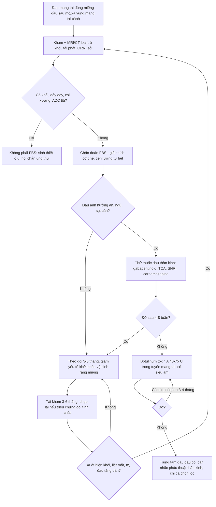
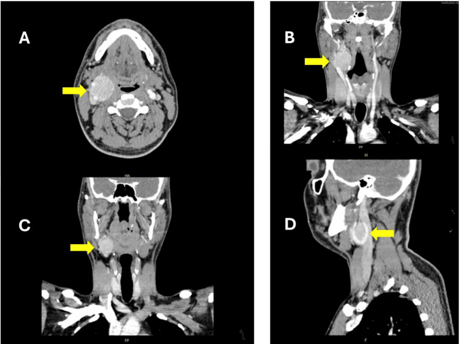
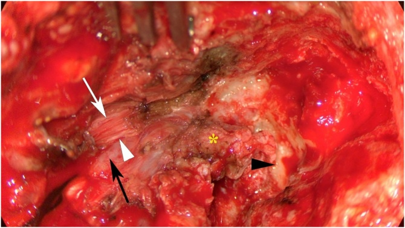
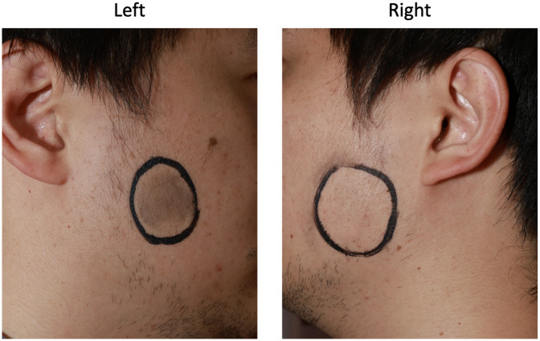

# 1766 — Hội chứng đau khi cắn miếng đầu tiên / First bite syndrome (FBS)

**Tags:** `pattern:dau-mot-ben` `pattern:dau-khi-an` `pattern:mat-thong-cam` `pattern:bien-chung-sau-mo` `pattern:khong-khoi` `vung:dau-co` `vung:tuyen-mang-tai` `vung:mach-co-dau-co` `protocol:MRI` `protocol:CT` `protocol:loai-tru-tai-phat` `incidentaloma:khong`

**Mức chắc chắn (certainty):** tổng hợp y văn (literature synthesis) — ghép các đoàn hệ phẫu thuật, tổng quan và ca bệnh; **không có thử nghiệm đối chứng** cho điều trị.

**Nguồn có PMCID (tên tác giả đã đối chiếu `authorString`):**
- Xu X et al., *Braz J Otorhinolaryngol* 2025 — **PMC12104697**, CC BY 4.0.
- AlOtaibi NM et al., *Cureus* 2025 — **PMC11695805**, CC BY 4.0.
- Li Z et al., *Front Oral Health* 2025 — **PMC12738825**, CC BY 4.0.
- Shaikh NE et al., *Gland Surg* 2022 — **PMC9346217**, CC BY-NC-ND 4.0 (chỉ dùng số liệu).
- Bikk A et al., *Cureus* 2021 — **PMC8301279**, CC BY 4.0 (chỉ dùng số liệu).
- Huang C et al., *J Clin Otorhinolaryngol Head Neck Surg* 2025 — **PMC12764405**, CC BY 4.0 (chỉ dùng số liệu).
- Lammek K et al., *Int J Oral Maxillofac Surg* 2021 — **PMID 33731266** (không OA — chỉ số liệu).
- Tran T, Caruso DP, *J Oral Maxillofac Surg* 2026 — **PMID 41265846** (không OA — chỉ số liệu).

**Ba ca trong quiz là ca bệnh thật đã công bố**, ghi rõ ảnh thuộc ca nào; ảnh **minh họa cơ chế/giải phẫu**, không phải ảnh "chẩn đoán FBS" (FBS không có dấu hiệu hình ảnh đặc hiệu).

> **Câu chốt:** FBS là **chẩn đoán lâm sàng**, không phải chẩn đoán hình ảnh. Ba con số phải thuộc: **tỉ lệ 6,3% sau cắt tuyến mang tai** (7/111) và **8,45% sau mổ khoang mang tai** (12/142), tăng lên **aOR 4,98** với đường vào cổ bên; **khởi phát 2–6 tuần sau mổ**, cơn đau **3–10 giây**; và **6–20% tự hết, 69–82% đỡ một phần, 15–18% đau mạn** — nên **đừng mổ phá hủy thần kinh sớm**, trong khi **botulinum toxin A ≥ 40 U** cho **8/8 ca cải thiện**. Điều quan trọng nhất trên phim: **không có khối** — nếu có khối, giãn dây, xói xương hoặc hạn chế khuếch tán thì **đó không còn là FBS**, mà là tái phát/u lan theo dây.

## 1. Tổng quan bệnh học – cơ chế hình ảnh

### 1.1 Tuyến mang tai tiết nước bọt như thế nào (và vì sao "miếng đầu tiên" lại đau)

- **Phần tiết (secretory) do hệ phó giao cảm chi phối.** Nhân nước bọt dưới ở hành não → dây **IX** → **hạch tai (otic ganglion)** → **dây tai–thái dương** → tuyến mang tai. Khi ăn, có một **đợt phóng thích acetylcholine rất lớn ở những giây đầu**, sau đó giảm dần khi bữa ăn tiếp diễn — đây là lý do **đau chỉ ở miếng đầu**, không đau suốt bữa.
- **Tế bào cơ biểu mô (myoepithelial cell)** nằm giữa nang tuyến và màng đáy, có cả **thụ thể phó giao cảm** và **giao cảm**. Khi co, chúng **bóp nang tuyến** để tống nước bọt vào ống tuyến — giống "bơm" hơn là "tiết".
- **Phần mạch và thể tích do giao cảm chi phối.** Sợi giao cảm từ **hạch giao cảm trên (superior cervical ganglion)** đi theo **đám rối quanh động mạch cảnh** vào tuyến, gây co mạch và điều hòa trương lực cơ biểu mô. Bình thường giao cảm **hãm bớt** đáp ứng co của cơ biểu mô với phó giao cảm.

### 1.2 TẠI SAO mất giao cảm lại gây đau: "nhạy cảm do mất chi phối" (denervation supersensitivity)

- **Mất sợi giao cảm → thụ thể tăng số lượng và tăng gắn kết với adenylyl cyclase** trong tế bào cơ biểu mô và mạch máu tuyến (hiện tượng kinh điển của mô bị cắt thần kinh, đã mô tả từ thực nghiệm trên tuyến nước bọt). Khi đợt acetylcholine **phó giao cảm** ập đến lúc cắn miếng đầu, mô đã "nhạy" phản ứng **quá mức**: cơ biểu mô co mạnh, nang tuyến bị bóp trong một tuyến **còn ứ nước bọt** vì ống tuyến chưa mở kịp → **đau co thắt dữ dội**.
- **Vì sao đau giây lát rồi hết:** đợt phóng thích chỉ kéo vài giây, sau đó tuyến giảm tiết và **giãn ra**; cơn đau điển hình **3–10 giây** (Xu 2025: 4/4 ca), có thể tới vài phút.
- **Vì sao khởi phát 2–6 tuần sau mổ, không ngay lập tức:** nhạy cảm do mất chi phối cần **tổng hợp thụ thể mới**, không xảy ra trong vài giờ. Đây là lý do bệnh nhân **ra viện rồi mới đau**, và lý do bác sĩ phẫu thuật dễ cho rằng "không liên quan đến mổ".
- **Vì sao vẫn có ca "vô căn":** nếu **cả chuỗi giao cảm bị tổn thương do bệnh nền** (đái tháo đường có biến chứng thần kinh tự chủ, xạ trị, u xâm lấn) thì cơ chế vẫn là mất chi phối giao cảm, chỉ khác nguyên nhân. Khoảng **42%** ca FBS có nguyên nhân xác định được, phần còn lại được xếp "vô căn" (Li 2025).

### 1.3 Vì sao đúng những phẫu thuật này: chuỗi giao cảm đi kèm động mạch cảnh

- **Đường đi của sợi giao cảm sau hạch:** hạch giao cảm trên → **đám rối quanh động mạch cảnh trong** → đi vào khoang mang tai cùng động mạch. Vì vậy **bất kỳ cuộc mổ nào bóc tách quanh động mạch cảnh trong, tĩnh mạch cảnh trong hoặc khoang mang tai sâu** đều có thể cắt đứt sợi giao cảm hậu hạch.
- **Tổng quan của Netterville (1998, dẫn qua Xu 2025):** trong 9 ca FBS đầu tiên, **8 ca có cắt chuỗi giao cảm**, 1 ca có **hội chứng Horner** — bằng chứng lâm sàng cho giả thuyết giao cảm.
- **Yếu tố nguy cơ đã được lượng hóa:**
  - **Linkov 2012** (dẫn qua Xu 2025): bóc tách **khoang mang tai (parapharyngeal space)**, **cắt thùy sâu tuyến mang tai** và **hy sinh chuỗi giao cảm** là yếu tố nguy cơ độc lập mạnh nhất.
  - **Huang 2025 (142 ca mổ khoang mang tai):** đường vào **cổ bên** aOR **4,98** (95% CI 1,62–15,31) và **u Schwannoma** aOR **3,75** (1,22–11,51); u ở **tầng trên khoang mang tai** OR **3,21**.
  - **Xu 2025 (47 ca u lỗ tĩnh mạch cảnh):** cả 4 ca FBS đều qua **đường xuyên hố dưới thái dương (ITF)**, có **buộc tĩnh mạch cảnh trong** và **bóc tách động mạch cảnh trong**.

### 1.4 TẠI SAO hình ảnh "bình thường": không có tổn thương mô đặc để thấy

- FBS là **rối loạn chức năng thần kinh–cơ**, không phải khối, không phải viêm, không phải xơ hóa tạo hình. **CT/MRI không có dấu hiệu đặc hiệu**; mọi bất thường trên phim là **bệnh nền hoặc biến chứng khác** (u tái phát, di chứng xạ, tụ dịch).
- Vì vậy vai trò của hình ảnh **không phải chẩn đoán FBS mà là loại trừ kẻ bắt chước**: khối tuyến mang tai/tuyến mang tai phụ, hạch hoại tử, sỏi ống tuyến, u lan theo dây V3, viêm xương hàm do xạ, và **tái phát u** ở bệnh nhân đã mổ ung thư.

### 1.5 Số liệu định lượng phải thuộc

| Đại lượng | Con số | Nguồn |
|---|---|---|
| Tỉ lệ sau **cắt tuyến mang tai** (u lành) | **6,3% (7/111)** | Lammek 2021 |
| Tỉ lệ sau **mổ khoang mang tai** | **8,45% (12/142)** | Huang 2025 |
| Tỉ lệ sau **mổ u lỗ tĩnh mạch cảnh** | **8,5% (4/47)** | Xu 2025 |
| Khoảng dao động trong y văn sau mổ tuyến mang tai/cổ trên | **2–30%**; các loạt phẫu thuật lớn **~6–10%** | Xu 2025; Tran 2026 |
| **Thời điểm khởi phát** | **2–6 tuần** sau mổ | Xu 2025 |
| **Thời lượng cơn đau** | **3–10 giây** (có ca vài phút) | Xu 2025 |
| **Thời gian kéo dài triệu chứng** | trung bình **16 tháng** (6–25 tháng) trong loạt lỗ tĩnh mạch cảnh | Xu 2025 |
| **Tự hết hoàn toàn** | **6–20%**, thời gian **1–18 tháng** | Shaikh 2022 (tổng hợp) |
| **Đỡ một phần** | **69–82%** | Shaikh 2022 |
| **Đau mạn không giảm** | **15–18%** | Shaikh 2022 |
| **Botulinum toxin A ≥ 40 U** | **8/8 (100%)** cải thiện | Shaikh 2022 |
| **Tiêm lại lần 2** | **45,5% (10/22)**, trung bình **3,8 tháng** sau lần đầu | Shaikh 2022 |
| **Hết đau hoàn toàn sau botulinum** | **38,1% (7/22)**, trung bình **12,1 tháng** | Shaikh 2022 |
| **Liều botulinum khởi đầu** | **10–75 U** (tiêm trong tuyến mang tai, thường có siêu âm) | Shaikh 2022 |

## 2. Mẫu hình + chẩn đoán phân biệt theo vị trí (gamut)

**Mẫu hình (pattern):** *đau một bên vùng mang tai/góc hàm, khởi phát tức thì ở miếng ăn đầu tiên, giảm dần khi nhai tiếp, không sưng, không sốt, không khối.*

Gamut theo **cơ chế và thời điểm đau**:

| Nhóm | Bệnh cảnh | Vì sao vào gamut |
|---|---|---|
| **Thần kinh–cơ (chức năng)** | **FBS** · bệnh thần kinh V3 sau xạ (1764) · đau dây IX · đau dây V nguyên phát | Đau do thần kinh, không có tổn thương mô đặc; FBS đau **theo bữa**, V3 đau **theo kích thích/chạm** |
| **Tuyến nước bọt** | Sỏi ống tuyến/viêm tuyến mang tai · hẹp ống tuyến · u tuyến mang tai · hội chứng Frey | Cùng vùng, cùng "đau khi ăn"; khác nhau ở **sưng/đỏ/vã mồ hôi** và **thời điểm đau** |
| **Cơ–khớp–răng** | Rối loạn khớp thái dương hàm · đau cơ nhai · sâu răng/viêm tủy · hội chứng Eagle | Đau khi há miệng/nhai; không có cơn "miếng đầu" |
| **Sau mổ/xạ** | Tái phát u · u lan theo dây · viêm xương hàm do xạ (ORN) · đau thần kinh sau mổ | Bắt buộc loại trừ ở bệnh nhân ung thư đầu cổ |
| **Toàn thân** | Đái tháo đường có biến chứng thần kinh tự chủ · bệnh tự miễn (Sjögren) · trào ngược | FBS "vô căn" thường là mất chi phối giao cảm do bệnh nền |

**Phân bố theo thời gian đau** — chốt phân biệt nhanh tại giường:

- **Chỉ miếng đầu, giảm khi nhai tiếp** → FBS.
- **Tăng dần suốt bữa, kèm sưng dưới góc hàm** → tắc ống tuyến/sỏi.
- **Đau + đỏ + vã mồ hôi khi ăn** → hội chứng Frey (tái phân bố phó giao cảm ra da).
- **Đau điện giật khi chạm, đánh răng, gió lạnh** → đau dây V; nếu kèm tê/teo cơ nhai → bệnh thần kinh V3 (1764).
- **Đau sâu một bên họng, lan vào tai khi nuốt** → dây IX; **đau khi quay cổ/nuốt + mỏm trâm dài** → Eagle.

## 3. Bảng so sánh phân biệt (ma trận đối chiếu)

| Thực thể (entity) | Hình ảnh điển hình (US/CT/MRI theo thì) | Chốt vào (rule-in) | Chốt loại (rule-out) | Gợi ý xác nhận |
|---|---|---|---|---|
| **FBS** | **Không có dấu hiệu đặc hiệu**; tuyến mang tai bình thường hoặc teo mỡ sau mổ; không khối, không hạn chế khuếch tán | **Đau co thắt đúng miếng đầu, giảm khi nhai tiếp, khởi phát 2–6 tuần sau mổ vùng mang tai/cảnh**; khám và hình ảnh âm tính | **Không có khối, không giãn dây, không xói xương, không hạn chế khuếch tán** trên MRI/CT chất lượng tốt | Chẩn đoán lâm sàng; hỏi kỹ **thức ăn chua** (Abdeldaoui: yếu tố khởi phát) và **tiền sử mổ/xạ** |
| **Tái phát/u lan theo dây** | MRI T1FS+Gd: **khối/ dây dày, ngấm thuốc mạnh**; DWI **ADC tối**; có thể giãn lỗ bầu dục | **Khối mới, dây dày lên theo thời gian, giãn/hủy lỗ, ADC tối, FDG dương** | **Không khối + ADC không giảm + ổn định ≥ 6–12 tháng** | MRI 3T có DWI + PET/CT; **sinh thiết ổ u, không sinh thiết dây mù** |
| **Sỏi/tắc ống tuyến** | US: **nốt tăng âm có bóng lưng** trong ống tuyến; CT không cản quang thấy sỏi calci | **Đau tăng dần trong bữa + sưng tuyến + thấy sỏi/giãn ống** | **Không sỏi, không giãn ống, đau chỉ ở miếng đầu** | US tuyến mang tai; CT xoang hàm khi cần |
| **Hội chứng Frey** | Không cần hình ảnh; test hồ nhỏ giọt i-ốt–tinh bột dương | **Đỏ + vã mồ hôi vùng mang tai khi ăn**, không đau | **Chỉ đau, không đỏ/không vã mồ hôi** | Lâm sàng; hỏi triệu chứng khi ăn thức ăn chua |
| **Đau dây V nguyên phát / V3 sau xạ** | MRI: **dây V3 teo/ngấm thuốc nhẹ, không khối** nếu sau xạ; mạch máu chạm dây ở cầu não nếu nguyên phát | **Đau điện giật theo kích thích, không theo bữa**; ± tê, teo cơ nhai (1764) | **Đau đúng miếng đầu, không có dị cảm/teo cơ** | Khám cảm giác V3, lực cắn; MRI nền sọ |
| **Viêm xương hàm do xạ (ORN)** | CT: **xơ đặc xương + mảnh xương chết + mất liên tục vỏ**; MRI: phù tủy, ngấm thuốc | **Đau sâu, lộ xương, không lành > 3 tháng sau xạ**, có mảnh xương chết | **Xương nguyên vẹn, không mảnh chết, đau theo bữa** | CT hàm mặt lát mỏng; nội soi miệng |
| **Đau răng/khớp thái dương hàm** | CT/CBCT: sâu răng, tiêu xương ổ, thoái hóa lồi cầu | **Đau khi cắn/nhai một bên, đau khớp, tiếng lục cục** | **Cơn đau chỉ ở miếng đầu rồi hết hẳn** | Khám răng–hàm, CBCT |

## 4. Protocol chụp + hệ phân độ/điểm chuẩn hóa

### 4.1 Khi nào chụp, chụp gì

- **Không chụp để "chẩn đoán FBS".** Chụp khi có **dấu hiệu báo động**: khối sờ được, liệt mặt, tê vùng V3, há miệng hạn chế, sụt cân, đau tăng dần/không theo bữa, chảy máu, hoặc bệnh nhân đã mổ/xạ ung thư.
- **MRI tuyến mang tai – cổ** (ưu tiên): T1W, T2W fat-sat, **DWI/ADC**, T1W fat-sat sau tiêm, lớp **≤ 3 mm**; đọc cả **giường tuyến sau mổ, khoang mang tai, chuỗi hạch cổ, lỗ bầu dục** (đường V3).
- **CT cổ có cản quang** khi nghi sỏi, ORN, hoặc cần đánh giá xương hàm; **US tuyến mang tai** khi nghi tắc ống/sỏi.
- **Không cần** PET/CT thường quy; chỉ khi nghi tái phát/di căn và MRI chưa kết luận.

### 4.2 Điều trị theo bậc — sơ đồ quyết định

### 4.3 Phân độ thực hành (chưa có thang điểm chuẩn hóa)

- **Chưa có thang điểm được thẩm định cho FBS** — đây là giới hạn bằng chứng. Để theo dõi, ghi **VAS 0–10**, **số bữa đau/ngày**, **thời lượng cơn**, **có né thức ăn chua/cứng không**, **cân nặng**. Cách gộp thực hành (suy luận, không phải guideline): **độ I** = đau nhẹ, không hạn chế ăn; **độ II** = đau vừa, phải ăn chậm/tránh thức ăn; **độ III** = đau dữ dội, sụt cân, không dám ăn.
- **Theo dõi:** khám lại **3–6 tháng**; nếu **ổn định/giảm** thì tiếp tục theo dõi vì nhiều ca tự hết trong **1–18 tháng**; nếu **tăng dần hoặc đổi tính chất** → chụp lại và nghĩ tái phát.

### 4.4 Ngưỡng điều trị cần nhớ

| Can thiệp | Ngưỡng / liều | Bằng chứng |
|---|---|---|
| Giải thích + theo dõi | Bước đầu cho **mọi ca**, đặc biệt độ I–II | Tự hết **6–20%**, đỡ **69–82%** (Shaikh 2022) |
| Thuốc đau thần kinh | Gabapentin/pregabalin, amitriptyline, carbamazepine, SNRI | Chỉ ca bệnh/loạt nhỏ; **bằng chứng yếu** |
| **Botulinum toxin A** | **40–75 U** tiêm trong tuyến mang tai (có siêu âm); lặp khi đau quay lại | **8/8 ca ≥ 40 U cải thiện**; tiêm lại **45,5%** ở **3,8 tháng**; hết đau **38,1%** ở **12,1 tháng** (Shaikh 2022) |
| Phẫu thuật thần kinh (cắt dây tai–thái dương, cắt thần kinh nhĩ/Jacobson) | **Ca kháng trị, chọn lọc** | Loạt nhỏ/ca bệnh; **không có thử nghiệm** — tránh chỉ định sớm vì nhiều ca tự hết |

## 5. Biến thể bình thường và cạm bẫy

- **"Không thấy gì trên MRI" không loại trừ FBS** — và cũng **không loại trừ tái phát vi thể**; chẩn đoán dựa vào **kiểu đau theo bữa**, không dựa vào phim.
- **FBS hai bên** rất hiếm; nếu gặp, tìm **bệnh nền toàn thân** (đái tháo đường có biến chứng tự chủ, xạ hai bên, bệnh tự miễn) thay vì gán cho "sau mổ".
- **Đái tháo đường kiểm soát kém** có thể gây FBS "vô căn" do biến chứng thần kinh tự chủ; **kiểm soát đường huyết** có ca hết đau (Tran 2026) — đừng bỏ qua điều trị bệnh nền.
- **Nhầm với hội chứng Frey:** Frey là **đỏ + vã mồ hôi**, không đau; hai hội chứng có thể **cùng tồn tại** sau cắt tuyến mang tai, nên hỏi cả hai.
- **Nhầm với đau dây V nguyên phát:** đau dây V do **kích thích** (chạm, gió, đánh răng), không do bữa ăn; nếu **tê + teo cơ nhai** thì nghĩ bệnh thần kinh V3 sau xạ (1764), không phải FBS.
- **Nhầm với sỏi ống tuyến:** sỏi đau **tăng dần trong bữa** và có **sưng tuyến**; FBS đau **giảm dần** và không sưng.
- **Bẫy "thỏa mãn tìm kiếm":** đã thấy di chứng xạ/teo tuyến rồi dừng, bỏ sót **u tái phát ở giường tuyến hoặc hạch cổ**; luôn đọc lại **giường mổ + chuỗi hạch + lỗ bầu dục**.
- **Bẫy thời gian:** khởi phát **2–6 tuần sau mổ** nên bệnh nhân thường đã ra viện; bác sĩ điều trị sau có thể cho là "đau răng" hoặc "viêm tuyến" và **kê kháng sinh vô ích**.
- **Tránh phẫu thuật phá hủy sớm:** vì **6–20% tự hết** và **69–82% đỡ**, chỉ can thiệp phẫu thuật sau khi đã thử nội khoa/botulinum và đau ảnh hưởng nặng.

## 6. Tự lượng giá — Blind Quiz

**Ca 1 — Nam 36 tuổi, sau mổ bóc u vùng cổ bên, 3 tuần sau xuất viện xuất hiện đau dữ dội vùng mang tai cùng bên ngay miếng ăn đầu, giảm sau vài giây; không sốt, không sưng.**

- Gợi ý lâm sàng: khối vùng cổ bên đã mổ; nay đau đúng "miếng đầu", không đau suốt bữa.
- Câu hỏi: Khối trên CTA nằm ở đâu và liên quan gì đến triệu chứng? Ba chẩn đoán phân biệt? Dấu hiệu nào trên phim sẽ **loại** FBS?

<b>Bấm để hiện đáp án (findings + chẩn đoán)</b>

- **Findings:** khối **3 × 4 cm**, bờ rõ, ở **chỗ chia động mạch cảnh**, đẩy **động mạch cảnh trong và ngoài ra ngoài** (A–D). Đây là **u cạnh hạch cảnh (carotid body tumor)**; ảnh là **CTA trước mổ**, không phải ảnh của FBS.
- **Chẩn đoán:** **first bite syndrome sau mổ u cạnh hạch cảnh** — bóc tách quanh chỗ chia cảnh làm tổn thương **sợi giao cảm hậu hạch** đi theo động mạch cảnh trong; mất chi phối giao cảm → tuyến mang tai **nhạy cảm quá mức** với đợt phó giao cảm khi cắn miếng đầu.
- **Ba phân biệt:** sỏi/tắc ống tuyến mang tai · hội chứng Frey · đau dây V/IX; thêm **tái phát u** nếu bệnh nhân đã mổ ung thư.
- **Dấu hiệu loại FBS:** **khối mới/tái phát**, **dây thần kinh dày + ngấm thuốc + ADC tối**, **giãn/hủy lỗ bầu dục**, **xói xương** — khi đó phải sinh thiết ổ u.
- **Lưu ý nguồn:** ảnh từ ca bệnh thật của AlOtaibi NM et al., *Cureus* 2025 (PMC11695805, Fig. 1), CC BY 4.0.

**Ca 2 — Bệnh nhân u lỗ tĩnh mạch cảnh, mổ đường xuyên hố dưới thái dương, buộc tĩnh mạch cảnh trong, bóc tách động mạch cảnh trong; sau mổ 4 tuần đau vùng mang tai khi cắn.**

- Gợi ý: tổn thương nằm ở đâu trong ảnh mổ? Vì sao đúng đường mổ này lại gây FBS?
- Câu hỏi: Cấu trúc nào bị tổn thương là nguyên nhân? Tỉ lệ FBS trong loạt này? Yếu tố nguy cơ nào lặp lại trong y văn?

<b>Bấm để hiện đáp án (findings + chẩn đoán)</b>

- **Findings:** ảnh mổ cho thấy **u (dấu hoa thị vàng)**, **mỏm nhô (mũi tên đầu đen)**, **tĩnh mạch cảnh trong đã buộc (mũi tên đen)**, **động mạch cảnh trong (mũi tên trắng)** và **sợi giao cảm sau hạch chạy dọc động mạch cảnh trong (mũi tên đầu trắng)**.
- **Chẩn đoán:** **FBS do tổn thương sợi giao cảm sau hạch quanh động mạch cảnh trong**; đây chính là cấu trúc phải nhận diện và cố bảo tồn khi mổ khoang mang tai/lỗ tĩnh mạch cảnh.
- **Số liệu:** **4/47 = 8,5%** trong loạt này; khởi phát **2–6 tuần**, cơn **3–10 giây**, kéo dài trung bình **16 tháng** (6–25), đau trung bình **2,8/10**, không ca nào cần điều trị.
- **Yếu tố nguy cơ lặp lại:** bóc tách **khoang mang tai**, **cắt thùy sâu tuyến mang tai**, **hy sinh chuỗi giao cảm** (Linkov 2012); đường vào **cổ bên** aOR **4,98**, **Schwannoma** aOR **3,75** (Huang 2025).
- **Lưu ý nguồn:** ảnh từ ca bệnh thật của Xu X et al., *Braz J Otorhinolaryngol* 2025 (PMC12104697, Fig. 1), CC BY 4.0.

**Ca 3 — Nam 32 tuổi, 3 năm nay đau co thắt hai bên vùng mang tai, chỉ khi ăn kem lạnh trong trời nóng sau vận động; hết trong 30 giây; không tiền sử mổ, không u, không bệnh khớp thái dương hàm; khám và MRI bình thường.**

- Gợi ý: đau hai bên, chỉ với thức ăn lạnh + nóng; không có khối, không sưng, không sốt.
- Câu hỏi: Chẩn đoán? Vì sao đây là thể không điển hình? Cần loại trừ gì trước khi kết luận? Điều trị bước đầu?

<b>Bấm để hiện đáp án (findings + chẩn đoán)</b>

- **Findings:** bản đồ đau khoanh **hai bên vùng mang tai**; không có khối/sưng; MRI và khám răng–khớp–tuyến bình thường.
- **Chẩn đoán:** **FBS không điển hình do nhiệt độ** (temperature-related atypical FBS) — cùng cơ chế **mất chi phối giao cảm + nhạy cảm quá mức**, nhưng **hai bên** và **chỉ với thức ăn lạnh trong môi trường nóng**, khác thể sau mổ một bên.
- **Vì sao không điển hình:** FBS kinh điển **một bên, sau mổ**, đau **ngay miếng đầu** với mọi thức ăn; ca này **hai bên, không mổ, chỉ với lạnh** — nhưng vẫn giữ **kiểu đau ngắn, theo bữa**.
- **Loại trừ:** sỏi/tắc ống tuyến hai bên · bệnh tự miễn (Sjögren) · đau cơ nhai/khớp thái dương hàm · bệnh thần kinh tự chủ do đái tháo đường · u tuyến hai bên (hiếm).
- **Điều trị:** giải thích, tránh yếu tố khởi phát; nếu đau nhiều → thuốc đau thần kinh, sau đó botulinum toxin A; **không phẫu thuật**.
- **Lưu ý nguồn:** ảnh từ ca bệnh thật của Li Z et al., *Front Oral Health* 2025 (PMC12738825, Fig. 2), CC BY 4.0.

## Bài liên quan chéo

- [700 – Tổng quan Đầu Cổ](../700-head-neck-overview/lesson.md)
- [1764 – Bệnh thần kinh sinh ba V3 sau xạ trị đầu cổ](../1764-v3-sau-xa-tri-dau-co/lesson.md) (đau V3 theo kích thích, teo cơ nhai, không khối)
- [740 – U tuyến nước bọt](../740-salivary-gland-tumors/lesson.md) (u tuyến mang tai, thùy sâu, chỉ định mổ)
- [1767 – Phù bạch mạch đầu–cổ ngoài sau xạ trị](../1767-phu-bach-mach-dau-co-sau-xa/lesson.md) (cùng bệnh nhân sau mổ + xạ, sưng mô mềm)
- [1761 – Trismus sau xạ trị đầu cổ](../1761-trismus-sau-xa-tri-dau-co/lesson.md) (hạn chế há miệng, cơ nhai)
- [1684 – Nuốt khó sau xạ trị đầu cổ](../1684-nuot-kho-sau-xa-tri-dau-co/lesson.md)
- [750 – Bản đồ hạch cổ & NI-RADS](../750-cervical-lymph-nodes-nirads/lesson.md) (theo dõi tái phát sau mổ/xạ)

## Ảnh

- `1766_first-bite_CTA_PMC11695805.jpg` — CTA cổ 4 thì: khối **3 × 4 cm** ở chỗ chia cảnh, đẩy ICA/ECA ra ngoài (AlOtaibi NM et al., *Cureus* 2025, PMC11695805, Fig. 1, **CC BY 4.0**).
- `1766_first-bite_Mo_PMC12104697.jpg` — ảnh mổ u lỗ tĩnh mạch cảnh: u, mỏm nhô, IJV đã buộc, ICA và **sợi giao cảm sau hạch** dọc ICA (Xu X et al., *Braz J Otorhinolaryngol* 2025, PMC12104697, Fig. 1, **CC BY 4.0**).
- `1766_first-bite_Anh_PMC12738825.jpg` — bản đồ vùng đau hai bên do bệnh nhân vẽ trong cơn (Li Z et al., *Front Oral Health* 2025, PMC12738825, Fig. 2, **CC BY 4.0**).
- Không có ảnh nào bị crop hay ghép; **không** dùng ảnh CC BY-NC-ND cho composite.

> Không dùng để chẩn đoán độc lập khi chưa có người hướng dẫn.
