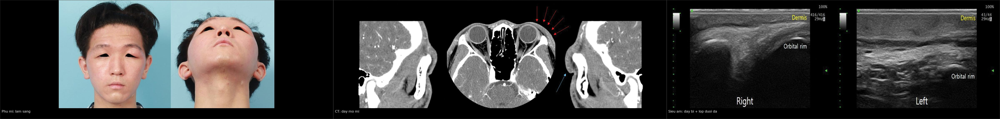
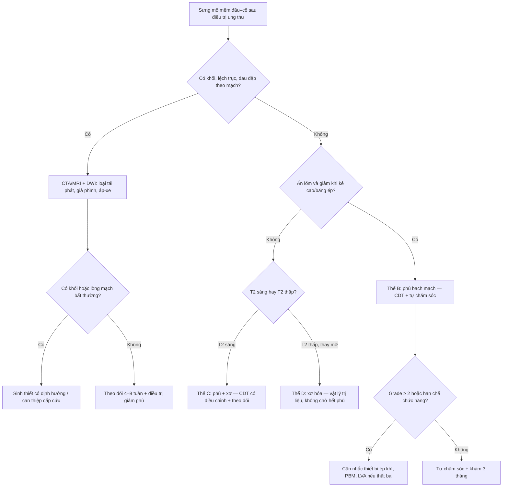
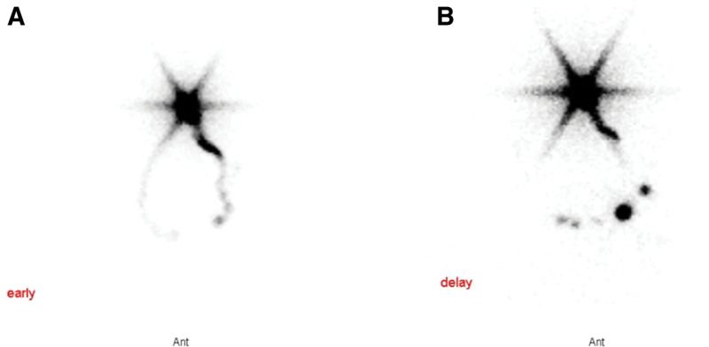
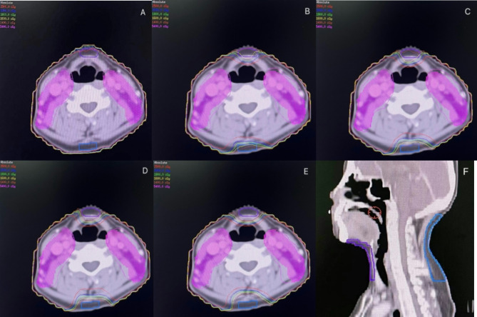
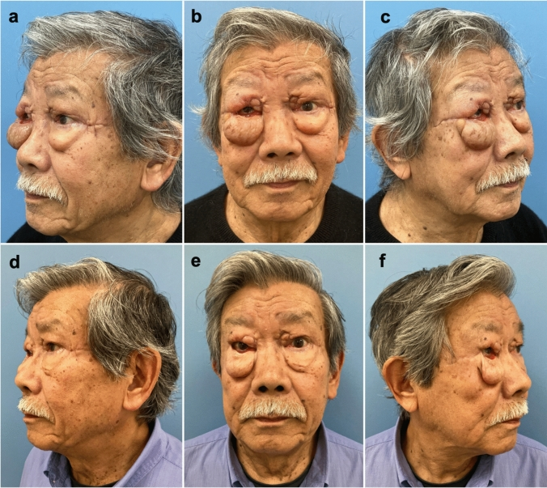
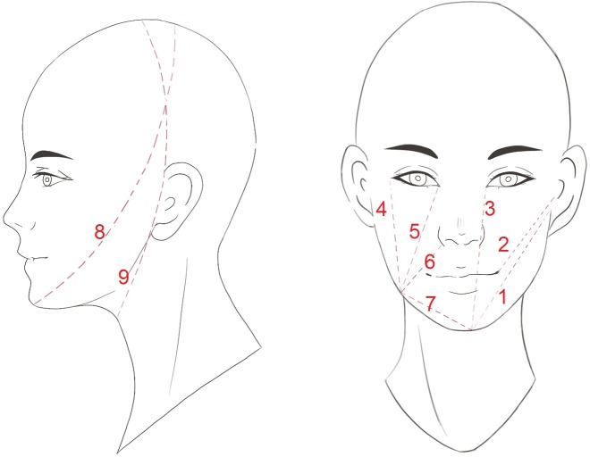
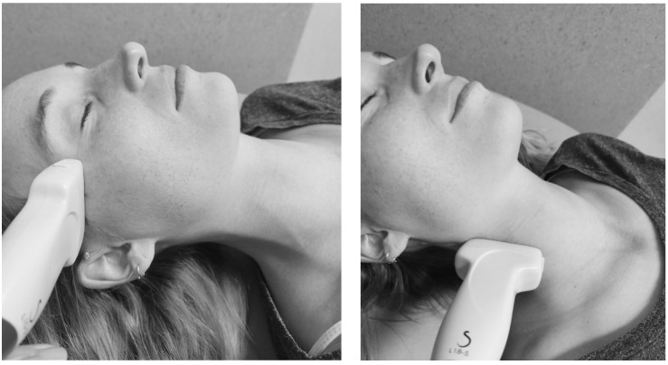

# 1767 — Phù bạch mạch đầu–cổ ngoài sau xạ trị / External head and neck lymphedema

**Tags:** `pattern:phu-mo-mem` `pattern:phu-bach-mach` `pattern:day-da` `pattern:xo-hoa-sau-xa` `vung:dau-co` `vung:co` `vung:mi` `protocol:CT` `protocol:MRI` `protocol:sieu-am` `protocol:lieu-OAR` `score:HN-LEFG` `score:MDACC` `score:Patterson` `incidentaloma:khong`

**Mức chắc chắn (certainty):** tổng hợp y văn (literature synthesis) — 1 đoàn hệ tiên lượng 76 bệnh nhân có mô hình đa biến (PMC11343725), 1 nghiên cứu đoàn hệ 87 bệnh nhân ung thư vòm họng với ngưỡng liều (PMC8422729), 1 đoàn hệ cắt ngang 59 bệnh nhân (PMC10854984), 1 RCT đa trung tâm 236 bệnh nhân (PMC12972646), 1 RCT danh sách chờ 49 bệnh nhân (PMC7767900), 1 nghiên cứu hồi cứu 34 bệnh nhân điều trị giảm phù (PMC6128036), 2 nghiên cứu độ tin cậy phép đo (PMC12110547, PMC7233552), 1 tổng quan hệ thống 4 RCT (PMC12033101), 1 loạt 6 bệnh nhân nối bạch mạch–tĩnh mạch (PMC11152802), 1 thử nghiệm lập kế hoạch xạ (PMC11973186) và 1 tổng quan hình ảnh (PMC13253071). **Không có ca nguyên văn của nhóm** — 3 ca trong quiz là **ca dựng từ ảnh công bố**, ghi nguồn từng ảnh.

> **Câu chốt:** phù mô mềm đầu–cổ sau điều trị **không phải "phù do xạ" chung chung** mà là **suy bơm bạch mạch (lymphatic pump failure)** sau khi chuỗi hạch và mạch bạch mạch bị cắt + chiếu tia: dịch giàu protein ứ lại trong mô kẽ, rồi **xơ hóa thay dần** tạo phổ **mềm–ấn lõm (B) → rắn–không lõm (C) → chỉ còn xơ, hết phù (D)**. Ba con số phải thuộc: **70%** phù ngoài và **34%** phù trong ở mốc **360 ngày**; **29,9%** phù mặt mức **≥ 2** ở ung thư vòm họng, trong đó **84,6% xuất hiện 3–6 tháng** sau hóa–xạ; và **liều trung bình level IV ≥ 58,7 Gy** là ngưỡng dự báo phù mặt trung bình–nặng (AUC **0,726**) — nghĩa là **giảm liều hạch cổ là can thiệp dự phòng thật**, không phải chuyện "chờ nó tự hết".

## 1. Tổng quan bệnh học – cơ chế hình ảnh

### 1.1 TẠI SAO lại phù, và tại sao phù đổi tính chất theo thời gian

- **Giải phẫu – sinh lý:** mỗi ngày có **2–4 lít** dịch giàu protein rời mao mạch vào mô kẽ; **90%** được tĩnh mạch hấp thu, **10%** còn lại phải qua **mạch bạch mạch** về hạch. Đầu–cổ là vùng có **mật độ mao mạch bạch mạch rất cao** và **chuỗi hạch duy nhất** (level I–VII) — nên khi mổ cổ lấy hạch + chiếu tia, **không có đường vòng**.
- **Chuỗi bệnh học (vì sao hình ảnh lại như vậy):**
  1. **Cắt hạch + xạ** → đứt/quag mạch bạch mạch, hẹp xơ quanh mạch → **sức cản dòng bạch mạch tăng**.
  2. Dịch kẽ **giàu protein** ứ lại → **áp lực keo tăng** → hút thêm nước → **phù mềm, ấn lõm, giảm khi kê cao/băng ép** (thể **B**, còn gọi "phù bạch mạch thuận nghịch").
  3. Phù mạn → đại thực bào/lympho T xâm nhập, **TGF-β** hoạt hóa nguyên bào cơ → **collagen I/III** lắng đọng, mô mỡ bị thay → **rắn, không lõm, dính** (thể **C** = phù + xơ).
  4. Xơ tiến triển tiếp → **hết phù nhưng da dày, đặc, giảm đàn hồi** (thể **D** = xơ thuần túy, trùng với [1763](../1763-xo-hoa-mo-mem-co-sau-xa/lesson.md)).
- **Vì sao "phù rồi xơ" là một phổ liên tục, không phải hai bệnh:** cùng một trường xạ vừa **phá bơm bạch mạch** vừa **gây xơ hóa**; tỉ lệ hai thành phần quyết định thể lâm sàng. Đây là lý do bảng phân độ **HN-LEFG** gộp cả **lymphedema và fibrosis** trong một thang A–D (xem mục 4.3).
- **Vì sao phù đầu–cổ khác phù chi:** mô mềm mặt/cổ **lỏng, nhiều mỡ, vách giải phẫu mỏng** nên phù lan nhanh và **thay đổi theo tư thế**; nhưng **thể tích nhỏ** và **không có băng ép chuẩn như chi** → khó định lượng, dễ bị đánh giá thấp.

### 1.2 Vật lý hình ảnh: mỗi chuỗi "nhìn thấy" một phần của cùng một quá trình

| Chuỗi / phương tiện | Cái gì tăng/giảm | TẠI SAO (vật lý + mô bệnh) |
|---|---|---|
| **CT** | Dày da, **dải tăng đậm độ dạng lưới** trong mô dưới da, mất mặt phẳng mỡ; đậm độ **dịch ~0–20 HU**, không ngấm thuốc | Nước tự do trong kẽ làm mô **đậm hơn mỡ (−50 đến −120 HU)** nhưng **thấp hơn cơ (40–60 HU)**; xơ làm mô **đặc hơn** nhưng vẫn **không có khối** |
| **MRI T2W** | **Tăng tín hiệu** lan tỏa mô dưới da, dày da nhẹ, **dày + ngấm thuốc mạc** | Nước tự do có **T2 dài** → sáng; mạc viêm/xơ **ngấm gadolinium** vì tăng thể tích kẽ và tăng tính thấm |
| **MRI T1W / fat-sat** | Sớm: **T1 trung tính, mỡ còn**; muộn: **thay mỡ → T1 cao, mất tín hiệu khi fat-sat**; xơ → **T2 thấp** | Mỡ (T1 ngắn) và collagen (T2 ngắn) là hai đầu đối lập; **DIXON** tách được **fat fraction** — định lượng mức thay mỡ |
| **Siêu âm** | **Dày bì**, lớp dưới da **tăng hồi âm dạng lưới/thô**, **nước mô tăng** (MoistureMeterD), mô **mềm/ấn xẹp được** | Nước tự do phản âm mạnh ở mặt phân cách → "lưới"; đầu dò tần số cao (**18–24 MHz**) mới đủ phân giải bì **< 2 mm** |
| **Xạ hình bạch mạch (lymphoscintigraphy)** | **Chậm/mất hiện hình hạch vùng**, ứ thuốc tại chỗ tiêm, **dermal backflow** | Đồng vị đi theo **dòng chảy**, không theo giải phẫu: thấy **chức năng bơm** chứ không thấy mô |
| **ICG lymphography** | **Dermal backflow** dạng "phun sương/sợi chỉ", mạch bạch mạch giãn ngoằn ngoèo | Huỳnh quang hồng ngoại **chỉ sáng khi thuốc nằm trong lòng mạch bạch mạch**; ứ ở bì = dòng bị chặn |
| **Định lượng MRI** | **Fat fraction > 30%**, **fibrosis ratio > 25%** = mức nặng | Hai ngưỡng này tương ứng điểm "không hồi phục" về mô học — mỡ và xơ đã thay thế mô kẽ |

*Ba lớp bằng chứng của cùng một tổn thương: lâm sàng (mi trên trái dày, sa xuống), **CT** (mô mềm dày lan tỏa quanh hốc mắt trái, mũi tên đỏ, so với bên phải) và **siêu âm 18–24 MHz** (bì dày + lớp dưới da thô, nhiều vạch — "lưới"). Nguồn: Cha HG et al., *Arch Plast Surg* 2025 (PMC11896721), CC BY. Ảnh ghép letterbox, giữ nguyên tỉ lệ; cả ba ảnh của **cùng một ca** trong bài gốc.*

### 1.3 Số liệu định lượng phải thuộc

| Đại lượng | Con số | Nguồn |
|---|---|---|
| Tỉ lệ phù **ngoài / trong** ở mốc 360 ngày (n = 76, xạ triệt căn hoặc bổ trợ) | **70% / 34%** | PMC11343725 |
| Yếu tố dự báo phù **ngoài** (đa biến) | **Số hạch lấy bỏ** + **hạch tiến xa lúc chẩn đoán** + **level VII đối bên V30 ≥ 50%** | PMC11343725 |
| Yếu tố dự báo phù **trong** | **Thanh quản V45 ≥ 50%** + hạch tiến xa; xạ bổ trợ > xạ triệt căn | PMC11343725 |
| Phù mặt **grade ≥ 2** ở ung thư vòm họng sau hóa–xạ (n = 87, theo dõi trung vị 34 tháng) | **29,9% (26/87)**; **84,6%** xuất hiện **3–6 tháng**, toàn bộ trong **15 tháng**; trung vị kéo dài **5,0 tháng** | PMC8422729 |
| Vị trí phù mặt hay gặp nhất | **Dưới cằm 92,3%**, **dưới hàm 76,9%** | PMC8422729 |
| Ngưỡng liều dự báo phù mặt grade ≥ 2 | **Level IV Dmean 58,7 Gy** (AUC **0,726**); **level I–VII Dmean 58,6 Gy** (AUC **0,720**); mỗi Gy **HR 1,238** và **1,384** | PMC8422729 |
| Tỉ lệ phù ở người sống > 6 tháng sau điều trị (n = 59, cắt ngang) | **94,1%** (KTC 95% 0,86–0,98), **trung vị nặng 9/24** — phần lớn **nhẹ** | PMC10854984 |
| Bảo tồn tĩnh mạch mặt + tĩnh mạch cảnh ngoài khi mổ cổ chọn lọc (n = 79) | Cắt bỏ → phù ngoài nặng hơn: **OR 2,82** (1,00–8,02) | PMC13240520 |
| Vòng liều cổ trước/sau **16 Gy** (n = 50, 25 có vòng) | **Giảm có ý nghĩa** tỉ lệ phù đầu–cổ, không giảm liều u | PMC11973186 |
| Điều trị giảm phù chuẩn (CDT, n = 34, trung vị 6 tháng) | Vòng cổ **giảm ở 100%** trong 1 tháng; quay cổ **+30,2% (trái) / +27,9% (phải)** lúc 1 tháng → **+44,6% / +55,3%** lúc 12 tháng; đau **4,3 → 2,0** | PMC6128036 |
| RCT đa trung tâm thiết bị ép khí (n = 236) | Triệu chứng giảm **tương đương** ở cả hai nhánh; thiết bị **giảm phù mô mềm ngoài trên ảnh số**; **không khác biệt trên CT** | PMC12972646 |
| RCT danh sách chờ (n = 49) | Cải thiện **khả năng kiểm soát phù** (p = 0,003) và **phù ngoài nhìn thấy** | PMC7767900 |
| Tổng quan 4 RCT (167 bệnh nhân) | **Tập + dẫn lưu bạch mạch + kinesio tape/băng ép** có lợi cho phù **ngoài**; **không cải thiện phù trong** | PMC12033101 |
| Nối bạch mạch–tĩnh mạch (n = 6 bệnh nhân / 8 ca mổ) | LSIDS-H&N **1,11 → 0,44** (p = 0,02); MDACC **2 → 0 hoặc 1a** (p = 0,008) | PMC11152802 |
| Độ tin cậy phép đo | **Vòng cổ ICC 0,958–0,994**; **độ dày bì ICC 0,136–0,354** (không dùng đơn độc); các phương pháp **tương quan yếu** với nhau | PMC12110547 |
| Sai số băng đo (n = 50 + 50) | **Sw 4,6–18,3 mm**; vòng cổ **ICC 0,90–0,95** nhưng **Sw 8,3–12,3 mm**; đo điểm–điểm mặt chính xác hơn (**4,6–8,8 mm**) | PMC7233552 |

### 1.4 Hai con số "94,1%" và "70%" không mâu thuẫn

- **70%** là **tỉ lệ tích lũy theo thời gian** ở một đoàn hệ xạ trị (bất kỳ mức độ, mốc 360 ngày).
- **94,1%** là **tỉ lệ hiện mắc** ở một đoàn hệ cắt ngang chọn bệnh nhân sống **> 6 tháng**, đo bằng **phép đo thể chất** (nhạy hơn tự khai), với **trung vị chỉ 9/24 điểm** — tức **rất nhiều ca nhẹ, không triệu chứng**.
- **Bài học:** tỉ lệ phụ thuộc **công cụ** (đo vs tự khai), **thời điểm** và **định nghĩa**. Khi trích dẫn, luôn nói rõ **mức độ nào**; đừng dùng "94% bị phù" để hù bệnh nhân, và đừng dùng "chỉ 30% nặng" để bỏ theo dõi.

## 2. Mẫu hình + chẩn đoán phân biệt theo vị trí (Gamut)

- **Cách đọc:** trả lời **4 câu** trước khi gọi tên: **(1) phù có đúng trường xạ / bên mổ cổ không? (2) ấn lõm và giảm khi kê cao/băng ép không? (3) có khối/mass effect/lệch trục không? (4) có dấu hiệu viêm cấp (nóng, đỏ, sốt) hay tắc mạch (giãn tĩnh mạch, thở nhanh) không?**
- **Gamut theo vị trí** (đúng thứ tự tần suất trong ung thư vòm họng: dưới cằm → dưới hàm → má → quanh hốc mắt → cổ bên → hõm trên đòn):

| Vị trí | Mẫu hình điển hình | Gamut chính |
|---|---|---|
| **Dưới cằm / dưới hàm** | Phù mềm, mất góc hàm, "mặt tròn" hai bên; hay gặp nhất (**92,3% / 76,9%**) | Phù bạch mạch · xơ hóa sau xạ · tái phát hạch Ib · áp-xe răng · hạch viêm |
| **Má / vùng mang tai** | Dày mô mềm lan tỏa theo trường chiếu, mất rãnh má | Phù bạch mạch · xơ hóa · viêm tuyến mang tai · tái phát u xâm lấn da |
| **Quanh hốc mắt** | Mi trên dày, sa mi, hẹp khe mi; **có thể một bên** | Phù bạch mạch sau mổ/xạ · phù do tắc tĩnh mạch · viêm mô tế bào · bệnh tuyến giáp · u hốc mắt |
| **Cổ bên** | Phù theo dải, mất đường viền cơ ức đòn chũm, dày da | Phù bạch mạch · xơ hóa (1763) · huyết khối tĩnh mạch cảnh · tái phát hạch · giả phình động mạch cảnh |
| **Hõm trên đòn** | Đầy hõm, mất lõm sinh lý, có thể hai bên | Phù bạch mạch · di căn hạch Virchow · huyết khối tĩnh mạch dưới đòn · phù do tắc tĩnh mạch chủ trên |

- **Gamut theo thể mô (HN-LEFG, dùng được ngay tại giường):** **A** = không phù nhìn thấy nhưng **sờ thấy dày/căng bì**; **B** = phù nhìn thấy, **mềm, ấn lõm, giảm khi kê cao** (thuần bạch mạch); **C** = phù nhìn thấy, **rắn, không lõm, tồn tại** (bạch mạch + xơ); **D** = **da rắn, tăng mật độ, giảm đàn hồi, KHÔNG phù** (xơ thuần). B, C, D được chia **nhẹ / vừa / nặng**.
- **Gợi nhớ chống bỏ sót: "SƯNG – MỀM – RẮN – KHỐI"** — **S**ưng đúng trường xạ, **M**ềm/ấn lõm = B, **R**ắn/không lõm = C–D, **K**hối/lệch trục = phải loại tái phát trước khi gọi phù.

## 3. Bảng so sánh phân biệt (ma trận đối chiếu)

| Thực thể (entity) | Hình ảnh điển hình (CT/MRI/US) | Chốt vào (rule-in) | Chốt loại (rule-out) | Gợi ý xác nhận |
|---|---|---|---|---|
| **Phù bạch mạch ngoài (thể B)** | Dày da + **lưới dịch** mô dưới da, **T2 sáng**, mạc ngấm thuốc nhẹ, **mặt phẳng mỡ còn**, **không khối** | **Mềm + ấn lõm + giảm khi kê cao/băng ép + đúng trường xạ + T2 sáng** | **Rắn, dính, không đổi theo tư thế; có khối/lệch trục** | Đo vòng cổ (ICC 0,958–0,994); siêu âm nước mô; đáp ứng với CDT |
| **Xơ hóa do xạ (thể D)** | Dày da, **mất lớp mỡ**, mô **T2 thấp**, ngấm thuốc đều, co kéo; **không phù** | **Rắn, không lõm, không đổi tư thế, T2 thấp** | **Còn phù mềm/ấn lõm, T2 sáng** | SWE (xem [1763](../1763-xo-hoa-mo-mem-co-sau-xa/lesson.md)); so phim cũ |
| **Thể hỗn hợp C** | Phù nền + dải xơ; T2 **hỗn hợp**, mạc dày | **Vừa mềm vừa rắn, còn ấn lõm một phần** | **Thuần mềm (B) hoặc thuần rắn (D)** | Theo dõi sau 4–8 tuần CDT: phần mềm giảm, phần rắn tồn tại |
| **Tái phát u / di căn da (carcinoma erysipeloides)** | **Khối hoặc dày da dạng mảng**, bờ không đều, **ADC thấp**, FDG dương, lớn dần | **Khối/lệch trục + lớn lên trên 2 lần chụp + ADC thấp/FDG dương** | **Phù đối xứng, ổn định ≥ 6 tháng, không hạn chế khuếch tán** | MRI + DWI; PET/CT sau ≥ 12 tuần; **sinh thiết khi có khối** |
| **Viêm mô tế bào / áp-xe** | Dày da, phù, **khí trong mô**, ổ dịch có vỏ | **Đỏ nóng, đau, sốt, bạch cầu tăng; ổ dịch trên siêu âm** | **Không sốt, không đau, phù đối xứng theo trường xạ** | Lâm sàng + CRP + siêu âm; chọc hút |
| **Tụ dịch / lymphocele sau mổ** | Ổ dịch **đồng nhất, bờ rõ**, sát giường mổ, **không ngấm thuốc** | **Ổ dịch khu trú + tiền sử mổ gần đây** | **Phù lan tỏa không tạo ổ** | Siêu âm; chọc hút dịch vàng chanh |
| **Hội chứng tắc tĩnh mạch chủ trên** | Phù **mặt + cổ + hai tay**, tuần hoàn bàng hệ, khối trung thất | **Phù hai tay + giãn tĩnh mạch ngực + khối trung thất** | **Phù chỉ ở đầu–cổ, hai tay bình thường** | CT ngực có cản quang |
| **Suy giáp / phù niêm** | Dày mô dưới da **đối xứng**, T2 trung tính, không theo trường xạ | **TSH cao, phù quanh hốc mắt + da khô, tăng cân** | **Đúng trường xạ, TSH bình thường** | TSH/FT4 |
| **Phù dị ứng / phù mạch** | Phù **môi–lưỡi–mi**, khởi phát **phút–giờ** | **Khởi phát cấp, ngứa/mày đay, đáp ứng kháng histamin/adrenalin** | **Diễn tiến tuần–tháng, không ngứa** | Bệnh sử; theo dõi đường thở |
| **Giả phình / dò động mạch cảnh** | Khối **đập theo mạch**, ngấm thuốc thì động mạch, có lòng giả | **Khối đập + tiếng thổi + CTA có lòng giả** | **Phù mềm lan tỏa không có lòng mạch** | CTA khẩn — **red flag chảy máu** |

### 3.1 Ba dấu hiệu dùng để "chốt" phù bạch mạch trên hình ảnh

1. **Tính chất theo tư thế:** phù bạch mạch **giảm khi kê cao ≥ 30 phút / sau băng ép**, còn xơ hóa **không đổi** — đây là "nghiệm pháp" rẻ nhất, làm trước khi chụp.
2. **Hình thái phân bố:** phù **ôm theo trường chiếu + bên mổ cổ**, **không tôn trọng ranh giới giải phẫu** (lan qua đường giữa nếu xạ hai bên), **không có bờ khối**. Tái phát **lệch trục** và **đẩy lệch** mạch/khí quản.
3. **Tín hiệu nước vs xơ:** **T2 sáng + mặt phẳng mỡ còn** = còn phù (điều trị được); **T2 thấp + thay mỡ + dày mạc** = đã xơ (điều trị ít lợi ích hơn). Ngưỡng định lượng: **fat fraction > 30%** và **fibrosis ratio > 25%** = mức nặng.

## 4. Protocol chụp + hệ phân độ/điểm chuẩn hóa

### 4.1 Chẩn đoán hình ảnh: khi nào cần và chọn gì

- **Chẩn đoán phù bạch mạch là chẩn đoán LÂM SÀNG.** Hình ảnh dùng để **(a)** loại tái phát/biến chứng, **(b)** đánh giá mức xơ–mỡ, **(c)** lập kế hoạch can thiệp. **Không chụp định kỳ chỉ để "xem phù".**
- **CT cổ – mặt có cản quang, lát 1–2 mm, cửa sổ mô mềm:** đánh giá **dày da, lưới dịch, mất mặt phẳng mỡ, hạch, mạch cảnh**. Là chuỗi **sẵn có** trong theo dõi ung thư — **đọc lại đúng cửa sổ mô mềm** thay vì chỉ nhìn hạch.
- **MRI (ưu tiên khi cần phân biệt xơ–phù–u):** **T1W, T2W fat-sat, T1W fat-sat sau tiêm, DWI + ADC**, thêm **DIXON** để đo **fat fraction**. Chụp **cả hai bên** và **trên–dưới ổ**.
- **Siêu âm đầu dò tần số cao 18–24 MHz:** đo **độ dày bì**, mô tả **lớp dưới da dạng lưới**, đo **nước mô cục bộ**. **Nhớ: độ dày bì có ICC chỉ 0,136–0,354** → dùng để mô tả/so sánh trong cùng người, **không dùng làm tiêu chí chính**.
- **Xạ hình bạch mạch / ICG:** dùng khi **cân nhắc can thiệp vi phẫu (LVA/VLNT)**, không dùng để chẩn đoán thường quy.
- **PET/CT:** chỉ đáng tin **sau ≥ 12 tuần** vì viêm sau xạ dương giả.

### 4.2 Đo lường: chọn đúng thước

| Phép đo | Độ tin cậy | Dùng khi |
|---|---|---|
| **Vòng cổ (thước dây)** | **ICC 0,958–0,994** — tốt nhất, nhanh nhất | Theo dõi cổ; **không dùng cho vùng đầu** |
| **Điểm–điểm mặt (7 mốc)** | Sw **4,6–8,8 mm**, ICC trung bình (tragus–góc miệng **0,66**) | Theo dõi mặt; **luôn đo 3 lần, lấy trung bình** |
| **Nước mô cục bộ (MoistureMeterD)** | Tốt cho **vùng đầu** | Khi cần định lượng vùng mặt/mi |
| **Độ dày bì trên siêu âm** | **ICC 0,136–0,354** | Chỉ mô tả; **không dùng đơn độc** |
| **Ảnh số / 3D** | Đang phát triển | Nghiên cứu, so sánh trước–sau |

> **Quy tắc:** mỗi lần khám đo **cùng vị trí, cùng tư thế, cùng người đo nếu được**, và ghi **cả vòng cổ + ảnh mặt** — vì các phương pháp **tương quan yếu** với nhau, chúng đo **các khía cạnh khác nhau** của phù.

### 4.3 Phân độ

- **HN-LEFG (Head and Neck Cancer Related Lymphedema and Fibrosis Grading):** thể **A** (không phù, sờ dày bì) · **B** (phù mềm, ấn lõm, giảm khi kê cao) · **C** (phù rắn, không lõm) · **D** (xơ không phù); B/C/D chia **nhẹ–vừa–nặng**; ghi **8 vị trí** (mi, má, cổ, hõm trên đòn hai bên + dưới cằm).
- **MDACC HNL rating scale:** **0 / 1a / 1b / 2 / 3**; trong nghiên cứu, **≥ 2 = trung bình–nặng**, được coi là **khó hồi phục và giảm chất lượng sống** — đây là ngưỡng dùng để **chỉ định điều trị tích cực**.
- **Modified Patterson Scale (phù TRONG, nội soi):** **0 bình thường · 1 nhẹ · 2 vừa · 3 nặng** cho từng cấu trúc (khoang miệng, hầu, thanh quản). **Phù ngoài và phù trong là hai bài toán khác nhau**: điều trị vật lý **có lợi cho phù ngoài** nhưng **không cải thiện phù trong**.

### 4.4 Dự phòng bằng liều: phần "can thiệp được" của bài

- **Ngưỡng liều (ung thư vòm họng):** giữ **Dmean level IV < 58,7 Gy** và **Dmean level I–VII < 58,6 Gy**; mỗi Gy tăng thêm → **HR 1,238 / 1,384** cho phù mặt ≥ 2.
- **Level VII đối bên V30 ≥ 50%** là yếu tố dự báo **phù ngoài** độc lập (PMC11343725) → khi lập kế hoạch, **để ý vùng họng sau đối bên**, không chỉ level II–IV.
- **Thanh quản V45 ≥ 50%** dự báo **phù trong** → nếu bệnh nhân đã có khó nuốt, đây là ràng buộc cần cân nhắc.
- **Vòng liều cổ trước/sau 16 Gy** (n = 50) **giảm phù** mà **không giảm liều u** — biện pháp kỹ thuật đơn giản, có thể thử trên kế hoạch IMRT.
- **Mổ cổ:** bảo tồn **tĩnh mạch mặt + tĩnh mạch cảnh ngoài** giảm phù ngoài (**OR 2,82** nếu cắt bỏ) → phối hợp với phẫu thuật viên ngay từ đầu.

## 5. Biến thể bình thường và cạm bẫy

- **Phù đỉnh 3–6 tháng rồi giảm:** **84,6%** ca phù mặt ≥ 2 xuất hiện **3–6 tháng** sau hóa–xạ, trung vị kéo dài **5 tháng**, **18/26 ca tự hồi phục trong 6 tháng** với điều trị bảo tồn (PMC8422729). → **Đừng hứa "sẽ hết"** và cũng **đừng can thiệp mổ sớm**.
- **Bất đối xứng là bình thường:** trường xạ và mổ cổ thường **một bên**; phù **nhiều hơn bên xạ/mổ** không phải tái phát. Phù **hai bên** gợi ý xạ hai bên hoặc nguyên nhân toàn thân (tắc tĩnh mạch, suy giáp, thận).
- **Đừng dùng "độ dày da" làm chỉ số chính:** **ICC 0,136–0,354** (PMC12110547); sai số băng đo tới **18,3 mm** (PMC7233552). Một lần đo **không đủ** để nói tiến triển.
- **Vòng cổ chỉ đo được cổ:** vùng **mặt/mi** cần **nước mô** hoặc **ảnh chuẩn hóa**; đừng suy ra phù mặt từ vòng cổ.
- **Tăng cân do corticoid:** bệnh nhân xạ đầu–cổ thường dùng corticoid → **mặt tròn do Cushing**, không phải phù; hỏi cân nặng và nhìn **mặt nề + thân + chi**.
- **Sai lầm "đã thấy phù rồi ngừng tìm hạch":** satisfaction of search — vẫn phải đọc **toàn bộ chuỗi hạch** theo [750](../750-cervical-lymph-nodes-nirads/lesson.md), vì phù có thể **che** hạch nhỏ.
- **Không sinh thiết mô xạ không có khối:** mô xạ **liền sẹo kém**, dễ **hoại tử**, và **lấy mẫu sai** vì xơ xen kẽ u. Sinh thiết chỉ khi **có khối/lệch trục/ADC thấp**.
- **Ba "red flag" phải dừng lại:** **(1)** khối **đập theo mạch** hoặc có tiếng thổi → giả phình/dò cảnh; **(2)** phù **tăng nhanh + đau + sốt** → nhiễm trùng/áp-xe; **(3)** phù **mặt + hai tay + giãn tĩnh mạch ngực** → tắc tĩnh mạch chủ trên.

## 6. Tự lượng giá — Blind Quiz ngay trên trang tĩnh

**Ca 1 — Nữ 24 tuổi, sau mổ + xạ vùng thái dương–mi trái, 8 tháng: mi trên trái nặng, sa xuống, không đau. Ba ảnh dưới là lâm sàng, CT và siêu âm của cùng bệnh nhân.**

- Gợi ý lâm sàng: không sốt, không đỏ, phù mềm, giảm khi nằm đầu cao.
- Câu hỏi: Dấu hiệu chính trên CT và siêu âm? Ba chẩn đoán phân biệt? Dấu hiệu nào loại u/tái phát?

<b>Bấm để hiện đáp án (findings + chẩn đoán)</b>

- Dấu hiệu: **mô mềm quanh hốc mắt trái dày lan tỏa** (mũi tên đỏ), **không khối, không xâm lấn cơ**; siêu âm: **bì dày + lớp dưới da thô nhiều vạch** ở bên trái so với bên phải.
- Chẩn đoán: **phù bạch mạch ngoài quanh hốc mắt** sau mổ + xạ, thể **B**.
- Vì sao: tắc dòng bạch mạch → **nước tự do trong bì/dưới da** → T2 sáng, siêu âm "lưới"; **không có khối và không hạn chế khuếch tán** là chốt loại tái phát.
- Nguồn ảnh: Cha HG, Hyun DY, Park ES, Choi CY, Nam SM, *Arch Plast Surg* 2025 (PMC11896721), CC BY.

**Ca 2 — Nam 55 tuổi, ung thư hạ họng–hầu đã mổ + hóa–xạ, 5 tháng sau xạ: sưng nửa mặt phải. Xạ hình bạch mạch dưới đây.**

- Câu hỏi: Ảnh A (sớm) và B (muộn) khác nhau ở đâu? Vì sao hạch dưới hàm/dưới cằm phải không hiện hình? Đây là bằng chứng của cơ chế gì?

<b>Bấm để hiện đáp án (findings + chẩn đoán)</b>

- Dấu hiệu: **A** — thuốc ở chỗ tiêm và một ít mạch, nhưng **không thấy hạch dưới hàm/dưới cằm phải**; **B (muộn)** — thuốc **ứ tại chỗ**, chỉ hiện vài hạch nhỏ, **không có chuỗi dẫn lưu bình thường**.
- Chẩn đoán: **phù bạch mạch ngoài do tắc dẫn lưu** sau mổ cổ + xạ.
- Vì sao: xạ hình đo **chức năng bơm**, không đo giải phẫu — chỗ tắc hiện **ứ thuốc**, hạch hạ lưu **không hiện hình**. Đây là bằng chứng trực tiếp của "suy bơm bạch mạch", không phải phù do tim/thận.
- Nguồn ảnh: Lin YS, Liu CJ, Chou CH, *Plast Reconstr Surg Glob Open* 2024 (PMC11152802), CC BY-NC-ND — ảnh nguyên bản, không cắt/ghép.

**Ca 3 — Nữ 52 tuổi, ung thư vòm họng T2N1, hóa–xạ đồng thời; 5 tháng sau: mặt dưới cằm–dưới hàm hai bên to, mềm, ấn lõm, không sốt. Bản đồ liều cho thấy vùng cổ trước/sau nhận liều cao.**

- Câu hỏi: Vì sao phù lại ở **dưới cằm/dưới hàm** chứ không phải nơi khác? Ngưỡng liều nào liên quan? Có cách giảm phù mà không giảm liều u không?

<b>Bấm để hiện đáp án (findings + chẩn đoán)</b>

- Dấu hiệu: vùng **cổ trước/sau** nằm trong **vòng liều** (A–E); đây là nơi tập trung **mạch bạch mạch nông và chuỗi hạch level VI/VII**, dẫn lưu cho **dưới cằm–dưới hàm**.
- Chẩn đoán: **phù bạch mạch ngoài thể B** sau hóa–xạ; vị trí **dưới cằm 92,3% / dưới hàm 76,9%** là phù hợp y văn.
- Ngưỡng: **Dmean level IV 58,7 Gy** và **level I–VII 58,6 Gy** dự báo phù mặt ≥ 2; **level VII đối bên V30 ≥ 50%** cũng là yếu tố nguy cơ.
- Can thiệp: đặt **vòng liều 16 Gy** ở cổ trước/sau **giảm phù** mà **không giảm liều u** (n = 50) → thảo luận với bác sĩ xạ trị **ngay từ lần lập kế hoạch**, không chờ phù xuất hiện.
- Nguồn ảnh: Liao K, Tian Y, Li H, Zheng R, *Sci Rep* 2025 (PMC11973186), CC BY-NC-ND — ảnh nguyên bản, không cắt/ghép.

*Phù mi hai bên (a–c) trước và **3 tháng sau nối bạch mạch–tĩnh mạch có hỗ trợ robot** (d–f): mi xẹp, khe mi mở, chức năng cải thiện. Nguồn: Imholz C et al., *J Robot Surg* 2025 (PMC12255657), CC BY. Đây là **ca phù mi tiên phát**, không phải sau xạ — dùng minh họa nguyên lý "dẫn lưu lại thì phù giảm", không gán cho bệnh nhân xạ.*

*Bảy mốc điểm–điểm vùng mặt (1–7) và hai vòng (8–9) dùng trong nghiên cứu độ tin cậy; **vòng cổ** (không vẽ trong hình) có ICC tốt nhất (0,90–0,95) nhưng sai số tới **12,3 mm**, còn đo mặt chính xác hơn nhưng **ICC chỉ trung bình**. Nguồn: Chotipanich A, Kongpit N, *PLoS One* 2020 (PMC7233552), CC BY.*

*Hai tư thế đặt đầu dò: **L18–5 ở cổ** và **L10–2 ở vùng đầu** — phải cố định tư thế và vị trí, vì **độ dày bì có ICC chỉ 0,136–0,354**. Nguồn: Van Aperen K et al., *Cancers* 2025 (PMC12110547), CC BY.*

## Bài liên quan chéo
- [700 – Tổng quan Đầu Mặt Cổ](../700-head-neck-overview/lesson.md)
- [1763 – Xơ hóa mô mềm cổ sau xạ](../1763-xo-hoa-mo-mem-co-sau-xa/lesson.md) (thể D của cùng phổ; phân biệt bằng ấn lõm và T2)
- [1761 – Trismus sau xạ trị đầu cổ](../1761-trismus-sau-xa-tri-dau-co/lesson.md) (cùng trường xạ, cùng cơ chế xơ hóa cơ nhai)
- [1764 – Bệnh thần kinh V3 sau xạ trị đầu cổ](../1764-v3-sau-xa-tri-dau-co/lesson.md) (teo cơ do mất thần kinh, không phải phù)
- [1684 – Nuốt khó sau xạ trị đầu cổ](../1684-nuot-kho-sau-xa-tri-dau-co/lesson.md) (phù **trong** — Modified Patterson)
- [750 – Hạch cổ & NI-RADS](../750-cervical-lymph-nodes-nirads/lesson.md) (phân tầng hạch sau điều trị)

## Ảnh
- 7 ảnh + 1 ảnh ghép; nguồn và giấy phép từng ảnh trong `images/CREDITS.md`.
- `1767_bach-mach-XQ_PMC11152802.jpg`, `1767_vong-lieu-co_CT_PMC11973186.jpg` là **CC BY-NC-ND** → dùng **nguyên bản, không crop, không ghép**.
- `1767_phu-mi_LVA_PMC12255657.jpg` là **ca phù mi tiên phát** (không sau xạ) và `1767_phu-mi_*_PMC11896721.jpg` là **ca phù mi sau mổ + xạ vùng thái dương** — bài ghi rõ trong chú thích, **không gán sai bối cảnh**.
- Không tìm được ảnh open-access chụp đúng **thang HN-LEFG A–D trên cổ** → bài **không bịa ảnh**, dùng ảnh minh họa từng cơ chế và ghi rõ nguồn.

> Không dùng để chẩn đoán độc lập khi chưa có người hướng dẫn.
