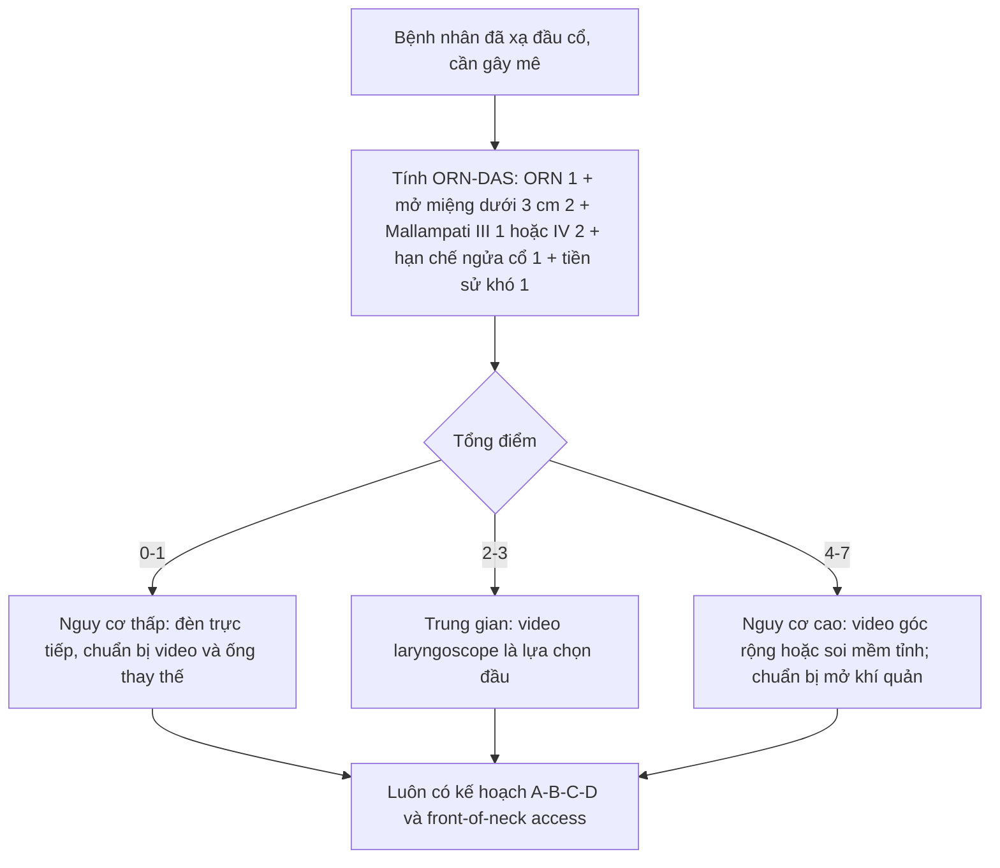
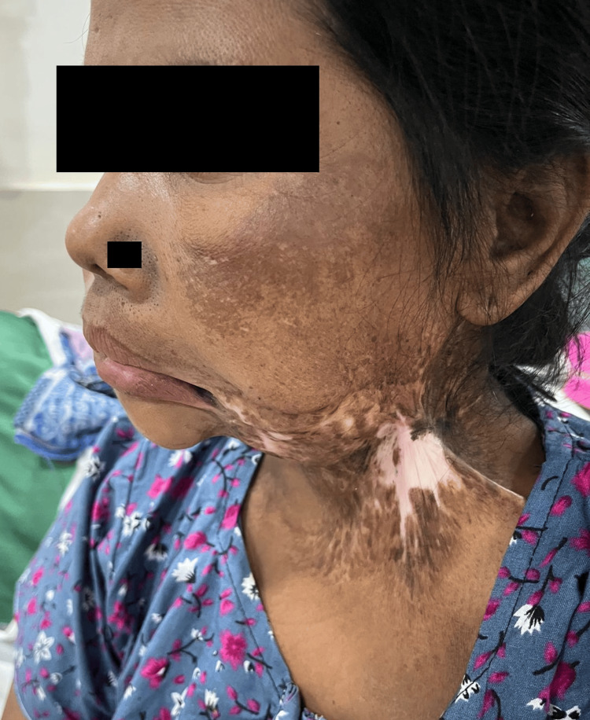
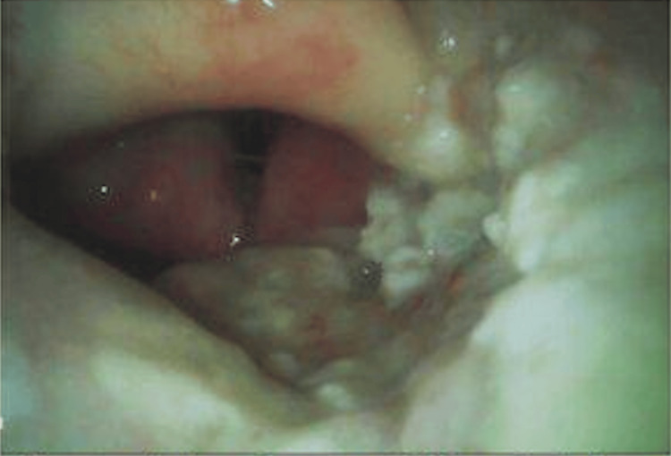
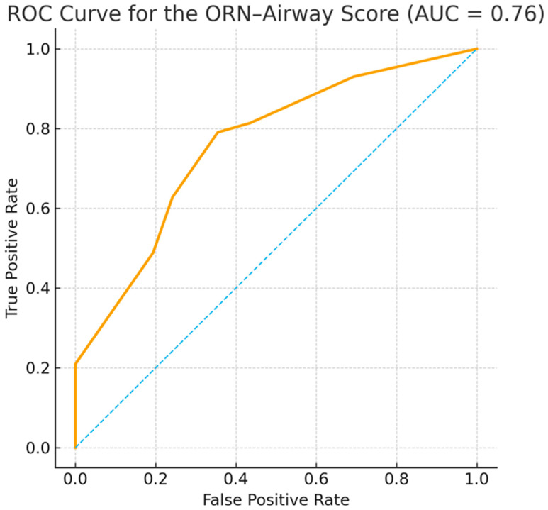
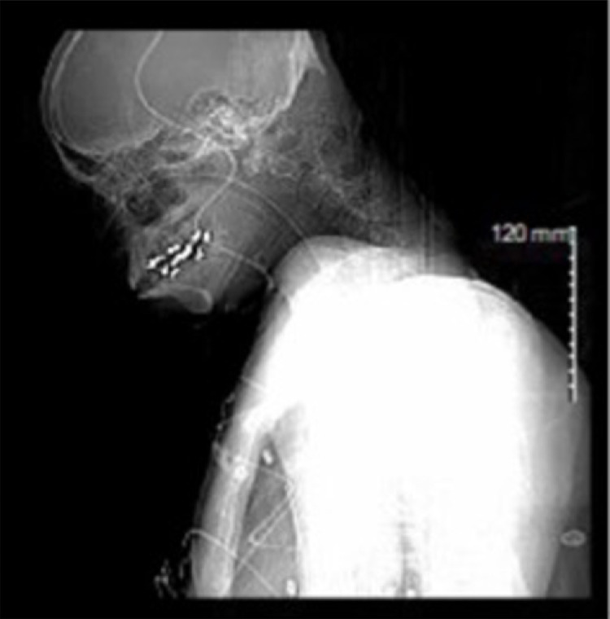
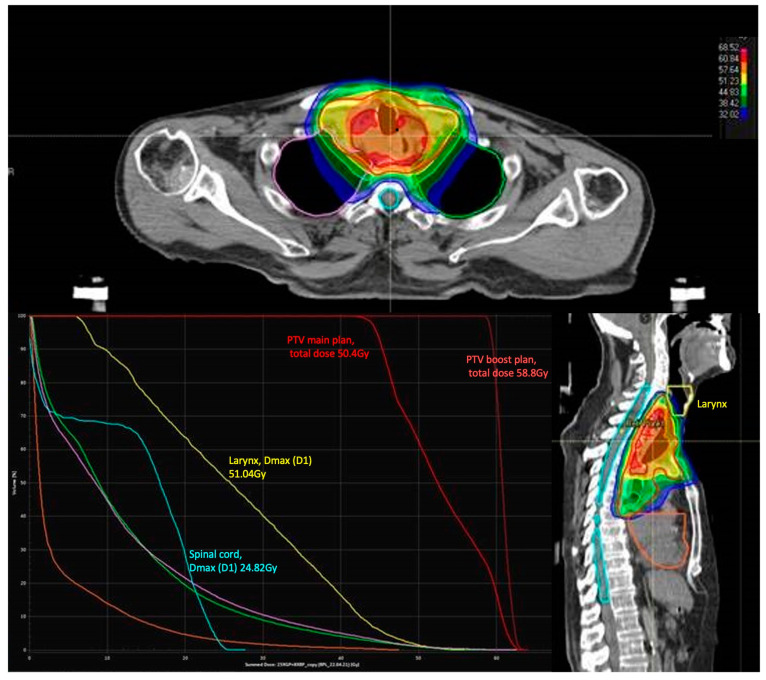

# 1768 — "Cổ đông cứng" sau xạ trị & đường thở khó / Frozen neck after radiotherapy & difficult airway

**Tags:** `pattern:xo-hoa-sau-xa` `pattern:han-che-van-dong` `pattern:han-che-mo-mieng` `pattern:hep-duong-tho` `pattern:bien-dang-thanh-mon` `vung:dau-co` `vung:co` `vung:thanh-quan` `protocol:CT` `protocol:MRI` `protocol:sieu-am` `protocol:lieu-OAR` `score:ORN-DAS` `score:Cormack-Lehane` `score:Mallampati` `incidentaloma:khong`

**Mức chắc chắn (certainty):** tổng hợp y văn (literature synthesis) — 1 đoàn hệ hồi cứu 105 bệnh nhân sau xạ đầu cổ phát triển thang điểm **ORN-Difficult-Airway Score** (*Med Sci* 2026, PMC12921790, CC BY), 1 đoàn hệ 55 bệnh nhân ung thư thực quản xạ rồi mổ (*Cancers* 2024, PMC11274552, CC BY), 1 đoàn hệ 200 bệnh nhân mổ ung thư đầu cổ (*Acta Otorhinolaryngol Ital* 2025, PMC12201920, CC BY-NC-ND), 1 đoàn hệ 1.932 người lớn soi thanh quản bằng video không kênh dẫn (*J Clin Med* 2026, PMC13566525, CC BY), 2 ca lâm sàng "cổ đông cứng/biến dạng đường thở" (*Cureus* 2026, PMC13157648 và PMC13215159, CC BY; *Int Med Case Rep J* 2024, PMC11316490, CC BY-NC), 1 nghiên cứu siêu âm mô mềm cổ trước 90 bệnh nhân (*Ann Afr Med* 2024, PMC11210741, CC BY-NC-SA), 1 đoàn hệ 312 bệnh nhân định nghĩa mức độ trismus (*BMC Oral Health* 2026, PMC13678981, CC BY-NC-ND) và các bài nền của nhóm về xơ hóa cổ (1763), trismus (1761), phù bạch mạch (1767). **Không có ca nguyên văn của nhóm** — 4 ca trong quiz là **ca công bố lấy nguyên văn từ bài gốc**, không phải ca của nhóm.

> **Câu chốt:** "cổ đông cứng" sau xạ không phải một cảm giác lâm sàng mà là **ba thay đổi đo được**: **hạn chế mở miệng** (trismus, MIO **< 35 mm**), **mất biên độ ngửa cổ** (cổ gập cố định, ca điển hình **~20°**) và **mô mềm trước cổ dày, không đàn hồi** — cộng thêm **phù/biến dạng thanh môn** và **mạch cổ bị đẩy lệch**. Ba con số phải thuộc: trong 105 bệnh nhân sau xạ đầu cổ, **41,0% (43/105)** được xếp "đặt nội khí quản khó"; **soi mềm tỉnh (FOI)** phải dùng **28,8%** ở nhóm hoại tử xương hàm do xạ (ORN) so với **9,4%** ở nhóm không ORN; và **đèn trực tiếp chỉ thành công lần đầu 54,2%** ở nhóm ORN so với **79,5%** — trong khi **video laryngoscope thành công lần đầu 100% (11/11 và 8/8)**.

## 1. Tổng quan bệnh học – cơ chế hình ảnh

### 1.1 Vì sao cổ sau xạ lại "đông cứng"

- **Xơ hóa do xạ (radiation-induced fibrosis, RIF)** là biến chứng muộn (> 90 ngày): xạ → tổn thương mao mạch, thiếu oxy mô → hoạt hóa **TGF-β** → nguyên bào sợi thành **nguyên bào cơ (myofibroblast)** → tăng **collagen I/III**, giảm phân hủy collagen (MMP/TIMP) → **ma trận dày đặc, co rút**. Hệ quả trên mô mềm cổ: **da dày, mất lớp mỡ dưới da, cơ teo và thay mỡ, mạc cổ dày dính** (chi tiết hình ảnh ở bài 1763).
- **Vì sao mô cứng lại làm đường thở khó:** độ cứng mô phản ánh **mật độ liên kết chéo collagen**, không phản ánh triệu chứng. Siêu âm đàn hồi sóng biến dạng cho thấy cơ ức đòn chũm sau xạ **46,98 vs 28,10 kPa** và mạc cổ **46,41 vs 25,47 kPa** so với người không xạ (PMC13241838, dẫn trong bài 1763) — tức mô **cứng gần gấp đôi**. Mô cứng, mất đàn hồi thì **không thể bị ấn dịch bởi lưỡi đèn thanh quản**, và **không thể kéo giãn** để đưa các trục giải phẫu về một đường thẳng.
- **Hạn chế mở miệng (trismus)** sau xạ là xơ hóa **cơ nhai – màng xương – khớp thái dương hàm** ± co kéo da vùng dưới cằm; định nghĩa thống nhất trong ung thư đầu cổ là **MIO < 35 mm** (nhẹ **30–34 mm**, vừa **20–29 mm**, nặng **< 20 mm**) — xem bài 1761. Điểm khác biệt của bài này: **trismus chỉ là một trong năm biến số của thang điểm đường thở**, không phải đích điều trị.
- **Phù và dễ chảy máu:** tắc/giảm dẫn lưu tĩnh mạch – bạch mạch (ca "woody neck" có **tắc hai tĩnh mạch cảnh trong**, PMC11316490) → phù thanh môn, niêm mạc mỏng, giãn mạch, **dễ chảy máu khi chạm** (ca PMC13157648: chảy máu đáng kể khi đặt ống). Máu + phù làm **mất hình ảnh camera** — đây là lý do thất bại của video laryngoscope dù "nhìn thấy" thanh môn.

### 1.2 Hình học của "đường ngắm" — TẠI SAO hạn chế cổ lại chặn đèn trực tiếp

- Đèn trực tiếp (direct laryngoscopy, DL) cần **đường thẳng từ răng cửa tới thanh môn**. Để có đường này, cổ phải **ngửa ~25–35°** và miệng mở đủ để đặt lưỡi đèn (thực hành lấy ngưỡng **30 mm ≈ 2 đốt ngón tay**, đúng bằng ngưỡng 2 điểm của thang điểm; dưới ~20 mm gần như không đưa được lưỡi đèn vào — **suy luận hình học**, không phải ngưỡng từ guideline). Khi cổ **gập cố định 20°** (ca PMC13215159) thì góc ngửa khả dụng **bằng 0**, đường ngắm mất hoàn toàn về mặt hình học — không có kiểu lưỡi đèn nào bù được.
- Video laryngoscope **góc rộng (hyperangulated)** đưa camera tới gần thanh môn nên **giảm phụ thuộc đường ngắm**, nhưng **vẫn cần miệng mở ≥ ~25 mm** để đưa lưỡi đèn vào và cần khoảng trống họng để luồn ống. Vì vậy **trismus nặng (< 20 mm)** là chống chỉ định tương đối của video qua đường miệng → phải **soi mềm đường mũi** hoặc **mở khí quản**.
- **Vì sao "nhìn thấy thanh môn" không đồng nghĩa "đặt được ống":** trong 1.932 ca soi video, **64% ca khó vẫn ở Cormack–Lehane I–II** và **45% ở độ I**; tỉ lệ khó **4,3% khi nhìn tốt vs 29,3% khi nhìn kém (OR 9,2)**, thời gian đặt ống **90 vs 40 giây** (PMC13566525). Nghĩa là **khó = vấn đề đưa ống qua**, không chỉ vấn đề nhìn.

### 1.3 Số liệu định lượng phải thuộc

| Đại lượng | Con số | Nguồn |
|---|---|---|
| Đặt nội khí quản khó (định nghĩa: phải FOI, phải mở khí quản, hoặc Cormack–Lehane ≥ III) sau xạ đầu cổ | **41,0% (43/105)** | PMC12921790 |
| FOI ở nhóm **ORN** so với không ORN | **28,8% (15/52) vs 9,4% (5/53)**, p = 0,0224 | PMC12921790 |
| Đèn trực tiếp — thành công lần đầu (FPS) | **54,2% (13/24) ORN vs 79,5% (31/39)** không ORN, p = 0,065 | PMC12921790 |
| Video laryngoscope — thành công lần đầu | **100% (11/11) ORN · 100% (8/8)** không ORN (ca được chọn có chủ đích) | PMC12921790 |
| Mallampati IV | **50,0% ORN vs 20,8%** không ORN | PMC12921790 |
| Mở miệng **< 3 cm** | **75,0% ORN vs 71,7%** không ORN | PMC12921790 |
| Hạn chế ngửa cổ | **25,0% vs 22,6%**, p = 0,564 (không khác biệt) | PMC12921790 |
| Liều tổng trung bình · CTV boost | **66,9 vs 65,4 Gy** · **185 vs 109 mL** | PMC12921790 |
| ORN-DAS: diện tích dưới đường cong (AUC) | **0,76** (bootstrap 500 lần: **0,76**, SD 0,05) | PMC12921790 |
| ORN-DAS **≥ 4 điểm** | Se **62,8%** · Sp **75,8%** · PPV **64,3%** · NPV **74,6%** | PMC12921790 |
| ORN-DAS **≥ 3 điểm** | Se **79,1%** · Sp **64,5%** · PPV **60,7%** · NPV **81,6%** | PMC12921790 |
| Phân tầng nguy cơ trong 105 ca | thấp **41,0%** · trung gian **19,0%** · cao **40,0%**; trong 43 ca khó, **63% (27/43)** thuộc nhóm cao | PMC12921790 |
| Mổ ung thư đầu cổ (n = 200): cách kiểm soát đường thở | đặt ống miệng **61%** · mũi **15%** · **FOI tỉnh 15%** · **mở khí quản gây tê tại chỗ 9%**; 3 ca mở khí quản cấp cứu | PMC12201920 |
| Soi video không kênh dẫn ở tai mũi họng (n = 1.932) | khó **6,2%**; khó dù nhìn tốt **64%**; **4,3% vs 29,3%** (OR **9,2**); **90 vs 40 giây** | PMC13566525 |
| Xạ thực quản (n = 55, liều thanh quản trung bình **40,0 Gy**): thành công lần đầu | **96,4%**; DL **80,0%**, video **12,1%**, FOI **7,2%** — **không** thấy đường thở khó tăng | PMC11274552 |
| Độ dày mô mềm cổ trước trên siêu âm dự báo soi thanh quản khó (BMI > 25, n = 90) | da–xương móng **1,26 cm** · da–màng giáp móng **2,0 cm** · da–mép trước dây thanh **1,2 cm** | PMC11210741 |
| Ca co kéo cổ–mặt: MIO · gập cổ · lệch khí quản | **~10 mm** · **~20° cố định** · **1,5 cm sang trái**, BMI **16,2** | PMC13215159 |
| Ca "woody neck": tắc tĩnh mạch cảnh trong hai bên | mở khí quản thất bại nhiều lần → **ECMO** hỗ trợ mới đặt được cannula | PMC11316490 |
| Liều thanh quản trên kế hoạch minh họa | **Dmax 51,04 Gy**; tủy sống **Dmax 24,82 Gy** | PMC11274552 |

## 2. Mẫu hình + chẩn đoán phân biệt theo vị trí (Gamut)

- **Cách đọc:** trước khi gọi "đường thở khó do xạ", trả lời **4 câu**: **(1) hạn chế ở tầng nào — miệng, cổ, hay thanh môn? (2) có khối/đẩy lệch không? (3) có phù cấp tính (đang tiến triển) hay xơ mạn? (4) mạch cổ và khí quản còn ở đúng chỗ cho mở khí quản không?**
- **Gamut theo vị trí (từ nông đến sâu):**

| Tầng | Cơ chế sau xạ | Dấu hiệu chốt |
|---|---|---|
| **Khớp thái dương hàm – cơ nhai** | Xơ hóa cơ nhai, co kéo da dưới cằm | MIO < 35 mm, không đau, tiến triển chậm; không có khối |
| **Mô mềm trước cổ – mạc cổ** | Dày da, mất lớp mỡ, dính da–cơ | Cổ gập cố định, mất nếp da, mô cứng khi ấn; CT: dải tăng đậm độ, mất mặt phẳng mỡ |
| **Họng – thanh môn** | Phù do tắc tĩnh mạch/bạch mạch, niêm mạc giòn, hẹp do xơ | Khàn, rít, khó nuốt; soi thấy thanh môn biến dạng, phù, dễ chảy máu |
| **Khí quản cổ** | Hẹp sau mở khí quản/đặt ống, lệch trục do xơ một bên | Khó thở thì hít vào, CT: hẹp < 50% lòng, lệch đường giữa |
| **Mạch cổ** | Tắc tĩnh mạch cảnh trong, động mạch cảnh bị đẩy ra trước | Siêu âm: tĩnh mạch không xẹp khi ấn; mạch lệch khỏi đường rạch cổ |
| **Cột sống cổ** | Thoái hóa, dính khớp (không do xạ) — hàng DDx của "cổ cứng" | Hạn chế ngửa cổ nhưng mô mềm bình thường, không đúng trường xạ |

- **Mnemonic 5 chữ "C" của cổ sau xạ:** **C**ứng (fibrosis) – **C**o (trismus) – **C**hèn (phù/edema) – **C**hệch (tracheal/vessel deviation) – **C**ắt (sẹo mổ cũ, mở khí quản cũ).

## 3. Bảng so sánh phân biệt (ma trận đối chiếu)

| Thực thể (entity) | Hình ảnh điển hình | Chốt vào (rule-in) | Chốt loại (rule-out) | Gợi ý xác nhận |
|---|---|---|---|---|
| **Xơ hóa mô mềm cổ sau xạ** | CT: da dày, dải tăng đậm độ dạng lưới, **mất lớp mỡ dưới da**, cơ teo ± thay mỡ; MRI: **T2 thấp**, T1 thấp, ngấm thuốc chậm đều; đúng trường xạ | **Tổn thương ôm trường chiếu, không khối, không hiệu ứng choán chỗ, T2 thấp** | Có khối + T2 trung tính + hạn chế khuếch tán → nghĩ **tái phát** | Đối chiếu kế hoạch xạ; MRI + DWI; theo dõi 3–6 tháng |
| **Trismus do xạ** | Không cần hình ảnh để chẩn đoán; CT thấy cơ nhai teo/thay mỡ, khớp thái dương hàm thoái hóa | **MIO < 35 mm, tiến triển sau xạ, không khối trong khoang nhai** | MIO giảm đột ngột + đau + khối → **u/viêm khoang nhai** | Đo MIO bằng thước kẹp; MRI khoang nhai khi không điển hình |
| **Phù thanh môn sau xạ** | Soi: thanh môn phù, niêm mạc giòn, giãn mạch; CT: dày niêm mạc, hẹp lòng, mô mềm quanh sụn | **Phù đối xứng, đúng vùng chiếu, không loét cứng** | Loét cứng, bờ nham nhở, hạch → **tái phát/hoại tử** | Soi ống mềm, sinh thiết chỉ khi có tổn thương khu trú |
| **Hẹp khí quản sau mở khí quản** | CT: hẹp chu vi hoặc web, đoạn hẹp ngay dưới sụn nhẫn; còn sẹo mở khí quản cũ | **Tiền sử mở khí quản/đặt ống, hẹp < 50% lòng, cách nhẫn < 3 cm** | Hẹp do u xâm lấn (bờ cứng, xâm lấn ngoài lòng) | CT lát mỏng + nội soi; phân độ Myer–Cotton nếu trẻ |
| **Tái phát u tại chỗ** | Khối T2 trung tính, **hạn chế khuếch tán (ADC thấp)**, ngấm thuốc mạnh; có thể loét, chảy máu | **Khối mới + ADC thấp + ngấm mạnh**, khác trường xạ | Xơ hóa: T2 rất thấp, ngấm chậm, ADC không giảm | MRI + DWI ± PET/CT; sinh thiết khi có khối |
| **Cổ cứng không do xạ (thoái hóa/dính khớp)** | Hạn chế ngửa cổ nhưng da – mô dưới da bình thường, không mất mặt phẳng mỡ | **Tiền sử viêm cột sống dính khớp, thoái hóa nặng, không xạ vùng cổ** | Mô mềm dày đúng trường xạ → do xạ | X-quang/CT cột sống cổ; hỏi tiền sử xạ |

- **Dấu hiệu chốt theo từng modality:**
  - **CT:** đo **độ dày da** (bình thường < 2 mm vùng cổ), sự **mất lớp mỡ dưới da**, và **khoảng cách da → khí quản** tại sụn nhẫn (dùng cho mở khí quản qua da); ghi **lệch khí quản tính bằng mm/cm**.
  - **MRI:** **T2 thấp** = collagen (xơ); **T2 cao** = phù hoạt tính; **T1 cao + mất tín hiệu khi fat-sat** = thay mỡ muộn. **DWI** là cửa phân biệt xơ với tái phát.
  - **Siêu âm:** đầu dò thẳng **6–13 MHz**, dựng bản đồ khí quản – sụn nhẫn – màng giáp nhẫn – xương móng, đánh dấu **động mạch cảnh/tĩnh mạch cảnh trong** và **độ lệch đường giữa** trước khi rạch.

## 4. Protocol chụp + hệ phân độ/điểm chuẩn hóa

### 4.1 Hình ảnh trước gây mê (khi có tiền sử xạ đầu cổ)

- **CT cổ có cản quang, lát ≤ 1 mm**, từ nền sọ tới carina, **không cần nín thở**; đọc theo 5 điểm: (1) độ dày da – mô dưới da; (2) mất mặt phẳng mỡ quanh cơ ức đòn chũm – mạc cổ; (3) **lệch khí quản** và **đường kính lòng khí quản** tại nhẫn; (4) vị trí động mạch cảnh/tĩnh mạch cảnh trong so với đường giữa; (5) vôi hóa sụn giáp/nhẫn (ảnh hưởng mở khí quản cấp cứu).
- **MRI 3T** (khi cần phân biệt xơ – tái phát – hoại tử): T1, T2 fat-sat, DWI/ADC, T1 sau tiêm; **không dùng MRI để "đo" độ cứng** (xem 1763: siêu âm đàn hồi mới định lượng được).
- **Siêu âm tại giường (6–13 MHz)**: bản đồ đường thở + mạch; đo **khoảng cách da → khí quản** và **độ lệch đường giữa**. Ca PMC13215159: khí quản lệch **1,5 cm** sang trái, mạch cảnh hai bên bị đẩy — nhờ bản đồ này mới đặt được block và soi mềm an toàn.
- **Rà kế hoạch xạ cũ:** liều tổng, **liều thanh quản** (ví dụ Dmax **51,04 Gy**, PMC11274552), liều và thể tích boost (**185 vs 109 mL** ở nhóm ORN, PMC12921790). Liều cao hơn và thể tích boost lớn hơn đi kèm nhiều thay đổi đường thở hơn — nhưng **chưa có ngưỡng liều nào được thẩm định để dự báo "đường thở khó"**, nên liều chỉ là **yếu tố nguy cơ**, không phải tiêu chuẩn chẩn đoán.

### 4.2 ORN-Difficult-Airway Score (ORN-DAS) — phiên bản 2026, chỉ dùng biến số tại giường

| Biến số | Định nghĩa | Điểm |
|---|---|---|
| Hoại tử xương hàm do xạ (ORN) | Không **0** / Có **1** | 0–1 |
| Mở miệng | **≥ 3 cm = 0** / **< 3 cm = 2** | 0–2 |
| Mallampati | I–II **0** / III **1** / IV **2** | 0–2 |
| Ngửa cổ | Bình thường **0** / Hạn chế **1** | 0–1 |
| Tiền sử đường thở khó | Không **0** / Có **1** | 0–1 |
| **Tổng** | | **0–7** |

- **Phân tầng:** **0–1 điểm** = nguy cơ thấp (đèn trực tiếp có thể dùng được); **2–3** = trung gian (**video laryngoscope là lựa chọn đầu**); **≥ 4** = cao (**video góc rộng hoặc soi mềm tỉnh; chuẩn bị chiến lược cứu hộ**).
- **Hiệu năng (phải nhớ cả mặt trái):** AUC **0,76**; ngưỡng **≥ 4** có **PPV 64,3%** — nghĩa là **khoảng 1/3 ca "nguy cơ cao" thực tế đặt ống bình thường**; ngưỡng **≥ 3** nhạy hơn (**79,1%**) nhưng PPV chỉ **60,7%**. Đây là công cụ **phân tầng**, không phải để từ chối can thiệp.

### 4.3 Trình tự chọn kỹ thuật (dựa trên số liệu, không dựa cảm tính)

1. **Tính ORN-DAS + đo MIO + đo biên độ ngửa cổ + Mallampati** ở mọi bệnh nhân có tiền sử xạ đầu cổ, kể cả khi bề ngoài bình thường.
2. **Nguy cơ thấp:** đèn trực tiếp; **nhưng** chuẩn bị video, ống nhỏ hơn và người có kinh nghiệm thứ hai.
3. **Trung gian:** **video laryngoscope** (nhóm được chọn trong PMC12921790 đặt thành công lần đầu 100%, nhưng đây là **ca được chọn**, không phải thử nghiệm ngẫu nhiên).
4. **Nguy cơ cao / MIO < 20 mm / gập cổ cố định:** **soi mềm tỉnh đường mũi** (như ca PMC13215159: ống có cuff **7,0 mm**, lidocaine tổng **280 mg = 4 mg/kg** với block dây thanh trên + xuyên khí quản dưới siêu âm) hoặc **mở khí quản gây tê tại chỗ** (9% trong 200 ca mổ đầu cổ, PMC12201920).
5. **Khi mở khí quản dự kiến khó** (cổ đông cứng + tắc tĩnh mạch cảnh trong): đặt **airway exchange catheter (AEC)** giữ đường thở, và nếu vẫn thất bại → **ECMO** hỗ trợ (ca PMC11316490).

## 5. Biến thể bình thường và cạm bẫy

- **"Cổ cứng" không đồng nghĩa "ngửa cổ hạn chế":** trong 105 ca, hạn chế ngửa cổ chỉ **25,0% vs 22,6%** (p = 0,564) — xơ hóa khu trú ở dưới cằm/mô trước cổ vẫn gây khó dù biên độ ngửa cổ "bình thường". **Đừng loại trừ vì cổ còn ngửa được.**
- **Đừng suy ra từ xạ mà bỏ qua liều – vị trí:** đoàn hệ xạ thực quản (55 ca, liều thanh quản trung bình **40,0 Gy**) đặt ống thành công lần đầu **96,4%**, FOI chỉ **7,2%** (PMC11274552). Xạ **xa thanh quản** không làm đường thở khó như xạ **đi qua vùng họng – thanh môn – cổ trước**. Đây là **thiên lệch chọn mẫu** điển hình nếu chỉ đọc một phía.
- **Video 100% không phải bằng chứng ưu việt:** 19 ca được chọn dùng video đều thành công, nhưng chính nhóm này được chọn **vì** dự đoán khó; cần thử nghiệm ngẫu nhiên mới so sánh được.
- **Siêu âm mô mềm cổ: ngưỡng không chuyển được nguyên xi.** Các ngưỡng **1,26 / 2,0 / 1,2 cm** được lập ở **90 bệnh nhân BMI > 25, không xạ** (PMC11210741); mô xạ **dày và cứng theo kiểu khác** — dùng để **mô tả và lập bản đồ**, không dùng làm tiêu chuẩn chẩn đoán.
- **Thông khí bằng mask không phải "phao cứu sinh":** khó thông khí mask gặp **37,0% vs 37,1%** ở cả hai nhóm ORN/không ORN (PMC12921790) — tức là **không hề ít hơn** ở nhóm cổ mềm hơn.
- **Nhầm xơ hóa với tái phát:** mô xơ T2 rất thấp, ngấm chậm, **không hạn chế khuếch tán**; tái phát **T2 trung tính + ADC thấp + ngấm mạnh**. Không sinh thiết "mù" vào mô xạ (nguy cơ rò, chảy máu, hoại tử).
- **Cạm bẫy mở khí quản:** sụn nhẫn **vôi hóa**, mô sẹo dày, **mạch cảnh bị đẩy ra trước** và **tĩnh mạch cảnh trong tắc** làm mất mốc giải phẫu — phải **đánh dấu trên siêu âm trước khi gây mê**, không dựa vào mốc sờ.
- **Đừng quên nguyên nhân không do xạ:** thoái hóa cột sống cổ, viêm cột sống dính khớp, béo phì – cổ ngắn, phì đại amidal/lưỡi gà. "Cổ cứng" sau xạ là chẩn đoán **loại trừ bằng hình ảnh đúng trường chiếu**.

## 6. Tự lượng giá — Blind Quiz

**Ca 1 — Nữ 47 tuổi, ung thư lưỡi đã cắt nửa hàm dưới + xạ 3 năm trước, vào mổ giải phóng co kéo. Nhìn ảnh lâm sàng, mô tả trước khi mở đáp án.**

- Gợi ý lâm sàng: BMI **16,2**; miệng mở **~10 mm**; cổ gập cố định **~20°**; không sốt, không khối mới.
- Câu hỏi: (1) Ba bất thường định lượng trên ảnh là gì? (2) Đây là biến dạng **do xơ hóa** hay **do u**? (3) Kỹ thuật nào hợp lý nhất để kiểm soát đường thở?

<b>Bấm để hiện đáp án (findings + chẩn đoán)</b>

- **Dấu hiệu:** da vùng má–dưới cằm–cổ trước **dày, mất đàn hồi, co kéo thành dải**; **cằm dính vào ngực** (gập cố định ~20°); **khe miệng ~10 mm**. Không có khối, không loét.
- **Chẩn đoán:** **co kéo mô mềm – da sau xạ (radiation-induced cervicofacial contracture)** — xơ hóa chứ không phải tái phát: tổn thương **đúng trường xạ, đối xứng theo vùng chiếu, không khối, không xâm lấn**.
- **Xử trí:** **soi mềm tỉnh đường mũi** sau khi **lập bản đồ siêu âm** (khí quản lệch **1,5 cm**, mạch cảnh bị đẩy) + block dây thanh trên và xuyên khí quản, lidocaine **280 mg (4 mg/kg)**, ống cuff **7,0 mm**. Không đèn trực tiếp, không mask.
- **Nguồn ảnh:** Mallick S, Pandita R, Patangia D, K M. *Cureus* 2026;18(4):e107808 — PMC13215159, **CC BY**.

**Ca 2 — Nam 77 tuổi, ung thư họng–miệng đã hóa–xạ, vào mổ đặt ống nuôi ăn. Video laryngoscope cho hình dưới. Mô tả và quyết định bước tiếp theo.**

- Câu hỏi: (1) Thanh môn bị biến dạng theo hướng nào? (2) Vì sao đặt ống gây chảy máu? (3) Ba việc phải làm ngay khi máu che camera?

<b>Bấm để hiện đáp án</b>

- **Dấu hiệu:** **lỗ thanh môn hẹp, phù nề, bờ không đều**, tổ chức xung quanh **trắng – dày – giòn** (mô xạ + u cũ); không thấy được toàn bộ dây thanh.
- **Vì sao chảy máu:** niêm mạc sau xạ **mỏng, giãn mạch, mất lớp đệm dưới niêm** → chạm là rách; máu hấp thụ ánh sáng, che camera.
- **Ba việc:** **hút liên tục**, **đưa ống qua bằng nòng/bougie khi còn thấy một phần lỗ thanh môn**, **chuẩn bị cứu hộ** (video thứ hai/soi mềm/FONA). Ca thật đặt được ống nhưng **chảy máu đáng kể**; hậu phẫu ổn.
- **Nguồn ảnh:** Ansari AR, Long A, Hadaway C. *Cureus* 2026;18(4):e106771 — PMC13157648, **CC BY**.

**Ca 3 — Nam 68 tuổi, ORN xương hàm sau xạ 66 Gy, mở miệng 25 mm, Mallampati IV, ngửa cổ hạn chế, chưa từng khó đặt ống. Tính điểm và chọn kế hoạch.**

- Câu hỏi: (1) ORN-DAS bao nhiêu điểm, tầng nào? (2) Xác suất "khó" theo ngưỡng ≥ 4 là bao nhiêu? (3) Kế hoạch A/B/C?

<b>Bấm để hiện đáp án</b>

- **Điểm:** ORN **1** + mở miệng < 30 mm **2** + Mallampati IV **2** + hạn chế ngửa cổ **1** + tiền sử **0** = **6/7 → nguy cơ cao**.
- **Hiệu năng:** ở ngưỡng **≥ 4**, **62,8%** ca khó được phát hiện (Se), **75,8%** ca không khó được loại (Sp), **PPV 64,3%**, **NPV 74,6%**; AUC **0,76**.
- **Kế hoạch:** A = **video góc rộng**; B = **soi mềm tỉnh** (ưu tiên nếu MIO < 20 mm); C = **mở khí quản** (gây tê tại chỗ nếu dự đoán FONA bất khả thi). Chuẩn bị **AEC** và **hai người có kinh nghiệm**.
- **Nguồn ảnh:** Uzun DD, Gruebl T, Bleymehl M, Ristow O, Weykamp F, Held T, Mohr S, Schmitt FCF, Weigand MA, Debus J, Uzun-Lang K. *Med Sci (Basel)* 2026;14(1):59 — PMC12921790, **CC BY**.

**Ca 4 — Nam 46 tuổi, ung thư amidal đã xạ nhiều đợt, phù mặt và đường thở sắp mất. Ảnh định vị CT dưới đây. Vì sao mở khí quản thất bại và phương án cuối là gì?**

- Câu hỏi: (1) Mô tả bất thường mô mềm? (2) Vì sao mở khí quản khó? (3) Vai trò của AEC và ECMO?

<b>Bấm để hiện đáp án</b>

- **Dấu hiệu:** mô mềm vùng cổ **dày lan tỏa**, **mất các mặt phẳng mỡ**, đường viền da phồng ra trước và ra sau; không thấy khối khu trú — phù + xơ hóa "cổ gỗ" (**woody neck**).
- **Vì sao khó:** **tắc hai tĩnh mạch cảnh trong** làm phù nặng, mô cứng không tách được, mất mốc giải phẫu; đặt ống mũi đã phải làm cấp cứu, mở khí quản thất bại nhiều lần.
- **AEC + ECMO:** **airway exchange catheter** giữ đường thở trong các lần thử; **ECMO** cung cấp oxy trong lúc mổ mở khí quản, cuối cùng đặt được cannula.
- **Nguồn ảnh:** Bales T, Hamid A, Fadumiye CO. *Int Med Case Rep J* 2024;17:739–744 — PMC11316490, **CC BY-NC**.

**Ca 5 (liên hệ kế hoạch xạ) — Bệnh nhân xạ thực quản, liều thanh quản Dmax 51,04 Gy. Có nên mặc định "đường thở khó"?**

<b>Bấm để hiện đáp án</b>

- **Không.** Đoàn hệ 55 ca xạ thực quản (liều thanh quản trung bình **40,0 Gy**) đặt ống thành công lần đầu **96,4%**, chỉ **7,2%** cần soi mềm (PMC11274552). Yếu tố quyết định là **liều – thể tích – vị trí** so với thanh quản/họng/cổ trước, cộng với **hạn chế mở miệng và ngửa cổ**, không phải "đã xạ là khó".
- **Nguồn ảnh:** Uzun DD, Tryjanowski T, Arians N, Mohr S, Schmitt FCF, Michalski CW, Weigand MA, Debus J, Lang K. *Cancers* 2024;16(14):2540 — PMC11274552, **CC BY**.

## Bài liên quan chéo
- [1763 – Xơ hóa mô mềm cổ sau xạ & hội chứng vai–cổ](../1763-xo-hoa-mo-mem-co-sau-xa/lesson.md) (cơ chế xơ hóa, TD50, siêu âm đàn hồi)
- [1767 – Phù bạch mạch đầu–cổ ngoài sau xạ](../1767-phu-bach-mach-dau-co-sau-xa/lesson.md) (phù, tắc dẫn lưu)
- [1761 – Trismus sau xạ trị đầu cổ](../1761-trismus-sau-xa-tri-dau-co/lesson.md) (MIO, phục hồi chức năng)
- [1764 – Bệnh thần kinh sinh ba V3 sau xạ trị đầu cổ](../1764-v3-sau-xa-tri-dau-co/lesson.md) (đau – tê vùng hàm, phân biệt tái phát)
- [091 – Ho ra máu ồ ạt, nút mạch động mạch phế quản](../091-ho-ra-mau-oat-nut-mach-dong-mach-phe-quan/lesson.md) (cấp cứu đường thở – chảy máu)
- [204 – Hoại tử phóng xạ sau xạ trị u não](../204-hoai-tu-phong-xa-sau-xa-tri-u-nao/lesson.md) (phân biệt xơ – tái phát trên MRI)

## Ảnh
- Tên file theo quy ước `1768_slug_Modality_SourceID.jpg`; **nguồn + giấy phép từng ảnh** ở `images/CREDITS.md`.
- Không có ảnh nào bị crop/kéo giãn; không dùng ảnh ghép cho bài này (các ảnh khác modality, không so sánh trực tiếp được).
- Ảnh minh họa **cơ chế và ca công bố**; không có ảnh "cổ đông cứng" của nhóm (không bịa nguồn).

> Không dùng để chẩn đoán độc lập khi chưa có người hướng dẫn.
