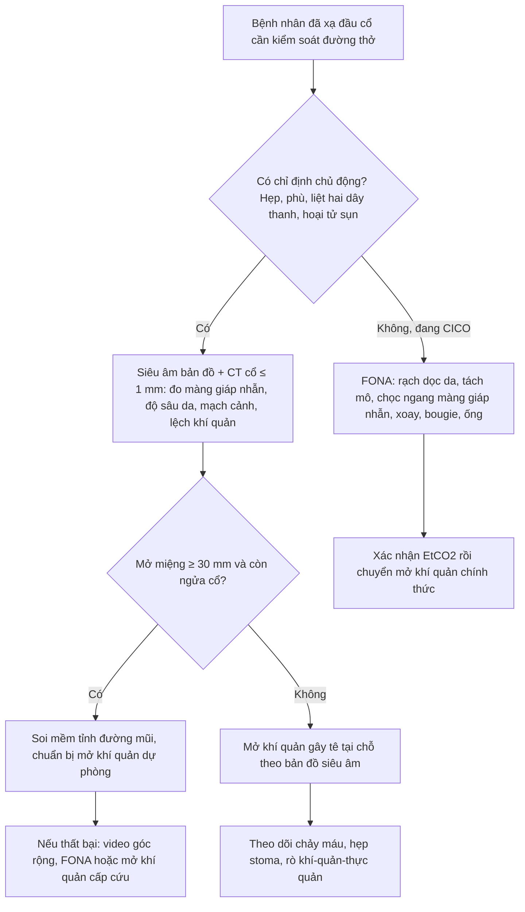
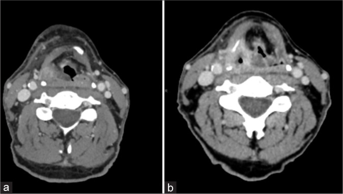
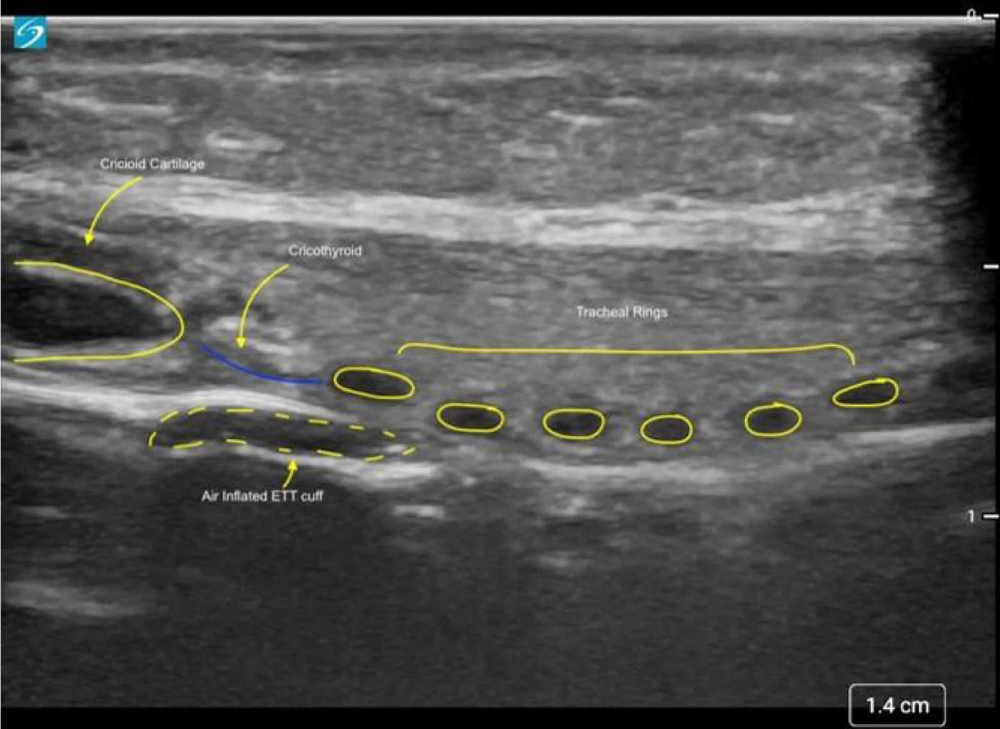
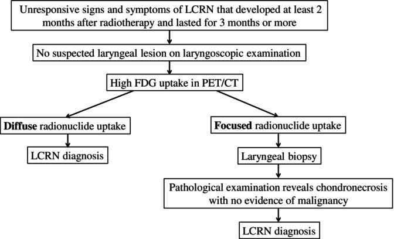
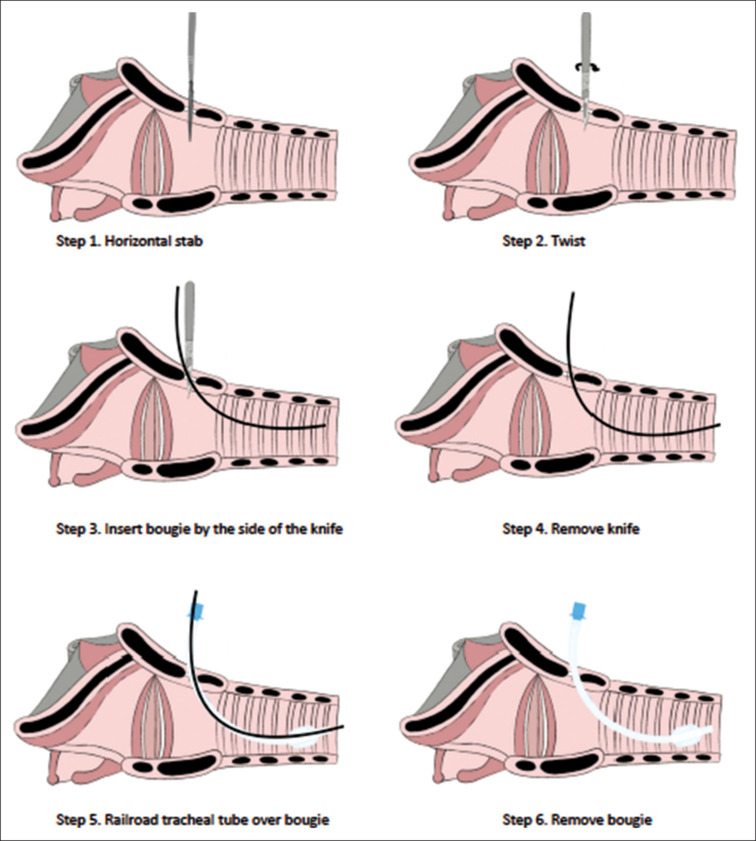

# 1769 — Mở khí quản & front-of-neck access xuyên cổ ĐÃ XẠ / Tracheostomy & front-of-neck access in the irradiated neck

**Tags:** `pattern:xo-hoa-sau-xa` `pattern:hep-duong-tho` `pattern:mat-moc-giai-phau` `pattern:day-da` `pattern:lech-khi-quan` `vung:dau-co` `vung:co` `vung:thanh-quan` `vung:duong-tho-tren` `protocol:CT` `protocol:sieu-am` `protocol:lieu-OAR` `score:ORN-DAS` `score:Chandler` `incidentaloma:khong`

**Mức chắc chắn (certainty):** tổng hợp y văn (literature synthesis) — 1 đoàn hệ hồi cứu **231 bệnh nhân** đo lại kích thước màng giáp nhẫn trên CT trước và sau xạ đầu cổ (*Indian J Otolaryngol Head Neck Surg* 2024, PMC11456054, không rõ giấy phép ảnh nên chỉ dùng số), 1 phân tích gộp **26 nghiên cứu/27.029 bệnh nhân** về mở khí quản trong mổ vạt đầu cổ (*Head Neck* 2026, PMC12797017, CC BY), 1 đoàn hệ **678 bệnh nhân** xạ thanh quản có hoại tử sụn do xạ (*Head Neck* 2025, PMC11635753, CC BY-NC-ND), 1 đoàn hệ **12 bệnh nhân** liệt hai dây thanh sau xạ (*J Laryngol Otol* 2026, PMC13443436), 1 nghiên cứu trên mô hình lợn béo (PMC7197851, CC BY), 1 thử nghiệm ngẫu nhiên chéo trên manikin cổ không sờ thấy mốc (*Anesth Analg* 2022, PMID 35245225), 1 nghiên cứu trên bàn về kỹ thuật cricothyroidotomy (PMC6078881, CC BY-NC), 1 ca cấp cứu thật (*Int J Surg Case Rep* 2024, PMC10963650) và hướng dẫn AIDAA 2025 (PMC12643155, CC BY-NC-SA). **Không có ca nguyên văn của nhóm**; 4 ca trong quiz là **ca công bố lấy nguyên văn từ bài gốc**.

> **Câu chốt:** ở cổ đã xạ, "mốc giải phẫu" không còn là thứ sờ được mà là thứ **đo được**: trong **231 bệnh nhân** xạ đầu cổ, **chiều cao màng giáp nhẫn giảm từ 8,7 mm xuống 7,5 mm** và **khoảng cách da–màng giáp nhẫn từ 11,7 mm xuống 10,2 mm** (trung vị, đánh giá sau **29,5 tháng**; giảm có ý nghĩa thống kê) — màng **ngắn hơn ~14%**, sụn **vôi hóa**, mô **cứng không ấn dịch được**, mạch cảnh **bị đẩy**. Ba con số phải thuộc: **41,0% (43/105)** đặt nội khí quản khó sau xạ đầu cổ; **9%** bệnh nhân mổ đầu cổ phải **mở khí quản gây tê tại chỗ** chủ động thay vì đặt ống; và khi đã "không đặt được – không thông khí được" (CICO), **kỹ thuật scalpel-bougie trên mô hình lợn béo đạt oxy hóa cứu 83% so với 18% của cannula** (p = 0,003).

## 1. Tổng quan bệnh học – cơ chế hình ảnh

### 1.1 Vì sao cổ sau xạ là "vùng cấm" của mọi thủ thuật đường thở

- **Xơ hóa do xạ (radiation-induced fibrosis, RIF)** là tổn thương muộn (> 90 ngày): xạ → tổn thương mao mạch và tế bào gốc mô → thiếu oxy → **TGF-β** → nguyên bào sợi thành nguyên bào cơ → **collagen I/III dày đặc, liên kết chéo** (chi tiết cơ chế ở bài 1763). Hệ quả trực tiếp cho FONA: **da dày, mất lớp mỡ dưới da, mạc cổ dính vào cơ và sụn** → không có "mặt phẳng" để tách, và mô **không đàn hồi** nên không thể kéo rộng vết rạch bằng lực.
- **Vì sao màng giáp nhẫn teo lại:** màng giáp nhẫn là mô **sợi – chun** nằm giữa hai sụn, không có sụn riêng để "giữ khung"; khi collagen co rút và mạch máu nuôi màng bị xơ, màng **co ngắn theo trục dọc**. Đoàn hệ 231 bệnh nhân (PMC11456054) cho thấy **chiều cao màng trung vị 8,7 mm trước xạ → 7,5 mm sau xạ** (khoảng 3–16,2 → 3,1–14,3 mm) và **khoảng cách da–màng 11,7 → 10,2 mm** (2,9–71,1 → 3,9–38 mm). Điểm chết người: **mốc càng gần da nhưng màng càng hẹp** — tưởng "dễ" vì nông, thực ra **cửa sổ đích chỉ còn 7,5 mm**.
- **Vì sao sụn mất vai trò mốc:** xạ gây **vôi hóa sụn** giáp – nhẫn – khí quản (thấy trên CT là **đậm độ > 200 HU**), nên sụn **cứng như xương**, mất "cảm giác đàn hồi" đặc trưng và **không còn di động theo nhịp thở** — sờ không phân biệt được sụn nhẫn với sụn giáp, nhất là khi da dày > 2 mm và mô dưới da xơ. **Tỉ lệ vôi hóa sau xạ: chưa rõ — cần tra** (bài này không có đoàn hệ đo HU sụn).
- **Vì sao dễ chảy máu:** niêm mạc và mô dưới niêm sau xạ **mỏng, giãn mạch, mất lớp đệm**; mạch cảnh và thân giáp cổ có thể **bị đẩy vào đường rạch** do xơ co kéo một bên (ca 1768: khí quản lệch **1,5 cm**, mạch cảnh hai bên bị đẩy).

### 1.2 Vì sao bệnh nhân xạ đầu cổ lại cần FONA nhiều hơn người thường

| Bệnh cảnh sau xạ | Con số | Nguồn |
|---|---|---|
| Mở khí quản trong mổ vạt đầu cổ (gộp) | **54,6%** (42,4% khi loại các nghiên cứu mở khí quản thường quy); **tiền sử xạ là yếu tố dự báo độc lập** | PMC12797017 |
| Biến chứng chung của mở khí quản trong nhóm này | **16,3%**, trong đó **biến chứng đường thở 2,6%** | PMC12797017 |
| Hoại tử sụn thanh quản do xạ (laryngeal chondroradionecrosis, LCRN) | **4,3% (29/678)** bệnh nhân xạ ung thư thanh quản; **59%** được xử trí chính bằng **mở khí quản** + corticoid/kháng sinh; **21%** phải cắt toàn bộ thanh quản | PMC11635753 |
| Liệt hai dây thanh sau xạ | **12 ca**; **91,7%** xạ điều biến liều (IMRT) trung vị **68 Gy**; thời gian tới liệt **trung vị 7,5 năm**; **7/12 phải mở khí quản** (2 ca cai được), **không ca nào hồi phục** | PMC13443436 |
| Kiểm soát đường thở trong 200 ca mổ ung thư đầu cổ | đặt ống miệng **61%** · mũi **15%** · **soi mềm tỉnh 15%** · **mở khí quản gây tê tại chỗ 9%**; **3 ca mở khí quản cấp cứu** | PMC12201920 |
| Đặt nội khí quản khó sau xạ đầu cổ (đoàn hệ ORN-DAS) | **41,0% (43/105)**; soi mềm tỉnh **28,8% vs 9,4%** ở nhóm hoại tử xương hàm | PMC12921790 |

- **Đọc bảng này đúng cách:** xạ không làm "ai cũng khó đặt ống" — đoàn hệ 55 ca **xạ thực quản** (liều thanh quản trung bình **40,0 Gy**) đặt được lần đầu **96,4%** (PMC11274552). Cái quyết định là **liều – thể tích – vị trí so với thanh môn/họng/cổ trước**, cộng thêm **xơ hóa, liệt dây thanh và hoại tử sụn**. Vì vậy FONA ở cổ xạ là **quyết định theo bản đồ giải phẫu**, không theo tiền sử "đã xạ".

### 1.3 Vật lý của hai modality quyết định

- **Siêu âm (đầu dò thẳng 6–13 MHz):** sụn **không có tín hiệu âm (anechoic)** vì chưa vôi hóa hoàn toàn; **mặt tiếp giáp khí – niêm mạc là siêu âm dày (hyperechoic) kèm đuôi nhiễu (reverberation)** vì chênh trở kháng âm khí/mô rất lớn — đó là lý do "không thấy gì sau khí quản". Màng giáp nhẫn hiện là **dải giảm âm** giữa hai sụn; đo được **chiều cao màng** và **khoảng cách da → màng** (hình quiz: **1,4 cm** trên thước của máy). Khi sụn **vôi hóa sau xạ**, sụn **mất đặc tính anechoic**, bờ sụn **dày và tăng âm kèm bóng lưng** → khó phân biệt sụn với mô xơ.
- **CT cổ ≤ 1 mm:** đây là modality duy nhất **đo được màng giáp nhẫn theo trục dọc** và **phát hiện vôi hóa sụn** (đậm độ **> 200 HU**), **lệch khí quản**, **mạch cảnh lạc chỗ** và **độ dày da – mô dưới da**. Vì cửa sổ đích chỉ **7,5 mm**, sai 2–3 mm theo trục dọc là **ra ngoài màng** (vào sụn giáp hoặc sụn nhẫn) — trên mô hình, đặt sai vị trí làm **tăng chấn thương thành khí quản** (nguy cơ tương đối **6,9** sau một lần thất bại, PMC6078881).

## 2. Mẫu hình + chẩn đoán phân biệt theo vị trí (Gamut)

- **Cách đọc:** trước khi quyết định FONA, trả lời **5 câu**: **(1) màng giáp nhẫn còn bao nhiêu mm? (2) sụn còn sờ thấy hay đã vôi hóa? (3) khí quản có lệch không, lệch bao nhiêu? (4) mạch cảnh nằm ở đâu so với đường rạch? (5) đây là đường thở cấp cứu hay chương trình?**
- **Gamut theo tầng (từ nông tới sâu):**

| Tầng | Cơ chế sau xạ | Dấu hiệu chốt |
|---|---|---|
| **Da – mô dưới da** | Xơ hóa, mất mỡ, dính da – cơ | Da dày **> 2 mm**, không nhấc được khỏi nền, mất nếp da |
| **Màng giáp nhẫn** | Co rút sợi – chun | Chiều cao **≤ 7,5 mm** (trung vị sau xạ), khó xác định trên siêu âm |
| **Sụn giáp – sụn nhẫn** | Vôi hóa, xơ mạch nuôi | Sụn **> 200 HU**, mất di động theo nhịp thở, sờ "cứng như xương" |
| **Khí quản cổ** | Lệch trục do co kéo một bên, hẹp sau ống/mở khí quản | Lệch **> 0,5 cm** trên CT; hẹp **< 50%** lòng |
| **Mạch cảnh – thân giáp cổ** | Bị đẩy ra trước/ra giữa do xơ | Mạch nằm **trong 1 cm** đường giữa trên siêu âm ngang |
| **Tuyến giáp** | To, xơ, chèn ép | Không thấy eo giáp trên siêu âm dọc; khí quản bị đẩy |

- **Gamut theo cơ chế cần FONA:** (a) **hẹp/phù thanh môn – thượng thanh môn** sau xạ; (b) **liệt hai dây thanh** (7/12 ca phải mở khí quản, PMC13443436); (c) **hoại tử sụn thanh quản** (4,3%, PMC11635753); (d) **hẹp khí quản sau đặt ống/mở khí quản cũ**; (e) **khối tái phát xâm lấn** — nhóm này **không được** mở khí quản qua khối.
- **Mnemonic 5 chữ "S" của cổ xạ khi chuẩn bị FONA:** **S**át (màng sát da nhưng ngắn) – **S**ụn (vôi hóa) – **S**ai (khí quản lệch) – **S**ợi (mô xơ không tách) – **S**ẹo (mổ cũ, xạ lại).

## 3. Bảng so sánh phân biệt (ma trận đối chiếu)

| Thực thể (entity) | Hình ảnh điển hình | Chốt vào (rule-in) | Chốt loại (rule-out) | Gợi ý xác nhận |
|---|---|---|---|---|
| **Cổ xơ hóa sau xạ (FONA khó do RIF)** | CT: da dày, **mất lớp mỡ dưới da**, dải tăng đậm độ quanh cơ ức đòn chũm; MRI: **T2 thấp**, ngấm chậm; màng giáp nhẫn **7,5 mm** | **Đúng trường xạ + không khối + T2 thấp + màng ≤ 7,5 mm** | Có khối T2 trung tính, ADC thấp, ngấm mạnh → **tái phát** | Siêu âm bản đồ + CT ≤ 1 mm; đối chiếu kế hoạch xạ |
| **Phù thanh môn cấp sau xạ** | Soi: phù đối xứng, niêm mạc giòn; CT: dày niêm mạc, hẹp lòng, mô mềm quanh sụn **không có khối** | **Phù đối xứng, khởi phát sau xạ, không loét cứng** | Loét cứng bờ nham nhở + hạch → **tái phát** | Soi ống mềm; sinh thiết chỉ khi khu trú |
| **Hoại tử sụn thanh quản do xạ (LCRN)** | PET/CT: **ngấm FDG lan tỏa** hoặc **khu trú**; CT: sụn **vỡ, vôi hóa loạn**, khí trong mô mềm | **Triệu chứng ≥ 2 tháng sau xạ, kéo dài ≥ 3 tháng, không u trên soi, FDG dương** | Khối u + FDG khu trú mạnh một ổ + tổn thương niêm mạc → **tái phát, phải sinh thiết** | Thuật toán Chandler + PET/CT (ảnh quiz 3) |
| **Liệt hai dây thanh sau xạ** | Soi: hai dây thanh **bất động ở vị trí giữa**, không khối; CT: **không thấy u**, teo cơ | **Không khối + bất động hai bên + tiền sử xạ ≥ 68 Gy** | Khối thanh quản/hạ họng, hạch → tái phát | Soi động + EMG thanh quản; theo dõi ≥ 7,5 năm |
| **Hẹp khí quản sau mở khí quản/đặt ống** | CT: hẹp chu vi hoặc web ngay dưới sụn nhẫn; sẹo mở khí quản cũ | **Tiền sử ống/mở khí quản + hẹp < 50% lòng + cách nhẫn < 3 cm** | Hẹp do u xâm lấn (bờ cứng, lan ngoài lòng) | CT lát mỏng + nội soi |
| **Cổ cứng không do xạ** | Mô mềm bình thường, không mất mặt phẳng mỡ; cột sống thoái hóa/dính khớp | **Không có tiền sử xạ vùng cổ; hạn chế ngửa cổ nhưng da bình thường** | Da dày + mất mỡ đúng trường xạ → do xạ | X-quang/CT cột sống cổ |

- **Ảnh ghép đối chiếu:** bài này **không tạo composite** — các ảnh khác modality và khác bệnh cảnh, ghép sẽ gợi ý so sánh không có thật.
- **Dấu hiệu chốt theo modality**
  - **CT:** đo **chiều cao màng giáp nhẫn**, **khoảng cách da → màng**, **độ dày da** (bình thường < 2 mm), **lệch khí quản (mm)**, **vôi hóa sụn (HU)**.
  - **Siêu âm:** dựng bản đồ **xương móng → sụn giáp → màng giáp nhẫn → sụn nhẫn → các vòng khí quản**, đánh dấu **động mạch cảnh hai bên** và **đường giữa**; đo **độ sâu** bằng thước của máy.
  - **PET/CT:** chỉ dùng khi nghi **LCRN** hoặc **tái phát**, không dùng để "đo" đường thở.

## 4. Protocol chụp + hệ phân độ/điểm chuẩn hóa

### 4.1 Trước gây mê (bắt buộc với mọi ca có tiền sử xạ đầu cổ)

- **CT cổ có cản quang, lát ≤ 1 mm**, từ nền sọ tới carina; đọc 5 điểm: (1) chiều cao màng giáp nhẫn; (2) khoảng cách da – màng; (3) độ dày da – mô dưới da; (4) lệch khí quản; (5) vị trí mạch cảnh/thân giáp cổ và vôi hóa sụn.
- **Siêu âm tại giường 6–13 MHz**, đầu dò thẳng đặt **dọc đường giữa** (màng giáp nhẫn hiện là dải giảm âm giữa sụn giáp và sụn nhẫn) rồi **ngang** để đánh dấu mạch cảnh; ghi lại **độ sâu da → màng** và **đường rạch** trên da bằng bút.
- **Rà kế hoạch xạ cũ:** liều tổng, **liều thanh quản/khí quản** và thể tích boost. Số liệu cụ thể: đoàn hệ ORN-DAS có liều tổng **66,9 vs 65,4 Gy** và **CTV boost 185 vs 109 mL** ở nhóm hoại tử xương hàm (PMC12921790); LCRN xuất hiện ở nhóm **IMRT trung vị 68 Gy** (PMC13443436).
- **Đánh giá đường thở chủ động:** ORN-DAS 0–7 (bài 1768) + **MIO** + **Mallampati** + **biên độ ngửa cổ** + **khàn/rít/thở rít thì hít vào**.

### 4.2 Ba con đường kiểm soát đường thở (chọn theo bản đồ, không theo thói quen)

| Đường | Chỉ định | Ưu điểm | Giới hạn ở cổ xạ |
|---|---|---|---|
| **Soi mềm tỉnh đường mũi (awake FOI)** | MIO ≥ 30 mm, cổ còn ngửa được, không phù cấp | Giữ tự thở, nhìn được thanh môn biến dạng | **15%** trong 200 ca mổ đầu cổ; thất bại khi phù/máu che camera |
| **Mở khí quản gây tê tại chỗ (chương trình)** | Cổ xơ hóa, MIO < 30 mm, gập cổ cố định, dự kiến đặt ống khó | Kiểm soát chắc chắn, không phụ thuộc đường ngắm | **9%** ca mổ đầu cổ; cần bản đồ mạch + sụn; chảy máu, hẹp stoma về sau |
| **FONA cấp cứu (scalpel-bougie-tube)** | CICO: không đặt được ống **và** không thông khí được | Nhanh, không cần thiết bị phức tạp | Đích chỉ **7,5 mm**, mô xơ, chảy máu; **chỉ là cầu nối** |

- **Kỹ thuật FONA 6 bước (AIDAA 2025 — "stab, twist, bougie, tube", ảnh quiz 4):** (1) rạch **ngang** da – màng giáp nhẫn; (2) **xoay** lưỡi dao để mở rộng; (3) luồn **bougie** dọc theo lưỡi dao vào khí quản; (4) **rút dao**; (5) **trượt ống** có cuff theo bougie; (6) **rút bougie**, bơm cuff, xác nhận **EtCO2**.
- **Số liệu chọn kỹ thuật (phải nhớ cả hai chiều):**
  - Mô hình **lợn béo** (mô trước khí quản dày): oxy hóa cứu **83% scalpel-bougie vs 18% cannula** (p = 0,003); đặt được dụng cụ **92% vs 73%** (p = 0,317); thời gian **90 vs 108 giây**; **chấn thương thêm 75% vs 27%** (p = 0,039) — **hiệu quả đổi bằng chấn thương** (PMC7197851).
  - **Manikin cổ không sờ thấy mốc + đang chảy máu** (65 bác sĩ gây mê): **scalpel-finger-cannula đặt được lần đầu 72,3% vs 27,7%** của scalpel-finger-bougie (OR **10,7**); thời gian tới oxy **ngắn hơn 61,5 giây**; thành công trong **3 lần thử/180 giây 84,6% vs 63,1%** (OR 5,59) — nhưng **thời gian tới ống có cuff lại dài hơn** ở nhóm cannula (PMID 35245225).
  - **Trên bàn (mô lợn)**: scalpel-bougie **45,2 giây vs 101,3 giây** của cannula-Melker (p = 0,001); cả hai **100% trong 2 lần thử** (PMC6078881).
  - **Kết luận thực hành:** **có mốc sờ/ siêu âm được → bougie** (ổn định, ít trượt); **cổ mất mốc, đang chảy máu, cần oxy hóa ngay → cannula/finger** rồi chuyển ống có cuff. Không có kỹ thuật nào "đúng tuyệt đối".

- **Phân độ dùng kèm:** **Chandler** cho phản ứng xạ thanh quản (dùng để quyết định HBOT/phẫu thuật; trong 10 ca HBOT, điểm Chandler trung vị **4 → 2,5**, p = 0,005 — PMC11635753) và **ORN-DAS** cho nguy cơ đặt ống khó (bài 1768).

## 5. Biến thể bình thường và cạm bẫy

- **"Nông" không có nghĩa "dễ":** khoảng cách da – màng sau xạ **10,2 mm** (ngắn hơn 11,7 mm trước xạ) nhưng **màng chỉ còn 7,5 mm** — đích nhỏ, dao dễ xuyên qua sụn nhẫn hoặc sụn giáp. Luôn đo **chiều cao màng**, không chỉ đo độ sâu (PMC11456054).
- **Sụn vôi hóa làm mất cảm giác "sụn đàn hồi":** đừng dùng cảm giác sờ để xác định sụn nhẫn; đánh dấu **trên da bằng siêu âm** rồi mới rạch.
- **Khí quản lệch:** ca 1768 lệch **1,5 cm** sang trái, mạch cảnh hai bên bị đẩy — rạch theo "đường giữa giải phẫu" sẽ đi vào mô xơ và mạch. Đường rạch đúng là **đường giữa khí quản đã bị lệch**, không phải đường giữa cổ.
- **Cricothyroidotomy không phải đường thở vĩnh viễn:** trong **668 ca** cricothyroidotomy, **53,1%** phải chuyển sang mở khí quản; **hẹp khí quản 1 năm 13,0% ở nhóm chuyển tiếp vs 4,9% ở nhóm chỉ cricothyroidotomy** (PMC12788739). Ở cổ xạ, quyết định **chương trình** phải là **mở khí quản**, không phải cricothyroidotomy.
- **Đừng nhầm phù sau xạ với tái phát:** phù **đối xứng, không khối, T2 sáng, ngấm thuốc rải rác**; tái phát **khối + ADC thấp + ngấm mạnh**. Sinh thiết "mù" vào mô xạ gây rò và chảy máu.
- **Đừng nhầm LCRN với tái phát:** LCRN cần **triệu chứng ≥ 2 tháng sau xạ, kéo dài ≥ 3 tháng, không u trên soi**; PET/CT **ngấm lan tỏa** → chẩn đoán LCRN, **ngấm khu trú** → **sinh thiết** (ảnh quiz 3).
- **Biến chứng muộn của chính mở khí quản:** rò khí quản – động mạch không tên (tracheoinnominate fistula) gặp **0,7%**, tử vong **50–70%**, **75% xuất hiện trong 3 tuần đầu** (y văn dẫn lại, PMC10332689) — chảy máu ồ ạt qua stoma là cấp cứu, không phải "viêm stoma".
- **Thuốc chống đông/kháng tiểu cầu** làm tăng chảy máu khi rạch mô xơ; cân nhắc cầm máu tại chỗ và chuẩn bị máu khi mở khí quản chương trình.

## 6. Tự lượng giá — Blind Quiz

**Ca 1 — Nam 62 tuổi, đã xạ liều cao ung thư vùng họng–thanh quản, khó thở tăng dần. Nhìn CT, mô tả trước khi mở đáp án.**

- Gợi ý lâm sàng: khàn, khó thở thì hít vào, không sốt; soi thấy phù nề thượng thanh môn–thanh môn.
- Câu hỏi: (1) Bất thường nằm ở tầng nào? (2) Đây là phù do xạ hay khối tái phát? (3) Bước tiếp theo an toàn nhất?

<b>Bấm để hiện đáp án (findings + chẩn đoán)</b>

- **Dấu hiệu:** hai lát CT ngang (a, b) cho thấy **mô mềm dày đối xứng vùng thượng thanh môn – thanh môn**, **hẹp lòng đường thở**, **không có khối khu trú**; mô mềm trước cổ dày, mất mặt phẳng mỡ.
- **Chẩn đoán:** **phù/hẹp đường thở trên sau xạ** (không phải khối) — phù đối xứng, không xâm lấn, không hạch.
- **Xử trí:** **không đặt ống qua đường miệng khi chưa có bản đồ**; **soi mềm tỉnh** hoặc **mở khí quản gây tê tại chỗ** nếu phù tiến triển; corticoid + kháng sinh khi có viêm; theo dõi sát 24–48 giờ.
- **Nguồn ảnh:** *J Clin Imaging Sci* 2025 (PMC11878725), **CC BY-NC-SA 4.0**.

**Ca 2 — Bệnh nhân xạ đầu cổ, chuẩn bị mở khí quản. Siêu âm dọc đường giữa cổ: mô tả mốc và trả lời vì sao phải đo.**

- Câu hỏi: (1) Kể tên 4 mốc từ trái sang phải. (2) Đường xanh là gì? (3) Con số **1,4 cm** dùng để làm gì?

<b>Bấm để hiện đáp án</b>

- **Mốc:** **sụn nhẫn** (trái, cấu trúc không tín hiệu) → **màng giáp nhẫn** (dải giảm âm, đường xanh) → **các vòng sụn khí quản** (các bầu dục không tín hiệu xếp hàng) → **bóng cuff ống nội khí quản** (đường đứt nét dưới).
- **Đường xanh:** **màng giáp nhẫn** — đích của FONA.
- **1,4 cm:** **khoảng cách da → màng**, tức độ sâu cần đi qua; ở bệnh nhân xạ, con số này **ngắn hơn** (trung vị 10,2 mm) nhưng **chiều cao màng chỉ 7,5 mm** → phải đo cả hai.
- **Nguồn ảnh:** *J Clin Med Res* 2026 (PMC13568779), **CC BY 4.0**.

**Ca 3 — Bệnh nhân xạ thanh quản 4 tháng, đau họng, khàn, không thấy u trên soi. PET/CT ngấm FDG. Chọn bước tiếp theo.**

- Câu hỏi: (1) Tiêu chuẩn thời gian của LCRN? (2) Ngấm FDG **lan tỏa** khác **khu trú** ở điểm nào? (3) Khi nào phải sinh thiết?

<b>Bấm để hiện đáp án</b>

- **Thời gian:** triệu chứng **≥ 2 tháng sau xạ** và **kéo dài ≥ 3 tháng**, không thấy u trên soi thanh quản.
- **Lan tỏa** → chẩn đoán **LCRN**, điều trị bảo tồn (corticoid, kháng sinh, **HBOT**: Chandler **4 → 2,5**, p = 0,005). **Khu trú** → **sinh thiết** để loại ung thư; nếu mô bệnh chỉ hoại tử sụn, không có tế bào ác → LCRN.
- **Sinh thiết** khi ngấm **khu trú**, hoặc khi tổn thương không đáp ứng điều trị; **không sinh thiết mù** vùng xạ lan tỏa.
- **Nguồn ảnh:** *Head Neck* 2025;47(1):300–308 (PMC11635753), **CC BY-NC-ND 4.0**.

**Ca 4 — CICO ở bệnh nhân cổ xơ sau xạ, không sờ thấy màng giáp nhẫn. Sắp xếp 6 bước.**

- Câu hỏi: (1) Thứ tự 6 bước? (2) Vì sao phải luồn bougie **dọc theo lưỡi dao**? (3) Xác nhận thành công bằng gì?

<b>Bấm để hiện đáp án</b>

- **Thứ tự:** **rạch ngang** → **xoay dao** → **luồn bougie** → **rút dao** → **trượt ống theo bougie** → **rút bougie**, bơm cuff.
- **Vì sao:** mô xơ không tách, lỗ rạch **co lại ngay**; bougie giữ đường dẫn và cho phép **trượt ống có cuff** mà không mất đường.
- **Xác nhận:** **EtCO2** (và sóng khí lưu thông), rồi **chuyển mở khí quản chính thức** vì cricothyroidotomy có **hẹp 1 năm 13,0%** khi phải chuyển tiếp (PMC12788739).
- **Nguồn ảnh:** *Indian J Anaesth* 2025 (PMC12643155), **CC BY-NC-SA 4.0**; số liệu bổ sung từ PMC7197851, PMID 35245225.

## Bài liên quan chéo
- [1768 – "Cổ đông cứng" sau xạ trị & đường thở khó](../1768-co-dong-cung-sau-xa-duong-tho-kho/lesson.md) (ORN-DAS, soi mềm tỉnh, bản đồ khí quản lệch)
- [1763 – Xơ hóa mô mềm cổ sau xạ & hội chứng vai–cổ](../1763-xo-hoa-mo-mem-co-sau-xa/lesson.md) (cơ chế RIF, độ cứng mô)
- [1767 – Phù bạch mạch đầu–cổ ngoài sau xạ](../1767-phu-bach-mach-dau-co-sau-xa/lesson.md) (phù mô mềm, chèn ép đường thở)
- [1761 – Trismus sau xạ trị đầu cổ](../1761-trismus-sau-xa-tri-dau-co/lesson.md) (MIO, hạn chế mở miệng)
- [3047 – Hẹp khí quản sau đặt nội khí quản ở trẻ](../3047-hep-khi-quan-sau-dat-noi-khi-quan-o-tre/lesson.md) (hẹp do ống, phân độ Myer–Cotton)
- [091 – Ho ra máu ồ ạt, nút mạch động mạch phế quản](../091-ho-ra-mau-oat-nut-mach-dong-mach-phe-quan/lesson.md) (cấp cứu đường thở – chảy máu)

## Ảnh
- Tên file theo quy ước `1769_slug_Modality_SourceID.ext`; **nguồn + giấy phép từng ảnh** ở `images/CREDITS.md`.
- Không crop, không kéo giãn, **không tạo composite** (khác modality/bệnh cảnh).
- **CC BY-NC-ND** (Chandler) giữ **nguyên bản**, không chỉnh sửa.

> Không dùng để chẩn đoán độc lập khi chưa có người hướng dẫn.
