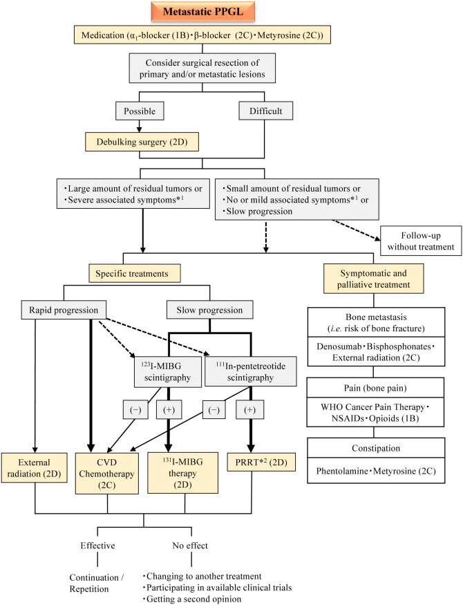
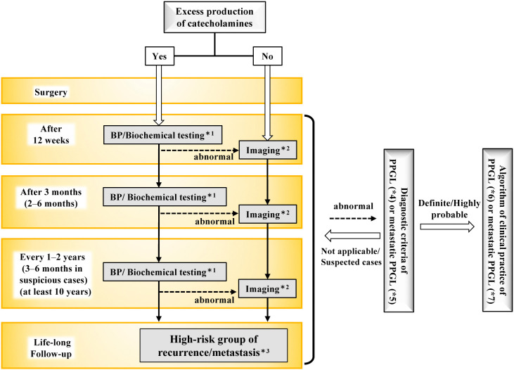
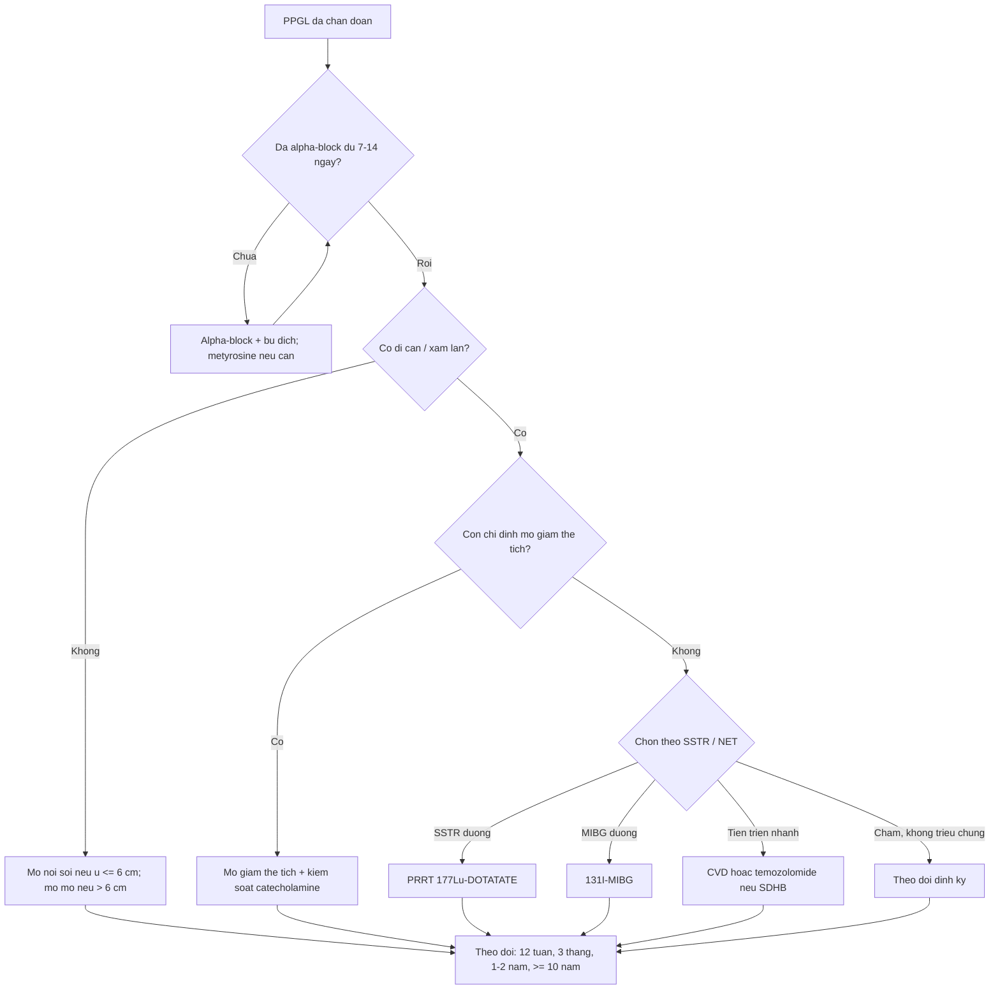
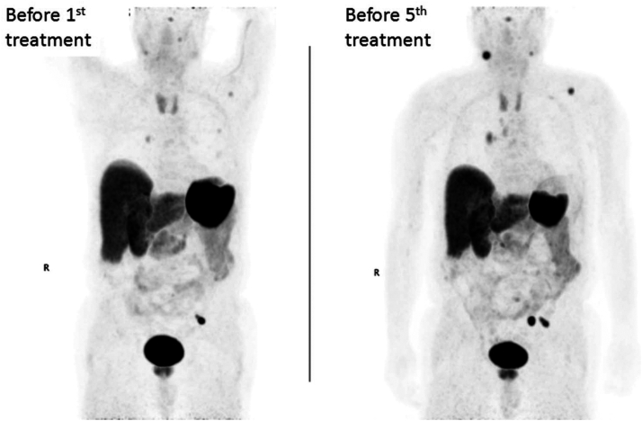
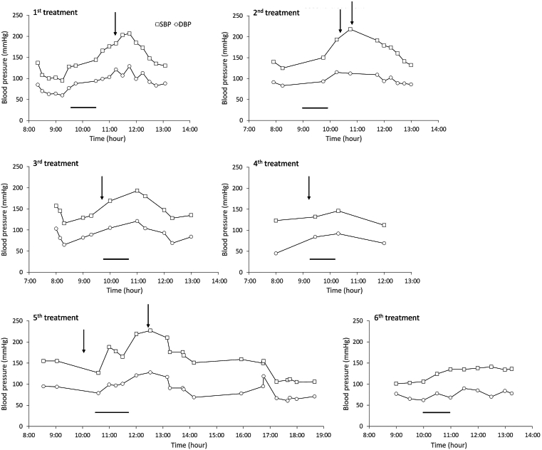

# 177 — Điều trị & theo dõi u tủy thượng thận – u cận hạch (PPGL): alpha-block, phẫu thuật, PRRT/MIBG & lịch theo dõi / Pheochromocytoma–paraganglioma: treatment and surveillance

**Tags:** `pattern:khoi-thuong-than` `pattern:paraganglioma` `vung:thuong-than` `vung:paraganglia` `score:RECIST` `protocol:alpha-block` `protocol:PRRT-MIBG` `incidentaloma:u-thuong-than`

**Mức chắc chắn (certainty):** tổng hợp y văn (literature synthesis) — guideline Nhật 2025, review gây mê chu phẫu 2026, review điều trị toàn thân 2026 và ca PRRT 2026; số liệu lấy trực tiếp từ bài gốc, không suy diễn.

> **Câu chốt:** Với PPGL, **thuốc điều trị đầu tiên không phải thuốc hạ huyết áp — mà là alpha-block đủ lâu để "mở khóa" mạch và bù thể tích**. Mổ là cách duy nhất chữa khỏi, nhưng mổ khi chưa khóa alpha = nguy cơ cơn tăng huyết áp lúc chạm u và sốc sau khi thắt tĩnh mạch thượng thận. Sau mổ, bệnh có thể tái phát **hàng chục năm** — theo dõi là một phần của điều trị, không phải thủ tục hành chính.

## 1. Tổng quan — vì sao phải "khóa catecholamine trước, cắt u sau"

- **Bệnh học (pathology):** u tủy thượng thận (pheochromocytoma, PCC) và u cận hạch (paraganglioma, PGL) cùng xuất phát từ **tế bào ưa crôm (chromaffin cells)**. Khoảng **40%** trường hợp mang đột biến dòng mầm (germline), hay gặp **RET, VHL, NF1, SDHB/SDHD**; di truyền quyết định nguy cơ đa ổ, hai bên và tái phát. Theo WHO 2022, mọi PPGL đều được xếp là u **có tiềm năng ác tính**; chỉ gọi di căn khi thấy tổn thương ở mô **không ưa crôm** (xương, phổi, gan, hạch).
- **TẠI SAO alpha-block trước, beta-block sau:** catecholamine cao kéo dài gây **co mạch và giảm thể tích nội mạch**; đồng thời thụ thể alpha bị "khóa xuống thang" (downregulation). Khi bắt đầu chẹn alpha, mạch giãn ra và thể tích "lộ" ra thiếu → phải bù muối/nước. Nếu chẹn beta đơn thuần trước, mất tác dụng giãn mạch beta-2 ở mạch ngoại vi trong khi alpha còn nguyên → **tăng huyết áp dữ dội, phù phổi, cơn kịch phát**. Vì vậy quy tắc bất biến: **không bao giờ khởi đầu bằng beta-blocker đơn thuần**.
- **TẠI SAO sốc sau khi cắt u:** khi thắt tĩnh mạch thượng thận, nguồn catecholamine tắt đột ngột trong lúc mạch vẫn còn giãn do alpha-block → **giãn mạch, tụt huyết áp, phản ứng viêm** (vasoplegia). Đây là lý do phải bù thể tích trước mổ, theo dõi huyết áp xâm lấn và chuẩn bị vận mạch.
- **TẠI SAO metyrosine (metyrosine):** ức chế **tyrosine hydroxylase** — enzym giới hạn tốc độ tổng hợp catecholamine — nên làm giảm *sản xuất* catecholamine, khác với alpha-block chỉ chặn *tác dụng*. Dùng khi alpha-block không đủ, không dung nạp, hoặc trước can thiệp có nguy cơ giải phóng catecholamine lớn (PRRT, nút mạch, u to).

**Ngưỡng định lượng bắt buộc (mục 1 & 4):**
- **Thời gian chuẩn bị alpha-block:** **7–14 ngày**, nhiều trung tâm nhắm **≥ 10 ngày** — đủ bù thể tích và hồi phục tổn thương cơ quan đích.
- **Mục tiêu huyết áp – tần số:** ngồi **< 130/80 mmHg**, nhịp ngồi **60–70 lần/phút**, đứng **huyết áp tâm thu ≥ 90 mmHg**, nhịp đứng **70–80** (Endocrine Society; đạt *xu hướng*, không phải một lần đo).
- **Ngưỡng mổ nội soi:** u **≤ 6 cm**, không xâm lấn; **> 6 cm** hoặc nghi xâm lấn → mổ mở.
- **Bảo tồn vỏ thượng thận:** u **≤ 5 cm**, PCC hai bên/thể gia đình — giảm phụ thuộc corticoid suốt đời; tái phát tại thượng thận cùng bên **13%**.
- **Di căn:** PCC **10–15%**, PGL **35–70%**; trung vị sống **7–22 năm** — PGL và SDHB có nguy cơ cao nhất.
- **Tái phát sau cắt:** thể lẻ tẻ **14,7%**; cluster 1 (SDHx) **47,5%**; cluster 2 **14,9%**; **29,1%** phát hiện ở năm thứ 10, **17,7%** ở năm thứ 15. Yếu tố nguy cơ: noradrenaline trội, u **≥ 5 cm**, ngoài thượng thận, trẻ, đột biến gen.
- **Theo dõi tối thiểu:** **10 năm**; **suốt đời** nếu nguy cơ cao — không có "khỏi hẳn" để xuất viện vĩnh viễn.

## 2. Mẫu hình bệnh cảnh + gamut quyết định điều trị

Không phải mọi PPGL đều đi chung một đường. Trước khi chọn thuốc/mổ, hãy xếp bệnh nhân vào một trong năm **bệnh cảnh (clinical scenario)**:

- **A — PCC/PGL khu trú, lẻ tẻ, chức năng:** alpha-block → **cắt tuyến thượng thận toàn phần qua nội soi** (≤ 6 cm). Đây là nhóm tiên lượng tốt nhất nhưng vẫn phải theo dõi ≥ 10 năm.
- **B — Thể gia đình / hai bên / đa ổ (RET, VHL, NF1, SDHx):** ưu tiên **phẫu thuật bảo tồn vỏ** khi u ≤ 5 cm; mổ bên có u trước, giữ vỏ bên còn lại; tầm soát cả gia đình và các u phối hợp (ung thư giáp thể tủy trong MEN 2, u mạch võng mạc/tủy trong VHL).
- **C — Di căn hoặc tái phát:** không mổ "bằng mọi giá". Chọn theo **khối u còn lại – triệu chứng – tốc độ tiến triển**: theo dõi, mổ giảm thể tích, PRRT, 131I-MIBG, hóa trị CVD, temozolomide, TKI hoặc belzutifan.
- **D — Khủng hoảng (crisis), xuất huyết/nhồi máu trong u:** ổn định trước; **mổ cấp cứu chỉ khi không thể ổn định**; nếu có sốc tim, cân nhắc hỗ trợ tuần hoàn cơ học (xem bài 167).
- **E — Thai kỳ & trẻ em:** alpha-block vẫn là nền tảng; thời điểm mổ khác nhau theo tam cá nguyệt/lứa tuổi (bài 169).

**Gợi nhớ "4T" của điều trị PPGL:** **T**arget blockade (alpha-block đủ) · **T**umor removal (mổ khi đã khóa) · **T**herapy for metastatic disease (chọn theo SSTR/NET/đột biến) · **T**racking (theo dõi suốt đời).

## 3. Bảng so sánh phân biệt các lựa chọn điều trị (ma trận đối chiếu)

| Chiến lược (strategy) | Chỉ định chính | Chốt vào (rule-in) | Chốt loại (rule-out) | Hiệu quả định lượng & theo dõi |
|---|---|---|---|---|
| **Cắt thượng thận toàn phần** | PCC khu trú, u ≤ 6 cm, không xâm lấn | **U khu trú + chức năng + đã alpha-block đủ 7–14 ngày** | U > 6 cm/xâm lấn → mổ mở; di căn lan rộng → không cắt "triệt căn" | Chữa khỏi cao nhất; tái phát 14,7–47,5% tùy thể; theo dõi ≥ 10 năm |
| **Cắt bảo tồn vỏ thượng thận** | Thể gia đình, PCC hai bên, u **≤ 5 cm** | **Nguy cơ mất cả hai thượng thận + u còn vỏ lành** | U > 5 cm, xâm lấn vỏ, không đảm bảo bờ → cắt toàn phần | Tái phát cùng bên **13%**, di căn **1,3%**; tránh suy thượng thận suốt đời |
| **Alpha-block ± metyrosine** | Mọi PPGL chức năng trước mổ/can thiệp; không mổ được | **Huyết áp dao động + catecholamine tăng + chuẩn bị can thiệp** | U không tiết catecholamine, không can thiệp → không cần | Đạt đích ngồi < 130/80, nhịp 60–70; tác dụng phụ: hạ huyết áp tư thế, nghẹt mũi |
| **PRRT ¹⁷⁷Lu-DOTATATE** | Di căn/tái phát **SSTR dương** | **DOTATATE PET dương mạnh + bệnh tiến triển** | SSTR âm, bệnh ổn định nhiều năm → chưa cần | Pha II: **PFS 6 tháng 86,1%**, PFS trung vị **19,9 tháng**, OS **51,7 tháng**; cohort khác kiểm soát bệnh **80%**; nguy cơ **cơn THA do PRRT** |
| **¹³¹I-MIBG (HSA)** | Di căn **MIBG dương**, cần kiểm soát huyết áp | **MIBG-avid + tăng catecholamine** | MIBG âm / SSTR dương ưu thế → PRRT hợp lý hơn | **25%** giảm ≥ 50% thuốc hạ áp ≥ 6 tháng; **92%** PR/ổn định; OS trung vị **36,7 tháng** |
| **Hóa trị CVD** (cyclophosphamide–vincristine–dacarbazine) | Bệnh tiến triển nhanh, khối lớn, cần giảm nhanh | **Tiến triển nhanh + cần cytoreduction** | Bệnh chậm, không triệu chứng → theo dõi | Đáp ứng khối u **57%**, đáp ứng sinh hóa **79%** (n = 14) |
| **Temozolomide** | Di căn tiến triển, đặc biệt **SDHB** | **SDHB đột biến + bệnh tiến triển** | Không có dữ liệu cho thể không SDHB | PR **33%**, PFS trung vị **13,3 tháng**; đáp ứng chỉ ở SDHB |
| **Sunitinib / cabozantinib** | Di căn tiến triển, SSTR/MIBG không phù hợp | **Bệnh tiến triển + không còn lựa chọn đích** | Bệnh ổn định, không triệu chứng | Sunitinib: PFS 12 tháng **36% vs 19%** placebo; cabozantinib: ORR **25%**, PFS **16,6 tháng** |
| **Belzutifan (HIF-2α)** | Di căn không mổ được, đặc biệt **VHL/EPAS1** | **Bệnh tiến triển + bối cảnh giả thiếu oxy** | Không có bằng chứng cho mọi PPGL | ORR **26%**, DCR **85%**, PFS **22,3 tháng**; 32% giảm ≥ 50% thuốc hạ áp |
| **Theo dõi không điều trị** | Di căn nhỏ, không triệu chứng, tiến triển chậm; HNPGL không chức năng | **Không triệu chứng + khối nhỏ + chậm/không tiến triển** | Tiến triển nhanh, triệu chứng nặng, chèn ép → phải can thiệp | HNPGL lớn **0,4–1,6 mm/năm**; theo dõi MRI/DOTATATE định kỳ |

*Lưu đồ PPGL di căn: kiểm soát catecholamine → cân nhắc mổ giảm thể tích → chọn theo tốc độ tiến triển và hình ảnh chức năng (MIBG vs DOTATATE) → CVD/PRRT/MIBG/xạ trị; nhánh xương dùng denosumab/bisphosphonate + xạ ngoài. Nguồn: Tanabe A et al., Endocrine Journal 2026 (PMC12819074), Fig. 8, CC BY-NC-ND 4.0 — giữ nguyên bản, không chỉnh sửa.*

## 4. Protocol điều trị – theo dõi

### 4.1. Chuẩn bị trước mổ (7–14 ngày)

- **Alpha-block:** phenoxybenzamine **10 mg mỗi 8–12 giờ**, tăng dần; hoặc doxazosin **2–4 mg mỗi 8–12 giờ**. Tăng liều mỗi **3–4 ngày** theo huyết áp và mức hạ huyết áp tư thế nhẹ.
- **Beta-block:** chỉ thêm **sau khi đã chẹn alpha**, khi nhịp nhanh dai dẳng; mục tiêu nhịp ngồi **60–70 lần/phút**.
- **Metyrosine:** dùng khi alpha-block không đủ hoặc trước can thiệp nguy cơ cao; theo dõi sỏi thận/tinh thể niệu (khuyến khích uống **≥ 2 L/ngày**).
- **Bù thể tích:** chế độ ăn nhiều muối + uống đủ nước; cá thể hóa ở người suy tim/bệnh cơ tim do catecholamine (bài 167) — bù quá mạnh có thể gây phù phổi.
- **Đích:** huyết áp ngồi **< 130/80 mmHg**, huyết áp tâm thu đứng **≥ 90 mmHg**, nhịp ngồi **60–70**, nhịp đứng **70–80**.
- **ECG trước mổ:** nhiều trung tâm yêu cầu ECG **không còn thay đổi ST-T trong ≥ 1 tuần** (tiêu chí Roizen) trước khi mổ.

### 4.2. Trong mổ

- **Tăng huyết áp khi chạm u:** phentolamine **5–15 mg bolus**, hoặc truyền **1–6 µg/kg/phút**; nicardipine **5–15 mg/giờ**; nitroprusside **0,25–2 µg/kg/phút** (tránh liều cao vì độc tính cyanide).
- **Sau thắt tĩnh mạch/tắt nguồn catecholamine:** tụt huyết áp do giãn mạch + giảm thể tích → bù dịch, rồi **noradrenaline/vasopressin** nếu cần; không chậm trễ vận mạch.
- **Hạ đường huyết sau mổ:** theo dõi glucose **48 giờ**, đặc biệt ở người đái tháo đường; xử trí glucose tĩnh mạch.

### 4.3. Sau mổ và theo dõi dài hạn

- **12 tuần sau mổ:** đo huyết áp + xét nghiệm sinh hóa (metanephrine tự do huyết tương/niệu phân đoạn).
- **3 tháng (2–6 tháng):** lặp sinh hóa; nếu bất thường → chụp hình ảnh.
- **Sau đó:** mỗi **1–2 năm** (hoặc **3–6 tháng** ở nhóm nguy cơ cao), tối thiểu **10 năm**; **suốt đời** nếu trẻ, u **≥ 5 cm**, PGL, noradrenaline trội hoặc có đột biến gen.
- **Hình ảnh:** chỉ chụp khi sinh hóa bất thường hoặc có triệu chứng; với u không tiết catecholamine, chụp MRI/CT định kỳ theo lịch.

*Lưu đồ theo dõi hậu phẫu: 12 tuần → 2–6 tháng → mỗi 1–2 năm (3–6 tháng nếu nguy cơ cao) → nhóm nguy cơ cao theo dõi suốt đời. Nguồn: Tanabe A et al., Endocrine Journal 2026 (PMC12819074), Fig. 6, CC BY-NC-ND 4.0 — giữ nguyên bản.*

### 4.4. Chọn can thiệp theo hình ảnh chức năng

- **⁶⁸Ga-DOTATATE PET/CT:** chọn bệnh nhân **PRRT**; nhạy nhất cho PGL đầu–cổ và di căn SDHx.
- **¹²³I-MIBG:** chọn bệnh nhân **¹³¹I-MIBG**; độ nhạy thấp hơn ở di căn pheo (đặc biệt SDHB).
- **¹⁸F-FDG PET/CT:** đánh giá độ hung hãn, di căn, và các tổn thương kém biệt hóa.
- **Nguyên tắc:** *hình ảnh chức năng chọn thuốc, không chỉ để "tìm u"*. U SSTR dương mạnh nhưng MIBG âm → PRRT; u MIBG dương mạnh, SSTR âm → ¹³¹I-MIBG.

## 5. Biến thể bình thường và cạm bẫy

- **Chẹn beta trước alpha = cạm bẫy chết người.** Không dùng propranolol/atenolol đơn thuần để trị nhịp nhanh khi chưa chẹn alpha.
- **Alpha-block quá ngắn hoặc quá dài đều có giá.** Nghiên cứu 110 ca: chuẩn bị **> 30 ngày** và dùng **doxazosin** liên quan cơn tăng huyết áp kéo dài hơn, nhiều vận mạch hơn; mục tiêu thực tế là **7–14 ngày** và đủ liều, không phải "càng lâu càng tốt".
- **"Sinh hóa bình thường" không loại trừ PGL không chức năng** — nhất là PGL đầu–cổ; chẩn đoán dựa vào hình ảnh và mô bệnh, điều trị theo nguy cơ chèn ép/chảy máu.
- **PRRT có thể gây cơn tăng huyết áp** do giải phóng catecholamine/tan u. Phải chẹn alpha đủ, theo dõi huyết áp trong và sau truyền; ca khó dùng **metyrosine tăng liều 4 ngày trước** đã ngăn được cơn ở chu kỳ sau.
- **MIBG âm không có nghĩa "không còn cách"** — chuyển sang DOTATATE/FDG để chọn PRRT hoặc TKI.
- **Đừng nhầm "ổn định sau mổ" với "khỏi bệnh":** tái phát có thể xuất hiện **sau nhiều thập kỷ**, đặc biệt thể gia đình. Bệnh nhân cần được cấp lịch theo dõi bằng văn bản.
- **Bảo tồn vỏ không miễn phí:** tái phát tại thượng thận cùng bên **13%**; phải giải thích rõ lợi ích (tránh suy thượng thận) và nguy cơ mổ lại.
- **Thai kỳ:** alpha-block vẫn dùng được; tránh mổ trong tam cá nguyệt 1 và 3 nếu có thể; phối hợp sản – nội tiết – gây mê (bài 169).

## 6. Tự lượng giá — Blind Quiz

**Ca 1 — Nam 75 tuổi, PPGL di căn tiến triển, đã chẹn alpha + beta. Trước và sau 4 chu kỳ ¹⁷⁷Lu-DOTATATE, DOTATATE PET thay đổi thế nào?**

- Gợi ý lâm sàng: đau xương, huyết áp dao động, đã điều trị 4 chu kỳ PRRT.
- Câu hỏi: So sánh hai ảnh MIP? Có phải "càng nhiều chu kỳ càng tốt" không? Theo dõi bằng gì?

<b>Bấm để hiện đáp án (findings + chẩn đoán)</b>

- **Dấu hiệu:** ảnh bên phải (trước chu kỳ 5) xuất hiện **thêm ổ bắt xạ ở cổ, hố nách và nhiều ổ mới** so với ảnh bên trái → bệnh **tiến triển dù đã PRRT**.
- **Chẩn đoán:** PPGL di căn tiến triển trong khi PRRT; PRRT là điều trị kiểm soát, **không phải chữa khỏi**.
- **Xử trí:** đánh giá lại bằng RECIST + DOTATATE; cân nhắc đổi sang CVD/temozolomide/TKI/belzutifan; kiểm soát catecholamine và đau xương.
- Nguồn: Yu R et al., AACE Endocrinol Diabetes 2026, Fig. 1, PMC13043445, CC BY 4.0.

**Ca 2 — Cùng bệnh nhân, huyết áp trong 6 chu kỳ PRRT. Chu kỳ nào có cơn tăng huyết áp, và vì sao chu kỳ 6 khác biệt?**

- Câu hỏi: Mô tả đỉnh huyết áp tâm thu? Can thiệp nào đã thay đổi kết quả chu kỳ 6?

<b>Bấm để hiện đáp án (findings + chẩn đoán)</b>

- **Dấu hiệu:** cơn tăng huyết áp rõ ở **chu kỳ 1, 2, 3 và 5** (huyết áp tâm thu tới ~220 mmHg); **chu kỳ 4 và 6 không có cơn**. Trước chu kỳ 6, bệnh nhân được **tăng liều metyrosine 4 ngày** trước truyền, không dùng thêm alpha-block ngay trước truyền.
- **Chẩn đoán:** cơn tăng huyết áp do PRRT (giải phóng catecholamine/tan u), **dự phòng được** bằng kiểm soát catecholamine đủ sâu.
- **Bài học:** PRRT phải có protocol theo dõi huyết áp, không truyền như hóa trị thông thường.
- Nguồn: Yu R et al., AACE Endocrinol Diabetes 2026, Fig. 2, PMC13043445, CC BY 4.0.

**Ca 3 — Sau mổ PCC lẻ tẻ, u 3 cm, hết triệu chứng. Bạn hẹn theo dõi thế nào?**

<b>Bấm để hiện đáp án</b>

- **Lịch:** sinh hóa + huyết áp ở **12 tuần**, **3 tháng**, sau đó **mỗi 1–2 năm**; tối thiểu **10 năm**. Nếu trẻ, u **≥ 5 cm**, PGL, noradrenaline trội hoặc có đột biến → theo dõi **suốt đời**.
- **Vì sao:** tái phát thể lẻ tẻ **14,7%**, nhưng có thể xuất hiện **29,1% ở năm thứ 10** và **17,7% ở năm thứ 15**.
- Nguồn số liệu: Tanabe A et al., Endocrine Journal 2026, PMC12819074, CC BY-NC-ND 4.0.

## Bài liên quan chéo
- [168 – U tủy thượng thận & u cận hạch: chẩn đoán hình ảnh](../168-pheo-paraganglioma/lesson.md)
- [167 – Biến chứng tim mạch & khủng hoảng tăng huyết áp của pheo](../167-bien-chung-tim-mach-pheo-pgl/lesson.md)
- [169 – PPGL ở trẻ em & thai kỳ](../169-ppgl-tre-em-va-thai-ky/lesson.md)
- [155 – Khối thượng thận tình cờ](../155-thuong-than-tinh-co/lesson.md)
- [199 – Xét nghiệm gen & tầm soát gia đình](../199-quy-trinh-xet-nghiem-gen-tam-soat-gia-dinh/lesson.md)

## Ảnh
- Nguồn + giấy phép từng ảnh: `images/CREDITS.md`.
- Ảnh CC BY-NC-ND (PMC12819074) giữ **nguyên bản**, không crop/ghép.

> Không dùng để chẩn đoán độc lập khi chưa có người hướng dẫn.
