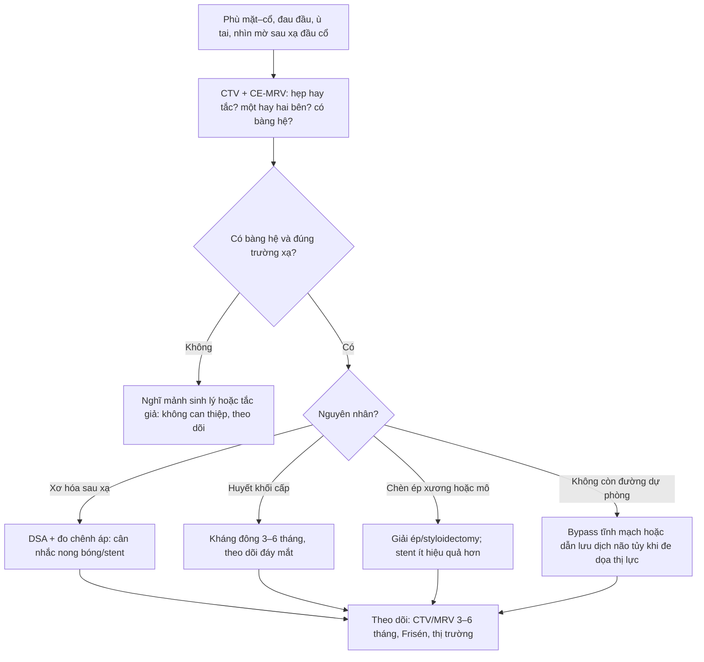
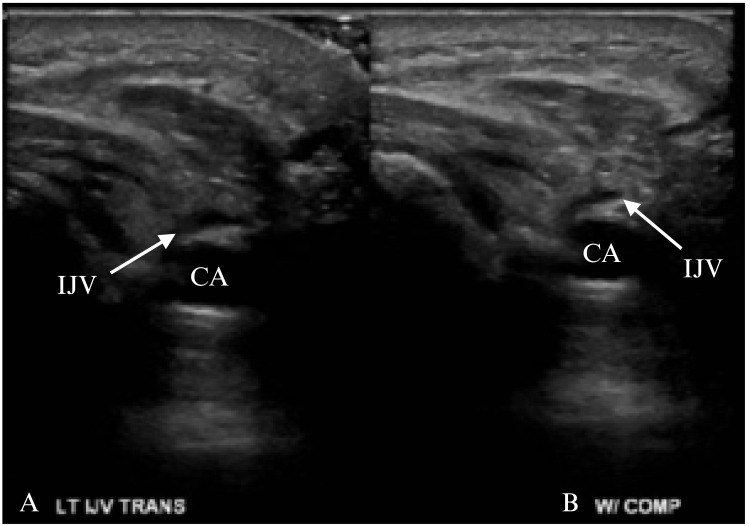
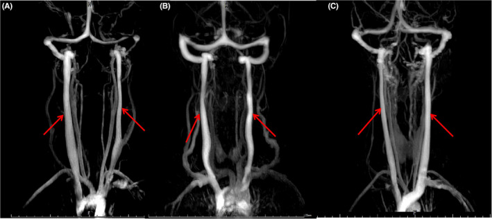
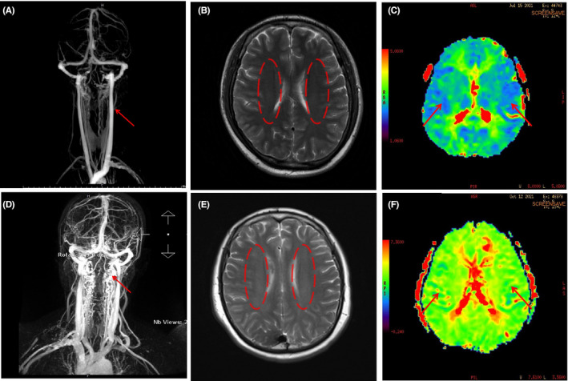

# 1770 — Tắc tĩnh mạch cảnh trong HAI BÊN sau xạ / Bilateral internal jugular vein occlusion after radiotherapy

**Tags:** `pattern:xo-hoa-sau-xa` `pattern:tac-tinh-mach` `pattern:hep-tinh-mach` `pattern:phu-mat` `pattern:giai-thong-mach` `vung:dau-co` `vung:co` `vung:co-canh` `vung:mach-co-dau-co` `protocol:CT` `protocol:MRI` `protocol:DSA` `protocol:lieu-OAR` `score:Frisen` `incidentaloma:khong`

**Mức chắc chắn (certainty):** tổng hợp y văn (literature synthesis) — 1 ca "cổ gỗ" có **tắc hai tĩnh mạch cảnh trong** sau xạ (*Int Med Case Rep J* 2024, PMC11316490, CC BY-NC), 1 đoàn hệ **1.487 bệnh nhân** phân biệt **tĩnh mạch cảnh mảnh** với **hẹp mắc phải** (*CNS Neurosci Ther* 2022, PMC9532925, CC BY 4.0), 1 đoàn hệ **319 bệnh nhân/144 ca đặt stent** theo dõi **30,5 tháng** (PMC10424652), 1 đoàn hệ **118 bệnh nhân** hẹp tĩnh mạch cảnh trong (*Ann Transl Med* 2019, PMC6944626), 1 tổng quan can thiệp (*J Neurointerv Surg* 2022), 2 ca tắc hai bên có can thiệp (*J Vasc Surg* 2000; *J Vasc Interv Radiol* 2005), 1 ca tái tạo tĩnh mạch cảnh (*Oral Oncol* 2023), 1 ca huyết khối xoang sau thắt tĩnh mạch cảnh (*BMJ Case Rep* 2024), 1 ca stent di trú (*BMC Neurol* 2025, PMC12625422) và các nghiên cứu huyết khối tĩnh mạch cảnh sau vét hạch (PMC7701489; *Head Neck* 1998; *Arch Otolaryngol Head Neck Surg* 1997). **Không có ca nguyên văn của nhóm**; 3 ca trong quiz là **ca công bố lấy nguyên văn từ bài gốc**.

> **Câu chốt:** tắc **một** tĩnh mạch cảnh trong thường **im lặng**; tắc **hai** bên là **tăng áp lực nội sọ do ứ tĩnh mạch** — phù mặt–quanh hốc mắt, đau đầu, ù tai mạch đập, **phù gai thị**, có thể mất thị lực. Ba con số phải thuộc: huyết khối tĩnh mạch cảnh sau vét hạch gặp **8,25% (9/109)** đến **21,6% (25/116)**; **hẹp mắc phải có tuần hoàn bàng hệ**, còn **tĩnh mạch mảnh sinh lý thì không** (bên trái "mảnh" tới **48,4%** người bình thường); và **CTV có thể báo tắc giả** — trong 4 tĩnh mạch cảnh bị CTV gọi là tắc hoàn toàn, **chụp số hóa xóa nền (DSV) thấy thông cả 4**.

## 1. Tổng quan bệnh học – cơ chế hình ảnh

### 1.1 Vì sao tắc hai tĩnh mạch cảnh trong lại là bệnh của não, không phải bệnh của cổ

- **Giải phẫu chức năng:** ở tư thế nằm, **tĩnh mạch cảnh trong (internal jugular vein, IJV)** là đường dẫn lưu chính của não ở tư thế nằm; hệ **đám rối tĩnh mạch quanh sống (vertebral venous plexus)** và **tĩnh mạch cảnh ngoài** chỉ là đường phụ (tỉ lệ lưu lượng chính xác thay đổi theo tư thế và giữa các nghiên cứu — **chưa rõ, cần tra**). Các xoang màng não **không có van**, nên khi IJV tắc, **áp lực được truyền ngược trực tiếp vào xoang – mao mạch màng não**.
- **Hệ quả sinh lý:** tăng áp lực tĩnh mạch nội sọ → giảm chênh áp hấp thu dịch não tủy ở hạt màng nhện → **tăng áp lực nội sọ "kiểu giả u não" (pseudotumor cerebri)** dù não không có u. Đây là lý do bệnh nhân **đau đầu, ù tai mạch đập, nhìn mờ từng lúc, phù gai thị** — và vì sao khám **đáy mắt là bắt buộc**, không phải "khám thêm".
- **Vì sao xạ tạo ra tắc:** (a) **xơ hóa quanh mạch** — IJV bị bao trong mô xơ co rút, thành dày, lòng hẹp dần (cùng cơ chế RIF ở bài 1763); (b) **huyết khối** trên nội mạch bị tổn thương, nhất là sau **vét hạch cổ** làm rối loạn dòng và tổn thương lớp nội mạc; (c) **tắc do chèn ép** từ hạch/u/tổ chức xơ. Khi **một bên đã bị lấy bỏ hoặc tắc**, bên còn lại **không còn dự trữ** — tắc thêm bên thứ hai là **mất hoàn toàn dẫn lưu não**.
- **Số liệu nền:**
  - Huyết khối IJV sau vét hạch cổ: **8,25% (9/109 tĩnh mạch)**, trong đó **4 tĩnh mạch vẫn tắc sau 3 tháng** (PMC7701489); **21,6% (25/116)** (J Plast Reconstr Aesthet Surg 2021); **14% (4/29)** (*Head Neck* 1998); khoảng chung **0–29,6%**.
  - Tắc IJV sau nối tận–bên trong tạo hình vi phẫu: **4/58 ca (6,9%)** (*Ann Plast Surg* 2002).
  - Tắc IJV trong ung thư giáp: có thể do **huyết khối, huyết khối u, chèn ép/xâm lấn, hoặc xẹp xơ sau vét hạch bên** (*Eur J Surg Oncol* 2021).
- **Vì sao hình ảnh khó:** tĩnh mạch cảnh **mảnh** (slenderness) là biến thể bình thường, **rất hay gặp bên trái** (bên trái **48,4%**, bên phải **10,5%**, hai bên đối xứng **41,1%** trong **1.487** người, PMC9532925) và **không gây triệu chứng**; nếu đọc "hẹp" trên mọi phim, ta sẽ can thiệp vào người khỏe. Ngược lại, **tắc thật sau xạ** có **tuần hoàn bàng hệ quanh chỗ hẹp** — đây là dấu hiệu phân biệt cốt lõi.

### 1.2 Vật lý của ba modality và cái bẫy "tắc giả"

| Modality | Nguyên lý | Điều cho biết | Cạm bẫy |
|---|---|---|---|
| **CT tĩnh mạch (CTV)** | Thuốc cản quang thì **tĩnh mạch 45–60 giây**, lát **≤ 1 mm**, dựng MPR dọc theo trục IJV | Đường kính nhỏ nhất, đoạn hẹp, **tuần hoàn bàng hệ**, lệch lỗ tĩnh mạch cảnh | **Tắc giả** khi dòng chậm/không đủ thuốc: **4/4 tĩnh mạch CTV gọi tắc hoàn toàn đều thông trên DSV** (*J Clin Neurosci* 2022) |
| **MR tĩnh mạch (CE-MRV)** | Gadolinium thì tĩnh mạch; **không dùng TOF** vì TOF phụ thuộc dòng chảy, dễ "mất tín hiệu" ở chỗ hẹp | Tuần hoàn bàng hệ, tương phản mô mềm quanh mạch, **tổn thương chất trắng** | **MRI đánh giá hẹp cao hơn CT**: độ III–IV gặp **57,1%** trên MRI so với **24,2%** trên CT (35 bệnh nhân/70 tĩnh mạch, κ = 0,220) — *không đổi điều trị chỉ vì một con số trên MRI* (PMC10893318) |
| **DSA + đo áp lực** | Chụp số hóa xóa nền qua đường bẹn, đo **chênh áp qua đoạn hẹp (manometry)** | Xác nhận **thông/tắc thật**, hướng dòng, chênh áp, và cho phép can thiệp cùng lúc | Xâm lấn; **chưa có ngưỡng chênh áp được thẩm định** cho IJV (khác hẹp xoang); quyết định dựa vào **triệu chứng + hình ảnh + chênh áp** |

- **TẠI SAO "mảnh" khác "hẹp":** tĩnh mạch mảnh có **lỗ tĩnh mạch cảnh (jugular foramen) hai bên không đối xứng** và **không có bàng hệ**; hẹp mắc phải có **bàng hệ quanh chỗ hẹp** và **không** kèm bất đối xứng lỗ. Trong 1.487 người, nhóm mảnh có **tưới máu não bình thường** trên MR-PWI và **không có bàng hệ** (PMC9532925).
- **TẠI SAO "tắc giả" trên CTV:** thuốc cản quang đi theo **dòng chảy**; khi một bên đã tắc mạn, dòng bên đó **chậm và loãng**, có thể **không đủ đậm độ** ở thì chụp → hình giống tắc hoàn toàn. Vì vậy **mọi ca dự kiến can thiệp phải xác nhận bằng DSA**, nhất là khi CTV nói "tắc" mà bệnh nhân **chỉ phù nhẹ**.

## 2. Mẫu hình + chẩn đoán phân biệt theo vị trí (Gamut)

- **Cách đọc:** trả lời **5 câu**: **(1) tắc một bên hay hai bên? (2) tắc do xơ – huyết khối – chèn ép? (3) có bàng hệ không? (4) có bằng chứng tăng áp lực nội sọ (phù gai, Frisén) không? (5) còn đường dự phòng (tĩnh mạch cảnh ngoài, đám rối quanh sống) để phẫu thuật không?**
- **Gamut theo vị trí (từ trên xuống):**

| Vị trí | Nguyên nhân hay gặp | Dấu hiệu chốt |
|---|---|---|
| **Lỗ tĩnh mạch cảnh – nền sọ** | Xơ hóa sau xạ, chèn ép xương (mỏm trâm/C1), huyết khối lan từ xoang | Hẹp **sát nền sọ**, bàng hệ quanh lỗ; CTV dễ gọi tắc giả |
| **IJV đoạn trên (dưới góc hàm)** | Xơ hóa trường xạ, hạch di căn, huyết khối sau catheter | Thành dày, lòng hẹp dài, **bàng hệ cảnh ngoài** |
| **IJV đoạn giữa (ngang sụn giáp)** | Xơ hóa sau vét hạch + xạ, **dính vào cơ ức đòn chũm** | Mất mặt phẳng mỡ quanh mạch, mạch **không xẹp khi ấn siêu âm** |
| **Ngã ba tĩnh mạch cảnh – thân cánh tay đầu** | Hẹp sau catheter, huyết khối, xơ sau mổ | Hẹp **đoạn cuối**, ảnh hưởng cả hai bên nếu lan thân cánh tay đầu |
| **Toàn hệ (SVC)** | U trung thất, xơ trung thất sau xạ | Phù mặt–cổ–tay, tuần hoàn bàng hệ thành ngực; **SVC hẹp/tắc trên CT** |

- **Mnemonic 4 chữ "V" của tắc tĩnh mạch cảnh hai bên:** **V**ị trí (một hay hai bên) – **V**ách (xơ/huyết khối/chèn ép) – **V**òng bàng hệ (có/không) – **V**õng mạc (phù gai, Frisén).

## 3. Bảng so sánh phân biệt (ma trận đối chiếu)

| Thực thể (entity) | Hình ảnh điển hình | Chốt vào (rule-in) | Chốt loại (rule-out) | Gợi ý xác nhận |
|---|---|---|---|---|
| **Hẹp/tắc IJV mắc phải sau xạ + vét hạch** | CTV/MRV: hẹp **dài, thành dày, không vôi**, **bàng hệ quanh chỗ hẹp**; MRI: mô xơ **T2 thấp** quanh mạch | **Đúng trường xạ + bàng hệ + thành dày + không khối trong lòng** | Lòng mạch **nhẵn, không bàng hệ, không thay đổi thành** → mảnh sinh lý | CE-MRV + DSA/đo áp lực khi cân nhắc can thiệp |
| **IJV mảnh sinh lý (slenderness)** | CTV: mạch nhỏ đều, **không bàng hệ**; **lỗ tĩnh mạch cảnh hai bên bất đối xứng**; PWI bình thường | **Không triệu chứng + không bàng hệ + bất đối xứng lỗ cảnh** | Có bàng hệ + triệu chứng tăng áp nội sọ → hẹp thật | So sánh hai bên; không can thiệp, không stent |
| **Huyết khối IJV cấp** | Siêu âm: lòng mạch **tăng âm, không xẹp được**, không có dòng; CT: **khuyết thuốc trong lòng**, thành mạch viêm | **Khởi phát cấp sau catheter/mổ + đau + khuyết thuốc trong lòng** | Hẹp do xơ: không có khuyết thuốc, thành dày mạn | Siêu âm Doppler + D-dimer; kháng đông |
| **Chèn ép do u/hạch** | CT/MRI: **khối ngoài mạch đẩy lệch**, mạch bị ép một bên | **Có khối + đẩy lệch trục + ngấm thuốc** | Xơ hóa: không khối, mô xơ T2 thấp | MRI có cản quang; sinh thiết khối |
| **Tắc tĩnh mạch chủ trên (SVC)** | CT ngực: hẹp/tắc SVC, bàng hệ thành ngực; phù mặt–cổ–**hai tay** | **Phù cả hai tay + bàng hệ thành ngực + tổn thương trung thất** | Phù chỉ ở mặt/cổ, tay bình thường → tại IJV | CT ngực có cản quang |
| **Phù bạch mạch sau xạ** | Mô mềm dày **đối xứng**, **T2 sáng**, không hẹp lòng mạch | **Ấn lõm, đổi theo tư thế, mạch thông** | Mạch hẹp/tắc + bàng hệ → nguyên nhân tĩnh mạch | CE-MRV; đo vòng cổ (bài 1767) |
| **Huyết khối xoang màng não (CVST)** | MRV: khuyết thuốc trong xoang; MRI: nhồi máu/ phù não | **Đau đầu dữ dội + khuyết thuốc xoang + có thể co giật** | Xoang thông, chỉ IJV hẹp → không phải CVST | MRV + MRI não; kháng đông toàn thân |

- **Ảnh ghép đối chiếu:** không tạo composite — ảnh khác modality và khác bệnh cảnh.
- **Dấu hiệu chốt theo modality**
  - **CTV:** đo **đường kính nhỏ nhất** và **chiều dài đoạn hẹp**; ghi **số nhánh bàng hệ**; luôn dựng **MPR dọc** hai bên để so sánh.
  - **CE-MRV:** chỉ dùng **thì tĩnh mạch sau gadolinium**; ghi rõ **có/không bàng hệ** — đây là dấu hiệu phân biệt mảnh với hẹp.
  - **DSA:** chụp **hai bên**, đánh giá **dòng qua xoang – bàng hệ – chéo bên**, đo **chênh áp** trước/sau chỗ hẹp.

## 4. Protocol chụp + hệ phân độ/điểm chuẩn hóa

### 4.1 Protocol hình ảnh

- **CTV cổ – nền sọ:** lát **≤ 1 mm**, từ **xoang dọc trên** tới **quai động mạch chủ**, thì tĩnh mạch **45–60 giây** (hoặc bắt đầu khi thuốc đạt tĩnh mạch cảnh); dựng **MPR dọc theo IJV hai bên** và **MIP** để thấy bàng hệ.
- **CE-MRV** khi cần đánh giá xoang màng não và mô mềm quanh mạch; **không dùng TOF** cho IJV.
- **Siêu âm Doppler màu** tại giường: đánh giá **khả năng xẹp khi ấn** (tắc = không xẹp), dòng, và **huyết khối trong lòng** (ảnh quiz 1).
- **DSA + đo áp lực** khi: CTV/MRV gợi ý tắc **nhưng triệu chứng nhẹ**, khi dự kiến **đặt stent**, hoặc khi cần phân biệt **tắc thật với tắc giả**.
- **Đáy mắt:** ghi **phù gai thị theo Frisén 0–5** và **thị trường** ở mọi ca nghi tăng áp lực nội sọ.

### 4.2 Phân tầng và xử trí theo nguyên nhân (không theo "độ hẹp" đơn thuần)

- **Bằng chứng cho từng nhánh:**
  - **Huyết khối:** kháng đông chuẩn đưa tới kết cục tốt **100,0% vs 33,3%** so với không kháng đông (p = 0,038) trong 118 bệnh nhân (PMC6944626).
  - **Hẹp do xơ không chèn ép ngoài:** đặt stent có lợi **26,9% vs 3,3%** (p = 0,019) — cùng đoàn hệ trên; **không có lợi ở nhóm chèn ép ngoài** (nhóm này cần giải ép).
  - **Chèn ép (mỏm trâm/C1):** tổng quan 17 nghiên cứu: **giải ép/styloidectomy thành công 79%** so với **nong bóng/stent 66%** (J Neurointerv Surg 2022).
  - **Stent (nhóm hẹp/tắc IJV nói chung):** **144 ca** đặt stent; cải thiện đau đầu, ù tai, mất ngủ, **áp lực nội sọ** sau **6,15 ± 1,67 ngày**; sau **30,53 ± 4,41 tháng** cải thiện cả **nhìn mờ và phù gai thị**, **Frisén 2 (0–4) → 1 (0–3)**; **127/144 (95,5%)** giữ được dòng; **3 hẹp lại trong stent, 3 huyết khối trong stent**, không có chảy máu nội sọ hay stent di trú trong loạt này (PMC10424652).
  - **Biến chứng stent phải nhớ:** một ca **stent IJV di trú vào động mạch phổi** sau đặt stent hai bên (biểu hiện **hồi hộp + phù ngoại biên**) (PMC12625422).
  - **Tái tạo/bypass tĩnh mạch:** ca **lấy bỏ IJV một bên + tắc bên còn lại sau hóa–xạ** có **phù bạch mạch cổ nặng và giãn tĩnh mạch cổ**; nối **tận–bên từ IJV trên xuống tĩnh mạch cảnh ngoài cùng bên**, không biến chứng, triệu chứng hết (*Oral Oncol* 2023).

## 5. Biến thể bình thường và cạm bẫy

- **Bên trái "mảnh" là bình thường:** **48,4%** người không triệu chứng có IJV trái mảnh, **10,5%** bên phải (PMC9532925). Đừng đặt stent cho một biến thể giải phẫu — **thiếu bàng hệ** là dấu hiệu loại trừ quan trọng nhất.
- **CTV báo tắc ≠ tắc:** **4/4** tĩnh mạch cảnh bị CTV gọi tắc hoàn toàn ở nền sọ **thông trên DSV** (*J Clin Neurosci* 2022). Nếu bệnh nhân chỉ phù nhẹ mà CTV nói "tắc", hãy chụp lại thì muộn/ DSA trước khi can thiệp.
- **MRI "nặng" hơn CT:** cùng 70 tĩnh mạch, hẹp độ III–IV gặp **57,1%** trên MRI nhưng **24,2%** trên CT (κ = 0,220). Đừng so sánh hai modality như hai lần đo cùng một thứ.
- **Phù mặt sau xạ không phải lúc nào cũng là phù bạch mạch:** ca *J Vasc Interv Radiol* 2005 mô tả **phù mặt dai dẳng được chẩn đoán là phù bạch mạch**, thực ra do **tắc IJV sau mổ + xạ**, và **giải thông + stent** mới hết phù. Phù bạch mạch **ấn lõm, T2 sáng, mạch thông** (bài 1767); tắc tĩnh mạch **mạch không xẹp, có bàng hệ**, phù **nặng khi nằm/ngủ dậy**.
- **Thắt một bên IJV không phải "vô hại":** ca nam 30 tuổi thắt IJV phải trong mổ ung thư lưỡi **kèm vét hạch hai bên** → **huyết khối xoang sigma – ngang**, tăng áp lực nội sọ, dù hệ tĩnh mạch bên đối diện "bình thường" (*BMJ Case Rep* 2024). Trước khi lấy IJV, phải biết **bên đối diện có thông không**.
- **Tắc hai bên có thể diễn tiến tối cấp:** ca *J Vasc Surg* 2000: nữ 62 tuổi (đã cắt thanh quản, vét hạch cổ phải lấy IJV, xạ cổ) → **phù mặt đau, phù quanh hốc mắt và quanh miệng, mất thị lực, mất thính lực và rối loạn ý thức**; phải **đặt stent IJV trái + thân cánh tay đầu**. Đây là biến chứng **đe dọa tính mạng**, không phải "phù thẩm mỹ".
- **Stent không phải đích cuối:** theo dõi **hẹp lại/huyết khối trong stent** (3 + 3/144 trong 30 tháng) và **di trú stent** (ca di trú vào động mạch phổi). Bệnh nhân cần được dặn **hồi hộp, phù ngoại biên, đau ngực** sau stent.
- **"Cổ gỗ" + tắc hai IJV = đường thở khó:** ca PMC11316490 cho thấy **phù mặt + tắc hai IJV** đi kèm **phù thanh môn**, đặt ống thất bại, phải **mở khí quản dưới ECMO** — xem bài 1769 để lập kế hoạch đường thở trước khi can thiệp mạch.

## 6. Tự lượng giá — Blind Quiz

**Ca 1 — Nam 46 tuổi, ung thư amidan đã xạ nhiều đợt, phù mặt tăng dần. Siêu âm cổ trái: mô tả trước khi mở đáp án.**

- Gợi ý lâm sàng: phù mặt–cổ, khó thở khi nằm; tiền sử xạ cổ nhiều đợt.
- Câu hỏi: (1) Cấu trúc nào là tĩnh mạch, cấu trúc nào là động mạch? (2) Vì sao ấn đầu dò mà tĩnh mạch không xẹp? (3) Bước tiếp theo?

<b>Bấm để hiện đáp án (findings + chẩn đoán)</b>

- **Dấu hiệu:** (A) trước ấn và (B) sau ấn: **IJV (mũi tên) bị lấp bởi mô tăng âm trong lòng, không xẹp khi ấn**, nằm cạnh **động mạch cảnh (CA)** còn đập; không thấy dòng chảy rõ.
- **Chẩn đoán:** **tắc tĩnh mạch cảnh trong trái** (huyết khối/xơ hóa trong lòng) — mất dự trữ dẫn lưu não khi bên phải đã tổn thương.
- **Bước tiếp theo:** **CTV/MRV hai bên** xác nhận tắc hai bên + bàng hệ; **khám đáy mắt (Frisén)**; **đánh giá đường thở** theo bài 1769 trước khi gây mê; cân nhắc **kháng đông** và **DSA** nếu dự kiến can thiệp.
- **Nguồn ảnh:** *Int Med Case Rep J* 2024 (PMC11316490), **CC BY-NC**.

**Ca 2 — Ba kiểu tĩnh mạch cảnh trên CTV. Kiểu nào là biến thể, kiểu nào cần can thiệp?**

- Câu hỏi: (1) Kiểu A/B/C tương ứng gì? (2) Dấu hiệu nào trên phim giúp phân biệt mảnh với hẹp? (3) Có nên đặt stent cho kiểu A không?

<b>Bấm để hiện đáp án</b>

- **Kiểu:** (A) **IJV phải mảnh**, (B) **hai bên đối xứng**, (C) **IJV trái mảnh** — đều là **biến thể mảnh**, không phải hẹp mắc phải.
- **Phân biệt:** mảnh **không có tuần hoàn bàng hệ quanh chỗ hẹp**, **lỗ tĩnh mạch cảnh hai bên bất đối xứng**, tưới máu não bình thường; hẹp mắc phải có **bàng hệ** và thường **có triệu chứng**.
- **Không stent** cho biến thể mảnh không triệu chứng (48,4% người bình thường có IJV trái mảnh).
- **Nguồn ảnh:** *CNS Neurosci Ther* 2022 (PMC9532925), **CC BY 4.0**.

**Ca 3 — Bệnh nhân phù mặt sau xạ, MRV hai bên. Nhìn ảnh và quyết định hướng xử trí.**

- Câu hỏi: (1) Hàng trên khác hàng dưới ở điểm nào? (2) Dấu hiệu nào chỉ ra hẹp **mắc phải**? (3) Vì sao phải khám đáy mắt?

<b>Bấm để hiện đáp án</b>

- **Khác nhau:** hàng trên (A–C) là **IJV mảnh**: CE-MRV **không có bàng hệ**, T2-FLAIR không có tổn thương chất trắng, PWI bình thường. Hàng dưới (D–F) là **hẹp mắc phải**: CE-MRV có **mạng bàng hệ quanh chỗ hẹp**, có **tổn thương chất trắng kiểu mây (cloudy-like WMH)**, PWI thay đổi.
- **Chỉ ra hẹp mắc phải:** **tuần hoàn bàng hệ** + triệu chứng (đau đầu, ù tai) + tổn thương chất trắng.
- **Đáy mắt:** hẹp hai bên gây **tăng áp lực nội sọ** → **phù gai thị**; Frisén và thị trường quyết định **mức khẩn** (đe dọa thị lực → can thiệp/dẫn lưu sớm).
- **Nguồn ảnh:** *CNS Neurosci Ther* 2022 (PMC9532925), **CC BY 4.0**.

## Bài liên quan chéo
- [1769 – Mở khí quản & front-of-neck access xuyên cổ đã xạ](../1769-co-dong-cung-sau-xa-duong-tho-kho/lesson.md) (đường thở khi phù thanh môn do tắc tĩnh mạch)
- [1767 – Phù bạch mạch đầu–cổ ngoài sau xạ](../1767-phu-bach-mach-dau-co-sau-xa/lesson.md) (phân biệt phù bạch mạch với tắc tĩnh mạch)
- [1763 – Xơ hóa mô mềm cổ sau xạ & hội chứng vai–cổ](../1763-xo-hoa-mo-mem-co-sau-xa/lesson.md) (cơ chế xơ hóa quanh mạch)
- [1768 – "Cổ đông cứng" sau xạ trị & đường thở khó](../1768-co-dong-cung-sau-xa-duong-tho-kho/lesson.md) (tắc hai IJV làm mất mốc mở khí quản)
- [249 – Rò động mạch cảnh – xoang hang chấn thương](../249-ro-dong-mach-canh-xoang-hang-chan-thuong/lesson.md) (bệnh mạch cảnh–xoang, can thiệp nội mạch)

## Ảnh
- Tên file theo quy ước `1770_slug_Modality_SourceID.ext`; **nguồn + giấy phép từng ảnh** ở `images/CREDITS.md`.
- Không crop, không kéo giãn, **không tạo composite**.
- Toàn bộ ảnh là **nguyên bản** của bài gốc; không dùng ảnh không rõ giấy phép.

> Không dùng để chẩn đoán độc lập khi chưa có người hướng dẫn.
