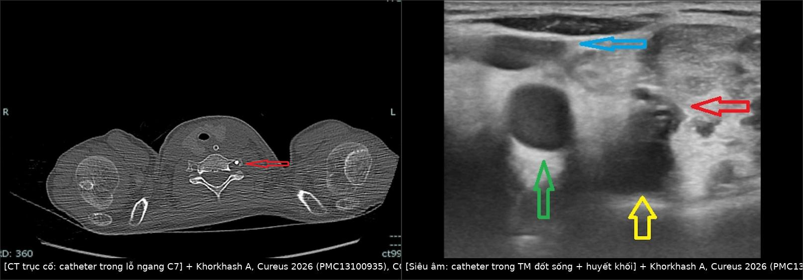
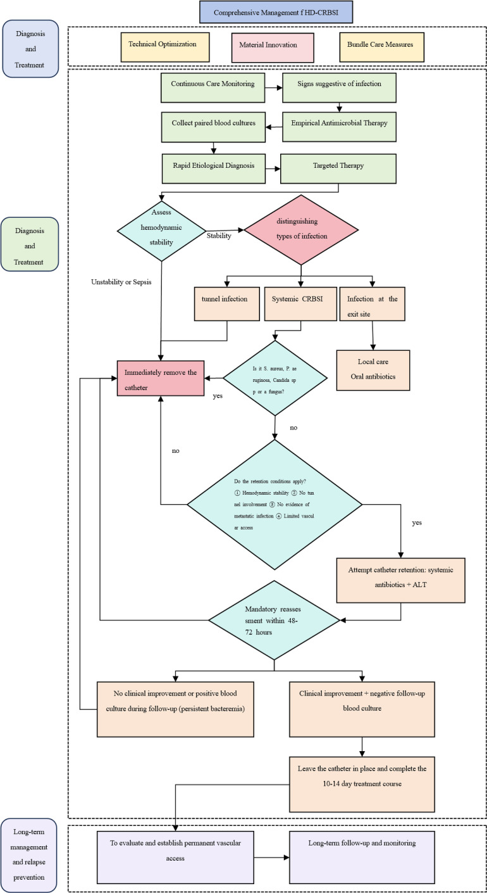
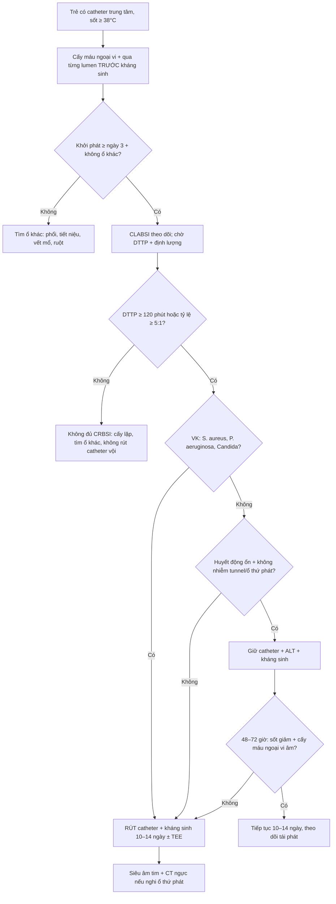
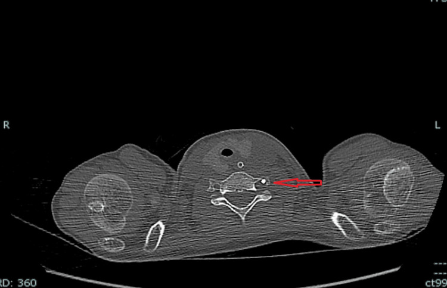
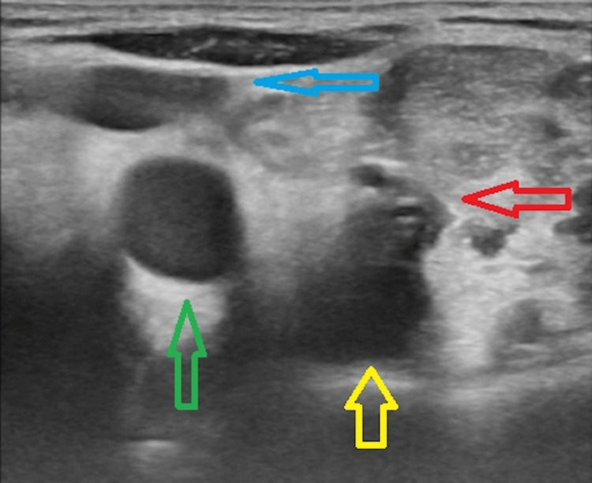
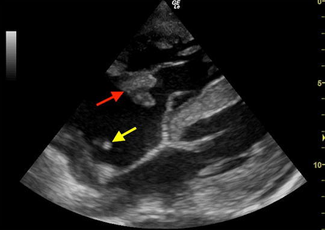

# 1771 — Nhiễm khuẩn huyết liên quan catheter trung tâm ở trẻ: cấy máu đôi, vị trí đầu catheter và khi nào rút / Central line-associated bloodstream infection (CLABSI) in children

**Tags:** `pattern:nhiem-khuan` `vung:nhieu-co-quan` `protocol:CDC-NHSN` `protocol:DTTP` `protocol:sieu-am-long-mach` `protocol:CTA` `protocol:siec-tim` `score:CLABSI`

**Mức chắc chắn (certainty):** tổng hợp y văn (literature synthesis) — số liệu nhi từ **31 trẻ hội chứng ruột ngắn (intestinal failure) dùng catheter – PN** (PMC12937225), **270 catheter – 4.304 catheter-day ở PICU** (PMC13306186), **đoàn hệ trẻ lọc máu** (PMC13181618); định nghĩa và tiêu chuẩn cấy máu từ **tổng quan quản lý CRBSI 2026** (PMC13269079) + **nghiên cứu độ tin cậy DTTP** (PMC12131746); ngưỡng vị trí đầu catheter từ **đoàn hệ 836 ca đặt port dưới huỳnh quang** (PMC13702922). Ca minh họa là ca nguyên văn, ghi rõ nguồn từng ảnh.

> **Câu chốt:** CLABSI là **chẩn đoán vi sinh – dịch tễ**, không phải chẩn đoán hình ảnh. Hình ảnh trả lời **4 câu hỏi**: (1) đầu catheter có đúng chỗ không, (2) có **huyết khối** trong lòng mạch không, (3) có **ổ nhiễm khuẩn thứ phát** (viêm nội tâm mạc, tắc mạch nhiễm khuẩn, viêm xương) không, và (4) có **ổ nhiễm khác** giải thích được sốt không. Câu hỏi "có CLABSI không?" phải trả lời bằng **cấy máu ngoại vi + cấy máu qua catheter**, không bằng CT.

## 1. Tổng quan bệnh học – cơ chế hình ảnh

### 1.1 Hai định nghĩa không được lẫn

- **CLABSI (central line-associated bloodstream infection – nhiễm khuẩn huyết liên quan catheter trung tâm):** định nghĩa **giám sát (surveillance)** của CDC/NHSN — nhiễm khuẩn huyết nguyên phát ở người **đang có catheter trung tâm ≥ 2 ngày lịch** (ngày đặt tính là ngày 1), khởi phát **từ ngày thứ 3** trở đi, và **không do một ổ nhiễm khác** (viêm phổi, nhiễm tiết niệu, nhiễm vết mổ). CLABSI **không** chứng minh catheter là nguồn.
- **CRBSI (catheter-related bloodstream infection – nhiễm khuẩn huyết do catheter):** định nghĩa **lâm sàng – vi sinh** — cùng một loại vi khuẩn mọc ở **cấy máu ngoại vi** và **cấy máu lấy qua catheter**, kèm bằng chứng catheter là nguồn: **hiệu số thời gian mọc (differential time to positivity, DTTP) ≥ 120 phút** (catheter mọc trước) hoặc **tỷ lệ định lượng ≥ 5:1** (catheter/ngoại vi) (PMC12131746, PMC13269079).
- Hệ quả thực hành: **CLABSI dùng để so sánh chất lượng giữa khoa**; **CRBSI dùng để quyết định rút hay giữ catheter**. Một ca "CLABSI" có thể thực ra là nhiễm từ đường ruột ở trẻ suy ruột — và ngược lại, một CRBSI do *S. aureus* có thể không đủ tiêu chuẩn CLABSI nếu khởi phát sớm.

### 1.2 Sinh bệnh học: vì sao hình ảnh không thấy ổ nhiễm

- **Màng sinh học (biofilm):** vi khuẩn bám vào mặt trong catheter, tiết ma trận polysaccharide; màng dày **10–100 µm**, **dưới giới hạn phân giải của CT (≈ 0,5–1 mm) và siêu âm (≈ 0,3–0,5 mm)**. Vì vậy **không có "dấu hiệu biofilm" trên bất kỳ phương thức hình ảnh nào** — chỉ thấy **hệ quả**: huyết khối, dày thành tĩnh mạch, ổ mủ quanh catheter.
- **Hai đường vào:** **ngoài lòng (extraluminal)** — vi khuẩn từ da đi theo mặt ngoài catheter qua cuff vào máu, thường **sớm trong 10–14 ngày đầu**; **trong lòng (intraluminal)** — nhiễm từ hub/van khi thao tác, thường **muộn hơn**, chiếm ưu thế ở catheter nằm lâu. Đây là lý do **kỹ thuật sát khuẩn hub** quan trọng hơn kháng sinh dự phòng.
- **TẠI SAO huyết khối thấy được còn nhiễm khuẩn không:** huyết khối là **khối fibrin – tiểu cầu – hồng cầu** có **trở kháng âm khác máu** (echo lòng mạch) và **không xẹp khi ép**; còn vi khuẩn **không tạo đậm độ tia X** và **không đủ lớn** để tạo mặt phân cách âm. Nhiễm khuẩn chỉ trở nên "thấy được" khi đã tạo **dịch mủ, khí, phù mô, hoặc huyết khối nhiễm khuẩn**.
- **TẠI SAO siêu âm tim thấy vegetation:** vegetation là **khối mô – fibrin – vi khuẩn ≥ 2 mm** gắn vào van, dao động theo dòng máu; chênh **trở kháng âm** với máu đủ để tạo cấu trúc echo di động. Tuy vậy **khối < 2 mm** và **van nhân tạo** vẫn có thể bỏ sót — âm tính không loại trừ.

### 1.3 Ngưỡng định lượng

| Chỉ số | Số liệu | Nguồn |
|---|---|---|
| CRBSI ở trẻ hội chứng ruột ngắn dùng PN | **1,3–10,2 đợt/1.000 catheter-day**; cao hơn ở trẻ **< 1 tuổi** | PMC12937225 |
| CLABSI ở PICU | **3,0/1.000 catheter-day** (13 ca/4.304 ngày) | PMC13306186 |
| Nguy cơ theo thời gian nằm | **15–22 ngày: aOR 4,33**; **≥ 23 ngày: aOR 11,71** so với < 14 ngày | PMC13306186 |
| Vị trí đặt | **tĩnh mạch đùi** tăng nguy cơ (aOR **2,45** ở trẻ lọc máu); **IJ phải** thấp hơn đùi (aOR **0,34**) | PMC13181618, PMC13306186 |
| Đường kính catheter | **≥ 7 Fr: aOR 2,20** | PMC13181618 |
| Cân nặng/tuổi | Trẻ **< 1 tuổi** nguy cơ cao nhất; suy giảm miễn dịch **aOR 2,18** | PMC12937225, PMC13181618 |
| Vi khuẩn | **Gram dương ≈ 64%**, **CoNS ≈ 32%**, **Gram âm ≈ 36%** (người lớn lọc máu); trẻ suy ruột: *S. epidermidis*, *E. faecalis*, *K. pneumoniae* | PMC13269079, PMC12937225 |
| Vị trí đầu catheter | Dải tối ưu **20–40 mm dưới carina**; CAJ trung bình **46,2 mm dưới carina** | PMC13702922 |
| Siêu âm chẩn đoán huyết khối catheter | **Độ nhạy 91%, độ đặc hiệu 93%** | PMC13435576 |

- **Vì sao thời gian nằm lâu lại tăng nguy cơ:** màng sinh học dày dần, **fibrin sheath** hình thành quanh đầu catheter sau **24–48 giờ**, tạo giá thể cho vi khuẩn; đồng thời số lần thao tác hub tăng theo thời gian. Nguy cơ **không tuyến tính** — tăng vọt sau **tuần thứ 2–3**, đúng như aOR 11,71 ở nhóm ≥ 23 ngày.
- **Vì sao đùi nguy cơ cao:** vùng bẹn **ẩm, nhiều vi khuẩn da – niêm mạc**, catheter di động khi gấp háng, và **dễ nhiễm bẩn phân – nước tiểu** ở trẻ nhỏ; thêm vào đó **huyết khối tĩnh mạch đùi** gặp nhiều hơn do dòng chảy thấp.

## 2. Mẫu hình + chẩn đoán phân biệt theo vị trí (gamut)

- **Đầu catheter quá cao** (SVC trên, thân cánh tay đầu): tăng **huyết khối**, chệch dòng, khó lấy máu; **không** bảo vệ được tĩnh mạch chủ.
- **Đầu catheter quá thấp** (nhĩ phải/thất phải): **loạn nhịp, thủng, chèn ép tim**, huyết khối quanh van ba lá.
- **Catheter lạc (malposition)** — gamut theo đường đi: **tĩnh mạch đốt sống** (ảnh ca 1), **tĩnh mạch azygos**, **tĩnh mạch vú trong**, **tĩnh mạch màng tim – hoành**, **khoang màng phổi**, **động mạch**. Mỗi vị trí có **hệ quả riêng**: azygos → huyết khối + tràn dịch; màng tim → chèn ép; động mạch → thiếu máu/giả phình.
- **Huyết khối liên quan catheter (catheter-related thrombosis, CRT):** hay gặp nhất ở **đầu catheter** (fibrin sheath) và **thân catheter trong tĩnh mạch lớn**; có thể **bít tắc** hoặc **không bít tắc**. Gamut: huyết khối do catheter, huyết khối do ung thư/tăng đông, huyết khối do nhiễm khuẩn (septic thrombophlebitis).
- **Viêm tắc tĩnh mạch nhiễm khuẩn (septic thrombophlebitis):** huyết khối **nhiễm khuẩn** ở tĩnh mạch có catheter — sốt dai dẳng, **cấy máu dương tính kéo dài dù kháng sinh**, đau dọc tĩnh mạch; nguy cơ **tắc mạch nhiễm khuẩn** và **viêm mủ màng phổi**.
- **Viêm nội tâm mạc tim phải (right-sided infective endocarditis):** van ba lá; hay gặp **S. aureus**, **Candida**, catheter nằm lâu; **siêu âm tim** là chốt.
- **Tắc mạch phổi nhiễm khuẩn (septic pulmonary emboli):** **nốt ngoại vi, hang hóa, "feeding vessel"** trên CT; thường từ **S. aureus** hoặc **Candida**.
- **Ổ nhiễm khác phải loại trừ:** **CAUTI** (bài 3086), **viêm phổi thở máy**, **nhiễm vết mổ**, **viêm ruột – translocation** ở trẻ suy ruột, **viêm xương – đĩa đệm** (bài 3121).

## 3. Bảng so sánh phân biệt (ma trận đối chiếu)

| Thực thể (entity) | Hình ảnh điển hình | Chốt vào (rule-in) | Chốt loại (rule-out) | Gợi ý xác nhận |
|---|---|---|---|---|
| **CLABSI/CRBSI** | **Không có dấu hiệu hình ảnh đặc hiệu**; CT/US chỉ để tìm biến chứng | **Cấy máu ngoại vi + qua catheter cùng loại VK**, DTTP **≥ 120 phút** hoặc tỷ lệ **≥ 5:1**; khởi phát **≥ ngày 3** với catheter | Cấy máu **chỉ qua catheter** dương tính, ngoại vi âm → **không đủ** chẩn đoán CRBSI | Cấy máu đôi, định lượng/DTTP, loại trừ ổ khác |
| **Huyết khối liên quan catheter (CRT)** | Siêu âm: **echo trong lòng mạch, không xẹp khi ép**, ± Dopppler mất dòng; CT: khuyết thuốc trong lòng tĩnh mạch | **Tĩnh mạch không xẹp + khối echo trong lòng**; đau/phù chi, catheter không rút được | Siêu âm bình thường **không loại trừ** huyết khối sau xương đòn/trung thất | Siêu âm Doppler (nhạy **91%**, đặc hiệu **93%**), CT tĩnh mạch nếu cần |
| **Viêm tắc tĩnh mạch nhiễm khuẩn** | Huyết khối **dày thành, thâm nhiễm mô quanh**, ± khí trong lòng mạch; CT có cản quang | **Sốt dai dẳng + cấy máu dương kéo dài > 72 giờ** dù kháng sinh đúng; huyết khối có mủ | Huyết khối đơn thuần không sốt, cấy máu âm → không phải thể nhiễm khuẩn | Siêu âm + CT, cấy máu lặp, **rút catheter** |
| **Viêm nội tâm mạc tim phải** | Siêu âm tim: **vegetation di động trên van ba lá**, ± catheter tip trong nhĩ phải; TEE nhạy hơn TTE | **Vegetation trên van ba lá** + cấy máu dương; **S. aureus/Candida** là cờ đỏ | TTE âm **không loại trừ** — cần TEE nếu lâm sàng mạnh | TTE → TEE; cấy máu; theo dõi emboli |
| **Tắc mạch phổi nhiễm khuẩn** | CT ngực: **nốt ngoại vi đa ổ, hang hóa, feeding vessel**, ± tràn dịch | **Nốt/hang ngoại vi + cấy máu dương** ở bệnh nhân có catheter | X-quang bình thường **không loại trừ** (nhỏ, ngoại vi) | CT ngực có cản quang |
| **Ổ nhiễm khác (CAUTI, VAP, vết mổ)** | Ổ nhiễm tương ứng trên hình ảnh | **Cấy ổ đó dương + hình ảnh ổ nhiễm**; cấy máu cùng loại VK | Không có ổ trên hình + cấy ổ âm → quay lại catheter | Cấy ổ nghi ngờ, CT/US vùng tương ứng |

*Trái: CT trục cổ — catheter (mũi tên đỏ) đi qua **lỗ ngang C7**, tức vào **tĩnh mạch đốt sống**, không vào tĩnh mạch cảnh trong. Phải: siêu âm — catheter là cấu trúc **echo tròn trong lòng tĩnh mạch đốt sống**, kèm **huyết khối** quanh catheter. Nguồn: Khorkhash A, *Cureus* 2026 (PMC13100935), CC BY 4.0. Ảnh ghép letterbox.*

### Dấu hiệu "đầu catheter đúng chỗ" — đọc thế nào

- **Trên X-quang ngực thẳng:** đầu catheter (radiopaque) nên nằm ở **ngã ba tĩnh mạch chủ trên – nhĩ phải (cavoatrial junction, CAJ)**. CAJ nằm trung bình **46,2 mm dưới carina**; dải chấp nhận tốt nhất trong đoàn hệ 836 ca là **20–40 mm dưới carina** (PMC13702922).
- **Cạm bẫy:** carina **không** phải mốc cố định — carina có thể cao/thấp theo tư thế và thể tích phổi; đầu catheter **quá thấp** trên phim portable (BN nằm) có thể thực ra nằm trong nhĩ phải khi BN ngồi. Luôn đối chiếu **đường đi** (qua TM cảnh trong hai bên, không qua trung thất) và **độ sâu dự kiến**.
- **Catheter lạc vào tĩnh mạch đốt sống:** trên phim ngực có thể **giống hệt** catheter cảnh trong; **siêu âm** thấy catheter **sau tĩnh mạch cảnh trong**, trong **lỗ ngang đốt sống**; CT xác nhận (ảnh trên). Đây là lý do **không được chỉ dựa vào X-quang** khi đường đi bất thường.

## 4. Protocol chụp + hệ phân độ/điểm chuẩn hóa

### 4.1 Cấy máu — "protocol" quan trọng hơn mọi hình ảnh

1. **Trước kháng sinh** (nếu chưa sốc): lấy **2–3 bộ cấy máu**, mỗi bộ **20–30 mL** ở người lớn; trẻ **1–3 mL/bottle** tùy cân nặng (tối thiểu **1 mL** mỗi bottle để tăng độ nhạy).
2. **Một bộ từ ngoại vi** + **một bộ qua mỗi lumen catheter** (catheter nhiều nòng: lấy **từng nòng** vì có thể chỉ một nòng nhiễm).
3. Ghi **thời điểm cấy** chính xác từng bộ; phòng xét nghiệm ghi **thời gian mọc**.
4. **DTTP ≥ 120 phút** (catheter mọc trước) hoặc **tỷ lệ định lượng ≥ 5:1** = CRBSI (PMC12131746).
5. **Không** lấy máu qua catheter vừa mới đặt hoặc vừa flush; **không** bơm dung dịch vào catheter trước khi cấy (có thể làm loãng/âm giả).

> **Phản biện:** DTTP **không hoàn hảo** — trong một đoàn hệ ICU, độ nhạy chỉ **50,0%**, độ đặc hiệu **71,8%**, PPV **54,2%**, NPV **68,3%** (PMC12131746). Ngưỡng 120 phút **kém chính xác** với **Candida** và **S. aureus** do đặc tính sinh học màng sinh học; vì vậy **âm tính không loại trừ**, và quyết định vẫn dựa vào **bệnh cảnh + cấy lặp + hình ảnh biến chứng**.

### 4.2 Hình ảnh — chọn đúng câu hỏi

| Tình huống | Phương thức | Mục tiêu |
|---|---|---|
| Ngay sau đặt catheter | **X-quang ngực** (hoặc fluoroscopy) | Đầu catheter ở **CAJ**, đường đi không lạc; loại trừ **tràn khí màng phổi** |
| Sốt + catheter nằm lâu | **Siêu âm Doppler tĩnh mạch** (cảnh trong, dưới đòn, đùi) | **Huyết khối** trong lòng, dày thành, ổ mủ quanh catheter |
| Nghi viêm nội tâm mạc | **TTE trước**, **TEE** nếu TTE âm nhưng lâm sàng mạnh | Vegetation van ba lá, catheter tip trong nhĩ phải |
| Sốt dai dẳng + ho/khó thở | **CT ngực có cản quang** | Tắc mạch nhiễm khuẩn, hang hóa, tràn dịch |
| Đau lưng/sốt | **MRI cột sống** | Viêm đĩa đệm – xương (bài 3121) |
| Cấy máu dương kéo dài, không ổ rõ | **CT ngực – bụng – chậu** | Ổ nhiễm thứ phát (gan, lách, khớp, mô mềm) |

- **Siêu âm là tuyến đầu** khi nghi CRT: độ nhạy **91%**, độ đặc hiệu **93%** (PMC13435576). Kỹ thuật: **ngang + dọc**, **ép bằng đầu dò** (không xẹp = huyết khối), **Doppler màu** (mất dòng), đánh giá **tĩnh mạch cảnh trong, dưới đòn, nách, đùi**.
- **Hạn chế:** xương đòn và trung thất **che khuất**; huyết khối **sau xương đòn** hoặc trong **SVC** có thể bỏ sót → **CT tĩnh mạch có cản quang** nếu lâm sàng mạnh.

### 4.3 Phân loại và quyết định giữ/rút catheter

- **CRBSI đơn giản (uncomplicated):** sốt giảm và **cấy máu âm trong 48–72 giờ** sau kháng sinh đúng, huyết động ổn, **không có ổ thứ phát** (viêm nội tâm mạc, huyết khối nhiễm khuẩn, nhiễm tunnel).
- **CRBSI phức tạp (complicated):** sốt/bacteremia **> 72 giờ**, **sốc nhiễm khuẩn**, có **ổ thứ phát** hoặc **nhiễm tunnel**.
- **Rút catheter ngay** khi: **S. aureus**, **P. aeruginosa**, **Candida**, **nhiễm tunnel**, **sốc nhiễm khuẩn**, **bacteremia dai dẳng > 72 giờ**, hoặc **không có đường vào thay thế** nhưng BN không ổn định (PMC13269079).
- **Có thể giữ catheter + khóa kháng sinh (antibiotic lock therapy, ALT)** khi: huyết động **ổn định**, **VK độc lực thấp** (CoNS), **không nhiễm tunnel/ổ thứ phát**, **cải thiện trong 48–72 giờ**, **cấy máu ngoại vi âm** sau 2–4 ngày. Thời gian điều trị **10–14 ngày** (PMC13269079).
- **ALT:** kháng sinh nồng độ cao **+ heparin** (theo phác đồ) trong lòng catheter **12–24 giờ/ngày**; **không dùng** nếu VK kháng thuốc hoặc catheter không cần giữ.
- **Phòng ngừa:** **taurolidine** khóa catheter giảm CRBSI ở trẻ suy ruột (tỷ lệ **29,4 vs 42,8/1.000 catheter-day**, aRR **0,78**) (PMC12734565); **LOCK-IT-100** ở người lớn lọc máu: **HR 0,28** (PMC13269079). **Ethanol lock** không khuyến cáo ở **sơ sinh non tháng** vì nguy cơ **ngấm ethanol toàn thân** và **kết tủa protein** trong lòng catheter.

*Lưu đồ gốc: cấy máu đôi → phân loại đơn giản/phức tạp → rút ngay với S. aureus/P. aeruginosa/Candida hoặc nhiễm tunnel/sốc, còn lại thử giữ catheter + ALT và đánh giá lại 48–72 giờ. Nguồn: Ge Y et al., *Front Cell Infect Microbiol* 2026 (PMC13269079), CC BY 4.0.*

## 5. Biến thể bình thường và cạm bẫy

- **"Một bộ cấy qua catheter dương tính" không phải CLABSI:** CoNS là **tạp nhiễm da** phổ biến; cần **2 bộ** và **cấy ngoại vi** để phân biệt. Đừng rút catheter chỉ vì một bottle dương.
- **DTTP âm không loại trừ CRBSI:** đặc biệt với **Candida**, **S. aureus**, catheter **nằm lâu**; nếu lâm sàng mạnh, **cấy lặp + hình ảnh**.
- **Đầu catheter "đúng" trên phim portable:** phim chụp BN nằm có thể làm đầu catheter **trông thấp hơn** thực tế; đối chiếu **đường đi** và **độ sâu**; nếu nghi lạc, **siêu âm/CT**.
- **Siêu âm bình thường không loại trừ huyết khối SVC:** vùng sau xương đòn/trung thất bị che; nếu **catheter không rút được, phù mặt/cổ, đau ngực** → **CT tĩnh mạch**.
- **Satisfaction of search:** thấy **huyết khối quanh catheter** rồi dừng lại, bỏ sót **vegetation van ba lá** hoặc **tắc mạch phổi nhiễm khuẩn** — luôn hỏi "ổ thứ phát ở đâu?".
- **Không chọc/ flush catheter nghi nhiễm trước khi cấy:** thao tác có thể **đẩy vi khuẩn vào máu** và làm **âm giả** cấy máu.
- **Trẻ sơ sinh:** catheter **rốn** và **PICC** có nguy cơ riêng; **không dùng ethanol lock**; **hạn chế số lần thao tác hub** là biện pháp hiệu quả nhất.
- **Đừng nhầm "catheter còn dùng được" với "catheter an toàn":** catheter bít tắc một phần có thể vẫn lấy máu được nhưng là **ổ nhiễm dai dẳng**.

## 6. Tự lượng giá — Blind Quiz

**Ca 1 — Bé gái 4 tuổi, suy ruột, catheter trung tâm đặt qua tĩnh mạch cảnh trong trái; sau đặt 2 giờ, đầu catheter không lấy được máu, X-quang ngực "ổn". CT cổ dưới dưới đây cho thấy gì?**

- Câu hỏi: Catheter đi vào **tĩnh mạch nào**? Vì sao X-quang ngực có thể "bình thường"? Hệ quả lâm sàng nếu bỏ sót?

<b>Bấm để hiện đáp án</b>

- Catheter (mũi tên đỏ) đi qua **lỗ ngang đốt sống C7** → vào **tĩnh mạch đốt sống**, không vào tĩnh mạch cảnh trong.
- Trên X-quang ngực, catheter vẫn **đi lên trên vào trung thất** giống catheter cảnh trong → **dễ đọc nhầm là bình thường**; siêu âm/CT mới thấy đường đi sau cảnh trong.
- Hệ quả: **không lấy được máu, huyết khối, đau cổ, nguy cơ truyền nhầm thuốc vào đám rối đốt sống**; phải **rút và đặt lại** dưới hướng dẫn siêu âm.
- Nguồn: Khorkhash A, Zahran A, *Cureus* 2026 (PMC13100935), CC BY 4.0.

**Ca 2 — Bé trai 7 tuổi, catheter đùi 3 tuần, sốt 39°C, đau và sưng đùi phải. Siêu âm dọc tĩnh mạch đùi:**

- Câu hỏi: Cấu trúc echo tròn trong lòng mạch là gì? Huyết khối nằm ở đâu? Có nên rút catheter ngay không?

<b>Bấm để hiện đáp án</b>

- Cấu trúc **echo tròn, bóng lưng sau** = **catheter**; nó nằm trong **tĩnh mạch đốt sống** (trường hợp này), và **huyết khối echo** bao quanh.
- Huyết khối **quanh catheter trong lòng mạch** → **CRT**, có thể **nhiễm khuẩn** nếu sốt + cấy máu dương.
- **Có chỉ định rút** nếu: huyết khối nhiễm khuẩn, sốt dai dẳng, cấy máu dương kéo dài; nếu không, **kháng sinh + theo dõi siêu âm** và **không luồn dây mới qua cùng đường**.
- Nguồn: Khorkhash A, Zahran A, *Cureus* 2026 (PMC13100935), CC BY 4.0.

**Ca 3 — Bé gái 2 tuổi, catheter trung tâm 6 tuần, sốt dai dẳng dù meropenem 5 ngày, cấy máu *S. aureus*. POCUS tim:**

- Câu hỏi: Mũi tên đỏ và vàng chỉ gì? Vì sao *S. aureus* là cờ đỏ? Bước tiếp theo?

<b>Bấm để hiện đáp án</b>

- Mũi tên **đỏ**: **vegetation trên van ba lá**; mũi tên **vàng**: **đầu catheter trong nhĩ phải**.
- **S. aureus** có nguy cơ cao **di căn** (viêm nội tâm mạc, viêm xương, áp-xe) → **rút catheter**, **TEE**, **kháng sinh tĩnh mạch kéo dài**, tìm ổ thứ phát.
- POCUS phát hiện được vegetation lớn nhưng **không thay TEE**; nếu POCUS âm mà lâm sàng mạnh → **TEE**.
- Nguồn: MacCready ENA, Keteku IN, *Pan Afr Med J* 2026 (PMC13279896), CC BY 4.0.

## Bài liên quan chéo
- [3086 – CAUTI ở trẻ: chẩn đoán và khi nào rút sonde](../3086-cauti-o-tre/lesson.md)
- [1739 – Cai sonde tiểu & TWOC ở trẻ](../1739-cauti-tre-va-cai-sonde/lesson.md)
- [3121 – Nhiễm khuẩn mảnh ghép cột sống ở trẻ](../3121-nhiem-khuan-manh-ghep-cot-song-o-tre/lesson.md)
- [1430 – Độc thần kinh cấp (ICANS) sau CAR-T](../1430-icans-doc-tinh-than-kinh-sau-car-t/lesson.md)
- [1980 – Dự phòng nhiễm trùng cơ hội sau ghép tạng](../1980-du-phong-nhiem-trung-co-hoi-sau-ghep-tang/lesson.md)
- [497 – Theo dõi sau cấy ốc tai điện tử ở trẻ](../497-theo-doi-sau-cay-oc-tai-tre/lesson.md)

## Ảnh
- Nguồn + giấy phép từng ảnh: `images/CREDITS.md`. Ba ảnh gốc (CT, siêu âm, POCUS) + một ảnh ghép letterbox; tất cả **CC BY 4.0**, giữ nguyên nội dung, không crop.
- Ảnh minh họa quy trình (PMC13269079, Fig. 2) dùng ở mục 4; xem `images/CREDITS.md`.

> Không dùng để chẩn đoán độc lập khi chưa có người hướng dẫn.
