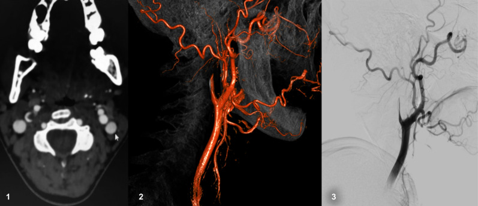
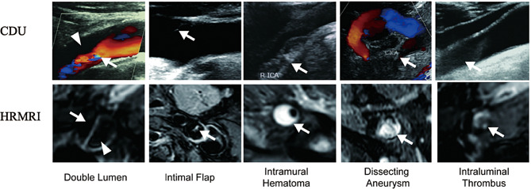
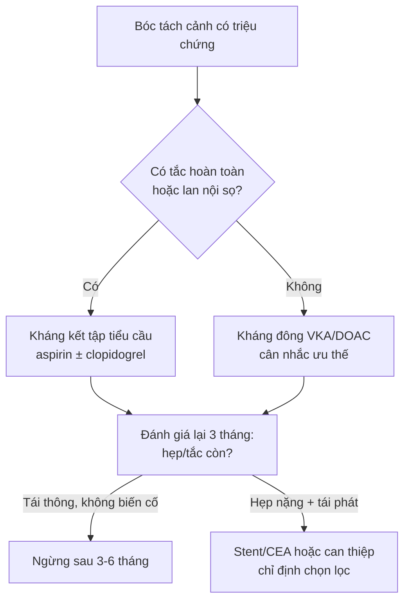
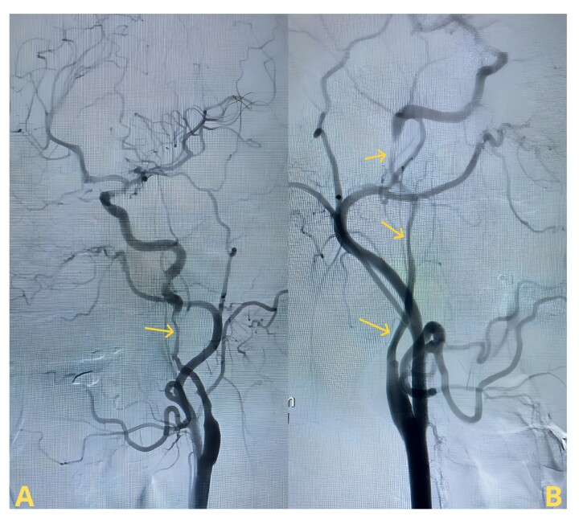
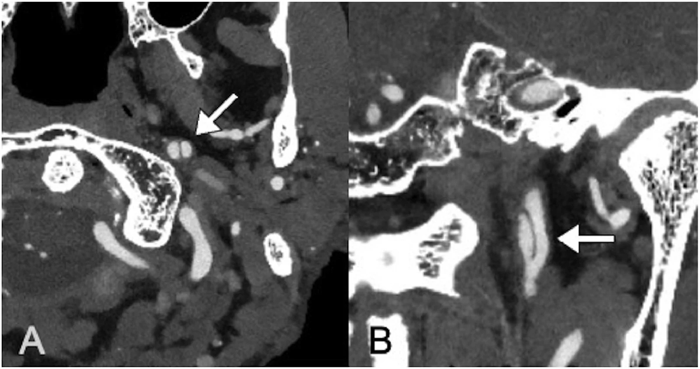

# 1773 — Bóc tách động mạch cảnh cổ / Cervical artery dissection (CAD)

**Tags:** `pattern:hai-long` `pattern:vat-noi-mac` `pattern:huyet-khoi-thanh-mach` `pattern:hep-dai-doan` `pattern:tac-mach` `pattern:liem-tang-tin-hieu-T1` `vung:dong-mach-canh` `vung:dau-co` `vung:co-canh` `score:CADISS` `protocol:CTA` `protocol:MRI-T1-fat-sat` `protocol:SA-Doppler` `protocol:DSA` `incidentaloma:khong`

**Mức chắc chắn (certainty):** tổng hợp y văn (literature synthesis) — 2 đoàn hệ dân số (Olmsted 123 ca; Iceland 107 ca), 2 thử nghiệm ngẫu nhiên lớn nhất (CADISS 250 ca; TREAT-CAD 194 ca), 1 đoàn hệ 153 ca đối chiếu **siêu âm Doppler cảnh (CDU) với MRI mạch thành phân giải cao (HRMRI)**, các nghiên cứu chuỗi xung T1 3D (46 ca; 31 ca), 1 nghiên cứu 53 ca theo dõi huyết khối thành mạch (IMH) bằng HR-VWI và 1 đoàn hệ 48 ca **carotid web**. 3 ca trong quiz là **ca công bố, lấy nguyên văn ảnh gốc**. Không có ca nguyên văn của nhóm.

> **Câu chốt:** "hai lòng" trên siêu âm/CTA **không đồng nghĩa bóc tách** — bóc tách thật có **huyết khối trong thành mạch (intramural hematoma, IMH) hình liềm, tăng tín hiệu trên T1 fat-sat**, bắt đầu **2 cm sau chỗ chia đôi** và **chừa hành cảnh**; **carotid web** là **dải xơ cục bộ ở mặt sau hành cảnh**, **không có IMH**, **không hẹp dài**. Hai bệnh này **điều trị và tiên lượng khác nhau** — nhầm web thành bóc tách dẫn tới kháng đông kéo dài không cần thiết; nhầm bóc tách thành web dẫn tới **bỏ sót huyết khối thành mạch đang hoạt động**.

## 1. Tổng quan bệnh học – cơ chế hình ảnh

### 1.1 Bóc tách xảy ra thế nào

- **Rách nội mạc (intimal tear)** → máu từ lòng thật ép vào **lớp trung mạc (media)**, tách dọc theo thành mạch → tạo **lòng giả (false lumen)** chứa máu đông; lòng thật bị **ép hẹp dần kiểu "vót nhọn" (tapered stenosis)** hoặc **tắc hoàn toàn** khi lòng giả chèn kín.
- Máu trong lòng giả **đông lại thành huyết khối trong thành (IMH)** — chính là "khối" mà ta nhìn thấy trên MRI, và là **nguồn thuyên tắc** gây nhồi máu não.
- **Vì sao vị trí điển hình là 2 cm sau chỗ chia đôi:** đoạn này động mạch cảnh trong **cố định vào mạc quanh mạch và xương**, còn hành cảnh **di động** — chấn thương xoay/ngửa cổ tạo **lực cắt (shear)** đúng mặt phân cách; vì vậy bóc tách **chừa hành cảnh**, khác **carotid web** (đúng mặt sau hành cảnh) và khác **mảng xơ vữa** (đúng chỗ chia đôi).

### 1.2 TẠI SAO thấy được trên từng chuỗi xung (vật lý + mô bệnh)

- **T1 fat-sat / T1 black-blood (CUBE, SPACE, VISTA):** hemoglobin trong huyết khối chuyển dần thành **methemoglobin** (máu bán cấp), có **thời gian T1 ngắn** → **tăng tín hiệu**. Đây là **dấu hiệu duy nhất nhìn thấy thành mạch**, không phụ thuộc dòng chảy. **Diễn tiến tín hiệu:** 3 ngày đầu T1 **trung gian**, T2 **tăng**; sau đó T1 **tăng rõ** và giữ vài tuần; bóc tách **mạn** có thể trở về đồng tín hiệu — nên **T1 âm không loại trừ bóc tách cũ**.
- **Fat-sat là bắt buộc:** mỡ quanh cảnh **rất sáng trên T1**; nếu không bão hòa mỡ, dải mỡ sẽ **che mất** IMH và tạo "liềm sáng giả". Đây là lý do **T1 không fat-sat là chuỗi xung vô dụng** cho bệnh này.
- **CTA:** thấy **lòng mạch** chứ không thấy thành — biểu hiện là **hẹp dài, nhẵn, vót nhọn ("string sign")**, **dấu ngọn lửa (flame-shaped occlusion)**, hoặc **vạt nội mạc (intimal flap)** khi có cản quang hai bên. Khi mạch **tắc hoàn toàn**, CTA **không phân biệt được** bóc tách với huyết khối thuyên tắc.
- **Siêu âm Doppler màu (CDU):** hai lòng = **dòng chảy hai màu** (lòng thật tốc độ cao, lòng giả chậm/xoáy); vạt nội mạc = **dải tăng âm đung đưa trong lòng**; nhưng **đồng thuận với HRMRI về "hai lòng" là KÉM** (153 ca) — tức CDU **không đủ để chốt cơ chế**.
- **Huyết khối trong lòng (intraluminal thrombus) khác IMH:** huyết khối **trong lòng thật** nằm **trong dòng máu**, không có vạt nội mạc ngăn cách; IMH nằm **ngoài lòng thật, dưới nội mạc**. Trên **T1 black-blood**, IMH **bám thành hình liềm**, huyết khối trong lòng **lấp đầy lòng**; trên **T1 sau tiêm**, chỉ **niêm mạc lòng giả ngấm thuốc** mới xác nhận hai lòng thật.

### 1.3 Số liệu nền (bắt buộc thuộc)

- **Tần suất:** **4,69/100.000 người–năm** (Olmsted 2002–2020, 123 ca; cảnh trong **2,43**, đốt sống **2,01**), tăng từ **2,30** (2002–2006) lên **8,93** (2017–2020), ở nữ tăng **12 lần** — phần lớn do **chụp mạch không xâm lấn nhiều hơn**.
- **Tỉ lệ trong đột quỵ:** **15–25%** đột quỵ ở người **< 50 tuổi**.
- **Triệu chứng (Iceland, 107 ca):** **đau 72%**, **rối loạn cảm giác 67%**, **vận động 49%**, **Horner 36%**, **đột quỵ 51%**; bóc tách tái phát **4,6%**.
- **Tái phát đột quỵ:** **2,4% (6/250) trong 1 năm** (CADISS), **2,5% (5/197)** ở nhóm chẩn đoán xác nhận — **phần lớn xảy ra trong 2 tuần đầu**, không phải rải đều cả năm.
- **Tái thông:** ở **3 tháng**, vẫn còn **hẹp/tắc** ở **56/92 (60,9%)** nhóm kháng kết tập tiểu cầu và **53/89 (59,6%)** nhóm kháng đông (CADISS, p = 0,97) — nghĩa là **chỉ ~40% thông hoàn toàn**.

## 2. Mẫu hình + chẩn đoán phân biệt theo vị trí (Gamut)

**Mẫu hình cốt lõi:** *hẹp dài–nhẵn–vót nhọn* **±** *liềm tăng tín hiệu T1 trong thành* **±** *vạt nội mạc* **±** *phình giả (dissecting aneurysm)*.

- **Theo vị trí:**
  - **Hành cảnh/mặt sau (posterior bulb):** **carotid web** (dải xơ, không IMH), **mảng xơ vữa loét**, **thrombus treo**.
  - **2–3 cm sau chỗ chia đôi, chừa hành:** **bóc tách tự phát** (kinh điển), **FMD** (chuỗi hạt, thường đoạn giữa–xa ICA).
  - **Sát nền sọ / đoạn xương đá:** **bóc tách chấn thương**, **phình giả**, **vỡ xương**.
  - **Động mạch đốt sống V2 (trong lỗ ngang C6–C2) / V3 (quai tập bản đồ):** bóc tách do xoay cổ, thủ thuật nắn chỉnh cột sống; **thiếu máu hành não/tủy cổ**.
  - **Hai bên:** nghĩ **bệnh mô liên kết** (vEDS, Marfan, Loeys–Dietz), **FMD**, **Eagle** (mỏm trâm dài chèn) — xem ca 3.
- **Mnemonic "DISSECT"** (gamut bóc tách): **D**issection tự phát, **I**atrogenic (can thiệp, đặt catheter), **S**train (gắng sức/nôn/ho), **S**ystemic (bệnh mô liên kết, FMD), **E**agle (mỏm trâm dài), **C**hiropractic (nắn cổ), **T**rauma.

## 3. Bảng so sánh phân biệt (ma trận đối chiếu)

| Thực thể (entity) | Hình ảnh điển hình | Chốt vào (rule-in) | Chốt loại (rule-out) | Gợi ý xác nhận |
|---|---|---|---|---|
| **Bóc tách cảnh tự phát (CAD)** | Hẹp dài nhẵn **bắt đầu ~2 cm sau chỗ chia đôi, chừa hành**; **liềm T1 fat-sat tăng tín hiệu** trong thành; vạt nội mạc; phình giả | **Liềm T1 tăng tín hiệu + hẹp/vót nhọn + đau cổ–đầu/Horner cùng bên** | **Không có liềm thành mạch**, hẹp cục bộ đúng hành cảnh → web/xơ vữa | MRI cổ **T1 fat-sat 3D** (SPACE/VISTA) hoặc **HR-VWI**; CTA lát ≤ 1 mm |
| **Carotid web** | **Dải xơ mảnh, hình kệ, mặt sau hành cảnh**, có **ổ ứ cản quang sau dải**; **không hẹp dài**; 48 ca: **huyết khối dưới web 45,8%**, đột quỵ **18,8%** | **Kệ ở mặt sau hành cảnh + không có IMH + người trẻ không yếu tố nguy cơ** | Có **liềm T1 thành mạch** hoặc hẹp lan dài → bóc tách | CTA **lát mỏng đa bình diện**; DSA nếu còn nghi; **không dựa vào siêu âm** |
| **Mảng xơ vữa loét** | Dày thành **lệch tâm, vôi hóa**, đúng chỗ chia đôi; loét = ổ cản quang lõm vào mảng | **Vôi hóa + tuổi > 60 + nhiều yếu tố nguy cơ + không đau cổ** | **Vôi hóa rõ + không IMH + không hẹp dài** → loại bóc tách | CTA; **MRI: xuất huyết trong mảng cũng T1 sáng** (bẫy) |
| **FMD (loạn sản cơ xơ)** | **"Chuỗi hạt" (string of beads)** đoạn giữa–xa ICA, **chừa hành và chỗ chia đôi** | **Nhiều chỗ hẹp–giãn xen kẽ, hai bên, nữ trung niên** | Một ổ hẹp dài đơn độc + IMH → bóc tách | CTA/MRA toàn thân; tìm phình/tách ở thận–mạch chậu |
| **Bóc tách chấn thương / phình giả** | Tổn thương **sát nền sọ/xương đá**, **túi phình giả**, có **vỡ xương/dập mô mềm** | **Cơ chế chấn thương + phình giả + vạt nội mạc** | Không có chấn thương, tổn thương đúng hành cảnh → web | CTA có **xương**; DSA khi cần can thiệp |
| **Huyết khối thuyên tắc (không bóc tách)** | **Tắc hoàn toàn đột ngột**, không hẹp dài trước đó, **không liềm thành mạch** | **Rung nhĩ/nguồn tim + tắc đột ngột + không IMH** | **Liềm T1 thành mạch** → bóc tách | Siêu âm tim, Holter; MRI thành mạch để loại bóc tách |

*Ca bóc tách cảnh trong: (1) CT ngang — **dấu liềm (crescent sign)** tăng đậm độ ở thành mạch (máu trong thành); (2) dựng hình 3D và (3) DSA — **tắc vót nhọn kiểu ngọn lửa (flame-shaped occlusion)**. Nguồn: *J Vasc Bras* 2021;20:e20200242 (PMC8483012), CC BY.*

### 3.1 Năm dấu hiệu, hai phương thức — đọc cặp đôi

*Hàng trên: siêu âm Doppler màu; hàng dưới: MRI mạch thành phân giải cao. Năm cột: **hai lòng**, **vạt nội mạc**, **huyết khối trong thành (IMH)**, **phình giả bóc tách**, **huyết khối trong lòng**. Nguồn: *BMC Med Imaging* 2026;26:219 (PMC13126898), CC BY-NC-ND — ảnh nguyên bản, không cắt/ghép.*

- **Đồng thuận giữa CDU và HRMRI (153 ca):** **tốt** với IMH, huyết khối trong lòng và độ hẹp; **trung bình** với vạt nội mạc và phình giả; **kém** với "hai lòng". Kết luận thực hành: **CDU phát hiện được IMH/huyết khối trong lòng (hai yếu tố liên quan độc lập với đột quỵ)**, nhưng **không dùng CDU để chốt "hai lòng"**.
- **Độ nhạy chuỗi T1 3D:** **T1 VISTA 3,0 T: Se 95,2% / Sp 100%** (46 ca, 21 bóc tách); **T1 SPACE 3D: Se 96,5% / Sp 94,5%** so với **T1 SE 2D: Se 92,9% / Sp 100%** (31 ca). Giới hạn: khi **tắc hoàn toàn**, **6/17 ca** vẫn **không phân biệt được** huyết khối trong thành với huyết khối trong lòng trên T1 VISTA.
- **Siêu âm:** độ nhạy **~70%** khi bệnh nhân **chỉ đau cổ/đầu, Horner hoặc liệt dây sọ** (không thiếu máu não), **75–86%** với động mạch đốt sống — nên **không loại trừ bóc tách bằng siêu âm bình thường**.

## 4. Protocol + quyết định điều trị

### 4.1 Chuỗi xung/chụp

- **MRI cổ (ưu tiên):** **T1 fat-sat 3D black-blood** (SPACE/VISTA/CUBE) trục + đa bình diện, **lát ≤ 1 mm**, phủ **từ hành cảnh đến nền sọ** và **V1–V3**; kèm **MRA TOF** (không cần cản quang) hoặc **CE-MRA**; **DWI não** cùng buổi để tìm nhồi máu.
- **CTA:** lát **≤ 1 mm**, **đa bình diện (MPR)**, cửa sổ mạch + xương; **bắt buộc MPR** — đọc lát trục đơn thuần bỏ sót vạt nội mạc. Chụp **thì muộn 2–3 giây** giúp thấy lòng giả chậm.
- **CDU:** đầu tay, rẻ, lặp lại được; **giá trị chính là theo dõi tái thông**, không phải chốt chẩn đoán.
- **DSA:** khi **CTA/MRI không kết luận**, khi **tắc hoàn toàn cần phân biệt**, hoặc khi **can thiệp** (bóc tách gây hẹp nặng có triệu chứng lặp lại).
- **Theo dõi:** lặp hình ảnh **3 tháng** (đánh giá tái thông/phình giả) và **6–12 tháng** nếu còn hẹp; **không chụp lại mỗi tháng**.

### 4.2 Kháng kết tập tiểu cầu hay kháng đông — số liệu thật

- **CADISS (2015/2019, 250 ca):** **không khác biệt** giữa kháng kết tập tiểu cầu và kháng đông về **đột quỵ cùng bên/tử vong** (2,4% trong 1 năm) và về **tái thông** (p = 0,97).
- **TREAT-CAD (2021, 194 ca):** biến cố chính (lâm sàng + MRI) **23% aspirin vs 15% kháng đông vitamin K**; **khác biệt tuyệt đối 8% (95% CI −4 đến 21)** — **không chứng minh được aspirin không thua kém**. **Đột quỵ thiếu máu: 8% (7 ca) ở aspirin vs 0% ở kháng đông**; **chảy máu ngoài sọ nặng 1% ở nhóm kháng đông**; không tử vong.
- **Phân nhóm TREAT-CAD (173 ca):** **không tắc mạch** → kháng đông **OR 0,28 (0,07–0,86)**; **có thiếu máu não + không tắc** → **OR 0,16 (0,04–0,55)**. Đây là **gợi ý, chưa đủ để thành chỉ định**.
- **Thực hành:** **3–6 tháng** kháng đông hoặc kháng kết tập tiểu cầu (cá thể hóa theo nguy cơ chảy máu, có/không tắc, lan nội sọ); **theo dõi 6 tháng TREAT-CAD: biến cố rất hiếm và đều là chảy máu** — không có lý do kéo dài vô hạn.
- **Can thiệp:** stent/CEA **chỉ khi tái phát triệu chứng dù đã điều trị nội khoa**, hẹp nặng tiến triển, hoặc phình giả lớn; **không đặt stent dự phòng cho mọi bóc tách**.

## 5. Biến thể bình thường và cạm bẫy

- **Cạm bẫy số 1 — xuất huyết trong mảng xơ vữa cũng T1 sáng:** mảng xơ vữa có **xuất huyết trong mảng (intraplaque hemorrhage)** cho **tín hiệu T1 cao giống IMH**; khác biệt: **vôi hóa + lệch tâm + đúng chỗ chia đôi + không hẹp dài**, và **không có vạt nội mạc**.
- **Cạm bẫy số 2 — huyết khối trong lòng vs IMH:** cả hai đều T1 sáng. Phân biệt bằng **T1 black-blood**: IMH **liềm, ngoài lòng thật**; huyết khối trong lòng **lấp lòng**, có **dấu hiệu viền** khi có cản quang. Trong **tắc hoàn toàn**, đây là **giới hạn thật của T1** (6/17 ca).
- **Cạm bẫy số 3 — dòng chảy chậm giả tắc:** trên CTA/MRA, **dòng chảy rất chậm** ở lòng giả hoặc đoạn hẹp nặng có thể **giả "tắc"**; chụp **thì muộn** hoặc DSA để phân biệt.
- **Cạm bẫy số 4 — bóc tách cũ:** IMH **mạn** có thể **đồng tín hiệu T1** và chỉ còn **hẹp nhẵn**; **T1 âm không loại trừ**. So phim cũ, tìm **phình giả** và **vạt nội mạc**.
- **Cạm bẫy số 5 — bỏ sót tổn thương thứ hai:** bóc tách **hai bên** hoặc **kèm bóc tách đốt sống** gặp đủ nhiều để **bắt buộc chụp toàn bộ trục**; ca 3 dưới đây là ví dụ.
- **Biến thể bình thường:** **hành cảnh giãn sinh lý** và **dòng xoáy ở xoang cảnh** trên CDU tạo **vùng trống tín hiệu** giả "huyết khối"; **mỡ quanh cảnh không bão hòa** tạo "liềm sáng giả" trên T1.
- **Bẫy hình học:** vạt nội mạc **chỉ thấy trên mặt phẳng vuông góc với trục mạch** — luôn **MPR đa bình diện**; bóc tách chạy **dọc** nên **lát cắt ngang một mình dễ bỏ sót**.

## 6. Tự lượng giá — Blind Quiz

**Ca 1 — Nam 45 tuổi, đau cổ trái sau khi nôn nhiều, rồi yếu nửa người phải. Nhìn CT ngang và dựng hình:**

- Hỏi: (1) Dấu hiệu ở thành mạch cảnh trái? (2) Vì sao lòng mạch "vót nhọn" thay vì tắc ngang? (3) Cần chuỗi xung nào để chốt?

<b>Bấm để hiện đáp án</b>

- **Dấu liềm (crescent sign):** dải **tăng đậm độ hình liềm** ở thành động mạch cảnh trong — máu trong **lòng giả**. Dựng hình/DSA: **tắc vót nhọn kiểu ngọn lửa**, chừa hành cảnh.
- **Vì sao vót nhọn:** lòng giả chứa huyết khối **chèn dần** lòng thật dọc theo thành → hẹp **dài, nhẵn, thuôn**; huyết khối thuyên tắc thường **cắt ngang đột ngột**.
- **Chốt:** **MRI cổ T1 fat-sat 3D black-blood** (liềm tăng tín hiệu) + **DWI não**; CTA đơn thuần **không loại trừ** được bóc tách khi đã tắc.
- **Nguồn ảnh:** *J Vasc Bras* 2021;20:e20200242 (PMC8483012), **CC BY**.

**Ca 2 — Bốn bệnh nhân trẻ, cùng "hẹp cảnh trong": so sánh CDU với HRMRI:**

- Hỏi: (1) Dấu hiệu nào **không đáng tin** trên siêu âm? (2) Hai dấu hiệu nào trên CDU **liên quan độc lập với đột quỵ**? (3) Nếu chỉ có "hai lòng" trên siêu âm, có đủ chẩn đoán bóc tách?

<b>Bấm để hiện đáp án</b>

- **Không đáng tin:** **"hai lòng"** — đồng thuận CDU–HRMRI **kém**; vạt nội mạc và phình giả chỉ **trung bình**.
- **Liên quan độc lập với đột quỵ:** **IMH** và **huyết khối trong lòng** (giữ nguyên sau hiệu chỉnh và sau ghép cặp tỉ lệ).
- **Không đủ:** "hai lòng" có thể là **dòng chảy song song trong hành cảnh giãn**, **vạt xơ của web**, hoặc **dòng chảy chậm**; phải xác nhận bằng **MRI T1 black-blood** (IMH/vạt) hoặc **CTA lát mỏng MPR**.
- **Nguồn ảnh:** *BMC Med Imaging* 2026;26:219 (PMC13126898), **CC BY-NC-ND**.

**Ca 3 — Nữ 38 tuổi, đau cổ hai bên + nhìn đôi; DSA dưới đây:**

- Hỏi: (1) Có mấy tổn thương, ở đâu? (2) Vì sao phải tìm nguyên nhân **hai bên**? (3) Cần thêm phim gì?

<b>Bấm để hiện đáp án</b>

- **Hai bên:** DSA cho thấy **bóc tách cảnh trong hai bên** (mũi tên hai bên) — không phải một ổ.
- **Vì sao tìm nguyên nhân:** bóc tách **hai bên** gợi ý **bệnh mô liên kết/FMD** hoặc **chèn ép cơ học**; trong ca gốc là **hội chứng Eagle** — **mỏm trâm dài 37,7 mm (phải) và 36,1 mm (trái)** chèn động mạch cảnh.
- **Thêm:** **CT xương đa bình diện đo mỏm trâm** (ngưỡng thường dùng **> 30 mm**), **MRA/CTA toàn trục** để tìm bóc tách đốt sống, và **đánh giá mô liên kết** nếu hai bên không giải thích được.
- **Phản biện:** ca này **không điển hình** — bóc tách tự phát hai bên **hiếm**; đừng mặc định "tự phát" khi có **chèn ép cơ học**.
- **Nguồn ảnh:** *J Vasc Bras* 2026;25:e20250008 (PMC13078177), **CC BY**.

**Ca 4 — CTA ngực/cổ ở bệnh nhân 64 tuổi, hẹp cảnh trong tiến triển:**

- Hỏi: (1) Vạt nội mạc nằm ở đâu? (2) Vì sao cần **MPR**? (3) Khi nào cần DSA?

<b>Bấm để hiện đáp án</b>

- **Vạt nội mạc (intimal flap):** đường **giảm đậm độ mảnh trong lòng** động mạch cảnh trong, thấy rõ trên **mặt phẳng dọc trục** (B) trong khi lát ngang (A) chỉ thấy **lòng bị chia đôi**.
- **MPR:** bóc tách chạy **dọc mạch**, nên **mặt phẳng vuông góc trục** là bắt buộc; đọc lát ngang đơn thuần bỏ sót tới **phần lớn** vạt mảnh.
- **DSA:** khi **không kết luận được** trên CTA/MRI, khi **tắc hoàn toàn** cần phân biệt cơ chế, hoặc khi **có chỉ định can thiệp**.
- **Nguồn ảnh:** *Radiol Case Rep* 2026;21(11):5538–5543 (PMC13528219), **CC BY-NC-ND**.

## Bài liên quan chéo
- [270 – Carotid web](../270-carotid-web/lesson.md) (dải xơ mặt sau hành cảnh — hàng phân biệt bắt buộc)
- [260 – Bệnh mạch cảnh do xạ trị](../260-hep-dong-mach-canh-do-xa/lesson.md) (hẹp dài nhẵn không vôi — bẫy "giống bóc tách")
- [249 – Rò động mạch cảnh – xoang hang chấn thương](../249-ro-dong-mach-canh-xoang-hang-chan-thuong/lesson.md) (bóc tách chấn thương nền sọ)
- [211 – Đột quỵ não](../211-dot-quy-nao/lesson.md) (DWI, lãnh thổ mạch)
- [200 – Tổng quan hệ Thần kinh](../200-tong-quan-he-than-kinh/lesson.md)

## Ảnh
- Tên file `1773_slug_Modality_SourceID.ext`; **nguồn + giấy phép từng ảnh** ở `images/CREDITS.md`.
- **Không crop, không kéo giãn, không tạo composite**: hai ảnh CC BY-NC-ND (PMC13126898, PMC13528219) là **nguyên bản**; hai ảnh CC BY (PMC8483012, PMC13078177) cũng giữ nguyên khung.

> Không dùng để chẩn đoán độc lập khi chưa có người hướng dẫn.
