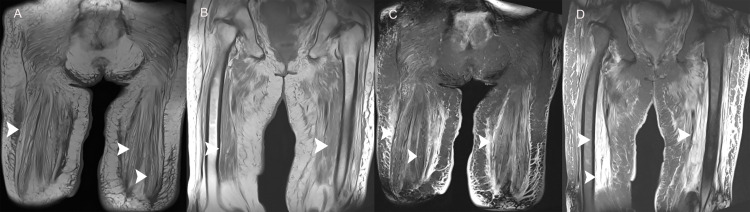
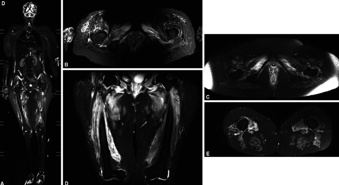
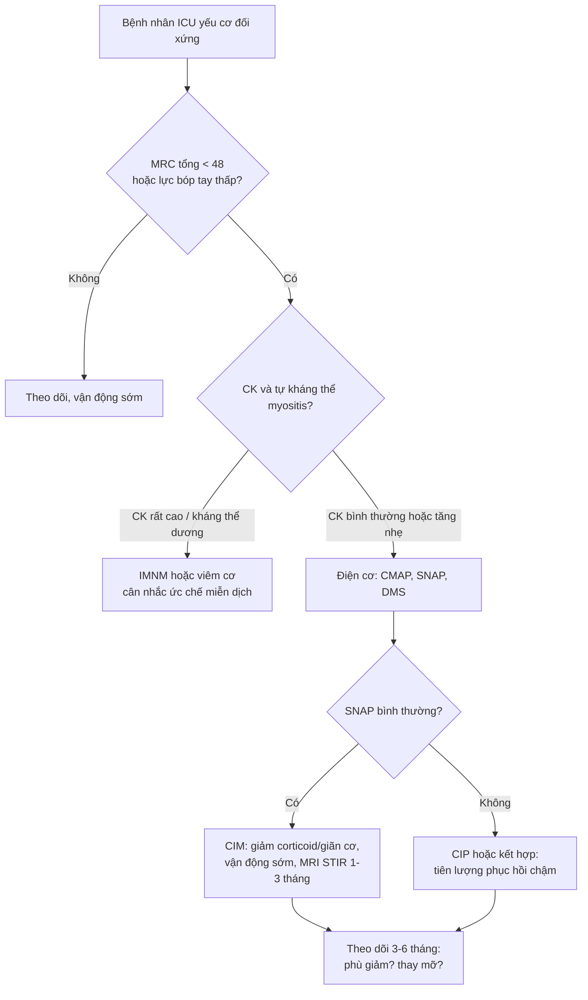
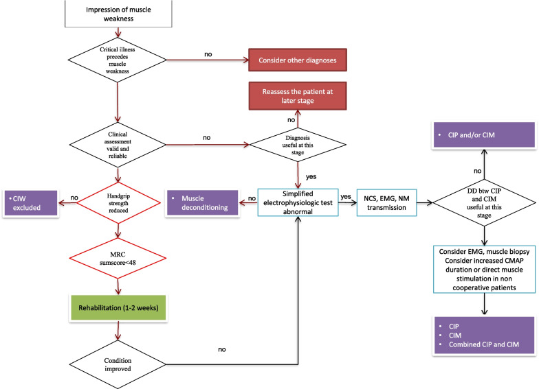

# 1774 — Bệnh cơ do corticoid & bệnh cơ bệnh nặng ở ICU / Corticosteroid myopathy & critical illness myopathy (CIM/CIP)

**Tags:** `pattern:teo-co` `pattern:thay-mo-co` `pattern:phu-co` `pattern:yeu-co-doi-xung` `vung:chi-duoi` `vung:co-xuong` `vung:mo-mem` `score:MRC-SS` `protocol:MRI-STIR` `protocol:MRI-Dixon` `protocol:SA-co` `protocol:dien-co` `incidentaloma:khong`

**Mức chắc chắn (certainty):** tổng hợp y văn (literature synthesis) — 1 tổng quan hồi sức lớn (tab bệnh học + thuật toán, *Crit Care* 2023), 1 đoàn hệ MRI vai **25 bệnh nhân** sau ICU, 1 nghiên cứu **STIR 7 ca CIMN so với 7 ca Guillain–Barré**, **3 ca CIM sau COVID** có ảnh MRI, 1 nghiên cứu **qMRI 9 người sống sót ICU**, 1 tổng quan ICU-AW 2026 (các ngưỡng siêu âm/điện cơ) và 2 tổng quan bệnh cơ do glucocorticoid. 3 ca trong quiz là **ca công bố, lấy nguyên văn ảnh gốc**.

> **Câu chốt:** yếu cơ đối xứng ở bệnh nhân ICU **không phải một bệnh** — **phù cơ lan tỏa trên STIR = bệnh đang hoạt động (CIM cấp)**, **teo + thay mỡ không phù = di chứng (mạn)**, và **cả hai đều không đáp ứng corticoid**. Ngược lại **IMNM/viêm cơ** cũng phù cơ nhưng **CK tăng rất cao + tự kháng thể + đau**, và **có** chỉ định ức chế miễn dịch. Ba con số phải thuộc: **43%** bệnh nhân hồi phục chậm có ICU-AW; **STIR phù cơ lan tỏa: Se 100% / Sp 85,7%** phân biệt CIMN với GBS; **MRC tổng ≤ 48** là ngưỡng chẩn đoán yếu cơ mắc phải.

## 1. Tổng quan bệnh học – cơ chế hình ảnh

### 1.1 Bệnh cơ hồi sức gồm những gì

- **Yếu cơ mắc phải ở ICU (ICU-acquired weakness, ICUAW)** là **thuật ngữ ô dù**: **bệnh cơ bệnh nặng (critical illness myopathy, CIM)**, **bệnh thần kinh bệnh nặng (critical illness polyneuropathy, CIP)**, hoặc **kết hợp** — cộng thêm **bệnh cơ do thuốc** (glucocorticoid, thuốc giãn cơ) và **bệnh cơ do bất động/dinh dưỡng**.
- **Tần suất:** **43% (KTC 25–75%)** ở bệnh nhân hồi phục chậm; **> 50%** nếu còn nằm ICU **ngày thứ 8**; **tới 64%** ở bệnh nhân **nhiễm khuẩn huyết**. Đây là lý do **mọi bệnh nhân thở máy > 5–7 ngày đều phải được đánh giá sức cơ**, không chờ "khi tỉnh hẳn".
- **Ba cơ chế chính của CIM:** (a) **mất sợi myosin dày (thick filament myosin loss)** — đặc trưng nhất, gắn với **corticoid + giãn cơ + nhiễm khuẩn**; (b) **hoại tử rải rác**; (c) **hoại tử lan tỏa (viêm cơ hoại tử của ICU)** — hiếm, tiên lượng xấu.
- **Bệnh cơ do glucocorticoid (glucocorticoid-induced myopathy, GIM):** teo chọn lọc **sợi type II**, yếu **gần, không đau**, **CK bình thường**, **điện cơ bình thường hoặc chỉ myopathic nhẹ** — khác CIM ở chỗ **không có mất myosin dày** và **không phù cơ**.

### 1.2 TẠI SAO ảnh phản ánh đúng sinh lý bệnh (vật lý + mô bệnh)

- **Phù cơ (cấp) — STIR/T2 fat-sat tăng tín hiệu:** phù = **nước tự do** làm **T2 dài**, và STIR **bão hòa mỡ** nên nước trong cơ **nổi bật trên nền tối**. Trong CIM cấp, **tăng tính thấm mao mạch + rối loạn bơm Na⁺/K⁺ của màng cơ** gây **phù nội bào/ngoại bào lan tỏa, đối xứng, ưu thế gốc chi** — hình ảnh **không đặc hiệu** nhưng **rất nhạy**.
- **Teo + thay mỡ (mạn) — T1 tăng tín hiệu, STIR KHÔNG tăng:** khi sợi cơ chết/teo, **mô mỡ thay thế**; mỡ có **T1 ngắn** nên **sáng trên T1**, và **bị bão hòa trên STIR/T2 fat-sat** nên **tối** — đây là dấu hiệu **di chứng**, không phải viêm đang hoạt động. Vì vậy **một chuỗi STIR âm không loại trừ bệnh cơ**; phải xem **T1/Dixon fat fraction** để thấy thay mỡ.
- **Vì sao CIM hay gặp ở cơ gốc chi và cơ hô hấp:** cơ **type II (sợi nhanh)** chiếm ưu thế ở **đùi, vai, cơ hoành** và **nhạy với corticoid/bất động** hơn → yếu **gần > xa**, **không đối xứng thần kinh ngoại vi**, **không liệt dây sọ** (khác GBS).
- **Vì sao "CK bình thường" lại là chìa khóa:** mất myosin dày **không phá màng sợi cơ** → **CK chỉ tăng nhẹ**; còn **hoại tử cơ** (IMNM, viêm cơ, necrotizing ICU myopathy) **vỡ màng** → **CK tăng hàng nghìn**. Vì vậy **CK tăng rất cao là cờ đỏ chống lại CIM đơn thuần**.
- **Vì sao MRI không thay được điện cơ:** MRI thấy **hậu quả** (phù/teo/mỡ), điện cơ thấy **cơ chế** (màng cơ vs sợi trục). Câu "phù cơ" **không phân biệt** CIM với IMNM — quyết định nằm ở **CK + tự kháng thể + thời gian + đau**.

### 1.3 Số liệu nền (bắt buộc thuộc)

- **Ngưỡng lâm sàng:** **MRC tổng (MRC-SS) < 48/60** = ICUAW; **lực bóp tay < 7 kg (nữ) / < 11 kg (nam)** là ngưỡng sàng lọc (**Se 88% / Sp 80%**, n = 60).
- **Điện cơ:** **dây thần kinh mác (peroneal) đơn thuần: Se 94% / Sp 91%** (n = 95) để phát hiện bệnh cơ–thần kinh mắc phải; **CIM: biên độ CMAP giảm + thời khoảng CMAP kéo dài, SNAP bình thường**; **CIP: CMAP và SNAP đều giảm, thời khoảng bình thường**.
- **Siêu âm cơ:** **tốc độ teo diện tích ngang cơ thẳng đùi (RFCSA) ≥ 6,9%** → ICUAW **Se 76,5% / Sp 92,2%** (n = 76).
- **Sinh thiết:** tỉ lệ **myosin/actin < 1,7** là bất thường; **mất myosin chọn lọc là đặc hiệu của CIM**.
- **MRI:** STIR phù cơ lan tỏa phân biệt **CIMN với GBS**: **Se 100% / Sp 85,7% / PPV 87,5% / NPV 100%** (7 ca mỗi nhóm). Ở **25 bệnh nhân ICU-AW sau COVID**, **23/25 (92%)** có **phù cơ kiểu ngoại vi** trong tháng đầu sau ra ICU, **23/25 (92%)** hết phù sau **3 tháng**, **không có thay mỡ hay hoại tử cơ**; nhưng **12/20 (60%)** còn **đau/vận động vai kém** ở 3 tháng.
- **Hậu quả dài hạn:** ở người sống sót ICU, **qMRI nhiều năm sau** vẫn thấy **tỉ lệ mỡ tăng** và **water T2 tăng** — tức **vừa di chứng vừa còn hoạt động bệnh**; dấu hiệu điện cơ kiểu CIP tồn tại **tới 5 năm** ở **> 90%** bệnh nhân nằm ICU dài (**> 28 ngày**).

## 2. Mẫu hình + chẩn đoán phân biệt theo vị trí (Gamut)

**Mẫu hình:** *yếu cơ đối xứng, gần > xa, không liệt dây sọ, cảm giác bình thường* **±** *phù cơ STIR lan tỏa (cấp)* **±** *teo + thay mỡ T1 (mạn)*.

- **Theo vị trí tổn thương:**
  - **Cơ (myopathy):** CIM, bệnh cơ do corticoid, bệnh cơ do bất động/dinh dưỡng, viêm cơ hoại tử miễn dịch (IMNM), viêm đa cơ/bệnh cơ do thuốc.
  - **Dây thần kinh ngoại vi (neuropathy):** CIP, **GBS** (bệnh cảnh cấp, tiến triển, areflexia, cảm giác), bệnh thần kinh do tư thế nằm sấp (prone-positioning).
  - **Tấm vận động:** blốc thần kinh cơ tồn dư do thuốc giãn cơ (kéo dài, hiếm).
  - **Tủy/cột sống:** nhồi máu tủy, áp-xe, chèn ép do thủ thuật — **yếu không đối xứng + mức cảm giác**.
- **Theo giai đoạn (quyết định ý nghĩa ảnh):** **cấp < 1 tháng** (phù cơ) → **bán cấp 1–3 tháng** (phù giảm, teo bắt đầu) → **mạn > 6 tháng** (teo + thay mỡ, không phù).
- **Mnemonic "MUSCLE":** **M**yopathy bệnh nặng (CIM), **U**se-disuse (bất động), **S**teroid, **C**IP (neuropathy), **L**ong stay/nutrition (suy dinh dưỡng), **E**lectrolyte (hạ K, hạ Mg, hạ phospho).

## 3. Bảng so sánh phân biệt (ma trận đối chiếu)

| Thực thể (entity) | Hình ảnh điển hình | Chốt vào (rule-in) | Chốt loại (rule-out) | Gợi ý xác nhận |
|---|---|---|---|---|
| **CIM (bệnh cơ bệnh nặng)** | **Phù cơ lan tỏa, đối xứng, gốc chi** trên STIR (**Se 100%/Sp 85,7%** so với GBS); sau đó **teo**; **không thay mỡ** giai đoạn sớm | **Yếu đối xứng sau nhiễm khuẩn/thở máy + STIR phù lan tỏa + CMAP giảm/thời khoảng dài + SNAP bình thường** | **CK rất cao + tự kháng thể + đau cơ** → nghĩ IMNM, không phải CIM | Điện cơ + **DMS (neCMAP:mfCMAP > 0,5)**; sinh thiết nếu chẩn đoán chưa rõ |
| **Bệnh cơ do corticoid** | **Teo + thay mỡ** trên T1/Dixon, **STIR KHÔNG phù**; teo chọn lọc **type II**, chủ yếu **đùi/vai** | **Dùng corticoid liều cao kéo dài + yếu gần không đau + CK bình thường + STIR âm** | **Phù cơ lan tỏa** → không phải GIM đơn thuần (nghĩ CIM/viêm cơ) | Ngừng/giảm corticoid → cải thiện trong **vài tuần–vài tháng** |
| **IMNM / viêm cơ hoại tử miễn dịch** | **Phù cơ không đối xứng, từng đám**, ưu thế **đùi sau/khép**; **thay mỡ theo thời gian** (T1 score tăng) | **CK tăng rất cao + anti-SRP/anti-HMGCR + yếu tiến triển trong tuần–tháng** | **Phù lan tỏa đối xứng + CK bình thường + bối cảnh ICU** → loại IMNM | CK, tự kháng thể myositis, **STIR% cao khi chưa điều trị**, sinh thiết cơ |
| **CIP (bệnh thần kinh bệnh nặng)** | **Không phù cơ**, teo do **mất chi phối**; STIR bình thường; NMUS: **dây thần kinh dày, giảm đậm độ** | **CMAP giảm + SNAP GIẢM + thời khoảng CMAP bình thường**; **phản xạ gân xương giảm/mất** | **SNAP bình thường** → loại CIP, nghĩ CIM | Điện cơ; NMUS thần kinh; **tiên lượng chậm hơn CIM** |
| **GBS (Guillain–Barré)** | **86% MRI bình thường**; **14%** có phù cơ nhẹ — **không đặc hiệu** | **Tiến triển < 4 tuần + areflexia + cảm giác + dịch não tủy protein tăng** | **STIR phù lan tỏa đối xứng** → nghĩ CIMN hơn GBS (NPV 100% trong loạt nhỏ) | Điện cơ (giảm dẫn truyền), CSF; **MRI không dùng để loại GBS** |
| **Bệnh cơ do bất động / suy dinh dưỡng** | **Teo đối xứng, thay mỡ**, **không phù**, không hoại tử | **Nằm lâu + giảm cân + CK/điện cơ bình thường** | **Phù STIR + CMAP giảm** → không chỉ do bất động | Chỉnh dinh dưỡng, vận động; hồi phục chậm |

*Bệnh cơ bệnh nặng: (A, B) **T1 đùi–chậu** — teo cơ lan tỏa, mỡ thay thế (T1 sáng); (C, D) **T2 fat-sat** — không có phù nội cơ nổi bật ngoài các dải tín hiệu cao. Nguồn: *Cureus* 2021;13(3):e13807 (PMC8027959), CC BY.*

### 3.1 Hai pha của cùng một bệnh — đọc đúng để không điều trị sai

*Bệnh cơ–thần kinh bệnh nặng: **(A)** STIR toàn thân và **(B–E)** STIR đùi — **phù cơ lan tỏa, đối xứng, ưu thế gốc chi**. Trong loạt 7 ca CIMN so với 7 ca GBS, **Se 100% / Sp 85,7%**. Nguồn: *Indian J Crit Care Med* 2022;26(2):204–209 (PMC8857722), CC BY-NC — ảnh nguyên bản.*

- **Cấp (tuần 1–4):** **phù cơ** — dấu hiệu **đang hoạt động**, có thể **hồi phục hoàn toàn** (92% hết phù sau 3 tháng ở loạt 25 ca COVID).
- **Mạn (> 6 tháng):** **teo + thay mỡ**, **STIR âm** — dấu hiệu **di chứng**; **không có nghĩa là bệnh đang tiến triển**, và **không phải chỉ định corticoid**.
- **Vì sao phải phân biệt:** corticoid **làm teo cơ type II** và **làm nặng thêm CIM**; cho corticoid vì "thấy phù cơ" là **sai hướng** trừ khi có bằng chứng viêm cơ (CK cao, tự kháng thể, sinh thiết).

## 4. Protocol + thuật toán

### 4.1 Chụp gì, khi nào

- **MRI đùi/hángthế (thigh) 3T:** **STIR hoặc T2 fat-sat** (phù) **+ T1 hoặc mDixon** (mỡ/thay mỡ) **+ T1 sau tiêm** chỉ khi nghi viêm cơ/áp-xe; **thời điểm tốt nhất: 1–3 tháng sau ra ICU** (đủ để phù rõ, chưa teo hoàn toàn); **quá sớm < 2 tuần** dễ âm giả.
- **Định lượng:** **fat fraction (Dixon)** và **water T2** — hai thông số theo dõi được; **không dùng "độ sáng tương đối" bằng mắt**.
- **Siêu âm cơ (NMUS):** **RFCSA** và **tốc độ teo ≥ 6,9%**; **độ dày/độ hồi âm cơ hoành** dự đoán **thất bại cai máy**; làm được tại giường, lặp lại hằng ngày.
- **Điện cơ:** **PENT/peroneal NCS** khi bệnh nhân không hợp tác; **DMS** phân biệt màng cơ (CIM) với sợi trục (CIP) — **tỉ lệ neCMAP:mfCMAP > 0,5 → CIM, < 0,5 → CIP**.
- **Sinh thiết cơ:** chỉ khi **chẩn đoán chưa rõ**, nghi **IMNM/viêm cơ**, hoặc **CK rất cao**; kim nhỏ đo **myosin/actin** (bất thường **< 1,7**) ít xâm lấn hơn sinh thiết mở.

### 4.2 Điều trị — cái gì có bằng chứng, cái gì không

- **Không có thuốc đặc hiệu.** Nền tảng: **giảm/ngừng corticoid và thuốc giãn cơ**, **giảm an thần**, **kiểm soát nhiễm khuẩn/đường huyết**, **dinh dưỡng đủ đạm**, **vận động sớm**.
- **Dinh dưỡng:** phân tích dưới nhóm **EPaNIC** (122 sinh thiết cơ + 20 chứng) cho thấy **nuôi dưỡng ngoài đường tiêu hóa MUỘN** giảm ICUAW và **hồi phục nhanh hơn** so với nuôi dưỡng sớm.
- **Kích điện cơ (NMES):** **meta-analysis 2020 (6 RCT, 718 bệnh nhân)** **không** khác biệt về sức cơ tổng, tử vong ICU, thời gian thở máy/ICU; **RCT 2022 (n = 139)** và **RCT 2023 (n = 118)** sau đó cho kết quả **tốt hơn** trên chức năng và thời gian thở máy — bằng chứng **chưa đồng nhất**, dùng như **bổ trợ**.
- **Tiên lượng:** **CIM hồi phục tốt hơn CIP**; CIP **kéo dài hơn**, để lại **giảm/mất phản xạ, rối loạn cảm giác kiểu "bao tay–tất"**, đau; dấu hiệu điện cơ **tồn tại 5 năm ở > 90%** ca nằm ICU dài.
- **Bệnh cơ do corticoid:** **giảm liều/đổi corticoid** → cải thiện trong **vài tuần đến vài tháng**; **không dùng thêm corticoid** để "điều trị teo cơ".

## 5. Biến thể bình thường và cạm bẫy

- **Cạm bẫy 1 — "không phù = không bệnh":** giai đoạn mạn **chỉ có teo + thay mỡ**; nếu chỉ chụp STIR sẽ **âm giả**. Luôn kèm **T1/Dixon**.
- **Cạm bẫy 2 — "phù = viêm, cho corticoid":** phù cơ trong CIM **lan tỏa, đối xứng, CK bình thường**; cho corticoid **làm teo cơ nặng thêm**. Chỉ điều trị ức chế miễn dịch khi **CK cao/tự kháng thể/sinh thiết**.
- **Cạm bẫy 3 — nhầm CIP với CIM:** cùng yếu cơ, cùng bối cảnh; **SNAP** là điểm chia: **CIM giữ SNAP, CIP mất SNAP**. DMS củng cố (**neCMAP:mfCMAP**).
- **Cạm bẫy 4 — MRI bình thường không loại GBS:** **86%** ca GBS có MRI cơ bình thường; chẩn đoán GBS dựa vào **diễn tiến + phản xạ + dịch não tủy + điện cơ**, không dựa MRI.
- **Cạm bẫy 5 — bỏ sót nguyên nhân thứ hai:** bệnh nhân ICU có thể **vừa CIM vừa chèn ép thần kinh do tư thế** (nằm sấp, liệt trụ/liệt mác) → yếu **không đối xứng** phải tìm **chèn ép**, không quy hết cho ICUAW.
- **Biến thể bình thường:** **teo cơ do bất động** ở người già/nằm lâu cho **thay mỡ nhẹ đối xứng** — không đồng nghĩa bệnh cơ; **mỡ dưới da dày** gây **bão hòa mỡ không đều** trên STIR, dễ đọc thành "phù cơ" (dùng Dixon để tránh).
- **Bẫy hình học:** đặt ROI/cửa sổ **theo trục cơ** ở **1/3 giữa đùi**, tránh **chỗ gân bám** và **mạch máu**; so sánh **hai bên** cùng lát.

## 6. Tự lượng giá — Blind Quiz

**Ca 1 — Nam 57 tuổi, thở máy 3 tuần vì viêm phổi nặng + corticoid liều cao; không nhấc được chân. Ảnh MRI đùi:**

- Hỏi: (1) Mô tả cơ đùi trên T1? (2) Có phù đang hoạt động không? (3) Chẩn đoán và hướng xử trí?

<b>Bấm để hiện đáp án</b>

- **T1 (A, B):** **teo cơ lan tỏa hai bên**, **dải mỡ thay thế** (tín hiệu sáng trong bụng cơ).
- **T2 fat-sat (C, D):** **không có phù nội cơ lan tỏa** — chỉ các dải tín hiệu cao rời rạc; nghĩa là **không có viêm cơ đang hoạt động**.
- **Chẩn đoán:** **bệnh cơ bệnh nặng giai đoạn teo–thoái hóa** (kèm **bệnh cơ do corticoid**); **không phải viêm cơ**. Xử trí: **giảm corticoid**, **vận động sớm**, dinh dưỡng đủ đạm; **không thêm ức chế miễn dịch**.
- **Nguồn ảnh:** *Cureus* 2021;13(3):e13807 (PMC8027959), **CC BY**.

**Ca 2 — Nữ 34 tuổi, sau 5 tuần ICU vì COVID-19, yếu gần hai vai; STIR toàn thân:**

- Hỏi: (1) Tín hiệu bất thường là gì, phân bố ra sao? (2) Nó nói gì về giai đoạn bệnh? (3) Chẩn đoán phân biệt chính và cách loại?

<b>Bấm để hiện đáp án</b>

- **Tín hiệu:** **tăng tín hiệu lan tỏa, đối xứng ở cơ gốc chi** trên STIR — **phù cơ**, ưu thế **đùi/vai**.
- **Giai đoạn:** **cấp/đang hoạt động** — có thể **hồi phục**; loạt 25 ca tương tự cho thấy **92% hết phù sau 3 tháng**.
- **Phân biệt:** **IMNM/viêm cơ** (loại bằng **CK rất cao + tự kháng thể + đau + phù không đối xứng**), **GBS** (MRI **bình thường 86%**, loại bằng điện cơ/CSF), **CIP** (**SNAP giảm**, không phù cơ).
- **Nguồn ảnh:** *Indian J Crit Care Med* 2022;26(2):204–209 (PMC8857722), **CC BY-NC**.

**Ca 3 — Bệnh nhân 70 tuổi, mở mắt, làm theo lệnh nhưng không nhấc tay; dùng thuật toán dưới đây:**

- Hỏi: (1) Bước nào quyết định trước khi kết luận ICUAW? (2) Nếu bệnh nhân không hợp tác thì dùng gì? (3) Khi nào chuyển sang điện cơ/sinh thiết?

<b>Bấm để hiện đáp án</b>

- **Bước quyết định:** **loại trừ nguyên nhân khác** ("critical illness provides muscle weakness?") — nếu **không** thì **đánh giá lại sau**, không gán nhãn ICUAW; sau đó **lực bóp tay** (ngưỡng **< 7 kg nữ / < 11 kg nam**) và **MRC tổng < 48**.
- **Không hợp tác:** dùng **xét nghiệm điện cơ rút gọn** (PENT/peroneal NCS — **Se 94%/Sp 91%**), rồi **NCS/EMG/DMS**; **siêu âm cơ** (tốc độ teo RFCSA **≥ 6,9%**).
- **Chuyển điện cơ/sinh thiết:** khi **chẩn đoán phân biệt CIP/CIM chưa rõ**, khi **CK rất cao** nghi IMNM/hoại tử, hoặc khi kết quả sẽ **đổi điều trị** (ngừng corticoid, ức chế miễn dịch).
- **Nguồn hình:** *Crit Care* 2023;27:439 (PMC10644573), **CC BY** — sơ đồ nguyên bản.

## Bài liên quan chéo
- [1685 – Bệnh cơ do statin & viêm cơ hoại tử miễn dịch (IMNM)](../1685-benh-co-do-statin-imnm/lesson.md) (phù cơ + CK rất cao — hàng phân biệt bắt buộc)
- [300 – Tổng quan hệ Cơ – Xương – Khớp](../300-tong-quan-he-co-xuong-khop/lesson.md) (đọc chuỗi xung cơ – mỡ)

## Ảnh
- Tên file `1774_slug_Modality_SourceID.ext`; **nguồn + giấy phép từng ảnh** ở `images/CREDITS.md`.
- Ba ảnh đều **nguyên bản, không crop, không kéo giãn, không composite**; ảnh STIR (CC BY-NC) và ảnh MRI (CC BY) giữ nguyên toàn khung.

> Không dùng để chẩn đoán độc lập khi chưa có người hướng dẫn.
