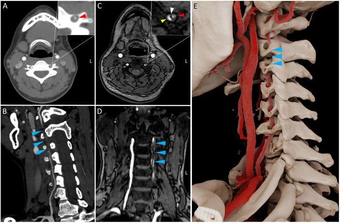
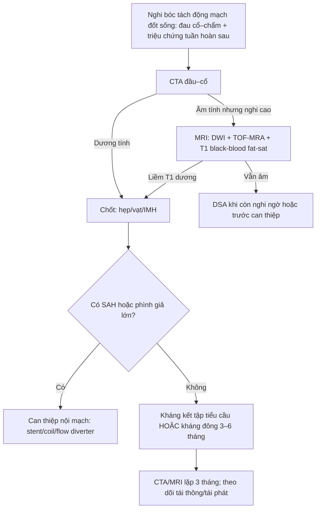
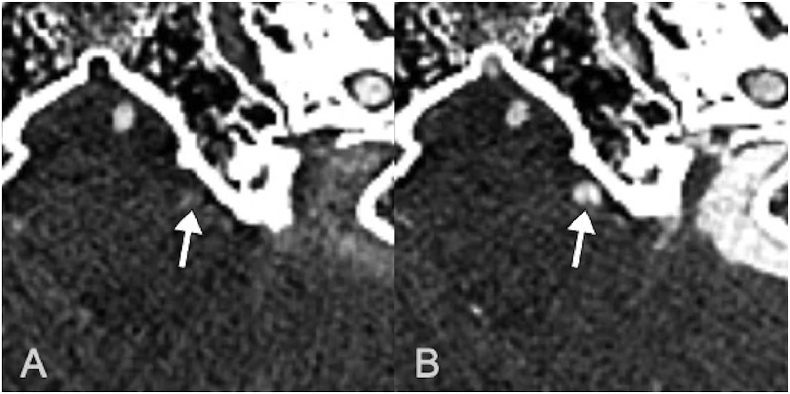
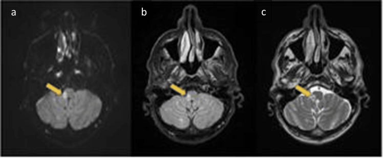

# 1775 — Bóc tách động mạch đốt sống / Vertebral artery dissection (VAD)

**Tags:** `pattern:hai-long` `pattern:vat-noi-mac` `pattern:huyet-khoi-thanh-mach` `pattern:hep-dai-doan` `pattern:tac-mach` `pattern:liem-tang-tin-hieu-T1` `pattern:nhoi-mau-hanh-nao` `vung:tuy-song` `vung:nao` `vung:co` `score:Denver` `protocol:CTA` `protocol:MRA` `protocol:MRI-T1-fat-sat` `protocol:DSA` `incidentaloma:khong`

**Mức chắc chắn (certainty):** tổng hợp y văn (literature synthesis) — 2 thử nghiệm ngẫu nhiên về kháng huyết khối ở bóc tách mạch cổ (CADISS 250 ca; TREAT-CAD 194 ca), 2 đoàn hệ dịch tễ (Olmsted 123 ca; Iceland 107 ca), 1 nghiên cứu bệnh–chứng theo từng mạch về **bất thường giải phẫu xương–mạch** ở VAD không do chấn thương (191 bệnh nhân CTA), các ca có ảnh gốc và 1 bài tổng quan chấn thương VAD. 3 ca trong quiz là **ca công bố, lấy nguyên văn ảnh gốc**.

> **Câu chốt:** đau cổ–chẩm một bên sau xoay/ngửa cổ hoặc sau xoa bóp cổ, kèm **chóng mặt–nhìn đôi–mất thăng bằng** là VAD cho tới khi chứng minh ngược. **CTA là bước đầu**, nhưng **CTA thì sớm có thể ÂM TÍNH**; chốt chẩn đoán là **liềm tăng tín hiệu trong thành mạch trên T1 fat-sat/black-blood** (huyết khối trong thành) và **hẹp dài–vót nhọn bắt đầu ở V2–V3**. Đừng nhầm **động mạch đốt sống thiểu sản tận cùng bằng PICA** với tắc do bóc tách, và đừng bỏ **bóc tách V4 nội sọ** vì thể này chảy máu dưới nhện chứ không chỉ gây nhồi máu.

## 1. Tổng quan bệnh học – cơ chế hình ảnh

### 1.1 Giải phẫu quyết định vị trí tổn thương

Động mạch đốt sống chia 4 đoạn:

| Đoạn | Đường đi | Vì sao dễ bị bóc tách / bỏ sót |
|---|---|---|
| **V1** | Nguyên ủy dưới đòn → lỗ ngang C6 | Ngắn, ít di động; hay bị xơ vữa và chấn thương xuyên thấu |
| **V2** | Trong lỗ ngang **C6–C2** | Bị **xương** bao quanh: chấn thương xoay/ngửa cổ tạo lực cắt; **siêu âm bị xương che**, CTA dễ có giả ảnh do bờ xương |
| **V3** | Ra khỏi C2 → quai quanh C1 → xuyên màng cứng | **Đoạn di động nhất** (C1–C2 xoay), căng–gấp khi ngửa/xoay cổ; đây là nơi **bóc tách do tư thế, xoa bóp cổ, chỉnh hình cột sống cổ** |
| **V4** | Xuyên màng cứng → hợp thành động mạch nền | **Nội sọ, không có lớp mô bao quanh** → dễ **vỡ vào khoang dưới nhện (SAH)**; nhánh **PICA** → nhồi máu hành não bên (Wallenberg) |

- **V2 và V3 chiếm phần lớn VAD** vì vừa cố định trong xương vừa chịu lực xoay của cột sống cổ; bài bệnh–chứng theo từng mạch còn cho thấy **bất thường giải phẫu xương–mạch** (cung xương bao quanh V3, lỗ vào cao của V2, dị tật C1–C2) làm tăng nguy cơ.
- **V4 khác hẳn về hậu quả:** thành mạch trong khoang dưới nhện **không có mô đệm**, nên khi rách nội mạc – trung mạc, máu có thể **vỡ tự do vào DNT** thay vì chỉ tạo huyết khối trong thành.

### 1.2 Cơ chế: từ vết rách nội mạc đến nhồi máu và chảy máu

- **Rách nội mạc** → máu động mạch ép vào **lớp trung mạc** → tạo **lòng giả** và **huyết khối trong thành (intramural hematoma, IMH)**. Lòng thật bị ép **hẹp dần kiểu vót nhọn**, có khi **tắc hoàn toàn**.
- **Nhồi máu không phải do hẹp tại chỗ là chính**, mà do **thuyên tắc** từ huyết khối trong lòng giả/lòng thật rồi trôi lên **động mạch nền – PCA – PICA**. Vì vậy **mạch có thể chỉ hẹp 50% mà vẫn nhồi máu lớn**; ngược lại **tắc mạn tính có tuần hoàn bàng hệ có thể không triệu chứng**.
- **V4 vỡ:** máu vào khoang dưới nhện → **SAH**, co mạch, giãn não thất; nguy cơ **chảy máu lại rất cao trong 24–72 giờ đầu** nếu không can thiệp.

### 1.3 TẠI SAO thấy được trên từng chuỗi xung (vật lý + mô bệnh)

- **T1 fat-sat / T1 black-blood (SPACE, VISTA, CUBE):** hemoglobin trong huyết khối chuyển thành **methemoglobin** → **thời gian T1 ngắn** → **tăng tín hiệu**. Đây là dấu hiệu **duy nhất nhìn trực tiếp thành mạch**, không phụ thuộc dòng chảy, nên là **chốt chẩn đoán**.
  - **Diễn tiến tín hiệu:** **< 48–72 giờ** T1 còn **trung gian/đồng tín hiệu** → **âm tính giả**; sau **3–7 ngày** T1 **tăng rõ** và giữ **vài tuần**; sau **vài tháng** có thể trở về đồng tín hiệu → **T1 âm không loại trừ bóc tách cũ**.
  - **Bắt buộc bão hòa mỡ:** mỡ quanh mạch cổ rất sáng trên T1; không fat-sat thì dải mỡ **che mất liềm IMH**.
- **CTA:** thấy **lòng mạch**, không thấy thành. Dấu hiệu: **hẹp dài–nhẵn–vót nhọn ("string sign")**, **tắc hình ngọn lửa**, **vạt nội mạc**, **hai lòng**, **phình giả**. Vì lòng giả chảy chậm, **thì sớm có thể không đủ thuốc vào lòng giả** → **ảnh âm tính giả**; **thì muộn 40–60 giây** làm rõ vạt nội mạc và lòng giả.
- **MRA TOF:** nhạy với **hẹp/tắc** nhưng **kém với vạt nội mạc và IMH**; dễ **giả hẹp** do dòng chảy xoáy.
- **DSA:** chuẩn vàng, thấy **hai lòng, vạt nội mạc, phình giả, tuần hoàn bàng hệ**, và là **đường can thiệp** khi V4 vỡ.
- **Siêu âm Doppler:** hữu ích ở **V1–V2 gần**, nhưng **V2 trong lỗ ngang và V3 sau C1 bị xương che** → **không đủ để loại trừ VAD**.

### 1.4 Số liệu nền (bắt buộc thuộc)

- **Dịch tễ:** bóc tách động mạch cảnh–đốt sống **≈ 2,5–4,7/100.000 người–năm**; riêng **động mạch đốt sống ≈ 1,0–2,0/100.000/năm** (Olmsted: **2,01/100.000**). VAD chiếm **khoảng 1/3–1/2** tổng số bóc tách mạch cổ.
- **Tuổi:** **15–25%** đột quỵ ở người **< 50 tuổi** là do bóc tách mạch cổ; VAD là nguyên nhân **nhồi máu tuần hoàn sau** hay gặp ở người trẻ.
- **Triệu chứng:** **đau cổ–chẩm 70–90%**, đau đầu, **chóng mặt/vertigo**, nhìn đôi, nói khó, thất điều; **Horner** gặp ở bóc tách cảnh nhiều hơn; **nhồi máu hành não bên** khi tổn thương **V4/PICA**.
- **Tái phát:** **≈ 2,4% trong năm đầu** (CADISS), phần lớn trong **2 tuần đầu**; bóc tách tái phát **≈ 4,6%** trong đoàn hệ Iceland.
- **Tái thông:** chỉ **≈ 40%** mạch thông hoàn toàn ở 3 tháng; **60%** còn hẹp/tắc — nhưng **hẹp tồn dư không đồng nghĩa còn nguy cơ**.

## 2. Mẫu hình + chẩn đoán phân biệt theo vị trí (gamut)

### 2.1 Theo đoạn mạch

- **V1:** xơ vữa (người lớn tuổi, có yếu tố nguy cơ, vôi hóa), chấn thương xuyên thấu, bóc tách do ống thông.
- **V2:** **bóc tách** (hay gặp nhất), **thiểu sản V2**, chèn ép do gai xương/thoái hóa, bất thường lỗ ngang.
- **V3:** **bóc tách do tư thế** (xoay/ngửa cổ, xoa bóp, chỉnh hình), **hội chứng Bow Hunter** (chèn ép động khi xoay cổ), **cung xương C1 (arcuate foramen)**.
- **V4:** **bóc tách nội sọ + SAH**, **nhồi máu PICA/Wallenberg**, huyết khối động mạch nền, phình giả bóc tách.

### 2.2 Theo hình thái — 4 câu hỏi trên CTA/MRA

1. **Có hẹp dài–vót nhọn không?** → nghĩ bóc tách hoặc xơ vữa.
2. **Có vạt nội mạc/hai lòng không?** → gần như chốt bóc tách.
3. **Có liềm tăng tín hiệu T1 trong thành không?** → chốt **IMH**.
4. **Có phình giả hoặc máu dưới nhện không?** → quyết định **can thiệp nội mạch**, không chỉ kháng huyết khối.

**Gamut "hẹp dài ở động mạch đốt sống":** bóc tách · xơ vữa · loạn sản cơ–sợi (FMD, "chuỗi hạt") · co mạch/RCVS · thiểu sản bẩm sinh · chèn ép động (Bow Hunter) · viêm mạch · tia xạ.

## 3. Bảng so sánh phân biệt (ma trận đối chiếu)

| Thực thể (entity) | Hình ảnh điển hình | Chốt vào (rule-in) | Chốt loại (rule-out) | Gợi ý xác nhận |
|---|---|---|---|---|
| **Bóc tách VAD (IMH)** | **Hẹp dài–vót nhọn bắt đầu V2–V3**, vạt nội mạc, hai lòng, **liềm tăng tín hiệu T1 fat-sat** trong thành | **Liềm T1 tăng tín hiệu + hẹp vót nhọn không vôi** | Không có IMH, mảng xơ vữa vôi hóa lệch tâm → nghĩ xơ vữa | MRI 3D T1 black-blood fat-sat + CTA (thì muộn nếu cần) |
| **Mảng xơ vữa** | Người **> 50 tuổi**, có ĐTĐ/hút thuốc, **vôi hóa**, hẹp **lệch tâm**, thường ở **V1** hoặc chỗ phân nhánh | **Vôi hóa + nhiều ổ xơ vữa + yếu tố nguy cơ** | Liềm T1 tăng tín hiệu + hẹp dài nhẵn → bóc tách | CTA, siêu âm mạch |
| **Loạn sản cơ–sợi (FMD)** | **"Chuỗi hạt"** nhiều chỗ hẹp–giãn xen kẽ, thường **động mạch cảnh trong**, có thể đốt sống; **không IMH** | **Nhiều đoạn hẹp–giãn xen kẽ, hai bên** | Một đoạn hẹp dài đơn độc + IMH → bóc tách | CTA/DSA toàn bộ mạch cổ–thận |
| **Thiểu sản V4 tận cùng bằng PICA** | **V4 nhỏ đều, không vạt, không IMH**, tận cùng **PICA**, bên đối diện bù trừ | **Mạch nhỏ nhưng đều, bẩm sinh, không triệu chứng cấp** | Hẹp mới + IMH + đau cổ cấp → bóc tách | MRA/CTA so sánh hai bên; MRI T1 fat-sat âm |
| **Bow Hunter (chèn ép khi xoay cổ)** | Hẹp/tắc **V3 chỉ khi xoay cổ**, hết khi trả tư thế; **không IMH** | **Hẹp động theo tư thế trên DSA/CTA xoay cổ** | Hẹp cố định mọi tư thế + IMH → bóc tách | DSA/CTA động (xoay đầu 45–90°) |
| **Bóc tách V4 vỡ (SAH)** | **Máu dưới nhện bể nền**, phình giả/vạt ở **V4**, giãn não thất | **SAH + bất thường V4 trên CTA/DSA** | SAH do phình túi thường ở vòng tuần hoàn trước | DSA 4 mạch; can thiệp nội mạch |

*Bóc tách động mạch đốt sống trái: **A** CT trục, **B** CTA dọc (mũi tên xanh: đoạn hẹp/vạt), **C** T1 black-blood trục (mũi tên trắng: bất thường thành mạch), **D** MRA dựng hình, **E** dựng hình 3D xương–mạch cho thấy đoạn V2–V3. Nguồn: Liu J et al., J Belg Soc Radiol 2025 (PMC12742373), CC BY 4.0.*

### 3.1 Ba dấu hiệu phải đọc thành thạo
- **String sign (dấu sợi chỉ):** hẹp dài, nhẵn, vót nhọn — **không đặc hiệu**, gặp cả xơ vữa và co mạch; chỉ chốt khi có **IMH**.
- **Intimal flap (vạt nội mạc):** dải tuyến tính trong lòng mạch, **chốt bóc tách**; dễ thấy hơn trên **CT photon-counting** hoặc **thì muộn**.
- **Liềm IMH trên T1 fat-sat:** dải tăng tín hiệu **bám thành**, **không thay đổi theo tư thế**, khác **đám rối tĩnh mạch quanh mạch** (ở ngoài thành, thay đổi theo thì/tư thế).

## 4. Protocol chụp + phân độ

### 4.1 Chọn chuỗi xung

- **CTA đầu–cổ (bước đầu):** lát **0,6–1 mm**, bơm **4–5 mL/s**, theo dõi bolus; **thì muộn 40–60 giây** khi nghi ngờ mà thì sớm âm tính. CTA gộp có **độ nhạy cao với hẹp/tắc** nhưng **thấp hơn với vạt nội mạc nhỏ**.
- **MRI (chốt thành mạch):** **DWI** (tìm nhồi máu cấp) + **TOF-MRA** + **3D T1 black-blood fat-sat** (1 mm, trước tiêm; có thể sau tiêm để thấy niêm mạc lòng giả). **T1 3D VISTA: Se 95,2% / Sp 100%**; **T1 SPACE: Se 96,5% / Sp 94,5%** trong chẩn đoán bóc tách mạch cổ.
- **DSA:** khi CTA/MRI không kết luận, khi **V4 vỡ/SAH**, hoặc trước can thiệp (stent, coil, flow diverter).
- **Siêu âm Doppler:** chỉ để sàng lọc/t heo dõi **V1–V2 gần**; **không dùng để loại trừ** VAD ở V2–V3.

### 4.2 Phân độ hình thái (dùng cho theo dõi và can thiệp)

- **Theo mức hẹp:** **< 50%** · **50–99%** · **tắc hoàn toàn**.
- **Theo biến chứng:** **IMH đơn thuần** · **phình giả bóc tách** · **tắc có/không có nhồi máu** · **V4 vỡ (SAH)**.
- **Thang Denver cho chấn thương mạch cổ (BCVI)** — dùng khi VAD do chấn thương: **I** hẹp < 25%, **II** hẹp ≥ 25%, **III** phình giả, **IV** tắc, **V** đứt mạch. **Denver ≥ III** thường cần can thiệp/theo dõi sát.

### 4.3 Điều trị — bằng chứng và ngưỡng

- **Kháng kết tập tiểu cầu vs kháng đông:** **CADISS** (250 ca) **không khác biệt** về đột quỵ/tử vong (**≈ 2% mỗi nhóm**), tái phát **2,4%/năm**; **TREAT-CAD** (194 ca) **không chứng minh được aspirin không thua kém** kháng đông (xu hướng nghiêng kháng đông, chưa có ý nghĩa thống kê). **Không có bằng chứng cứng buộc một lựa chọn** — chọn theo **ổ nhồi máu lớn hay không, nguy cơ xuất huyết, có SAH hay không**.
- **Thời gian:** thường **3–6 tháng**, rồi quyết định theo **hình ảnh tái thông** và triệu chứng.
- **Can thiệp nội mạch (stent/coil/flow diverter):** **thiếu máu tái diễn dù đã điều trị nội**, **phình giả lớn/lớn dần**, **chống chỉ định kháng đông**, hoặc **V4 vỡ có SAH**. **Không dùng kháng kết tập mạnh ngay** khi đang có SAH.
- **V4 vỡ:** ưu tiên **nút mạch/coil/stent phủ/flow diverter** để loại ổ rách khỏi dòng chảy; **không chờ** vì nguy cơ **chảy máu lại trong 24–72 giờ** rất cao.

## 5. Biến thể bình thường và cạm bẫy

- **Thiểu sản V4 tận cùng PICA:** mạch nhỏ **đều**, **không IMH**, thường **không triệu chứng cấp**; đừng gọi là tắc.
- **Cửa sổ mạch (fenestration):** hai lòng **đều ngấm thuốc**, không có vạt; trên MRA dễ giả "hai lòng".
- **Đám rối tĩnh mạch quanh mạch:** tăng tín hiệu **ngoài thành**, thay đổi theo thì; **IMH nằm trong thành**, hình liềm, bám dọc.
- **Beam hardening do xương ở V2:** tạo **dải giả hẹp** trên CTA; so sánh với MRA/MRI và đọc đa mặt phẳng.
- **CTA thì sớm âm tính:** lòng giả chảy chậm — **chụp thì muộn** trước khi kết luận âm tính.

*Cùng một bệnh nhân bóc tách động mạch đốt sống: **A (thì sớm)** động mạch đốt sống trái hiển thị kém; **B (thì muộn)** thấy rõ **vạt nội mạc + thuốc trong lòng giả**. Bài học: **thì sớm âm tính không loại trừ bóc tách**. Nguồn: Matsumoto K et al., Radiol Case Rep 2026 (PMC13528219), CC BY-NC-ND 4.0 — giữ nguyên khung, không cắt.*

- **T1 âm trong 48–72 giờ đầu:** methemoglobin chưa hình thành; nếu nghi cao, **lặp MRI sau 2–3 ngày** hoặc dựa CTA/DSA.
- **Bóc tách mạn:** T1 có thể trở về đồng tín hiệu sau vài tháng; **đừng loại trừ dựa vào một lần T1 âm**.
- **Bow Hunter:** hẹp chỉ khi xoay cổ — **CTA/DSA tĩnh sẽ bỏ sót**; hỏi kỹ tư thế khởi phát và chụp động.
- **Satisfaction of search:** thấy nhồi máu tiểu não/hành não rồi dừng — **phải truy tìm mạch** (CTA/MRA) vì nhồi máu là hậu quả, không phải chẩn đoán.

## 6. Tự lượng giá — Blind Quiz

**Ca 1 — Nam 35 tuổi, đau cổ–chẩm phải đột ngột sau xoa bóp cổ, sau đó chóng mặt, nói khó, tê bì nửa người. MRI sọ:**

- Gợi ý: ba chuỗi **(a) DWI, (b) FLAIR, (c) T2**; chú ý **hành não bên phải**.
- Câu hỏi: ổ tổn thương ở đâu, thuộc lãnh thổ mạch nào? Chẩn đoán mạch nền là gì? Cần chụp gì tiếp?

<b>Bấm để hiện đáp án (findings + chẩn đoán)</b>

- **Findings:** ổ **hạn chế khuếch tán** nhỏ ở **hành não bên phải** (mũi tên vàng), tăng tín hiệu FLAIR/T2 tương ứng — **nhồi máu hành não bên (Wallenberg)**.
- **Chẩn đoán:** **bóc tách động mạch đốt sống phải đoạn V4/PICA** gây nhồi máu; đau cổ sau xoa bóp là **tiền triệu**.
- **Việc cần làm:** CTA đầu–cổ + **MRI T1 black-blood fat-sat** tìm **liềm IMH**; nếu có **SAH** → DSA và cân nhắc can thiệp nội mạch. **Không dừng ở "nhồi máu não trẻ"**.
- **Nguồn ảnh:** Remelhe Sá S et al., Cureus 2025;17(12):e100355 (PMC12851604), CC BY 4.0. Ca gốc có **giảm 50% lòng mạch V4**.

**Ca 2 — Nữ 42 tuổi, đau cổ trái, nhìn đôi, đi loạng choạng sau ngửa cổ làm tóc. CTA/MRA:**

- Câu hỏi: tổn thương ở **đoạn nào** của động mạch đốt sống? Ba dấu hiệu trên ảnh? Vì sao **không được chỉ dùng siêu âm**?

<b>Bấm để hiện đáp án (findings + chẩn đoán)</b>

- **Findings:** **hẹp dài–vót nhọn** ở **V2–V3 trái** (B, D), bất thường thành mạch trên **T1 black-blood** (C) — **huyết khối trong thành**; dựng hình 3D (E) cho thấy mạch chạy trong lỗ ngang.
- **Chẩn đoán:** **bóc tách động mạch đốt sống trái**; cơ chế **xoay/ngửa cổ**.
- **Vì sao không chỉ siêu âm:** **V2 trong lỗ ngang và V3 sau C1 bị xương che**, nên siêu âm có thể **bình thường** dù bóc tách. Cần **CTA/MRI**.
- **Điều trị:** kháng kết tập hoặc kháng đông **3–6 tháng** (CADISS/TREAT-CAD); **stent** nếu thiếu máu tái diễn hoặc phình giả lớn.
- **Nguồn ảnh:** Liu J, Jia P, Ji Q. J Belg Soc Radiol 2025;109(1):70 (PMC12742373), CC BY 4.0.

## Bài liên quan chéo
- [200 – Tổng quan Hệ Thần kinh](../200-tong-quan-he-than-kinh/lesson.md)
- [1773 – Bóc tách động mạch cảnh cổ](../1773-boc-tach-dong-mach-canh-co/lesson.md) (cùng bệnh cảnh, khác đoạn mạch)
- [211 – Đột quỵ não](../211-dot-quy-nao/lesson.md)
- [247 – Bóc tách động mạch cổ/đốt sống & chấn thương mạch cổ (BCVI)](../247-boc-tach-dong-mach-co-dot-song-cervical-artery-dissection/lesson.md)
- [1770 – Tắc tĩnh mạch cảnh trong hai bên sau xạ](../1770-tac-tinh-mach-canh-trong-hai-ben-sau-xa/lesson.md)

> Không dùng để chẩn đoán độc lập khi chưa có người hướng dẫn.
