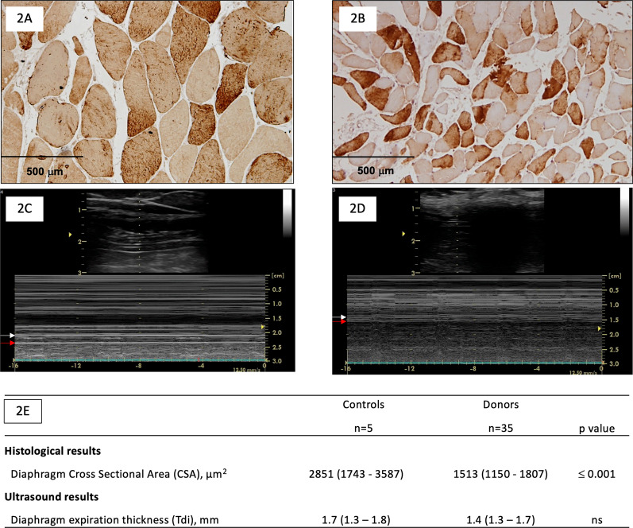
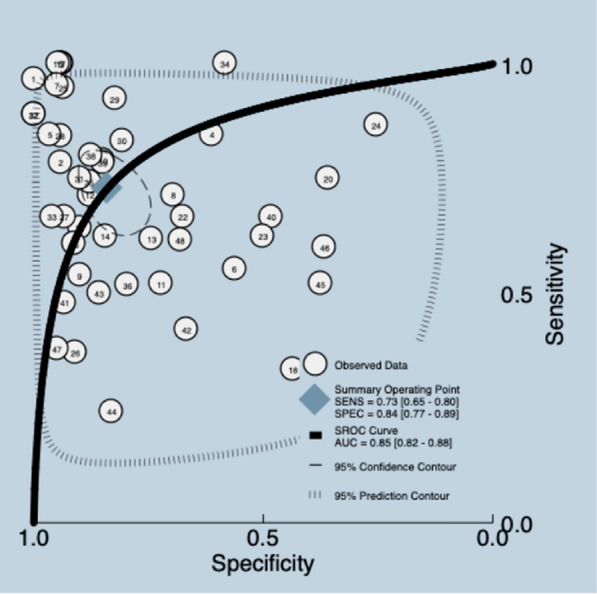
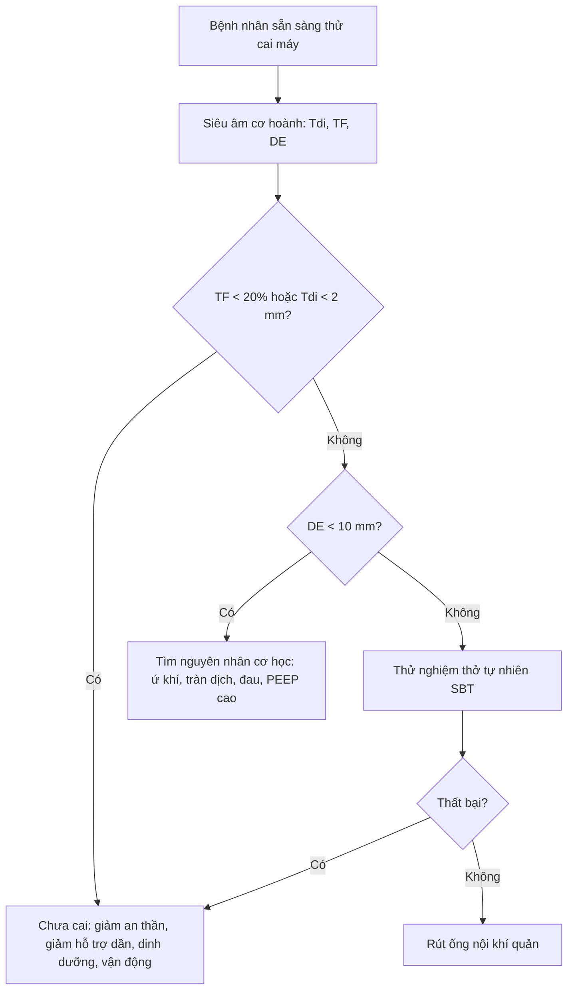
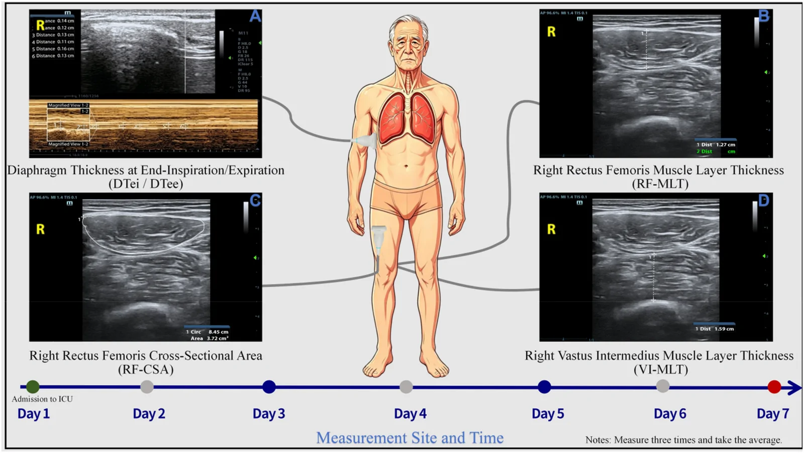

# 1776 — Bệnh cơ hoành do thở máy / Ventilator-induced diaphragmatic dysfunction (VIDD)

**Tags:** `pattern:teo-co` `pattern:mat-day-co-hoanh` `pattern:giam-do-day` `pattern:yeu-co-hoanh` `pattern:bai-tho-nghich-thuong` `vung:co-hoanh` `vung:phoi` `score:DTF` `protocol:SA-co-hoanh` `protocol:Xquang-tai-giuong` `protocol:dien-co` `incidentaloma:khong`

**Mức chắc chắn (certainty):** tổng hợp y văn (literature synthesis) — 1 đoàn hệ **211 bệnh nhân** đo độ dày cơ hoành hằng ngày (Goligher 2018), 1 nghiên cứu **7 bệnh nhân** về tốc độ mỏng cơ hoành (Grosu 2012), 1 tổng quan cơ chế **bệnh cơ hoành liên quan bệnh nặng** (Dres 2017), 1 nghiên cứu **mô học – siêu âm** trên 35 người hiến tạng (Dot 2022), 2 phân tích gộp về siêu âm dự đoán cai máy (1114 bệnh nhân; 2024) và 3 bài có ảnh gốc. Ảnh trong bài là **ảnh công bố, giữ nguyên khung**.

> **Câu chốt:** **thở máy kiểm soát hoàn toàn không phải "nghỉ ngơi" cho cơ hoành** — cơ hoành mỏng đi **~6%/ngày**, bắt đầu **trong 48 giờ**, và **giảm > 10% độ dày trong 4 ngày đầu** làm **giảm 31% khả năng cai máy mỗi ngày** (HR 0,69 cho mỗi 10% giảm). Nhưng **không phải cứ mỏng là do thở máy**: phải phân biệt **teo do bất động (VIDD)** với **liệt cơ hoành một bên do tổn thương thần kinh hoành**, **bệnh cơ/đa dây thần kinh bệnh nặng**, và **giảm vận động do ứ khí/tràn dịch** — vì xử trí khác nhau.

## 1. Tổng quan bệnh học – cơ chế hình ảnh

### 1.1 Cơ hoành là cơ hô hấp chính — và là cơ "dùng hoặc mất"

- Cơ hoành là **cơ vân** có **sợi co nhanh và chậm**; khi co, nó **hạ thấp và dẹt vòm** → tạo **áp lực âm lồng ngực**, kéo khí vào. **Vùng áp thành (zone of apposition)** là nơi cơ hoành **áp sát thành ngực**, nên **siêu âm đo được bề dày cơ** giữa **màng phổi (lá thành) và màng bụng**.
- **Bề mặt cơ hoành** trong thì thở ra bình thường **1,5–3 mm**; **phân suất dày (thickening fraction, TF)** = (Tdi hít vào − Tdi thở ra)/Tdi thở ra × 100, bình thường **20–40%**; **độ di chuyển vòm hoành (excursion, DE)** khi thở yên lặng **1–2 cm**.

### 1.2 Hai con đường dẫn đến teo — và vì sao "thở máy nhiều" không bảo vệ

```text
Thở máy kiểm soát / an thần sâu
        │
        ├── Ít/không co cơ hoành (unloading) ──► giảm tải cơ học
        │        └── Proteolysis: calpain, ubiquitin–proteasome, autophagy
        │                 └── TEo cơ (giảm CSA sợi, giảm Tdi)
        │
        └── Gắng sức quá mức (patient–ventilator asynchrony, P-SILI)
                 └── Tổn thương cơ do căng (sarcomere disruption, viêm)
                          └── Yếu + phù cơ, đôi khi dày lên giả tạo
```

- **Bất động (disuse):** cơ hoành **không co** trong nhiều ngày → **phân giải protein** tăng, **tổng hợp protein** giảm → **teo sợi cơ**, giảm **diện tích cắt ngang (CSA)** và **bề dày siêu âm**.
- **Quá tải (over-assist/effort injury):** bệnh nhân **gắng sức mạnh** với máy thở (hoặc **P-SILI**) → **tổn thương sarcomere**, phù cơ, viêm → **yếu dù cơ dày lên**. Vì vậy **cơ dày lên cũng là dấu hiệu xấu** (Goligher: **24%** bệnh nhân tăng độ dày > 10%, cũng kéo dài thở máy).
- **Sepsis, corticoid, giãn cơ, dinh dưỡng kém** cộng thêm → **bệnh cơ hoành liên quan bệnh nặng (critical illness-associated diaphragm weakness)**, không chỉ thuần "VIDD".

### 1.3 TẠI SAO siêu âm thấy được — và giới hạn vật lý

- **Siêu âm B-mode tần số cao (5–12 MHz):** cơ hoành là **dải giảm âm** kẹp giữa **hai đường tăng âm** (màng phổi và màng bụng). Đo **khoảng cách giữa hai đường** ở **cuối thì thở ra** và **cuối thì hít vào**.
- **M-mode:** ghi chuyển động của vòm hoành theo thời gian → đo **biên độ (DE)** và **hướng** (bình thường **đi xuống khi hít vào**; **nghịch thường** khi liệt).
- **Vì sao TF phản ánh chức năng:** TF tỷ lệ với **mức co và mức gắng sức**; nhưng **TF phụ thuộc gắng sức** — bệnh nhân **gắng mạnh bù trừ** có thể có TF bình thường dù cơ đã teo. Vì vậy đo **ở mức hỗ trợ thấp/NAVA** và **so với nền**, không dùng một giá trị tuyệt đối.
- **Vì sao Tdi không đặc hiệu:** nghiên cứu **mô học – siêu âm** trên người hiến tạng cho thấy **CSA mô học giảm rõ** (2851 → 1513 µm², p ≤ 0,001) nhưng **Tdi siêu âm chỉ 1,7 → 1,4 mm, không khác biệt có ý nghĩa**. Tức **siêu âm bề dày là dấu hiệu thô**, bỏ sót teo mức độ sợi.

### 1.4 Số liệu nền (bắt buộc thuộc)

- **Tốc độ mỏng:** **6%/ngày** ở bệnh nhân thở máy, bắt đầu **< 48 giờ** (Grosu 2012, 7 ca).
- **Tần suất teo:** **41%** bệnh nhân giảm **> 10%** độ dày, trung vị **ngày 4** (khoảng 3–5); **24%** tăng > 10% (Goligher 2018, 191 bệnh nhân).
- **Hậu quả:** mỗi **10% giảm** độ dày → **HR 0,69** cho khả năng cai máy hằng ngày; **thời gian ICU dài hơn 1,71 lần**; **biến chứng OR 3,00**.
- **Vùng TF "tốt nhất":** **15–30%** trong 3 ngày đầu → thời gian thở máy **ngắn nhất**. Đây là lý do **không để cơ hoành nghỉ hoàn toàn** mà cũng **không để gắng quá mức**.
- **Khó cai máy:** **20–25%** bệnh nhân thở máy gặp khó khăn khi ngừng máy; **yếu cơ hoành** là nguyên nhân hàng đầu.

## 2. Mẫu hình + chẩn đoán phân biệt theo vị trí (gamut)

### 2.1 Bốn mẫu hình siêu âm

| Mẫu hình | Tdi | TF | DE | Nghĩ đến |
|---|---|---|---|---|
| **Mỏng + TF thấp** | **< 2 mm** hoặc giảm > 10% | **< 20%** | Giảm | **VIDD / teo do bất động** |
| **Bề dày bình thường + TF thấp** | Bình thường | **< 20%** | Giảm/nghịch thường | **Liệt cơ hoành do tổn thương thần kinh hoành** |
| **Bề dày bình thường + DE thấp, TF bình thường** | Bình thường | Bình thường | **< 10 mm** | **Ứ khí COPD, tràn dịch/ascites, đau bụng sau mổ** |
| **Dày lên + TF thấp/biến thiên** | Tăng > 10% | Thấp/không đều | Giảm | **Gắng sức quá mức, phù cơ, bệnh cơ cấp** |

### 2.2 Gamut theo nguyên nhân

- **Teo do bất động (VIDD):** thở máy kiểm soát, an thần sâu, giãn cơ kéo dài; **giảm Tdi theo ngày**.
- **Tổn thương thần kinh hoành:** sau **mổ tim/ngực**, chấn thương cổ, **u trung thất**, bệnh **thần kinh–cơ**; **một bên**, **nghịch thường**, **Tdi bên lành bù**.
- **Bệnh cơ/đa dây thần kinh bệnh nặng (CIM/CIP):** yếu chi kèm yếu hoành; xem **bài 1774**.
- **Bệnh cơ do corticoid:** teo **loại sợi II**, thường **không đau**, **CK bình thường**; xem **1774**.
- **Ứ khí/COPD:** cơ hoành **dẹt, DE thấp** nhưng **Tdi/TF bình thường** — **không phải VIDD**.
- **Tràn dịch màng phổi/ascites:** **DE thấp giả tạo** do cơ chế học; **đo Tdi vẫn được**, đừng kết luận teo.
- **Giảm drive trung ương:** ngộ độc, tổn thương thân não, an thần — **TF thấp nhưng cơ không teo**; phân biệt bằng **đáp ứng với kích thích/giảm an thần**.

## 3. Bảng so sánh phân biệt (ma trận đối chiếu)

| Thực thể (entity) | Hình ảnh điển hình | Chốt vào (rule-in) | Chốt loại (rule-out) | Gợi ý xác nhận |
|---|---|---|---|---|
| **VIDD (teo do bất động)** | **Tdi giảm dần theo ngày**, **TF < 20%**, DE giảm, **hai bên** | **Tdi < 2 mm hoặc giảm > 10% so với nền + thở máy kiểm soát nhiều ngày** | Tdi/TF bình thường hoặc chỉ một bên → không phải VIDD | Siêu âm hằng ngày; so với ngày đầu |
| **Liệt cơ hoành một bên** | **Một bên DE giảm/nghịch thường**, bên lành tăng bù; **Tdi hai bên có thể bình thường** | **Nghịch thường khi hít vào + một bên** | Hai bên đều mỏng, không nghịch thường → VIDD | X-quang sniff test, huỳnh quang, **kích thích thần kinh hoành** |
| **CIM/CIP** | Yếu **chi + hoành**, teo cơ lan tỏa, **TF thấp**, có thể **phù cơ** | **Yếu đối xứng chi + MRC thấp + điện cơ bất thường** | Chỉ hoành, chi bình thường → VIDD/liệt hoành | MRC, điện cơ, CK |
| **Bệnh cơ do corticoid** | Teo cơ **gốc chi**, **Tdi giảm**, **CK bình thường**, không đau | **Tiền sử corticoid liều cao + teo gốc chi + CK bình thường** | Đau cơ + CK tăng mạnh → viêm cơ | CK, điện cơ, MRI STIR |
| **COPD ứ khí** | **Hoành dẹt, DE thấp**, Tdi bình thường, **TF bình thường/thấp** | **DE < 10 mm + phổi ứ khí + TF bảo tồn** | Tdi mỏng dần + TF rất thấp → VIDD | X-quang/CT, phế thân ký |
| **Tràn dịch/ascites** | **DE thấp giả tạo**, Tdi bình thường | **Dịch lượng lớn + DE thấp nhưng TF bình thường** | TF < 20% + Tdi mỏng → bệnh cơ thật | Siêu âm màng phổi/ổ bụng, chọc dịch |


*Đối chiếu **mô học** và **siêu âm** ở người hiến tạng: **A/B** lát cắt ngang cơ hoành (A: nhóm chứng; B: người hiến có teo), **C/D** siêu âm đo Tdi, **E** bảng số. **CSA mô học 2851 → 1513 µm² (p ≤ 0,001)** nhưng **Tdi siêu âm 1,7 → 1,4 mm (không khác biệt)** — siêu âm bề dày **bỏ sót teo ở mức sợi**. Nguồn: Dot I et al., J Intensive Care 2022;10:40 (PMC9392308), CC BY 4.0.*

## 4. Protocol siêu âm + ngưỡng cai máy

### 4.1 Kỹ thuật đo (làm đúng mới có số đúng)

- **Đầu dò:** linear **5–12 MHz** (người lớn gầy) hoặc convex ở người béo; **B-mode** là đủ, **M-mode** cho DE.
- **Vị trí:** **vùng áp thành**, khoảng **liên sườn 8–10**, **đường nách giữa/bên**, bên **phải** dễ hơn (cửa sổ gan); bên trái qua lách.
- **Cách đo:** vuông góc với cơ, **3 lần lấy trung bình**, ở **cuối thì thở ra** (Tdi thở ra) và **cuối thì hít vào** (Tdi hít vào). Ghi rõ **mức hỗ trợ thở** lúc đo.
- **DE:** đo **biên độ vòm hoành** trên M-mode hoặc B-mode, **bên phải**, từ **đáy thì thở ra đến đỉnh thì hít vào**.
- **Điều kiện lý tưởng:** bệnh nhân **tỉnh, hợp tác**, **không gắng quá**, **PEEP thấp**, **không có tràn khí dưới da**.

### 4.2 Ngưỡng định lượng

| Chỉ số | Ngưỡng bình thường | Ngưỡng bất thường / dự báo |
|---|---|---|
| **Tdi cuối thở ra** | **1,5–3 mm** | **< 2 mm** hoặc **giảm > 10%** so với nền = teo |
| **TF (phân suất dày)** | **20–40%** | **< 20%** = rối loạn chức năng; **15–30%** là vùng "an toàn" khi thở máy |
| **TF dự báo cai máy** | — | **≥ 30–36%** gợi ý cai máy thành công |
| **DE** | **1–2 cm** | **< 10–12 mm** gợi ý cai máy thất bại |
| **DTF (phân tích gộp)** | — | **Se 0,73 (0,65–0,80) · Sp 0,84 (0,77–0,89) · AUC 0,85 (0,82–0,88)** |


*SROC tổng hợp: **DTF** có **Se 0,73 · Sp 0,84 · AUC 0,85** cho dự báo cai máy — tốt hơn **DE** và **RSBI** trong phân tích gộp 2022. Nguồn: Grillo-Ardila CF et al., J Intensive Care 2026;14:14 (PMC12874667), CC BY 4.0.*

### 4.3 Thuật toán cai máy dựa trên siêu âm



### 4.4 Dự phòng và điều trị — bằng chứng hiện có

- **Giữ nhịp thở tự nhiên ở mức vừa:** mục tiêu **TF 15–30%** trong 3 ngày đầu; tránh **kiểm soát hoàn toàn kéo dài** và tránh **gắng sức quá mức**.
- **Giảm an thần, tránh giãn cơ kéo dài**, **giảm PEEP** khi có thể, **vận động sớm**.
- **Tập cơ hít vào (inspiratory muscle training)** và **kích thích thần kinh hoành** có thể cải thiện ở chọn lọc, nhưng **chưa có bằng chứng cứng giảm tử vong**.
- **Không có thuốc đặc hiệu** được chứng minh; **corticoid không điều trị VIDD** (và có thể gây teo cơ — xem 1774).

## 5. Biến thể bình thường và cạm bẫy

- **Đo sai vị trí:** đo ở **vòm hoành** thay vì **vùng áp thành** → không thấy hai đường màng, số đo vô nghĩa.
- **Không vuông góc:** đầu dò xiên → bề dày **giả tăng**; luôn chỉnh vuông góc và đo 3 lần.
- **TF phụ thuộc gắng sức:** bệnh nhân **gắng bù** có TF bình thường dù cơ teo; đo **ở mức hỗ trợ thấp** và **so với nền**.
- **Thay đổi thể tích/dịch:** **PEEP cao, tràn dịch, ascites** làm **DE thấp giả tạo**; đừng quy cho teo cơ.
- **Mô học ≠ siêu âm:** Tdi **1,4 mm** vẫn có thể là teo nặng trên mô học; **bề dày bình thường không loại trừ** teo sợi.
- **Trẻ em/trẻ sơ sinh:** giá trị Tdi/DE **thấp hơn người lớn** (DE bình thường có thể **0,7–1,0 cm**); không áp ngưỡng người lớn.
- **Một bên ≠ hai bên:** liệt hoành một bên có **Tdi hai bên gần bình thường**; phải xem **hướng chuyển động** và **so sánh hai bên**.
- **Satisfaction of search:** thấy "cơ hoành mỏng" rồi dừng — phải tìm **nguyên nhân gây teo** (an thần, giãn cơ, sepsis, corticoid) và **nguyên nhân cai máy thất bại khác** (tim, phổi, dinh dưỡng).


*Kỹ thuật đo **Tdi cuối thì hít vào/thở ra (DTei/DTee)** ở vùng áp thành, so sánh với cơ đùi; thời điểm đo **ngày 1–7**. Đây là cách chuẩn hóa để phát hiện **teo tiến triển**. Nguồn: Chen X et al., Front Med 2026;13:1892704 (PMC13624071), CC BY 4.0.*

## 6. Tự lượng giá — Blind Quiz

**Ca 1 — Nam 70 tuổi, thở máy kiểm soát 6 ngày sau viêm phổi, cai máy thất bại 2 lần. Siêu âm cơ hoành:**


- Gợi ý: chú ý **hai đường tăng âm** và **dải giảm âm ở giữa**; đo ở **vùng áp thành**, không phải vòm hoành.
- Câu hỏi: đo Tdi ở thì nào? Ba ngưỡng cần nhớ? Vì sao bệnh nhân này có thể đã teo cơ hoành dù **chưa có gì bất thường trên X-quang**?

<details><summary><b>Bấm để hiện đáp án (findings + chẩn đoán)</b></summary>

- **Findings:** dải cơ hoành giảm âm giữa **màng phổi** và **màng bụng**; đo **Tdi cuối thở ra** và **cuối hít vào** → tính **TF**.
- **Chẩn đoán:** nghĩ **VIDD** khi **Tdi < 2 mm** hoặc **giảm > 10%** so với nền, **TF < 20%**, **DE < 10 mm**; ở bệnh nhân này thở máy kiểm soát 6 ngày, **teo ~6%/ngày** là rất khả dĩ.
- **Vì sao X-quang bình thường:** X-quang chỉ thấy **vòm hoành**, không thấy **bề dày cơ**; teo cơ hoành là **chẩn đoán siêu âm**, không phải X-quang.
- **Nguồn ảnh:** Chen X et al., Front Med 2026;13:1892704 (PMC13624071), CC BY 4.0.
</details>

**Ca 2 — Nữ 55 tuổi, thở máy 4 ngày, nghi teo cơ hoành. Bảng SROC dưới đây dùng để chọn chỉ số nào?**


- Câu hỏi: **DTF** hay **DE** dự báo cai máy tốt hơn? Đọc **Se/Sp/AUC** và nêu một lý do **DTF có thể dương tính giả**.

<details><summary><b>Bấm để hiện đáp án (findings + chẩn đoán)</b></summary>

- **Findings:** **DTF: Se 0,73 · Sp 0,84 · AUC 0,85**; **DE** và **RSBI** thấp hơn trong phân tích gộp.
- **Chẩn đoán:** ưu tiên **DTF** khi đánh giá cai máy, nhưng **không dùng một mình**: **TF phụ thuộc gắng sức**, nên bệnh nhân **gắng mạnh** có thể có TF cao **dù cơ teo** (dương tính giả cho "cơ còn tốt"), và ngược lại **an thần/đau** làm TF thấp **dù cơ bình thường**.
- **Cách dùng đúng:** đo **ở mức hỗ trợ thấp**, **so với nền**, kết hợp **Tdi**, **DE**, **RSBI** và **đánh giá lâm sàng**.
- **Nguồn ảnh:** Grillo-Ardila CF et al., J Intensive Care 2026;14:14 (PMC12874667), CC BY 4.0.
</details>

## Bài liên quan chéo
- [001 – Tổng quan hệ Ngực](../001-tong-quan-he-nguc/lesson.md)
- [098 – Barotrauma & tràn khí màng phổi áp lực ở bệnh nhân thở máy](../098-barotrauma-tran-khi-ap-luc-tho-may/lesson.md)
- [1774 – Bệnh cơ do corticoid & bệnh cơ bệnh nặng ở ICU](../1774-benh-co-corticoid-va-icu/lesson.md)
- [6100 – Chăm sóc và cai ống mở khí quản ở trẻ](../6100-cham-soc-va-cai-ong-mo-khi-quan-tre/lesson.md)
- [045 – Thành ngực & hoành](../045-thanh-nguc-hoanh/lesson.md)

> Không dùng để chẩn đoán độc lập khi chưa có người hướng dẫn.
