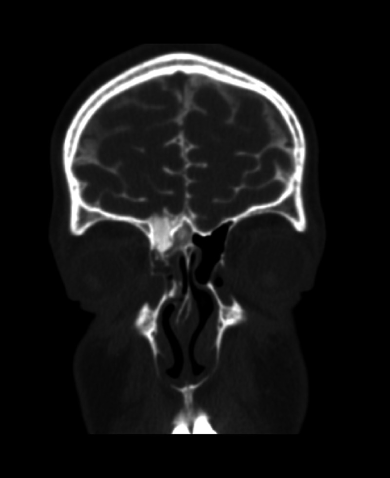
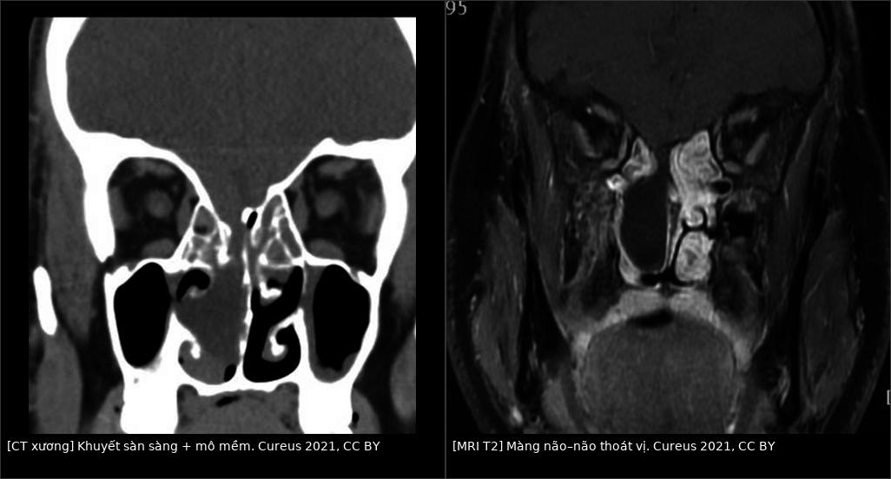
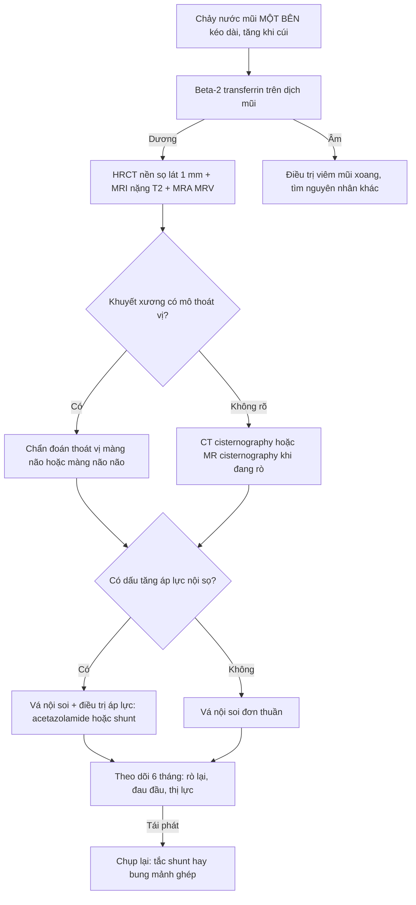
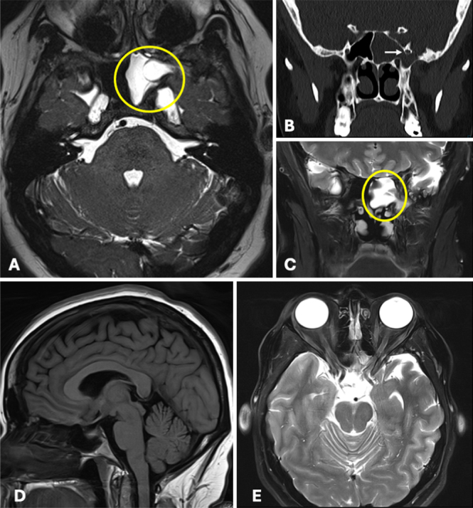
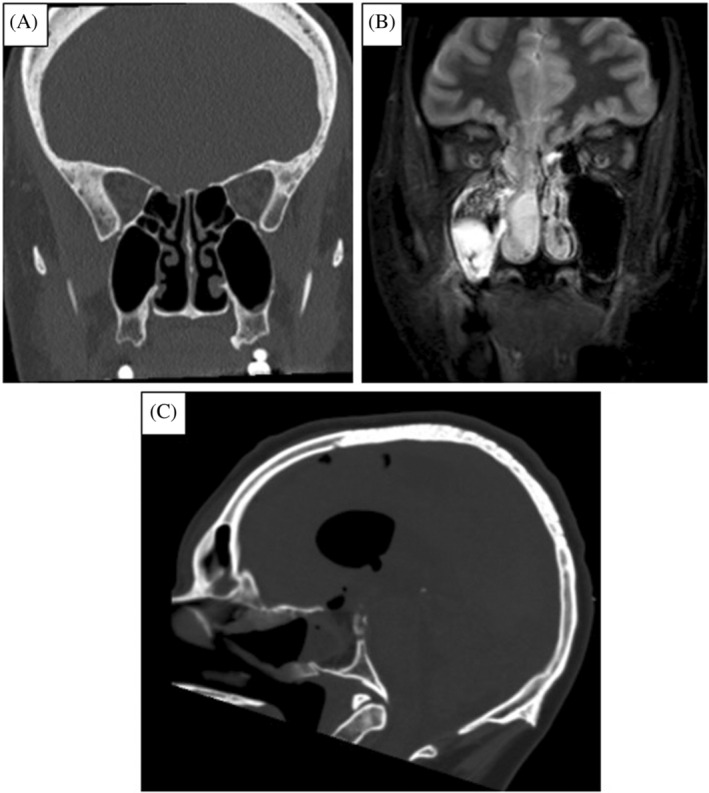

# 1777 — Rò dịch não tủy nền sọ trước "ẩn" / Occult anterior skull base CSF rhinorrhea

**Tags:** `pattern:ro-dich-nao-tuy` `pattern:khuyet-xuong` `vung:nensso` `vung:xoang` `score:beta-2-transferrin` `protocol:HRCT` `protocol:MR-cisternography` `protocol:CT-cisternography` `incidentaloma:khong`

**Mức chắc chắn (certainty):** tổng hợp y văn (literature synthesis) — **1 loạt 57 bệnh nhân rò tự phát** về chẩn đoán nhầm (*Ann Otol Rhinol Laryngol* 2026, PMC12953672, CC BY-NC), **1 loạt 56 bệnh nhân/61 lần vá nội soi** (*Cureus* 2021, PMC7984942, CC BY), **1 loạt 293 ca rò dịch não tủy** (*Surg Neurol Int* 2024, PMC11704438, CC BY-NC-SA), **1 tổng quan chẩn đoán đa phương thức** (*Laryngoscope Investig Otolaryngol* 2024, PMC11129547, CC BY-NC-ND) và **2 ca nguyên văn có ảnh** (PMC12884825 CC BY-NC-ND; PMC7984942 CC BY). Nhóm **không có bệnh nhân của mình**; chỗ nguồn lệch nhau (chiến lược shunt trước hay vá trước) được ghi là **mâu thuẫn nguồn**.

> **Câu chốt:** rò dịch não tủy (dịch não tủy, CSF) nền sọ trước "ẩn" là **đường thông giữa khoang dưới nhện và hốc mũi/xoang** mà bệnh nhân chỉ than **"chảy nước mũi một bên"** — không chấn thương, không mổ. Bốn số quyết định: **(1)** **61%** ca rò tự phát bị **chẩn đoán nhầm** thành viêm mũi/viêm xoang/migraine, và **chỉ 32% báo cáo CĐHA** nhận ra khuyết nền sọ **trước khi** có beta-2 transferrin dương (PMC12953672); **(2)** **88,1% (37/42)** ca rò tự phát có **áp lực dịch não tủy cao**, với ngưỡng **20 cmH₂O** (PMC11704438) — nghĩa là **rò là hậu quả của tăng áp lực nội sọ**, không chỉ là "lỗ thủng"; **(3)** hình ảnh **CT đơn thuần định vị đúng ổ rò chỉ ~70%**, MR cisternography **56–94%** (PMC11129547) — nên **luôn phối hợp CT xương lát mỏng + MRI nặng T2**; **(4)** vá nội soi **thành công 92% ngay lần đầu**, tái phát **4/56** (PMC7984942) — nhưng **không điều trị tăng áp lực nội sọ thì vá cũng bung**.

## 1. Tổng quan bệnh học – cơ chế hình ảnh

### 1.1 Vì sao "rò tự phát" thực chất là bệnh của áp lực

- Nền sọ trước là nơi **màng não cứng áp sát xương mỏng nhất**: **mảnh sàng** dày **~1 mm** với các lỗ khứu giác, **trần sàng** mỏng **0,5–1 mm**. Dịch não tủy dao động theo nhịp mạch **60–80 lần/phút**, mỗi nhịp tạo một xung áp lực lên chính điểm yếu đó.
- Cơ chế được chấp nhận: **tăng áp lực nội sọ mạn** (thường là **tăng áp lực nội sọ vô căn, IIH**) → **hạt nhện (arachnoid granulation)** phát triển và **làm mòn xương** từ phía nội sọ → **hố mòn (pit)** → **khuyết xương** → **màng não–não thoát vị (meningoencephalocele)** → **rách màng nhện** → rò. **37/42 (88,1%)** ca rò tự phát có áp lực dịch não tủy **> 20 cmH₂O**, và áp lực mở trung bình trong y văn là **40,5 ± 15,6 cmH₂O** (PMC11704438, PMC12884825).
- Hệ quả thực hành: **rò tự phát = IIH cho tới khi chứng minh ngược lại**. Vá lỗ mà không hạ áp lực → **rò tái phát hoặc bung mảnh ghép**. Trong loạt 37 ca được đặt **shunt thắt lưng–phúc mạc** trước, **rò ngừng ở cả 37 ca**; **7 ca tái phát**, trong đó **3 do tắc shunt** (sửa shunt là hết) và **4 ca cần vá nền sọ** (PMC11704438).
- **Đường vào bẩm sinh:** **ống Sternberg** (lateral craniopharyngeal canal) là di tích phôi thai ở **thành bên xoang bướm**, tạo đường thông sẵn từ hố sọ giữa vào **hố chân bướm–khẩu cái**. Đây là lý do có **thoát vị màng não–não xoang bướm bên** ở người trẻ **không béo, không IIH** — một biến thể phải nhớ vì đường mổ khác hẳn (qua xoang bướm/transpterygoid) (PMC12884825).

### 1.2 TẠI SAO dịch chảy ra lại "trong như nước lã" — và vì sao điều đó đánh lừa

- Dịch não tủy **nghèo tế bào và nghèo protein** (protein **0,15–0,45 g/L**, glucose **~60% glucose huyết tương**, **2–5 tế bào/µL**) → **trong, không màu, không mùi**, chảy **thành giọt** chứ không thành dòng.
- Chính vì thế nó **bắt chước hoàn hảo** viêm mũi dị ứng/vận mạch, và **61%** bệnh nhân được điều trị viêm mũi/viêm xoang/migraine trước khi có chẩn đoán đúng (PMC12953672). **Không có triệu chứng nào** (hắt hơi, ngứa, nghẹt mũi) phân biệt được — chỉ có **một bên, tăng khi cúi/khom, vị kim loại**.
- **Dấu "halo sign" (quầng trên khăn giấy) không dùng được**: máu trộn với **nước mũi thường** cũng tạo quầng. Nghiệm pháp **ipratropium bromide**: **không đáp ứng** có **độ nhạy 96%, độ đặc hiệu 100%** cho rò dịch não tủy (PMC11129547) — nhưng vẫn chỉ là gợi ý, chẩn đoán vẫn cần **beta-2 transferrin**.

### 1.3 TẠI SAO CT và MRI bổ sung nhau — không thay nhau

- **CT xương lát mỏng (HRCT) trả lời "xương thủng ở đâu":** mảnh sàng/trần sàng là **xương mỏng 0,5–1 mm**, chỉ thấy được với **lát ≤ 1 mm, tái tạo coronal + sagittal**. CT **không thấy màng não cứng**, nên một khuyết xương **không đồng nghĩa** có rò đang hoạt động — trong các ca đã xác nhận bằng beta-2 transferrin, **CT định vị đúng ổ rò chỉ 70%** (PMC11129547).
- **MRI nặng T2 (3D CISS/FIESTA) trả lời "có mô gì chui qua":** dịch não tủy có **T1 tối, T2 rất sáng** (thời gian T2 dài, ~2.000 ms) nên nổi bật trên nền xương đen và niêm mạc trung bình. Chuỗi nặng T2 cho thấy **túi màng não, mô não thoát vị, và đường hầm dịch** — thứ CT không thể hiện. **MR cisternography: độ nhạy 56–94%, độ đặc hiệu 57–100%** (PMC11129547).
- **CT cisternography** (bơm thuốc cản quang vào ống sống rồi chụp) chỉ có giá trị **khi rò đang hoạt động**: thuốc **rò ra đúng chỗ** là chốt. Nếu bệnh nhân không chảy lúc chụp → **âm tính giả**. Hình dưới là ca rò **xoang trán** với **thuốc cản quang rò vào xoang** — dấu hiệu chốt trực tiếp:

*CT cisternography coronal: cột thuốc cản quang **tăng đậm độ** đi từ khoang dưới nhện qua khuyết nền sọ trước vào xoang. Nguồn: *Cureus* 2021, **CC BY**.*

### 1.4 Dấu hiệu "phía trong sọ" của tăng áp lực — đọc trên chính MRI sọ

Khi đã nghĩ tới rò tự phát, **MRI sọ thường quy đã đủ gợi ý IIH** — tìm 5 dấu hiệu (không cần đo áp lực):

| Dấu hiệu | Cơ chế | Ý nghĩa thực hành |
|---|---|---|
| **Tuyến yên rỗng (empty sella)** | Dịch não tủy đập lên làm dẹt tuyến yên | Gợi ý tăng áp lực mạn; gặp ở phần lớn ca rò tự phát |
| **Giãn vỏ bọc dây thị giác, dây thị giác ngoằn ngoèo** | Áp lực truyền vào vỏ dây thị | Đọc cùng ảnh hốc mắt — cũng là dấu của IIH |
| **Dẹt cực sau nhãn cầu** | Áp lực đẩy nhãn cầu ra trước | Phối hợp với khám **gai thị** |
| **Hẹp xoang tĩnh mạch ngang hai bên** | Chênh áp qua chỗ hẹp duy trì vòng xoắn bệnh sinh | Giải thích vì sao **stent xoang** được dùng trong IIH kháng trị |
| **Ống sống giãn, hẹp khe đĩa** | Áp lực dịch cao mạn | Dấu phụ, không đặc hiệu |

- Đối chiếu: ca Sternberg bên dưới có **BMI 42,6** nhưng MRI **không có tuyến yên rỗng, không dẹt gai thị, không giãn vỏ dây thị** — tức **không có bằng chứng IIH trên hình ảnh**, và áp lực mở lúc chọc dò **bình thường**; tăng áp lực chỉ xuất hiện **sau mổ** (PMC12884825). Bài học: **IIH có thể âm thầm**, và chẩn đoán IIH không được chỉ dựa vào hình ảnh.

## 2. Mẫu hình + chẩn đoán phân biệt theo vị trí (gamut)

- **Theo vị trí khuyết xương (loạt 61 lần vá — PMC7984942):** **mảnh sàng 39%**, **trần sàng 25%**, **thành xoang bướm 21%**, **xoang trán 14%**; một số ca **nhiều ổ** cùng lúc. Vì vậy **luôn cuộn hết từ xoang trán xuống sàn xoang bướm**, không dừng ở ổ đầu tiên thấy.
- **Theo hình thái:**
  1. **Khuyết xương đơn thuần** — chỉ thấy trên CT xương, không có mô thoát vị; khó định vị nhất.
  2. **Thoát vị màng não (meningocele)** — túi dịch T2 sáng chui qua lỗ, không có mô não.
  3. **Thoát vị màng não–não (meningoencephalocele)** — có **mô não** (T1/T2 giống vỏ não) trong túi; nguy cơ **động kinh, nhiễm trùng, rò tái phát** cao hơn.
  4. **Rò kèm khí nội sọ (pneumocephalus)** — khí trong khoang dưới nhện, dấu hiệu **đang có đường thông hoạt động**.
- **Theo cơ chế:** **tự phát/IIH** (thành bên xoang bướm, mảnh sàng), **sau chấn thương** (mảnh sàng, xương trán — vỡ phức tạp), **sau mổ** (xuyên bướm, xuyên mê đạo — bài [1715](../1715-ro-dich-nao-tuy-sau-mo-xuyen-me-dao/lesson.md)), **bẩm sinh** (ống Sternberg, thoát vị nền sọ ở trẻ).
- **Bắt chước (không phải dịch não tủy):** **viêm mũi dị ứng/vận mạch**, **viêm xoang mạn**, **migraine có chảy nước mũi**, **nang xoang bướm vỡ**, **rò dịch não tủy từ đường khác** (tai → mũi qua vòi nhĩ). Chiến lược: **xác nhận bằng chất chỉ điểm rồi mới định vị**, không định vị trước.

## 3. Bảng so sánh phân biệt (ma trận đối chiếu)

| Thực thể (entity) | Hình ảnh điển hình (HRCT / MRI nặng T2 / CT cisternography) | Chốt vào (rule-in) | Chốt loại (rule-out) | Gợi ý xác nhận |
|---|---|---|---|---|
| **Rò tự phát do IIH** | Khuyết **mảnh sàng/trần sàng/thành bướm** + **tuyến yên rỗng**, giãn vỏ dây thị, hẹp xoang ngang; túi màng não T2 sáng | **Beta-2 transferrin dương + khuyết xương đúng bên + dấu IIH trên MRI + áp lực > 20 cmH₂O** | Không có beta-2 transferrin, không khuyết xương, không dấu IIH → tìm nguyên nhân viêm mũi | Beta-2 transferrin; HRCT 1 mm; MRC; đo áp lực khi chọc dò |
| **Rò sau chấn thương** | **Đường vỡ phức tạp** xương trán/mảnh sàng, mảnh xương di lệch, khí nội sọ, máu xoang | **Tiền sử chấn thương + đường vỡ đi qua nền sọ + khí nội sọ** | Đường vỡ **không chạm nền sọ**, không khí nội sọ → không phải nguồn rò | HRCT; theo dõi 24–48 giờ nếu rò tự cầm |
| **Rò sau mổ (xuyên bướm/xuyên mê đạo)** | Ổ khuyết **đúng đường mổ**, vật liệu vá cũ, tụ dịch; **hội chứng tuyến yên** kèm theo | **Tiền sử mổ trong 30 ngày + dịch chảy đúng bên mổ** | Khuyết cũ **đã vá kín**, không có đường dịch → theo dõi | So sánh ảnh mổ cũ; nội soi mũi; bài [1715](../1715-ro-dich-nao-tuy-sau-mo-xuyen-me-dao/lesson.md) |
| **Thoát vị màng não–não bẩm sinh (ống Sternberg)** | Khuyết **thành bên xoang bướm**, đường hầm qua **hố chân bướm–khẩu cái**, túi có **mô não**; thường **không dấu IIH** | **Khuyết bướm bên + mô não trong túi + không tiền sử chấn thương/mổ** | Chỉ có **dịch** trong xoang, không mô, không đường hầm → viêm xoang/ nang | MRI 3D T2 + MRA để loại trừ **phình cảnh trong** trước khi mổ |
| **Polyp mũi / u lành xoang** | Khối **niêm mạc** T2 trung bình, **ngấm thuốc**, không thông với khoang dưới nhện, không khuyết xương nền sọ | **Khối đặc/niêm mạc + không đường dịch + beta-2 transferrin âm** | Có **đường dịch từ nền sọ** hoặc **khuyết xương** → thoát vị | Nội soi + sinh thiết; MRI sau tiêm |
| **Viêm mũi dị ứng/vận mạch** | **Không khuyết xương**, niêm mạc dày đều hai bên, cuốn mũi phì đại | **Hai bên + đáp ứng thuốc + beta-2 transferrin âm** | **Một bên + tăng khi cúi + beta-2 transferrin dương** → rò thật | Beta-2 transferrin; nghiệm pháp ipratropium |

*Trái: **CT xương** — khuyết mảnh sàng/trần sàng phải với **mô mềm lấp đầy** lỗ và làm mờ các tế bào sàng. Phải: **MRI T2 cùng ca** — túi **màng não–não** tăng tín hiệu rõ chui qua khuyết xuống hốc mũi. Cả hai: *Cureus* 2021, **CC BY**. Ảnh ghép letterbox, giữ nguyên tỷ lệ.*

## 4. Protocol chụp + hệ phân độ/điểm chuẩn hóa

### 4.1 Trình tự bắt buộc: **xác nhận → định vị → đánh giá áp lực → vá**

1. **Xác nhận dịch là dịch não tủy — beta-2 transferrin (B2T)**: chất chỉ điểm **đặc hiệu** (chỉ có trong dịch não tủy, dịch tai trong, dịch kính). **Độ nhạy 87–100%, độ đặc hiệu 71–94%**; **giới hạn phát hiện 2 µg/mL**, cần **200–500 µL** dịch; mẫu **bền tới 14 ngày ở nhiệt độ phòng** (PMC11129547). Vì cần **nửa mL**, rò ít/ngắt quãng phải **cho bệnh nhân hứng tại nhà**.
2. **HRCT xoang + nền sọ, lát ≤ 1 mm, tái tạo coronal + sagittal** (và axial): tìm khuyết xương, mảnh xương di lệch, làm mờ tế bào sàng, **khí nội sọ**; đây cũng là **bộ ảnh dùng cho định vị navigation trong mổ**.
3. **MRI nặng T2 3D (CISS/FIESTA) + T1 sau tiêm**: xác định **màng não/mô não thoát vị**, đường hầm dịch, và **5 dấu IIH**. Thêm **MRA/MRV** để loại trừ **phình mạch, hẹp xoang tĩnh mạch** trước khi mổ.
4. **CT cisternography hoặc MR cisternography có thuốc nội tủy** — chỉ khi HRCT/MRI không định vị được **và** đang có rò hoạt động, hoặc có **nhiều ổ khuyết** cạnh tranh. Gadolinium nội tủy là **dùng ngoài nhãn**, phải giải thích và có đồng thuận.
5. **Đo áp lực dịch não tủy** (chọc dò thắt lưng) khi nghĩ rò tự phát — ngưỡng **20 cmH₂O** (PMC11704438). **Không chọc dò** khi có **khí nội sọ nhiều, phù gai thị nặng hoặc dấu thần kinh khu trú** — nguy cơ tụt não.
6. **Hội chẩn** với tai mũi họng–nền sọ, thần kinh, mắt: **vá nội soi** ± **quản lý áp lực** (acetazolamide, shunt, stent xoang ngang).

### 4.2 Số liệu kết quả vá nội soi (loạt 56 bệnh nhân, 61 lần vá)

| Chỉ số | Giá trị | Nguồn |
|---|---|---|
| Nguyên nhân | **chấn thương 30**, **tự phát 26** bệnh nhân | PMC7984942 |
| Tuổi | trung bình **39,9** (4–70) | PMC7984942 |
| Vật liệu | sụn cuốn **12**, sụn vách **18**, **vạt niêm mạc vách có cuống 12** | PMC7984942 |
| **Thành công lần vá đầu** | **92%** | PMC7984942 |
| Tái phát | **4 bệnh nhân** | PMC7984942 |
| Nằm viện | trung bình **6,5 ngày**; theo dõi **1–10 năm** | PMC7984942 |
| Triệu chứng hay gặp | chảy nước trong **82,7%**, nghẹt mũi **40,7%** | PMC7984942 (dẫn y văn) |

### 4.3 Sơ đồ xử trí

### 4.4 Vì sao "vá xong" chưa phải "xong"

- **Tái phát 4/56** trong loạt trên, và trong loạt IIH **7/37** ca rò lại sau shunt — **3 do tắc shunt** (sửa shunt là hết), **4 phải vá nền sọ** (PMC7984942, PMC11704438). Nghĩa là **theo dõi phải tách hai câu hỏi**: *mảnh ghép còn kín không?* và *áp lực còn cao không?*
- **Biến chứng phải tư vấn trước mổ:** **viêm màng não** (lý do chính phải vá), **động kinh** (thoát vị có mô não), **đái tháo nhạt** nếu tổn thương cuống tuyến yên (bài [1710](../1710-dai-thao-nhat-trung-uong-sau-mo-tuyen-yen/lesson.md)), **mất khứu giác** một bên.

## 5. Biến thể bình thường và cạm bẫy

- **Cạm bẫy lớn nhất là chẩn đoán nhầm:** **61%** ca rò tự phát được điều trị như viêm mũi/viêm xoang/migraine; tỉ lệ nhầm **83%** khi bác sĩ đầu tiên **không phải tai mũi họng**, và **36%** ngay cả khi là tai mũi họng (PMC12953672). Nước mũi **một bên, trong, tăng khi cúi** phải được coi là rò cho tới khi loại trừ.
- **Cạm bẫy đọc phim:** **chỉ 32% báo cáo CĐHA** nhận ra khuyết nền sọ **trước khi** có kết quả beta-2 transferrin, nhưng **sau khi** chẩn đoán đã được xác lập thì tỉ lệ này tăng rõ (**p < 0,001**) — đây là **bias do đã biết đáp án**. Cách chống: khi đọc xoang ở bệnh nhân có nước mũi một bên, **chủ động cuộn nền sọ trước ở cửa sổ xương lát 1 mm** thay vì chỉ đọc tế bào sàng.
- **Lát cắt dày = mất ổ rò:** xương **0,5–1 mm** chỉ hiện được với **lát ≤ 1 mm**; lát **3–5 mm** bỏ sót gần như toàn bộ khuyết nhỏ và **hố mòn** quanh hạt nhện.
- **Khuyết xương ≠ đang rò:** CT không thấy màng não cứng. Một khuyết **không có mô thoát vị, không có tụ dịch** ở người **không chảy nước mũi** là **phát hiện tình cờ**, không phải chỉ định mổ.
- **CT cisternography âm không loại trừ:** chỉ dương khi **đang rò**; bệnh nhân nằm ngửa, hết chảy → thuốc không ra. Cần **nghiệm pháp Valsalva/đầu thấp** theo protocol của đơn vị.
- **Bẫy mạch máu:** trước khi can thiệp **thành bên xoang bướm**, phải loại trừ **phình động mạch cảnh trong** và **dị dạng mạch** bằng **CTA/MRA** — sinh thiết hay nạo "polyp" ở vùng này có thể gây chảy máu chết người.
- **Bẫy "thỏa mãn tìm kiếm":** thấy một khuyết ở mảnh sàng rồi dừng; **21%** ổ rò ở **thành xoang bướm** và nhiều ca **có nhiều ổ** — cuộn hết từ trần sàng xuống sàn bướm.

## 6. Tự lượng giá — Blind Quiz

**Ca 1 — nữ 44 tuổi, chảy nước mũi trái 8 tháng, đau đầu, BMI 42,6**

- Gợi ý lâm sàng: chảy nước mũi **một bên**, tăng khi cúi; đau đầu nhẹ; **không chấn thương, không mổ**; khám mắt **không phù gai**.
- Câu hỏi: (1) Ổ khuyết nằm ở đâu và đi vào khoang nào? (2) Dấu hiệu nào cho biết đây là đường thông **bẩm sinh**? (3) Vì sao vẫn phải đánh giá áp lực nội sọ dù MRI không có dấu IIH?

<b>Bấm để hiện đáp án (findings + chẩn đoán)</b>

- **Dấu hiệu:** (A) axial T2: **túi màng não–não tăng tín hiệu** ở thành sau–bên trái xoang bướm; (B) coronal CT xương: **khuyết xương 8 × 9 mm** ở **thành bên xoang bướm**, ngay **trước Meckel's cave**, **phía trong lỗ tròn**; (C) coronal T2: túi thoát vị chui vào **hố chân bướm–khẩu cái**; (D, E) **không tuyến yên rỗng, không dẹt gai thị, không giãn vỏ dây thị**.
- **Chẩn đoán:** **thoát vị màng não–não qua ống Sternberg** (di tích ống sọ–hầu bên) gây rò dịch não tủy tự phát; đã vá nội soi qua đường **transmaxillary**.
- **Vì sao chốt:** đường đi **thành bên xoang bướm → hố chân bướm–khẩu cái** đúng giải phẫu ống Sternberg; **không tiền sử chấn thương/mổ** loại trừ nguyên nhân mắc phải.
- **Phản biện (theo PROMPT_SYNTHESIZER):** ca này **BMI 42,6 nhưng không có dấu IIH trên hình ảnh** và áp lực mở **bình thường**; tăng áp lực chỉ xuất hiện **sau mổ** (hai lần, một lần tự hết, một lần dùng acetazolamide). Vì vậy **không được suy ra "béo = IIH = có dấu trên MRI"**, và ngược lại **MRI âm không loại trừ IIH**.
- **Nguồn ảnh:** *J Neurosurg Case Lessons* 2026, Fig. 1 — PMC12884825, **CC BY-NC-ND**; tác giả Rudd G, Park R, Ang T, Sritharan N, Di Ieva A.

**Ca 2 — nam 52 tuổi, "viêm xoang" điều trị 1 năm không đỡ**

- Gợi ý lâm sàng: chảy mũi phải **trong, một bên**, đã dùng nhiều đợt kháng sinh và corticoid xịt; **không sốt**, không chấn thương.
- Câu hỏi: (1) Mô tả tổn thương trên CT xương (A)? (2) Trên MRI T2 (B) thành phần trong hốc mũi là gì? (3) Vì sao "viêm xoang một bên kéo dài" phải chụp nền sọ lát mỏng?

<b>Bấm để hiện đáp án (findings + chẩn đoán)</b>

- **Dấu hiệu:** (A) coronal CT xương: **khuyết trần sàng phải** với **mô mềm lấp đầy**, các tế bào sàng bên dưới **mờ**; (B) coronal T2: **khối tăng tín hiệu mạnh, đồng nhất như dịch não tủy** đi từ khoang dưới nhện xuống hốc mũi — **thoát vị màng não**; (C) tái tạo sagittal xác nhận **đường thông** qua nền sọ trước.
- **Chẩn đoán:** **thoát vị màng não (meningocele) qua trần sàng** gây rò dịch não tủy tự phát — biểu hiện như "viêm xoang một bên kháng trị".
- **Vì sao chốt:** **tín hiệu T2 của khối bằng đúng dịch não tủy** + **đường thông với khoang dưới nhện** + **khuyết xương đúng vị trí**.
- **Phân biệt:** polyp mũi (T2 trung bình, ngấm thuốc, không thông khoang dưới nhện); u sàng (ngấm thuốc, phá xương); **viêm xoang mạn** (mờ đều các tế bào, không khuyết xương).
- **Nguồn ảnh:** *Laryngoscope Investig Otolaryngol* 2024, Fig. 1 — PMC11129547, **CC BY-NC-ND**; tác giả Torabi SJ, Abiri A, Chen X, Senel M, Hsu FPK, Lupták A, Khine M, Kuan EC.

**Ca 3 — bệnh nhân nghi rò, CT xương "bình thường", cần chốt ổ rò**

- Gợi ý lâm sàng: nam 38 tuổi, chảy nước mũi một bên, **beta-2 transferrin dương**; HRCT lần đầu đọc là "không bất thường".
- Câu hỏi: (1) Ổ khuyết nằm ở đâu? (2) Vì sao lần đọc đầu bỏ sót? (3) Bước tiếp theo nếu MRI vẫn không định vị được?

<b>Bấm để hiện đáp án (findings + chẩn đoán)</b>

- **Dấu hiệu:** CT xương: **khuyết mảnh sàng/trần sàng phải** với mô mềm đi qua; MRI T2: **túi màng não–não** tăng tín hiệu chui xuống hốc mũi phải.
- **Vì sao bỏ sót lần đầu:** đọc trên **lát dày** và chỉ nhìn **tế bào sàng mờ** — xương nền sọ **0,5–1 mm** biến mất khi lát > 1 mm; thêm nữa **báo cáo CĐHA chỉ nhận ra khuyết ở 32% ca trước khi có beta-2 transferrin** (PMC12953672).
- **Bước tiếp theo:** **CT cisternography** hoặc **MR cisternography có thuốc nội tủy** khi đang rò; nếu vẫn âm, **nội soi mũi có fluorescein nội tủy** để định vị trong mổ.
- **Nguồn ảnh:** *Cureus* 2021, Fig. 1 + Fig. 3 — PMC7984942, **CC BY**; tác giả Bubshait RF, Almomen AA.

## Bài liên quan chéo
- [1715 — Rò dịch não tủy sau mổ xuyên mê đạo](../1715-ro-dich-nao-tuy-sau-mo-xuyen-me-dao/lesson.md): cùng bệnh cảnh, khác đường vào
- [1710 — Đái tháo nhạt trung ương sau mổ tuyến yên](../1710-dai-thao-nhat-trung-uong-sau-mo-tuyen-yen/lesson.md): biến chứng cùng vùng giải phẫu
- [3051 — Máu tụ tổ chức hóa xoang bướm](../3051-mau-tu-to-chuc-hoa-xoang-buom/lesson.md): khối xoang bướm, cùng gamut
- [236 — Viêm tai xương chũm biến chứng nội sọ](../236-viem-tai-xuong-chum-bien-chung-noi-so/lesson.md): nhiễm khuẩn lan nội sọ
- [222 — Viêm đốt sống–đĩa](../222-viem-dot-song/lesson.md): nhiễm khuẩn lan từ ổ lân cận

## Ảnh
- Tên file theo quy ước `1777_ro-dnt_Modality_SourceID.jpg`; nguồn + giấy phép từng ảnh trong `images/CREDITS.md`.
- Ảnh ghép `images/composite_ct-vs-mri.jpg` tạo bằng `tools/make_composite.py` (letterbox nền đen, **không crop, không kéo giãn**), chỉ ghép ảnh **CC BY** (cùng một bệnh nhân, hai chuỗi xung).
- Ảnh **CC BY-NC-ND** (PMC11129547, PMC12884825) dùng **nguyên bản**, không đưa vào composite.

> Không dùng để chẩn đoán độc lập khi chưa có người hướng dẫn.
