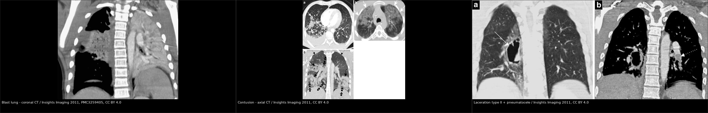
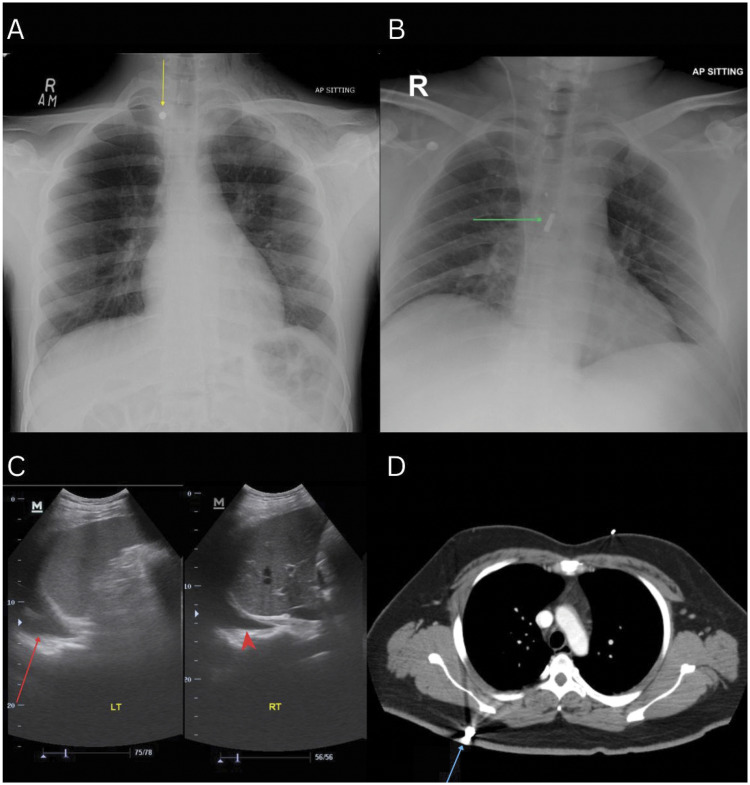
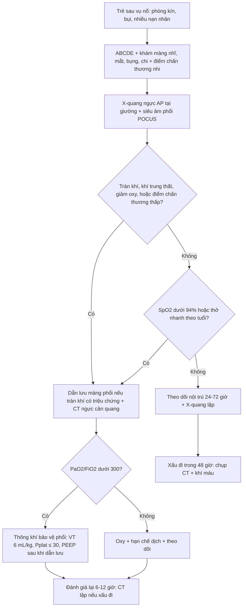
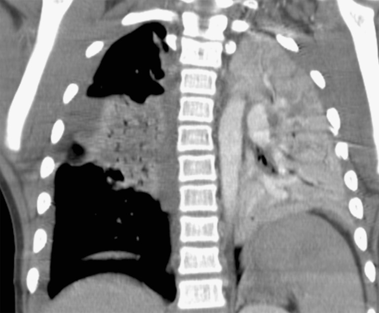
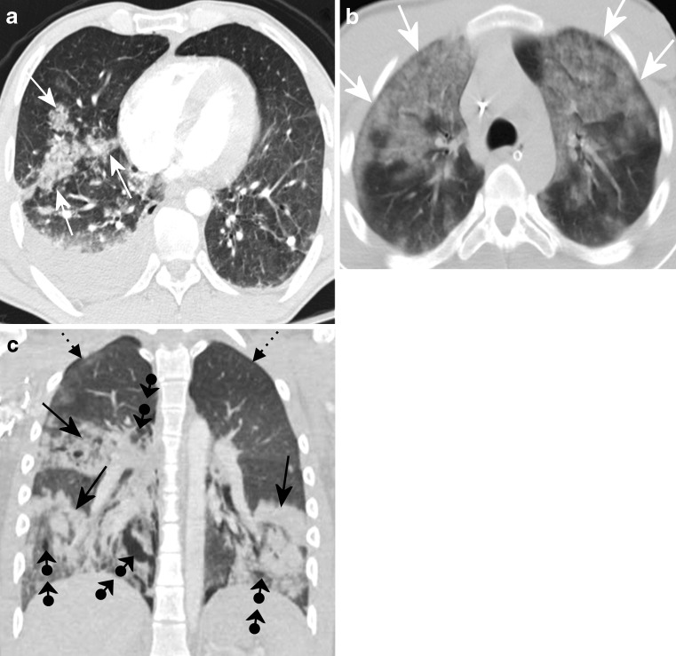
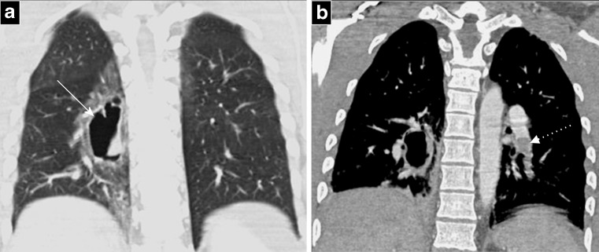

# 1778 — Chấn thương phổi do sóng nổ (blast lung injury) ở trẻ: vì sao X-quang bình thường trong 24 giờ đầu, và vì sao PEEP cao có thể giết trẻ

**Tags:** `pattern:dam-phoi` `pattern:dong-dac` `pattern:kinh-mo` `pattern:tran-khi` `vung:phoi` `vung:thanh-nguc` `vung:trung-that` `score:pediatric-trauma-score` `score:PaO2-FiO2`
**Mức chắc chắn (certainty):** tổng hợp y văn (literature synthesis) — ghép **36 trẻ có tổn thương phổi do sóng nổ** (Pediatr Emerg Care 2023, PMID 37463251), **105 trẻ chấn thương ngực do sóng nổ có đối chiếu X-quang với CT** (Injury 2023, PMID 36539310), **ca người lớn diễn tiến muộn 48 giờ** (Lung India 2026, PMC13186511), **khảo sát 130 nạn nhân bom** (J Int Med Res 2025, PMC12553861), **mô hình thông khí bảo vệ phổi trong chấn thương phổi do sóng nổ** (Intensive Care Med Exp 2020, PMC7309205) và **tổng quan chấn thương nổ ở trẻ** (Turk J Emerg Med 2026, PMC13171127). Ảnh CT minh họa là **người lớn** (ca lựu đạn, Insights Imaging 2011, PMC3259405) — dùng để dạy **mẫu hình**, không dùng để suy tỉ lệ ở trẻ.

> **Câu hỏi thực hành:** bé trai **8 tuổi** chơi gần bếp khi **bình gas mini phát nổ trong phòng kín**. Bé được đưa vào cấp cứu sau **2 giờ**: tỉnh, ho khan, **SpO₂ 97% khí trời**, không đau ngực, **không có vết thương ngực**, **X-quang ngực "bình thường"**. Mẹ hỏi: *"Phim bình thường, cho cháu về được chưa?"*
> Bài chốt **sáu điểm**: **(1) X-quang bình thường trong 24 giờ đầu là quy luật, không phải bằng chứng an toàn** — trên **105 trẻ** chấn thương ngực do sóng nổ, độ nhạy X-quang chỉ **43%** với tràn khí, **40%** với tràn máu, **44%** với đụng dập phổi, và **bỏ sót toàn bộ** rách cơ hoành, gãy ≥ 2 xương sườn, gãy xương đòn, tràn dịch màng phổi; **(2) tổn thương phổi do sóng nổ xuất hiện trong 12 giờ, nhưng có thể biểu hiện muộn tới 48 giờ** — ca được báo cáo có X-quang bình thường lúc vào, đến giờ 48 tụt oxy với **PaO₂/FiO₂ 220** (ARDS nhẹ); **(3) tổn thương là HAI BÊN, không theo phân thùy** vì lực cắt sinh ra ở mặt phân cách khí–mô, không phải ở điểm va đập; **(4) ở trẻ, không gãy xương sườn KHÔNG loại trừ chấn thương ngực nặng** — thành ngực mềm, sườn đàn hồi truyền năng lượng vào trong; **(5) PEEP và thông khí áp lực dương có thể biến tràn khí kín thành tràn khí áp lực** — phải loại trừ/dẫn lưu tràn khí trước khi tăng PEEP, và dùng **VT 6 mL/kg cân nặng lý tưởng, Pplat ≤ 30 cmH₂O**; **(6) trẻ sau sóng nổ phải được tìm tổn thương NGOÀI ngực** — trong loạt 36 trẻ, trẻ có điểm chấn thương nhi thấp có **tổn thương não 52,4%** và **ổ bụng 76,2%**.

*Trái: **blast lung** — đông đặc/kính mờ lan tỏa hai bên, có ổ khí (pneumatocele) trong nhu mô, không theo phân thùy (coronal CT, cửa sổ trung thất). Giữa: **đụng dập phổi (contusion)** — kính mờ dạng nốt, bờ không theo giải phẫu, ba bình diện. Phải: **rách phổi type II** — pneumatocele hình thùy cạnh cột sống, bao quanh là kính mờ. Ảnh ghép letterbox giữ nguyên tỉ lệ (Insights Imaging 2011, PMC3259405, CC BY 4.0).*

## 1. Tổng quan bệnh học – cơ chế hình ảnh: vì sao phổi bị rách ở mặt phân cách khí–mô

- **Định nghĩa và ngưỡng thời gian:** **tổn thương phổi do sóng nổ nguyên phát (primary blast lung injury, PBLI)** là **tổn thương phổi cấp trong 12 giờ sau phơi nhiễm sóng nổ, không do chấn thương xuyên thấu hay đụng dập trực tiếp** (Intensive Care Med Exp 2020, PMC7309205). Định nghĩa này quan trọng vì nó tách PBLI khỏi **đụng dập do va đập** và khỏi **bỏng hít** — ba cơ chế khác nhau, ba cách xử trí khác nhau.
- **Bốn nhóm chấn thương nổ — phải gọi đúng tên vì xử trí khác nhau:** **nguyên phát** (sóng áp lực tác động lên tạng chứa khí: phổi, ruột, màng nhĩ); **thứ phát** (mảnh kim loại/dị vật bắn vào); **tam phát** (nạn nhân bị ném đi, va đập, sập công trình); **tứ phát** (bỏng, hít khí độc, bụi) (J Int Med Res 2025, PMC12553861). Trong thực hành, một trẻ thường có **cả bốn** cùng lúc — đây là lý do "chấn thương phổi" không bao giờ là chẩn đoán duy nhất.
- **Tần suất:** PBLI gặp ở khoảng **24%** nạn nhân vụ nổ, với tỉ lệ bệnh tật tới **88,3%** (y văn dẫn trong J Int Med Res 2025, PMC12553861). Trong một loạt cấp cứu nhi, **36 trẻ có PBLI chiếm 25,3%** tổng số trẻ nhập viện vì chấn thương nổ (Pediatr Emerg Care 2023, PMID 37463251).
- **TẠI SAO tổn thương xảy ra ở mặt phân cách khí–mô:** sóng nổ là một **xung siêu áp** lan trong không khí rồi **giảm áp đột ngột** phía sau. Khi sóng đi từ **khí (trở kháng thấp)** sang **mô đặc (trở kháng cao)**, phần lớn năng lượng bị **phản xạ** và tạo **lực cắt (shear)** tại vách phế nang–mao mạch. Hệ quả là **rách vách phế nang và mao mạch** → máu và protein tràn vào lòng phế nang (**đụng dập/xuất huyết phế nang**), đồng thời khí thoát vào **khoảng kẽ** rồi vào **màng phổi, trung thất, mô dưới da**. Vì lực tác động lên **mọi mặt phân cách khí–mô mà sóng gặp**, tổn thương có tính **hai bên, lan tỏa, không theo phân thùy** — khác hẳn đụng dập do va đập (khu trú ở điểm va đập, thường kèm gãy sườn).
- **Vì sao phòng kín nguy hiểm hơn:** trong không gian kín, sóng bị **phản xạ từ tường** và **cộng hưởng**, kéo dài thời gian tác động và tăng áp lực đỉnh. Đây là lý do các vụ nổ trong xe buýt, tàu điện, phòng nhỏ gây PBLI nặng hơn vụ nổ ngoài trời cùng lượng thuốc nổ (Intensive Care Med Exp 2020, PMC7309205).
- **TẠI SAO X-quang bình thường trong 24 giờ đầu — bốn lý do định lượng:**
  1. **Độ nhạy thấp có số liệu:** trên **105 trẻ**, X-quang chỉ phát hiện **43%** tràn khí, **40%** tràn máu, **44%** đụng dập, và **không phát hiện được ca rách cơ hoành, gãy ≥ 2 sườn, gãy xương đòn, tràn dịch màng phổi nào** trong loạt; độ nhạy cho "bất kỳ bất thường nào đủ để chỉ định CT" chỉ **72%** (95% CI 55–85%), độ đặc hiệu **82%** (Injury 2023, PMID 36539310).
  2. **Tràn khí kín trên phim AP tại giường:** phim **AP nằm/ngồi tại giường** có thể **bỏ sót tới 50%** tràn khí màng phổi (J Int Med Res 2025, PMC12553861); ở trẻ nằm ngửa, khí tụ ở **phía trước và đáy** — nơi phim AP khó thấy nhất.
  3. **Đụng dập cần thời gian để đậm đặc:** trên X-quang, đụng dập có thể cần **tới 6 giờ** mới hiện rõ, trong khi CT thấy **ngay sau chấn thương** (J Int Med Res 2025, PMC12553861).
  4. **Sinh lý trẻ che lấp:** thành ngực mỏng, phổi giàu khí, dung tích cặn chức năng nhỏ — một vùng đụng dập nhỏ vẫn đủ làm giảm oxy máu mà chưa đủ thay đổi đậm độ trên phim.

*(A, B) X-quang ngực AP: dị vật kim loại (mũi tên vàng/xanh) và **dải mờ dạng băng ở thùy trên trái** — đụng dập phổi, cộng khí dưới da thành ngực trái. (C) Siêu âm FAST: tràn dịch màng phổi hai bên (mũi tên đỏ). (D) CT ngang: dị vật kim loại trong mô mềm thành ngực sau phải (mũi tên xanh). Ảnh cùng một bệnh nhân, cho thấy **X-quang bỏ sót tràn dịch và nhiều tổn thương nhu mô** mà CT/US phát hiện. Nguồn: J Int Med Res 2025, PMC12553861, CC BY 4.0.*
- **Vì sao có thể biểu hiện MUỘN 48 giờ:** ca được báo cáo (người lớn 67 tuổi, nổ lốp xe tải ở cự ly **2 m**, không chấn thương ngực trực tiếp) có **X-quang bình thường lúc vào**, **SpO₂ 98% khí trời**; **48 giờ sau** xuất hiện khó thở cấp, **PaO₂/FiO₂ 220** (ARDS nhẹ), CT thấy **kính mờ lan tỏa hai bên + tràn dịch màng phổi ít**; hồi phục trong **48 giờ** với thông khí không xâm nhập (Lung India 2026, PMC13186511). Cơ chế: tổn thương màng mao mạch–phế nang ban đầu **dưới ngưỡng hình ảnh**, sau đó **viêm và tăng tính thấm** tiến triển → phù phế nang thứ phát.
- **Vì sao trẻ khác người lớn — năm điểm thực hành:**
  1. **Sườn mềm, đàn hồi:** năng lượng được truyền vào trong thay vì làm gãy sườn → **chấn thương nội tạng nặng mà không có gãy xương**. Đây là bẫy kinh điển "không gãy sườn = ngực lành".
  2. **Tỷ lệ đầu/thân lớn, hộp sọ mỏng:** chấn thương não **nặng và thường gặp hơn** người lớn; trong loạt 36 trẻ PBLI, trẻ tử vong có tổn thương não **61,5%** so với **26,1%** ở trẻ sống (Pediatr Emerg Care 2023, PMID 37463251).
  3. **Khoang bụng mỏng, tạng đặc lớn tương đối:** trong cùng loạt, trẻ có **điểm chấn thương nhi thấp** có tổn thương ổ bụng **76,2%** (p = 0,017) và tổn thương não **52,4%** (p = 0,049) — nghĩa là **điểm chấn thương thấp là cờ đỏ để khám toàn thân**, không phải để tập trung vào phổi.
  4. **Màng nhĩ và mắt bị ảnh hưởng nhiều hơn:** rách màng nhĩ, chấn thương mắt gặp với tỉ lệ cao hơn người lớn do ống tai ngắn, không có bảo vệ (Turk J Emerg Med 2026, PMC13171127). Khám màng nhĩ là **dấu chứng phơi nhiễm** rẻ tiền nhất.
  5. **Đường thở nhỏ, dễ tắc:** phù thanh môn sau bỏng/hít, dị vật, mảnh vỡ vùng hầu → **đặt ống khó**; phải chuẩn bị đường thở trước khi chuyển đi chụp.
- **Vì sao PEEP cao nguy hiểm trong PBLI:** phổi đã có **rách phế nang và đường rò khí vào khoảng kẽ**. Áp lực dương làm khí đi theo đường rò **nhanh hơn và nhiều hơn**, dễ tạo **tràn khí áp lực** và **tràn khí trung thất**; đồng thời phần phổi lành còn lại ít ("baby lung") nên **cùng một VT sẽ làm căng quá mức các đơn vị còn thông khí**. Vì vậy nguyên tắc là **dẫn lưu tràn khí trước, thông khí bảo vệ phổi sau**, không phải "tăng PEEP để cải thiện oxy bằng mọi giá".

## 2. Mẫu hình + chẩn đoán phân biệt theo vị trí (Gamut)

- **Năm mẫu hình hình ảnh — theo thứ tự thường gặp ở trẻ:**
  1. **Đụng dập phổi (contusion)** — mảng kính mờ/đông đặc **không theo phân thùy**, bờ nham nhở, thường ở phổi phải **69,4%** và phổi trái **80,6%** trong loạt 36 trẻ (Pediatr Emerg Care 2023, PMID 37463251). Đây là tổn thương **thường gặp nhất**, tiến triển tối đa trong **24–72 giờ**.
  2. **PBLI lan tỏa hai bên** — kính mờ đối xứng quanh rốn phổi ("butterfly"), có thể kèm **pneumatocele** (ổ khí trong nhu mô) và **tràn khí trung thất**.
  3. **Rách phổi (laceration) và pneumatocele** — ổ khí hình tròn/thùy, thành mỏng, có thể có mức dịch; xuất hiện **sau 24–48 giờ** khi máu trong ổ tiêu đi; **không phải hang lao, không phải áp-xe**.
  4. **Tràn khí/tràn máu màng phổi** — trên **CT** thấy rõ; trên X-quang AP bỏ sót tới **50%** tràn khí.
  5. **Khí trung thất – khí dưới da – tràn khí màng tim** — dấu hiệu của đường rò khí từ phế nang vào khoảng kẽ; **không cần điều trị riêng** nếu không có chèn ép, nhưng là **dấu chứng của tổn thương nặng**.
- **Gamut theo giải phẫu — "đọc CT ngực chấn thương nổ theo 5 tầng":** **thành ngực** (gãy sườn, xương ức, xương đòn) → **màng phổi** (tràn khí, tràn máu, tràn dưỡng trấp) → **nhu mô** (đụng dập, rách, pneumatocele, PBLI) → **trung thất/đường thở** (khí trung thất, vỡ khí quản–phế quản, rách thực quản) → **mạch máu** (giả phình động mạch chủ, rách mạch lớn). Bỏ tầng nào cũng là **satisfaction of search**.
- **Gamut "kính mờ hai bên sau chấn thương" — 6 nguyên nhân phải phân biệt:** **PBLI/đụng dập** (bối cảnh nổ, không theo phân thùy) → **bỏng hít/viêm phổi hít** (khói, bồ hóng, co thắt thanh môn) → **phù phổi do sốc/truyền máu** (bilateral, có bối cảnh tụt huyết áp/truyền máu) → **ARDS do nguyên nhân khác** (nhiễm khuẩn, viêm tụy) → **thuyên tắc mỡ** (gãy xương dài, chấm xuất huyết, giảm tiểu cầu) → **thuyên tắc phổi** (thường khu trú, có dấu hiệu mạch máu).
- **Gamut "tràn khí màng phổi ở trẻ" — đừng chỉ nghĩ chấn thương:** chấn thương nổ/va đập → **tràn khí áp lực do thông khí** → **tràn khí tự phát** (kén khí, Birt–Hogg–Dubé) → **tràn khí do nhiễm trùng** (áp-xe vỡ, PCP) → **tràn khí do dị vật** (hít phải) → **tràn khí do bệnh mô liên kết** (Marfan).
- **Cờ đỏ bắt buộc nhập viện/theo dõi 24–72 giờ:** **PaO₂/FiO₂ < 300**, **SpO₂ < 94% khí trời**, **thở nhanh theo tuổi**, **ho ra máu**, **tràn khí/khí trung thất trên bất kỳ hình ảnh nào**, **điểm chấn thương nhi thấp**, **rách màng nhĩ**, **bỏng mặt/đường thở**, **nhiều nạn nhân cùng vụ nổ**.

## 3. Bảng so sánh phân biệt (ma trận đối chiếu)

| Thực thể (entity) | Hình ảnh điển hình (CT/X-quang) | Chốt vào (rule-in) | Chốt loại (rule-out) | Gợi ý xác nhận |
|---|---|---|---|---|
| **PBLI (blast lung nguyên phát)** | Kính mờ/đông đặc **hai bên, lan tỏa, không theo phân thùy**; ± pneumatocele, khí trung thất; X-quang có thể **bình thường 24–48 giờ đầu** | **Bối cảnh nổ (nhất là phòng kín) + tổn thương hai bên không theo phân thùy + không có vết thương ngực** | **X-quang bình thường KHÔNG loại trừ**; đụng dập khu trú một bên → nghĩ va đập hơn | CT ngực có cản quang; theo dõi PaO₂/FiO₂ 24–72 giờ |
| **Đụng dập phổi (contusion)** | Kính mờ dạng nốt/mảng, **bờ không theo giải phẫu**, thường dưới vùng va đập; có thể kèm gãy sườn | **Vị trí tương ứng điểm va đập + gãy sườn/xương ức** | Tổn thương **đối xứng hai bên + không gãy sườn** → nghĩ PBLI | CT; đậm đặc tối đa 24–72 giờ |
| **Rách phổi / pneumatocele** | **Ổ khí thành mỏng** trong nhu mô, hình tròn/thùy, có thể có mức dịch; xuất hiện muộn 24–48 giờ | **Ổ khí mới sau chấn thương + bao quanh là kính mờ** | Hang/áp-xe có **thành dày, mức khí–dịch, tổn thương vệ tinh** → không phải rách | CT lặp; theo dõi tự tiêu |
| **Tràn khí màng phổi** | Khí màng phổi, mất mạch phổi; **tràn khí áp lực: di lệch trung thất, xẹp phổi** | **CT thấy khí màng phổi + mất liên tục màng phổi**; US **mất dấu lung sliding** | **X-quang AP bình thường không loại trừ** (bỏ sót tới 50%) | CT/US; dẫn lưu nếu có triệu chứng hoặc trước khi tăng PEEP |
| **Bỏng hít / viêm phổi hít** | Đông đặc **quanh rốn phổi, thùy dưới**, bồ hóng trong đường thở; phù thanh môn | **Bối cảnh cháy + bồ hóng + khàn tiếng/ho ra bồ hóng** | Không bỏng đường thở, tổn thương đối xứng hai bên → nghĩ PBLI | Nội soi thanh–khí quản; CT |
| **Thuyên tắc mỡ** | Kính mờ hai bên + **chấm xuất huyết**, thường sau **24–72 giờ** | **Gãy xương dài + chấm xuất huyết + giảm tiểu cầu + rối loạn tri giác** | Không có gãy xương dài, không chấm xuất huyết → ít nghĩ | Lâm sàng; MRI não nếu có thần kinh |
| **Phù phổi do truyền máu/sốc** | Kính mờ hai bên **đối xứng, có bối cảnh truyền máu/tụt huyết áp** | **Truyền máu trong 6 giờ + tụt oxy + sốt** | Bối cảnh nổ đơn thuần, không truyền máu → nghĩ PBLI | Đáp ứng lợi tiểu; loại trừ nguyên nhân |

- **Ảnh ghép đối chiếu:** `images/composite_blast-lung-phoi.jpg` — ba mẫu hình trên cùng cửa sổ/phổi: lan tỏa hai bên (blast lung), khu trú không theo giải phẫu (contusion), ổ khí thành mỏng (laceration type II).

## 4. Protocol chụp – xét nghiệm + phân tầng điều trị

- **Nguyên tắc: đường thở và dẫn lưu trước, chụp sau.** Trẻ sau vụ nổ thường **không mô tả được triệu chứng**; thứ tự thực hành:
  1. **ABCDE + khám toàn thân:** khám **màng nhĩ** (dấu chứng phơi nhiễm), **mắt**, **bụng**, **khung chậu**, **chi**; ghi **điểm chấn thương nhi (pediatric trauma score)** — điểm thấp dự báo tổn thương não/ổ bụng (Pediatr Emerg Care 2023, PMID 37463251).
  2. **X-quang ngực AP tại giường** ngay — nhưng **hiểu đúng giới hạn**: độ nhạy **72%** cho bất kỳ bất thường đủ chỉ định CT (Injury 2023, PMID 36539310). Phim bình thường **không dừng** quy trình.
  3. **Siêu âm phổi tại giường (POCUS)** — **B-lines** (phù kẽ), **đông đặc dưới màng phổi**, **mất lung sliding** (tràn khí), **dịch màng phổi**. Ưu điểm: lặp lại được, không bức xạ, làm được khi trẻ chưa ổn định để chuyển.
  4. **CT ngực có cản quang — ngưỡng thấp** ở trẻ chấn thương nổ: bất kỳ bất thường trên X-quang/US, **giảm oxy**, **tràn khí/khí trung thất**, **điểm chấn thương thấp**, hoặc cơ chế nổ trong phòng kín. CT là **chuẩn vàng** cho tràn khí kín, đụng dập, rách phổi, tổn thương mạch lớn, cơ hoành.
  5. **CT bụng/thận và CT sọ** theo lâm sàng — trong loạt 36 trẻ, **76,2%** trẻ có điểm chấn thương thấp có tổn thương ổ bụng.
- **Thông khí — bảng tham số (ARDSnet + kinh nghiệm PBLI):**

| Tham số | Ngưỡng / cách làm | Lý do |
|---|---|---|
| **VT** | **6 mL/kg cân nặng lý tưởng** (dải 4–8), giảm dần nếu Pplat cao | Giảm volutrauma trên "baby lung"; **chưa có RCT riêng ở trẻ**, dùng nguyên lý ARDSnet |
| **Pplat** | **≤ 30 cmH₂O** | Ngăn căng phế nang quá mức; Pplat cao là dấu hiệu phải giảm VT |
| **PEEP** | Khởi đầu **thấp–trung bình**, tăng từng bước **sau khi đã loại trừ/dẫn lưu tràn khí** | PEEP cao trên phổi đã rách → tràn khí áp lực |
| **FiO₂** | Mức thấp nhất giữ **SpO₂ 92–96%** | Tránh độc tính oxy |
| **Hypercapnia** | Chấp nhận **pH ≥ 7,20** nếu huyết động ổn và **không có chấn thương sọ** | Bảo vệ phổi; tránh ở trẻ có tăng áp lực nội sọ |
| **Dịch** | **Hạn chế dịch**, duy trì tưới máu | Giảm phù phổi |
| **APRV** | Cân nhắc **cứu cánh** khi thông khí bảo vệ thất bại | Có dữ liệu mô hình; **chưa có RCT ở người** (Intensive Care Med Exp 2020, PMC7309205) |

- **Những điều KHÔNG làm:** **không NIV/CPAP** khi có tràn khí chưa dẫn lưu, hôn mê, hoặc huyết động không ổn; **không tăng PEEP mù** để "cải thiện SpO₂"; **không cho về nhà** sau một phim X-quang bình thường trong 24 giờ đầu.
- **Theo dõi:** **24–72 giờ** nội trú với **SpO₂/khí máu lặp**, vì biểu hiện muộn đã được ghi nhận tới **48 giờ** (Lung India 2026, PMC13186511). Hẹn khám lại **1–2 tuần** nếu cho về: ho, khó thở, giảm dung nạp gắng sức.

## 5. Biến thể bình thường và cạm bẫy

- **Cạm bẫy 1 — "X-quang bình thường thì cho về".** Đây là sai lầm nguy hiểm nhất của bài: **43%** tràn khí, **40%** tràn máu, **44%** đụng dập bị bỏ sót trên X-quang ở trẻ (Injury 2023, PMID 36539310), và biểu hiện muộn tới **48 giờ** đã được ghi nhận. Trẻ có cơ chế nổ trong phòng kín cần **theo dõi tối thiểu 24 giờ**.
- **Cạm bẫy 2 — "không gãy xương sườn thì ngực không sao".** Sườn trẻ mềm, đàn hồi; năng lượng truyền vào nhu phổi và mạch máu mà không làm gãy xương. Gãy sườn ở trẻ là dấu hiệu **năng lượng rất lớn**, nhưng **không gãy sườn không phải bằng chứng an toàn**.
- **Cạm bẫy 3 — đọc pneumatocele thành "hang lao/áp-xe".** Pneumatocele sau chấn thương là **ổ khí thành mỏng, không có tổn thương vệ tinh, không mức khí–dịch điển hình**, xuất hiện **sau 24–48 giờ** và **tự tiêu** trong vài tuần. Điều trị là **theo dõi**, không phải kháng lao/kháng sinh.
- **Cạm bẫy 4 — bỏ sót tràn khí kín vì phim AP.** Phim AP tại giường có thể bỏ sót **tới 50%** tràn khí (J Int Med Res 2025). Nếu trẻ **xấu đi sau khi tăng PEEP hoặc sau đặt ống**, phải nghĩ **tràn khí áp lực** và **chọc giải áp ngay**, không chờ phim.
- **Cạm bẫy 5 — satisfaction of search.** Tập trung vào phổi mà bỏ **màng nhĩ, mắt, bụng, sọ**. Trong loạt 36 trẻ, tổn thương não và ổ bụng chiếm tỉ lệ rất cao ở trẻ nặng (Pediatr Emerg Care 2023). Khám màng nhĩ còn là **dấu chứng phơi nhiễm** khi bệnh sử mơ hồ.
- **Cạm bẫy 6 — nhầm PBLI với bỏng hít.** Bỏng hít gây **co thắt thanh môn, bồ hóng, phù đường thở trên**; PBLI gây **tổn thương nhu mô hai bên** mà đường thở trên có thể bình thường. Hai bệnh cảnh **cùng tồn tại** trong vụ cháy nổ — đừng chọn một.
- **Cạm bẫy 7 — "đã hết khó thở là lành".** Trong ca diễn tiến muộn, bệnh nhân **không triệu chứng lúc vào**, **SpO₂ 98%**, rồi tụt oxy ở **48 giờ** (Lung India 2026). Sự hồi phục nhanh sau đó **không** biện minh cho việc bỏ theo dõi.
- **Biến thể bình thường dễ nhầm:** **khoang màng phổi nhỏ phía trước** trên CT ở trẻ nằm ngửa có thể là **tràn khí kín lượng ít** — so với màng phổi đối diện; **giãn phế nang bù trừ** ở phổi còn lại; **khí trong thực quản** không phải khí trung thất bệnh lý; **pneumatocele nhỏ** có thể tự tiêu, không can thiệp.

## 6. Tự lượng giá — Blind Quiz

**Ca 1 — Bé trai 12 tuổi, nổ lựu đạn gần người, vào viện tỉnh, ho ra máu ít, SpO₂ 95%. Nhìn CT coronal, mô tả trước khi mở đáp án.**

- Gợi ý lâm sàng: không vết thương ngực, không gãy sườn trên phim; bụng mềm; màng nhĩ trái rách.
- Câu hỏi: Tổn thương ở đâu, một bên hay hai bên? Có theo phân thùy không? Ba chẩn đoán phân biệt? Vì sao X-quang có thể bình thường?

<b>Bấm để hiện đáp án (findings + chẩn đoán)</b>

- Dấu hiệu: **đông đặc và kính mờ lan tỏa hai bên**, không theo phân thùy, kèm **ổ khí trong nhu mô** (pneumatocele) và **tràn khí màng phổi lượng ít**; không thấy gãy sườn.
- Chẩn đoán: **blast lung injury nguyên phát** — vì **tổn thương hai bên, lan tỏa, ở mặt phân cách khí–mô** trong bối cảnh nổ, không có chấn thương ngực trực tiếp.
- Phân biệt: **đụng dập do va đập** (khu trú, kèm gãy sườn), **bỏng hít** (bồ hóng, co thắt thanh môn), **phù phổi do truyền máu/sốc**, **thuyên tắc mỡ** (nếu gãy xương dài).
- Vì sao X-quang bình thường: đụng dập cần **tới 6 giờ** mới đậm đặc, phim AP bỏ sót **tới 50%** tràn khí; CT thấy ngay.
- Nguồn ảnh: Insights Imaging 2011, **PMC3259405**, CC BY 4.0 (ca người lớn — dùng để dạy mẫu hình).

**Ca 2 — Bé gái 9 tuổi, ngã từ xe đạp đè lên ngực phải, đau ngực, SpO₂ 96%. Nhìn 3 bình diện CT, mô tả trước khi mở đáp án.**

- Gợi ý lâm sàng: không có vụ nổ; có vết xước thành ngực phải; X-quang thấy "mờ nhẹ đáy phổi phải".
- Câu hỏi: Tổn thương có theo phân thùy không? Đây là đụng dập hay blast lung? Cần làm gì tiếp?

<b>Bấm để hiện đáp án (findings + chẩn đoán)</b>

- Dấu hiệu: **kính mờ dạng nốt, bờ nham nhở, không tôn trọng ranh giới phân thùy**, tập trung ở phổi phải dưới vùng va đập; không có ổ khí lớn.
- Chẩn đoán: **đụng dập phổi (pulmonary contusion)** — cơ chế va đập trực tiếp, không phải sóng nổ.
- Phân biệt: **PBLI** (hai bên, đối xứng, bối cảnh nổ), **viêm phổi hít** (sốt, bồ hóng), **thuyên tắc phổi** (khu trú, dấu hiệu mạch máu), **phù phổi** (đối xứng, bối cảnh).
- Xử trí: theo dõi **24–72 giờ**, giảm đau để trẻ thở sâu, **hạn chế dịch**, oxy theo mục tiêu, **thông khí bảo vệ phổi nếu PaO₂/FiO₂ < 300**; đụng dập **> 1/3 thể tích phổi** thường cần thông khí.
- Nguồn ảnh: Insights Imaging 2011, **PMC3259405**, CC BY 4.0.

**Ca 3 — Bé trai 11 tuổi, nổ bình gas trong bếp, ngày thứ 3 ho và đau ngực. Nhìn CT, mô tả trước khi mở đáp án.**

- Gợi ý lâm sàng: không sốt, không ho ra máu; bạch cầu bình thường; tiền sử nổ trong phòng kín.
- Câu hỏi: Ổ khí này là hang, áp-xe hay gì? Có cần kháng sinh/kháng lao không? Theo dõi thế nào?

<b>Bấm để hiện đáp án (findings + chẩn đoán)</b>

- Dấu hiệu: **ổ khí hình thùy, thành mỏng, cạnh cột sống**, bao quanh là **kính mờ (đụng dập)**; không có thành dày, không mức khí–dịch, không tổn thương vệ tinh.
- Chẩn đoán: **rách phổi type II với pneumatocele** sau chấn thương — khí thoát từ phế nang rách vào khoảng kẽ rồi tụ lại thành ổ.
- Phân biệt: **hang lao** (thùy trên, nốt vệ tinh, thành dày), **áp-xe** (mức khí–dịch, sốt, đông đặc quanh), **kén khí bẩm sinh** (có từ trước), **di căn hoại tử** (bệnh cảnh ung thư).
- Xử trí: **theo dõi**, không kháng sinh/kháng lao; CT lặp nếu sốt hoặc khó thở; phần lớn **tự tiêu trong vài tuần**; tránh thông khí áp lực cao.
- Nguồn ảnh: Insights Imaging 2011, **PMC3259405**, CC BY 4.0.

## Bài liên quan chéo
- [1720 – Ngộ độc cyanid do khói lửa ở trẻ](../1720-ngo-doc-cyanid-khoi-lua-o-tre/lesson.md) (cùng bối cảnh cháy nổ: toan lactic, PaO₂ bình thường)
- [090 – Bỏng hít đường thở ở trẻ](../090-bong-hit-duong-tho-o-tre/lesson.md) (phần đường thở trên của cùng bối cảnh)
- [098 – Barotrauma tràn khí do áp lực thở máy](../098-barotrauma-tran-khi-ap-luc-tho-may/lesson.md) (vì sao PEEP/VT cao gây tràn khí áp lực)
- [040 – Tràn dịch màng phổi](../040-tran-dich-mang-phoi/lesson.md) (phân biệt tràn máu – tràn dịch – mủ)
- [031 – Viêm phổi mẫu hình](../031-viem-phoi-mau-hinh/lesson.md) (đông đặc theo phân thùy vs không theo phân thùy)

## Ảnh
- `images/1778_blast-lung_CT_InsightsImaging-2011-Fig7.jpg`, `...-Fig4.jpg`, `...-Fig5.jpg` — Insights Imaging 2011, **PMC3259405**, **CC BY 4.0**.
- `images/1778_blast-lung_CXR-CT_JIMR-2025-Fig1.jpg` — J Int Med Res 2025, **PMC12553861**, **CC BY 4.0**.
- `images/composite_blast-lung-phoi.jpg` — ảnh ghép letterbox từ 3 ảnh PMC3259405 (giữ nguyên tỉ lệ, không crop), CC BY 4.0.
- Chi tiết giấy phép từng ảnh: `images/CREDITS.md`.

> Không dùng để chẩn đoán độc lập khi chưa có người hướng dẫn.
