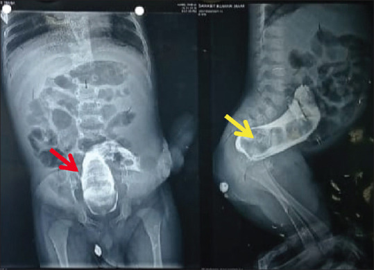
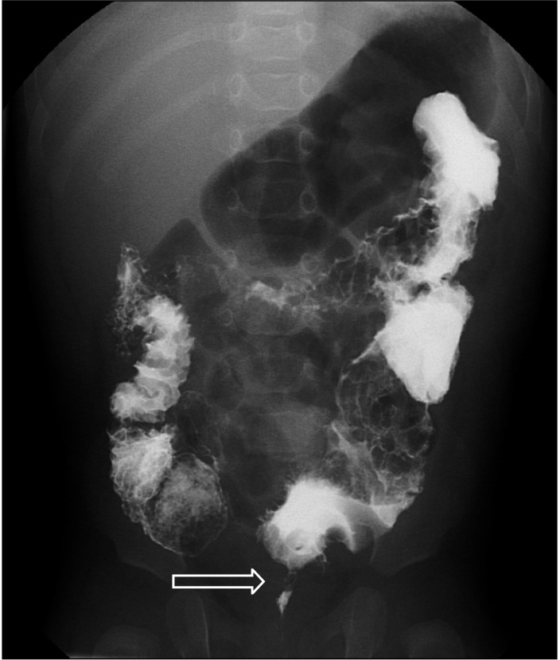
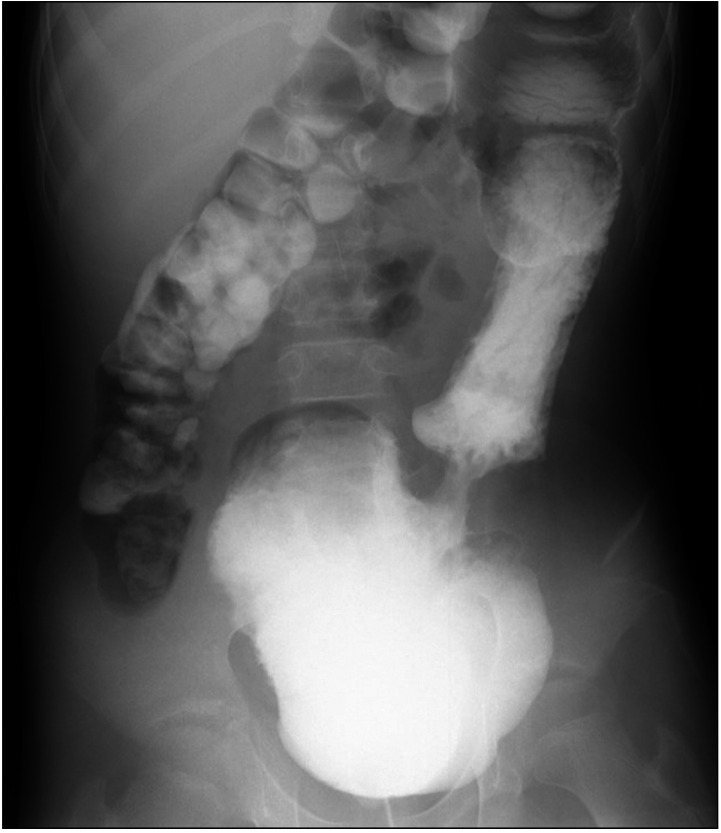
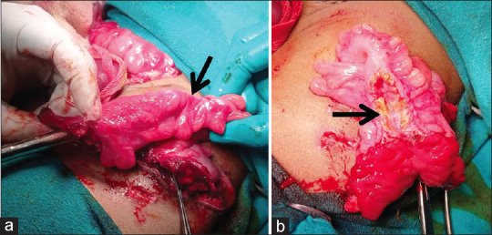
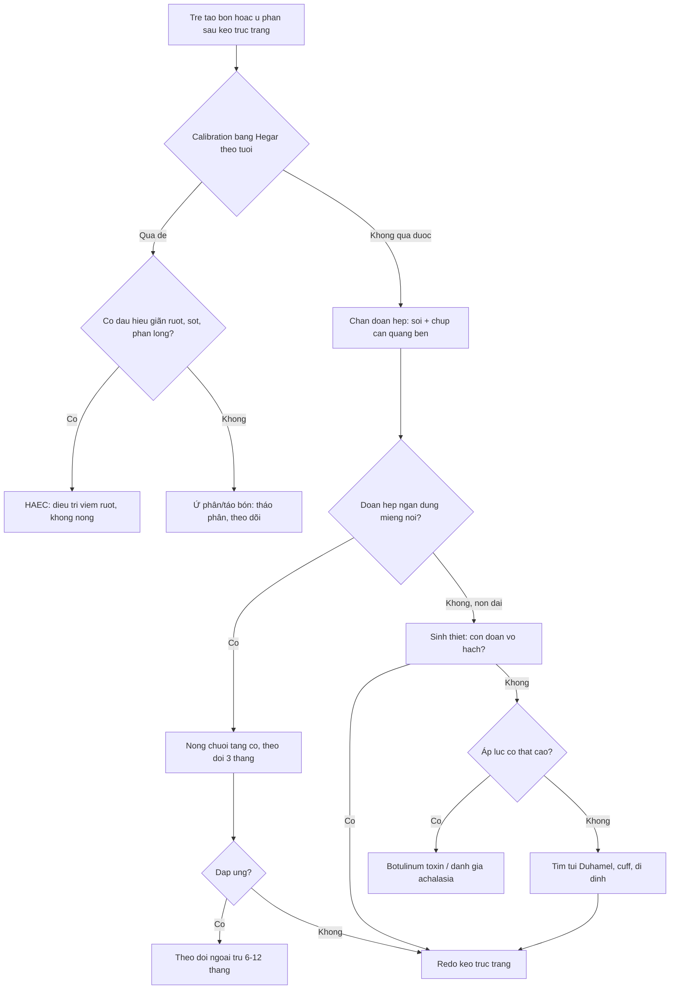

# 1779 — Hẹp miệng nối sau kéo trực tràng ở trẻ / Post-pull-through anastomotic stricture

**Tags:** `pattern:hep` `pattern:hep-mieng-noi` `pattern:gian-dai-trang` `pattern:u-phan` `vung:truc-trang` `vung:hau-mon` `vung:khung-chau` `vung:sinh-duc-nhi` `protocol:chup-luu-can-quang` `protocol:calibration-Hegar` `protocol:noi-soi`
**Mức chắc chắn (certainty):** tổng hợp y văn (literature synthesis) — số liệu lấy từ 1 đoàn hệ 2 trung tâm 91 trẻ so sánh nong định kỳ với **một lần calibration** (PMC13652869), 1 đoàn hệ 150 trẻ kéo trực tràng qua hậu môn một thì (PMC11430751), 2 loạt mổ lại (PMC10333807; PMC6322179), 1 đoàn hệ 98 trẻ nong hậu môn sau mổ (PMC13171265), 1 nghiên cứu định tính về gánh nặng nong hậu môn (PMC12443886), 1 loạt 37 trẻ rửa trực tràng sớm sau Swenson nội soi (PMC11605820), 1 loạt 41 trẻ ASSSARP (PMC11488181) và 1 ca hẹp đại tràng muộn sau PSARP dùng cho hình ảnh (PMC11493231). Phần nào là **suy luận thực hành** được ghi rõ ngay trong câu.

## 1. Tổng quan bệnh học – cơ chế hình ảnh

- **Định nghĩa thực hành (đo được, không phải cảm tính):** hẹp miệng nối là tình trạng **không đưa được ống nong Hegar cỡ theo tuổi qua ống hậu môn** và/hoặc **sờ thấy vòng xơ hẹp** khi thăm trực tràng (tiêu chuẩn dùng trong PMC13652869). Định nghĩa này quan trọng vì "hẹp" trên phim và "hẹp" trên lâm sàng không luôn trùng nhau.
- **Tần suất:** y văn **3–35%** sau mổ Hirschsprung; đoàn hệ 91 trẻ của Zurich–Frankfurt có **15,4% (14/91)** hẹp (10,9% ở nhóm nong định kỳ so với 20% ở nhóm chỉ calibration một lần, p = 0,259) (PMC13652869). Loạt 150 trẻ kéo trực tràng qua hậu môn một thì: **rò miệng nối 4%, nhiễm vết mổ 15%, viêm ruột non–đại tràng (HAEC) 26%, phải mổ lại 18%** (PMC11430751).
- **TẠI SAO hẹp hình thành (và vì sao nó hẹp đúng một khoanh):**
  1. **Thiếu máu tại miệng nối** — bóc niêm mạc/ống cơ trực tràng làm tổn thương mạng mạch dưới niêm; thiếu máu → loét → lành bằng mô hạt → **nguyên bào sợi → collagen** → co rút vòng quanh chu vi. Đây là lý do hẹp thường **ngắn, đối xứng, đúng mặt phẳng miệng nối**, khác vùng chuyển tiếp của bệnh Hirschsprung (đoạn vô hạch **dài hơn, hình nón**).
  2. **Căng miệng nối** và **khâu không kín** → rò nhỏ → xơ hóa thứ phát.
  3. **Cuff niêm mạc/ống cơ còn lại** (kỹ thuật Soave) hoặc **niêm mạc cuộn vào lòng** tạo vòng cản trở.
  4. **Viêm ruột non–đại tràng (HAEC)** tái diễn làm niêm mạc phù nề, xơ hóa — hẹp và HAEC thường đi cùng (trong đoàn hệ trên, 2 trẻ có **cả hẹp và nhiều đợt HAEC**) (PMC13652869).
- **Vì sao phim cản quang thấy hẹp:** cột thuốc cản quang **đột ngột nhỏ lại tại một đoạn ngắn cố định**, không thay đổi theo nhu động; đại tràng phía trên **giãn** vì phải tạo áp lực lớn hơn để đẩy phân qua. Đoạn xơ **không giãn** khi bơm căng, trong khi co thắt cơ thắt sẽ **mở ra khi thư giãn/gây mê** — đây là chốt phân biệt trên bàn chụp.
- **Thời điểm:** hẹp có thể xuất hiện **rất muộn** — trong đoàn hệ trên, chẩn đoán rơi vào **ngày 22–356** (nhóm nong định kỳ) và **ngày 13–1.623** (nhóm calibration) (PMC13652869). Vì vậy "đã qua 3 tháng không hẹp" **không** đồng nghĩa hết nguy cơ.

## 2. Mẫu hình + chẩn đoán phân biệt theo vị trí và thời điểm (Gamut)

**Bốn câu hỏi tại giường khi trẻ tắc nghẽn sau kéo trực tràng:**
1. **Thời điểm:** ngay sau mổ (rò, phù nề, cuff) hay vài tháng–vài năm (xơ hẹp, còn đoạn vô hạch, túi giãn)?
2. **Vị trí hẹp:** ngay trên đường lược (miệng nối) hay cao hơn (đoạn đại tràng kéo xuống)?
3. **Có vùng chuyển tiếp không?** Nón hẹp dài + đại tràng giãn = nghĩ **còn đoạn vô hạch**, không phải hẹp xơ.
4. **Đáp ứng nong:** nong đúng cỡ mà vẫn hẹp lại trong vài tuần = xơ thật; nong xong đỡ nhưng tái phát triệu chứng không kèm hẹp = nghĩ **rối loạn vận động/achalasia cơ thắt trong**.

**Gamut theo cơ chế:**
- **Hẹp xơ miệng nối** (thiếu máu/rò/cuff) — nguyên nhân cơ học hay gặp nhất.
- **Còn đoạn vô hạch/vùng chuyển tiếp** — "giả hẹp", do phẫu thuật cắt chưa hết; đây là lý do hàng đầu phải mổ lại trong các loạt lớn: **12/32** ca mổ lại vì bệnh tồn dư/túi trực tràng sau Duhamel, chỉ **2/32** vì hẹp hậu môn trực tràng (PMC6322179); loạt 13 ca mổ lại: **8/13 (61,5%) do chẩn đoán mô bệnh sai**, **2/13 (15,4%) do hẹp** (PMC10333807).
- **Túi Duhamel giãn/ứ phân** — miệng nối thông nhưng túi lớn giữ phân.
- **Cuff Soave hẹp, niêm mạc cuộn, vách tồn dư** — hẹp ngay trên đường lược, thấy rõ khi soi.
- **Achalasia cơ thắt trong** — không có hẹp giải phẫu; áp lực nghỉ cao trên đo đạc; đáp ứng botulinum toxin.
- **HAEC** — giãn ruột, thành dày, mức khí–dịch; không có vòng hẹp.
- **Tắc do dính/xoắn** — mức dịch nhiều, quai giãn, không liên quan cỡ ống nong.
- **Ứ phân đơn thuần** — đại tràng giãn nhưng ống nong qua dễ.

## 3. Bảng so sánh phân biệt (ma trận đối chiếu)

| Thực thể (entity) | Hình ảnh điển hình (cản quang/nội soi) | Chốt vào (rule-in) | Chốt loại (rule-out) | Gợi ý xác nhận |
|---|---|---|---|---|
| **Hẹp xơ miệng nối** | Đoạn hẹp **ngắn, đối xứng, cố định** đúng mặt phẳng miệng nối; đại tràng trên giãn; không nón dài | **Không qua được Hegar theo tuổi + sờ vòng xơ + đoạn hẹp cố định khi bơm căng** | Đoạn hẹp **dài, hình nón**, đổi theo nhu động → nghĩ vùng chuyển tiếp | Calibration dưới gây mê; chụp cản quang bên (lateral) |
| **Còn đoạn vô hạch (vùng chuyển tiếp)** | **Nón hẹp dài** rồi đại tràng giãn; vị trí cao hơn miệng nối; có thể thấy sau nhiều tháng | **Sinh thiết hậu môn–trực tràng: không có tế bào hạch, calretinin âm** | Hẹp ngắn đúng miệng nối, sinh thiết có hạch → loại | Sinh thiết + nhuộm AChE/calretinin; đối chiếu mô bệnh lúc mổ đầu |
| **Túi Duhamel giãn** | Túi lớn chứa thuốc/phân, miệng nối thông; không có vòng hẹp | **Tiền sử mổ Duhamel + túi giãn + ứ phân tái diễn** | Miệng nối hẹp rõ, túi xẹp → loại | Cản quang + nội soi; đo thể tích túi |
| **Cuff Soave/niêm mạc cuộn** | Vòng niêm mạc ngay trên đường lược; ống nong vướng nhưng qua được một phần | **Thấy vòng niêm mạc/cầu nối khi soi; cắt vòng này hết triệu chứng** | Không thấy vòng, Hegar qua dễ → loại | Soi hậu môn dưới gây mê |
| **Achalasia cơ thắt trong** | Không hẹp giải phẫu; đại tràng giãn; cản quang bình thường hoặc giãn | **Áp lực nghỉ cơ thắt cao; đáp ứng botulinum toxin** | Có vòng xơ cố định + không qua Hegar → loại | Đo áp lực hậu môn trực tràng; thử botulinum |
| **HAEC** | Giãn ruột, thành dày, mức khí–dịch, có thể có khí trong thành; **không có vòng hẹp** | **Sốt + chướng + phân lỏng phun + hình ảnh giãn ruột** | Hẹp cố định, không sốt → loại | X-quang/CT; tiêu chuẩn Delphi HAEC |
| **Tắc do dính/xoán** | Mức dịch nhiều, quai giãn, điểm chuyển tiếp cao; ống nong bình thường | **Đau quặn + nôn + không trung tiện; ống nong qua dễ** | Ống nong vướng tại miệng nối → loại | CT bụng cấp; mổ khi có dấu hiệu hoại tử |
| **Ứ phân đơn thuần** | Đại tràng giãn, phân rắn; ống nong qua dễ; không vòng xơ | **Hegar qua dễ + tháo phân cải thiện** | Không qua Hegar → loại | Calibration + điều trị táo bón |

*Chụp lưu can quang tăng áp lực (distal colostogram): túi trực tràng tồn dư (mũi tên đỏ) và khối phân lớn (mũi tên vàng) — nguyên nhân "giả hẹp" rất hay gặp. Nguồn: Tạp chí Afr J Paediatr Surg 2024 (PMC11493231) Fig. 1, CC BY-NC-SA 4.0.*

*Cản quang ở trẻ còn đoạn vô hạch sau kéo trực tràng qua hậu môn: mũi tên chỉ vùng chuyển tiếp — đoạn hẹp **dài, hình nón**, khác hẹp xơ ngắn tại miệng nối. Nguồn: Tạp chí Ann Surg Treat Res 2023 (PMC10333807) Fig. 2, CC BY-NC 4.0.*

*Cản quang ở trẻ sau mổ Duhamel: túi Duhamel giãn lớn gây triệu chứng tắc nghẽn, dù miệng nối không hẹp. Nguồn: Tạp chí Ann Surg Treat Res 2023 (PMC10333807) Fig. 1, CC BY-NC 4.0.*

*(a) Đại tràng sigma hẹp đột ngột (mũi tên đen); (b) niêm mạc xơ trắng — bằng chứng xơ hóa thật, không phải co thắt. Nguồn: Tạp chí Afr J Paediatr Surg 2024 (PMC11493231) Fig. 2, CC BY-NC-SA 4.0.*

## 4. Protocol chụp – calibration – nong và thuật toán xử trí

- **Bước 1 — calibration lần đầu (POD 8–10):** dùng **Hegar cỡ theo tuổi** (bảng Peña), tốt nhất dưới giảm đau/an thần nhẹ. Ghi lại **cỡ ống lớn nhất qua được**. Đây là mốc để phân biệt "hẹp" với "ống hậu môn bình thường chật".
- **Bước 2 — bằng chứng về nong định kỳ:** nong định kỳ **không giảm** tỉ lệ hẹp có ý nghĩa (10,9% vs 20%, p = 0,259); **một lần calibration không thua kém** (khác biệt 9,1%; CI một phía 95% 0,0018–0,0861, dưới biên không thua kém 10%); **NNT = 11** — phải nong 11 trẻ mới tránh được 1 ca hẹp (PMC13652869). Vì vậy nhiều trung tâm chuyển sang **calibration một lần rồi chỉ nong khi có hẹp**, thay vì nong dự phòng 8 tháng theo phác đồ Peña cổ điển.
- **Bước 3 — khi đã xác định hẹp:** nong chuỗi (hằng ngày do bố mẹ hoặc hằng tuần do phẫu thuật viên), tăng cỡ dần; trong đoàn hệ trên, **tất cả trẻ hẹp đều xử lý được bằng nong, không ca nào phải mổ lại** (PMC13652869). Nong có thể cần gây mê ở trẻ nhỏ.
- **Bước 4 — chụp cản quang khi:** trẻ tắc nghẽn kéo dài, nong không đỡ, nghi còn đoạn vô hạch/túi giãn/rò. Kỹ thuật: **thuốc cản quang tan trong nước, không dùng bóng, chụp bên (lateral)**, bơm đủ căng nhưng không quá tay; đo **đường kính nhỏ nhất** và mô tả **độ dài đoạn hẹp** (ngắn < 1 cm vs nón dài).
- **Bước 5 — khi nghi "giả hẹp":** **sinh thiết trực tràng** (calretinin/AChE) trước khi nong lặp lại; **đo áp lực hậu môn trực tràng** nếu không có hẹp giải phẫu; **soi** tìm cuff/niêm mạc cuộn.
- **Bước 6 — chỉ định mổ lại (redo):** hẹp **không đáp ứng nong ≥ 3 tháng**, hẹp tái phát nhanh sau mỗi lần nong, hẹp kèm rò hoặc hẹp gần như hoàn toàn, hoặc có **nguyên nhân giải phẫu khác** (đoạn vô hạch, túi Duhamel, cuff) — *phần ngưỡng 3 tháng là suy luận thực hành, y văn chưa có RCT*. Lưu ý: trong 2 loạt mổ lại, **hẹp chỉ chiếm 2/13 và 2/32 chỉ định**, còn lại là bệnh tồn dư/chẩn đoán sai — đừng mổ lại chỉ vì "thấy hẹp trên phim".
- **ARM (dị tật hậu môn–trực tràng):** nong hậu môn sau PSARP là truyền thống theo Peña, nhưng bằng chứng **mơ hồ**; nghiên cứu định tính PANDA (5 phụ huynh + 13 gia đình) ghi nhận đau đớn, sợ làm hại con và ảnh hưởng quan hệ gia đình, và **không khuyến cáo nong thường quy** (PMC12443886). Trong loạt 41 trẻ ASSSARP, **hẹp hậu môn dưới lâm sàng 6/41 (14,6%)**, không ca nào phải mổ lại (PMC11488181).
- **Chọn dụng cụ nong:** ống nong cao su tự nhiên giúp đạt cỡ mục tiêu nhanh hơn (trung vị **5,6 so với 9,4 tháng**; HR 9,9; đau ít hơn) và **không ca nào hẹp phải mổ** trong nhóm dùng dụng cụ này (PMC13171265) — nhưng đây là nghiên cứu lịch sử–đối chứng, cần thận trọng khi quy kết.

## 5. Biến thể bình thường và cạm bẫy

- **Ống hậu môn "chật" lúc nghỉ:** cơ thắt trong co bình thường làm ống nong vướng — **đừng gọi hẹp** nếu ống vẫn qua được khi thư giãn/gây mê. Đây là lỗi hay gặp nhất khi calibration tại giường.
- **Bơm quá ít hoặc quá căng:** bơm ít → đoạn hẹp giả; bơm căng quá → miệng nối xé, đau, co thắt. Luôn chụp **bên** và bơm đến khi cột thuốc vừa căng.
- **Vùng chuyển tiếp giả dạng hẹp:** đoạn vô hạch tồn dư cho hình **nón dài**; nếu chỉ nong mà không sinh thiết, trẻ sẽ "hẹp tái phát" mãi. Trong loạt mổ lại, **61,5% do chẩn đoán mô bệnh sai** (PMC10333807).
- **Hẹp xuất hiện muộn:** đã ghi nhận ca hẹp **1.623 ngày (4 năm)** sau mổ (PMC13652869) — trẻ tắc nghẽn nhiều năm sau kéo trực tràng vẫn phải nghĩ hẹp.
- **Satisfaction of search:** hẹp và HAEC có thể cùng tồn tại (2 ca trong đoàn hệ); thấy hẹp rồi dừng lại sẽ bỏ sót viêm ruột đang tiến triển.
- **Nong là thủ thuật có nguy cơ:** chảy máu, rách miệng nối, nhiễm khuẩn huyết thoáng qua. Trong loạt 37 trẻ Swenson nội soi, **rửa trực tràng sớm (trung vị 46 giờ) không làm tăng rò miệng nối** (9,1% vs 7,7%, p = 0,887) nhưng đây là rửa, **không phải nong bằng ống cứng** (PMC11605820).
- **Nong dự phòng không phải "vô hại":** ngoài chi phí, nong hằng ngày gây đau và sang chấn tâm lý cho cả trẻ và bố mẹ (PMC12443886) — cân nhắc trước khi áp dụng cho mọi trẻ.

## 6. Tự lượng giá — Blind Quiz

**Ca 1 — Bé trai 3 tuổi, mổ Duhamel vì Hirschsprung 2 năm trước, nay bụng chướng, ứ phân tái diễn dù vẫn đi cầu.**

- Câu hỏi: Hình ảnh chính? Vì sao trẻ vẫn đi cầu được mà vẫn tắc? Có phải hẹp miệng nối không?

<b>Bấm để hiện đáp án (findings + chẩn đoán)</b>

- Findings: **túi Duhamel giãn rất lớn**, chứa đầy thuốc/phân; miệng nối thông, **không có vòng hẹp**.
- Chẩn đoán: **túi Duhamel giãn/ứ phân** — trực tràng thật nối với túi, phân ứ trong túi; trẻ vẫn đi được một phần nên không tắc hoàn toàn.
- Không phải hẹp miệng nối: ống nong qua dễ, không thấy đoạn hẹp cố định. Xử trí: tháo phân, cân nhắc **thu nhỏ/cắt túi** nếu tái diễn.
- Nguồn ảnh: Ann Surg Treat Res 2023 (PMC10333807) Fig. 1, CC BY-NC 4.0.

**Ca 2 — Bé gái 2 tuổi, kéo trực tràng qua hậu môn lúc 3 tháng, nay táo bón nặng, bụng chướng. Cản quang bên thấy đoạn hẹp dài hình nón.**

- Câu hỏi: Đoạn hẹp này là hẹp xơ hay còn đoạn vô hạch? Dấu hiệu nào phân biệt? Bước tiếp theo?

<b>Bấm để hiện đáp án</b>

- Findings: **đoạn hẹp dài, hình nón**, chuyển tiếp từ đại tràng giãn sang đoạn nhỏ — mũi tên chỉ vùng chuyển tiếp.
- Chẩn đoán: **còn đoạn vô hạch sau kéo trực tràng** (bệnh tồn dư), không phải hẹp xơ ngắn tại miệng nối.
- Phân biệt: hẹp xơ **ngắn, đối xứng, đúng mặt phẳng miệng nối**; vùng chuyển tiếp **dài, hình nón**, nằm trên miệng nối.
- Bước tiếp theo: **sinh thiết trực tràng (calretinin/AChE)**; nếu còn vô hạch → **mổ lại (redo)**, không nong đơn thuần.
- Nguồn ảnh: Ann Surg Treat Res 2023 (PMC10333807) Fig. 2, CC BY-NC 4.0.

**Ca 3 — Bé gái 4 tuổi, PSARP vì dị tật hậu môn–trực tràng 2 năm trước, nay phân dẹt, phải rặn nhiều. Khám: ống hậu môn chật, không qua ống nong cỡ tuổi.**

- Câu hỏi: Chẩn đoán? Vì sao phải soi/đo trước khi nong? Khi nào cần mổ lại?

<b>Bấm để hiện đáp án</b>

- Findings: **(a) đại tràng hẹp đột ngột** tại vùng miệng nối; **(b) niêm mạc xơ trắng** — xơ hóa thật.
- Chẩn đoán: **hẹp miệng nối sau PSARP** (hẹp xơ), phù hợp phân dẹt + không qua ống nong theo tuổi.
- Vì sao soi/đo: phân biệt hẹp xơ với **co thắt cơ thắt** (sẽ mở khi gây mê) và với **cuff/niêm mạc cuộn**; đồng thời xác định **độ dài đoạn hẹp** để chọn nong hay mổ.
- Mổ lại khi: hẹp **không đáp ứng nong ≥ 3 tháng**, tái hẹp nhanh, hẹp gần hoàn toàn hoặc kèm rò — *ngưỡng thực hành, chưa có RCT*.
- Nguồn ảnh: Afr J Paediatr Surg 2024 (PMC11493231) Fig. 2, CC BY-NC-SA 4.0.

## Bài liên quan chéo
- [622 – Tắc ruột sơ sinh: double-bubble, microcolon, Hirschsprung](../622-tac-ruot-so-sinh/lesson.md)
- [3075 – Dị tật hậu môn–trực tràng ở sơ sinh](../3075-di-tat-hau-mon-truc-trang-so-sinh/lesson.md)
- [1734 – Rò trực tràng–âm đạo ở trẻ em](../1734-ro-truc-trang-am-dao-o-tre/lesson.md)
- [546 – Loạn vận động tống phân (anismus)](../546-loan-van-dong-tong-phan-anismus/lesson.md)
- [555 – Táo bón chậm vận chuyển & loạn cảm trực tràng](../555-tao-bon-cham-van-chuyen-loan-cam-truc-trang/lesson.md)

## Ảnh
- 4 ảnh tải từ kho toàn văn mở PMC, giấy phép ghi từng file trong `images/CREDITS.md`; ảnh CC BY-NC-SA giữ **nguyên bản**, không cắt/ghép.

> Không dùng để chẩn đoán độc lập khi chưa có người hướng dẫn.
