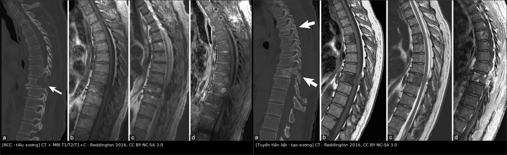
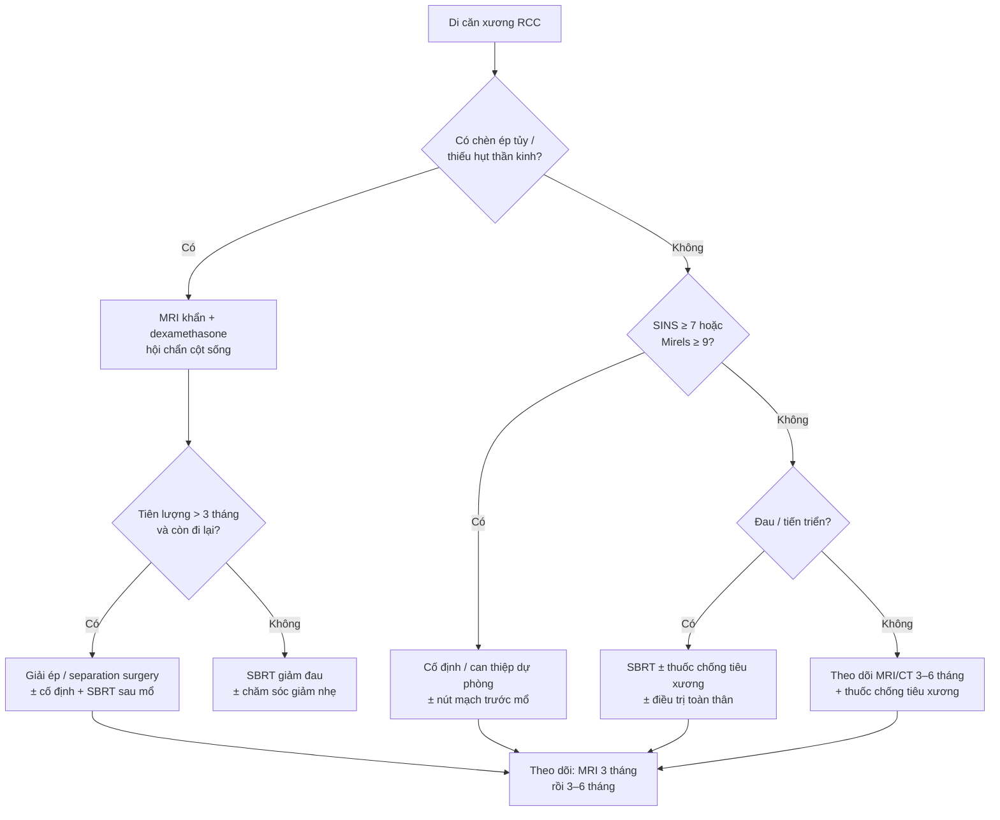
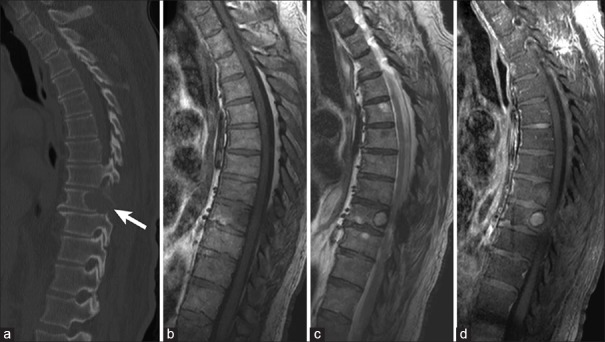
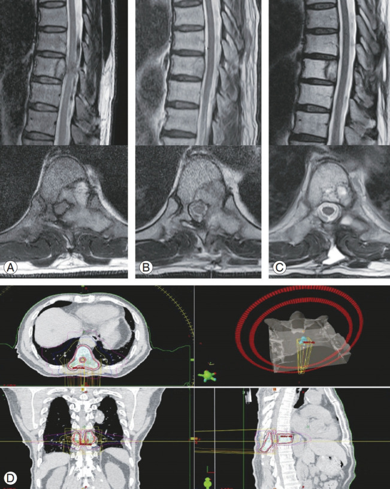

# 178 — Di căn xương của ung thư tế bào thận: chèn ép tủy, gãy xương bệnh lý & xử trí / RCC bone metastases: mechanical complications

**Tags:** `pattern:di-can-xuong` `pattern:tieu-xuong` `pattern:chen-ep-tuy` `vung:xuong` `vung:cot-song` `score:Mirels` `score:SINS` `score:Bilsky` `protocol:MRI-cot-song` `protocol:SBRT` `incidentaloma:di-can-xuong`
**Mức chắc chắn (certainty):** tổng hợp y văn (literature synthesis) — số liệu từ đoàn hệ 43 bệnh nhân di căn cột sống RCC (PMC8242338), 69 bệnh nhân phẫu thuật (PMC9600183), tổng quan hệ thống 63 nghiên cứu/1.968 bệnh nhân (PMC13586073), thử nghiệm RADICAL (PMC13489773) và các ca nguyên văn có ảnh CC BY-NC (PMC4879848, PMC7435309).

## 1. Tổng quan bệnh học – cơ chế hình ảnh

### 1.1. Vì sao RCC hay di căn xương — và vì sao "tiêu xương"

- **Dịch tễ:** RCC chiếm **2–3% ung thư người lớn**; **~1/3 bệnh nhân đã có di căn lúc chẩn đoán**, thêm **20–40%** phát triển di căn sau cắt thận (PMC8242338). **Xương là vị trí di căn phổ biến thứ hai** sau phổi, và **~40% di căn xương nằm ở cột sống** (PMC8242338). Khoảng **30% bệnh nhân RCC di căn (mRCC) có di căn xương** (PMC13489773).
- **TẠI SAO tiêu xương chứ không tạo xương:** tế bào RCC tiết **PTHrP, IL-6, VEGF** và các yếu tố kích thích **RANKL** → **tăng hoạt động hủy cốt bào (osteoclast)**; đồng thời **ức chế tạo cốt bào (osteoblast)**. Kết quả là **ổ tiêu xương (lytic)** thuần, bờ có thể "nham nhở", **vỏ xương bị phá (cortical destruction)**, mô mềm u lan ra ngoài.
- **TẠI SAO RCC "giàu mạch" (hypervascular):** VEGF do u tiết ra làm tăng sinh mạch máu; trên CT, u **ngấm mạnh thì động mạch**; khi sinh thiết/mổ có thể **chảy máu nhiều** — đây là lý do cân nhắc **nút mạch trước mổ**.
- **TẠI SAO hay gây biến chứng cơ học:** cột sống là nơi chịu tải; ổ tiêu xương làm **thân đốt yếu**, dễ **sụp (collapse)**, **bờ sau đẩy vào ống sống (retropulsion)** → **chèn ép tủy (metastatic spinal cord compression, MSCC)**. Ở xương dài (đùi, cánh tay), ổ tiêu xương làm **gãy xương bệnh lý (pathological fracture)**.
- **Triệu chứng:** đau **37,5%**, thiếu hụt thần kinh **36,0%** trong tổng quan 1.968 bệnh nhân (PMC13586073). Đau kiểu **đau cơ học tăng khi vận động/nằm**, đau về đêm; thiếu hụt vận động là **cấp cứu**.

### 1.2. Vật lý hình ảnh — vì sao CT "thấy lỗ" và MRI "thấy thay tủy"

- **CT:** xương là mô có **hệ số Hounsfield cao (xương đặc ~700–1.000 HU)**; ổ tiêu xương thay xương bằng mô mềm (**20–60 HU**) → **vùng tối trong xương sáng**. Tuy nhiên **X-quang chỉ thấy khi mất 30–50% khoáng chất**; **CT phát hiện sớm hơn**, đặc biệt với lát mỏng **1–2 mm** và cửa sổ xương.
- **MRI:** tủy xương người trưởng thành **80% là mỡ** → **T1W sáng hơn cơ/đĩa đệm**. U di căn **thay tủy mỡ bằng tế bào/nước** → **T1W tối hơn cơ và tối hơn đĩa đệm** (dấu hiệu "thay tủy thật"); **T2W/STIR tăng tín hiệu** vì nhiều nước/tế bào; **T1W sau tiêm + fat-sat ngấm mạnh** do u giàu mạch.
- **TẠI SAO cần STIR/DWI:** STIR **triệt mỡ** làm tổn thương phù/tế bào **nổi bật**; DWI **hạn chế khuếch tán** (ADC thấp) giúp phân biệt u đặc với **tủy đỏ lành** (tủy đỏ T1 ≥ cơ, ADC không thấp) và **phù tủy** (T1 ≥ cơ, STIR sáng nhưng không phá xương).
- **Sau điều trị:** vùng **xơ/đặc xương (blastic)** trên CT có thể là **lành hóa**, không phải tiến triển; ngược lại **tiêu xương mới** hoặc **mô mềm mới** là dấu hiệu tái phát.

### 1.3. Ngưỡng định lượng phải nhớ (cửa 1 Argon)

- **Tiên lượng di căn cột sống RCC:** sống trung bình **30 tháng** nếu chỉ có di căn cột sống đơn độc, **19 tháng** nếu nhiều ổ; **cắt en-bloc 40,1 tháng** so với **19,7 tháng** khi cắt không en-bloc (PMC8242338). Sau mổ, **OS 5 năm 31,2%**, OS trung bình **34,7 tháng** (PMC9600183).
- **Xu hướng hiện đại:** OS trung bình sau mổ cột sống **27 tháng (≥ 2017)** so với **12,3 tháng (trước 2017)**; nhóm xạ trị **41,3 vs 10,8 tháng**; nhóm toàn thân **29,0 vs 11,5 tháng** (PMC13586073).
- **Di căn xương làm tăng tử vong:** **~2,5 lần** tỷ lệ tử vong 5 năm so với RCC không di căn xương; **SRE** tăng có ý nghĩa (PMC12800899).
- **Mirels (nguy cơ gãy xương dài):** tổng **0–12 điểm**; **≥ 9 điểm** là ngưỡng cân nhắc **cố định dự phòng** (nguồn: "> 8 điểm được cân nhắc mổ", PMC10585877). Giá trị tiên đoán dương của Mirels **thấp (10–32% ở xương đùi)** nhưng **NPV 90–100%** (PMC12192531) — nghĩa là **điểm thấp loại trừ khá tốt**, điểm cao **không chắc đã gãy**.
- **SINS (điểm bất ổn cột sống):** **0–6 = vững**, **7–12 = trung gian**, **≥ 13 = mất vững** (PMC10585877). SINS ≥ 7 là lý do hội chẩn cột sống.
- **Bilsky/ESCC (mức chèn ép tủy):** **0** = chỉ trong xương; **1a** = mô u chạm màng cứng; **1b** = chèn ép màng cứng nhưng không chạm tủy; **1c** = chạm tủy; **2** = chèn ép tủy còn dịch não tủy; **3** = **không còn dịch não tủy** quanh tủy. Độ **2–3** là chỉ định can thiệp giải ép.
- **Phẫu thuật tách ép (separation surgery):** giải ép **chu vi 2–3 mm** quanh túi màng cứng, tạo "khoảng an toàn" để xạ **SBRT/SRS** liều phá huỷ; giới hạn liều tủy **~45–50 Gy** (tương đương phân liều thường) (PMC12564190).
- **SBRT:** BED **cao gấp ~3 lần** xạ ngoài thường (cEBRT); kiểm soát tại chỗ **80–90%** ở 1–2 năm với di căn xương RCC (PMC13586073; PMC12564190).
- **Thuốc chống tiêu xương:** denosumab **120 mg SC mỗi 4 tuần** hoặc acid zoledronic **4 mg IV mỗi 4 tuần**; bổ sung **canxi 500–1.000 mg + vitamin D**; theo dõi **hoại tử xương hàm (ONJ)** và **hạ canxi**. Trong đoàn hệ 247 bệnh nhân dùng denosumab, **SRE 7,7%**, can thiệp mổ **5,7%** (PMC10585877).
- **RADICAL (pha II):** cabozantinib ± **radium-223** ở mRCC có di căn xương **dừng sớm vì vô hiệu**; SSE-FS trung bình **16,7 vs 17,6 tháng** (sHR 1,46; PMC13489773) → **không thêm Ra-223 thường quy**.

## 2. Mẫu hình + chẩn đoán phân biệt theo vị trí (gamut)

### 2.1. Mẫu hình cốt lõi — "ổ tiêu xương đơn độc/đa ổ ở người lớn"

- **Mẫu hình RCC điển hình:** **ổ tiêu xương (lytic)**, **bờ không đều**, **vỏ xương phá**, **mô mềm cạnh xương**, **phình xương (expansile)**, có thể **"soap bubble"**, **không vôi hóa**; MRI **T1 thấp, T2 cao, ngấm mạnh**; thường ở **thân đốt sống** hoặc **đầu xương dài**.
- **Vị trí quyết định biến chứng:** **cột sống** → chèn ép tủy/mất vững; **cổ xương đùi** → gãy cổ xương đùi; **xương cùng** → đau/thần kinh; **xương sườn** → đau màng phổi; **hàm** → nhầm u nguyên phát/răng.

### 2.2. Gamut "ổ tiêu xương ở người lớn"

1. **Di căn RCC** — tiêu xương, phình, giàu mạch, mô mềm, tiền sử cắt thận (có thể **nhiều năm sau**).
2. **Myeloma** — nhiều ổ **"đục lỗ" (punched-out)**, **không viền xơ**, không phình nhiều, tăng canxi máu, protein niệu Bence-Jones.
3. **Di căn tuyến giáp** — tiêu xương **phình mạnh ("blow-out")**, có thể vôi hóa, giàu mạch, tiền sử tuyến giáp.
4. **Di căn phổi** — tiêu xương ± tạo xương, thường có u phổi nguyên phát.
5. **Di căn vú** — hỗn hợp **tiêu + tạo xương**, tiền sử vú.
6. **U máu xương (hemangioma)** — **dải xương song song ("corduroy")**, T1/T2 **sáng do mỡ**, **"polka-dot"** trên axial, không phá vỏ.
7. **U nâu (brown tumor)** — tiêu xương phình, **người trẻ**, tăng PTH, thường hàm/xương chậu/sườn.
8. **Viêm đốt sống–đĩa (spondylodiscitis)** — **đĩa đệm bị phá**, T2 đĩa sáng, phù xương hai bên đốt, áp-xe cạnh sống.
9. **Paget xương** — đốt **to ra**, vỏ dày, **"picture frame"**, có thể "ivory vertebra"; phosphatase kiềm cao.
10. **Di căn tạo xương (prostate, breast)** — đốt **đặc trắng**, không tiêu xương — cần phân biệt với **lành hóa sau điều trị**.

### 2.3. Phân biệt theo tuổi và bối cảnh

- **< 40 tuổi:** nghĩ **u nâu (cường PTH)**, **nhiễm trùng**, **u tế bào Langerhans**, **ABC**; di căn ít gặp hơn.
- **> 40 tuổi:** **di căn** và **myeloma** đứng đầu; nếu **nhiều ổ tiêu xương + tăng canxi** → myeloma.
- **Tiền sử ung thư:** ổ xương mới ở bệnh nhân RCC **mặc định là di căn** cho đến khi chứng minh khác; nhưng vẫn phải loại trừ **u nguyên phát xương** và **nhiễm trùng**.

## 3. Bảng so sánh phân biệt (ma trận đối chiếu)

| Thực thể (entity) | Hình ảnh điển hình (CT/MRI) | Chốt vào (rule-in) | Chốt loại (rule-out) | Gợi ý xác nhận |
|---|---|---|---|---|
| **Di căn RCC** | Ổ **tiêu xương phình**, phá vỏ, **mô mềm**, ngấm mạnh; T1 thấp/T2 cao; có thể sụp đốt | **Tiêu xương + phình + giàu mạch + tiền sử RCC** | Vôi hóa dày đặc, không phá vỏ, T1 sáng do mỡ → không phải RCC | CT 3 thì; MRI T1/T2/STIR + T1+C; sinh thiết nếu chưa rõ |
| **Myeloma** | Nhiều ổ **"đục lỗ"**, bờ rõ, **không viền xơ**, không phình nhiều; T1 thấp, T2 cao | **Nhiều ổ + tăng canxi + thiếu máu + protein niệu** | Một ổ đơn độc có phình/mô mềm lớn → ít nghĩ myeloma | Điện di protein huyết thanh/nước tiểu; sinh thiết tủy xương |
| **Di căn tuyến giáp** | Tiêu xương **phình mạnh**, bờ rõ, có thể **vôi hóa**, giàu mạch | **Phình xương + vôi hóa + tiền sử tuyến giáp** | Không vôi hóa, phá vỏ nham nhở → ít nghĩ | Siêu âm tuyến giáp; CT cổ; sinh thiết |
| **U máu xương** | **Dải xương song song**, T1/T2 **sáng do mỡ**, "polka-dot" axial; không phá vỏ | **T1 sáng + dải xương + không mô mềm** | T1 thấp, phá vỏ, mô mềm → không phải u máu | MRI không cản quang; CT thấy dải xương |
| **U nâu (cường PTH)** | Tiêu xương phình, bờ rõ, **một/nhiều ổ**, thường hàm/chậu; **không mô mềm ác tính** | **PTH cao + canxi cao + người trẻ** | PTH bình thường → loại u nâu | PTH, canxi, phospho; siêu âm tuyến cận giáp |
| **Viêm đốt sống–đĩa** | **Đĩa đệm bị phá**, T2 đĩa sáng, phù xương **hai bên đốt**, áp-xe cạnh sống | **Phá đĩa + phù hai đốt + sốt/đau** | Đĩa đệm còn nguyên, tổn thương **chỉ trong thân đốt** → ít nghĩ viêm | MRI + CRP/VS; cấy máu; sinh thiết |
| **Paget xương** | Đốt **to**, vỏ dày, **"picture frame"**, có thể đặc ("ivory") | **Xương to + vỏ dày + ALP cao** | Xương không to, vỏ mỏng/phá → không phải Paget | X-quang/CT; ALP; scintigraphy |
| **Di căn tạo xương (prostate/vú)** | Đốt **đặc trắng**, không tiêu xương, bờ có thể không đều | **Tiền sử prostate/vú + nhiều ổ đặc** | Ổ tiêu xương/phình/mô mềm → không phải tạo xương đơn thuần | PSA; CT/MRI; sinh thiết |

*Trái: RCC — ổ tiêu xương thân đốt (CT) + MRI T1/T2/T1+C. Phải: di căn tuyến tiền liệt — ổ tạo xương (CT). Nguồn: Reddington JA et al., Surg Neurol Int 2016, CC BY-NC-SA 3.0; ảnh ghép letterbox.*

### 3.1. Ba câu hỏi chốt trước khi kết luận

1. **Có phá vỏ/mô mềm không?** Có → nghĩ **ác tính** (di căn/myeloma), không phải u máu hay loãng xương.
2. **Có mất vững hay chèn ép tủy không?** Đo **SINS**, **Bilsky**, tìm **sụp đốt, bờ sau, tín hiệu tủy**.
3. **Có nguy cơ gãy xương dài không?** Tính **Mirels**; ≥ 9 → hội chẩn chỉnh hình sớm.

## 4. Protocol chụp + hệ phân độ/điểm chuẩn hóa

### 4.1. Protocol chẩn đoán

- **CT cột sống/xương:** lát **1–2 mm**, cửa sổ xương + mô mềm; **toàn bộ cột sống** nếu nghi đa ổ; cản quang thì động mạch để đánh giá **mạch máu/độ giàu mạch** trước can thiệp.
- **MRI toàn bộ cột sống:** **T1W sagittal**, **T2W**, **STIR**, **T1W + gadolinium fat-sat**, **DWI**; axial tại tầng tổn thương. Đánh giá: **thay tủy, phá vỏ, mô mềm, chèn ép tủy (Bilsky), tín hiệu tủy (phù/myelomalacia), mất vững (SINS)**.
- **X-quang:** chỉ để đánh giá **sụp đốt/gãy** và theo dõi nhanh; **không loại trừ di căn** (độ nhạy thấp).
- **PET/CT:** dùng **phân giai đoạn** và tìm ổ khác; **RCC có thể FDG âm giả** (đặc biệt thể clear cell biệt hóa cao) → không dùng để loại trừ.
- **Sinh thiết:** khi **chưa rõ nguyên phát**, ổ **đơn độc**, hoặc cần xác định mô học trước điều trị toàn thân; **CT-guided**, tránh vùng hoại tử, **chuẩn bị cầm máu** vì RCC giàu mạch.

### 4.2. Hệ phân độ/điểm

| Hệ | Mục đích | Ngưỡng xử trí |
|---|---|---|
| **Bilsky/ESCC 0–3** | Mức chèn ép tủy | **2–3** → giải ép (mổ/SBRT) khẩn |
| **SINS 0–18** | Bất ổn cột sống | **0–6** vững; **7–12** trung gian (hội chẩn); **≥ 13** mất vững (can thiệp) |
| **Mirels 0–12** | Nguy cơ gãy xương dài | **≥ 9** → cố định dự phòng; **≤ 8** theo dõi |
| **Tokuhashi/Tomita** | Tiên lượng sau mổ | Chọn mổ triệt để vs giảm đau |
| **NOMS** | Quyết định phối hợp | **N**eurologic, **O**ncologic, **M**echanical, **S**ystemic |

### 4.3. Flowchart xử trí di căn xương RCC

### 4.4. Điều trị cụ thể

- **Chèn ép tủy cấp:** **dexamethasone 16 mg/ngày** (ví dụ 4 mg mỗi 6 giờ) ngay khi nghi ngờ; **MRI khẩn**; hội chẩn ngoại thần kinh/chỉnh hình và xạ trị.
- **Mổ:** **giải ép + cố định** khi **mất vững (SINS ≥ 13)**, **chèn ép nặng (Bilsky 2–3)**, **đau do gãy/sụp**, tiên lượng **> 3 tháng**; **separation surgery** (giải ép chu vi 2–3 mm) + **SBRT** sau mổ cho RCC (kháng xạ) — kiểm soát tại chỗ tốt hơn giải ép đơn thuần.
- **Nút mạch trước mổ:** với u **giàu mạch**, nút mạch **24–48 giờ trước phẫu thuật** để giảm chảy máu; cân nhắc **nguy cơ thiếu máu tủy** nếu nút quá rộng.
- **SBRT/SRS:** chỉ định khi **không mổ được**, **di căn ít ổ**, **sau separation surgery**, hoặc **đau do di căn**; SRS **1 phân liều**, SBRT **2–5 phân liều**, BED cao gấp ~3 lần cEBRT; kiểm soát tại chỗ **80–90%** (PMC13586073, PMC12564190).
- **Thuốc chống tiêu xương:** **denosumab 120 mg SC q4w** hoặc **zoledronic acid 4 mg IV q4w**; bổ sung canxi/vitamin D; theo dõi **ONJ** (khám răng trước điều trị) và **hạ canxi**. Denosumab có thể **cải thiện sống 5 năm** so với bisphosphonate trong phân tích hồi cứu lớn (PMC12800899).
- **Toàn thân:** **TKI** (sunitinib, pazopanib, cabozantinib) hoặc **ức chế miễn dịch** (nivolumab + ipilimumab) tùy tuyến; **radium-223 không có lợi** khi phối với cabozantinib (RADICAL, PMC13489773).
- **Giảm đau:** xạ ngoài thường **8 Gy × 1** hoặc **20 Gy/5** cho giảm đau nhanh; SBRT khi cần kiểm soát lâu dài.

### 4.5. Theo dõi sau điều trị

- **MRI/CT** tại **3 tháng**, sau đó **3–6 tháng** tùy nguy cơ; so sánh **cùng chuỗi xung, cùng mặt phẳng**.
- **Đánh giá đáp ứng:** RECIST 1.1 cho tổn thương mô mềm; **thay đổi xương (blastic) có thể là lành hóa**, không tính là tiến triển nếu không có mô mềm mới.
- **Theo dõi biến chứng:** đau mới, yếu chi mới → **MRI khẩn**; theo dõi **ONJ, hạ canxi, suy thận** khi dùng thuốc chống tiêu xương.

## 5. Biến thể bình thường và cạm bẫy

- **X-quang bình thường không loại trừ di căn:** phải mất **30–50%** khoáng chất mới thấy; **đau xương + X-quang bình thường** vẫn cần **MRI**.
- **"Đặc xương" sau điều trị:** vùng **xơ hóa/blastic** sau xạ/hóa trị là **lành hóa**, đừng gọi tiến triển; ngược lại **tiêu xương mới** hoặc **mô mềm mới** mới là tái phát.
- **U máu xương:** **T1 sáng do mỡ**, dải xương song song, **không phá vỏ** — đừng sinh thiết/cắt oan.
- **Paget:** đốt **to ra**, vỏ dày, "picture frame" — khác di căn tạo xương (đốt không to).
- **U nâu:** người **trẻ**, **PTH cao**, nhiều ổ — hỏi kỹ cường tuyến cận giáp trước khi gọi "di căn".
- **Viêm đốt sống–đĩa:** **đĩa đệm bị phá** là chốt; di căn **thường chừa đĩa** (nhưng có thể lan vào đĩa khi muộn).
- **Bỏ sót chèn ép tủy trên CT:** CT chỉ thấy xương; **MRI mới đánh giá tủy/màng cứng** — bệnh nhân yếu chi phải chụp MRI.
- **Bỏ sót tổn thương bờ sau/ cuống sống:** làm **SINS tăng** và nguy cơ mất vững; đọc axial từng tầng.
- **Sinh thiết u giàu mạch:** nguy cơ **chảy máu**; cân nhắc nút mạch/chuẩn bị trước.
- **Artifact:** xi măng, nẹp, kim loại gây giả ảnh trên CT/MRI; so phim không cản quang và nhiều chuỗi xung.

## 6. Tự lượng giá — Blind Quiz

**Ca 1 — Nam 78 tuổi, tiền sử cắt thận vì RCC 6 năm, đau lưng tăng dần. CT + MRI cột sống.**

- Gợi ý lâm sàng: không sốt, không chấn thương; xét nghiệm canxi bình thường.
- Câu hỏi: (1) Mô tả tổn thương trên CT và MRI? (2) Chẩn đoán? (3) Cần đánh giá thêm gì trước khi quyết định mổ?

<b>Bấm để hiện đáp án (findings + chẩn đoán)</b>

- **Findings:** (a) CT sagittal: **ổ tiêu xương thân đốt** giữa ngực, phá vỏ, không viền xơ; (b–d) MRI: **T1 thấp**, **T2/STIR cao**, **ngấm mạnh sau tiêm**; không có mô mềm lớn ra ngoài.
- **Chẩn đoán:** **di căn xương RCC** (lytic, hypervascular) — phù hợp tiền sử và hình ảnh.
- **Cần đánh giá thêm:** **Bilsky** (chèn ép tủy), **SINS** (mất vững), **Mirels** nếu xương dài; **MRI toàn bộ cột sống** tìm ổ khác; **CT ngực/bụng** phân giai đoạn; cân nhắc **nút mạch trước mổ**.
- **Nguồn ảnh:** Reddington JA et al., *Surg Neurol Int* 2016 (PMC4879848), Fig. 1; CC BY-NC-SA 3.0.

**Ca 2 — Nam 68 tuổi, di căn RCC T9, yếu hai chân 2 ngày. MRI cột sống ngực.**

- Gợi ý lâm sàng: đau ngực lưng, yếu chi dưới, bí tiểu nhẹ; không sốt.
- Câu hỏi: (1) Mức chèn ép tủy theo Bilsky? (2) SINS ước lượng? (3) Hướng xử trí?

<b>Bấm để hiện đáp án (findings + chẩn đoán)</b>

- **Findings:** (A) MRI sagittal T2: **khối mô mềm sau thân đốt T9 đẩy vào ống sống, chèn ép tủy**; (B) axial: tổn thương **xâm lấn bờ sau/ cuống sống**; (C) sau mổ: giải ép, tủy trở về; hình D là kế hoạch xạ trị.
- **Chẩn đoán:** **di căn RCC cột sống gây chèn ép tủy (Bilsky 2–3)** + **mất vững (SINS cao do tổn thương bờ sau)**.
- **Xử trí:** **dexamethasone + MRI khẩn + hội chẩn**; nếu tiên lượng > 3 tháng → **giải ép/separation surgery + cố định + SBRT**; nút mạch trước mổ nếu u giàu mạch.
- **Nguồn ảnh:** Chang SY et al., *Asian Spine J* 2020 (PMC7435309), Fig. 1; CC BY-NC 4.0.

**Ca 3 — Hai bệnh nhân: một tiêu xương, một tạo xương. Nhìn ảnh ghép, phân biệt trước khi mở đáp án.**

- Gợi ý lâm sàng: bên trái có tiền sử RCC; bên phải có tiền sử ung thư tuyến tiền liệt.
- Câu hỏi: (1) Bên nào là tiêu xương, bên nào tạo xương? (2) Vì sao RCC tiêu xương còn prostate tạo xương? (3) Ý nghĩa với nguy cơ gãy xương?

<b>Bấm để hiện đáp án (findings + chẩn đoán)</b>

- **Findings:** **trái = RCC, tiêu xương** (vùng tối trong thân đốt, phá vỏ); **phải = prostate, tạo xương** (đốt đặc trắng, dày xương).
- **Vì sao:** RCC tiết **PTHrP/IL-6/VEGF** → **tăng hủy cốt bào, ức chế tạo cốt bào** → tiêu xương; prostate tiết **yếu tố tạo xương (BMP, endothelin-1)** → **tạo xương**.
- **Ý nghĩa:** tiêu xương làm **yếu cấu trúc** → nguy cơ **gãy/sụp** cao hơn; cần **Mirels/SINS** và **thuốc chống tiêu xương**; tạo xương thường đau do xương đặc nhưng ít gãy hơn.
- **Nguồn ảnh:** Reddington JA et al., *Surg Neurol Int* 2016 (PMC4879848), Fig. 1 + Fig. 2; CC BY-NC-SA 3.0; ảnh ghép letterbox.

## Bài liên quan chéo
- [154 – RCC di căn & theo dõi sau cắt thận](../154-rcc-di-can-va-theo-doi-sau-cat-than/lesson.md)
- [151 – U thận đặc: RCC vs oncocytoma vs AML](../151-u-than-dac/lesson.md)
- [581 – Di căn não & xương trong ung thư phụ khoa: Mirels, SRS](../581-di-can-nao-xuong-ung-thu-phu-khoa/lesson.md)
- [228 – Thoát vị đĩa đệm & phân độ Pfirrmann/Modic](../228-thoat-vi-dia-dem-that-lung-pfirrmann-modic/lesson.md)
- [199 – Quy trình xét nghiệm gen & tầm soát gia đình](../199-quy-trinh-xet-nghiem-gen-tam-soat-gia-dinh/lesson.md)

## Ảnh
- `178_di-can-xuong-RCC_CT-MRI_PMC4879848-Fig1-CCBYNCSA.jpg` — CT + MRI ổ tiêu xương RCC (PMC4879848, Fig. 1), CC BY-NC-SA 3.0.
- `178_di-can-cot-song-RCC_MRI_PMC7435309-Fig1-CCBYNC.jpg` — MRI chèn ép tủy + kế hoạch xạ (PMC7435309, Fig. 1), CC BY-NC 4.0.
- `composite_178_lytic-vs-blastic.jpg` — ảnh ghép tiêu xương (RCC) vs tạo xương (prostate), từ PMC4879848 Fig. 1 + Fig. 2, CC BY-NC-SA 3.0.
- Nguồn + giấy phép từng ảnh: `images/CREDITS.md`.

> Không dùng để chẩn đoán độc lập khi chưa có người hướng dẫn.
