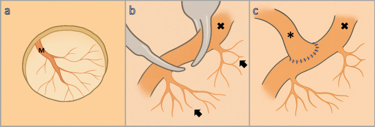
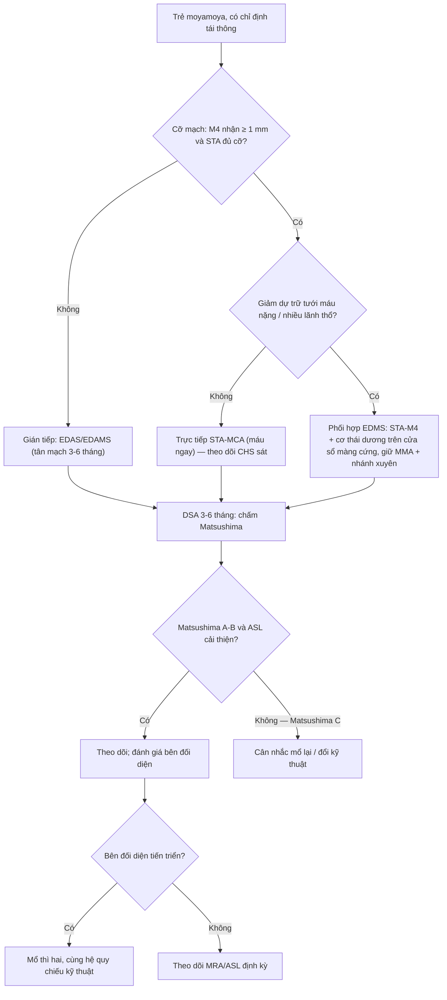
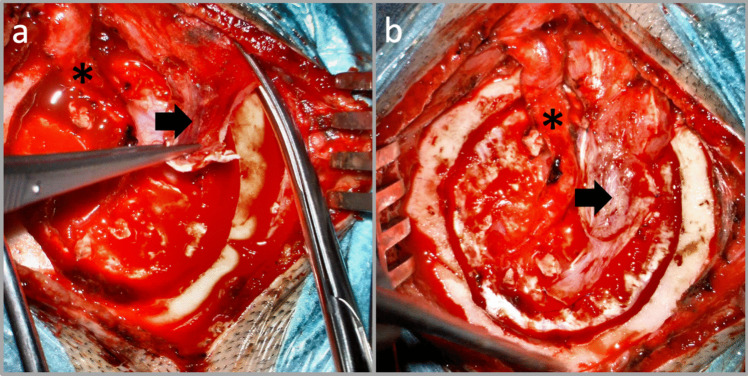
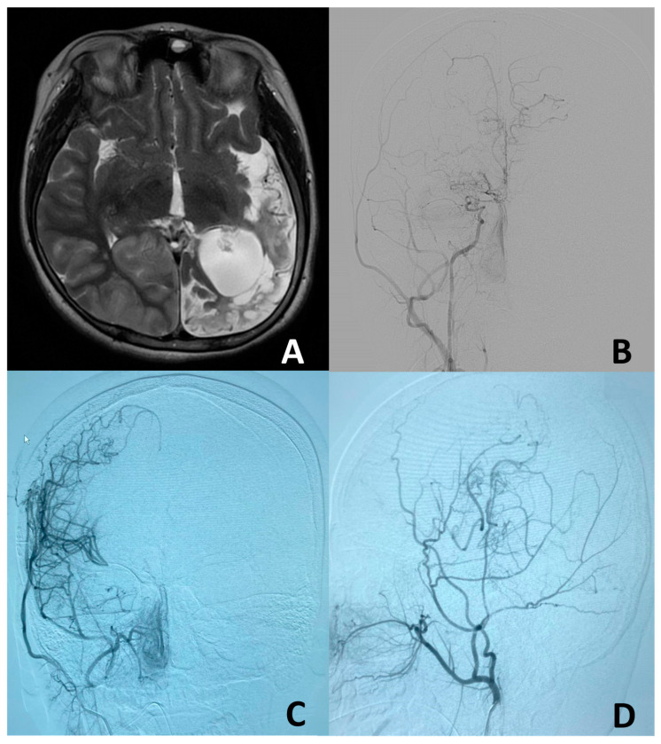

# 1780 — Chọn kỹ thuật tái thông (revascularization) moyamoya ở trẻ: gián tiếp (EDAS/EDAMS) vs trực tiếp (STA–MCA) vs phối hợp (EDMS)

**Tags:** `pattern:hep-tac-mach` `pattern:tuoi-mau-bang-he` `vung:nao-nhi` `score:Matsushima` `score:Suzuki` `protocol:DSA` `protocol:ASL`
**Mức chắc chắn (certainty):** tổng hợp y văn (literature synthesis) — ghép **đồng thuận chuyên gia 2024** (Trung Quốc), **kỹ thuật "How I do it"** mô tả phẫu thuật, và **hai loạt trẻ** có số liệu giải phẫu–chức năng; số nào nguồn không đưa thì ghi "chưa rõ", không suy diễn.

> **Điểm chốt của bài:** ba kỹ thuật không phải "ba mức độ của cùng một việc", mà là **ba cơ chế tưới máu khác nhau về thời gian**: trực tiếp (STA–MCA) cho **máu đến ngay trong phút mổ** nhưng phụ thuộc **cỡ mạch** và dễ gây **hội chứng tưới máu quá mức (cerebral hyperperfusion syndrome, CHS)**; gián tiếp (EDAS/EDAMS) **không cho máu ngay** mà **kích thích tân mạch xuyên màng cứng trong 3–6 tháng**, nên hợp với **mạch nhỏ ở trẻ** và với **nhu cầu tăng dần** của não đang phát triển; phối hợp (EDMS) làm **cả hai** — và vì vậy tiêu chí chọn nằm ở **tuổi + cỡ mạch cho–nhận + mức giảm dự trữ tưới máu**, không ở "kỹ thuật nào mới hơn".

## 1. Tổng quan bệnh học – cơ chế hình ảnh

### 1.1 Vì sao cùng một bệnh lại có ba kỹ thuật

Moyamoya là **hẹp/tắc tiến triển đoạn tận động mạch cảnh trong (internal carotid artery, ICA)** ± đoạn gần động mạch não giữa (middle cerebral artery, MCA)/não trước, kèm mạng bàng hệ "khói thuốc" ở nền não ([652](../652-dot-quy-mach-mau-nao-nhi-moyamoya-viem-mach/lesson.md)). Điều trị nền là **đưa máu từ hệ ngoài sọ vào vỏ não**. Có ba đường:

1. **Trực tiếp (direct bypass):** nối **động mạch thái dương nông (superficial temporal artery, STA) vào nhánh M4 của MCA** — máu **có ngay** trong phòng mổ.
2. **Gián tiếp (indirect):** đặt **mô có mạch (STA, cơ thái dương, màng cứng) áp sát vỏ não** — **EDAS** (encephaloduroarteriosynangiosis), **EDAMS** (thêm cơ: …myosynangiosis) — tân mạch **mọc dần trong 3–6 tháng**.
3. **Phối hợp (combined/EDMS):** **vừa nối trực tiếp STA–M4, vừa đặt cơ thái dương lên các "cửa sổ" màng cứng** để synangiosis tiếp tục phát triển; kèm **giữ động mạch màng não giữa (middle meningeal artery, MMA)** và **giữ các nhánh xuyên của M4** ([PMC12496275](https://pmc.ncbi.nlm.nih.gov/articles/PMC12496275/)).

**Vì sao trẻ khác người lớn (cơ chế, không phải khẩu quyết):**

- **Cỡ mạch:** miệng nối trực tiếp cần **nhánh MCA nhận ≥ 1 mm** (ưu tiên); nếu **STA cho < 1 mm** thì phải **cắt vát 45°** để tăng diện nối ([PMC12916888](https://pmc.ncbi.nlm.nih.gov/articles/PMC12916888/)). Trẻ nhỏ vì thế **thường được chọn gián tiếp**: y văn tổng kết "ở trẻ, thủ thuật gián tiếp thường được ưu tiên vì **khả thi kỹ thuật trên mạch cỡ nhỏ** và **tiềm năng tân mạch mạnh của não đang phát triển**" ([PMC12608464](https://pmc.ncbi.nlm.nih.gov/articles/PMC12608464/)).
- **Không có ngưỡng tuổi tuyệt đối:** đồng thuận 2024 ghi rõ **không có tuổi tối thiểu được chấp nhận chung**; đã có ca tái thông ở trẻ **1,4 tuổi**, và nhiều nghiên cứu làm **gián tiếp ở trẻ dưới 4 tuổi** ([PMC13540286](https://pmc.ncbi.nlm.nih.gov/articles/PMC13540286/)).
- **Động học tân mạch:** tân mạch sau mổ phụ thuộc **kiểu mổ, tuổi, lưu lượng STA**, yếu tố di truyền (**RNF213 p.R4810K**), yếu tố tăng sinh mạch (VEGF, PDGF, TGF-β1), tế bào nội mô tiền thân lưu hành ([PMC13381305](https://pmc.ncbi.nlm.nih.gov/articles/PMC13381305/)) → **cùng một kỹ thuật, hai trẻ cho hai kết quả khác nhau**; đây là lý do phải **chấm Matsushima** chứ không chỉ nhìn "mổ thành công".

### 1.2 TẠI SAO chọn sai kỹ thuật lại gây hại (vật lý dòng chảy)

- **Trực tiếp ở não đã giãn mạch tối đa:** tự điều hòa (autoregulation) đã cạn trong hẹp mạn; mở miệng nối → **lưu lượng tăng vọt** trong khi tiểu động mạch chưa co kịp → **phù mạch máu (vasogenic edema)** và **xuất huyết**. Đây chính là **CHS/TND**, gặp ở **16,5–38,2%** ca mổ moyamoya (đồng thuận 2024, qua [660](../660-theo-doi-sau-tai-thong-moyamoya-o-tre/lesson.md)); **CBF vùng mổ tăng ≥ 30% so bên đối diện hoặc ≥ 50% so nền** là ngưỡng dự báo CHS xuất huyết.
- **Gián tiếp ở trẻ lớn/người lớn có giảm dự trữ nặng:** tân mạch cần **3–6 tháng**; trong khoảng đó bệnh nhân vẫn **thiếu máu** và có thể **nhồi máu mới** — loạt trẻ gián tiếp có **2/14 (14%) nhồi máu mới sau mổ dù đang dùng aspirin** ([PMC12608464](https://pmc.ncbi.nlm.nih.gov/articles/PMC12608464/)).
- **Vì sao phối hợp được ưa ở ca giảm tưới máu nặng:** đồng thuận 2024: "**tái thông phối hợp có hiệu quả dài hạn**, đặc biệt ở bệnh nhân **giảm tưới máu đáng kể**" (chất lượng bằng chứng trung bình, khuyến cáo mạnh); nhưng với **trẻ**, "**vẫn còn chưa rõ phối hợp có trội hơn gián tiếp hay không**" (bằng chứng thấp, khuyến cáo có điều kiện) ([PMC13540286](https://pmc.ncbi.nlm.nih.gov/articles/PMC13540286/)). **Ghi đúng mức chắc chắn này** — không được viết "phối hợp là chuẩn" cho trẻ.

## 2. Mẫu hình + chẩn đoán phân biệt theo "hình thái mạch sau mổ" (gamut)

Đọc phim sau tái thông, câu hỏi không phải "có tân mạch chưa" mà là **máu đến từ đâu, qua đường nào, đủ bao nhiêu lãnh thổ**:

- **Mẫu "miệng nối trực tiếp" (DSA/CTA):** thuốc từ **STA → M4** đổ **thì động mạch**, **một vùng lãnh thổ MCA** rõ rệt, **đồng thì với bơm ECA**; thấy **đường nối** (anastomosis) trên DSA xoay 3D. Đây là mẫu của bypass trực tiếp.
- **Mẫu "tân mạch xuyên màng cứng":** bơm **ECA** → mạng mạch **mảnh, nhiều nhánh nhỏ** vào vỏ não, **xuất hiện muộn 3–6 tháng**; bơm **ICA bên mổ giảm ngấm** vì dòng ưu thế đã chuyển sang bàng hệ. Đây là mẫu của EDAS/EDAMS (ảnh ca 3).
- **Mẫu "hai đường cùng lúc" (combined):** **vừa** thấy miệng nối STA–M4 ngấm thì động mạch, **vừa** thấy mạng tân mạch xuyên màng cứng phát triển theo thời gian → chấm Matsushima **A** thường gặp ở nhóm này (ảnh ca 2).
- **Mẫu "thất bại":** miệng nối **mất tín hiệu** trên MRA (cẩn thận: có thể **giả hẹp do mất tín hiệu dòng chảy**), hoặc **Matsushima C** (bàng hệ < 1/3 lãnh thổ MCA) dù lâm sàng tạm ổn.

**Gamut theo tuổi/cỡ mạch (định hướng chọn, không phải luật):**

| Bối cảnh | Kỹ thuật hay dùng | Lý do |
|---|---|---|
| Trẻ nhỏ, STA/MCA nhỏ (< 1 mm) | **Gián tiếp** (EDAS/EDAMS) | Không đủ cỡ mạch để nối; não trẻ tân mạch mạnh |
| Trẻ lớn/thiếu niên, mạch đủ cỡ, giảm dự trữ nặng | **Trực tiếp** hoặc **phối hợp** | Cần máu **ngay**, giảm cửa sổ thiếu máu |
| Bệnh tiến triển, giảm tưới máu đáng kể, nhiều lãnh thổ | **Phối hợp (EDMS)** | Dùng cả hai cơ chế; bằng chứng dài hạn ở người lớn tốt hơn |
| Bán cầu đối diện chưa mổ | Kỹ thuật **giống bên thứ nhất** để so sánh được | Chấm Matsushima hai bên phải **cùng hệ quy chiếu** |

## 3. Bảng so sánh phân biệt (ma trận đối chiếu)

| Thực thể (entity) | Hình ảnh điển hình | Chốt vào (rule-in) | Chốt loại (rule-out) | Gợi ý xác nhận |
|---|---|---|---|---|
| **Gián tiếp — EDAS/EDAMS** | DSA bơm **ECA** 3–6 tháng: mạng tân mạch **mảnh, lan toả** vào vỏ não; ICA bên mổ **giảm ngấm**; trên MRI: tăng tín hiệu mạch trong rãnh (ivy-like) | **Tân mạch từ STA/MMA vào vỏ ở thì muộn + không có miệng nối trực tiếp** | Có **miệng nối STA–M4** ngấm thì động mạch → đó là trực tiếp/phối hợp | DSA 3–6 tháng + chấm **Matsushima**; ASL định lượng CBF |
| **Trực tiếp — STA–MCA** | DSA/CTA: **miệng nối STA–M4 thấy rõ**, MCA đổ **ngay thì động mạch**; STA **giãn** sau mổ | **Thấy đường nối + lãnh thổ MCA ngấm sớm từ ECA** | MRA "mất tín hiệu" nhưng DSA thông → **giả hẹp do mất tín hiệu dòng chảy** | DSA xoay 3D; siêu âm Doppler STA; ICG trong mổ |
| **Phối hợp — EDMS** | **Cả hai mẫu trên**: miệng nối + cơ thái dương trên cửa sổ màng cứng; DSA muộn: bàng hệ **≥ 2/3 MCA** (Matsushima A) thường gặp | **Miệng nối ngấm sớm + tân mạch xuyên màng cứng tăng dần** | Chỉ một trong hai mẫu → không phải phối hợp thật | DSA 3–6–12 tháng; MRI T2 phồng cơ thái dương hậu phẫu (đừng nhầm khối) |
| **Thất bại tái thông** | DSA: **không tân mạch** hoặc **Matsushima C**; ASL còn **giảm CBF** bán cầu; có thể nhồi máu mới | **Matsushima C + ASL giảm + triệu chứng tái phát** | Matsushima A–B + ASL tăng → thành công | DSA + ASL; cân nhắc **mổ lại/đổi kỹ thuật** ([660](../660-theo-doi-sau-tai-thong-moyamoya-o-tre/lesson.md)) |
| **CHS sau mổ (bất kể kỹ thuật)** | ASL/SPECT: **CBF vùng mổ tăng trội**; FLAIR/T2 phù vỏ–dưới vỏ; **DWI âm** | **Triệu chứng thoáng qua + CBF tăng + DWI âm** | DWI dương theo lãnh thổ → **nhồi máu thật** | ASL ngày 1 & 7; kiểm soát huyết áp |

*Ba điểm kỹ thuật của "Integrated Method": (a) **giữ động mạch màng não giữa (M)** khi mở xương/màng cứng; (b) **giữ các nhánh xuyên (→) của M4 nhận (x)**; (c) **nối tận–bên STA (\*)–M4 (x)** bằng chỉ 10–0. Nguồn: Neyazi M et al., Acta Neurochir 2025, PMC12496275 — CC BY 4.0.*

## 4. Protocol chụp + hệ phân độ/điểm chuẩn hóa

### 4.1 Trước mổ — quyết định kỹ thuật bằng số đo, không bằng cảm giác

1. **DSA (chuẩn vàng):** đánh giá **cỡ và đường đi của STA** (đường da đầu → đường rạch), **nhánh M4 nhận** (ưu tiên **≥ 1 mm**), **mạng bàng hệ xuyên màng cứng** phải **giữ khi mở màng cứng**, và **Suzuki** hai bên ([PMC12916888](https://pmc.ncbi.nlm.nih.gov/articles/PMC12916888/)).
2. **Tưới máu:** **CT perfusion / MR perfusion / SPECT / ASL** để xác định **giảm dự trữ** — đây là lý do mổ và là tiêu chí **chọn phối hợp** khi giảm tưới máu đáng kể.
3. **MRI nền:** nhồi máu cũ (gliosis), teo, **ivy sign** (dấu giảm dự trữ, mất đi khi tái thông tốt).
4. **Ghi rõ trong hồ sơ:** tuổi, **cỡ STA**, **cỡ M4**, Suzuki, có **phình mạch** kèm theo (đồng thuận: xử trí **cá thể hoá**).

### 4.2 Sau mổ — lịch đọc phim

| Thời điểm | Chụp gì | Trả lời câu hỏi gì |
|---|---|---|
| **Ngày 0–7** | ASL/SPECT ± CTP; MRI khi có triệu chứng | **CHS?** (CBF tăng, DWI âm) hay **nhồi máu thật** (DWI dương)? |
| **1–3 tháng** | MRA/CTA + Doppler STA | **Miệng nối thông?** (nhớ cạm bẫy mất tín hiệu) |
| **3–6 tháng** | **DSA** | **Matsushima**: tân mạch đã đủ chưa? |
| **12–18 tháng** | DSA lặp nếu triệu chứng/tân mạch chưa đủ | Có cần **mổ lại/đổi kỹ thuật**? |
| **Bên đối diện** | MRA + ASL theo lịch | **Mổ thì hai** khi tiến triển ([660](../660-theo-doi-sau-tai-thong-moyamoya-o-tre/lesson.md)) |

**Thang Matsushima** (bàng hệ nuôi lãnh thổ MCA sau tái thông **gián tiếp**): **A ≥ 2/3**; **B = 1/3–2/3**; **C < 1/3** diện tích lãnh thổ MCA ([PMC13406446](https://pmc.ncbi.nlm.nih.gov/articles/PMC13406446/)). **Suzuki I–VI** mô tả tiến triển hẹp–tắc và bàng hệ nền, **không** phải thang kết quả sau mổ — đừng lẫn hai thang.

### 4.3 Số liệu để tư vấn gia đình (không hứa hẹn)

- **Loạt gián tiếp ở trẻ (n = 14, 79% mổ hai bên):** Matsushima **A 43%, B 57%**; biến chứng **21%**; **2/14 nhồi máu mới** dù aspirin; mRS trung bình **1,9 ± 0,8** sau **3,5 năm** ([PMC12608464](https://pmc.ncbi.nlm.nih.gov/articles/PMC12608464/)).
- **Loạt trẻ (n = 45, 64,4% mổ hai bên):** **> 75%** đã **Suzuki IV–V** lúc mổ; mRS **2,09 ± 1,26 → 1,64 ± 1,00** (p = 0,004); **82,2% kết cục tốt (mRS 1–2)**; **bàng hệ A–B gắn kết cục tốt hơn** ([PMC13406446](https://pmc.ncbi.nlm.nih.gov/articles/PMC13406446/)).
- **Phản biện:** cả hai loạt **hồi cứu, cỡ nhỏ, một trung tâm**; không có thử nghiệm ngẫu nhiên so **trực tiếp vs gián tiếp vs phối hợp ở trẻ** → mọi so sánh "kỹ thuật nào hơn" đều là **gián tiếp**.

## 5. Biến thể bình thường và cạm bẫy

- **MRA "tắc miệng nối" giả:** mất tín hiệu dòng chảy ở miệng nối nhỏ → **DSA/CTA** mới kết luận; đừng mổ lại vì MRA.
- **Phồng cơ thái dương (temporal muscle swelling)** sau EDMS: khối giả trên T2/CT, có thể **đẩy đường giữa** — bệnh cảnh lành, đừng đọc thành khối/u.
- **Tân mạch "giả" từ cân–cơ (galeal/muscle blush):** ngấm ở thì mao mạch của cân không phải tân mạch nuôi vỏ; phải thấy **nhánh vào vỏ não** và **giảm ngấm ICA** mới tính.
- **Cạm bẫy "mổ xong là xong":** bỏ lịch DSA → bỏ **Matsushima C** và **bên đối diện tiến triển** (FCASS ≥ 8 dự báo).
- **Cạm bẫy nguồn:** so sánh **side-to-side vs end-to-side** hiện chỉ có **meta-analysis ở người lớn** ([PMC13574496](https://pmc.ncbi.nlm.nih.gov/articles/PMC13574496/)); **không** suy ra cho trẻ; kết luận "phối hợp trội hơn gián tiếp ở trẻ" là **chưa có bằng chứng**.
- **Sai lầm hay gặp khi chọn kỹ thuật:** chọn trực tiếp vì "hiện đại" ở trẻ **< 4 tuổi, STA < 1 mm** → miệng nối hẹp, thời gian clamp dài; hoặc chọn gián tiếp ở trẻ lớn **giảm dự trữ nặng** → cửa sổ thiếu máu 3–6 tháng.

*(a) Sau khi **nối trực tiếp STA (\*)–M4**, vạt cơ thái dương (→) được đặt **trực tiếp trên các cửa sổ màng cứng** để làm **encephaloduromyosynangiosis**; (b) hình ảnh cuối trước khi đặt lại nắp xương. Đây là "phối hợp" đúng nghĩa — **không** phải chỉ khâu STA lên vỏ não. Nguồn: Neyazi M et al., Acta Neurochir 2025, PMC12496275 — CC BY 4.0.*

## 6. Tự lượng giá — Blind Quiz (ảnh trơn ngoài, đáp án ẩn trong khối chi tiết)

**Ca 1 — Bé gái 9 tuổi, yếu nửa người phải, tiền sử nhồi máu bán cầu trái. (A) MRI, (B) DSA trước mổ, (C–D) DSA theo dõi 14 tháng sau tái thông *gián tiếp*. Ba câu: tổn thương cũ ở đâu, Suzuki mấy, và bàng hệ đạt độ mấy?**

- Gợi ý: trẻ 9 tuổi, một bên; so sánh **(B)** với **(C,D)** để biết tân mạch đến từ đâu.
- Câu hỏi: (A) tổn thương ở vùng nào? (B) động mạch nào tắc, Suzuki mấy? (C,D) bàng hệ nuôi được bao nhiêu lãnh thổ MCA?

<b>Bấm để hiện đáp án (findings + chẩn đoán)</b>

- **Dấu hiệu:** (A) **gliosis/nhồi máu cũ** bán cầu trái (thùy thái dương–chẩm, có nang hóa); (B) **tắc đoạn tận ICA phải**, bàng hệ nền "khói thuốc" = **Suzuki V**; (C,D) sau mổ **14 tháng**: mạng tân mạch xuyên màng cứng từ hệ ngoài sọ nuôi **1/3–2/3** lãnh thổ MCA = **Matsushima B**.
- **Chẩn đoán:** moyamoya **Suzuki V** một bên đã tái thông **gián tiếp**, kết quả bàng hệ **B** (khá nhưng chưa tối ưu).
- **Vì sao quan trọng:** Matsushima **B** → tiếp tục theo dõi; nếu triệu chứng tái phát hoặc ASL còn giảm → cân nhắc **mổ lại/đổi kỹ thuật** (bài 660). Không "ăn mừng" chỉ vì hết cơn thiếu máu.
- Nguồn ảnh: Nurimanov C et al., Children 2026 (PMC13406446), Fig. 2 — CC BY 4.0.

**Ca 2 — Ảnh trong mổ: sau khi nối một mạch, phẫu thuật viên đặt một vạt cơ lên vùng màng cứng đã rạch cửa sổ. Đây là kỹ thuật gì, và vì sao làm cả hai?**

- Gợi ý: (\*) là mạch cho, (→) là vạt cơ; màng cứng đã được rạch thành nhiều cửa sổ.
- Câu hỏi: Kỹ thuật tên gì? Hai cơ chế tưới máu tương ứng? Giữ MMA và nhánh xuyên M4 để làm gì?

<b>Bấm để hiện đáp án (findings + chẩn đoán)</b>

- **Dấu hiệu:** (a) **STA (\*)–M4 đã nối**, vạt **cơ thái dương (→)** đặt trên **cửa sổ màng cứng**; (b) hình ảnh trước khi đóng.
- **Chẩn đoán:** **tái thông phối hợp (EDMS)** = trực tiếp + gián tiếp.
- **Cơ chế:** trực tiếp cho **máu ngay** (giảm cửa sổ thiếu máu); synangiosis cho **tân mạch tăng dần 3–6 tháng**; **giữ MMA** (nguồn nuôi màng cứng) và **nhánh xuyên M4** để **tăng đường vào** cho cả hai.
- **Phản biện:** đây là mô tả kỹ thuật ("How I do it"), **không** phải bằng chứng phối hợp trội hơn gián tiếp ở trẻ (đồng thuận 2024: bằng chứng thấp).
- Nguồn ảnh: Neyazi M et al., Acta Neurochir 2025 (PMC12496275), Fig. 3 — CC BY 4.0.

**Ca 3 — Trẻ đã được tái thông gián tiếp (pial synangiosis dùng STA làm mạch cho). DSA hậu phẫu: (A) bơm động mạch đốt sống, (B) bơm ICA trái. Cái gì chứng minh thủ thuật thành công, và vì sao ICA lại "mờ" đi?**

- Gợi ý: chú ý nguồn máu nuôi mạng tân mạch và mức ngấm của ICA bên mổ.
- Câu hỏi: Dấu hiệu nào của synangiosis thành công? Vì sao "ICA giảm ngấm" lại là dấu hiệu **tốt**?

<b>Bấm để hiện đáp án (findings + chẩn đoán)</b>

- **Dấu hiệu:** mạng **tân mạch xuyên màng cứng phát triển mạnh từ STA** (hệ ECA) vào vỏ não; **ICA bên mổ ngấm giảm**.
- **Chẩn đoán:** **tái thông gián tiếp thành công** — dòng ưu thế đã chuyển sang tuần hoàn ngoài sọ, ICA không còn phải "gánh" lãnh thổ đó.
- **Lưu ý thời điểm:** synangiosis cần **3–6 tháng** mới ổn định → DSA đánh giá ở **3–6–12 tháng**; chụp quá sớm sẽ "âm tính giả".
- Nguồn ảnh: Savoldi AM et al., J Clin Med 2025 (PMC12608464), Fig. 2 — CC BY 4.0.

**Ca 4 — Bạn nhận bệnh nhi 3 tuổi, moyamoya hai bên, Suzuki III, có cơn TIA tay phải 2 lần/tuần; DSA: STA 0,6 mm, nhánh M4 lớn nhất 0,7 mm. Chọn gì và vì sao?**

<b>Bấm để hiện đáp án (findings + chẩn đoán)</b>

- **Chọn:** **gián tiếp (EDAS/EDAMS)** — vì **cả STA cho và M4 nhận đều < 1 mm**, miệng nối trực tiếp nhiều nguy cơ hẹp/tắc và thời gian kẹp mạch dài; trẻ nhỏ có **tiềm năng tân mạch mạnh**.
- **Nhưng phải nói rõ với gia đình:** tân mạch cần **3–6 tháng**, trong đó vẫn có nguy cơ **nhồi máu mới** (loạt gián tiếp: **2/14** dù dùng aspirin) → cần **theo dõi sát** và tái khám đúng hẹn.
- **Ngưỡng đã dùng:** M4 nhận **≥ 1 mm** là ưu tiên; **STA < 1 mm** phải cắt vát 45° nếu vẫn nối (PMC12916888); không có tuổi tối thiểu tuyệt đối (PMC13540286).
- **Không chọn phối hợp** ở ca này vì **không đủ cỡ mạch** cho phần trực tiếp; "phối hợp" không thể thay thế kỹ thuật khi mạch quá nhỏ.

## Bài liên quan chéo
- [652 – Đột quỵ & bệnh mạch máu não ở trẻ (moyamoya, FCA, viêm mạch, CVST)](../652-dot-quy-mach-mau-nao-nhi-moyamoya-viem-mach/lesson.md) — chẩn đoán, Suzuki, FCASS, chỉ định tái thông.
- [660 – Theo dõi sau tái thông moyamoya ở trẻ: CHS, thiếu máu muộn, mổ bên đối diện](../660-theo-doi-sau-tai-thong-moyamoya-o-tre/lesson.md) — "chuyện sau mổ".
- [661 – Đột quỵ do hồng cầu hình liềm ở trẻ](../661-dot-quy-hong-cau-hinh-liem-o-tre/lesson.md) — moyamoya syndrome thứ phát.
- [241 – HR-vwMRI: đọc ngấm thành mạch](../241-hr-vwmri-doc-ngam-thanh-mach/lesson.md) — đánh giá thành mạch trước can thiệp.
- [248 – Can thiệp nội mạch giả phình & bóc tách động mạch cổ](../248-can-thiep-noi-mach-gia-phinh-boc-tach-dong-mach-co-dot-song/lesson.md) — can thiệp mạch não.

## Ảnh
- `1780_moyamoya_DSA_PMC13406446-Fig2-SuzukiV-MatsushimaB-CCBY.jpg` — MRI gliosis + DSA trước mổ (Suzuki V) + DSA 14 tháng (Matsushima B), CC BY 4.0.
- `1780_moyamoya_DSA_PMC12608464-Fig2-gian-tiep-CCBY.jpg` — DSA sau pial synangiosis: tân mạch từ STA, ICA giảm ngấm, CC BY 4.0.
- `1780_moyamoya_Intraop_PMC12496275-Fig3-truc-tiep-EDMS-CCBY.jpg` — trong mổ phối hợp: STA–M4 + cơ thái dương trên cửa sổ màng cứng, CC BY 4.0.
- `1780_moyamoya_Schematic_PMC12496275-Fig4-CCBY.jpg` — sơ đồ ba điểm kỹ thuật (MMA, nhánh xuyên, miệng nối), CC BY 4.0.
- Nguồn + giấy phép từng ảnh: `images/CREDITS.md`. Ảnh CC BY 4.0 được phép dùng/ghi nguồn; **không** crop/ghép ảnh CC BY-NC-ND (bài này không dùng ảnh ND).

> **Disclaimer:** Bài học dành cho mục đích học tập, không dùng để chẩn đoán độc lập khi chưa có bác sĩ chuyên khoa hướng dẫn. Chỉ định mổ, chọn kỹ thuật, huyết áp mục tiêu và thuốc phải theo phác đồ tại cơ sở.
