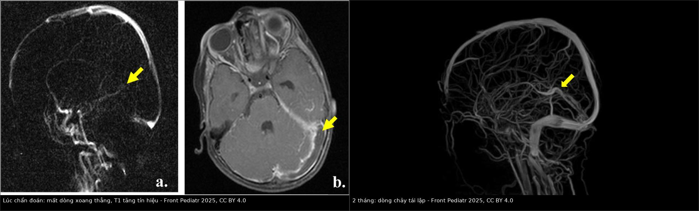
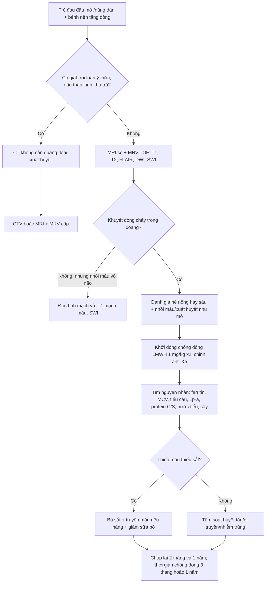
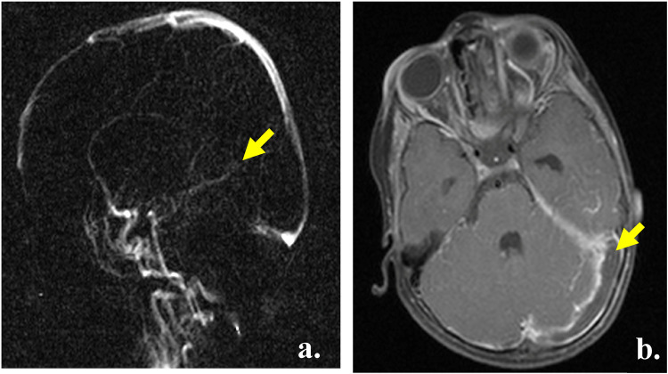
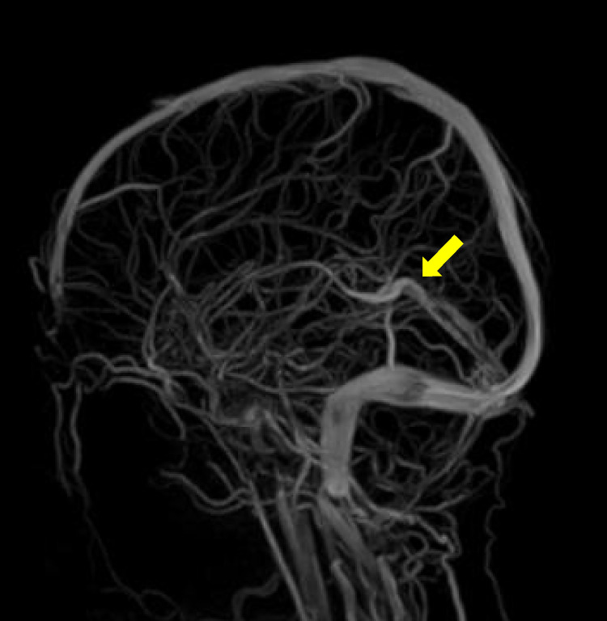
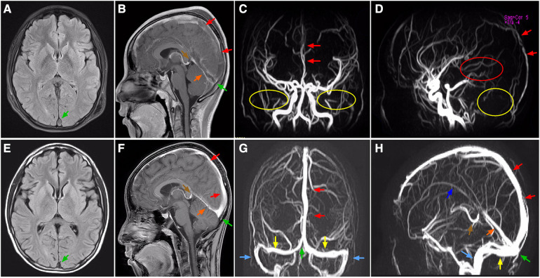

# 1781 — Huyết khối tĩnh mạch não ở trẻ thiếu máu / huyết tán / Cerebral venous sinus thrombosis in children with anemia or hemolysis

**Tags:** `pattern:huyet-khoi-xoang` `pattern:khuyet-dong-chay` `pattern:nhoi-mau-tinh-mach` `pattern:xuat-huyet-kem` `vung:nao` `vung:xoang-tinh-mach` `protocol:MRV` `protocol:CTV` `protocol:MRI-nao` `protocol:SWI` `incidentaloma:khong`

**Mức chắc chắn (certainty):** tổng hợp y văn (literature synthesis) — **2 ca nguyên văn có ảnh nhi**: bé gái 2 tuổi thiếu máu thiếu sắt nặng (PMC11960503) và bé trai 13 tuổi hội chứng thận nhiễm mỡ không triệu chứng (PMC10196485), ghép với **2 loạt nhi** (30 ca ICU — PMC13200926; 52 trẻ/78 lượt nhập viện — PMC9904331), **1 phân tích gộp** về chống đông (PMC13553567), **1 loạt 43 trẻ** viêm tai–xoang (PMC11706750) và **1 loạt người lớn** về CVT + thiếu máu thiếu sắt (PMC13055716). Không suy rộng số liệu người lớn cho trẻ mà không ghi rõ.

## 1. Tổng quan bệnh học – cơ chế hình ảnh

**Vì sao trẻ thiếu máu lại bị huyết khối tĩnh mạch não?** Nghe nghịch lý — thiếu máu gợi ý "loãng máu" — nhưng đây là **tam chứng Virchow đảo chiều theo hướng tăng đông**:

1. **Ứ trệ (stasis) do lưu lượng tăng, không giảm.** Thiếu máu làm **giảm khả năng vận chuyển oxy** → cơ chế bù trừ làm **tăng lưu lượng máu não** và **tăng vận tốc dòng**; vận tốc cao gây **chảy rối (turbulent flow)** và **tăng ứng suất trượt trên nội mô**. Hồng cầu thiếu sắt **giảm khả năng biến dạng (deformability)** → dòng chảy càng rối. Nghiên cứu Doppler ghi nhận **63% trẻ thiếu máu thiếu sắt có tăng vận tốc dòng máu não** (PMC11960503).
2. **Tăng đông (hypercoagulability).** Thiếu sắt làm **giảm hoạt tính glutathione peroxidase** và giảm hàng rào chống oxy hóa → **tăng kết tập tiểu cầu**; đồng thời erythropoietin tăng gây **tăng tiểu cầu phản ứng (reactive thrombocytosis)**. Ca bé gái 2 tuổi: tiểu cầu **cao nhất 832/nL**; ca người lớn kinh điển trong y văn: **1.523.000/mm³** (PMC8608668). Yếu tố tăng đông thứ hai rất hay bị bỏ: **lipoprotein (a) > 30 mg/dL** — ca nhi có **Lp(a) 86 mg/dL** (tham chiếu 0–29,9), gấp ~3 lần ngưỡng nguy cơ (PMC11960503).
3. **Tổn thương nội mô (endothelial injury).** **Huyết tán** (hồng cầu hình liềm, thalassemia, tán huyết miễn dịch) giải phóng **hem tự do** làm cạn **nitric oxide**, hoạt hóa nội mô và tăng bám dính; thiếu oxy mô do thiếu máu cộng thêm. Nhiễm trùng (viêm tai–xương chũm) là con đường nội mô – ứ trệ kinh điển khác ở trẻ.

**Vì sao hình ảnh lại như vậy (vật lý từng chuỗi xung):**

- **CT không cản quang:** cục máu đông có **hồng cầu cô đặc, hematocrit tại chỗ cao** → **tăng đậm độ (hyperdense sinus)** khoảng **50–80 HU** so với máu đang chảy **30–40 HU**. Nhưng ở trẻ, **CT không cản quang có thể hoàn toàn bình thường** — ca bé trai 13 tuổi nhập viện với chóng mặt, sốt, khó thở, **CT sọ không cản quang bình thường** và bị chẩn đoán nhầm là viêm phổi; CVST chỉ được phát hiện khi làm **MRI/MRV** (PMC10196485).
- **CT có cản quang — dấu "empty delta":** màng cứng (dura) quanh xoang **ngấm cản quang**, còn **cục máu đông trong lòng xoang thì không** → xoang hiện thành **tam giác có viền sáng và lõi tối**. Dấu này **chỉ có khi đã tiêm cản quang** và không phải lúc nào cũng thấy.
- **MRI — tín hiệu đổi theo "tuổi" hemoglobin** (đây là lý do phải đọc T1 *và* T2, không chỉ một chuỗi):
  - cấp: **deoxyhemoglobin** → T1 **đồng tín hiệu**, T2 **tối**;
  - bán cấp sớm: **methemoglobin nội bào** → T1 **sáng**, T2 **tối**;
  - bán cấp muộn: **methemoglobin ngoại bào** → T1 **sáng**, T2 **sáng**;
  - mạn: **hemosiderin** → T1 tối, T2 **rất tối**, có **blooming** trên SWI/GRE.
  Ca bé gái 2 tuổi: **T1 tăng tín hiệu** trong xoang ngang trái (bán cấp) (PMC11960503).
- **MRV TOF (thời gian bay):** tín hiệu đến từ **spin mới chảy vào lát cắt**; huyết khối chặn dòng → **mất tín hiệu**. Vì vậy MRV là **chuỗi quyết định**, nhưng có **dương tính giả** (dòng chảy trong mặt phẳng, hạt màng nhện (arachnoid granulation), xoang giảm sản) và **âm tính giả** khi huyết khối **không tắc hoàn toàn** (còn dòng ngoại vi).
- **DWI/ADC:** nhồi máu tĩnh mạch gây **phù độc tế bào** → **DWI sáng, ADC thấp**; phù mạch (vasogenic) thì **không hạn chế khuếch tán** — phân biệt với PRES.
- **SWI/T2\*:** deoxyhemoglobin và hemosiderin **thuận từ** → **blooming**, phát hiện **vi chảy máu** và **xuất huyết trong nhồi máu tĩnh mạch** (30% ca ICU nhi có xuất huyết nội sọ kèm theo — PMC13200926).

**Ngưỡng định lượng cần nhớ:**

| Chỉ số | Số liệu | Nguồn |
|---|---|---|
| Tần suất CVST ở trẻ | **0,6–1,1/100.000 trẻ/năm**; tăng **3,8%/năm** (chuẩn hóa tuổi–giới); số nhập viện tăng **4,9%/năm** | PMC13200926 |
| Thiếu máu trong CVST | **27%** ca CVST có thiếu máu, liên quan mạnh hơn khi **thiếu máu hồng cầu nhỏ**; loạt 42 trẻ: **50%** có thiếu máu ± hồng cầu nhỏ | PMC11960503 |
| Thiếu máu thiếu sắt toàn cầu | **40% trẻ dưới 5 tuổi**; thiếu máu nói chung **32,9% dân số** | PMC11960503 |
| CVT + thiếu máu thiếu sắt (người lớn) | **64/616 (10,4%)**; tổn thương nhu mô **54,7% vs 35,3%** (p = 0,0025); nhồi máu tĩnh mạch **32,8% vs 14,5%** (p = 0,0002); kết cục 1 năm **không khác** (aOR 0,60; 0,23–1,52) | PMC13055716 |
| Bệnh cảnh ICU nhi | 30 ca: **19 (63%)** nguyên phát / 11 (37%) thứ phát; **nhồi máu 47%**, **xuất huyết nội sọ 30%**, **tử vong 17%** | PMC13200926 |
| Loạt đăng ký Ba Lan (nhi) | **52 trẻ / 78 lượt** (2013–2020); **63,5% nam**; tuổi trung bình **9,7 ± 5,8**; nhóm **vị thành niên 27%**; **51%** vào cấp cứu; nằm **10,5 ± 11,7 ngày** | PMC9904331 |
| Hiệu quả chống đông (phân tích gộp nhi) | tử vong **RR 0,14 (0,05–0,39)** (4 nghiên cứu, n = 448); thiếu hụt thần kinh **RD −0,13**; tan huyết khối hoàn toàn/một phần **RR 1,25**; tái phát **RD 0**; chảy máu **RD 0,03** | PMC13553567 |
| CVT sau viêm tai–xoang ở trẻ | 43 trẻ, **63% nam**, tuổi trung bình **4**; viêm xương chũm **54%**; dùng chống đông **53%**; **tái thông 80%** (33/41 sống) | PMC11706750 |
| Ca nhi thiếu máu thiếu sắt + Lp(a) | bé gái **2 tuổi**; tiểu cầu tối đa **832/nL**; **Lp(a) 86 mg/dL** (0–29,9); enoxaparin **1 mg/kg × 2/ngày**, chỉnh theo anti-Xa; chống đông **1 năm**; Hb khi ra viện **9,5 g/dL** | PMC11960503 |
| Ca nhi hội chứng thận nhiễm mỡ | bé trai **13 tuổi**; CVST + thuyên tắc phổi trong **5 ngày** đầu bệnh; **CT sọ không cản quang bình thường** | PMC10196485 |

## 2. Mẫu hình + chẩn đoán phân biệt theo vị trí (gamut)

**Mẫu hình chung:** *trẻ đau đầu mới xuất hiện hoặc nặng dần + co giật/buồn nôn + một bệnh nền tăng đông (thiếu máu thiếu sắt, huyết tán, hội chứng thận nhiễm mỡ, đang dùng asparaginase, viêm tai–xương chũm) — và **hay có CT sọ không cản quang bình thường**.*

Ba câu hỏi phải trả lời trước khi kết luận:

1. **Hệ nào bị tắc: nông (xoang dọc trên, ngang, sigma) hay sâu (xoang thẳng, tĩnh mạch não trong, tĩnh mạch Galen)?** — quyết định tiên lượng.
2. **Có nhồi máu/xuất huyết nhu mô kèm theo không?** — quyết định có cần hồi sức tích cực/phẫu thuật giải ép.
3. **Nguyên nhân nền có điều trị được không?** — thiếu sắt (bù sắt), huyết tán (kiểm soát bệnh nền), nhiễm trùng (kháng sinh/dẫn lưu).

**Gamut theo vị trí:**

- **Xoang dọc trên (superior sagittal sinus):** vị trí hay gặp nhất ở trẻ; đau đầu lan tỏa, co giật, **nhồi máu cạnh đường giữa hai bên** (kỳ lạ với đột quỵ động mạch).
- **Xoang ngang – sigma:** thường **sau viêm tai giữa/xương chũm**; đau sau tai, sốt; huyết khối lan xuống **bóng cảnh (jugular bulb)**.
- **Hệ sâu (xoang thẳng, tĩnh mạch não trong, tĩnh mạch Galen):** **nhồi máu đồi thị hai bên**, rối loạn ý thức, tiên lượng nặng nhất; trên hình ảnh: mất dòng xoang thẳng trên MRV + T1 sáng (ca bé gái 2 tuổi: **mất dòng xoang thẳng và tĩnh mạch não** — PMC11960503).
- **Tĩnh mạch vỏ não đơn độc (isolated cortical vein thrombosis):** đau đầu + co giật, **MRV xoang bình thường** → dễ bỏ sót; cần T1 mạch máu/SWI và đọc kỹ tĩnh mạch vỏ.
- **Xoang hang (cavernous sinus):** lồi mắt, phù mi, liệt dây III/IV/V1–V2, sốt — bệnh cảnh **nhiễm trùng vùng mặt/xoang** (khác hẳn nhóm trên).
- **Bóng cảnh – tĩnh mạch cổ trong:** huyết khối lan xuống (Lemierre) — sốt cao, đau cổ, ổ áp-xe vùng họng.

**Gamut theo nguyên nhân (chọn xét nghiệm theo hàng này):**

- **Thiếu máu thiếu sắt:** trẻ **uống nhiều sữa bò** (ca 2 tuổi), vị thành niên nữ **rong kinh**; xét nghiệm: ferritin, MCV, TIBC, phết máu.
- **Huyết tán:** hồng cầu hình liềm, thalassemia, thiếu G6PD, tán huyết miễn dịch — bilirubin gián tiếp, LDH, haptoglobin, phết máu.
- **Bệnh nền tăng đông khác:** hội chứng thận nhiễm mỡ (mất antithrombin qua nước tiểu), **asparaginase/steroid trong ALL**, béo phì, thuốc tránh thai, COVID-19.
- **Nhiễm trùng:** viêm tai–xương chũm, viêm xoang, viêm màng não, nhiễm khuẩn huyết.
- **Di truyền:** **yếu tố V Leiden**, **prothrombin G20210A**, thiếu **protein C/S**, **antithrombin**, **Lp(a) > 30 mg/dL** (ca nhi: 86 mg/dL — PMC11960503).
- **Cơ học:** chấn thương đầu, mất nước, đặt catheter tĩnh mạch trung tâm.

## 3. Bảng so sánh phân biệt (ma trận đối chiếu)

| Thực thể (entity) | Hình ảnh điển hình | Chốt vào (rule-in) | Chốt loại (rule-out) | Gợi ý xác nhận |
|---|---|---|---|---|
| **CVST** | CT không cản quang: xoang **tăng đậm độ**; CT có cản quang: **empty delta**; MRI: T1/T2 đổi theo tuổi máu; **MRV/CTV: mất tín hiệu xoang** | **Khuyết dòng chảy trong xoang trên MRV/CTV + nhồi máu không theo lãnh thổ động mạch** | Xoang giảm sản/hạt màng nhện (mất tín hiệu nhưng **không có nhồi máu, không đau đầu cấp**) | MRV TOF + T1 mạch máu/SWI; CTV khi cấp cứu |
| **Nhồi máu động mạch (AIS)** | Vùng **theo lãnh thổ** (MCA/ACA/PCA), **tam giác vỏ–nhân** trên DWI; mạch lớn tắc trên MRA | **Nhồi máu theo lãnh thổ + mạch động mạch tắc** | Xoang bình thường trên MRV; tổn thương **không theo lãnh thổ** | MRA/CTA, siêu âm Doppler |
| **PRES** | Phù **mạch (vasogenic)**, **T2/FLAIR sáng vùng chẩm–đỉnh hai bên**, **DWI không hạn chế**, có thể xuất huyết | **Phù đối xứng sau, hồi phục sau kiểm soát huyết áp/nguyên nhân** | MRV bình thường; ADC **không thấp** | MRI + MRV; theo dõi huyết áp |
| **Tăng áp lực nội sọ vô căn (IIH)** | Não thất **bình thường/khe**, **phù đĩa thị**, **xoang ngang hẹp** (do chèn ép, không phải huyết khối) | **Đau đầu + phù gai + MRV xoang còn dòng** | Huyết khối thật (mất dòng + T1 sáng trong xoang) | Chọc dò dịch não tủy **sau** khi loại CVST |
| **Viêm màng não/viêm não** | Màng não **ngấm cản quang**, mủ trong khoang dưới nhện, DWI hạn chế vỏ não | **Sốt + cứng gáy + dịch não tủy viêm** | CVST đơn thuần (dịch não tủy không viêm, không sốt) | Chọc dò dịch não tủy (khi an toàn), cấy |
| **Huyết khối xoang do nhiễm trùng (viêm xương chũm)** | Xoang sigma **mất dòng** + **viêm xương chũm** cùng bên | **Viêm tai + đau sau tai + sốt + mất dòng xoang sigma** | CVST vô khuẩn (không ổ nhiễm trùng) | CT xương thái dương, MRI, cấy |
| **Huyết khối tĩnh mạch vỏ não đơn độc** | Xoang lớn **còn dòng**; tĩnh mạch vỏ **T1 sáng**, **SWI tối**, nhồi máu vỏ **hình ngón tay** | **Đau đầu + co giật + MRV xoang bình thường nhưng có nhồi máu vỏ** | CVST xoang lớn (mất dòng xoang) | MRI T1 mạch máu, SWI, DSA khi còn nghi |
| **Xuất huyết nội sọ tự phát** | Máu tụ, **không có khuyết dòng xoang** | **Máu tụ đơn thuần, xoang còn dòng** | CVST có xuất huyết (30% ca ICU) — **vẫn có thể chống đông** | MRV/CTV bắt buộc khi xuất huyết ở trẻ |

*Trái: (a) MRV TOF sagittal — **mất tín hiệu xoang thẳng và tĩnh mạch não** (mũi tên vàng); (b) T1 axial — **huyết khối tăng tín hiệu** lan vào xoang ngang trái. Phải: MRV sau **2 tháng chống đông** — **dòng chảy tái lập** ở xoang thẳng và tĩnh mạch não. Nguồn: Front Pediatr 2025;13:1449323 (PMC11960503), CC BY 4.0. Ảnh ghép letterbox, giữ nguyên tỷ lệ.*

### Ba dấu hiệu quyết định trên ảnh

- **Mất tín hiệu một đoạn xoang có "đầu–cuối" rõ (abrupt cut-off)** trên MRV/CTV — khác với mất tín hiệu **lan tỏa, mờ** của dòng chảy trong mặt phẳng.
- **T1 tăng tín hiệu trong lòng xoang:** chứng minh **có cục máu đông** (methemoglobin), không chỉ là hiệu ứng dòng chảy.
- **Nhồi máu không theo lãnh thổ động mạch:** đồi thị hai bên, thùy chẩm/đỉnh cạnh đường giữa — bắt buộc nghĩ tĩnh mạch.

## 4. Protocol chụp + hệ phân độ/điểm chuẩn hóa

### 4.1 Protocol hình ảnh

- **Bước 1 — MRI sọ + MRV TOF (không cản quang) là chuỗi đầu tay ở trẻ đau đầu cấp + bệnh nền tăng đông:** T1, T2, FLAIR, DWI/ADC, SWI/GRE + **MRV TOF 2D/3D** (đọc cả xoang và tĩnh mạch vỏ). Ở trẻ nhỏ cần an thần — cân nhắc lợi ích vì đây là chẩn đoán "đổi điều trị".
- **Bước 2 — CT/CTV khi không hoãn được (trẻ không hợp tác, cấp cứu, nghi xuất huyết lớn):** CT không cản quang để loại xuất huyết + **CTV** (không chỉ CT) để thấy khuyết dòng xoang. Lưu ý: **CT không cản quang bình thường không loại trừ CVST** (ca 13 tuổi — PMC10196485).
- **Bước 3 — Đánh giá nhu mô:** DWI/ADC (nhồi máu tĩnh mạch), SWI (xuất huyết/vi chảy máu), T2/FLAIR (phù). **Nhồi máu đồi thị hai bên** = huyết khối hệ sâu.
- **Bước 4 — Xét nghiệm nguyên nhân:** công thức máu (Hb, MCV, tiểu cầu), ferritin/TIBC/sắt, hồng cầu lưới, bilirubin/LDH/haptoglobin, **Lp(a)**, protein C/S, antithrombin, yếu tố V Leiden/PT G20210A, kháng thể kháng phospholipid; tổng phân tích nước tiểu + albumin (hội chứng thận nhiễm mỡ); cấy máu/CT xương thái dương khi nghi nhiễm trùng.
- **Bước 5 — Theo dõi hình ảnh:** chụp lại **~2 tháng** và **1 năm**; tái thông có thể **không hoàn toàn** mà bệnh nhân vẫn hồi phục tốt (ca nhi: sau 1 năm **còn huyết khối bám thành** xoang thẳng và xoang ngang trái — PMC11960503).

### 4.2 Chống đông — ngưỡng và thời gian

| Tình huống | Xử trí theo nguồn |
|---|---|
| CVST ở trẻ nói chung | **Có chống đông** (LMWH/heparin) — phân tích gộp: **giảm tử vong RR 0,14 (0,05–0,39)**, giảm thiếu hụt thần kinh, tăng tái thông, **không tăng chảy máu có ý nghĩa** (PMC13553567) |
| Liều khởi đầu (ca nhi có kiểm chứng) | **enoxaparin 1 mg/kg × 2/ngày**, chỉnh theo **anti-Xa** (PMC11960503) |
| **Có xuất huyết nhu mô kèm theo** | **Không phải chống chỉ định tuyệt đối** — 30% ca ICU nhi có xuất huyết nội sọ vẫn được điều trị; quyết định theo cân nặng tổn thương và thần kinh (PMC13200926, PMC13553567) |
| Thời gian | **3 tháng** cho ca đơn giản; **1 năm** khi huyết khối lan rộng + ≥ 2 yếu tố tăng đông (ca nhi: 1 năm) (PMC11960503) |
| CVT do viêm tai–xương chũm **không có triệu chứng thần kinh** | Chống đông **không bắt buộc cho mọi ca** — 43 trẻ: tái thông 80%, khác biệt không có ý nghĩa theo dùng/không dùng chống đông (PMC11706750) |
| Điều trị nguyên nhân | **Bù sắt (uống/tĩnh mạch) ± truyền hồng cầu** khi thiếu máu thiếu sắt nặng; dinh dưỡng (giảm sữa bò); kiểm soát huyết tán; kháng sinh/dẫn lưu ổ nhiễm trùng |

## 5. Biến thể bình thường và cạm bẫy

**Biến thể bình thường dễ nhầm:**

- **Hạt màng nhện (arachnoid granulation):** khuyết nhỏ, **bờ nhẵn, nằm sát thành xoang**, thường ở xoang dọc trên/ngang; **không có nhồi máu, không đau đầu cấp** — đừng gọi huyết khối.
- **Xoang ngang giảm sản một bên / bất đối xứng:** bẩm sinh, thường gặp; **không mất tín hiệu có đầu–cuối rõ**.
- **Mất tín hiệu do dòng chảy trong mặt phẳng** trên MRV 2D: đổi mặt phẳng/3D rồi đọc lại.
- **Xoang ngang hẹp trong IIH:** hẹp do **chèn ép từ ngoài** (tăng áp lực nội sọ), xoang **vẫn có dòng**, có phù đĩa thị — không phải huyết khối.

**Cạm bẫy (pitfall):**

- **Tin vào CT không cản quang bình thường:** ca 13 tuổi bị chẩn đoán nhầm viêm phổi vì CT sọ bình thường (PMC10196485). Ở trẻ có bệnh nền tăng đông + đau đầu mới, **phải làm MRV/CTV**.
- **Bỏ sót huyết khối hệ sâu:** nhồi máu **đồi thị hai bên** mà chỉ nghĩ động mạch → bỏ lỡ xoang thẳng/tĩnh mạch não trong.
- **Bỏ sót tĩnh mạch vỏ đơn độc:** MRV xoang "bình thường" mà bệnh nhân co giật + nhồi máu vỏ hình ngón tay → cần T1 mạch máu/SWI.
- **"Thiếu máu thì không thể huyết khối":** tư duy này làm chậm chẩn đoán; thiếu máu thiếu sắt là **yếu tố nguy cơ đã được công nhận**, đặc biệt khi có **tăng tiểu cầu phản ứng**.
- **Bỏ qua Lp(a) và tăng đông di truyền:** ca nhi có **Lp(a) 86 mg/dL** — nếu không tìm, sẽ không giải thích được vì sao trẻ 2 tuổi đã huyết khối.
- **Chọc dò dịch não tủy trước khi chụp:** nguy cơ **thoát vị não** khi có nhồi máu/xuất huyết lớn — chụp trước, chọc sau.
- **D-dimer bình thường không loại trừ:** trong huyết khối bán cấp/mạn, D-dimer có thể bình thường; nghiên cứu người lớn cho thấy **điểm lâm sàng thấp + D-dimer < 500 µg/L** mới đạt độ nhạy **92,5%** để loại trừ (PMC13453274) — **không dùng đơn độc ở trẻ**.
- **Ngừng chống đông quá sớm vì "MRV còn khuyết":** hồi phục lâm sàng có thể xảy ra **dù không tái thông hoàn toàn** (ca nhi còn huyết khối bám thành sau 1 năm vẫn hồi phục tốt — PMC11960503).

## 6. Tự lượng giá — Blind Quiz

**Ca 1 — Bé gái 2 tuổi, ăn nhiều sữa bò, da xanh, đau đầu rồi co giật. Ảnh dưới đây chụp gì và bạn kết luận gì?**

- Gợi ý lâm sàng: tiểu cầu tăng cao, **Lp(a) 86 mg/dL**, không có yếu tố di truyền nào khác.
- Câu hỏi: Dấu hiệu bất thường ở đâu? Vì sao phải làm **cả MRV và T1**? Chẩn đoán và hướng xử trí ban đầu?

<b>Bấm để hiện đáp án (findings + chẩn đoán)</b>

- Dấu hiệu: (a) MRV TOF sagittal — **mất tín hiệu xoang thẳng và các tĩnh mạch não** (mũi tên vàng); (b) T1 axial — **tăng tín hiệu trong xoang ngang trái**, tức **có cục máu đông** (methemoglobin), không chỉ là hiệu ứng dòng chảy.
- Chẩn đoán: **huyết khối xoang tĩnh mạch não trên nền thiếu máu thiếu sắt nặng + tăng tiểu cầu phản ứng + Lp(a) cao**. Vì sao: thiếu sắt → tăng kết tập tiểu cầu và tăng tiểu cầu phản ứng; Lp(a) ức chế tiêu sợi huyết; cả hai tạo trạng thái tăng đông.
- Xử trí: **enoxaparin 1 mg/kg × 2/ngày** (chỉnh anti-Xa) + **truyền hồng cầu/sắt tĩnh mạch** + sắt uống; chống đông **1 năm** vì huyết khối lan rộng + 2 yếu tố nguy cơ; chụp lại ở 2 tháng và 1 năm.
- Nguồn ảnh: Front Pediatr 2025;13:1449323 (PMC11960503), Fig. 1, CC BY 4.0.

**Ca 2 — Cùng bệnh nhân sau 2 tháng chống đông. Ảnh MRV này nói gì về hiệu quả điều trị, và có được ngừng thuốc không?**

- Gợi ý: lâm sàng đã cải thiện rõ trong 2 ngày đầu điều trị.
- Câu hỏi: Dòng chảy đã tái lập chưa, ở đâu? Có được ngừng chống đông ở thời điểm này không?

<b>Bấm để hiện đáp án</b>

- Dấu hiệu: MRV TOF sagittal — **dòng chảy đã tái lập ở xoang thẳng và các tĩnh mạch não** (mũi tên vàng), tương ứng cải thiện lâm sàng.
- Trả lời: **chưa ngừng** — tái thông một phần chưa đủ; ca này còn **huyết khối bám thành** ở xoang thẳng và xoang ngang trái đến **1 năm**; chống đông được duy trì **1 năm** rồi mới cân nhắc ngừng.
- Bài học: **hồi phục lâm sàng ≠ tái thông hoàn toàn**, và **còn khuyết trên MRV ≠ thất bại điều trị**.
- Nguồn ảnh: Front Pediatr 2025;13:1449323 (PMC11960503), Fig. 2, CC BY 4.0.

**Ca 3 — Bé trai 13 tuổi, chóng mặt + sốt + khó thở, phù không rõ. CT sọ không cản quang bình thường. Ảnh MRI/MRV dưới đây cho thấy gì?**

- Gợi ý: xét nghiệm có **giảm albumin máu** và **protein niệu lượng lớn**; đồng thời có thuyên tắc phổi.
- Câu hỏi: Tổn thương tĩnh mạch ở đâu? Vì sao CT không cản quang bình thường mà vẫn có huyết khối? Nguyên nhân nền?

<b>Bấm để hiện đáp án</b>

- Dấu hiệu: MRI FLAIR/T1 sau tiêm và **MRV** — **khuyết đầy (filling defect) ở xoang dọc trên, xoang thẳng, tĩnh mạch Galen và torcula**, **mất tín hiệu dòng ở xoang sigma và xoang ngang hai bên** (ô vàng); kèm hình ảnh thuyên tắc phổi trên CTA ngực (Fig. 1 của bài gốc).
- Chẩn đoán: **CVST + thuyên tắc phổi trên nền hội chứng thận nhiễm mỡ không triệu chứng** — mất antithrombin qua nước tiểu gây tăng đông, trong khi **không có phù** nên dễ bị chẩn đoán nhầm là viêm phổi.
- Vì sao CT bình thường: huyết khối **không gây tăng đậm độ rõ** ở thì sớm và CT không cản quang **không đánh giá được dòng chảy xoang** — cần MRI/MRV.
- Nguồn ảnh: Front Pediatr 2023;11:1169116 (PMC10196485), Fig. 2, CC BY 4.0.

## Bài liên quan chéo

- [216 – Dị dạng mạch não & huyết khối xoang](../216-di-dang-mach-CVST/lesson.md) — nền tảng hình ảnh CVST (empty delta, MRV) trong bối cảnh mạch máu não.
- [682 – Bệnh mạch não & quá tải sắt ở thalassemia](../682-benh-mach-nao-qua-tai-sat-thalassemia/lesson.md) — nhánh huyết tán/thalassemia: T2*/QSM, đột quỵ im lặng.
- [661 – Đột quỵ hồng cầu hình liềm ở trẻ](../661-dot-quy-hong-cau-hinh-liem-o-tre/lesson.md) — huyết tán + thiếu máu não cấp, nơi CVST là hàng phân biệt.
- [652 – Đột quỵ mạch máu não nhi](../652-dot-quy-mach-mau-nao-nhi-moyamoya-viem-mach/lesson.md) — phân biệt nhồi máu **động mạch** với nhồi máu tĩnh mạch.
- [676 – RCVS ở trẻ em](../676-rcvs-tre-em-dieu-tri/lesson.md) — đau đầu sét đánh + co thắt mạch, khác CVST về hình ảnh.
- [219 – PRES & RCVS](../219-pres-rcvs/lesson.md) — phù mạch không hạn chế khuếch tán, phân biệt với nhồi máu tĩnh mạch.
- [684 – Tăng triglyceride do asparaginase ở trẻ ALL](../684-tang-triglyceride-asparaginase-all-nhi/lesson.md) — cùng nhóm "trẻ ung thư có biến chứng huyết khối do thuốc".
- [238 – Lemierre & huyết khối tĩnh mạch cảnh trong](../238-lemierre-huyet-khoi-tm-canh-trong/lesson.md) — huyết khối tĩnh mạch lan từ ổ nhiễm trùng vùng cổ.
- [1783 – Huyết khối xoang sau chấn thương đầu ở trẻ](../1783-huyet-khoi-xoang-sau-chan-thuong-dau-tre/lesson.md) — **nhánh chấn thương**: vỡ xương bắt ngang xoang, NCCT 61 HU, CTV 20–25 giây, chống đông khi có xuất huyết nội sọ.

## Ảnh

- `1781_huyet-khoi-xoang_TOF-va-T1-PMC11960503-Fig1.jpg` — MRV TOF mất dòng xoang thẳng + T1 huyết khối xoang ngang (CC BY 4.0).
- `1781_tai-thong-sau-2-thang_MRV-PMC11960503-Fig2.jpg` — MRV sau 2 tháng: dòng chảy tái lập (CC BY 4.0).
- `1781_huyet-khoi-nhieu-xoang_MRI-MRV-PMC10196485-Fig2.jpg` — MRI/MRV nhiều xoang ở bé trai 13 tuổi (CC BY 4.0).
- `composite_1781_luc-chan-doan-va-2-thang.jpg` — ảnh ghép letterbox từ 2 ảnh cùng bài PMC11960503.
- Số liệu phân tích gộp (PMC13553567), loạt ICU (PMC13200926), loạt viêm tai (PMC11706750), loạt người lớn IDA (PMC13055716): **chỉ trích số liệu** (CC BY-NC-ND/CC BY-NC), không tải ảnh.

> Không dùng để chẩn đoán độc lập khi chưa có người hướng dẫn.
