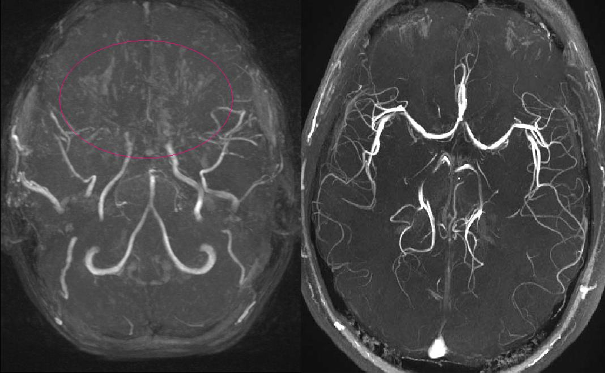
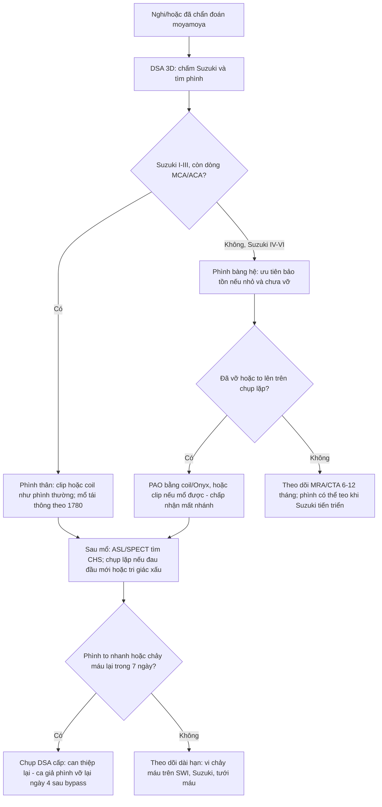
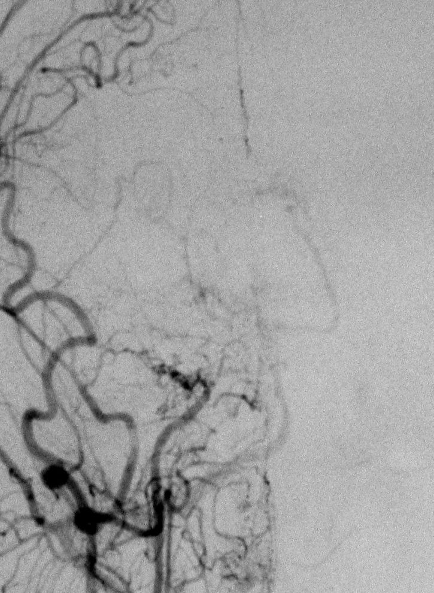

# 1782 — Phình mạch nội sọ trong bệnh moyamoya: thân vs bàng hệ, tầm soát bằng gì & vì sao chảy máu vẫn xảy ra SAU tái thông / Moyamoya-associated intracranial aneurysm

**Tags:** `pattern:phinh-mach` `pattern:hep-tac-mach` `pattern:xuat-huyet-nao` `vung:nao-nhi` `score:Suzuki` `protocol:DSA-3D` `protocol:CTA` `protocol:MRA-TOF`
**Mức chắc chắn (certainty):** tổng hợp y văn (literature synthesis) — loạt 42 phình chưa vỡ ở bệnh moyamoya (PMC9947525), loạt 11 phình bàng hệ đã vỡ được can thiệp bằng nút mẹ (PMC9923357), ca giả phình to nhanh và vỡ lại 4 ngày sau bypass (PMC10918708), tổng quan bệnh moyamoya 2025 (PMC12511514). Số nào nguồn không đưa thì ghi "chưa rõ".

> **Câu chốt:** trong bệnh moyamoya có **hai loại phình khác hẳn nhau về sinh bệnh, nguy cơ và cách xử trí** — **phình thân** (bifurcation: ICA, ACoA, MCA, đỉnh động mạch nền) hành xử gần như phình thường; và **phình trên mạng bàng hệ** (động mạch màng mạch trước/màng mạch sau xa, thể vân – đồi thị, P2–3, động mạch màng não giữa xuyên màng cứng) — **rất nhỏ (2,7 ± 0,6 mm vẫn vỡ)**, khó can thiệp, và thường phải **nút động mạch mẹ (parent artery occlusion, PAO)**.
> Nối [1780 – Chọn kỹ thuật tái thông moyamoya](../1780-chon-ky-thuat-tai-thong-moyamoya-o-tre/lesson.md) (kỹ thuật mổ) và [248 – Can thiệp giả phình/bóc tách động mạch cổ](../248-can-thiep-noi-mach-gia-phinh-boc-tach-dong-mach-co-dot-song/lesson.md) (kỹ thuật nội mạch).

## 1. Tổng quan bệnh học – cơ chế hình ảnh

### 1.1 Vì sao bệnh moyamoya sinh ra phình — và vì sao phình đó khác phình thường (TẠI SAO)

- **Nền bệnh:** hẹp – tắc tiến triển **đoạn cuối động mạch cảnh trong (ICA)** và **đoạn gần MCA/ACA**, kèm mạng bàng hệ mảnh ở đáy não ("làn khói thuốc" — *puff of smoke*) (PMC12511514). Ở người Đông Á, **RNF213 p.R4810K** là yếu tố nhạy cảm chính.
- **Cơ chế phình thân (trunk/bifurcation):** dòng máu vẫn đi qua các **chỗ chia đôi còn thông** (ICA trên hang, ACoA, chỗ phân đôi MCA, đỉnh động mạch nền) → **ứng suất thành mạch tại điểm phân nhánh** như phình thường. Loại này chiếm **35/42 phình (83,3%)** trong loạt tự nhiên (PMC9947525).
- **Cơ chế phình bàng hệ (peripheral/collateral):** để bù vùng thiếu máu, các **động mạch xuyên nhỏ giãn ra** (màng mạch trước, màng mạch sau, thể vân – đồi thị, màng não giữa xuyên màng cứng). Ba yếu tố cộng lại:
  1. **Thành mỏng, thiếu lớp cơ trơn và màng đàn hồi** — mạch bàng hệ là mạch nhỏ "dùng tạm", không được cấu tạo để chịu áp lực hệ thống;
  2. **Áp lực thành cao** vì đây là đường thoát chính cho một vùng não thiếu máu;
  3. **Theo Laplace (P thành ∝ áp lực × bán kính / độ dày thành)** — bán kính tăng khi giãn + thành mỏng = **ứng suất thành tăng gấp nhiều lần** → phình và vỡ ở **kích thước rất nhỏ**. Số liệu: phình bàng hệ **đã vỡ có đường kính trung bình 2,7 ± 0,6 mm** (PMC9923357).
- **TẠI SAO vị trí vỡ khác nhau:** máu thường chảy vào **não thất và vùng quanh não thất** vì mạng bàng hệ nằm sâu (động mạch màng mạch, thể vân – đồi thị). Trong 42 ca: **33,3% khởi phát bằng xuất huyết** — **8/14 là xuất huyết não thất**, 5/14 trong nhu mô, chỉ 1/14 dưới nhện (PMC9947525). Phình **ngoại vi** khởi phát bằng xuất huyết **57,1%** so với **28,6%** ở phình thân.
- **Vì sao chảy máu vẫn xảy ra SAU tái thông (câu hỏi thực hành):** ba cơ chế khác nhau, đừng gộp:
  1. **Hội chứng tưới máu quá mức (CHS)** — sau bypass trực tiếp, vùng não trước đó giãn mạch tối đa nhận dòng máu mới → **phù, xuất huyết**; tỷ lệ **21,5–50%** (PMC12511514).
  2. **Phình bàng hệ to nhanh rồi vỡ** do **thay đổi huyết động đột ngột** sau khi áp lực tưới máu tăng: ca giả phình động mạch màng mạch sau **to nhanh và vỡ lại chỉ 4 ngày sau STA–MCA**, phải coil rồi mổ bypass lần hai (PMC10918708).
  3. **Phình không liên quan đến vùng bypass** — xuất huyết từ mạch bàng hệ khác, hoặc từ vùng não thất vốn đã có **vi chảy máu (microbleed)**.
- **Ngược lại, phình cũng có thể TỰ THU NHỎ:** khi Suzuki tiến triển (bàng hệ "già" đi và thay bằng bàng hệ ngoài sọ), dòng qua phình giảm → **10/27 phình teo hoặc mất** trên chụp lặp (trung vị theo dõi 20,5 tháng); teo mất **liên quan có ý nghĩa với tiến triển Suzuki (P = 0,015)** — 5/6 ca có tiến triển Suzuki thì phình teo (PMC9947525). Đây là lý do **không can thiệp mọi phình nhỏ không vỡ ngay lập tức**.

### 1.2 Ngưỡng định lượng nằm lòng (bắt buộc nhớ)

| Chỉ số | Con số | Nguồn |
|---|---|---|
| Phân bố phình | **thân 35/42 (83,3%)**, **ngoại vi 7/42 (16,7%)**; thân gồm ICA 20, ACoA 3, MCA 2, PCA 4, thân nền 5, ACA 1 | PMC9947525 |
| Cỡ phình | **nhỏ < 5 mm: 34/42 (81,0%)**; trung bình 5–15 mm: 8/42 | *cùng nguồn* |
| Cỡ phình **bàng hệ đã vỡ** | **2,7 ± 0,6 mm** (nút mẹ bằng coil/Onyx) | PMC9923357 |
| Khởi phát bằng xuất huyết | **33,3%** (14/42); phình ngoại vi **57,1%** so với phình thân **28,6%** | PMC9947525 |
| Vỡ trong theo dõi **phình CHƯA vỡ** | **0/30 bệnh nhân** trong **37,9 ± 32,5 tháng** | *cùng nguồn* |
| Thay đổi phình trên chụp lặp | **teo/mất 10/27 (37,0%)**, không đổi 16/27, **to lên 1/27** | *cùng nguồn* |
| Tái phát đột quỵ hằng năm (điều trị bảo tồn) | **3,2–15%** | PMC12511514 |
| Vi chảy máu trên SWI/T2* | gặp ở **28–46%** bệnh nhân, liên quan **xuất huyết não thất** | *cùng nguồn* |
| Biến chứng sau tái thông | xuất huyết **0,7–8,0%**; thiếu máu **1,6–16%**; CHS **21,5–50%**; biến chứng vết mổ **17,6–21,4%** | *cùng nguồn* |
| Suzuki giai đoạn muộn | **V–VI**: nguy cơ xuất huyết, teo não, suy giảm nhận thức cao hơn | *cùng nguồn* |
| Can thiệp nút mẹ (PAO) | 11 ca: coil **63,6%**, Onyx **36,4%**; biến chứng chảy máu trong mổ **18,2%**; **100% mRS 0–2** khi ra viện/theo dõi | PMC9923357 |

## 2. Mẫu hình + chẩn đoán phân biệt theo vị trí (gamut)

**Mẫu hình cần nhận ra:** bệnh nhân **moyamoya đã biết** (hoặc người trẻ Đông Á xuất huyết não thất không rõ nguyên nhân) → trên **CTA/MRA thấy chỗ hẹp – tắc ICA cuối + mạng bàng hệ**, kèm **một túi phình nhỏ** ở **thân mạch** hoặc **trên nhánh bàng hệ sâu**.

**Gamut theo vị trí (mnemonic "THÂN – BÀNG HỆ – GIẢ – SAU MỔ"):**

1. **THÂN (trunk/bifurcation):** ICA đoạn trên hang/xoang hang, **ACoA**, chỗ phân đôi **MCA**, **đỉnh động mạch nền**, PCA đoạn gần. Hình thái túi điển hình, dễ thấy trên CTA/MRA. Xử trí như phình thường (clip/coil) — nhưng **phải tính đến nguy cơ CHS** khi tái thông cùng lúc.
2. **BÀNG HỆ (collateral/peripheral):** **động mạch màng mạch trước xa (AChA)**, **màng mạch sau (PChA)**, **thể vân – đồi thị (lenticulostriate) xa**, **P2–3 / P4–5 của PCA**, **động mạch màng não giữa xuyên màng cứng**. Rất nhỏ, sát não thất; can thiệp khó → **PAO** là lựa chọn cuối.
3. **GIẢ (pseudoaneurysm):** sau chấn thương hoặc **sau tái thông**, thành chỉ còn lớp ngoài → **to nhanh, vỡ lại sớm (4 ngày)** (PMC10918708).
4. **SAU MỔ (post-bypass change):** phình **mới xuất hiện** hoặc **to lên** sau bypass (do đổi huyết động), hoặc **teo/mất** khi Suzuki tiến triển.

**Phân biệt với "không phải phình" (quan trọng ngang với tìm phình):** mạng bàng hệ có thể **giãn, ngoằn ngoèo, chồng hình** trên MIP → trông như nhiều túi nhỏ; **vi chảy máu** trên SWI là **đốm tròn tối < 5 mm**, không phải túi phình; **CHS** sau mổ gây phù và xuất huyết nhưng **không có túi**.

## 3. Bảng so sánh phân biệt (ma trận đối chiếu)

| Thực thể (entity) | Hình ảnh điển hình | Chốt vào (rule-in) | Chốt loại (rule-out) | Gợi ý xác nhận |
|---|---|---|---|---|
| **Phình thân trong moyamoya** | Túi ở **chỗ phân đôi** (ICA/ACoA/MCA/đỉnh nền), cổ rõ, thường ≥ 3 mm | **Túi tại điểm phân nhánh + có cổ + không đổi hình theo nhát cắt** | Nằm trên nhánh xuyên nhỏ, không có cổ → nghĩ phình bàng hệ | CTA lát ≤ 1 mm + **DSA 3D** xác nhận |
| **Phình bàng hệ (AChA/PChA/LSA/P2–3/MMA)** | Túi **rất nhỏ (< 3 mm)** nằm **sâu, sát não thất**, trên mạch bàng hệ ngoằn ngoèo | **Túi + xuất huyết não thất + mạng bàng hệ kiểu moyamoya** | Túi lớn ở thân mạch → không phải loại này | **DSA 3D là chuẩn**; CTA/MRA dễ bỏ sót |
| **Giả phình sau tái thông** | Túi **thành không đều**, **to nhanh trong vài ngày**, không có cổ thật | **Tiền sử bypass ≤ 1 tuần + túi to lên trên chụp lặp** | Kích thước ổn định nhiều tháng → không phải giả phình cấp | Chụp lặp sớm (DSA/CTA) khi có triệu chứng mới |
| **Vi chảy máu (microbleed)** | **Đốm tối tròn < 5 mm** trên SWI/T2*, thường **quanh não thất**, không thấy trên CTA | **Nhiều đốm tối rải rác + không có túi trên DSA** | Có túi có cổ trên DSA → không phải chỉ microbleed | MRI SWI 3T; đếm số đốm, so phim cũ |
| **Mạng bàng hệ giãn (puff of smoke) không phình** | Chùm mạch **ngoằn ngoèo, không có túi đơn lẻ**, thay đổi theo thì | **Hình chùm, không có túi bờ rõ, không điểm yếu thành khu trú** | Túi bờ rõ, giữ hình ở mọi thì → phình thật | DSA 3D xoay; so sánh nhiều thì |
| **Hội chứng tưới máu quá mức (CHS)** | Phù vỏ – dưới vỏ ± xuất huyết **cùng bên bypass**, xuất hiện **ngày 1–7** | **Sau bypass trực tiếp + tăng tưới máu trên ASL/SPECT + không có túi mới** | Có túi mới/to lên → nguyên nhân là phình, không phải CHS | ASL/SPECT; DSA loại phình |
| **Xuất huyết do tăng huyết áp** | Ổ máu **thể vân – đồi thị**, không mạng bàng hệ | **HA cao, không hẹp ICA cuối, không bàng hệ moyamoya** | Có hẹp ICA cuối hai bên + bàng hệ → moyamoya | CTA/DSA; hỏi tiền sử |

Ảnh ghép đối chiếu (mạng bàng hệ moyamoya so với người bình thường):

*MRA MIP: bên trái là bé gái 11 tuổi bệnh moyamoya — **mất tín hiệu MCA/ACA đoạn gần**, thay bằng **chùm mạch bàng hệ** (vòng đỏ); bên phải là người bình thường để so sánh. Đây là nơi phình bàng hệ hình thành. Nguồn: MBq & SBarnes, Wikimedia Commons, **CC BY-SA 3.0**.*

## 4. Protocol chụp + hệ phân độ & chiến lược xử trí

**Chụp gì (thứ tự leo thang):**
1. **MRA TOF 3T** — tầm soát không xâm lấn ở trẻ và theo dõi; **hạn chế: bỏ sót phình < 3 mm** và dễ "giả phình" do chồng hình mạng bàng hệ.
2. **CTA lát mỏng ≤ 1 mm + dựng 3D** — tốt cho phình thân; đánh giá được xương/Canxi; vẫn có thể bỏ sót phình bàng hệ nhỏ.
3. **DSA (+ 3D xoay)** — **chuẩn vàng** để chẩn đoán moyamoya và **bắt buộc** khi: CTA/MRA âm nhưng bệnh nhân **xuất huyết não thất không rõ nguyên nhân**, hoặc trước khi can thiệp. DSA cũng cho biết **Suzuki** và nguồn bàng hệ.
4. **MRI SWI/T2*** — đếm **vi chảy máu** (28–46% bệnh nhân), yếu tố dự báo xuất huyết não thất.
5. **ASL/SPECT/PET** — đánh giá **dự trữ tưới máu** trước mổ và phát hiện **CHS** sau mổ.

**Suzuki (phân độ theo DSA) — vì sao phải ghi vào hồ sơ:**

**Chiến lược xử trí (theo nguồn):**
- **Phình thân:** xử lý như phình nội sọ thường — **clip hoặc coil**; nếu mổ tái thông cùng lúc, **ưu tiên xử lý phình trước** để tránh làm tăng áp lực xuyên thành trong lúc tăng tưới máu (nguyên lý, mức suy luận).
- **Phình bàng hệ:** **PAO (nút động mạch mẹ)** bằng coil hoặc Onyx là lựa chọn cuối nhưng **an toàn chấp nhận được**: 11 ca, **100% mRS 0–2**, biến chứng chảy máu trong mổ **18,2%**; tác giả lưu ý **PAO chỉ giải quyết tạm thời** — bệnh nền vẫn tiến triển (PMC9923357).
- **Phình nhỏ, chưa vỡ, không tăng kích thước:** **theo dõi** là hợp lý — 0/30 bệnh nhân vỡ trong ~38 tháng, và **37% phình teo/mất** (PMC9947525).
- **Sau tái thông:** theo dõi **CHS** (ASL/SPECT, huyết áp), và **chụp lại ngay** nếu đau đầu mới, tri giác xấu, hoặc xuất huyết mới — ca giả phình **vỡ lại ngày 4** cho thấy cửa sổ nguy hiểm là **tuần đầu** (PMC10918708).

## 5. Biến thể bình thường và cạm bẫy

- **Cạm bẫy 1 — "phình < 3 mm thì không vỡ":** đúng với phình thân ở người lớn, **sai với phình bàng hệ trong moyamoya** — cỡ vỡ trung bình chỉ **2,7 mm** (PMC9923357). Đừng dùng ngưỡng 7 mm của phình thường để trấn an.
- **Cạm bẫy 2 — can thiệp mọi phình bắt gặp:** **37% phình tự teo/mất** khi Suzuki tiến triển; can thiệp không cần thiết có thể **làm mất một nhánh bàng hệ đang nuôi vùng não thiếu máu**. Chỉ can thiệp khi **đã vỡ, đang to lên, hoặc có hình thái nguy hiểm**.
- **Cạm bẫy 3 — bỏ sót phình vì CTA/MRA âm:** phình bàng hệ nằm sâu, sát não thất, rất nhỏ → **DSA là bắt buộc** ở bệnh nhân xuất huyết não thất không rõ nguyên nhân, kể cả khi CTA đẹp.
- **Cạm bẫy 4 — đọc mạng bàng hệ thành "nhiều phình":** MIP dày làm các nhánh chồng hình thành "chùm túi". Phân biệt bằng **DSA 3D nhiều thì**: phình thật **giữ hình và có cổ**, bàng hệ **thay đổi theo thì**.
- **Cạm bẫy 5 — gán mọi xuất huyết sau mổ cho "chảy máu do phình":** phải loại **CHS** (21,5–50%) và **tăng huyết áp**; CHS xử trí bằng **kiểm soát huyết áp, an thần, tránh tăng tưới máu**, không phải bằng can thiệp mạch.
- **Cạm bẫy 6 — quên rằng tái thông có thể làm phình NẶNG LÊN:** thay đổi huyết động sau bypass có thể làm **giả phình to nhanh và vỡ trong vài ngày**; bệnh nhân có phình đã biết cần **kế hoạch chụp kiểm tra sớm**, không chờ 3 tháng.
- **Biến thể bình thường:** **giãn nhẹ, đối xứng các động mạch xuyên quanh não thất** ở người trẻ không có túi khu trú — theo dõi, không can thiệp.

## 6. Tự lượng giá — Blind Quiz ngay trên trang tĩnh

**Ca 1 — Bé gái 11 tuổi, đau đầu tái diễn, yếu nửa người thoáng qua. MRA dựng MIP (bên trái là bệnh nhân, bên phải là người bình thường):**

- Câu hỏi: (1) Bất thường chính là gì? (2) Vòng đỏ khoanh vào cấu trúc nào? (3) Bước tiếp theo để tìm phình?

<b>Bấm để hiện đáp án (findings + chẩn đoán)</b>

- **Findings:** **mất tín hiệu đoạn gần MCA và ACA hai bên**; thay vào đó là **chùm mạch nhỏ ngoằn ngoèo ở đáy não** (vòng đỏ) = **mạng bàng hệ kiểu moyamoya ("puff of smoke")**.
- **Chẩn đoán:** **bệnh moyamoya**. MRA **không đủ** để loại phình nhỏ.
- **Bước tiếp:** **DSA 3D** — vừa chấm **Suzuki**, vừa tìm **phình thân/bàng hệ**; thêm **MRI SWI** đếm vi chảy máu.
- **Nguồn ảnh:** MBq & SBarnes, Wikimedia Commons, **CC BY-SA 3.0**.

**Ca 2 — Nữ 45 tuổi, moyamoya thể xuất huyết, được mổ STA–MCA. Ngày thứ 4 sau mổ: đau đầu dữ dội, tri giác giảm, chảy máu não thất tái diễn. DSA:**

- Câu hỏi: (1) Vì sao phải chụp DSA ngay chứ không chờ? (2) Hai nguyên nhân phải phân biệt? (3) Hướng xử trí?

<b>Bấm để hiện đáp án (findings + chẩn đoán)</b>

- **Findings:** DSA ICA phải — **hẹp/tắc đoạn cuối ICA**, thay bằng **mạng bàng hệ dày đặc** ("làn khói"); trong bối cảnh xuất huyết não thất tái diễn, phải tìm **túi phình nhỏ trên nhánh bàng hệ** (thường động mạch màng mạch sau).
- **Vì sao chụp ngay:** cửa sổ nguy hiểm là **tuần đầu sau tái thông** — ca giả phình động mạch màng mạch sau **to nhanh và vỡ lại chỉ 4 ngày sau STA–MCA** (PMC10918708).
- **Hai nguyên nhân:** (a) **giả phình/phình bàng hệ to nhanh do đổi huyết động**; (b) **CHS** (21,5–50%) — CHS không có túi mới.
- **Hướng xử trí:** **coil nút mẹ** (PAO) cho túi bàng hệ, rồi **mổ bypass lần hai** nếu cần; ca gốc ra viện ngày 8, phình tắc hoàn toàn, không chảy máu lại.
- **Nguồn ảnh:** Dr Frank Gaillard, **CC BY 3.0** (Wikimedia Commons; ảnh DSA moyamoya minh hoạ mạng bàng hệ — **không phải ảnh của ca trong bài**, ca gốc ở PMC10918708).

**Ca 3 — Nam 38 tuổi, moyamoya Suzuki IV, tình cờ thấy túi 2,5 mm ở nhánh màng mạch trước trái, chưa vỡ, không triệu chứng.**

- Câu hỏi: (1) Có chỉ định can thiệp ngay không? (2) Theo dõi bằng gì và bao lâu? (3) Điều gì khiến quyết định đổi?

<b>Bấm để hiện đáp án (findings + chẩn đoán)</b>

- **Không can thiệp ngay:** phình **chưa vỡ, rất nhỏ, không tăng** — trong loạt 42 phình chưa vỡ, **0/30 bệnh nhân vỡ** trong **37,9 ± 32,5 tháng**, và **37% phình teo/mất** khi Suzuki tiến triển (PMC9947525).
- **Theo dõi:** **MRA TOF hoặc CTA 6–12 tháng/lần** (chu kỳ thực tế "chưa rõ" — nguồn không đưa lịch chuẩn), kèm **MRI SWI** đếm vi chảy máu và đánh giá **dự trữ tưới máu** trước khi mổ tái thông.
- **Đổi quyết định khi:** phình **to lên**, **xuất huyết** (kể cả não thất kín đáo), hoặc có kế hoạch **tái thông trực tiếp** — vì thay đổi huyết động sau bypass có thể làm phình to nhanh (PMC10918708).
- **Lưu ý:** ngưỡng "7 mm" của phình thường **không áp dụng** cho phình bàng hệ moyamoya (cỡ vỡ trung bình 2,7 mm).

## Bài liên quan chéo
- [1780 – Chọn kỹ thuật tái thông moyamoya ở trẻ](../1780-chon-ky-thuat-tai-thong-moyamoya-o-tre/lesson.md)
- [248 – Can thiệp nội mạch giả phình & bóc tách động mạch cổ](../248-can-thiep-noi-mach-gia-phinh-boc-tach-dong-mach-co-dot-song/lesson.md)
- [207 – Phình mạch nội sọ chưa vỡ: nguy cơ vỡ & chỉ định can thiệp](../207-phinh-mach-noi-so-chua-vo/lesson.md)
- [200 – Tổng quan hệ Thần kinh](../200-tong-quan-he-than-kinh/lesson.md)

## Ảnh
- `1782_moyamoya_MRA_Commons-MBq.jpg` — MBq & SBarnes, Wikimedia Commons, **CC BY-SA 3.0**.
- `1782_moyamoya_DSA_Commons-Gaillard.jpg` — Dr Frank Gaillard, Wikimedia Commons, **CC BY 3.0**.
- Chi tiết nguồn/giấy phép: `images/CREDITS.md`.

> Không dùng để chẩn đoán độc lập khi chưa có người hướng dẫn.
