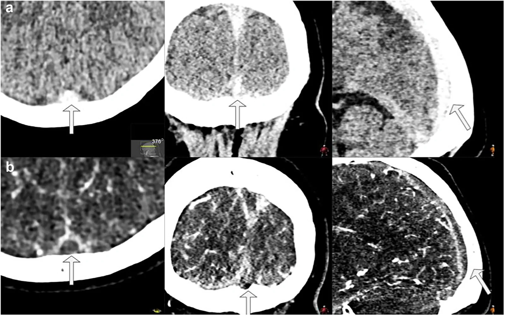
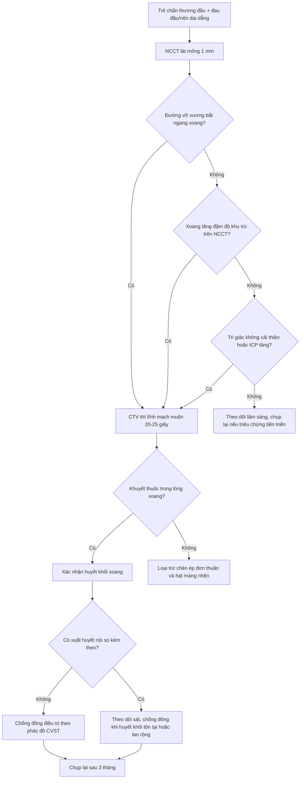
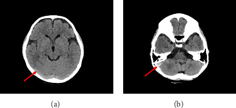
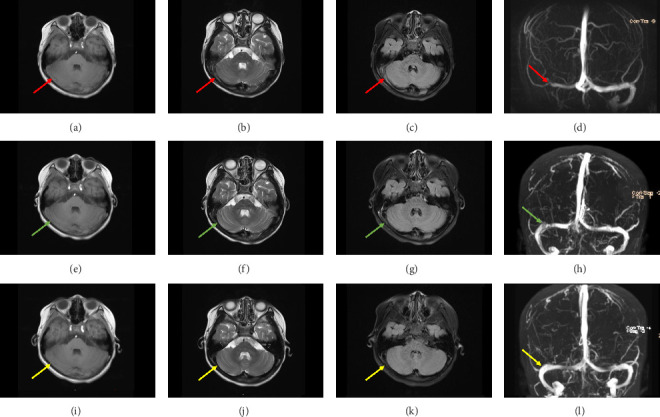
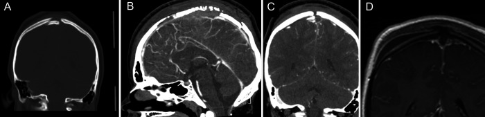

# 1783 — Huyết khối xoang tĩnh mạch não SAU CHẤN THƯƠNG ĐẦU ở trẻ / Post-traumatic cerebral venous sinus thrombosis in children

**Tags:** `pattern:huyet-khoi-xoang` `pattern:khuyet-dong-chay` `pattern:vo-xuong-so` `pattern:nhoi-mau-tinh-mach` `pattern:giam-ap-luc-noi-so` `vung:nao` `vung:xoang-tinh-mach` `protocol:NCCT` `protocol:CTV` `protocol:MRV` `protocol:MRI-nao`

**Mức chắc chắn (certainty):** tổng hợp y văn (literature synthesis) — **1 ca nguyên văn nhi có đủ ảnh** (bé gái 7 tuổi, PMC12318623), **1 ca nguyên văn nhi có ảnh vỡ xương sọ lún + CTV** (PMC9237661), **1 ca người lớn có ảnh CTV + ICP** (PMC8497043), ghép với **1 tổng quan hình học–vật lý của huyết khối xoang** (PMC13588991), **1 tổng quan hệ thống về CVST sau chấn thương não** (PMC9869151), **2 đoàn hệ** (30 trẻ hồi sức — PMC13200926; 112 ca tVST người lớn — PMC12819568), **1 nghiên cứu ngưỡng HU trên CT không cản quang** (PMC11813980) và **1 tổng quan chấn thương sọ nền** (PMC11289000). Không suy rộng số của người lớn cho trẻ mà không ghi rõ; chỗ suy luận được đánh dấu.

> **Câu chốt:** Ở trẻ sau chấn thương đầu, **huyết khối xoang không phải biến chứng hiếm** — tới **28%** bệnh nhi chấn thương não kín có huyết khối xoang, trong đó tới **55%** là huyết khối tắc hoàn toàn (PMC8497043). **CT không cản quang có thể hoàn toàn bình thường** và bị đọc là "chấn động não" (PMC12318623) — vì vậy câu hỏi không phải "có huyết khối hay không" mà là **"đường vỡ xương có bắt ngang xoang không, và triệu chứng có dai dẳng bất thường không"**. Bỏ sót = **tăng áp lực nội sọ dai dẳng, nhồi máu tĩnh mạch, chảy máu trong ổ nhồi máu** — ba thứ đều chữa được nếu nhận ra sớm.

## 1. Tổng quan bệnh học – cơ chế hình ảnh (TẠI SAO)

### 1.1 Dịch tễ và bối cảnh

- **CVST ở trẻ nói chung:** chiếm **0,5–1,0%** mọi đột quỵ nhi, ước tính **~7 ca/1 triệu trẻ** (PMC12318623); tỷ lệ mắc **0,6–1,1/100.000 trẻ/năm**, tử vong **3–12%**, di chứng thần kinh tới **62%** người sống (PMC13200926).
- **Nhóm nặng (hồi sức):** 30 trẻ trong 6 năm tại một trung tâm (PMC13200926): **63%** CVST nguyên phát, **47%** có nhồi máu não kèm theo, **30%** có xuất huyết nội sọ, **17%** tử vong.
- **Sau chấn thương não kín:** tới **28%** bệnh nhi có huyết khối xoang; **55%** trong số đó tắc hoàn toàn (PMC8497043). Vỡ xương sọ **97,3%** trong đoàn hệ 112 ca tVST (PMC12819568).
- **Vỡ sọ nền:** chiếm **3,5–24%** các vỡ xương sọ và **4%** mọi chấn thương đầu; biến cố mạch máu–não gặp ở **8,5%** ca vỡ sọ nền kín (PMC11289000).
- **Tiên lượng theo vị trí:** huyết khối **đường giữa** (xoang dọc trên, torcula, tĩnh mạch não sâu) làm **tăng tử vong** trong phân tích hiệu chỉnh ở 2 nghiên cứu người lớn/mọi tuổi (PMC9869151). Nhồi máu tĩnh mạch gặp **7–18%** (người lớn/mọi tuổi) nhưng **38% (3/8)** trong loạt nhi duy nhất; **không có tử vong** trong tổng số **50 trẻ** CVST sau chấn thương của các loạt nhi (PMC9869151).

### 1.2 Sinh lý bệnh — vì sao chấn thương lại gây huyết khối

1. **Rách nội mạc tại chỗ xoang bị xương đè/vỡ.** Đường vỡ bắt ngang rãnh xoang (sigmoid groove, rãnh xoang dọc trên) làm **đứt lớp nội mạc** và bộc lộ collagen → hoạt hóa tiểu cầu và dòng thác đông máu **ngay tại chỗ** (PMC13588991; PMC11289000).
2. **Ứ trệ do xoang bị chèn ép.** Máu tụ ngoài màng cứng, mảnh xương lún hoặc phù não làm **giảm khẩu kính lòng xoang** → vận tốc dòng giảm, hình thành vùng xoáy sau chỗ hẹp. **Chèn ép ngoài và huyết khối trong lòng có thể cùng tồn tại**, và đây là điểm làm CTV khó đọc nhất (PMC9869151).
3. **Tăng đông toàn thân sau chấn thương.** Giải phóng **yếu tố mô từ não**, tăng yếu tố VIII/von Willebrand, bất động, mất nước do nôn — đều đẩy về phía tạo huyết khối.
4. **Hệ quả:** tăng áp lực tĩnh mạch → **giảm hấp thu dịch não tủy** → tăng áp lực nội sọ; nặng hơn là **nhồi máu tĩnh mạch** (phù độc tế bào + xuất huyết trong ổ nhồi máu).

### 1.3 TẠI SAO nhìn thấy trên từng chuỗi xung (vật lý + mô bệnh)

| Chuỗi / kỹ thuật | Cơ chế vật lý | Ngưỡng / con số thực hành |
|---|---|---|
| **CT không cản quang (NCCT)** | Cục máu đông co rút, **hồng cầu cô đặc** → tăng đậm độ so với máu đang chảy | Huyết khối **50–80 HU**, máu chảy **30–40 HU** (PMC13588991); **cut-off 61 HU: Se 77,1% / Sp 92,5%**, AUC **0,88**; tỷ số chuẩn hóa **HU/H 1,41 · HU/ĐM cảnh trong 1,52 · HU/ĐM nền 1,63 · HU/nhu mô trán 1,6 · HU−ĐM nền 23** (PMC11813980) |
| **CTV** | Cản quang **không vào được** đoạn có huyết khối → **khuyết thuốc**; màng cứng quanh xoang vẫn ngấm → "empty delta" | Thì tĩnh mạch muộn **20–25 giây**; xoang hang cần **45 giây** (PMC13588991) |
| **MRI T1** | **Methemoglobin nội bào** (bán cấp sớm) → T1 **sáng** | T1 sáng mạnh nhất **~3–7 ngày**, kéo dài tới **1 tháng** (PMC13588991) |
| **MRI T2/T2\*** | **Deoxyhemoglobin** (cấp) → T2 **tối**, blooming trên T2*/SWI | Phù hợp với **xuất huyết trong ổ nhồi máu** (30% ca hồi sức — PMC13200926) |
| **MRV TOF** | Tín hiệu đến từ **spin mới chảy vào lát cắt**; huyết khối chặn dòng → **mất tín hiệu** | Có **dương tính giả** ở xoang giảm sản/hạt màng nhện/dòng chảy chậm → **không dùng MRV đơn độc để chẩn đoán** (PMC13588991) |
| **DWI/ADC** | Nhồi máu tĩnh mạch gây **phù độc tế bào** → DWI sáng, ADC thấp | Phân biệt với phù mạch (ADC tăng) của PRES/ARIA |

*(a) CT không cản quang: **tăng đậm độ trong lòng xoang dọc trên** (mũi tên) — dấu "cord sign"; (b) CTV: **khuyết thuốc** trong xoang dọc trên, tương ứng "empty delta". Ảnh: Delgado AF và cs., *Insights Imaging* 2026, Fig. 1 (PMC13588991), CC BY 4.0.*

## 2. Mẫu hình + chẩn đoán phân biệt theo vị trí (gamut)

**Nguyên tắc:** với trẻ chấn thương đầu, **vị trí đường vỡ xương dự báo vị trí huyết khối** — đọc phim theo đường đi của xoang, không theo "vùng não bị thương".

- **Xoang dọc trên (SSS) — đường giữa:** vỡ xương lún đường giữa, vỡ sọ nền trước; huyết khối SSS **đường giữa** là nhóm **tăng tử vong** (PMC9869151) và hay gây **nhồi máu hai bên ký sinh** + xuất huyết cạnh đường giữa. Ca nguyên văn nhi: mảnh xương lún đường giữa + CTV mất tín hiệu SSS (PMC9237661).
- **Xoang ngang – xích-ma (TS/SS):** vỡ xương thái dương, **vỡ rãnh xích-ma**, viêm tai–xương chũm; đây là **vị trí hay bị bỏ sót nhất** vì (a) ngay sát xương đá → **streak artifact** trên CT, (b) trẻ chỉ nôn/đau đầu. Ca nhi 7 tuổi của bài này: huyết khối **TS/SS phải + tĩnh mạch cảnh trong** (PMC12318623).
- **Tĩnh mạch cảnh trong đoạn sọ:** lan xuống từ xích-ma; khác huyết khối do nhiễm trùng (Lemierre) ở chỗ **không có ổ viêm** và có đường vỡ xương.
- **Tĩnh mạch não sâu (thalamus, thể vân):** hiếm sau chấn thương; khi có thì **hai bên, đối xứng** → dễ nhầm với nhồi máu động mạch/thalamic infarct.
- **Tĩnh mạch vỏ não đơn thuần:** huyết khối không tắc xoang lớn — CTV có thể bỏ sót; MRI T1 sau tiêm + SWI nhạy hơn.

**Gamut của "xoang tăng đậm độ" trên CT chấn thương (5 nhóm):** (1) huyết khối thật; (2) **máu tụ trong/ngoài màng cứng đè lên xoang**; (3) **cản quang tồn dư** từ lần chụp trước; (4) **hematocrit cao/mất nước** (tăng đậm độ toàn bộ hệ tĩnh mạch, không khu trú); (5) **giả ảnh** do xương đá/xương chũm.

## 3. Bảng so sánh phân biệt (ma trận đối chiếu)

| Thực thể (entity) | Hình ảnh điển hình | Chốt vào (rule-in) | Chốt loại (rule-out) | Gợi ý xác nhận |
|---|---|---|---|---|
| **Huyết khối xoang sau chấn thương (thrombus thật)** | NCCT: **tăng đậm độ khu trú trong lòng xoang**, xoang **căng giãn** tại chỗ; CTV: **khuyết thuốc** liên tục ≥ 1 đoạn xoang; MRI: T1 sáng/T2 tối ở giai đoạn bán cấp | **Khuyết thuốc trong lòng xoang + tăng đậm độ tại CÙNG vị trí trên NCCT + đường vỡ xương bắt ngang xoang** | Xoang ngấm đều ở thì tĩnh mạch muộn; không có đường vỡ xương tương ứng | CTV tĩnh mạch muộn 20–25 giây; MRI + MRV nếu cần theo dõi |
| **Chèn ép xoang đơn thuần (máu tụ ngoài màng cứng / xương lún)** | Khối máu tụ **đè dẹt** xoang từ ngoài; lòng xoang còn cản quang một phần; xương lún chạm xoang | **Khuyết thuốc có bờ ngoài lõm theo khối máu tụ**, hết khi giải ép; **không có tăng đậm độ trong lòng xoang trên NCCT** | Có **tăng đậm độ trong lòng xoang** cùng chỗ → huyết khối thật (có thể kèm chèn ép) | CTV trước–sau giải ép; MRI T1 (methemoglobin trong lòng xoang) |
| **Cản quang tồn dư** | **Toàn bộ hệ tĩnh mạch** tăng đậm độ đều, thường **xoang bên phải > trái** | Hỏi **thuốc cản quang trong 24 giờ**; ngấm đều nhiều xoang | Chỉ **một đoạn xoang** tăng đậm độ, có **giãn khu trú** → huyết khối | So sánh HU với ĐM cảnh trong/ĐM nền (PMC11813980) |
| **Hạt màng nhện (arachnoid granulation)** | Khuyết thuốc **bờ trơn, hình bầu dục**, sát thành xoang, thường **xoang ngang**; **không tăng đậm độ trên NCCT** | Bờ đều, không đổi theo thì, **cùng tỷ trọng dịch não tủy** trên NCCT | **Tăng đậm độ trên NCCT + bờ không đều + xoang giãn** → huyết khối | Đối chiếu NCCT; MRI T2 (hạt màng nhện sáng như dịch não tủy) |
| **Xoang giảm sản / dòng chảy chậm** | Mất tín hiệu **cả đoạn dài** trên MRV TOF, thường **xoang ngang trái**; CTV lại thấy thuốc vào bình thường | **CTV có cản quang trong lòng** dù MRV trống | CTV cũng khuyết thuốc **+ NCCT tăng đậm độ** → huyết khối | Luôn đọc **CTV/MRV cùng NCCT**; so xoang hai bên |
| **Hẹp xoang do tăng áp lực nội sọ** | Hẹp **hai bên, đối xứng**, xoang ngang; não thất bình thường/thóp căng | Hẹp đối xứng + **không khuyết thuốc hoàn toàn** + đáp ứng khi hạ áp lực | Hẹp **một bên, kèm tăng đậm độ NCCT** → huyết khối | Đo áp lực mở nếu nghi; MRI não + MRV |
| **Huyết khối tĩnh mạch vỏ não** | Khuyết thuốc ở **tĩnh mạch vỏ**; xuất huyết **thùy não** không theo lãnh thổ động mạch | Xuất huyết thùy + **phù quanh ổ xuất huyết** + tĩnh mạch vỏ không ngấm | Không có xuất huyết thùy, chỉ tổn thương nhu mô theo lãnh thổ → nhồi máu động mạch | MRI T1 sau tiêm + SWI; CTV có cửa sổ mỏng |

## 4. Protocol chụp + phân tầng xử trí

### 4.1 Chọn chuỗi xung theo bước

- **Bước 1 — NCCT lát mỏng ≤ 1 mm, cửa sổ mô mềm + cửa sổ xương:** đọc **đường vỡ xương** trước, rồi **so độ đậm độ xoang với ĐM cảnh trong/ĐM nền**. Ghi HU tại chỗ nghi ngờ; ngưỡng tham chiếu **61 HU** (Se 77,1%/Sp 92,5%) và các tỷ số chuẩn hóa (PMC11813980).
- **Bước 2 — CTV khi có bất kỳ dấu hiệu nào:** vỡ xương **bắt ngang xoang** (rãnh xích-ma, xoang dọc trên), **máu tụ ngoài màng cứng** đè xoang, **triệu chứng dai dẳng > 48–72 giờ** (nôn, đau đầu) hoặc **tri giác không cải thiện như kỳ vọng**, **tăng áp lực nội sọ không giải thích**. Thì tĩnh mạch muộn **20–25 giây**; xoang hang **45 giây** (PMC13588991).
- **Bước 3 — MRI/MRV** khi: cần lặp lại nhiều lần (trẻ nhỏ, lo ngại liều xạ), CTV không kết luận, hoặc nghi huyết khối tĩnh mạch vỏ não/nhu mô. Dùng **T1 không tiêm + T2 + SWI + T1 sau tiêm + MRV** — T1 sáng của methemoglobin là dấu **đặc hiệu** cho huyết khối (PMC13588991).
- **Bước 4 — theo dõi:** chụp lại **sau 3 tháng** (và 6 tháng nếu còn triệu chứng). Tái thông hoàn toàn **41–80%** (mọi tuổi) và **70–86%** ở các loạt nhi (PMC9869151); trong đoàn hệ 112 ca tVST, **50%** tái thông trong **6 tháng** (PMC12819568). **Không có bằng chứng** cho việc chụp lại định kỳ ở trẻ không triệu chứng — quyết định theo lâm sàng (suy luận từ PMC9869151).

### 4.2 Chống đông khi có xuất huyết nội sọ kèm theo

- Bằng chứng nhi yếu nhất trong toàn bộ chủ đề này. Loạt nhi duy nhất: **14/20 trẻ** có CVST sau chấn thương được chống đông, **13 trẻ có xuất huyết nội sọ đồng thời**; khởi động **trung vị ngày 7** (2–48 ngày) sau khi chứng minh **huyết khối tồn tại (9/14)** hoặc **lan rộng (5/14)** trên chụp tĩnh mạch; **3 trẻ chảy máu nhẹ** (1 chảy máu cam, 2 lan rộng xuất huyết không triệu chứng) và **không trẻ nào xấu đi đáng kể** (PMC9869151).
- Ca người lớn minh họa: vỡ xương sọ lún + **huyết khối tắc hoàn toàn 1/3 sau xoang dọc trên**, tăng áp lực nội sọ kháng trị; chống đông khởi động **ngày 6 sau chấn thương** → áp lực nội sọ về bình thường, ra viện không di chứng vận động (PMC8497043). **Suy luận:** ở trẻ có huyết khối tắc hoàn toàn + tăng áp lực nội sọ kháng trị + ổ xuất huyết **ổn định**, lợi ích có thể vượt nguy cơ — nhưng phải cá thể hóa và có hình ảnh đối chiếu.

## 5. Biến thể bình thường và cạm bẫy

- **"CT bình thường" không loại trừ:** bé gái 7 tuổi ngã nhẹ, CT tại tuyến trước đọc là **bình thường** và chẩn đoán "chấn động não"; đến **60 giờ** vẫn nôn, CT lần 2 mới thấy **tăng đậm độ xoang ngang–xích-ma phải**, MRI/MRV xác nhận huyết khối lan tới **tĩnh mạch cảnh trong** (PMC12318623). Bài học: **đọc lại phim cũ + so sánh HU**, đừng chỉ đọc báo cáo.
- **Đè nén ≠ huyết khối:** máu tụ ngoài màng cứng làm xoang **dẹt** và có thể **giả "khuyết thuốc"**; phân biệt bằng **bờ ngoài lõm theo khối máu tụ** và **không có tăng đậm độ trong lòng xoang** trên NCCT (PMC9869151; PMC13588991). Hai thứ có thể **cùng tồn tại**.
- **Hạt màng nhện** là "kẻ bắt chước" số 1 ở xoang ngang: bờ trơn, hình bầu dục, **cùng tỷ trọng dịch não tủy**; nếu chỉ đọc CTV sẽ gọi nhầm là huyết khối (PMC13588991).
- **Hiệu ứng dòng chảy (flow artifact)** trên T1 3D GRE/MRV TOF: tín hiệu trống ở xoang có dòng nhanh → giả khuyết thuốc; đối chiếu **CTV** hoặc **MRI T1 sau tiêm** (PMC13588991).
- **Xoang giảm sản** (thường ngang trái) + **dòng chảy chậm** → MRV mất tín hiệu cả đoạn dài nhưng CTV bình thường; **không đặt stent, không chống đông** chỉ vì MRV (PMC13588991).
- **Streak artifact từ xương đá** ở xoang xích-ma làm **giảm độ nhạy của NCCT**; nếu nghi ngờ, **hạ cửa sổ + đọc lại trên CTV** (PMC13588991).
- **Sai lầm tìm kiếm (satisfaction of search):** đã thấy máu tụ dưới màng cứng/phù não là dừng, không đọc đường vỡ xương và xoang — đây là cơ chế bỏ sót phổ biến nhất trong chấn thương đầu.
- **Chống đông ở trẻ có ổ xuất huyết:** không có ngưỡng thể tích ổ xuất huyết được chứng minh; quyết định dựa trên **huyết khối tắc hoàn toàn + tăng áp lực nội sọ + ổ xuất huyết ổn định** (suy luận từ PMC8497043; PMC9869151).

## 6. Tự lượng giá — Blind Quiz

**Ca 1 — Bé gái 7 tuổi, ngã tại nhà, nôn và chóng mặt 60 giờ, CT tại tuyến trước "bình thường".**

- Câu hỏi: Có bất thường nào trên 2 lát cắt này? Vì sao CT lần đầu có thể bình thường? Bước tiếp theo là gì?

<b>Bấm để hiện đáp án (findings + chẩn đoán)</b>

- **Findings:** (a) **tăng đậm độ dạng dải** ở **xoang ngang phải**; (b) **tăng đậm độ xoang xích-ma phải** (mũi tên đỏ) — dấu "cord sign" cấp.
- **Chẩn đoán:** **huyết khối xoang ngang–xích-ma phải sau chấn thương đầu kín**. Cục máu đông co rút làm hồng cầu cô đặc → tăng đậm độ; ở trẻ nhỏ, xoang mảnh và nhiễu xương đá làm dấu này **rất dễ bị bỏ**.
- **Vì sao CT đầu bình thường:** huyết khối hình thành **muộn** sau chấn thương (giờ đến ngày) và dấu tăng đậm độ **mờ, khu trú**; đọc trên lát dày 5 mm càng khó.
- **Bước tiếp:** **CTV hoặc MRI/MRV** — ca này MRV xác nhận huyết khối lan tới **tĩnh mạch cảnh trong đoạn sọ**.
- Nguồn ảnh: Zhang Y, Liu H, Ding H, *Case Rep Pediatr* 2025, Fig. 2 (PMC12318623), CC BY 4.0.

**Ca 2 — Cùng bệnh nhi, diễn tiến hình ảnh trước – sau điều trị.**

- Câu hỏi: Ba hàng ảnh khác nhau ở điểm nào? Dấu hiệu nào chứng minh huyết khối **bán cấp**? Tái thông mất bao lâu?

<b>Bấm để hiện đáp án (findings + chẩn đoán)</b>

- **Findings:** hàng 1 (trước điều trị): T1 **tăng tín hiệu hỗn hợp** trong xoang ngang phải, T2/FLAIR **tăng tín hiệu**, MRV **mất tín hiệu** xoang ngang–xích-ma; hàng 2 (sau 7 ngày): T2/FLAIR **giảm tín hiệu**, MRV **tái thông một phần**; hàng 3 (sau 3 tháng): tín hiệu trở về bình thường, MRV **tái thông hoàn toàn**.
- **Vì sao T1 sáng:** **methemoglobin nội bào** ở giai đoạn bán cấp sớm — dấu hiệu đặc hiệu cho huyết khối (khác dòng chảy chậm).
- **Điều trị:** enoxaparin chuyển tiếp **rivaroxaban**, không biến chứng chảy máu; tái thông hoàn toàn.
- **Liên hệ số liệu:** tái thông hoàn toàn ở các loạt nhi **70–86%**, thời điểm thường trong **vài tháng** (PMC9869151) — nên chụp lại mốc **3 tháng**, không chụp hàng tuần.
- Nguồn ảnh: Zhang Y, Liu H, Ding H, *Case Rep Pediatr* 2025, Fig. 1 (PMC12318623), CC BY 4.0.

**Ca 3 — Trẻ có vỡ xương sọ lún đường giữa, tri giác xấu dần.**

- Câu hỏi: Mảnh xương lún nằm ở đâu? Xoang nào bị tắc? Vì sao phải chống đông/thảo luận ngoại khoa sớm?

<b>Bấm để hiện đáp án (findings + chẩn đoán)</b>

- **Findings:** (A) CT xương coronal: **mảnh xương lún đường giữa** đè lên xoang dọc trên; (B, C) CTV: **mất cản quang xoang dọc trên** đoạn sau mảnh lún, có tuần hoàn bàng hệ; (D) hình cộng hưởng cho thấy huyết khối trong lòng xoang.
- **Chẩn đoán:** **huyết khối xoang dọc trên do vỡ xương sọ lún** — huyết khối **đường giữa** thuộc nhóm **tăng tử vong** (PMC9869151).
- **Vì sao sớm:** tắc xoang dọc trên làm giảm hấp thu dịch não tủy → **tăng áp lực nội sọ**; cần hội chẩn **giải ép + chống đông** tùy tình trạng ổ xuất huyết.
- Nguồn ảnh: Zoerner DM, Reardon T, Miller BA, *J Neurosurg Case Lessons* 2022, Fig. 1 (PMC9237661), CC BY-NC-ND 4.0.

## Bài liên quan chéo
- [1781 – Huyết khối tĩnh mạch não ở trẻ thiếu máu/huyết tán](../1781-huyet-khoi-tinh-mach-nao-tre-thieu-mau-huyet-tan/lesson.md) — nền tảng CVST nhi, nguyên nhân không do chấn thương.
- [224 – Chấn thương sọ não ở trẻ](../224-chan-thuong-so-nao-nhi/lesson.md) — đọc phim chấn thương đầu, phân tầng can thiệp.
- [231 – Tổn thương mạch máu não do chấn thương & vỡ sọ tiến triển](../231-ton-thuong-mach-mau-nao-chan-thuong-va-vo-so-tien-trien/lesson.md) — nhóm bệnh mạch máu do chấn thương, nơi CVST là một nhánh.
- [216 – Dị dạng mạch não & huyết khối xoang](../216-di-dang-mach-CVST/lesson.md) — bán sắc hình ảnh CVST và bẫy MRV.
- [212 – Xuất huyết dưới nhện](../212-xuat-huyet-so-nao/lesson.md) — phân biệt máu trong rãnh/xoang với huyết khối xoang.

## Ảnh
- `1783_..._CT_PMC13588991-F1.jpg` — NCCT tăng đậm độ + CTV khuyết thuốc xoang dọc trên (CC BY 4.0).
- `1783_..._CT_PMC12318623-F2.jpg` — CT giờ 60: tăng đậm độ xoang ngang–xích-ma phải (CC BY 4.0).
- `1783_..._MRI_PMC12318623-F1.jpg` — MRI/MRV trước, sau 7 ngày, sau 3 tháng (CC BY 4.0).
- `1783_..._CTV_PMC9237661-F1.jpg` — vỡ xương sọ lún đường giữa + tắc xoang dọc trên (CC BY-NC-ND 4.0).
- Nguồn + giấy phép từng ảnh: `images/CREDITS.md`.

> Không dùng để chẩn đoán độc lập khi chưa có người hướng dẫn.
