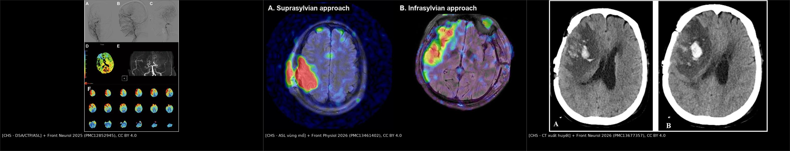
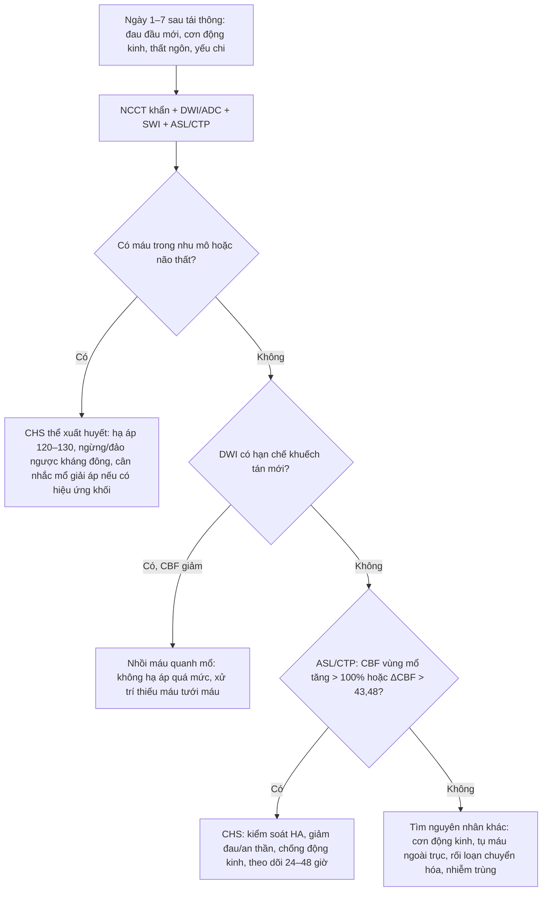
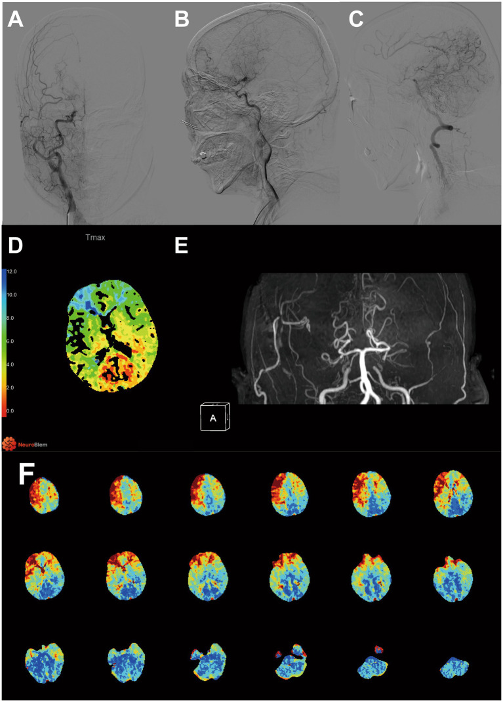
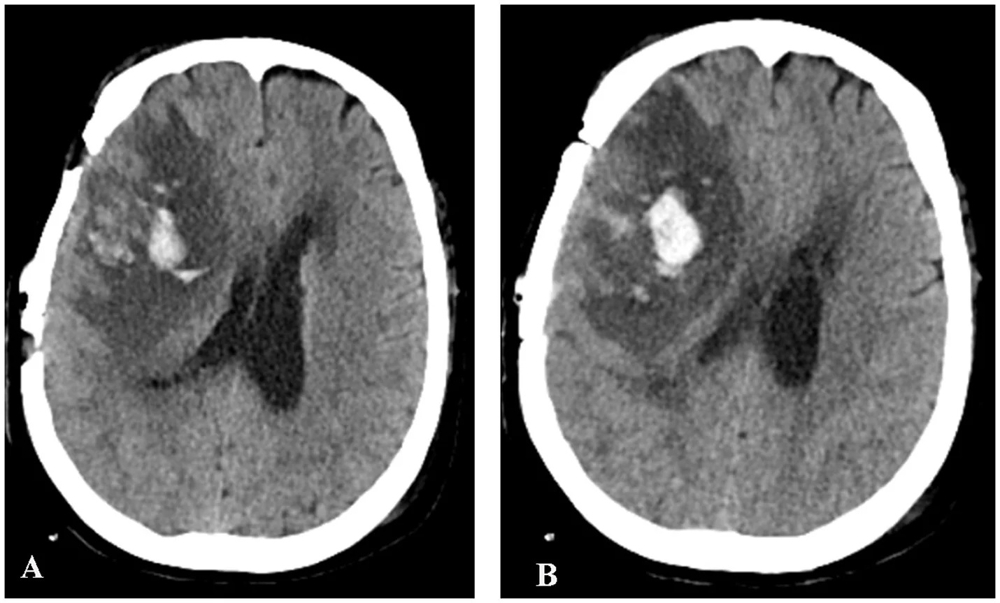
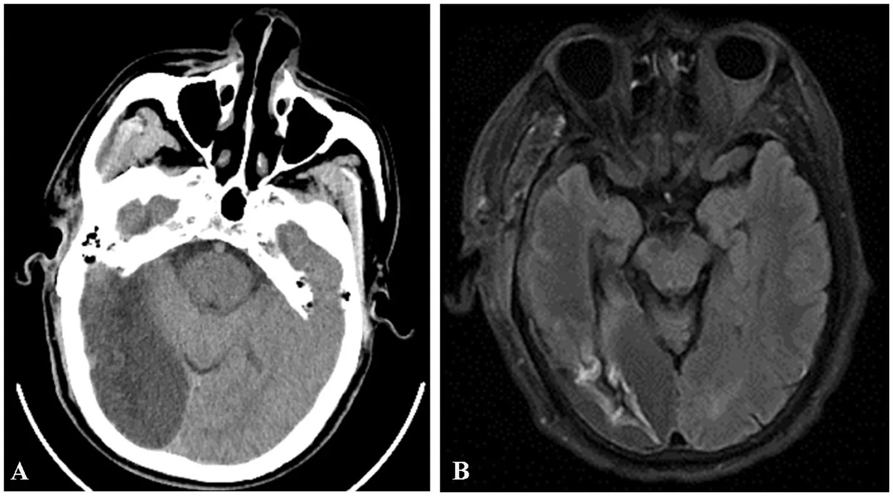

# 1784 — Hội chứng tưới máu quá mức (CHS) sau tái thông moyamoya: ASL/CTP trước–sau, ngưỡng ΔCBF > 43,48 và phân biệt chảy máu – nhồi máu – cơn động kinh

**Tags:** `pattern:tuoi-mau-bang-he` `pattern:xuat-huyet-nao` `pattern:phu-nao` `vung:nao-nhi` `vung:vo-nao` `score:Suzuki` `protocol:ASL` `protocol:CTP` `protocol:DSA` `protocol:NCCT` `protocol:SWI`
**Mức chắc chắn (certainty):** tổng hợp y văn (literature synthesis) — gộp **meta-analysis 23 nghiên cứu/2.083 ca** (2025, PMID 41392131), ba đoàn hệ tái thông moyamoya có số liệu định lượng (PMC12852945, PMC13461402, PMC13527932), một đoàn hệ **146 ca** đối chiếu ASL với biến chứng chảy máu/nhồi máu (PMC13677357), và ca minh họa nguyên văn trong các bài này. Số nào nguồn không đưa thì ghi "chưa rõ", không suy diễn.

> **Câu chốt:** CHS không phải "máu đến nhiều quá" một cách đơn giản, mà là **thất bại tự điều hòa (autoregulation failure)** của một vùng não đã giãn mạch tối đa vì thiếu máu mạn: khi miệng nối mở ra, **áp lực hệ thống truyền thẳng vào giường mao mạch không còn khả năng co lại** → phù mạch và/hoặc **xuất huyết**. Vì vậy chẩn đoán cần **triệu chứng mới + bằng chứng tăng tưới máu khu trú**, và điều trị là **hạ áp có kiểm soát**, không phải ngừng tưới máu.
> Nối [1780 – Chọn kỹ thuật tái thông moyamoya](../1780-chon-ky-thuat-tai-thong-moyamoya-o-tre/lesson.md) (kỹ thuật mổ), [1782 – Phình mạch trong moyamoya](../1782-phinh-mach-trong-moyamoya/lesson.md) (chảy máu muộn do phình) và [207 – Phình mạch nội sọ chưa vỡ](../207-phinh-mach-noi-so-chua-vo/lesson.md) (xuất huyết não).

## 1. Tổng quan bệnh học – cơ chế hình ảnh

### 1.1 Định nghĩa và vì sao CHS xảy ra (TẠI SAO)

- **Định nghĩa thực hành:** xuất hiện **triệu chứng thần kinh mới** (đau đầu khu trú, cơn động kinh, thất ngôn, yếu/giảm cảm giác) sau tái thông, kèm **tăng tưới máu khu trú** trong lãnh thổ mạch ghép trên **ASL hoặc CTP**, **không có nhồi máu mới hoặc xuất huyết nội sọ** giải thích triệu chứng (PMC13527932, PMC13461402). Tiêu chuẩn hình ảnh chặt của một đoàn hệ là **CBF vùng mổ tăng > 100% so với trước mổ** trên ASL (PMC13461402).
- **Sinh lý bệnh — ba bước:**
  1. **Giãn mạch tối đa do thiếu máu mạn:** vùng não hạ tưới (thường giai đoạn Suzuki cao) đã dùng hết **dự trữ giãn mạch**; tiểu động mạch trở nên **thụ động theo áp lực (pressure-passive)**.
  2. **Tái tưới máu đột ngột:** cầu nối STA–MCA là **mạch có sức cản thấp**, đưa áp lực hệ thống vào giường mao mạch đang giãn tối đa → **ứng suất thành mạch (wall shear stress)** tăng vọt.
  3. **Tổn thương hàng rào máu–não:** ứng suất + gốc oxy hóa + NO làm **phá vỡ BBB** → **phù mạch (vasogenic edema)**, sau đó có thể **xuất huyết** ở mạch bàng hệ/thành mạch mỏng. Đây là lý do CHS có **phổ liên tục**: chỉ tăng tưới máu → phù → xuất huyết nhu mô/não thất.
- **Vì sao không phải "tăng tưới máu lành tính":** tăng tưới máu đơn thuần sau mổ có thể **không triệu chứng**; chỉ khi vượt ngưỡng tự điều hòa mới thành CHS. Trong meta-analysis, **xuất huyết sau CHS chiếm 15% (95% CI 7–24%)**, **cơn động kinh 8% (5–11%)** (PMID 41392131) — đây là các biến cố làm thay đổi xử trí ngay.
- **Vì sao ASL/CTP thấy được:** ASL đánh dấu nước trong máu động mạch → **tín hiệu cao ở vùng CBF tăng**; CTP đo **thời gian vận chuyển (Tmax)** — vùng tăng tưới máu có **Tmax ngắn lại**. Trên CT, xuất huyết là **tăng đậm độ cấp (50–80 HU)**; trên DWI, nhồi máu là **hạn chế khuếch tán (ADC thấp)** — đây là ba đường dẫn hình ảnh tách biệt.

### 1.2 Ngưỡng định lượng nằm lòng (bắt buộc nhớ)

| Chỉ số | Con số | Nguồn |
|---|---|---|
| Tần suất CHS gộp | **23% (95% CI 17–30%)**, 23 nghiên cứu/2.083 ca | PMID 41392131 |
| Theo kỹ thuật | **trực tiếp 27%**; **phối hợp 21%** | *cùng nguồn* |
| Biến chứng của CHS | **động kinh 8% (5–11%)**; **xuất huyết 15% (7–24%)** | *cùng nguồn* |
| Đoàn hệ đơn trung tâm | **11,2% (13/116)**; **11,65% (12/103)**; **12,74%** | PMC13461402; PMC12852945; PMC13527932 |
| Thời điểm khởi phát | **15 phút – 6 ngày** sau mổ; phần lớn **trong 2 ngày đầu** | PMC12852945 |
| Thời gian hồi phục | thường **tự khỏi trong 2 tuần** nếu không xuất huyết | PMC12852945 |
| Tiêu chuẩn hình ảnh | **CBF vùng mổ tăng > 100%** so với trước mổ trên ASL | PMC13461402 |
| Ngưỡng ASL dự báo xuất huyết | **ΔCBF > 43,48 mL/100 g/phút**: AUC **0,989**, Se **100%**, Sp **95,65%**, PPV **57,1%**, NPV **100%** | PMC13677357 |
| Ngưỡng ASL dự báo nhồi máu | **ΔCBF ≤ 4,48 mL/100 g/phút**: AUC **0,915**, Se **92,86%**, Sp **78,79%**, PPV **31,7%**, NPV **99,0%** | *cùng nguồn* |
| Lưu lượng STA lúc cắt (STA-Cut) | **≤ 40,5 mL/phút**: AUC **0,843**, Se **66,3%**, Sp **100%**; nhóm CHS **26,15 ± 9,54** vs không CHS **63,88 ± 38,01** mL/phút (p = 0,0006) | PMC13527932 |
| CTP trước mổ | **Suzuki cao** OR **8,87 (1,44–54,45)**; **PCA Tmax thấp** OR **0,03 (0,00–0,69)**; mô hình **AUC 0,83**, cut-off **0,060** | PMC12852945 |
| tASL sau mổ | **thể tích tưới máu > 104,45 cm³**: AUC **0,663**, Se **69,2%**, Sp **67,0%** | PMC13461402 |
| Tuổi / giai đoạn / THA | tuổi **≥ 61**: Se **69,2%**, Sp **95,1%**; **Suzuki IV** OR **8,213 (1,460–46,193)**; **tăng huyết áp** OR **17,565 (4,371–70,584)** | *cùng nguồn* |

> **Đọc số cho đúng:** các ngưỡng ASL/CTP được **dẫn xuất và kiểm định trong cùng một đoàn hệ** (PMC13461402, PMC13677357) — tác giả tự gọi là **tín hiệu khám phá (exploratory)**, chưa phải quy tắc quyết định độc lập. Dùng để **tầng nguy cơ và chọn thời điểm chụp**, không dùng để thay thế đánh giá lâm sàng.

### 1.3 Vì sao cùng một bệnh cảnh lại có ba kiểu hình ảnh

| Kiểu | Cơ chế | Hình ảnh chốt |
|---|---|---|
| **CHS đơn thuần** | tăng tưới máu + phù nhẹ, chưa vỡ mạch | ASL/CTP tăng khu trú; NCCT bình thường hoặc phù nhẹ; DWI không hạn chế |
| **CHS thể xuất huyết** | BBB vỡ + mạch bàng hệ thành mỏng | NCCT: **tăng đậm độ trong nhu mô/não thất**; SWI: **blooming**; có thể kèm phù |
| **CHS "giả" do nhồi máu** | tưới máu không đủ hoặc tụt áp | DWI **hạn chế khuếch tán**, ADC thấp; ASL **giảm** hoặc không tăng; đừng hạ áp |

## 2. Mẫu hình + chẩn đoán phân biệt theo thời điểm và vị trí (Gamut)

- **Theo thời điểm:** **< 24 giờ** (thường gặp nhất; đau đầu, cơn động kinh, thất ngôn) → **1–3 ngày** (đỉnh phù/xuất huyết) → **3–7 ngày** (giảm dần, nhưng vẫn có ca khởi phát ngày 6). Sau 1 tuần mà triệu chứng mới thì phải tìm nguyên nhân khác (nhiễm trùng, tụ máu, động kinh muộn).
- **Theo vị trí:** vùng **miệng nối STA–MCA** (vỏ não trán–thái dương) là nơi hay gặp nhất; thể **xa miệng nối/watershed** do tái phân bố dòng; thể **bán cầu đối bên** hiếm; có thể gặp khi tăng tưới máu toàn thể hoặc sau đợt hạ áp.
- **Theo hình thái:** **ổ đơn** (quanh miệng nối) vs **lan tỏa một bán cầu** (thể nặng, dễ xuất huyết) vs **đa ổ** (gợi ý hạ áp/tắc mạch, không phải CHS).
- **Mnemonic lâm sàng "3 Đ":** **Đ**au đầu mới (khu trú, khác trước mổ), **Đ**ộng kinh, **Đ**ột ngột thay đổi ngôn ngữ/vận động — kèm **huyết áp thường cao**.
- **Gamut theo bối cảnh:**
  - **Sau tái thông trực tiếp** → CHS (27%) > nhồi máu quanh miệng nối > tụ máu ngoài trục.
  - **Sau tái thông gián tiếp** → CHS ít hơn nhưng vẫn có; nguyên nhân khác: thiếu máu vùng mổ, nhiễm trùng vết mổ.
  - **Trẻ em** → CHS có thể biểu hiện **kích thích, bỏ ăn, nôn, co giật** thay vì đau đầu/ngôn ngữ; đừng chờ "tam chứng người lớn".

## 3. Bảng so sánh phân biệt (ma trận đối chiếu)

| Thực thể (entity) | Hình ảnh điển hình | Chốt vào (rule-in) | Chốt loại (rule-out) | Gợi ý xác nhận |
|---|---|---|---|---|
| **CHS đơn thuần** | Vùng vỏ não quanh miệng nối tăng tín hiệu ASL/CTP; NCCT bình thường; DWI âm | **Triệu chứng mới khớp vị trí + CBF tăng > 100%** (hoặc ΔCBF > 43,48) | DWI hạn chế khuếch tán → không phải CHS đơn thuần | ASL/CTP lặp sau 24–48 giờ; theo dõi HA |
| **CHS thể xuất huyết** | NCCT tăng đậm độ trong nhu mô/não thất; SWI blooming; phù quanh ổ | **Máu trong nhu mô + tăng tưới máu cùng vùng** | Máu ở xa vùng tăng tưới máu → nghĩ phình vỡ lại/tăng áp | NCCT + CTA/MRA + SWI |
| **Nhồi máu quanh mổ** | Ổ giảm đậm độ theo lãnh thổ; DWI sáng/ADC tối; ASL **giảm** | **Hạn chế khuếch tán + CBF giảm** | CBF tăng mạnh + DWI âm → loại nhồi máu | DWI/ADC, CTP |
| **Cơn động kinh đơn thuần** | Có thể tăng tưới máu thoáng qua; EEG ổ động kinh | **EEG ổ + triệu chứng kiểu cơn** | Không có bất thường tưới máu kéo dài → không gọi CHS | EEG khẩn |
| **PRES** | Phù đối xứng chẩm–đỉnh, có thể xuất huyết; thường tăng HA | **Phù đối xứng hai bên + bối cảnh HA/thuốc** | Một bên, quanh miệng nối → CHS | MRI FLAIR/T2* |
| **"Luxury perfusion" sau nhồi máu** | Tăng tưới máu quanh ổ nhồi máu cũ | **DWI/ADC đã có ổ nhồi máu từ trước** | Không có nhồi máu → không phải luxury | DWI + thời điểm chụp |

*Trái: DSA/CTP/ASL trước–sau mổ — Tmax vùng PCA giảm, ASL tăng quanh miệng nối. Giữa: ASL vùng mổ theo hai đường vào. Phải: NCCT xuất huyết nhu mô sau tái thông. Nguồn: Front Neurol 2025 (PMC12852945), Front Physiol 2026 (PMC13461402), Front Neurol 2026 (PMC13677357) — CC BY 4.0. Ảnh ghép letterbox, không crop.*

### 3.1 Đọc ASL sau tái thông cho đúng

- **ASL đo CBF, không đo "áp lực":** tín hiệu cao có thể do **tăng CBF thật** hoặc do **thời gian đến (arterial transit time) ngắn**. Sau mổ, mạch ghép tốc độ cao → **tín hiệu trong lòng mạch lớn** (động mạch màng não, STA) có thể giả "tăng tưới máu". Luôn đọc **bản đồ CBF đã hiệu chỉnh**, đối chiếu MRA/CTA xem miệng nối có thông.
- **Đối chiếu ba chuỗi:** **DWI/ADC** loại nhồi máu; **SWI/T2\*** loại vi chảy máu; **NCCT** loại xuất huyết cấp. Chỉ khi cả ba âm mới gọi CHS "đơn thuần".
- **So sánh đúng:** dùng **cùng vùng ROI (region of interest) trước–sau**, không so với bán cầu đối侧 vì bán cầu đối侧 có thể bị "ăn cắp" dòng (steal) và trông giảm.

### 3.2 Ba cạm bẫy số liệu hay bị đọc ngược

1. **STA-Cut flow thấp lại đi với CHS cao** (26,15 vs 63,88 mL/phút). Đây là **liên hệ nghịch, chưa phải quan hệ nhân quả**; giả thuyết hợp lý là mạch ghép có **sức cản ngoại vi cao/không giãn được** nên áp lực truyền vào giường mao mạch mạnh hơn, nhưng nguồn chưa chứng minh. Đừng dùng một mình để quyết định mổ.
2. **Tmax PCA thấp dự báo CHS:** nghĩa là **tuần hoàn sau đã bù tốt**, không phải "thiếu máu nặng"; khi miệng nối trước mở ra, hai dòng cùng đổ vào vùng tự điều hòa kém → dễ quá tải. Đây là **nghịch lý cần nhớ**, không phải lỗi đo.
3. **"Tăng tưới máu không triệu chứng" không phải CHS:** trong 116 ca, 13 ca CHS nhưng nhiều ca khác có ASL tăng mà không có triệu chứng. Chẩn đoán luôn **lâm sàng trước, hình ảnh sau**.

## 4. Protocol chụp + phân độ + flowchart

### 4.1 Protocol

- **Trước mổ:** **CTP định lượng** (Tmax, CBF, CBV) + **DSA** ± **MRA TOF** để đánh giá Suzuki, bàng hệ, và **Tmax vùng PCA** (yếu tố dự báo CHS). Ghi rõ **ROI theo ASPECTS** nếu dùng CTP.
- **Sau mổ:**
  - **NCCT ngay khi có triệu chứng** (loại xuất huyết cấp; đây là bước đầu tiên, không chờ ASL).
  - **MRI: DWI/ADC + FLAIR + SWI/T2\*** (loại nhồi máu, phù, vi chảy máu).
  - **ASL** ở **ngày 1, ngày 7, ngày 30** (theo lịch đoàn hệ PMC13461402); nếu có triệu chứng thì chụp ngay, không chờ lịch.
  - **MRA/CTA** kiểm tra miệng nối thông và loại phình vỡ lại (nhất là khi máu không khớp vùng tăng tưới máu).
- **Theo dõi huyết áp:** đích **huyết áp tâm thu 120–130 mmHg** trong giai đoạn nguy cơ; tránh **tụt áp** vì có thể gây nhồi máu (PMC12852945).
- **Hydration:** **30–50 mL/kg** trong giai đoạn quanh mổ (theo protocol của đoàn hệ PMC12852945) — không để hạ thể tích, nhưng cũng không truyền quá nhanh.
- **Chống động kinh:** một đoàn hệ dùng **100 mg/ngày** dự phòng trong giai đoạn quanh mổ (PMC12852945); không có bằng chứng RCT cho mọi bệnh nhân — cân nhắc theo nguy cơ.

### 4.2 Phân độ / thang điểm

- **Suzuki I–VI:** mức hẹp–tắc và mạng bàng hệ; **Suzuki IV–V** là nhóm nguy cơ CHS cao (OR 8,213 cho stage IV; stage V ước lượng dương nhưng CI rộng).
- **Thang MBC:** điểm thấp liên quan CHS trong một đoàn hệ (11/13 ca CHS có MBC ≤ 4 vs 41/89 không CHS, p = 0,015) — dùng như **yếu tố bổ sung**, chưa phải thang chuẩn quốc tế.
- **Không có RADS cho CHS:** không gán "CHS-RADS"; dùng **phân tầng nguy cơ theo Suzuki + CTP/ASL + lâm sàng**.

## 5. Biến thể bình thường và cạm bẫy

- **Tăng tưới máu quanh miệng nối không triệu chứng:** gặp khá thường xuyên trên ASL ngày 1–3; **không chẩn đoán CHS** nếu không có triệu chứng mới. Tránh "điều trị hình ảnh".
- **Tín hiệu mạch máu trong ASL:** STA/động mạch màng não có tín hiệu rất cao, dễ bị đọc là "vỏ não tăng tưới máu". Dùng **bản đồ CBF**, không dùng ảnh ASL thô.
- **Hiệu ứng "steal" bán cầu đối侧:** bán cầu không mổ có thể giảm tín hiệu; đừng gọi là "nhồi máu" nếu DWI âm.
- **Hạ áp quá tay:** sau khi thấy ASL tăng, nếu hạ HA mạnh có thể gây **nhồi máu vùng miệng nối** — ngưỡng 120–130 mmHg là để **tránh cả hai cực**, không phải càng thấp càng tốt.
- **Cơn động kinh đơn thuần:** có thể làm tăng CBF thoáng qua và tăng tín hiệu ASL; nếu EEG có ổ động kinh và ASL tăng chỉ trong cơn, điều trị động kinh là chính.
- **Máu không khớp vùng tăng tưới máu:** nghĩ **phình bàng hệ vỡ lại** (bài 1782) hoặc **tăng áp lực nội sọ** do nguyên nhân khác — cần CTA/MRA, không quy mọi chảy máu sau mổ cho CHS.
- **Trẻ nhỏ:** triệu chứng có thể chỉ là **quấy khóc, nôn, li bì, co giật**; chỉ số ASL bình thường theo tuổi chưa được chuẩn hóa đầy đủ — đọc cùng lâm sàng và điện não.

## 6. Tự lượng giá — Blind Quiz

**Ca 1 — Nữ 56 tuổi, moyamoya, ngày 1 sau STA–MCA trái, đột ngột nói khó.**

- Gợi ý: trước mổ có cơn chóng mặt/yếu chi tái diễn 3 năm; sau mổ xuất hiện rối loạn ngôn ngữ.
- Hỏi: (1) Dấu hiệu chính trên CTP trước mổ? (2) ASL sau mổ cho thấy gì? (3) Ba chẩn đoán phân biệt và bước xử trí đầu tiên?

<b>Bấm để hiện đáp án (findings + chẩn đoán)</b>

- **CTP trước mổ (D):** **Tmax vùng PCA thấp** (màu đỏ/xanh theo thang), tức tuần hoàn sau đã bù tốt; **DSA (A–C)** hẹp/tắc đoạn tận ICA; **MRA (E)** thấy miệng nối; **ASL (F)** sau mổ tăng tín hiệu khu trú vùng vỏ não trán–thái dương trái, khớp vùng nói.
- **Chẩn đoán:** **CHS** sau tái thông trực tiếp — triệu chứng mới + tăng tưới máu khu trú, không có nhồi máu/xuất huyết trên phim.
- **Phân biệt:** nhồi máu quanh miệng nối (DWI sẽ hạn chế khuếch tán, ASL giảm), xuất huyết nhu mô (NCCT tăng đậm độ), cơn động kinh (EEG).
- **Xử trí:** NCCT khẩn + DWI/SWI; giữ **HA tâm thu 120–130 mmHg**, giảm đau/an thần, chống động kinh nếu có cơn; theo dõi sát 24–48 giờ. Không hạ áp quá mức.
- **Nguồn:** Front Neurol 2025 (PMC12852945), CC BY 4.0; ca nguyên văn trong bài.

**Ca 2 — Nam 48 tuổi, ngày 2 sau tái thông, đau đầu dữ dội rồi lơ mơ.**

- Hỏi: (1) Mô tả ổ tăng đậm độ? (2) Đây là CHS thể gì? (3) Vì sao không được hạ huyết áp xuống quá thấp?

<b>Bấm để hiện đáp án</b>

- **Findings:** ổ **tăng đậm độ trong nhu mô bán cầu phải** (A, B), quanh vùng miệng nối, kèm phù nhẹ; không thấy máu dưới nhện lan tỏa.
- **Chẩn đoán:** **CHS thể xuất huyết** — biến chứng nặng nhất của tăng tưới máu; trong meta-analysis, xuất huyết sau CHS chiếm **15% (7–24%)**.
- **Vì sao không hạ áp quá thấp:** vùng não quanh ổ máu vẫn phụ thuộc áp lực tưới máu; hạ áp mạnh gây **nhồi máu lan rộng** quanh ổ máu. Đích thực hành là **HA tâm thu 120–130 mmHg**, tránh dao động.
- **Xử trí:** ngừng/đảo ngược kháng đông nếu có; theo dõi ý thức/đồng tử; **mổ giải áp** khi có hiệu ứng khối và suy giảm tri giác (nguyên tắc chung của xuất huyết não, không riêng CHS).
- **Nguồn:** Front Neurol 2026 (PMC13677357), CC BY 4.0.

**Ca 3 — Nữ 60 tuổi, ngày 3 sau tái thông, yếu nửa người phải tiến triển; ASL không tăng, DWI có ổ sáng.**

- Hỏi: (1) Vì sao đây **không** phải CHS? (2) Ngưỡng ASL nào dự báo nhồi máu? (3) Xử trí khác CHS ở điểm nào?

<b>Bấm để hiện đáp án</b>

- **Findings:** NCCT (A) ổ **giảm đậm độ** vùng thái dương phải; MRI (B) ổ **tăng tín hiệu** tương ứng, phù hợp nhồi máu. ASL **không tăng** (nếu có ảnh), DWI hạn chế khuếch tán.
- **Chẩn đoán:** **nhồi máu quanh mổ**, không phải CHS. Ngưỡng ASL gợi ý: **ΔCBF ≤ 4,48 mL/100 g/phút** → nguy cơ nhồi máu (AUC 0,915; Se 92,86%; Sp 78,79%); **ΔCBF > 43,48** mới đi với xuất huyết.
- **Xử trí:** **không hạ huyết áp**; duy trì thể tích và áp lực tưới máu; tìm nguyên nhân (tụt áp, tắc miệng nối, co mạch); cân nhắc thuốc chống kết tập tiểu cầu theo phác đồ và hội chẩn mạch máu.
- **Nguồn:** Front Neurol 2026 (PMC13677357), CC BY 4.0.

## Bài liên quan chéo

- [1780 – Chọn kỹ thuật tái thông moyamoya ở trẻ](../1780-chon-ky-thuat-tai-thong-moyamoya-o-tre/lesson.md)
- [1782 – Phình mạch nội sọ trong bệnh moyamoya](../1782-phinh-mach-trong-moyamoya/lesson.md)
- [1795 – Xuất huyết & vi chảy máu trong moyamoya](../1795-xuat-huyet-vi-chay-mau-moyamoya-o-tre/lesson.md)
- [207 – Phình mạch nội sọ chưa vỡ](../207-phinh-mach-noi-so-chua-vo/lesson.md)
- [3034 – Chảy máu não thất & não úng thủy sau xuất huyết](../3034-chay-mau-nao-that-ivh-nao-ung-thuy/lesson.md)

## Ảnh

- `1784_hoi-chung-tuoi-mau_DSA-CTP-ASL_PMC12852945.jpg` — DSA/CTP/MRA/ASL ca CHS nguyên văn; **Front Neurol 2025 (PMC12852945), CC BY 4.0**.
- `1784_hoi-chung-tuoi-mau_ASL_PMC13461402.jpg` — ASL vùng mổ theo hai đường vào; **Front Physiol 2026 (PMC13461402), CC BY 4.0**.
- `1784_hoi-chung-tuoi-mau_CT-xuat-huyet_PMC13677357.jpg` — NCCT xuất huyết sau tái thông; **Front Neurol 2026 (PMC13677357), CC BY 4.0**.
- `1784_hoi-chung-tuoi-mau_CT-MRI-nhoi-mau_PMC13677357.jpg` — CT/MRI nhồi máu quanh mổ; **Front Neurol 2026 (PMC13677357), CC BY 4.0**.
- `composite_1784_tuoi-mau-qua-muc.jpg` — ảnh ghép letterbox từ 3 ảnh trên (không crop, không kéo giãn); attribution ghi trong dải đen.
- Chi tiết giấy phép từng file: `images/CREDITS.md`.

> Không dùng để chẩn đoán độc lập khi chưa có người hướng dẫn.
