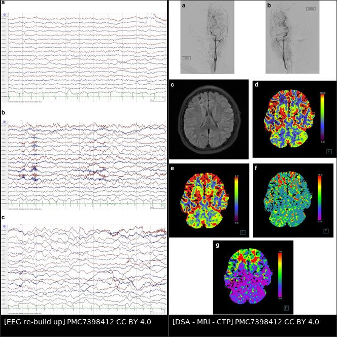
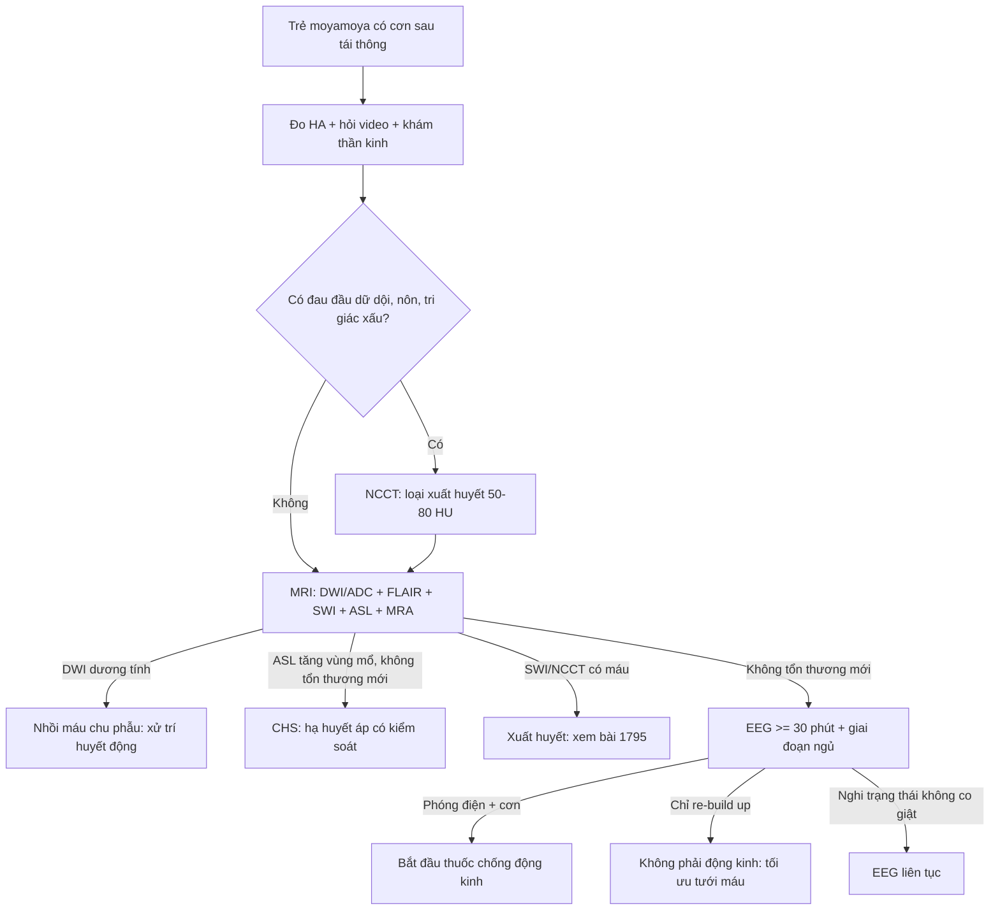
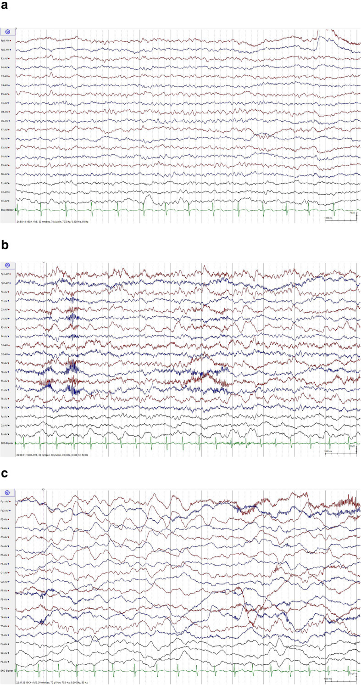
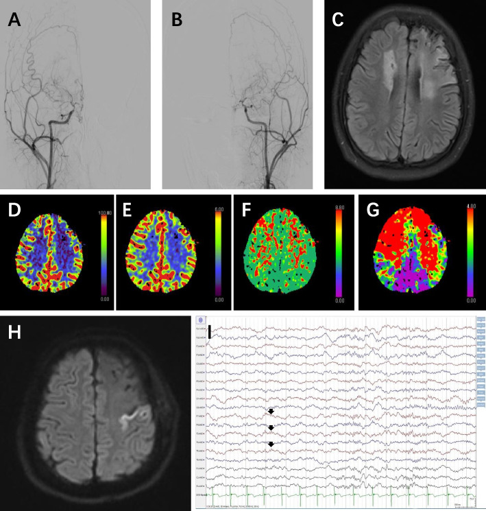
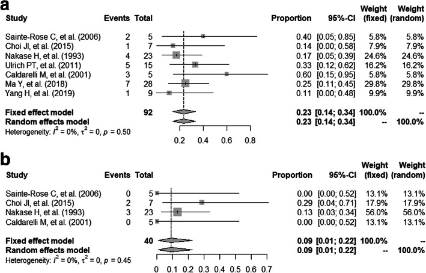

# 1785 — Động kinh sau tái thông moyamoya ở trẻ: phân biệt cơn do CHS – nhồi máu – xuất huyết, EEG "re-build up" và khi nào dùng thuốc chống động kinh

**Tags:** `pattern:dong-kinh` `pattern:thieu-mau-nao` `pattern:tuoi-mau-bang-he` `vung:nao-nhi` `vung:vo-nao` `vung:mach-nao` `protocol:EEG` `protocol:MRI-DWI` `protocol:ASL` `protocol:CTP`
**Mức chắc chắn (certainty):** tổng hợp y văn (literature synthesis) — gộp **tổng quan phạm vi 43 bài** về cơn/động kinh/EEG ở moyamoya trẻ (PMID 36577597), **đoàn hệ 84 trẻ** (PMID 37271055), **đoàn hệ 110 trẻ có EEG** (PMC7398412), **298 ca tìm yếu tố dự báo cơn sớm sau mổ** (PMC9793645), **696 ca với 28 trẻ có cơn trước mổ** (PMID 29128331) và **meta-analysis 7 đoàn hệ** (PMC7852094). Chỗ nguồn không có số thì ghi "chưa rõ".

> **Câu chốt:** cơn sau tái thông moyamoya **không phải một chẩn đoán** mà là **một trong bốn trạng thái tưới máu khác nhau**: cơn do **tăng tưới máu (CHS)**, do **nhồi máu**, do **xuất huyết**, hoặc **động kinh nền tiếp diễn**. Điều trị khác nhau hoàn toàn — hạ huyết áp cho CHS, xử trí nhồi máu, còn **thuốc chống động kinh chỉ giải quyết triệu chứng**. Vì vậy mọi cơn sau mổ phải được **chụp hình trong 24 giờ đầu** trước khi chỉ tăng liều thuốc.
> Bổ trợ trực tiếp cho [1784 – Hội chứng tưới máu quá mức (CHS)](../1784-hoi-chung-tuoi-mau-qua-muc-sau-tai-thong-moyamoya/lesson.md); nối [1780 – Chọn kỹ thuật tái thông](../1780-chon-ky-thuat-tai-thong-moyamoya-o-tre/lesson.md), [1782 – Phình mạch trong moyamoya](../1782-phinh-mach-trong-moyamoya/lesson.md), [1795 – Xuất huyết/vi chảy máu moyamoya](../1795-xuat-huyet-vi-chay-mau-moyamoya-o-tre/lesson.md) và [681 – Chống kết tập tiểu cầu sau tái thông](../681-chong-ket-tap-tieu-cau-sau-tai-thong-mach-nao-o-tre/lesson.md).

## 1. Tổng quan bệnh học – cơ chế hình ảnh

### 1.1 Vì sao trẻ moyamoya bị động kinh (và vì sao > một nửa không có ổ nhồi máu)

- **Thiếu máu mạn → tái cấu trúc vỏ não:** hẹp tiến triển động mạch cảnh trong + bàng hệ mỏng manh làm vỏ não **hạ tưới mạn**. Tế bào thần kinh trong vùng **dự trữ tưới máu cạn (misery perfusion)** dễ bị **khử cực bất thường** khi có stress chuyển hóa — đây là cơ chế "động kinh do huyết động" (hemodynamic epilepsy), **không cần ổ nhồi máu**.
- **Bằng chứng:** trong tổng quan phạm vi 43 bài, **9–19% trẻ moyamoya có động kinh**, và **hơn một nửa số ca không có bằng chứng thiếu máu trên hình ảnh** (PMID 36577597). Nghĩa là **MRI bình thường không loại trừ động kinh moyamoya**.
- **Vì sao trẻ nhỏ và trẻ có triệu chứng dễ bị hơn:** tuổi nhỏ là yếu tố nhất quán nhất; trong 84 trẻ, **moyamoya nguyên phát (bệnh) so với hội chứng OR 3,43**, **có ổ nhồi máu trên hình ảnh nền OR 5,80**, **tuổi lớn hơn mỗi năm OR 0,82**, **phát hiện tình cờ trên hình ảnh OR 0,05** (PMID 37271055).
- **Vì sao tăng thông khí gây cơn:** khóc, thổi sáo, chạy… → **giảm CO₂ → co mạch não**; ở trẻ đã dùng hết dự trữ giãn mạch, co mạch này **không bù trừ được** → thiếu máu khu trú → cơn hoặc TIA. Đây là lý do **tăng thông khí trong EEG không phải "nghiệm pháp vô hại"** ở moyamoya.
- **Vì sao sau mổ vẫn còn cơn:** tái thông tạo **dòng máu mới nhưng không hồi phục ngay** vùng vỏ đã tổn thương; đồng thời **thay đổi huyết động cấp** (tăng tưới máu hoặc nhồi máu chu phẫu) tạo **cơn sớm**. Vì vậy tỉ lệ cơn sau mổ vẫn đáng kể (mục 1.2).

### 1.2 Ngưỡng định lượng nằm lòng

| Chỉ số | Con số | Nguồn |
|---|---|---|
| Động kinh ở trẻ moyamoya | **9–19%**; **> 50% không có thiếu máu trên hình ảnh** | PMID 36577597 |
| Cơn ở đoàn hệ chuyên khoa | **40% (34/84)** — quần thể được giới thiệu, cao hơn dân số chung | PMID 37271055 |
| Tiền sử cơn/động kinh | **15,5% (17/110)**; nhồi máu làm tăng **RR 1,62** | PMC7398412 |
| EEG bất thường (15 trẻ có EEG đầy đủ) | **93,3%** — **chậm khu trú 80,0%**, **phóng điện động kinh 66,7%**, **chậm lan tỏa 60,0%**; **"re-build up" 1 ca** | PMC7398412 |
| Hiện tượng "re-build up" khi tăng thông khí | **tới 50%** trẻ moyamoya | PMC12593773 (tổng quan) |
| Cơn SỚM sau tái thông (< 1 tuần) | **5,0% (15/298)** | PMC9793645 |
| Yếu tố dự báo cơn sớm | **nhồi máu sau mổ OR 12,89 (4,198–39,525)**; **nhồi máu trước mổ OR 4,08 (1,267–13,119)**; tuổi và bên nhồi máu **không** có ý nghĩa | PMC9793645 |
| Cơn sau mổ ở trẻ **đã có động kinh trước mổ** | **23,44%** (gộp 7 đoàn hệ) | PMC7852094 |
| Nhồi máu sau mổ ở nhóm động kinh | **9,12%** | PMC7852094 |
| Tái phát cơn sau tái thông | **25,0% (7/28)**, trung vị theo dõi **42 tháng** | PMID 29128331 |
| Yếu tố dự báo tái phát | **thời gian mắc động kinh OR 3,84 (1,54–24,34), p = 0,035**; trực tiếp vs gián tiếp **không khác** | PMID 29128331 |
| Cơn là biến chứng của CHS | **8% (95% CI 5–11%)** | PMID 41392131 (qua bài 1784) |
| Ảnh hưởng chức năng | Có cơn → **điểm PSOM cao hơn +2,03 (p < 0,001)**, sau hiệu chỉnh **+1,54 (p = 0,025)** | PMID 37271055 |

### 1.3 Vì sao EEG thấy "re-build up" (vật lý – sinh lý, không phải mẹo đọc)

- **Bình thường:** tăng thông khí → hypocapnia → co mạch → **sóng chậm đồng bộ xuất hiện**, rồi **mất nhanh trong 30–60 giây** sau khi thở lại (phản ứng mạch bình thường).
- **Moyamoya:** mạch đã giãn tối đa để bù hẹp; khi hypocapnia, **không còn khả năng co–giãn dự trữ** → vùng vỏ hạ tưới **không "bắt kịp"** → **sóng chậm delta quay trở lại muộn và kéo dài** ở phút thứ 5 sau tăng thông khí. Đây là **dấu hiệu suy giảm dự trữ tưới máu**, không phải tổn thương cấu trúc.
- **Hệ quả thực hành:** "re-build up" **không phải phóng điện động kinh**; đọc nhầm thành ổ động kinh khu trú sẽ dẫn tới **dùng thuốc sai** trong khi vấn đề là **huyết động**. Ngược lại, **phóng điện thật** (spike/polyspike) mới là đích của thuốc.

## 2. Mẫu hình + chẩn đoán phân biệt theo vị trí (gamut)

**Mẫu hình:** trẻ moyamoya **sau tái thông**, xuất hiện **cơn co giật cục bộ (một chi, mặt, hoặc có quán tính) ± lan toàn thể**, thường **trong 1 tuần đầu** hoặc **muộn hơn** khi giảm/ngừng thuốc.

Bốn trục sinh lý — phân biệt theo **thời điểm + hình ảnh + huyết áp**:

- **Trục 1 — Cơn do tăng tưới máu (CHS):** xuất hiện **15 phút – 6 ngày** sau mổ, kèm **đau đầu khu trú, huyết áp tăng**, hình ảnh **ASL/CTP tăng tưới máu vùng mổ**, **không nhồi máu/xuất huyết mới** (bài 1784).
- **Trục 2 — Cơn do nhồi máu chu phẫu:** cơn **sớm**, kèm **khiếm khuyết thần kinh tồn tại**, **DWI sáng/ADC tối** trong lãnh thổ mới; đây là **yếu tố nguy cơ mạnh nhất** (OR 12,89).
- **Trục 3 — Cơn do xuất huyết:** đau đầu dữ dội, nôn, tri giác xấu đi; **NCCT tăng đậm độ 50–80 HU**, **SWI** thấy vi chảy máu; thường liên quan **phình bàng hệ** hoặc **CHS nặng** (bài 1782/1795).
- **Trục 4 — Động kinh nền (trước mổ) tiếp diễn:** cơn **giống hệt cơn cũ**, không kèm thay đổi hình ảnh; **thời gian mắc càng dài, nguy cơ tái phát càng cao** (OR 3,84).
- **Bắt chước (mimics):** **TIA rung lắc chi (limb-shaking TIA)** — cơn **ngắn 1–2 phút**, không mất ý thức, **không có phóng điện trên EEG**, khởi phát khi khóc/vận động; **ngất do ho/khóc**, **đau nửa đầu có aura**, **cơn giả động kinh (PNES)** ở trẻ lớn.

**Mnemonic "4T":** **T**hời điểm (Timing), **T**ưới máu (perfusion — ASL/CTP), **T**ổn thương (DWI/SWI), **T**huốc (drug level/Adherence).

## 3. Bảng so sánh phân biệt (ma trận đối chiếu)

| Thực thể (entity) | Hình ảnh/lâm sàng điển hình | Chốt vào (rule-in) | Chốt loại (rule-out) | Gợi ý xác nhận |
|---|---|---|---|---|
| **Cơn do CHS** | Cơn trong **6 ngày đầu**, đau đầu khu trú, **HA tăng**, ASL/CTP **tăng tưới máu** vùng mổ, **không nhồi máu/xuất huyết** | **CBF vùng mổ tăng > 100%** so với trước mổ (hoặc tăng rõ trên ASL) + không tổn thương mới | DWI có ổ hạn chế khuếch tán mới → không phải CHS đơn thuần | ASL/CTP, theo dõi HA, hạ áp có kiểm soát |
| **Cơn do nhồi máu** | Cơn **sớm**, khiếm khuyết tồn tại, **DWI sáng/ADC tối** theo lãnh thổ | **DWI dương tính trong 24 giờ** + cơn phù hợp lãnh thổ | MRI/DWI âm tính sau 24–48 giờ → ít khả năng | MRI DWI/ADC, MRA miệng nối |
| **Cơn do xuất huyết** | Đau đầu dữ dội, nôn, tri giác giảm; **NCCT tăng đậm độ**, SWI vi chảy máu | **Máu trên NCCT/SWI** | NCCT/SWI âm tính | NCCT cấp, SWI, CTA/DSA nếu nghi phình |
| **Động kinh nền tái phát** | Cơn **giống cơn trước mổ**, không tổn thương mới, **thời gian mắc dài** | **Cơn kiểu cũ + EEG ổ phóng điện cũ** | Cơn kiểu mới + tổn thương mới → tìm nguyên nhân cấp | EEG so sánh trước–sau, hỏi người nhà quay video |
| **TIA rung lắc chi** | **Rung lắc một chi 1–2 phút**, không mất ý thức, khởi phát khi khóc/vận động, **không có phóng điện** | **Video + EEG ictal không có phóng điện** | Phóng điện ictal rõ → động kinh thật | EEG trong cơn, ASL/CTP tìm hạ tưới |
| **Cơn giả động kinh (PNES)** | Đa dạng, **mắt nhắm chặt**, không chấn thương, kéo dài, **EEG bình thường trong cơn** | **EEG ictal bình thường + yếu tố tâm lý** | Prolactin sau cơn tăng, phóng điện ictal → cơn thật | EEG video, đánh giá tâm lý |

*Trái: EEG trước – cuối – 5 phút sau tăng thông khí, sóng chậm khu trú bán cầu trái tái xuất hiện muộn ("re-build up"). Phải: cùng bệnh nhi 9 tuổi — DSA hẹp tận động mạch cảnh trong hai bên, MRI FLAIR ổ nhồi máu trán hai bên, CTP giảm tưới máu trán. Chin Neurosurg J 2020 (PMC7398412), CC BY 4.0; ảnh ghép letterbox.*

### Ba dấu hiệu quyết định

- **Cơn + huyết áp tăng + ASL nóng = CHS:** hướng điều trị là **hạ huyết áp có kiểm soát**, không phải tăng thuốc chống động kinh (bài 1784).
- **Cơn + DWI dương tính = nhồi máu:** đây là **biến chứng, không phải "cơn đơn thuần"**; OR 12,89 giải thích vì sao **phải chụp MRI trước khi kết luận**.
- **"Re-build up" không phải ổ động kinh:** nó chỉ ra **vùng dự trữ tưới máu kém**, thường cải thiện sau tái thông thành công (PMID 36577597).

## 4. Protocol chụp + hệ phân độ/điểm chuẩn hóa

### 4.1 Đánh giá một cơn sau tái thông (24 giờ đầu)

1. **Lâm sàng:** hỏi **video điện thoại** (quý hơn mô tả), thời lượng, có mất ý thức, có yếu nửa người sau cơn (Todd), đo **huyết áp** ngay.
2. **NCCT không cản quang** nếu cơn kèm đau đầu dữ dội/nôn/tri giác xấu — loại xuất huyết (50–80 HU).
3. **MRI khẩn:** **DWI/ADC** (nhồi máu), **FLAIR**, **SWI** (vi chảy máu), **ASL** (tăng/giảm tưới máu), **MRA TOF** (miệng nối, hẹp tiến triển). Thời gian lý tưởng **≤ 24 giờ** sau cơn.
4. **EEG:**
   - **EEG thường ≥ 30 phút, có giai đoạn ngủ** — tìm phóng điện, chậm khu trú, và **re-build up**.
   - **Tăng thông khí có kiểm soát ≤ 3 phút**, luôn có người theo dõi lâm sàng, **dừng ngay** nếu trẻ yếu/đau đầu/nói khó — vì có thể **gây thiếu máu thật** (mục 5).
   - **EEG liên tục (cEEG)** khi: cơn lặp lại, không hồi phục tri giác, nghi **trạng thái động kinh không co giật**, hoặc trẻ thở máy sau mổ.
5. **Phân tầng theo kết quả:** CHS (bài 1784) · nhồi máu (xử trí huyết động, không hạ áp mù) · xuất huyết (bài 1795) · động kinh nền (thuốc + theo dõi).

### 4.2 Thuốc chống động kinh: khi nào, bao lâu

- **Không có RCT chọn thuốc cho moyamoya**; thực hành chọn theo **động kinh cục bộ có căn nguyên mạch máu** (tương tự động kinh sau đột quỵ) — đây là **suy luận từ dữ liệu dược lý**, không phải bằng chứng cấp 1 (PMC12593773).
- **Bắt đầu thuốc khi:** có **≥ 1 cơn co giật rõ ràng** hoặc **phóng điện động kinh kèm cơn trên EEG**, đặc biệt khi **đã loại trừ nguyên nhân cấp có thể sửa** (CHS, nhồi máu, xuất huyết).
- **Dự phòng sau mổ thường quy: chưa có bằng chứng**; một số trung tâm dùng ngắn hạn trong phác đồ CHS (ví dụ **100 mg/ngày** trong một đoàn hệ — PMC12852945 qua bài 1784), nhưng **không được coi là chuẩn**.
- **Thời gian:** **ngừng thuốc chỉ khi ≥ 2 năm không cơn + EEG không còn phóng điện + tưới máu ổn định trên ASL/CTP** (suy luận — chưa có nghiên cứu riêng ở moyamoya); **không ngừng đột ngột** ở trẻ có ổ tổn thương vỏ não.
- **Sau khi ngừng:** theo dõi **≥ 6 tháng**, dặn quay lại ngay nếu cơn tái xuất — vì **25% trẻ có cơn trước mổ vẫn tái phát** dù đã tái thông (PMID 29128331).

### 4.3 Sơ đồ tiếp cận

> **Không có RADS cho động kinh moyamoya.** "Phân độ" dùng trong bài này là **phân tầng cơ chế 4 trục** (CHS / nhồi máu / xuất huyết / động kinh nền) — vì nó quyết định điều trị, còn phân độ hình ảnh không có.

## 5. Biến thể bình thường và cạm bẫy

- **Biến thể bình thường:** **sóng chậm sau tăng thông khí ở trẻ lành** (mất trong 30–60 giây); **re-build up** khác ở chỗ **quay lại muộn và kéo dài** — đừng overcall "ổ động kinh" chỉ vì có chậm khu trú.
- **Bẫy 1 — tăng thông khí gây thiếu máu thật:** ở trẻ moyamoya, nghiệm pháp này có thể **gây cơn/TIA**; luôn giới hạn thời gian, có giám sát, dừng khi có triệu chứng. Đừng lặp lại nhiều lần "để chắc".
- **Bẫy 2 — yếu nửa người sau cơn (Todd) bị đọc là CHS/đột quỵ:** Todd **hồi phục trong 24–48 giờ**, không có tổn thương mới; CHS có **tăng tưới máu trên ASL**; đột quỵ có **DWI dương tính**. Điều trị sai hướng (hạ áp mù vs tăng thuốc) đều nguy hiểm.
- **Bẫy 3 — cơn sớm là dấu hiệu của nhồi máu:** **OR 12,89**; nếu chỉ thêm thuốc chống động kinh mà không chụp MRI, bỏ sót nhồi máu và mất cửa sổ xử trí.
- **Bẫy 4 — CHS có cơn:** **8%** ca CHS có cơn; hạ áp là điều trị chính, không phải thuốc chống động kinh.
- **Bẫy 5 — tưởng tái thông "chữa khỏi" động kinh:** **23,44%** trẻ có động kinh trước mổ vẫn còn cơn sau mổ; **25%** tái phát trong theo dõi trung vị 42 tháng → phải theo dõi dài, không ngừng thuốc sớm.
- **Bẫy 6 — bỏ sót TIA rung lắc chi:** cơn ngắn, không mất ý thức, EEG không phóng điện; **tăng thuốc chống động kinh không giúp**, cần **đánh giá tưới máu và tái thông**.
- **Bẫy 7 — an thần che lấp:** thuốc chống động kinh liều cao làm trẻ ngủ gà, khó đánh giá tri giác và **che dấu hiệu CHS/nhồi máu**; giữ liều thấp nhất hiệu quả, đánh giá lại sau 24–48 giờ.

## 6. Tự lượng giá — Blind Quiz

**Ca 1 — Bé trai 10 tuổi moyamoya, EEG làm trước và sau tăng thông khí.**

- Gợi ý: trẻ có cơn rung lắc tay trái khi khóc; không sốt.
- Câu hỏi: (a) hình b và c khác nhau ở đâu? (b) đây có phải **phóng điện động kinh** không? (c) dấu hiệu này nói lên điều gì về sinh lý mạch máu?

<b>Bấm để hiện đáp án (findings + chẩn đoán)</b>

- **Findings:** (a) trước tăng thông khí — nền tương đối đối xứng; (b) cuối tăng thông khí — sóng chậm bán cầu trái; (c) **5 phút sau** — sóng chậm **tái xuất hiện và lan rộng** ở bán cầu trái = **"re-build up"**.
- **Không phải phóng điện động kinh** (không có spike/polyspike ictal) → **không phải chỉ định thuốc chống động kinh** dựa trên hình này.
- **Ý nghĩa:** vùng bán cầu trái **mất dự trữ giãn mạch** — hypocapnia gây co mạch không bù trừ được; đây là dấu hiệu **hạ tưới máu huyết động**, thường cải thiện sau tái thông.
- Nguồn ảnh: Chin Neurosurg J 2020 (**PMC7398412**), Hình 2, CC BY 4.0.

**Ca 2 — Bé gái 14 tuổi, 1 ngày sau EDAS trái, co giật tay phải nhưng vẫn tỉnh.**

- Câu hỏi: Cơn này do **CHS** hay do **nhồi máu**? Dấu hiệu nào trên hình quyết định? Xử trí khác nhau thế nào?

<b>Bấm để hiện đáp án</b>

- **Findings:** DSA (A, B) tắc/hẹp tận động mạch cảnh trong hai bên; FLAIR (C) và DWI (H) **ổ nhồi máu mới**; CTP (D–G) **giảm tưới máu**; EEG (I) có **hoạt động dạng động kinh chu kỳ**.
- **Chẩn đoán:** **cơn sớm sau tái thông do NHỒI MÁU chu phẫu**, không phải CHS đơn thuần — cơn kèm **khiếm khuyết thực thể** và **DWI dương tính**.
- **Xử trí:** xử trí huyết động (tránh tụt huyết áp, kiểm soát dịch, xem lại miệng nối), **không hạ áp mù như CHS**; thuốc chống động kinh chỉ để kiểm soát cơn.
- **Vì sao phải chụp trước khi kê thuốc:** nhồi máu sau mổ là **yếu tố nguy cơ mạnh nhất** của cơn sớm (OR 12,89).
- Nguồn ảnh: Chin Neurosurg J 2022 (**PMC9793645**), Hình 1, CC BY 4.0.

**Ca 3 — Đọc kết quả gộp: trẻ có động kinh trước mổ, sau tái thông.**

- Câu hỏi: Nói với gia đình "mổ sẽ hết cơn" có đúng không? Hai con số cần nhớ là gì?

<b>Bấm để hiện đáp án</b>

- **Findings:** tỉ lệ gộp **cơn sau mổ 23,44%** và **nhồi máu sau mổ 9,12%** (7 đoàn hệ).
- **Trả lời gia đình:** tái thông **giảm** nhưng **không xóa** động kinh — khoảng **1/4 trẻ vẫn còn cơn**; lợi ích chính là **giảm nguy cơ đột quỵ tái phát và cải thiện tưới máu**, không phải "chữa khỏi động kinh".
- **Kèm theo:** **25% tái phát** trong theo dõi trung vị 42 tháng, và **thời gian mắc động kinh trước mổ** là yếu tố dự báo tái phát (OR 3,84) → **mổ sớm** có ý nghĩa.
- Nguồn ảnh: Chin Neurosurg J 2021 (**PMC7852094**), Hình 2, CC BY 4.0.

## Bài liên quan chéo

- [200 – Tổng quan Thần kinh](../200-tong-quan-he-than-kinh/lesson.md)
- [600 – Tổng quan Nhi khoa](../600-tong-quan-nhi-khoa/lesson.md)
- [1784 – CHS sau tái thông moyamoya: ASL/CTP, ΔCBF > 43,48](../1784-hoi-chung-tuoi-mau-qua-muc-sau-tai-thong-moyamoya/lesson.md)
- [1780 – Chọn kỹ thuật tái thông moyamoya ở trẻ](../1780-chon-ky-thuat-tai-thong-moyamoya-o-tre/lesson.md)
- [1782 – Phình mạch trong moyamoya](../1782-phinh-mach-trong-moyamoya/lesson.md)
- [1795 – Xuất huyết và vi chảy máu trong moyamoya ở trẻ](../1795-xuat-huyet-vi-chay-mau-moyamoya-o-tre/lesson.md)
- [681 – Chống kết tập tiểu cầu sau tái thông mạch não ở trẻ](../681-chong-ket-tap-tieu-cau-sau-tai-thong-mach-nao-o-tre/lesson.md)

> Không dùng để chẩn đoán độc lập khi chưa có người hướng dẫn.
