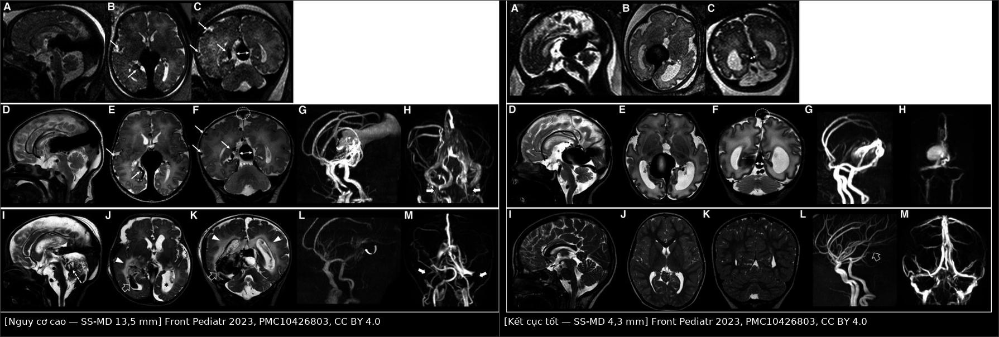
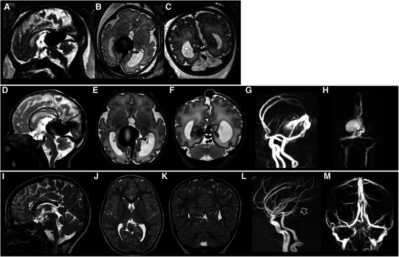
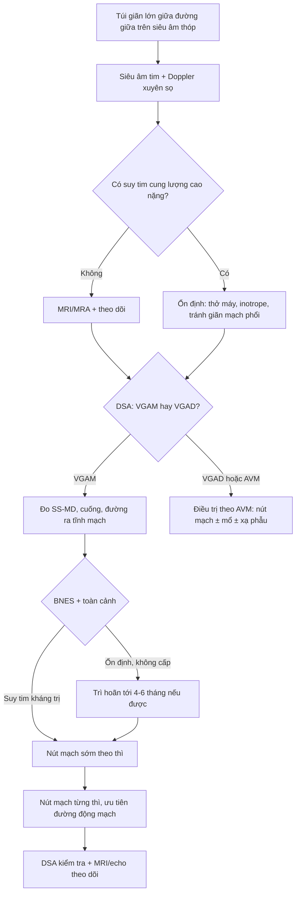
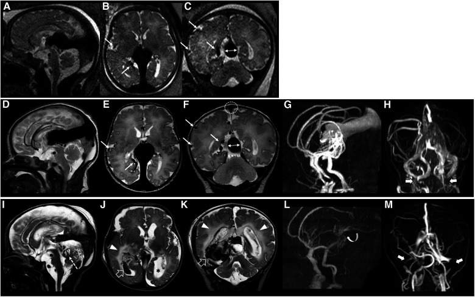
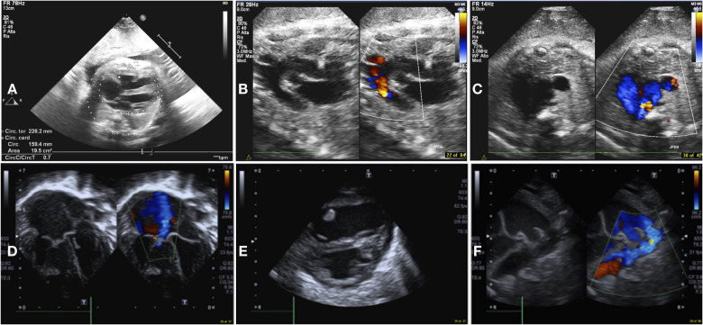
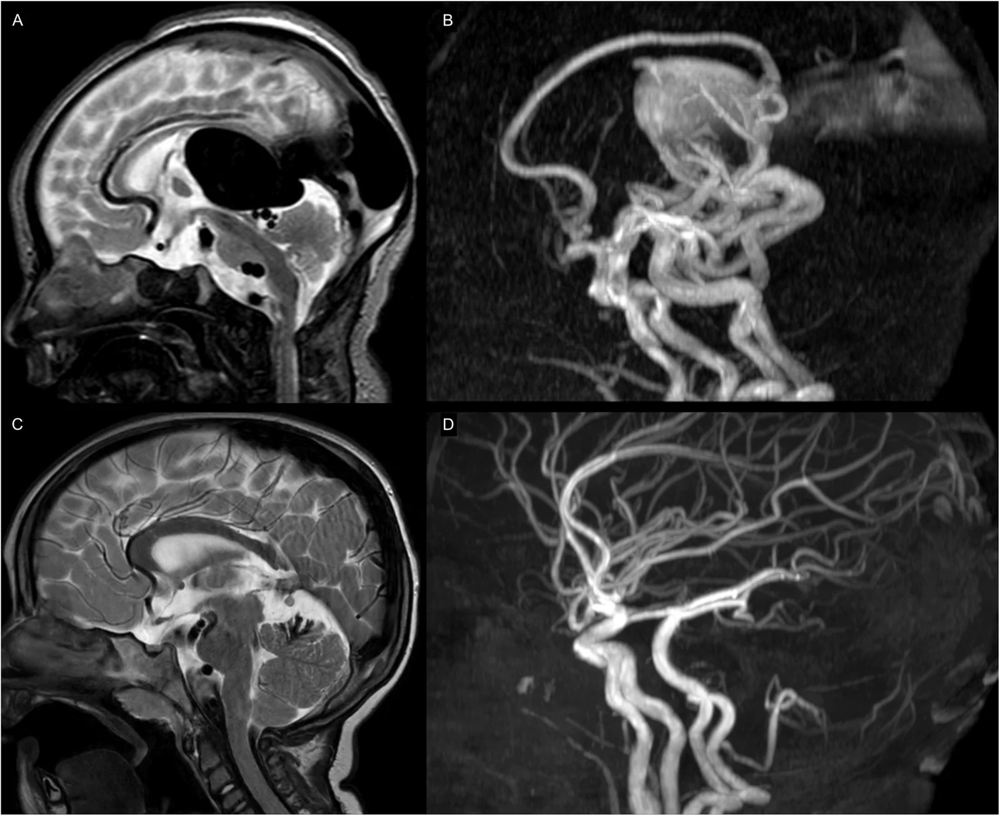

# 1786 — Dị dạng túi phình tĩnh mạch Galen ở sơ sinh: suy tim lưu lượng cao + túi giữa đường giữa / Vein of Galen aneurysmal malformation (VGAM)

**Tags:** `pattern:shunt-toc-do-cao` `pattern:flow-void` `pattern:tui-tinh-mach` `pattern:nao-ung-thuy` `pattern:suy-tim-cung-luong-cao` `vung:nao` `vung:mach-nao` `vung:tim` `score:Bicetre` `score:SS-MD` `protocol:SA-thop` `protocol:MRI-MRA` `protocol:DSA` `protocol:sieu-am-tim`

**Mức chắc chắn (certainty):** tổng hợp y văn (literature synthesis) — tổng quan hội nghị quốc tế 2025–2026 (Front Pediatr 2026, PMC13720373); loạt 40 sơ sinh có MRI/echo/điều trị nội mạch (Front Pediatr 2023, PMC10426803); phân tích gộp 400 bệnh nhân/339 ca can thiệp (Medicina 2024, PMC11676055). Không có thử nghiệm ngẫu nhiên; các ngưỡng đều là khuyến cáo từ đoàn hệ.

> **Câu chốt:** VGAM **không phải** "nang lành tính của tĩnh mạch Galen" mà là **shunt động–tĩnh mạch bẩm sinh giữa động mạch mạch màng mạch và tĩnh mạch trước não giữa Markowski chưa thoái triển** → một túi tĩnh mạch khổng lồ giữa đường giữa. Trẻ đến với **suy tim lưu lượng cao**, không phải triệu chứng thần kinh. Ba câu hỏi ở mọi túi giãn lớn vùng Galen: **(1) đây là VGAM thật hay chỉ là tĩnh mạch Galen giãn do AVM/AVF khác (VGAD)? (2) có suy tim cung lượng cao và tăng áp phổi không? (3) đường thoát tĩnh mạch có hẹp (xoang thẳng/bầu cảnh) và bán kính xoang thẳng (SS-MD) bằng bao nhiêu?** Sai lầm hay gặp: **gọi mọi túi giãn là VGAM rồi nút mạch một thì** — trong khi VGAM cần **nút mạch theo thì**, tránh làm tắc đột ngột túi tĩnh mạch.

## 1. Tổng quan bệnh học – cơ chế hình ảnh

### 1.1 Phôi thai học: vì sao có "túi" thay vì "nidus"

- **Tĩnh mạch trước não giữa của Markowski (median prosencephalic vein of Markowski)** là tĩnh mạch phôi thai dẫn lưu hệ màng mạch; bình thường **thoái triển** và được thay bằng hệ Galen trưởng thành. Trong VGAM, tĩnh mạch này **tồn tại và phình thành túi** vì nhận trực tiếp máu từ **động mạch màng mạch (choroidal arteries)** mà **không qua giường mao mạch** (PMC10426803, PMC13720373).
- Vì vậy VGAM là **shunt động–tĩnh mạch không có nidus** (giống AVF), khác AVM não có nidus. Túi chính là **tĩnh mạch dẫn lưu bị động mạch hoá**, không phải khối u hay nang.
- **Hai thể kinh điển:** **thể màng mạch (choroidal)** — nhiều động mạch nuôi màng mạch, shunt lớn, thường biểu hiện **sơ sinh**; **thể thành (mural)** — ít cuống mạch hơn, thường biểu hiện **nhũ nhi/trẻ lớn**. Trong loạt 36 ca phân loại được, **83% là thể màng mạch** (PMC10426803).
- **Phổ bệnh, không phải hai cực rời:** tổng quan 2026 nhấn mạnh nhiều tổn thương nằm **giữa VGAM thật và VGAD** (tĩnh mạch Galen giãn do AVM/AVF vùng đồi thị–trung não đổ vào) — cần mô tả **động mạch nuôi và kiểu dẫn lưu**, không chỉ đo túi (PMC13720373).

### 1.2 Dịch tễ và tiên lượng tự nhiên

- **~1/25.000 ca sinh**; **< 1%** dị dạng mạch máu trẻ em nhưng là **AVM nội sọ thường gặp nhất ở trẻ** (PMC10426803).
- **Không điều trị: tử vong 80–100%** (PMC11676055). Nguyên nhân tử vong là **suy tim/tăng áp phổi**, không phải xuất huyết.
- **Kết cục tốt** tăng theo thời đại: **50%** ở các đoàn hệ sơ sinh cũ → **~70%** ở các nghiên cứu gần đây, tốt nhất khi điều trị **sau giai đoạn sơ sinh**; **~10%** người sống có động kinh và/hoặc rối loạn phổ tự kỷ (PMC13720373).

### 1.2b Di truyền: không phải mọi VGAM đều có gen — nhưng gen đổi cách tầm soát

- Phần lớn VGAM **lẻ tẻ**, nhưng một phần có **đột biến dòng mầm RASA1 hoặc EPHB4** — hai gen của **CM-AVM** (hội chứng mảng mao mạch – dị dạng động tĩnh mạch); nhiều ca vẫn **chưa giải thích được gen** (PMC13720373).
- Trong **CM-AVM**, VGAM gặp **chủ yếu ở EPHB4 (66,7%)**, còn AVM có nidus gặp chủ yếu ở RASA1 — xem bài 746. Vì vậy trẻ có **nhiều mảng đỏ quầng nhạt + VGAM** cần **khám da và xét nghiệm gen RASA1/EPHB4**, đồng thời **tầm soát tủy** vì CM-AVM có thể có AVF màng mềm tủy.
- Đột biến **soma** trong nội mô túi (kể cả KRAS/EPHB4) đang được nghiên cứu qua **sinh thiết nội lòng trong lúc nút mạch**; chưa có liệu pháp đích được chứng minh cho VGAM (PMC13720373).

### 1.3 TẠI SAO hình ảnh và tim trông như vậy (vật lý + huyết động)

- **Flow void trên MRI = proton chạy quá nhanh.** Máu trong túi và tĩnh mạch dẫn lưu đạt vận tốc cao, rối loạn; phần lớn spin **rời mặt cắt** giữa kích thích và thu tín hiệu → **mất tín hiệu trên T2/TOF**, không cần cản quang. Vì thế **T2 là chuỗi đầu tay** ở sơ sinh (không cần gây mê sâu, không cần thuốc cản quang).
- **Túi sáng trên MRA vì "máu mới vào"** và **tĩnh mạch dẫn lưu hiện thì động mạch** = bằng chứng shunt không có giường mao mạch. **4D-flow MRI** định lượng được lưu lượng shunt và mức giảm sau nút mạch (PMC13720373).
- **Tim là "đầu cuối" của shunt:** mỗi mL máu qua túi quay về tim ngay → **tăng tiền tải, giãn buồng tim phải, tăng áp phổi**. Trước sinh, nhau thai (tuần hoàn trở kháng thấp, dung tích lớn) **bảo vệ thai**; sau sinh, **mất tuần hoàn nhau thai + giảm trở kháng phổi** → **quá tải phổi, cướp máu hệ thống, suy tim cấp** (PMC13720373, PMC10426803).
- **Suy tim cung lượng cao (high-output heart failure, HOHF)** không chỉ là "tim to": loạt 40 sơ sinh có **52,5% HOHF**, **42,5% HOHF nặng phải can thiệp sớm**, **55% cần thở máy xâm lấn**, **12,5% dùng PGE1** giữ ống động mạch (PMC10426803).
- **Giãn não thất trong VGAM không phải "nang chèn ép" đơn thuần:** chủ yếu do **tăng áp lực tĩnh mạch** làm giảm hấp thu dịch não tủy, cộng thêm **chèn ép cống não** bởi túi; **hẹp xoang dọc trên 58%** và **hẹp bầu tĩnh mạch cảnh 55,6%** trong loạt 40 ca (PMC10426803).
- **SS-MD (straight-sinus mediolateral diameter)** — bán kính ngang xoang thẳng/chân xoang ở chỗ hẹp nhất — phản ánh **áp lực và lưu lượng tĩnh mạch**: loạt 40 ca có **SS-MD trung bình 8,26 ± 3,73 mm**; nhóm HOHF nặng có **SS-MD sơ sinh 10,77 mm** (thai 11,74 mm), dự báo nguy cơ bằng mô hình Arko **96–98%** (PMC10426803). Tổng quan 2026 dùng **falcine sinus ≥ 7 mm** làm tiêu chuẩn vào phác đồ nút mạch thai nhi (PMC13720373).
- **Pseudofeeders** — các nhánh động mạch não giữa giãn bất thường ở rãnh Sylvius, **không thuộc hệ màng mạch** — là dấu của **cướp máu động mạch nặng và tăng áp tĩnh mạch**, gặp **39%** loạt sơ sinh và liên quan tổn thương chất trắng (PMC10426803).

### 1.4 Bảng số liệu trụ cột

| Đại lượng | Con số | Nguồn |
|---|---|---|
| Tần suất | **~1/25.000 ca sinh**; **< 1%** dị dạng mạch trẻ em | PMC10426803 |
| Tử vong không điều trị | **80–100%** | PMC11676055 |
| Phân tích gộp | **400 bệnh nhân**, **339 ca** nút mạch, **380 thủ thuật** | PMC11676055 |
| Số thì nút mạch | trung bình **2,1 thì/bệnh nhân** (1–7); thể màng mạch **2,6** vs thể thành **1,4** | PMC11676055 |
| Tắc hoàn toàn | **62,3%** (177/284); tắc một phần **37,7%** | PMC11676055 |
| Biến chứng | **32,1%** bệnh nhân; **22,9%** mỗi thủ thuật | PMC11676055 |
| Tử vong sau nút mạch | **7,1%** (24/339) | PMC11676055 |
| Kết cục chức năng tốt | **68%** (189/278) | PMC11676055 |
| Loạt 40 sơ sinh | HOHF **52,5%**, HOHF nặng **42,5%**, tử vong sơ sinh **18%**, tử vong sau can thiệp **14%** của 22 ca điều trị | PMC10426803 |
| Di chứng hình ảnh | giãn não thất **33%**, hẹp xoang dọc **58%**, hẹp bầu cảnh **55,6%**, pseudofeeders **39%** | PMC10426803 |
| Kết cục sống | **75%** POPC 1–2 (bình thường/khuyết tật nhẹ) | PMC10426803 |

## 2. Mẫu hình + chẩn đoán phân biệt theo vị trí (gamut)

### 2.1 Ba mẫu hình lâm sàng – hình ảnh theo tuổi

- **Sơ sinh (0–28 ngày): "túi giữa đường giữa + suy tim".** Tím/khó thở, gallop, gan to, thở máy; X-quang ngực **tim to + ứ máu phổi**; siêu âm thóp **cấu trúc giãn lớn giữa đường giữa có dòng chảy xoáy**. Đây là thể **màng mạch** điển hình.
- **Nhũ nhi (1–12 tháng): "đầu to + giãn não thất".** Tăng chu vi đầu, thóp căng, chậm phát triển, co giật; MRI thấy **túi lớn + giãn não thất + tĩnh mạch dẫn lưu giãn**.
- **Trẻ lớn/người lớn: "đau đầu, chảy máu, hoặc tình cờ".** Có thể **SAH/ICH**, đau đầu mạn, giảm thị lực; túi có thể **huyết khối một phần**.

### 2.2 Gamut theo hình thái túi giữa đường giữa

- **VGAM thật (thể màng mạch):** túi lớn, nhiều cuống màng mạch, dẫn lưu qua **xoang thẳng ± xoang chân bướm**, thường có **hẹp bầu cảnh**; sơ sinh suy tim.
- **VGAM thật (thể thành):** ít cuống hơn, thành túi nhận 1–2 nhánh màng mạch/đồi thị; biểu hiện muộn hơn, suy tim nhẹ hơn.
- **VGAD (vein of Galen aneurysmal dilatation):** tĩnh mạch Galen giãn **thứ phát** do AVM/AVF đồi thị–trung não–mái trung não đổ vào; **có nidus** và động mạch nuôi kiểu AVM. Điều trị theo AVM, không phải "nút túi".
- **AVF màng mềm (pial AVF):** shunt trực tiếp không nidus, thường một cuống; có thể gặp trong **CM-AVM (RASA1/EPHB4)** — xem bài 746.
- **AVF màng cứng quanh torcular:** thường ở người lớn/trẻ lớn, dẫn lưu xoang; khác VGAM.
- **Không phải mạch máu:** **nang màng nhện** vùng Galen, **cavum velum interpositum** giãn, **nang tuyến tùng**, **u tuyến tùng** — không có flow void, không có shunt thì động mạch.

### 2.3 Mnemonic "3S" cho VGAM có triệu chứng

- **S**hunt tốc độ cao (flow void, tĩnh mạch dẫn lưu sớm) · **S**ac giữa đường giữa (túi Markowski) · **S**uy tim cung lượng cao. Thiếu một trong ba → xem lại chẩn đoán hoặc tìm thể VGAD.

## 3. Bảng so sánh phân biệt (ma trận đối chiếu)

| Thực thể (entity) | Hình ảnh điển hình | Chốt vào (rule-in) | Chốt loại (rule-out) | Gợi ý xác nhận |
|---|---|---|---|---|
| **VGAM thể màng mạch** | Túi lớn giữa đường giữa, nhiều cuống màng mạch, xoang thẳng giãn, **hẹp bầu cảnh**, sơ sinh **tim to** | **Sơ sinh + suy tim + túi Markowski + flow void** | Có nidus đồi thị rõ + động mạch nuôi kiểu AVM → VGAD | MRI/MRA + siêu âm tim; DSA trước nút |
| **VGAM thể thành (mural)** | Túi nhỏ hơn, 1–2 cuống, thường nhũ nhi/trẻ lớn | **Túi + ít cuống + không suy tim nặng** | Nhiều cuống màng mạch + suy tim sơ sinh → thể màng mạch | DSA xác định số cuống |
| **VGAD do AVM/AVF** | **Nidus** đồi thị/trung não/mái + tĩnh mạch Galen giãn thứ phát | **Thấy nidus + cuống AVM** | Không nidus, túi là tĩnh mạch Markowski → VGAM | DSA 3D; MRI T2/TOF |
| **AVF màng mềm (pial AVF)** | Shunt trực tiếp một cuống, không nidus, thường kèm **CM-AVM** | **Một cuống + không nidus + mảng da quầng nhạt** | Túi giữa đường giữa đơn thuần → VGAM | Gen RASA1/EPHB4; DSA |
| **AVF màng cứng torcular** | Cuống từ động mạch màng cứng đổ vào xoang, thường trẻ lớn/người lớn | **Cuống màng cứng + dẫn lưu xoang** | Shunt màng mạch ở sơ sinh → VGAM | DSA chọn lọc động mạch màng cứng |
| **Nang màng nhện / cavum velum interpositum** | Ổ dịch giữa đường giữa, **không flow void**, không ngấm thuốc | **Tín hiệu dịch đồng nhất, không mạch** | Có flow void + tĩnh mạch dẫn lưu sớm → shunt | MRI T1/T2 ± CISS; không cần DSA |

*Trái: thai/sơ sinh **SS-MD 13,5 mm**, pseudofeeders từ động mạch não giữa, hẹp xoang dọc trên (SSS index 2,2) — kết cục xấu. Phải: **SS-MD 4,3 mm**, không hẹp xoang dọc (SSS index 3,3), không hẹp bầu cảnh — kết cục tốt sau 8 năm. Ảnh ghép letterbox từ Front Pediatr 2023 (PMC10426803), CC BY 4.0.*

*Cùng chuỗi MRI thai–sơ sinh–8 năm ở một ca **SS-MD 4,3 mm**, không hẹp xoang dọc, không hẹp bầu cảnh: túi vẫn lớn nhưng đường thoát tĩnh mạch tốt — minh họa vì sao **SS-MD và hẹp đường ra**, chứ không chỉ kích thước túi, mới quyết định tiên lượng. Nguồn: Front Pediatr 2023 (PMC10426803), Fig. 3, CC BY 4.0.*

### 3.1 Ba dấu hiệu định vị trên MRI sơ sinh

- **Dấu 1 — túi Markowski:** cấu trúc giãn lớn giữa đường giữa, tín hiệu **flow void** trên T2, nối trực tiếp xoang thẳng.
- **Dấu 2 — tĩnh mạch dẫn lưu "động mạch hoá":** xoang thẳng/torcular giãn sớm, có khi **hẹp bầu cảnh** cùng bên.
- **Dấu 3 — tổn thương nhu mô:** giãn não thất, mất thể tích vỏ, **tăng T2 chất trắng** do thiếu máu/tăng áp tĩnh mạch; **không hạn chế khuếch tán** nếu mạn (khác nhồi máu cấp).

## 4. Protocol chụp + hệ phân độ/điểm chuẩn hóa

### 4.1 Trước sinh

- **Siêu âm thai:** đường kính túi, **tỉ lệ tim–ngực**, giãn tĩnh mạch chủ trên, **dòng ngược thì tâm trương ở eo động mạch chủ**, hẹp xoang thẳng. Trong loạt 40 ca, **chỉ tỉ lệ tim–ngực** liên quan HOHF nặng (p = 0,01) và tử vong (p = 0,02) (PMC10426803).
- **MRI thai** khi siêu âm nghi ngờ: xác định túi, SS-MD, pseudofeeders, tổn thương não; **falcine sinus ≥ 7 mm** là tiêu chuẩn vào phác đồ nút mạch thai nhi ban đầu (PMC13720373).
- **Tư vấn:** không có một dấu hiệu đơn lẻ nào dự báo chắc chắn; cần mô hình đa thông số (tim mạch + giải phẫu + thần kinh) (PMC13720373).

### 4.2 Sau sinh — thứ tự bắt buộc

1. **Siêu âm thóp + Doppler xuyên sọ tại giường** (không gây mê): túi, dòng xoáy, tĩnh mạch dẫn lưu, giãn não thất.
2. **Siêu âm tim** ngay: giãn buồng phải, hở ba lá, **dẹt vách liên thất**, shunt phải–trái qua ống động mạch; đo áp lực phổi.
3. **MRI/MRA não** (T1, T2, FLAIR, DWI/ADC, TOF, MRA): xác định túi, cuống, dẫn lưu, SS-MD, tổn thương chất trắng, giãn não thất. **4D-flow** nếu có để định lượng shunt.
4. **DSA** là chuẩn vàng và **bắt buộc trước nút mạch**: số cuống, nguồn màng mạch, kiểu dẫn lưu sâu, hẹp đường ra, giả phình/túi phình liên quan.
5. **CT** chỉ dùng khi cấp cứu/chấn thương/nghi xuất huyết, hoặc khi MRI không khả thi.

### 4.3 Đo và ghi vào báo cáo (checklist 7 mục)

- Đường kính túi (mm) và **thể tích túi**; có **huyết khối trong túi** không.
- **SS-MD** (mm) tại chỗ hẹp nhất của xoang thẳng/chân xoang; **SSS index**; có **hẹp bầu cảnh** một/hai bên.
- Số cuống + nguồn (màng mạch trước/giữa/sau, động mạch não giữa, động mạch não trước).
- Kiểu dẫn lưu: xoang thẳng, xoang chân bướm, tĩnh mạch não trong, torcular; có **hẹp đường ra**.
- **Pseudofeeders** và mức **cướp máu**; tổn thương chất trắng (T2/FLAIR), nhồi máu, xuất huyết.
- **Giãn não thất** và dấu hiệu tăng áp nội sọ.
- **Tim:** chức năng thất phải, áp lực phổi, shunt ống động mạch, nhu cầu inotrope (VIS).

### 4.4 Thang điểm Bicêtre và giới hạn hiện tại

- **Bicêtre neonatal evaluation score (BNES)** chấm **5 hệ: tim, não, hô hấp, gan, thận**; điểm **8–12** mô tả bệnh nhân **ổn định, cần theo dõi sát trước khi nút mạch** (PMC11676055).
- **Giới hạn:** BNES **không có thông số hình ảnh** (không phản ánh tổn thương nhu mô, SS-MD, pseudofeeders) và **không dùng được ngoài giai đoạn sơ sinh**; nhiều trung tâm hiện **không dùng ngưỡng cứng của BNES để quyết định điều trị hay chăm sóc giảm nhẹ**, vì suy tim nặng có thể hồi phục sau khi ổn định và nút mạch (PMC11676055, PMC10426803, PMC13720373).
- **Hệ quả thực hành:** BNES là **một đầu vào**, không phải quyết định cuối; phải cộng **siêu âm tim, MRI (SS-MD, tổn thương não) và đáp ứng với điều trị nội khoa**.

### 4.5 Phân tầng và can thiệp

- **Nguyên tắc nút mạch:** **từng thì**, ưu tiên **đường động mạch (transarterial)**; **không làm tắc đột ngột toàn bộ túi tĩnh mạch một thì** vì nguy cơ xuất huyết/tắc tĩnh mạch não. Đường tĩnh mạch chỉ khi cuống động mạch không tiếp cận được và phải bảo tồn dẫn lưu sâu (PMC11676055, PMC13720373).
- **Vật liệu:** keo **nBCA/glue** chiếm **77,3%**, coil **13,3%**, phối hợp **9,4%**; nBCA **56,3%** trong nhóm dùng keo (PMC11676055).
- **Số thì:** trung bình **2,1** (1–7); **thể màng mạch 2,6** vs **thể thành 1,4** → thể màng mạch cần nhiều thì hơn.
- **Mục tiêu:** không nhất thiết **tắc hoàn toàn** ngay; mục tiêu là **kiểm soát suy tim và ngăn tiến triển thần kinh**; tắc hoàn toàn đạt **62,3%** trong phân tích gộp.
- **Trì hoãn có kiểm soát:** nếu ổn định, nhiều tác giả khuyến cáo **thì đầu tiên vào khoảng 4–6 tháng tuổi** để giảm nguy cơ tổn thương mạch do catheter quá lớn ở sơ sinh (PMC11676055).
- **Nút mạch thai nhi** là hướng thí điểm, **chưa đủ bằng chứng hiệu quả** (PMC13720373).

## 5. Biến thể bình thường và cạm bẫy

- **Biến thể bình thường #1 — tĩnh mạch Galen nổi:** ở trẻ/người lớn, tĩnh mạch Galen có thể **hơi nổi** trên T2; **không giãn lớn, không flow void mạnh, không tĩnh mạch dẫn lưu sớm** → không phải VGAM.
- **Biến thể bình thường #2 — cavum velum interpositum / nang màng nhện vùng Galen:** ổ dịch **đồng tín hiệu dịch**, không có mạch; đừng đo "túi" rồi kết luận shunt. So sánh T1/T2 và **không thấy flow void** là chốt loại.
- **Cạm bẫy #1 — gọi VGAD là VGAM.** Tĩnh mạch Galen giãn do **AVM đồi thị/trung não** có **nidus + động mạch nuôi kiểu AVM**; nút "túi" sẽ bỏ sót nidus và có thể gây xuất huyết. Luôn mô tả **có nidus hay không**.
- **Cạm bẫy #2 — bỏ qua hẹp đường ra tĩnh mạch.** **Hẹp bầu cảnh 55,6%**, **hẹp xoang dọc 58%** trong loạt sơ sinh; hẹp nặng làm tăng áp nội sọ và là **yếu tố tiên lượng**, có thể cần nong/stent chọn lọc (PMC10426803, PMC13720373).
- **Cạm bẫy #3 — pseudofeeders bị đọc là "mạch bình thường".** Chúng là **dấu của cướp máu nặng**, gặp **39%** và liên quan tổn thương chất trắng; thấy pseudofeeders = **chỉ định can thiệp sớm** trong nhiều phác đồ (PMC10426803).
- **Cạm bẫy #4 — "flow void = huyết khối".** Huyết khối trong túi có thể **tăng T1/T2** và **mất flow void**; VGAM đã huyết khối một phần trông "đặc" hơn. Đối chiếu MRA/DSA, đừng loại trừ shunt chỉ vì một vùng không có flow void.
- **Cạm bẫy #5 — dùng BNES thấp để chăm sóc giảm nhẹ.** Suy tim do shunt **có thể hồi phục** sau ổn định + nút mạch; nhiều ca HOHF nặng vẫn đạt **POPC 1–2** (75% người sống). Quyết định phải đa chuyên khoa (PMC10426803).
- **Cạm bẫy #6 — bỏ sót giãn não thất.** Giãn não thất **33%**; ở sơ sinh, "đầu to" có thể là dấu hiệu duy nhất. Luôn đo não thất và tìm hẹp xoang.

## 6. Tự lượng giá — Blind Quiz

**Ca 1 — Sơ sinh 2 ngày tuổi, suy hô hấp, tim to trên X-quang. Nhìn 3 lát MRI trước, mô tả trước khi mở đáp án.**

- Gợi ý lâm sàng: thở máy, gallop, gan to; không co giật.
- Câu hỏi: Cấu trúc giãn lớn giữa đường giữa là gì? Có dấu hiệu shunt tốc độ cao không? SS-MD và hẹp xoang gợi ý điều gì?

<b>Bấm để hiện đáp án (findings + chẩn đoán)</b>

- **Findings:** túi lớn giữa đường giữa (tĩnh mạch Markowski) với **flow void**; **pseudofeeders** từ động mạch não giữa (mũi tên mảnh); **SS-MD 13,5 mm** (mũi tên hai đầu); **hẹp xoang dọc trên** (vòng chấm), **SSS index 2,2**; MRA thấy cuống màng mạch và dẫn lưu sớm.
- **Chẩn đoán:** **VGAM thể màng mạch, nguy cơ cao**, suy tim cung lượng cao.
- **Vì sao:** SS-MD lớn phản ánh lưu lượng/áp lực tĩnh mạch cao; pseudofeeders = cướp máu; hẹp xoang dọc làm nặng tăng áp nội sọ.
- **Nguồn ảnh:** Front Pediatr 2023 (PMC10426803), Fig. 2, CC BY 4.0.

**Ca 2 — Sơ sinh cùng loạt, siêu âm tim trước và sau sinh. Nhìn 6 ô, mô tả trước.**

- Câu hỏi: Những dấu hiệu nào chứng minh suy tim cung lượng cao? Hướng xử trí đầu tiên?

<b>Bấm để hiện đáp án (findings + chẩn đoán)</b>

- **Findings:** (A) **tỉ lệ tim–ngực tăng**, (B) **dòng ngược thì tâm trương ở eo động mạch chủ**, (C) **giãn tĩnh mạch chủ trên**; sau sinh: (D) **giãn buồng phải + hở ba lá**, (E) **dẹt vách liên thất**, (F) **shunt phải–trái qua ống động mạch**.
- **Chẩn đoán:** **suy tim cung lượng cao do VGAM**, tăng áp phổi.
- **Xử trí:** ổn định huyết động (thở máy, inotrope, tránh giãn mạch phổi), **không trì hoãn DSA/nút mạch** nếu suy tim kháng trị; PGE1 chỉ khi quá tải thất phải nặng.
- **Nguồn ảnh:** Front Pediatr 2023 (PMC10426803), Fig. 1, CC BY 4.0.

**Ca 3 — Sơ sinh nặng, 4 lần nút mạch; so sánh lúc sinh và 3 tuổi.**

- Câu hỏi: Trước điều trị có gì? Sau 4 thì thay đổi ra sao? Vì sao phải chụp lại nhiều lần?

<b>Bấm để hiện đáp án (findings + chẩn đoán)</b>

- **Findings:** (A,B) sơ sinh: **shunt tốc độ cao + giãn lớn tĩnh mạch trước não giữa, xoang thẳng và torcular**; (C,D) sau **4 thì nút mạch** ở 3 tuổi: **tắc gần hoàn toàn**, giải phẫu mạch gần bình thường.
- **Chẩn đoán:** **VGAM thể nặng** — kiểm soát bằng nút mạch theo thì.
- **Vì sao chụp lại:** VGAM tái thông/tái cấp máu sau nút mạch; cần DSA/MRA định kỳ để phát hiện shunt tồn dư và đánh giá não đang phát triển.
- **Nguồn ảnh:** Front Pediatr 2026 (PMC13720373), Fig. 1, CC BY 4.0.

## Bài liên quan chéo
- [746 – CM-AVM (RASA1/EPHB4): mảng mao mạch + shunt não–tủy](../746-cm-avm-rasa1-ephb4/lesson.md) — **vGaM là hàng đầu trong CM-AVM2 (EPHB4 66,7%)**.
- [745 – HHT ở trẻ: tầm soát AVM phổi–não](../745-hht-o-tre-tam-soat-avm-phoi-nao/lesson.md) — phân biệt VGAM với AVM/PAVM của HHT.
- [741 – Dị dạng mạch máu đầu–cổ ở trẻ: ISSVA, PHACE & LUMBAR](../741-di-dang-mach-mau-dau-co-o-tre/lesson.md) — phân loại shunt nhanh/chậm dòng.
- [216 – Dị dạng mạch não & huyết khối xoang](../216-di-dang-mach-CVST/lesson.md) — nền tảng AVM/AVF và CVST.
- [1787 – AVM não ở trẻ đã vỡ: phân tầng cấp cứu](../1787-avm-nao-tre-da-vo/lesson.md) — thể AVM có nidus, khác VGAM.
- [200 – Tổng quan hệ Thần kinh](../200-tong-quan-he-than-kinh/lesson.md) · [600 – Tổng quan Nhi khoa](../600-tong-quan-nhi-khoa/lesson.md)

## Ảnh
- Tên file: `1786_vgam_<chuỗi>_<nguồn>.jpg`; nguồn + giấy phép từng ảnh ở `images/CREDITS.md`.
- Ảnh **CC BY 4.0**: dùng nguyên bản hoặc ghép composite (PMC10426803, PMC13720373).
- Không có ảnh nào cần dẫn link thay thế trong lượt này.

> Không dùng để chẩn đoán độc lập khi chưa có người hướng dẫn.
