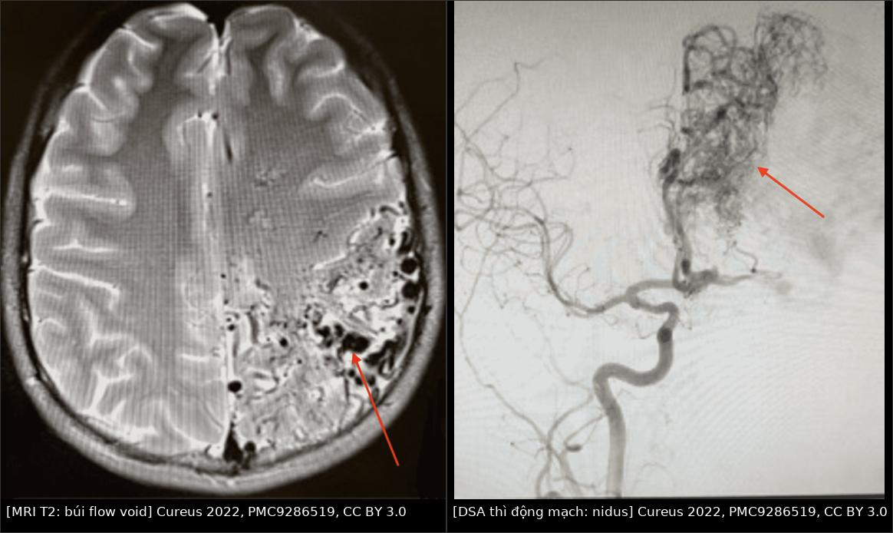
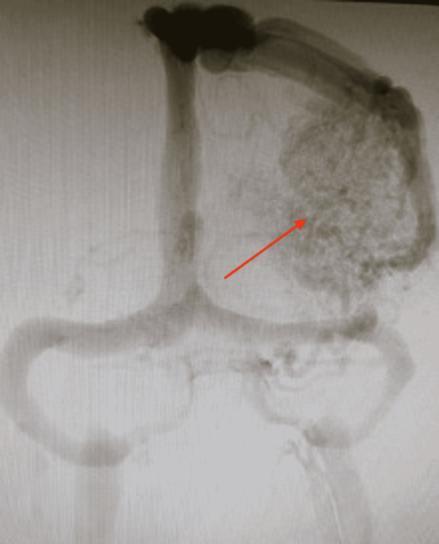
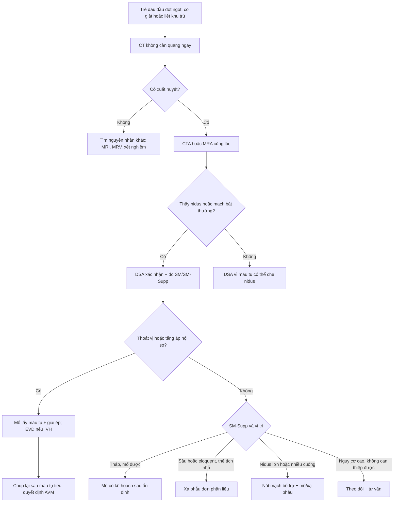
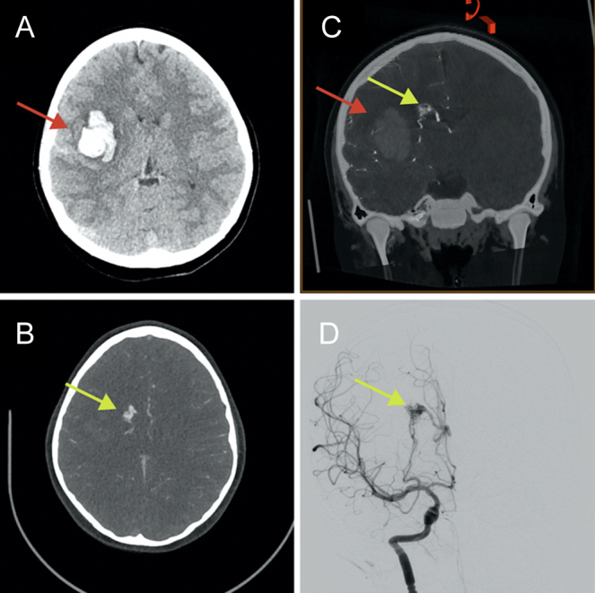

# 1787 — AVM não ở trẻ đã vỡ: phân tầng cấp cứu từ CT/CTA đến DSA / Ruptured pediatric brain arteriovenous malformation

**Tags:** `pattern:xuat-huyet-nao` `pattern:flow-void` `pattern:nidus` `pattern:di-lech-duong-giua` `pattern:nao-ung-thuy` `vung:nao` `vung:mach-nao` `score:Spetzler-Martin` `score:SM-Supp` `score:GCS` `protocol:CT-khong-can-quang` `protocol:CTA` `protocol:DSA` `protocol:MRI-DWI` `protocol:DTI`

**Mức chắc chắn (certainty):** tổng hợp y văn (literature synthesis) — đồng thuận quốc tế IPSO 2025 về xuất huyết não ở trẻ (J Am Heart Assoc, PMC12909056); tổng quan hệ thống 20 đoàn hệ hồi cứu về quản lý AVM nhi (Neurosurg Rev 2026, PMC13216134); loạt 30 trẻ mổ AVM (Medicina 2026, PMC13609203); loạt 89 trẻ/101 AVM xạ phẫu đơn phân liều (Childs Nerv Syst 2026, PMC12982297); ca nguyên văn có CT/CTA/DSA/DTI (J Neurosurg Case Lessons 2024, PMC11337941). Bằng chứng chủ yếu hồi cứu, không có thử nghiệm ngẫu nhiên.

> **Câu chốt:** Ở trẻ, AVM là **nguyên nhân hàng đầu của xuất huyết não tự phát**, và **một nửa số xuất huyết não ở trẻ là do AVM**. Ca đến cấp cứu không phải để "điều trị AVM" ngay mà để trả lời **4 câu theo thứ tự**: **(1) có xuất huyết và có thoát vị không? (2) có AVM hay nguyên nhân khác — CTA/MRA rồi DSA? (3) có cần mổ lấy máu tụ/giải ép NGAY không? (4) nếu không cấp cứu, AVM thuộc tầng nào — mổ, xạ phẫu, nút mạch hay theo dõi?** Sai lầm chết người: **cắt AVM ngay trong máu tụ cấp** ở mọi ca, hoặc **loại trừ AVM chỉ vì CTA âm** khi nidus bị máu tụ chèn ép.

## 1. Tổng quan bệnh học – cơ chế hình ảnh

### 1.1 Bệnh học: nidus bẩm sinh + đột biến soma

- **AVM não** là **nidus** gồm mạch loạn sản nối **động mạch → tĩnh mạch không qua giường mao mạch**, có **động mạch nuôi giãn** và **tĩnh mạch dẫn lưu sớm**. Đây là tổn thương **bẩm sinh**, thường trở nên triệu chứng ở tuổi trẻ.
- Nhiều AVM não có **đột biến soma KRAS** trong nội mô nidus (PMC12909056) — giải thích vì sao tổn thương **khu trú** dù đột biến liên quan đường RAS–MAPK. Điều này mở ra hướng **ức chế MEK** nhưng **chưa có dữ liệu hiệu quả ở người** (PMC12909056).
- **Vì sao trẻ dễ xuất huyết hơn người lớn cùng tổn thương:** tuổi thọ còn dài → **nguy cơ tích lũy** theo thời gian; AVM ở trẻ thường **nhỏ, sâu, dẫn lưu tĩnh mạch sâu** — đúng nhóm dễ vỡ (PMC13216134).
- **Vì sao vỡ:** thành mạch nidus mỏng, áp lực động mạch truyền trực tiếp vào tĩnh mạch không giảm qua mao mạch; **túi phình trong nidus/túi phình liên quan dòng chảy** làm điểm yếu thêm.

### 1.2 Dịch tễ và tiên lượng

- **Tần suất 0,014–0,028%** dân số; AVM chiếm **~50% xuất huyết não ở trẻ** (PMC13216134).
- **Nguy cơ xuất huyết hàng năm** thay đổi rất rộng **0,9–7,14%** giữa các đoàn hệ; AVM **chưa vỡ** ước tính **2–4%/năm** (PMC13609203).
- **Khi đã vỡ:** di chứng thần kinh vĩnh viễn **20–41%**, tử vong **~25%** (PMC13216134).
- **Trong giai đoạn cấp:** nguy cơ **tái xuất huyết tới 32%** tùy nguyên nhân; **máu tụ lan rộng ~1/3** bệnh nhân trong **48–72 giờ** (PMC12909056).

### 1.3 TẠI SAO hình ảnh trông như vậy (vật lý + mô bệnh)

- **CT không cản quang:** máu tụ cấp **60–80 HU**, bờ rõ, có **hiệu ứng khối/đẩy đường giữa**; **máu trong não thất** tăng đậm độ trong não thất. AVM có thể có **vôi hóa** (không bắt buộc) — vôi hóa không loại trừ AVM.
- **CTA:** nidus **ngấm thuốc mạnh**, **động mạch nuôi giãn**, **tĩnh mạch dẫn lưu hiện sớm ở thì động mạch**; nhưng **máu tụ có thể che nidus** → CTA âm không loại trừ.
- **MRI:** **flow void** ("búi giun"/bag of worms) trên T2 do spin chạy nhanh rời mặt cắt; **SWI/T2\*** thấy máu cũ/hemosiderin; **DWI/ADC** phân biệt **nhồi máu cấp (ADC giảm)** với **phù quanh máu tụ (ADC tăng)**; **MRA** thấy cuống và dẫn lưu.
- **DSA:** chuẩn vàng — xác định **nidus, số cuống, tĩnh mạch dẫn lưu, túi phình liên quan, tuần hoàn bàng hệ**; cần **3D xoay** trước can thiệp.
- **DTI:** dùng để lập kế hoạch mổ quanh đường thần kinh, nhưng **trong máu tụ cấp, DTI bị lệch do máu tụ đẩy giải phẫu + artifact từ tính** → có thể **đọc sai là đứt đường thần kinh**; phải chụp lại sau khi máu tụ tiêu bớt (PMC11337941).

### 1.4 Bảng số liệu trụ cột

| Đại lượng | Con số | Nguồn |
|---|---|---|
| Tần suất AVM não | **0,014–0,028%**; **~50%** xuất huyết não ở trẻ | PMC13216134 |
| Nguy cơ xuất huyết/năm | **0,9–7,14%** (đoàn hệ); chưa vỡ **2–4%/năm** | PMC13216134, PMC13609203 |
| Khi đã vỡ | di chứng **20–41%**, tử vong **~25%** | PMC13216134 |
| Tái xuất huyết cấp | tới **32%**; máu tụ lan rộng **~1/3** trong 48–72 giờ | PMC12909056 |
| Phân bố Spetzler–Martin | I–II **44,1%** (740), III **38,4%** (645), IV–V **17,5%** (293) | PMC13216134 |
| Mổ lấy AVM | tắc hoàn toàn **81–100%** (trung bình **~93%**) | PMC13216134 |
| Nút mạch đơn thuần | tắc hoàn toàn **65–67%** ở ca chọn lọc | PMC13216134 |
| Xạ phẫu đơn thuần | **51–68,5%**; **43,3%** nếu trước đó đã nút mạch | PMC13216134 |
| Tái phát sau "khỏi" | **0,9–29,4%**; loạt lớn **10,4–16,7%**; muộn **14–26 năm** | PMC13216134 |
| Loạt mổ 30 trẻ | vỡ **63,3%**, ICH **60%**, IVH **33,3%**, tử vong **13,3%**, mRS 0–2 **76,7%** | PMC13609203 |
| IVH → kết cục xấu | **OR 28,5**; GCS nhập viện **8 vs 15** | PMC13609203 |
| Xạ phẫu 89 trẻ/101 AVM | vỡ **70,8%**; liều trung vị **20 Gy**; tắc **83%** ở 5 năm; RN có triệu chứng **8,5%** | PMC12982297 |

## 2. Mẫu hình + chẩn đoán phân biệt theo vị trí (gamut)

### 2.1 Mẫu hình lâm sàng – hình ảnh

- **Xuất huyết nhu mô thùy + đau đầu đột ngột + thiếu hụt khu trú:** ổ tăng đậm độ trên CT, quanh ổ có **flow void**/mạch giãn; **CTA có nidus**. Đây là thể hay gặp nhất ở trẻ lớn.
- **Xuất huyết não thất (IVH) ± giãn não thất:** AVM sâu/đồi thị hoặc AVM vỡ vào não thất; **tiên lượng xấu nhất** (IVH **OR 28,5** cho mRS 3–6) (PMC13609203).
- **SAH + máu bể nền:** AVM vỡ vào khoang dưới nhện, hoặc **túi phình liên quan dòng chảy**; cần DSA phân biệt.
- **Co giật đơn thuần hoặc đau đầu mạn:** AVM chưa vỡ; hình ảnh **flow void/calcification**, không có máu tụ.
- **Hố sau (tiểu não/thân não):** đau đầu, nôn, thất điều; **nguy cơ thoát vị hạnh nhân nhanh**, cần xử trí cấp cứu sớm.

### 2.2 Gamut theo vị trí và tuổi

- **Thùy não (trán/đỉnh/thái dương/chẩm):** AVM, cavernoma, u trong não chảy máu, CVST có nhồi máu xuất huyết.
- **Nhân xám sâu (đồi thị, nhân bèo):** AVM thể sâu, **VGAD/VGAM** (xem bài 1786), tăng huyết áp (hiếm ở trẻ), bệnh mạch nhỏ.
- **Hố sau:** AVM tiểu não/thân não, cavernoma, u (medulloblastoma ependymoma), dị dạng mạch.
- **IVH đơn thuần:** AVM sâu, **CVST**, rối loạn đông máu, chấn thương, u nhú đám rối.
- **Mnemonic "AVM" cho xuất huyết ở trẻ:** **A**bnormal vessels (flow void/nidus) · **Y**oung (trẻ, không tăng huyết áp) · **M**edial/deep or lobar (vị trí sâu/thùy, không điển hình cho tăng huyết áp).

## 3. Bảng so sánh phân biệt (ma trận đối chiếu)

| Thực thể (entity) | Hình ảnh điển hình | Chốt vào (rule-in) | Chốt loại (rule-out) | Gợi ý xác nhận |
|---|---|---|---|---|
| **AVM vỡ** | Ổ máu tụ thùy/sâu + **flow void**, **nidus ngấm thuốc**, tĩnh mạch dẫn lưu sớm; có thể vôi hóa | **Nidus + cuống động mạch + dẫn lưu sớm trên CTA/DSA** | Không thấy nidus nhưng có **máu tụ lớn chèn ép** → vẫn phải DSA lại | DSA 3D; MRI T2/TOF; SM/SM-Supp |
| **Cavernoma vỡ** | "Bỏng ngô" đa tín hiệu, **viền hemosiderin tối trên SWI/T2\***, **không flow void lớn**, không shunt sớm | **Viền hemosiderin + không có cuống động mạch** | Có **nidus ngấm thuốc + tĩnh mạch dẫn lưu sớm** → AVM | MRI SWI; DSA thường âm |
| **Phình động mạch vỡ** | Máu **bể nền/SAH**, túi phình ở chỗ chia mạch; có thể kèm máu nhu mô | **Túi phình + SAH bể nền** | Nidus + nhiều cuống + dẫn lưu sớm → AVM | CTA/DSA; không có nidus |
| **CVST có nhồi máu xuất huyết** | Giảm đậm độ **không theo lãnh thổ** + xuất huyết trong ổ; xoang tăng đậm độ/khuyết thuốc | **Khuyết thuốc xoang + nhồi máu không theo lãnh thổ** | Có nidus/flow void + tĩnh mạch dẫn lưu sớm → AVM | CTV/MRV; DSA thì tĩnh mạch |
| **U trong não chảy máu** | Khối ngấm thuốc không đều, phù quanh, có thể vôi hóa; máu tụ trong u | **Thành phần mô u + ngấm thuốc kiểu u** | Chỉ có mạch giãn/flow void, không có mô u → AVM | MRI + cản quang; DSA |
| **Rối loạn đông máu** | Máu tụ nhiều ổ/thùy, không có mạch bất thường | **PT/aPTT/tiểu cầu bất thường + không nidus** | Có nidus trên CTA/DSA → AVM | Xét nghiệm đông máu; CTA |

*Trái: MRI T2 — **búi flow void** ("bag of worms") vùng trán–đỉnh trái, kích thước **8,5 × 8,5 × 7,5 cm**, Spetzler–Martin V. Phải: DSA thì động mạch — **nidus** dày đặc, cuống nuôi từ tuần hoàn cảnh trong. Ảnh ghép letterbox từ Cureus 2022 (PMC9286519), CC BY 3.0.*

### 3.1 Ba dấu hiệu định vị trên CT/CTA cấp cứu

- **Dấu 1 — ổ máu tụ "quá tròn" hoặc bờ không đều:** gợi ý tổn thương mạch máu bên dưới; đo **thể tích/thể tích ước tính** và **độ lệch đường giữa**.
- **Dấu 2 — mạch giãn trong/quantổ máu:** trên CTA, tìm **động mạch nuôi giãn** và **tĩnh mạch dẫn lưu hiện sớm**; nếu không thấy, vẫn không loại trừ.
- **Dấu 3 — IVH/giãn não thất:** **máu trong não thất + giãn não thất** là dấu tiên lượng xấu và là chỉ định **dẫn lưu não thất** khi có giảm tri giác/giãn tiến triển (PMC12909056).

### 3.2 Đọc DSA hai thì: nidus và đường thoát

*DSA thì tĩnh mạch cùng ca AVM **8,5 × 8,5 × 7,5 cm**: thấy rõ **tĩnh mạch dẫn lưu** và mức độ giãn của hệ tĩnh mạch — yếu tố quyết định phân độ (dẫn lưu sâu +1) và đường vào can thiệp. Nguồn: Cureus 2022 (PMC9286519), Fig. 3, CC BY 3.0.*

- **Thì động mạch:** trả lời **nidus ở đâu, bao nhiêu cuống, có túi phình liên quan dòng chảy không**.
- **Thì tĩnh mạch:** trả lời **dẫn lưu nông hay sâu, có hẹp đường ra/tĩnh mạch dẫn lưu không** — hẹp đường ra làm tăng nguy cơ xuất huyết và thay đổi chiến lược.
- **3D xoay** trước can thiệp để chọn catheter và tránh bỏ sót cuống nhỏ.

## 4. Protocol chụp + hệ phân độ/điểm chuẩn hóa

### 4.1 Thứ tự chẩn đoán trong cấp cứu (theo IPSO 2025)

1. **CT không cản quang ngay** khi nghi xuất huyết (Statement 5) — nhanh, không cần gây mê sâu, xác định máu tụ/IVH/thoát vị.
2. **CTA (hoặc MRA nếu chọn MRI) cùng lúc** để tìm nguyên nhân mạch máu (Statement 6) — **không chờ** kết quả CT rồi mới nghĩ tới mạch.
3. **DSA** cho **mọi trẻ không rõ nguyên nhân trên CTA/MRA**, hoặc để **mô tả đầy đủ AVM** trước điều trị (Statement 7); DSA nên do người có kinh nghiệm thực hiện.
4. **MRI/MRA** bổ sung khi CTA không kết luận, cần đánh giá nhu mô (DWI/ADC, SWI), hoặc lập kế hoạch mổ/xạ phẫu.
5. **Chụp lại** khi nghi ngờ: máu tụ lớn có thể **che nidus**; CTA/DSA âm trong giai đoạn cấp **không phải bằng chứng loại trừ**.

### 4.2 Xử trí cấp cứu — khi nào mổ, khi nào chờ

- **Thoát vị/tăng áp nội sọ nặng:** **mổ lấy máu tụ + giải ép (hemicraniectomy)** theo Statement 19; **dẫn lưu não thất ngoài (EVD)** khi IVH/giãn não thất gây giảm tri giác (Statement 18).
- **Cắt AVM cấp:** **thường KHÔNG** thực hiện ngay trong máu tụ cấp, **trừ khi có đặc điểm nguy cơ tái vỡ sớm cao** (Statement 20). Lý do: mô não đang phù, giải phẫu bị máu tụ làm lệch, nguy cơ mất máu và tổn thương thêm.
- **Trì hoãn có kế hoạch:** sau khi ổn định, chụp lại DSA/MRI (khi máu tụ tiêu bớt) để **đánh giá nidus thật**; ca minh họa trong PMC11337941 được **mổ/xạ phẫu sau 6 tuần**, khi DTI cho thấy nidus nằm trong bó vỏ–tủy.
- **Kiểm soát:** huyết áp, đau, co giật, đường huyết, nhiệt độ; **không dùng kháng đông** nếu không có chỉ định đặc biệt; xét nghiệm đông máu và hiệu chỉnh yếu tố thiếu.

### 4.3 Phân độ Spetzler–Martin và bản bổ sung

- **Spetzler–Martin (SM 1–5):** kích thước **< 3 cm = 1**, **3–6 cm = 2**, **> 6 cm = 3**; **vùng chức năng (eloquent) +1**; **dẫn lưu tĩnh mạch sâu +1**.
- **SM bổ sung (supplemented SM, Lawton–Young):** **tuổi < 20 = 1** (20–40 = 2; > 40 = 3); **chưa vỡ = 1**; **nidus lan tỏa (diffuse) = 1** → **SM-Supp 2–10**; **grade 6** là ngưỡng nguy cơ phẫu thuật được xem là chấp nhận (PMC6331307).
- **Ở trẻ đã vỡ:** tuổi luôn **1 điểm**, chưa vỡ **0 điểm**, nidus lan tỏa **0/1** → SM-Supp thường **2–8**; loạt 30 trẻ mổ có **SM-Supp 2–8, trung vị 3,5**; **mỗi 1 điểm tăng → OR 2,55** cho kết cục xấu (PMC13609203).
- **Ghi vào báo cáo:** SM, SM-Supp, kích thước nidus (mm), vị trí eloquent, kiểu dẫn lưu, **có túi phình trong nidus/túi phình liên quan dòng chảy không**, có IVH không.

### 4.4 Sơ đồ phân tầng

- **Xạ phẫu:** liều biên **18–20 Gy** (trung vị **20 Gy**, khoảng **14–26 Gy**) cho AVM nhỏ; tắc **55% ở 3 năm, 73,1% ở 4 năm, 83% ở 5 năm**; **không có xuất huyết sau xạ phẫu** trong loạt 89 trẻ, **RN có triệu chứng 8,5%**, **V12Gy = 10 cm³** là mốc nguy cơ thấp (PMC12982297).
- **Thời gian tiềm tàng 1–3 năm:** trong lúc chờ tắc, AVM vẫn có thể chảy máu; phải tư vấn và theo dõi.
- **Nút mạch:** chủ yếu **bổ trợ trước mổ/xạ phẫu** hoặc làm giảm lưu lượng; **nút mạch đơn thuần để khỏi** chỉ đạt **65–67%** ở ca chọn lọc và có thể **làm giảm tỉ lệ tắc của xạ phẫu sau đó (43,3% vs 68,5%)** (PMC13216134).
- **Theo dõi sau "khỏi":** tái phát **10,4–16,7%** ở loạt lớn, có ca **14–26 năm** sau điều trị → **theo dõi dài hạn tới tuổi trưởng thành**, không dừng sau một DSA âm (PMC13216134).

## 5. Biến thể bình thường và cạm bẫy

- **Cạm bẫy #1 — CTA/DSA âm trong máu tụ cấp.** Máu tụ **chèn ép nidus** và làm giảm dòng qua shunt; CTA âm không loại trừ. Phải **MRI/MRA** và **DSA lặp sau khi máu tụ tiêu bớt** (PMC12909056, PMC11337941).
- **Cạm bẫy #2 — dùng DTI cấp để quyết định cắt hay không.** Trong máu tụ cấp, **DTI bị lệch do đẩy giải phẫu và artifact từ tính**; ca PMC11337941 ban đầu tưởng bó vỏ–tủy đã mất, chụp lại sau 6 tuần thấy **bó còn và nidus nằm trong bó** → đổi từ mổ sang xạ phẫu. **Không mổ dựa trên DTI cấp đơn thuần.**
- **Cạm bẫy #3 — chỉ nhìn máu tụ, bỏ qua IVH/giãn não thất.** IVH là **yếu tố tiên lượng xấu mạnh nhất** trong loạt mổ (OR **28,5**); giãn não thất tiến triển cần **EVD**, không chờ.
- **Cạm bẫy #4 — gọi cavernoma là AVM.** Cavernoma **không có cuống động mạch/tĩnh mạch dẫn lưu sớm**, DSA thường âm; mổ cavernoma có thể thực hiện **sớm trong vài tuần** (khác AVM) (PMC12909056).
- **Cạm bẫy #5 — bỏ qua túi phình liên quan dòng chảy.** AVM có thể kèm **túi phình trong nidus hoặc trên cuống**; đây là điểm vỡ và phải được mô tả trên DSA 3D trước khi quyết định.
- **Cạm bẫy #6 — "DSA âm sau mổ = khỏi vĩnh viễn".** Ở trẻ, **tái phát sau tắc hoàn toàn** đã được ghi nhận, có thể **nhiều năm sau**; cần **theo dõi dài hạn** (PMC13216134).
- **Biến thể bình thường:** **mạch giãn lớn quanh ổ máu tụ** do tăng tưới máu phản ứng, **không có shunt sớm**; **vôi hóa mạch** ở người lớn không đồng nghĩa AVM. Đừng đo "nidus" chỉ dựa trên một mạch giãn đơn độc.

## 6. Tự lượng giá — Blind Quiz

**Ca 1 — Bé gái 9 tuổi, đau đầu dữ dội + yếu nửa người trái. Nhìn 4 ô trước, mô tả trước khi mở đáp án.**

- Gợi ý lâm sàng: tỉnh, nói được, liệt nửa người trái; không sốt, không chấn thương.
- Câu hỏi: Ổ máu tụ ở đâu, kích thước? Có dấu hiệu mạch máu bất thường trên CTA không? Bước tiếp theo?

<b>Bấm để hiện đáp án (findings + chẩn đoán)</b>

- **Findings:** (A) **máu tụ 2,8 × 4,6 × 3,6 cm** ở **nhân bèo/bào ngoài phải**, đẩy đường giữa **3 mm**; (B,C) CTA thấy **ổ tăng đậm độ nhỏ** nghi dị dạng mạch, nuôi bởi **động mạch đậu–vân bên**, dẫn lưu qua **tĩnh mạch đuôi**; (D) DSA: **nidus 1,5 × 0,9 × 0,9 cm**, 2 cuống đậu–vân bên.
- **Chẩn đoán:** **AVM vỡ thể sâu**, **SM III** (< 3 cm, eloquent, dẫn lưu sâu) + **SM-Supp IV** (tuổi < 20).
- **Vì sao:** máu tụ + nidus ngấm thuốc + tĩnh mạch dẫn lưu sớm; vị trí sâu/eloquent giải thích vì sao không mổ ngay.
- **Nguồn ảnh:** J Neurosurg Case Lessons 2024 (PMC11337941), Fig. 1, **CC BY-NC-ND 4.0** (nguyên bản).

**Ca 2 — Bé trai 12 tuổi, co giật + đau đầu; MRI và DSA cùng một tổn thương. Nhìn 2 ô, mô tả trước.**

- Câu hỏi: Dấu hiệu nào trên MRI chứng minh shunt tốc độ cao? DSA bổ sung gì? Phân độ và hướng điều trị?

<b>Bấm để hiện đáp án (findings + chẩn đoán)</b>

- **Findings:** MRI T2: **búi flow void** lớn vùng trán–đỉnh trái, **8,5 × 8,5 × 7,5 cm**, nhiều ổ mất tín hiệu; DSA: **nidus dày đặc**, cuống nuôi từ hệ cảnh trong, dẫn lưu tĩnh mạch sớm.
- **Chẩn đoán:** **AVM não lớn, Spetzler–Martin V** (kích thước > 6 cm + eloquent ± dẫn lưu sâu).
- **Vì sao:** flow void = spin rời mặt cắt; DSA xác định nidus và cuống — không thể phân độ chỉ bằng MRI.
- **Hướng điều trị:** AVM lớn/eloquent thường **không mổ đơn thuần**; cân nhắc **nút mạch bổ trợ ± xạ phẫu phân đoạn** hoặc theo dõi, tùy lâm sàng và đội đa chuyên khoa.
- **Nguồn ảnh:** Cureus 2022 (PMC9286519), Fig. 1–2, **CC BY 3.0**; ảnh ghép letterbox.

## Bài liên quan chéo
- [216 – Dị dạng mạch não & huyết khối xoang: phình, AVM, cavernoma, CVST](../216-di-dang-mach-CVST/lesson.md) — nền tảng phân biệt AVM/cavernoma.
- [1786 – VGAM ở sơ sinh: suy tim lưu lượng cao + túi giữa đường giữa](../1786-di-dang-tinh-mach-galen-so-sinh/lesson.md) — VGAD là hàng phân biệt của AVM sâu.
- [746 – CM-AVM (RASA1/EPHB4)](../746-cm-avm-rasa1-ephb4/lesson.md) — AVM não trong hội chứng di truyền.
- [257 – Theo dõi tái phát sau can thiệp túi phình](../257-theo-doi-tai-phat-sau-can-thiep-tui-phinh/lesson.md) · [266 – Theo dõi sau WEB](../266-theo-doi-sau-web-tui-phinh/lesson.md)
- [3034 – Chảy máu não thất & não úng thủy](../3034-chay-mau-nao-that-ivh-nao-ung-thuy/lesson.md) — xử trí IVH/EVD.
- [652 – Đột quỵ & bệnh mạch máu não ở trẻ](../652-dot-quy-mach-mau-nao-nhi-moyamoya-viem-mach/lesson.md) — chẩn đoán phân biệt mạch máu não nhi.
- [200 – Tổng quan hệ Thần kinh](../200-tong-quan-he-than-kinh/lesson.md) · [600 – Tổng quan Nhi khoa](../600-tong-quan-nhi-khoa/lesson.md)

## Ảnh
- Tên file: `1787_avm-nao_<chuỗi>_<nguồn>.jpg`; nguồn + giấy phép từng ảnh ở `images/CREDITS.md`.
- Ảnh **CC BY-NC-ND 4.0** (PMC11337941): giữ **nguyên bản**, không crop/ghép.
- Ảnh **CC BY 3.0** (PMC9286519): dùng nguyên bản và ghép composite.

> Không dùng để chẩn đoán độc lập khi chưa có người hướng dẫn.
