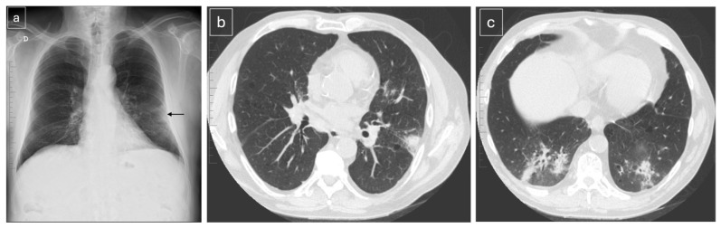
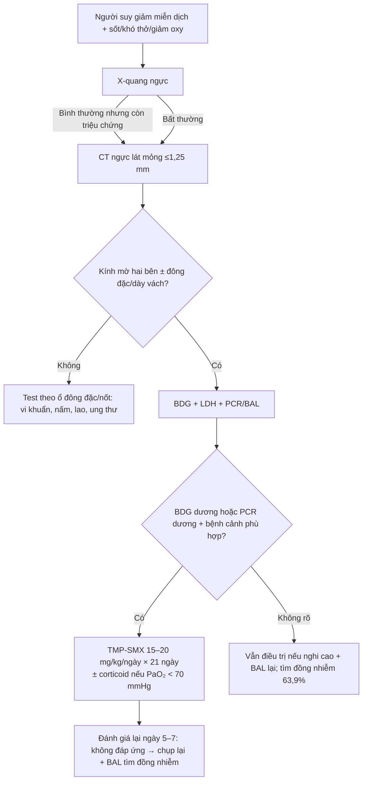
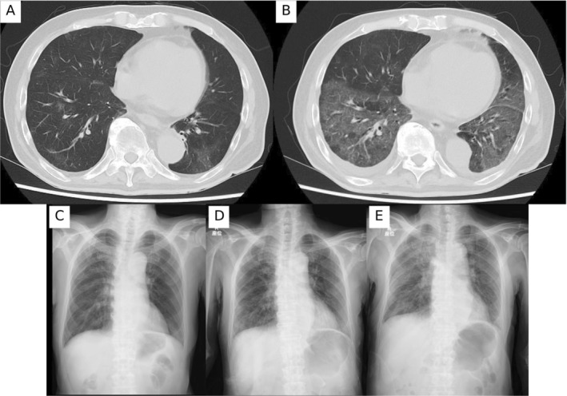
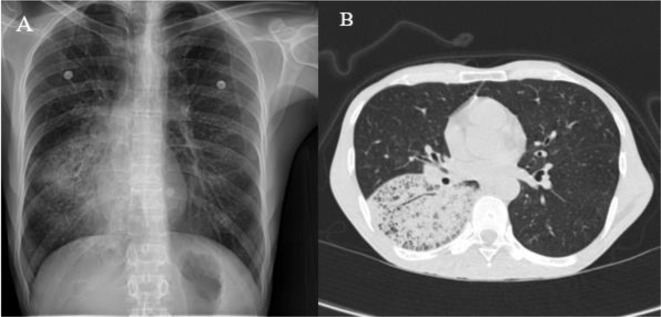

# 1788 — Viêm phổi do *Pneumocystis jirovecii* ở người KHÔNG nhiễm HIV / Non-HIV *Pneumocystis jirovecii* pneumonia (PJP)

**Tags:** `pattern:kinh-mo` `pattern:dong-dac` `pattern:day-ke` `vung:phoi` `protocol:CT-nguc-lat-mong` `protocol:BAL` `protocol:BDG`

**Mức chắc chắn (certainty):** tổng hợp y văn (literature synthesis) — số liệu hình ảnh từ **đoàn hệ 72 ca PJP (45 ca không HIV)** đọc lại CT có hệ thống (*Diagnostics* 2026, PMC13256207, CC BY 4.0), **bài tổng quan ICU 2026** (PMC13707430, CC BY 4.0), **hướng dẫn ECIL-6** và **3 ca nguyên văn có ảnh** (PMC12685607, PMC11459999, PMC13256207). Nhóm **không có bệnh nhân của mình**.

> **Câu chốt:** PJP không còn là bệnh của riêng HIV. Ở người **ghép tạng, ung thư đang điều trị, bệnh tự miễn dùng corticoid**, bệnh cảnh **nhanh hơn** (nhập viện sau **7,7 ngày** so với **19,1 ngày** ở HIV), **X-quang bình thường ở 38,6%**, và **tử vong 30–60%**. Ba số phải thuộc: **kính mờ là kiểu hình chính (66,7%)**, **nang khí gần như không có (0/42 ca không HIV)**, và **63,9% có đồng nhiễm** — nghĩa là **không được dừng ở PJP**.

## 1. Tổng quan bệnh học – cơ chế hình ảnh

### 1.1 Vì sao là "kính mờ" chứ không phải hang, xẹp hay đông đặc điển hình

- **PJP là nấm không điển hình, không nuôi cấy được.** Thể **trophozoite** bám vào **tế bào phế nang type I**, sau đó hình thành **thể nang (cyst)**; đáp ứng của ký chủ tạo **dịch tiết bọt (foamy eosinophilic exudate)** lấp **khoang phế nang**. Dịch này **thay khí nhưng không phá vách phế nang** → trên CT là **kính mờ**: đậm độ phổi tăng nhưng **vẫn thấy mạch máu và bờ phế quản xuyên qua**. Vì không có hoại tử - không có hang, và **không mất thể tích** - không có xẹp.
- **Vì sao người không HIV lại đông đặc nhiều hơn:** trong đoàn hệ 42 ca không HIV, **đông đặc 22,2%** so với **5,3%** ở HIV; **tràn dịch màng phổi 33,3%** so với **5,3%** (p = 0,022). Cơ chế được giải thích là **phản ứng bạch cầu trung tính mạnh hơn và tổn thương phế nang lan rộng (diffuse alveolar damage)** ở người còn một phần miễn dịch, cộng với **bệnh nền phổi/ghép tạng**; HIV có đáp ứng lympho - bọt **chậm và ít bạch cầu** hơn nên hình ảnh "sạch" hơn nhưng kéo dài hơn.
- **Vì sao HIV có nang khí còn không HIV thì không:** **26,3% (5/19)** ca HIV có nang/phế bào khí căng (pneumatocele) so với **0/42** ca không HIV (p = 0,001). Nang hình thành do **hoại tử mô kẽ + van một chiều** trong bối cảnh **diễn tiến hàng tuần**, điều hiếm khi xảy ra ở người không HIV vì bệnh tiến triển **nhanh hơn nhiều**.
- **Định lượng thời gian:** từ khởi phát đến nhập viện **7,69 ± 13,7 ngày** (không HIV) so với **19,12 ± 14,9 ngày** (HIV), p = 0,002; từ khởi phát đến chụp CT **13,0 so với 25,3 ngày**, p = 0,003. **Đây là lý do hình ảnh khác nhau: cùng một bệnh, hai tốc độ.**

### 1.2 Dịch tễ và tử vong — vì sao bài này quan trọng

- **Tử vong không HIV 30–60%**, so với **10–20%** ở HIV (PMC13707430). Khoảng **30–40%** ca PJP hiện nay là HIV dương tính, tức **60–70% là không HIV**.
- **Nhập ICU:** **20,7%** ở không HIV so với **18,1%** ở HIV (2014–2019, dẫn qua PMC13707430) — bệnh nặng tương đương, nhưng **nhận diện muộn hơn** vì không có "cửa sổ CD4" để nhắc.
- **Ai có nguy cơ:** ghép tạng đặc, ghép tế bào gốc, ung thư đặc/huyết học đang hóa trị, **corticoid > 20 mg/ngày kéo dài > 4 tuần**, thuốc ức chế miễn dịch phối hợp, bệnh tự miễn (nhất là viêm mạch, bệnh mô liên kết có bệnh phổi kẽ), CAR-T muộn (> 90 ngày sau truyền).
- **Bẫy "miễn dịch bình thường":** trong một đoàn hệ Hàn Quốc 187 ca, **7,5%** được xem là "miễn dịch bình thường" nhưng **29% có bệnh phổi mạn** và **tử vong 90 ngày tới 71%** — tức **không có yếu tố nguy cơ rõ ràng không loại trừ PJP** ở người suy dinh dưỡng, nghiện, COPD.

## 2. Mẫu hình + chẩn đoán phân biệt theo vị trí và tốc độ (Gamut)

- **Kính mờ hai bên, đối xứng, lan tỏa, chừa ngoại vi:** PJP (kiểu hình chuẩn), **viêm phổi do thuốc ức chế mTOR** (bài 1826), **viêm phổi do CMV**, **xuất huyết phế nang lan tỏa**, **phù phổi** (tim/không tim), **viêm phổi quá mẫn**.
- **Kính mờ + đông đặc, không đối xứng, ưu thế thùy dưới:** PJP ở người không HIV, **đồng nhiễm vi khuẩn** (63,9%), **viêm phổi tổ chức hóa (OP)**, **nhồi máu phổi**.
- **Kính mờ + dày vách liên tiểu thùy ("crazy paving"):** PJP (38,9% ca không HIV), xuất huyết phế nang, viêm phổi do thuốc, **adenocarcinoma tiết nhầy** (bệnh cảnh khác: mạn, có nốt).
- **Kính mờ + nang khí:** **gần như chỉ gặp ở HIV** (26,3% so với 0%); nếu người không HIV có nang, phải nghĩ **bệnh phổi nền (COPD/ILA)** hoặc **nhiễm khuẩn tạo hang thứ hai**.
- **Mnemonic "DAMP" cho kính mờ ở người suy giảm miễn dịch:** **D**rug (thuốc: mTOR, bleomycin, ICI), **A**lveolar hemorrhage, **M**icrobe (PJP, CMV, virus, lao), **P**ulmonary edema. PJP không đứng một mình — luôn đặt cạnh 3 nhóm còn lại.

## 3. Bảng so sánh phân biệt (ma trận đối chiếu)

| Thực thể (entity) | Hình ảnh điển hình | Chốt vào (rule-in) | Chốt loại (rule-out) | Gợi ý xác nhận |
|---|---|---|---|---|
| **PJP không HIV** | Kính mờ hai bên lan tỏa (66,7%), đông đặc (22,2%), tràn dịch (33,3%), dày vách; **không nang** | **Kính mờ + LDH ≥ 363 U/L + BDG dương + đáp ứng TMP-SMX trong 5–7 ngày** | Nang khí rõ + CD4 thấp + diễn tiến hàng tuần → nghi HIV PJP hơn; đông đặc một thùy đơn độc → ưu tiên vi khuẩn | BDG, PCR dịch rửa, BAL; **không chờ BAL mới điều trị** |
| **CMV phổi** | Kính mờ đồng nhất hoặc **nốt nhỏ + halo**, có thể một bên | **PCR CMV máu/dịch rửa dương + nốt halo** | Kính mờ đối xứng thuần túy không nốt → PJP nhiều hơn | CMV PCR định lượng; BAL |
| **Viêm phổi do mTOR (1826)** | Kính mờ + đông đặc ngoại vi/vùng sau, dày vách, giãn mạch | **Bắt đầu thuốc 0,8–50 tháng, ngừng thuốc → hồi phục 68%** | Không liên quan thời điểm dùng thuốc, BDG dương → PJP | Ngừng thuốc thử, BAL loại trừ nhiễm |
| **Xuất huyết phế nang** | Kính mờ/đông đặc **trung tâm, chừa màng phổi**, Hb giảm | **Hb giảm + BAL có hemosiderin-laden macrophage + 3 aliquots đỏ đều** | Kính mờ không kèm thiếu máu, BDG dương → PJP | BAL, CT; miễn dịch học |
| **Phù phổi cấp** | Kính mờ **phụ thuộc tư thế**, dày vách, tràn dịch hai bên, tim to | **BNP tăng + đáp ứng lợi tiểu nhanh** | Tổn thương không đổi khi nằm sấp, BNP bình thường | Siêu âm tim, BNP |
| **Đồng nhiễm vi khuẩn** | Đông đặc thùy, có thể mủ màng phổi; **63,9% ca PJP có đồng nhiễm** | **Đờm/cấy máu dương + đông đặc khu trú** | Kính mờ lan tỏa thuần túy → ít khả năng chỉ do vi khuẩn | Cấy, procalcitonin, BAL định lượng |

*(a) X-quang lúc vào: đông đặc vùng giữa phổi trái sát màng phổi (mũi tên). (b) CT 5 ngày sau: xác nhận đông đặc; (c) đồng thời **đông đặc mới ở hai đáy phổi**. Đây là kiểu hình "không HIV": đông đặc + tràn dịch nhiều hơn HIV. Nguồn: Parra-Fariñas R và cs, Diagnostics 2026, Fig. 1, CC BY 4.0.*

## 4. Protocol chụp + hệ phân độ/ngưỡng xử trí

### 4.1 Chụp gì, khi nào

- **X-quang là bước đầu, nhưng KHÔNG đủ để loại trừ:** bình thường ở **32,4%** toàn bộ và **38,6%** ở không HIV. **CT khi X-quang bình thường mà bệnh nhân giảm oxy hoặc suy giảm miễn dịch.**
- **CT ngực lát mỏng ≤ 1,25 mm, không cản quang là đủ** (trong đoàn hệ: 72,6% ca dùng lát ≤ 1,25 mm, 61,3% không cản quang, 54,8% là HRCT). Cản quang chỉ thêm khi nghi mạch máu/nhiễm khuẩn thùy.
- **Đọc theo 5 câu hỏi:** (1) kính mờ có đối xứng không? (2) có đông đặc/tràn dịch không? (3) có nang khí không? (4) có dày vách/crazy paving không? (5) có tổn thương ngoài phổi (hạch, màng phổi, tim to) gợi ý khác không?

### 4.2 Ngưỡng xét nghiệm — số nào dùng được

| Xét nghiệm | Ngưỡng / hiệu năng | Cách dùng đúng |
|---|---|---|
| **BDG huyết thanh** | Gộp: **Se 91%, Sp 79%**; **HIV Se 94% vs không HIV 86%**; Fungitell cắt **80 pg/mL: Se 84%, Sp 76%**; ở ICU không HIV, cắt tối ưu **252 pg/mL: Se 87%, Sp 79%** (so với 150 pg/mL của hãng: Se 94%, Sp 67%) | **BDG âm + xác suất trước thấp → gần như loại trừ**; BDG dương **không đủ chẩn đoán** (IVIG, albumin, lọc máu, beta-lactam, nấm khác đều dương giả) |
| **LDH** | Gộp: **Se 67%, Sp 54%**; ngưỡng riêng không HIV **363 U/L: Se 80%, Sp 76%** | Chỉ hỗ trợ; **không dùng đơn độc**, không dùng để theo dõi đáp ứng |
| **PCR *P. jirovecii*** | Rất nhạy; **không phân biệt được định cư với bệnh** | **PCR định lượng + Ct thấp** mới gợi bệnh thật; BAL là chuẩn |
| **Đờm cảm ứng** | **Se 99% (95% CI 51–100%), Sp 96%** | Thử trước khi nội soi phế quản nếu làm được |

### 4.3 Điều trị — ba quyết định

1. **Khởi trị theo kinh nghiệm khi nghi cao, không chờ BAL** (ECIL-6): TMP-SMX **15–20 mg/kg/ngày tính theo TMP** (SMX **75–100 mg/kg/ngày**), chia 3–4 lần, **21 ngày**; giảm liều theo chức năng thận, theo dõi K⁺, creatinin, công thức máu.
2. **Liều thấp hơn có thể đủ ở thể nhẹ–trung bình:** gộp 7 nghiên cứu, **< 15 mg/kg/ngày** so với **15–20 mg/kg/ngày**: tử vong **12,9% so với 25,9%** (OR 0,49; p = 0,004), ít tác dụng phụ hơn — **bằng chứng quan sát**, không áp dụng cho bệnh nặng/ICU.
3. **Corticoid bổ trợ ở không HIV: cân nhắc, không mặc định.** RCT lớn nhất (226 bệnh nhân không HIV, PJP nặng) dùng methylprednisolon **30 mg × 2/ngày ngày 1–5, 30 mg/ngày ngày 6–10, 20 mg/ngày ngày 11–21**: tử vong 28 ngày **21,5% so với 32,4%** (chênh 10,9 điểm %, 95% CI −0,9 đến 22,5; **p = 0,069** — **không đạt tiêu chí chính**), nhưng **tử vong 90 ngày thấp hơn** và **giảm nhu cầu thở máy xâm lấn**. Chỉ định cổ điển **PaO₂ < 70 mmHg hoặc A-a gradient > 35 mmHg** vẫn dùng cho HIV; ở không HIV, quyết định **theo từng ca** (ECIL-6).

### 4.4 Dự phòng — ngưỡng bắt đầu

- **Dự phòng khi corticoid > 20 mg/ngày kéo dài > 4 tuần**, ghép tạng, ghép tế bào gốc, hóa trị ức chế miễn dịch mạnh: **TMP-SMX 1 viên đôi/ngày** (hoặc 3 lần/tuần), chỉnh theo chức năng thận; dị ứng → dapsone, atovaquone, pentamidine khí dung.
- **Khi nào ngừng dự phòng:** còn ức chế miễn dịch thì còn nguy cơ; với CAR-T, PJP muộn **> 90 ngày** sau truyền đã được báo cáo **sau khi ngừng dự phòng** — không ngừng máy móc theo mốc CD4.

## 5. Biến thể bình thường và cạm bẫy

- **"X-quang bình thường" là bẫy số 1:** 38,6% ca không HIV có X-quang bình thường lúc vào; CT cùng ngày đã lan tỏa. **Không dùng X-quang âm để trấn an.**
- **CT bình thường không loại trừ:** **14,3% (6/42)** ca không HIV có CT bình thường. Nếu nghi cao, **chụp lại sau 24–48 giờ** hoặc BAL.
- **Không có nang khí là bình thường ở không HIV (0/42)** — đừng vì "không nang" mà loại PJP; ngược lại, **thấy nang khí + CD4 thấp** thì nghi HIV PJP.
- **Đồng nhiễm 63,9%:** kính mờ không đổi sau 5–7 ngày TMP-SMX thường là **đồng nhiễm/nhiễm khuẩn bệnh viện**, không phải "PJP kháng thuốc". Phải **chụp lại + BAL + cấy**.
- **BDG dương giả:** IVIG, albumin, lọc máu màng, beta-lactam (amoxicillin-clavulanate, piperacillin-tazobactam), nấm khác, bông gạc. **BDG âm giả** gặp ở ung thư đặc/huyết học — đừng loại trừ khi xác suất trước cao.
- **Kính mờ phụ thuộc tư thế:** ở bệnh nhân nằm ngửa lâu, vùng sau dưới có thể tăng đậm giả; cho **nằm sấp chụp lại** hoặc so với lát trên cùng mức.
- **Sai lầm "chỉ HIV mới có PJP"**: bỏ sót ở người ghép tạng/ung thư vì không nghĩ tới — đây là lý do tử vong không HIV cao gấp 2–3 lần.

## 6. Tự lượng giá — Blind Quiz

**Ca 1 — Nam 75 tuổi, ung thư tuyến tiền liệt di căn đang điều trị bộ ba (relugolix + darolutamide + docetaxel, prednisolon 10 mg dự phòng). Khó thở tăng dần, đã dùng kháng sinh không đỡ. Nhìn CT ngày 1 và ngày 7, mô tả trước.**

- Hỏi: Kiểu hình chính? Tại sao kháng sinh thường thất bại? Xét nghiệm nào cần làm ngay? Chẩn đoán phân biệt quan trọng nhất?

<b>Bấm để hiện đáp án (findings + chẩn đoán)</b>

- **Dấu hiệu:** (A) ngày 1 — kính mờ rải rác hai bên, vùng sau dưới; (B) ngày 7 — **kính mờ lan rộng và đậm hơn**, thêm dày vách liên tiểu thùy; (C–E) X-quang các ngày 1, 5, 9 cho thấy đám mờ lưới - kính mờ tăng dần.
- **Chẩn đoán:** **PJP ở người không HIV** (ung thư đang hóa trị + corticoid liều thấp). Kháng sinh thường thất bại vì PJP là **nấm**, không phải vi khuẩn; cần **TMP-SMX**.
- **Việc cần làm:** BDG + LDH + PCR/BAL; **bắt đầu TMP-SMX ngay** nếu nghi cao, không chờ kết quả.
- **Phân biệt:** viêm phổi do thuốc (docetaxel/mTOR), CMV, xuất huyết phế nang, phù phổi.
- **Phản biện:** ca này **tử vong** dù đã điều trị — cho thấy **nhận diện muộn** là yếu tố quyết định, không phải kháng thuốc.
- **Nguồn ảnh:** Ito F và cs, Respirol Case Rep 2025, Fig. 1, CC BY 4.0 (PMC12685607).

**Ca 2 — Nữ ghép tạng đặc, sốt 4 ngày, giảm oxy nhẹ. X-quang có đám mờ một bên; CT 5 ngày sau thay đổi. Đọc trước khi mở đáp án.**

- Hỏi: Vì sao CT khác X-quang? Kiểu hình này gợi HIV hay không HIV? Có cần cản quang không?

<b>Bấm để hiện đáp án (findings + chẩn đoán)</b>

- **Dấu hiệu:** (a) X-quang — đông đặc vùng giữa phổi trái sát màng phổi (mũi tên); (b) CT — xác nhận đông đặc; (c) **đông đặc mới hai đáy phổi**.
- **Chẩn đoán:** **PJP ở người ghép tạng** — kiểu hình **đông đặc + tràn dịch** nhiều hơn, điển hình của **không HIV** (đông đặc 22,2%, tràn dịch 33,3% so với 5,3% ở HIV).
- **Vì sao CT khác X-quang:** X-quang bỏ sót tổn thương sau tim/đáy và không phân biệt được kính mờ với đông đặc; CT lát mỏng phát hiện **tổn thương hai bên** dù X-quang chỉ thấy một bên.
- **Cản quang:** không bắt buộc; dùng khi cần loại trừ nhồi máu/nhiễm khuẩn thùy hoặc đánh giá màng phổi.
- **Nguồn ảnh:** Parra-Fariñas R và cs, Diagnostics 2026, Fig. 1, CC BY 4.0 (PMC13256207).

**Ca 3 — Nam 46 tuổi, nghiện thuốc phiện, suy dinh dưỡng, ho khan và khó thở 2 tháng, không sốt. HRCT chỉ có tổn thương khu trú một vùng phổi. Đây có phải PJP không?**

- Hỏi: Mô tả dấu hiệu? Vì sao PJP khu trú là **không điển hình**? Cần làm gì để chốt?

<b>Bấm để hiện đáp án (findings + chẩn đoán)</b>

- **Dấu hiệu:** (A) X-quang — đám mờ lưới - nốt phổi phải; (B) HRCT — **"crazy paving"** (kính mờ + dày vách liên tiểu thùy) **khu trú ở phân thùy trên thùy dưới phải**.
- **Chẩn đoán:** **PJP không HIV**, thể **khu trú/không điển hình** ở người suy dinh dưỡng, nghiện thuốc phiện — không có yếu tố ức chế miễn dịch kinh điển.
- **Phản biện:** PJP điển hình là **hai bên, lan tỏa**; tổn thương **một bên/khu trú** chỉ chiếm thiểu số và dễ bị gọi nhầm là viêm phổi khu trú/ung thư. Chẩn đoán trong ca này dựa vào **BAL + mô bệnh** (thấy thể nang trên nhuộm bạc), không dựa vào hình ảnh.
- **Bài học:** hình ảnh **không điển hình không loại trừ** ở người suy dinh dưỡng/COPD; nếu không nghĩ tới, sẽ không làm BAL.
- **Nguồn ảnh:** Fallahi MJ và cs, BMC Pulm Med 2024, Fig. 1, CC BY 4.0 (PMC11459999).

## Bài liên quan chéo
- [001 – Tổng quan hệ Ngực](../001-tong-quan-he-nguc/lesson.md)
- [1826 – Viêm phổi do thuốc ức chế mTOR](../1826-viem-phoi-do-thuoc-uc-che-mtor/lesson.md) (bắt chước gần nhất ở người ghép tạng)
- [031 – Viêm phổi mẫu hình](../031-viem-phoi-mau-hinh/lesson.md)
- [085 – Độc tính miễn dịch quanh mổ ung thư phổi](../085-doc-tinh-mien-dich-quanh-mo-ung-thu-phoi/lesson.md)
- [040 – Tràn dịch màng phổi](../040-tran-dich-mang-phoi/lesson.md) (tràn dịch 33,3% trong PJP không HIV)

> Không dùng để chẩn đoán độc lập khi chưa có người hướng dẫn.
