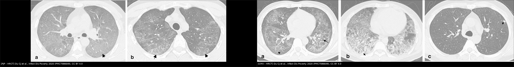
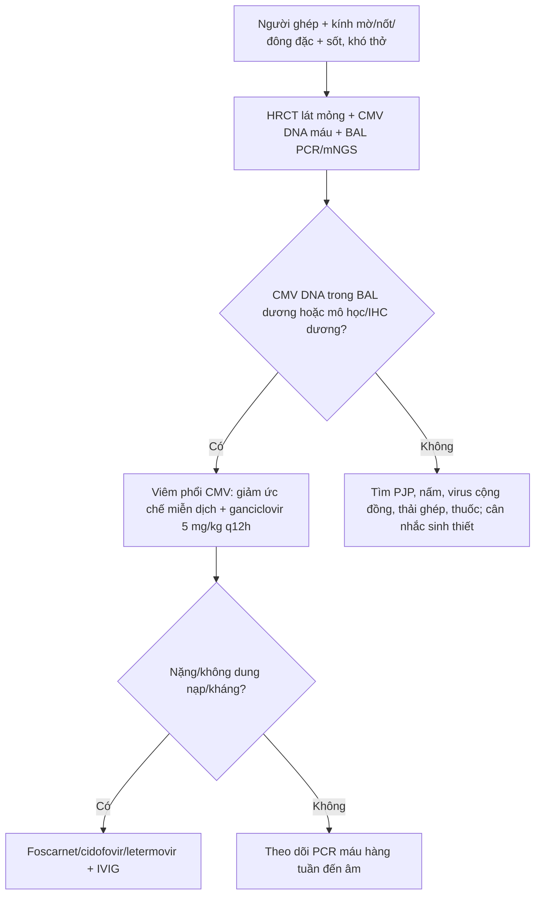
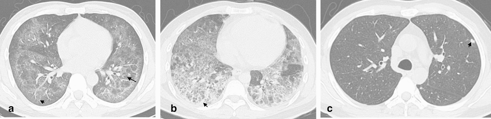
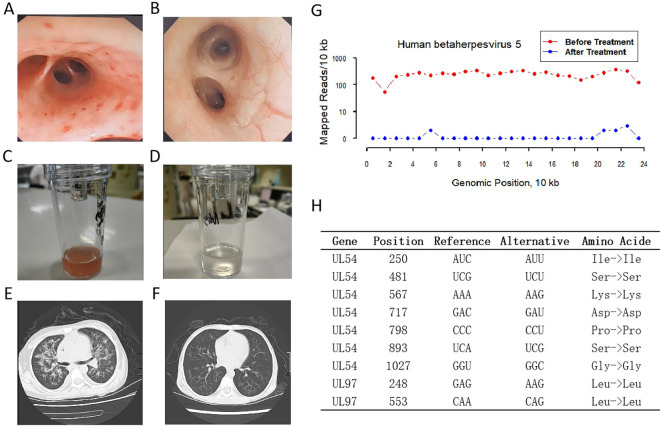
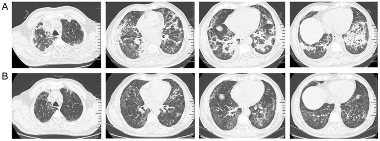

# 1789 — Viêm phổi do CMV ở người ghép tạng / Cytomegalovirus pneumonia in transplant recipients

**Tags:** `pattern:kinh-mo` `pattern:not` `pattern:dong-dac` `pattern:vien-kinh-mo` `pattern:day-ke` `vung:phoi` `protocol:CT-nguc-lat-mong` `protocol:BAL` `protocol:PCR-CMV` `score:CMV-DNA`
**Mức chắc chắn (certainty):** tổng hợp y văn (literature synthesis) — số liệu từ đoàn hệ HRCT, nghiên cứu dịch tễ và case report; chưa gắn một ca nguyên văn duy nhất.

## 1. Tổng quan — CMV gây viêm phổi bằng 2 con đường

- **Cytomegalovirus (CMV, human betaherpesvirus 5)** thuộc họ Herpesviridae; sau nhiễm tiên phát, virus **nằm tiềm tàng trong tế bào gốc tủy và tế bào myeloid** suốt đời. Khi ức chế miễn dịch (ghép tạng, ghép tế bào gốc, thuốc ức chế miễn dịch), virus **tái hoạt** và lây lan qua tế bào nội mô và bạch cầu.
- **Tổn thương phổi trực tiếp:** CMV nhiễm tế bào nội mô mao mạch phổi và đại thực bào phế nang → **viêm phổi kẽ** với thâm nhiễm tế bào đơn nhân, phù kẽ, xuất tiết trong phế nang; tế bào nhiễm to ra (**cytomegaly 25–35 µm**) với **thể vùi trong nhân kiểu "mắt cú" (owl's eye inclusion)** và thể vùi bào tương. Nhiễm nội mô gây **viêm mao mạch, xuất huyết** và tổn thương lan theo khoảng cửa.
- **TẠI SAO hình ảnh là kính mờ + nốt + đông đặc:** kính mờ (ground-glass opacity — GGO) xuất hiện khi phù/thâm nhiễm **lấp một phần khoang phế nang** nhưng chưa xóa mạch máu; nốt nhỏ trung tâm tiểu thùy phản ánh **ổ viêm/hoại tử quanh tiểu phế quản**; quầng kính mờ quanh nốt (**halo sign**) là **xuất huyết quanh ổ hoại tử**; đông đặc là khi phế nang bị lấp hoàn toàn. Vì vậy CMV cho **nhiều kiểu hình cùng lúc** hơn PJP.
- **TẠI SAO hay gặp ở người ghép:** nguy cơ cao nhất là **D+/R−** (người nhận âm tính, người cho dương tính) vì virus đến từ mảnh ghép; các yếu tố làm nặng thêm: **ATG, corticoid liều cao, bệnh mảnh ghép chống chủ (GVHD), giảm CD4**. Sau khi ngừng dự phòng, CMV có thể xuất hiện **muộn** — đã ghi nhận ca khởi phát **1 năm sau ghép tế bào gốc tự thân** với CD4 chỉ **172/µL** [PMC13198634].
- **Số liệu nền (allo-HSCT, gộp 56 nghiên cứu/13.882 bệnh nhân):** nhiễm CMV **49,99%**; bệnh CMV **13,30%**; nhiễm kháng trị **32,03%**; tử vong do mọi nguyên nhân **29,25%**; tử vong liên quan CMV **3,46%** [PMC12003426]. Riêng **viêm phổi CMV** có tử vong **30–50%** [PMC12552285]. Đây là lý do không được chờ hình ảnh "điển hình" mới điều trị.

## 2. Mẫu hình + chẩn đoán phân biệt theo kiểu hình và vật chủ

- **Kiểu 1 — kính mờ hai bên ± lưới (phổ biến nhất):** GGO gặp **100%** ca CMV-P; lưới **52,94%**; phân bố thùy/không theo thùy, thường lan tỏa hoặc ưu thế đáy [PMC7586649].
- **Kiểu 2 — nốt nhỏ ± halo:** nốt gặp **47,06%** ca CMV-P (so với **8,97%** ở PJP, p < 0,001); **nốt nhỏ 32,35%**, **nốt hiển vi 14,71%**, **không có nốt lớn**; phân bố **trung tâm tiểu thùy 23,53%**, **ngẫu nhiên 23,53%**. **Halo sign 32,35%** (PJP 11,54%, p = 0,01) [PMC7586649].
- **Kiểu 3 — đông đặc:** **61,77%** ca CMV-P (PJP 35,90%, p = 0,01); thường đông đặc dải hoặc đông đặc quanh nốt [PMC7586649].
- **Kiểu 4 — tưới máu mosaic:** **29,41%**; phản ánh tổn thương tiểu đường thở/mạch nhỏ, không đặc hiệu.
- **Ngoài phổi trên CT:** tràn dịch màng phổi **23,53%** (PJP 10,26%), hạch trung thất **14,71%**, dày thành phế quản **47,06%** [PMC7586649].
- **Gamut theo vật chủ:** người ghép tạng → CMV, PJP, *Aspergillus*, *Pneumocystis*, thải ghép cấp, thuốc ức chế miễn dịch (mTOR/ICI), xuất huyết phế nang lan tỏa (DAH), phù phổi; người ghép tế bào gốc → CMV, PJP, virus cộng đồng (RSV/influenza), nấm, PTLD.
- **Gợi nhớ "CMV = GGO + nốt nhỏ + đông đặc; PJP = GGO + nang khí, ít nốt":** trong nghiên cứu so sánh trực tiếp, **kết hợp đông đặc + nốt** cho **AUC 0,769** để phân biệt CMV-P với PJP — đủ để **gợi ý**, không đủ để **chẩn đoán** [PMC7586649].

*Trái: PJP — kính mờ lan tỏa, lưới nhẹ, không nốt rõ. Phải: CMV — kính mờ + lưới + đông đặc + nốt nhỏ có halo (panel c). Du CJ et al., Infect Dis Poverty 2020;9:117 (PMC7586649), Fig. 1–2, CC BY 4.0; ảnh ghép letterbox giữ tỷ lệ.*

## 3. Bảng so sánh phân biệt (ma trận đối chiếu)

| Thực thể (entity) | Hình ảnh điển hình trên HRCT | Chốt vào (rule-in) | Chốt loại (rule-out) | Gợi ý xác nhận |
|---|---|---|---|---|
| **Viêm phổi CMV** | GGO 100% + lưới 53% + **nốt nhỏ 32%** + **đông đặc 62%** + halo 32%; không nốt lớn | **Nốt nhỏ trung tâm tiểu thùy/ngẫu nhiên + đông đặc + halo ở người ghép** | GGO đơn thuần, không nốt, không đông đặc → vẫn **không loại trừ** CMV | **CMV DNA trong BAL** + giảm ức chế miễn dịch; mô học/IHC |
| **PJP** | GGO lan tỏa đối xứng, lưới, **nang khí/pneumatocele**, không nốt | **GGO + nang khí + LDH tăng + BDG dương** | Nốt nhỏ/đông đặc rõ → nghĩ CMV hoặc đồng nhiễm | BAL nhuộm Grocott/PCR PJP |
| **Cúm/RSV** | GGO + **tree-in-bud**, dày thành phế quản, tổn thương vá; có thể đông đặc thùy | **Tree-in-bud + bối cảnh dịch tễ** | Không có tree-in-bud, có nốt lớn → không điển hình | PCR multiplex dịch hô hấp |
| **Viêm phổi do thuốc (mTOR/ICI)** | GGO + đông đặc ngoại vi, dày vách, **không nốt nhỏ rõ**; hồi phục sau ngừng thuốc | **Mốc thời gian sau khởi thuốc + cải thiện khi ngừng** | Nốt nhỏ + halo + CMV DNA dương → nghi nhiễm | Ngừng thuốc thử + BAL loại trừ nhiễm |
| **Thải ghép cấp (ACR)** | Dày vách, GGO quanh mạch, tràn dịch; **không nốt nhỏ** | **Đáp ứng với corticoid + sinh thiết phổi** | Nốt nhỏ/halo + sốt cao → nhiễm | Sinh thiết + CMV PCR |
| **Xuất huyết phế nang (DAH)** | GGO lan tỏa hoặc đông đặc, **không nốt**; Hb giảm | **GGO + thiếu máu + BAL có hemosiderin** | Nốt nhỏ + CMV DNA dương → CMV | BAL, CT, Hb |
| **Nấm xâm lấn (Aspergillus)** | **Nốt + halo**, dấu liềm khí, xoang; thường trung tính | **Halo + giảm bạch cầu hạt + galactomannan** | Nốt nhỏ rải rác không hang → nghĩ CMV | Galactomannan, BAL, sinh thiết |

## 4. Protocol chụp, xét nghiệm và điều trị

- **HRCT ngực lát mỏng ≤ 1 mm**, thì hít vào; thêm thì thở ra nếu nghi mosaic/air trapping. Đánh giá **GGO, nốt (kích thước/phân bố), đông đặc, halo, lưới, tràn dịch, hạch** — ghi rõ từng kiểu hình vì không có dấu hiệu nào đặc hiệu.
- **Xét nghiệm chẩn đoán:** **CMV DNA định lượng trong máu (plasma) và dịch rửa phế quản (BAL)**; **pp65 antigenemia**; **mô học/IHC** (thể vùi "mắt cú", IHC CMV); **mNGS** khi đã loại trừ nguyên nhân thường gặp. **PCR máu âm không loại trừ viêm phổi CMV** — ca báo cáo có **BAL 3,0 × 10⁴ copies/mL trong khi plasma âm** [PMC13198634]; ca khác có máu **1,47 × 10⁴ copies/mL** [PMC12698586].
- **Ngưỡng:** không có một ngưỡng tuyệt đối dùng chung giữa các phòng xét nghiệm; trong thực hành, **CMV DNA dương trong BAL + hội chứng phù hợp + yếu tố nguy cơ** là đủ để điều trị theo kinh nghiệm, nhất là khi không có chẩn đoán thay thế.
- **Điều trị bậc 1:** **ganciclovir 5 mg/kg TM mỗi 12 giờ** (chỉnh theo chức năng thận) [PMC13198634]; **valganciclovir 900 mg uống mỗi 12 giờ** khi bệnh nhẹ/ổn định; thời gian **2–3 tuần** và đến khi hết virus huyết. **Giảm ức chế miễn dịch** là phần bắt buộc của điều trị.
- **Bậc 2/kháng trị:** **foscarnet** (độc thận, hạ kali/calci) hoặc **cidofovir**; **letermovir** dùng dự phòng ở HSCT và là lựa chọn cho ca kháng/không dung nạp; **IVIG** hỗ trợ trong ca nặng.
- **Kháng thuốc:** đột biến **UL97** (ganciclovir) và **UL54** (ganciclovir/cidofovir/foscarnet) — cần giải trình tự khi thất bại điều trị.
- **Dự phòng:** **valganciclovir 3–6 tháng** sau ghép tạng (ghép phổi **6–12 tháng**), **letermovir** sau HSCT; theo dõi CMV DNA định kỳ ở nhóm **D+/R−**.
- **Sơ đồ xử trí:**

## 5. Biến thể bình thường và cạm bẫy

- **PCR máu âm không loại trừ CMV phổi:** virus có thể khu trú ở phổi mà không lan ra máu, nhất là ở người ghép tế bào gốc tự thân. Nếu lâm sàng và HRCT phù hợp, **phải lấy BAL**.
- **Kính mờ là dấu hiệu không đặc hiệu:** PJP, phù phổi, xuất huyết, thuốc, thải ghép đều cho GGO. **Không chẩn đoán CMV chỉ bằng hình ảnh**; ngược lại, **không loại trừ CMV** chỉ vì hình ảnh "giống PJP".
- **Halo sign không phải của riêng CMV:** gặp trong **nấm xâm lấn**, di căn xuất huyết, viêm mạch; bối cảnh giảm bạch cầu hạt đổi hướng chẩn đoán sang *Aspergillus*.
- **Đồng nhiễm là quy luật, không phải ngoại lệ:** ca báo cáo có CMV + *Klebsiella pneumoniae*; ca khác có CMV + PJP. **Điều trị một tác nhân rồi thất bại** thường là do bỏ sót tác nhân thứ hai.
- **Khởi phát muộn sau khi ngừng dự phòng:** có thể xảy ra **1 năm sau ghép** khi CD4 còn thấp; đừng loại trừ CMV chỉ vì "đã qua giai đoạn nguy cơ".
- **Corticoid làm giảm triệu chứng tạm thời nhưng làm nặng nhiễm:** nếu đang cân nhắc tăng corticoid vì "thải ghép", phải loại trừ CMV trước — tăng ức chế miễn dịch trong viêm phổi CMV có thể gây tử vong.
- **mNGS dương không đồng nghĩa bệnh:** số đọc thấp có thể là nhiễm nền/ô nhiễm; luôn đối chiếu với **PCR định lượng** và bối cảnh lâm sàng.

## 6. Tự lượng giá — Blind Quiz

**Ca 1 — Ba bệnh nhân AIDS có viêm phổi CMV; HRCT của mỗi người ở một panel (a–c).**

- Câu hỏi: Mô tả các kiểu hình khác nhau trên 3 panel? Chẩn đoán phân biệt hàng đầu? Xét nghiệm nào chốt?

<b>Bấm để hiện đáp án (findings + chẩn đoán)</b>

- **Findings:** (a) kính mờ lan tỏa + lưới + tưới máu mosaic; (b) kính mờ + đông đặc + lưới; (c) kính mờ + **nốt nhỏ có quầng halo** (mũi tên).
- **Chẩn đoán:** **viêm phổi CMV** — kiểu hình nốt nhỏ + đông đặc + halo giúp phân biệt với PJP (PJP ít nốt, hay có nang khí).
- **Xét nghiệm chốt:** **CMV DNA trong BAL** (có thể âm ở máu) ± mô học/IHC; đồng thời loại trừ PJP/nấm/cúm.
- **Nguồn:** Du CJ et al., Infect Dis Poverty 2020 (PMC7586649), Fig. 2, CC BY 4.0.

**Ca 2 — Trẻ ghép tế bào gốc, sốt + khó thở; nội soi phế quản và CT trước/sau điều trị.**

- Câu hỏi: Hình nào chứng tỏ đáp ứng điều trị? Vì sao phải chỉnh liều theo chức năng thận?

<b>Bấm để hiện đáp án</b>

- **Findings:** niêm mạc phế quản viêm đỏ, dịch rửa đục (A, C) → niêm mạc lành, dịch trong (B, D); CT có đông đặc/nốt (E) → giảm rõ (F). Panel G–H là theo dõi tải lượng virus và đột biến UL54/UL97.
- **Chẩn đoán:** **viêm phổi CMV** ở trẻ ghép tế bào gốc; điều trị bằng **foscarnet + letermovir** trong ca này vì giảm tế bào máu.
- **Lý do chỉnh liều:** **ganciclovir thải qua thận**, gây độc tủy (giảm bạch cầu/tiểu cầu); foscarnet gây độc thận và hạ kali/calci — phải theo dõi creatinin, điện giải, công thức máu.
- **Nguồn:** Xuan F et al., Front Cell Infect Microbiol 2025;15:1665477 (PMC12698586), Fig. 2, CC BY 4.0.

**Ca 3 — Nam 57 tuổi, viêm phổi CMV sau ghép tế bào gốc tự thân; CT lúc 1 tuần và 6 tuần sau điều trị đích.**

- Câu hỏi: Đáp ứng hình ảnh diễn ra bao lâu? Có cần chọc hút/dẫn lưu tràn dịch không?

<b>Bấm để hiện đáp án</b>

- **Findings:** (a) còn kính mờ vá + đông đặc hai bên, tràn dịch màng phổi ít; (b) sau **6 tuần** tổn thương nhu mô giảm rõ, **tràn dịch hấp thu hoàn toàn**.
- **Chẩn đoán:** **viêm phổi CMV** đáp ứng điều trị; tràn dịch ít, không cần dẫn lưu.
- **Bài học:** đáp ứng hình ảnh chậm hơn lâm sàng — không đổi phác đồ chỉ vì CT còn tổn thương ở tuần 1; theo dõi **PCR máu** và lâm sàng.
- **Nguồn:** Zhang Z et al., Ther Adv Infect Dis 2026;13:20499361261450721 (PMC13198634), Fig. 3, CC BY-NC 4.0.

## Bài liên quan chéo

- [001 – Tổng quan hệ Ngực](../001-tong-quan-he-nguc/lesson.md)
- [1788 – Viêm phổi do *Pneumocystis jirovecii* ở người không nhiễm HIV](../1788-viem-phoi-pjp-khong-hiv/lesson.md)
- [1826 – Viêm phổi do thuốc ức chế mTOR](../1826-viem-phoi-do-thuoc-uc-che-mtor/lesson.md)
- [1918 – Nhiễm CMV sau ghép gan ở trẻ](../1918-nhiem-cmv-sau-ghep-gan-o-tre/lesson.md)
- [116 – Nhiễm trùng nặng sau ghép gan–thận](../116-nhiem-trung-nang-gan-ghep-than/lesson.md)
- [099 – Hẹp tĩnh mạch phổi sau ghép phổi](../099-hep-tinh-mach-phoi-sau-ablation-ghep-phoi/lesson.md)
- [459 – Theo dõi dài hạn & tái hoạt CMV retinitis sau ghép](../459-theo-doi-dai-han-cmv-retinitis/lesson.md)

## Ảnh

- `1789_cmv-phoi_HRCT_PMC7586649.jpg` — Infect Dis Poverty 2020 (PMC7586649), CC BY 4.0.
- `1789_cmv-phoi_HRCT-PJP_PMC7586649.jpg` — cùng bài, Fig. 1 (PJP), CC BY 4.0.
- `composite_pjp-vs-cmv.jpg` — ảnh ghép dựng từ Fig. 1–2 của PMC7586649 bằng `tools/make_composite.py`, CC BY 4.0.
- `1789_cmv-phoi_CT-noi-soi-dieu-tri_PMC12698586.jpg` — Front Cell Infect Microbiol 2025 (PMC12698586), CC BY 4.0.
- `1789_cmv-phoi_CT-dien-tien_PMC13198634.jpg` — Ther Adv Infect Dis 2026 (PMC13198634), CC BY-NC 4.0.
- Nguồn, giấy phép và tác giả từng ảnh: `images/CREDITS.md`.

> Không dùng để chẩn đoán độc lập khi chưa có người hướng dẫn.
