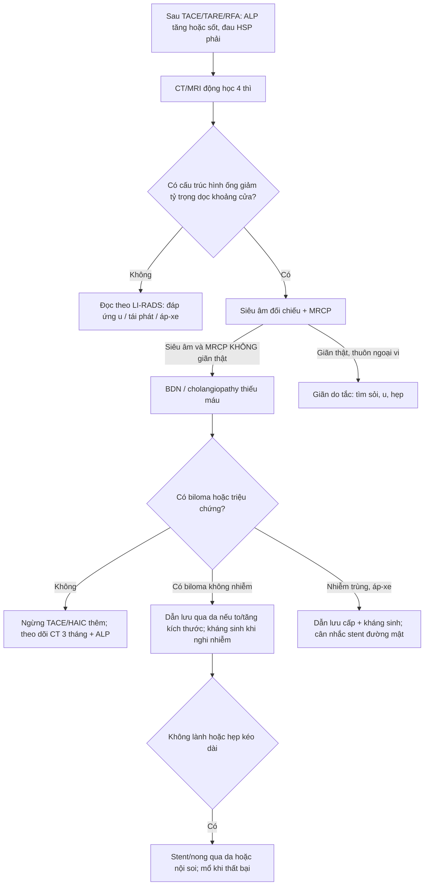
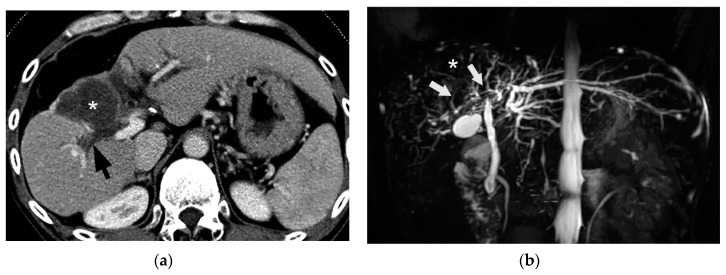
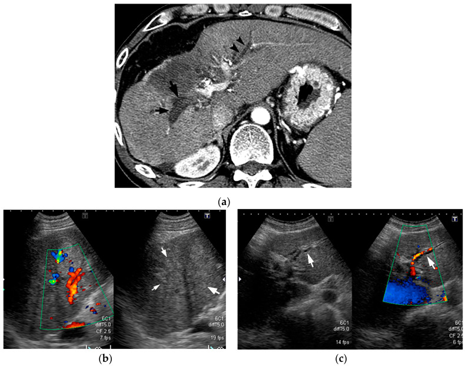
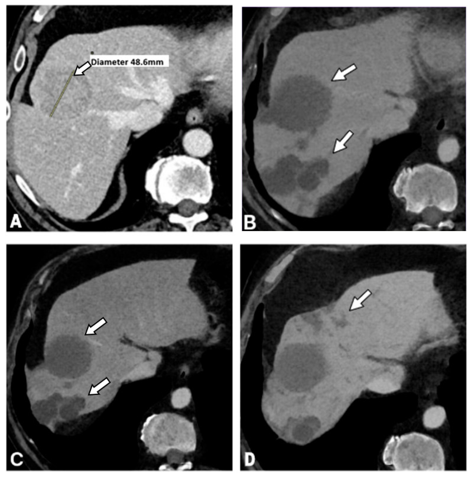

# 179 — Hoại tử ống mật & cholangiopathy thiếu máu sau can thiệp u gan (TACE/TARE/RFA): ống mật "giả giãn" và biloma

**Tags:** `pattern:ong-giam-ty-trong` `pattern:biloma` `vung:gan` `vung:duong-mat` `protocol:CT-MRI-dong-hoc` `protocol:MRCP`
**Mức chắc chắn (certainty):** tổng hợp y văn (literature synthesis) — bài tổng quan có ảnh minh họa của Kobayashi 2020 (Cancers, PMC7565329), bài tổng quan biến chứng TACE 2026 (PMC12835986), cohort DEB-TACE 2026 (PMC13204766), review biến chứng đốt nhiệt 2022 (PMC9147303) và nghiên cứu làm mát đường mật 2025 (PMC12153656). Số liệu trích trực tiếp; chỗ chưa có số ghi "chưa rõ".

## 1. Tổng quan bệnh học – cơ chế hình ảnh

- **Giải phẫu quyết định biến chứng:** ống mật lớn trong gan **không có mạch máu riêng từ tĩnh mạch cửa** mà được nuôi bởi **đám rối mạch quanh ống mật (peribiliary vascular plexus, PBP)** — mạch đến từ **nhánh động mạch gan**, mạch về đổ vào **tĩnh mạch cửa/xoang gan**. Ống mật lớn (ống gan **> 800 μm**, ống phân thùy **400–800 μm**, ống vùng **300–400 μm**) có PBP **3 lớp**; ống nhỏ (vách **100–300 μm**, tiểu thùy **15–100 μm**) gần như **không có PBP** và **không có tuyến quanh ống tiết nhầy** → **dễ tổn thương do thiếu máu và do acid mật** hơn (Kobayashi 2020).
- **TẠI SAO can thiệp động mạch gan gây hoại tử ống mật:** TACE (và các can thiệp động mạch gan khác như TARE/HAIC) đưa vật liệu tắc/hóa chất vào **nhánh động mạch nuôi u**; PBP cũng nằm trong vùng tắc → **thiếu máu cholangiocyte** → mất hàng rào bảo vệ (nhầy của tuyến quanh ống, "ô dù bicarbonate", phospholipid) → **acid mật thoát vào thành ống** → **hoại tử đông (coagulation necrosis) của thành ống và mô quanh ống** → **hoại tử ống mật (bile duct necrosis, BDN)** → **rò mật/biloma**, hẹp, hoặc áp-xe.
- **Vì sao gọi là "ống mật giả giãn":** trên CT, BDN hiện thành **cấu trúc hình ống giảm tỷ trọng chạy dọc khoảng cửa**, trông **y như ống mật giãn**. Khác biệt cốt lõi: BDN **không phải lòng ống chứa mật** mà là **thành ống hoại tử + mô quanh ống thấm mật**, nên **không thấy giãn thật trên siêu âm/MRCP**, và **đường kính không đều, có thể "dạng chuỗi hạt"** như viêm xơ đường mật nguyên phát (PSC).
- **Số liệu dịch tễ (định lượng):**
  - Nghiên cứu **tử thiết**: BDN sau TACE điều trị HCC gặp **9%** (Kobayashi 2020).
  - **HAIC** (truyền hóa chất vào động mạch gan): bất thường đường mật **57%** trong hoặc **1–12 tháng** sau điều trị (Kobayashi 2020).
  - Tổng quan 2026: biến chứng đường mật sau TACE **0,26–6,5%**; phân bố **giãn ống mật trong gan 57,1%**, **biloma 25,7%**, **hẹp ống mật rốn gan 17,1%**; biloma chia **dạng nang tròn 55%**, **dạng phân nhánh 30%**, **hỗn hợp 15%**; riêng biloma trong gan **1,04%** (1.923 BN / 4.695 lần TACE) và **3,6% BN / 1,9% lần thủ thuật** ở một cohort khác (PMC12835986).
  - Cohort **DEB-TACE**: **14/106 (13,2%)** có cholangiopathy thiếu máu, phát hiện trung bình **3,1 tháng** sau TACE; **42,9% không triệu chứng**; **5 ca nhập viện**, **2 ca biloma nhiễm trùng** cần kháng sinh/dẫn lưu; **không có tử vong** trực tiếp (PMC13204766).
  - **90%** ca BDN có **huyết khối/tắc tĩnh mạch cửa kế cận**; **20–65%** biloma có triệu chứng; **tử vong ở ca biloma sau TACE ~5–10%** (Kobayashi 2020).
- **TẠI SAO tín hiệu MRI như vậy:** BDN là **mô hoại tử + mật thấm** → T2 **tăng tín hiệu nhưng không sáng bằng dịch não tủy** (khác nang mật đơn thuần); thì **gan–mật (hepatobiliary phase) 20 phút sau Gd-EOB-DTPA** → vùng BDN **giảm tín hiệu** so với gan lành vì không còn cholangiocyte lấy thuốc (Kobayashi 2020).
- **Sau đốt nhiệt (RFA/MWA):** u **trung tâm, sát ống mật lớn** dễ gây **hẹp ống mật có ý nghĩa lâm sàng**; hẹp ống phân thùy **ngoại vi** có thể **không cần điều trị** (Granata 2022). Biện pháp bảo vệ: **làm mát đường mật bằng nước muối 4 °C** qua ống mũi–mật, thể tích trung bình **150 mL (100–200 mL)**, ở u cách ống mật trung vị **1 mm (0–4 mm)** — 9 ca không có tổn thương đường mật, 1 ca viêm đường mật sau đặt ống (Chou 2025).

## 2. Mẫu hình + chẩn đoán phân biệt theo vị trí (gamut)

**Ba mẫu hình cần nhận ra sau can thiệp u gan:**

1. **"Ống giảm tỷ trọng hình ống"** (dọc khoảng cửa, sau TACE/HAIC):
   - **BDN/cholangiopathy thiếu máu** (chốt: **siêu âm/MRCP không giãn thật**, đường kính không đều, nối với biloma, tắc TM cửa kế cận).
   - **Giãn ống mật thật do tắc** (sỏi/u/hẹp miệng nối): giãn **thuôn dần ra ngoại vi**, thấy nguyên nhân ở phía dưới, **thấy rõ trên MRCP**.
   - **Huyết khối tĩnh mạch cửa** (chốt: **cavernous transformation**, ngấm thuốc mạnh các mạch bàng hệ quanh; **ngấm từng vùng thì động mạch** thường có trong huyết khối cửa, **không có** trong BDN).
   - **Nang quanh ống mật (peribiliary cyst)**: nhiều nang nhỏ **dọc TM cửa lớn**, không nối với lòng ống.
   - **Bệnh Caroli**: nang/ống giãn rải rác + **dấu chấm trung tâm (central dot sign)** = nhánh cửa trong nang.
2. **"Tổn thương dạng dịch sau can thiệp"**:
   - **Biloma** (dạng tròn/phân nhánh/hỗn hợp; nối với ống hoại tử; tỉ trọng dịch, không ngấm thuốc).
   - **Ổ hoại tử sau đốt (post-ablation cavity)**: **bờ mỏng, đều, teo dần** theo thời gian; có thể có bóng khí sớm.
   - **Áp-xe**: bờ dày không đều, khí/mức dịch, ngấm vòng, **sốt + bạch cầu tăng**.
   - **Mật tụ dưới bao (subcapsular biloma)** sau đốt/sinh thiết.
   - **Giả phình động mạch gan**: **ngấm thuốc thì động mạch**, đồng tỉ trọng mạch máu — không phải dịch.
3. **"Hẹp đường mật"**: hẹp do thiếu máu (đoạn dài, sau TACE, không có khối), hẹp do u (đoạn ngắn, bờ vai), hẹp sau đốt (ổ đốt sát ống), hẹp miệng nối (sau mổ nối mật–ruột).

**Mnemonic "BILIARY":** **B**iloma, **I**schemic cholangiopathy/BDN, **L**eak (rò mật), **I**nfection/abscess, **A**rterial pseudoaneurysm, **R**estriction/stricture, **Y**ellow (vàng da do tắc) — mỗi chữ là một hướng đọc trên CT sau can thiệp.

## 3. Bảng so sánh phân biệt (ma trận đối chiếu)

| Thực thể (entity) | Hình ảnh điển hình | Chốt vào (rule-in) | Chốt loại (rule-out) | Gợi ý xác nhận |
|---|---|---|---|---|
| **BDN / cholangiopathy thiếu máu** | CT: cấu trúc **hình ống giảm tỷ trọng dọc khoảng cửa**, đường kính không đều, nối với biloma; T2 tăng nhưng **< dịch não tủy**; HBP giảm tín hiệu | **CT "giãn ống" nhưng siêu âm/MRCP KHÔNG giãn thật** + sau TACE + ALP tăng | Giãn thật (thấy rõ trên MRCP, thuôn ngoại vi) hoặc huyết khối cửa có bàng hệ → loại BDN | US đối chiếu + MRCP; theo dõi ALP/bilirubin |
| **Giãn ống mật do tắc** | Ống giãn **thuôn dần** ra ngoại vi; thấy sỏi/u/hẹp ở phía dưới | **Thấy nguyên nhân tắc phía dưới + giãn rõ trên MRCP** | Không có nguyên nhân tắc, ống không giãn trên MRCP → nghĩ BDN | MRCP; EUS/ERCP nếu cần |
| **Huyết khối tĩnh mạch cửa** | Cấu trúc giảm tỷ trọng trong lòng TM cửa; **mạch bàng hệ dạng hang (cavernous transformation)**; ngấm từng vùng thì động mạch | **Cavernous transformation + ngấm thuốc bàng hệ** | Ngấm từng vùng đơn thuần không loại BDN (BDN tiến triển cũng có) | CT động học; Doppler |
| **Biloma** | Khối dịch **tròn hoặc phân nhánh**, tỉ trọng nước, không ngấm thuốc, **nối với ống hoại tử** | **Nối trực tiếp với cấu trúc ống hoại tử + tỉ trọng dịch** | Ngấm thuốc thì động mạch → giả phình; bờ dày + khí → áp-xe | CT/MRI; chọc hút nếu nghi nhiễm |
| **Ổ hoại tử sau đốt** | Vùng giảm tỷ trọng **bờ mỏng, đều**, teo dần; có thể có bóng khí sớm | **Bờ mỏng đều + teo dần theo thời gian** | Nốt/viền dày lệch tâm mới xuất hiện → tái phát tại chỗ | MRI động học + so sánh lần trước |
| **Áp-xe sau can thiệp** | Khối dịch **bờ dày không đều**, khí/mức dịch, ngấm vòng, phù mô xung quanh | **Sốt + bạch cầu tăng + khí/mức dịch** | Không triệu chứng, bờ mỏng, teo dần → ổ đốt lành | CT; chọc hút cấy |
| **Peribiliary cyst / Caroli** | Nhiều nang nhỏ **dọc TM cửa lớn** (peribiliary) hoặc nang thông với cây mật + **central dot** (Caroli) | **Vị trí dọc TM cửa / central dot** | Nối với ổ hoại tử và xuất hiện sau TACE → biloma/BDN | MRCP; so phim cũ |

## 4. Protocol chụp + theo dõi + thuật toán

**Trước can thiệp (dự phòng):**
- **CTA bụng** lập kế hoạch (biến thể động mạch, nhánh nuôi, mạch bàng hệ) + **CBCT trong phòng DSA** để chọn nhánh.
- **TACE siêu chọn lọc** (superselective) — trung tâm dùng kỹ thuật này có tỉ lệ biến chứng thấp hơn cTACE; **B-TACE** (bóng chặn đầu gần) giảm trào ngược vật liệu tắc (PMC12835986).
- **U trung tâm sát ống mật** (đặc biệt khi đốt nhiệt): cân nhắc **làm mát đường mật bằng NaCl 4 °C qua ống mũi–mật**, thể tích ~**150 mL**; khoảng cách u–ống trung vị **1 mm** trong nghiên cứu (PMC12153656).
- **Ngừng/giảm số đợt** khi đã thấy BDN: Kobayashi 2020 khuyến cáo **không TACE/HAIC thêm** nếu phát hiện BDN vì nguy cơ biloma.

**Theo dõi sau can thiệp:**
- **CT/MRI gan động học 4 thì** đánh giá đáp ứng u theo **LI-RADS** (xem bài 121); cohort DEB-TACE phát hiện cholangiopathy trung bình **3,1 tháng** → **lần chụp 3 tháng rất quan trọng**, không chỉ đọc u mà **phải nhìn đường mật**.
- **Xét nghiệm:** **ALP tăng > 200 U/L ở 76,2% (16/21)** ca tổn thương đường mật; bilirubin tăng muộn hơn → **ALP là cờ sớm**, đừng chờ vàng da.
- **Siêu âm đối chiếu** khi CT nghi "giãn ống": nếu siêu âm **không thấy ống giãn** → hướng BDN.
- **MRCP** (T2 3D) khi cần bản đồ đường mật, xác định hẹp/rò; **MRI gadoxetic (HBP)** giúp phân biệt BDN (giảm tín hiệu) với ống mật thật.

**Điều trị (theo nguồn):**
- **Không triệu chứng, biloma nhỏ, không tăng kích thước:** **theo dõi bảo tồn** (Kobayashi 2020).
- **Có triệu chứng hoặc biloma tăng kích thước:** **dẫn lưu qua da + kháng sinh**; **20–65%** biloma có triệu chứng nên không được chủ quan.
- **Nhiễm trùng biloma/áp-xe:** dẫn lưu cấp + kháng sinh; **tử vong 5–10%** nếu chậm trễ (Kobayashi 2020).
- **Hẹp đường mật kéo dài:** nong bóng/stent qua da hoặc nội soi; mổ khi thất bại — xem bài 137 (theo dõi stent) và 910 (dẫn lưu đường mật qua da).

## 5. Biến thể bình thường và cạm bẫy

- **Cạm bẫy số 1 — "thấy ống giãn là tắc mật":** BDN trông giống hệt ống giãn trên CT. **Chốt loại bằng siêu âm/MRCP**: BDN **không giãn thật**; nếu chỉ đọc CT sẽ đặt stent/ERCP không cần thiết hoặc bỏ sót hoại tử đang tiến triển.
- **Ngấm từng vùng thì động mạch:** có trong **huyết khối TM cửa**, **không điển hình** trong BDN — nhưng **BDN tiến triển gây tắc TM cửa thứ phát** nên vẫn có thể gặp; đừng dùng một dấu hiệu để loại trừ.
- **Bóng khí trong ổ đốt sớm** có thể là bình thường; **khí + mức dịch + sốt + bờ dày** mới là áp-xe. So sánh với lần chụp trước là bắt buộc.
- **Biloma "phân nhánh"** (30%) dễ bị đọc là "ống mật giãn" — nhìn kỹ **có nối với ổ hoại tử** và **không thuôn ra ngoại vi**.
- **Hẹp ống phân thùy ngoại vi sau đốt** thường **không cần điều trị** (Granata 2022) — tránh can thiệp quá mức.
- **Satisfaction of search:** thấy biloma rồi dừng → bỏ sót **huyết khối TM cửa, giả phình động mạch, áp-xe**; và bỏ sót **u sống (LR-TR Viable)** vì vùng hoại tử che mất.
- **Đừng nhầm với biến chứng sau ghép gan:** cholangiopathy thiếu máu sau ghép (bài 133) có cơ chế tương tự nhưng bối cảnh và xử trí khác (hẹp miệng nối, thiếu máu mạch gan ghép).

## 6. Tự lượng giá — Blind Quiz ngay trên trang tĩnh

**Ca 1 — BN HCC sau nhiều đợt TACE, ALP tăng, không sốt. CT thì cửa (A) và MRCP (B).**

- Gợi ý: không có sỏi, không có khối u mới.
- Câu hỏi: (1) Cấu trúc mũi tên là gì? (2) Vì sao không phải ống mật giãn? (3) Bước tiếp theo?

<b>Bấm để hiện đáp án (findings + chẩn đoán)</b>

- **Findings:** (a) CT: cấu trúc **hình ống giảm tỷ trọng** ở rốn gan phải (mũi tên) + **khối dịch lớn** cạnh đó (dấu *). (b) MRCP: ống mật **không giãn tương ứng**, chỉ thấy tín hiệu bất thường khu trú.
- **Chẩn đoán:** **hoại tử ống mật (BDN) + biloma** sau TACE.
- **Vì sao:** "ống giãn" trên CT nhưng **MRCP không giãn thật** + nối với khối dịch + bối cảnh TACE → BDN. Ống giãn thật do tắc sẽ **thấy rõ trên MRCP và thuôn ra ngoại vi**.
- **Bước tiếp:** ngừng TACE thêm; siêu âm đối chiếu; theo dõi ALP; dẫn lưu nếu biloma to/có triệu chứng.
- **Nguồn ảnh:** Kobayashi S et al., *Cancers* 2020, PMC7565329 Fig. 14 — CC BY 4.0.

**Ca 2 — Sau TACE, CT thấy "ống mật giãn" nhưng siêu âm lại bình thường.**

- Gợi ý: bệnh nhân không vàng da, bilirubin bình thường, ALP tăng.
- Câu hỏi: (1) Tại sao CT và siêu âm "mâu thuẫn"? (2) Dấu hiệu nào trên siêu âm ủng hộ BDN? (3) Nếu là ống giãn thật thì siêu âm sẽ thấy gì?

<b>Bấm để hiện đáp án (findings + chẩn đoán)</b>

- **Findings:** (a) CT: cấu trúc hình ống giảm tỷ trọng dày ở rốn gan phải (mũi tên) và cấu trúc mảnh hơn ở phân thùy trái (đầu mũi tên). (b) Siêu âm gan phải: **không thấy ống giãn**, khoảng cửa **đồng âm/hơi tăng âm**. (c) Siêu âm trái: cấu trúc ống trống âm nhẹ dọc nhánh động mạch = giãn thật nhẹ.
- **Chẩn đoán:** BDN bên phải (giả giãn) + giãn ống mật thật nhẹ bên trái.
- **Vì sao:** BDN là **mô hoại tử đặc**, không phải lòng chứa dịch → siêu âm **không thấy ống trống âm**; CT chỉ phản ánh **thành ống dày + mô quanh ống thấm mật**.
- **Nếu giãn thật:** siêu âm sẽ thấy **ống trống âm, chạy song song TM cửa**, đo được đường kính.
- **Nguồn ảnh:** Kobayashi S et al., *Cancers* 2020, PMC7565329 Fig. 12 — CC BY 4.0.

**Ca 3 — BN HCC 48 mm được DEB-TACE; ảnh (A) trước, (B) 3 tháng, (C) 12 tháng, (D) sau đó.**

- Gợi ý: bệnh nhân không sốt; theo dõi định kỳ.
- Câu hỏi: (1) Mô tả thay đổi từ A→B. (2) Có cần can thiệp ngay ở B không? (3) Dấu hiệu nào sẽ khiến bạn dẫn lưu?

<b>Bấm để hiện đáp án (findings + chẩn đoán)</b>

- **Findings:** (A) HCC **48,6 mm** trước điều trị. (B) Sau 3 tháng: u hoại tử hoàn toàn + **hai biloma lớn** trong nhu mô đã điều trị. (C) 12 tháng: biloma **thoái triển nhẹ**. (D) tiếp tục giảm.
- **Chẩn đoán:** biloma sau DEB-TACE, **không nhiễm trùng**, diễn tiến lành tính.
- **Vì sao theo dõi:** biloma không triệu chứng, không tăng kích thước → **bảo tồn**; 20–65% biloma có triệu chứng mới cần can thiệp.
- **Khi nào dẫn lưu:** **sốt/đau tăng, bạch cầu tăng, khí trong biloma, hoặc biloma tăng kích thước**; dẫn lưu + kháng sinh, vì tử vong có thể **5–10%** nếu nhiễm trùng chậm trễ.
- **Nguồn ảnh:** Štupar S et al., *Curr Oncol* 2026, PMC13204766 Fig. 3 — CC BY 4.0.

## Bài liên quan chéo
- [100 – Tổng quan hệ Bụng](../100-tong-quan-he-bung/lesson.md)
- [930 – TACE, đốt & LR-TR (đáp ứng u sống/hoại tử)](../930-hepatic-oncology-tace-rfa/lesson.md)
- [121 – LI-RADS & HCC](../121-khoi-gan-LIRADS/lesson.md)
- [107 – MRCP & gadoxetic acid thì gan–mật](../107-mrcp-gadoxetic-acid-hbp/lesson.md)
- [133 – Hẹp miệng nối & cholangiopathy thiếu máu sau ghép gan](../133-hep-mieng-noi-duong-mat-sau-ghep/lesson.md)
- [137 – Theo dõi sau stent/dẫn lưu đường mật](../137-theo-doi-stent-dan-luu-duong-mat-di-tru-tac-nhiem-trung/lesson.md)
- [910 – Dẫn lưu áp-xe & đường mật qua da](../910-abscess-biliary-nephrostomy/lesson.md)
- [174 – Giun đũa đường mật (khuyết lòng di động)](../174-giun-duc-duong-mat/lesson.md)

> Không dùng để chẩn đoán độc lập khi chưa có người hướng dẫn.
