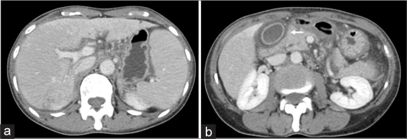
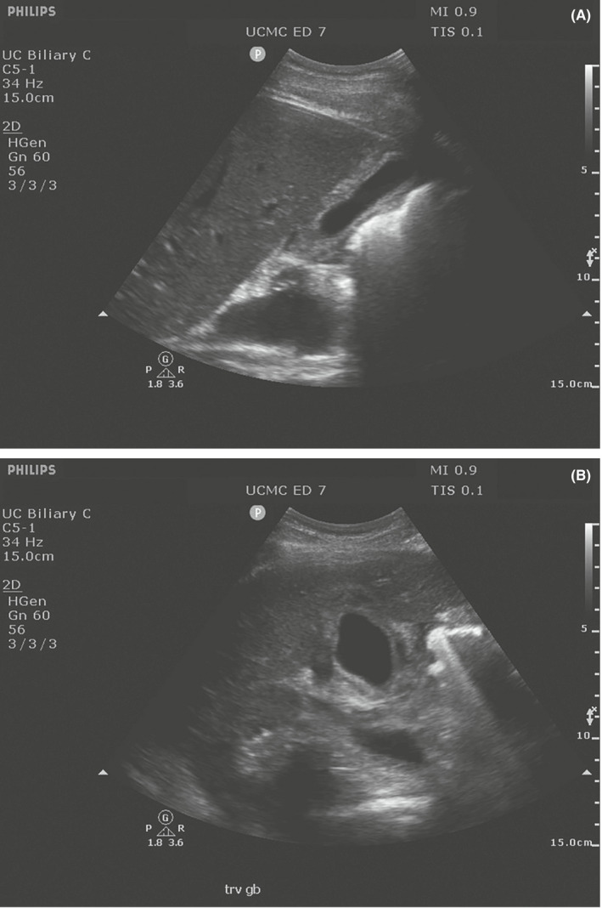
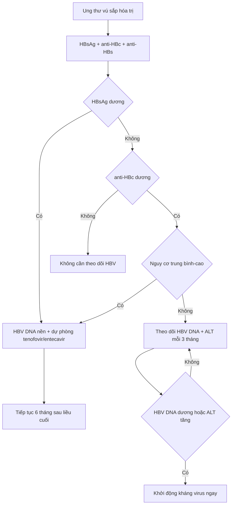

# 1790 — Bùng phát viêm gan B khi điều trị ung thư vú / HBV reactivation during breast cancer therapy

**Tags:** `pattern:tang-transaminase` `pattern:viem-gan` `pattern:gan-nhiem-mo` `vung:gan` `score:R-factor` `protocol:HBV-DNA` `protocol:SA-gan` `protocol:CT-gan`
**Mức chắc chắn (certainty):** tổng hợp y văn (literature synthesis) — ngưỡng chẩn đoán/ dự phòng theo AASLD 2018 và các hướng dẫn HBV reactivation; hình ảnh minh họa từ hai bài open-access (PMC12361689, PMC9400034). Không phải ca nguyên văn của một bệnh nhân duy nhất.

## 1. Tổng quan bệnh học – cơ chế hình ảnh

- **Bùng phát viêm gan B (HBV reactivation)** là sự tăng sao chép HBV khi miễn dịch bị ức chế (hóa trị, corticoid, anti-CD20, ức chế điểm kiểm soát), sau đó **hệ miễn dịch phục hồi tấn công tế bào gan nhiễm virus** → viêm gan, có thể **suy gan cấp** và tử vong.
- **Định nghĩa định lượng (AASLD 2018):**
  - Ở người **HBsAg+**: **HBV DNA tăng ≥ 2 log10 (100 lần)** so với nền, hoặc **HBV DNA xuất hiện lại** nếu trước đó không đo được.
  - Ở người **anti-HBc+ / HBsAg− (nhiễm đã khỏi)**: **HBsAg dương trở lại** hoặc **HBV DNA dương**.
  - **Đợt bùng phát viêm gan (hepatitis flare):** **ALT ≥ 3 lần nền và > 100 U/L**.
- **Vì sao ung thư vú là bối cảnh điển hình:** phác đồ **anthracycline + cyclophosphamide ± taxane** là nhóm nguy cơ **trung bình (1–10%)**; thêm **corticoid liều cao kéo dài** hoặc **anti-CD20** (nếu điều trị lymphoma kèm) đẩy lên **nguy cơ cao (> 10%)**. Không dự phòng, **20–50%** người HBsAg+ bùng phát; **tử vong 5–40%** khi đã suy gan.
- **Vì sao hình ảnh quan trọng nhưng không chẩn đoán được một mình:** bùng phát HBV là **bệnh của xét nghiệm** (HBV DNA, ALT, bilirubin, INR). Hình ảnh có ba việc: **(1)** loại **tiến triển u/di căn gan mới**, **(2)** loại **tắc mật** (giãn đường mật, sỏi, hẹp), **(3)** nhận diện **tổn thương gan do thuốc** (SOS, gan nhiễm mỡ, pseudocirrhosis).
- **TẠI SAO có phù khoảng cửa (periportal edema) trên CT:** viêm gan cấp làm **dịch thấm vào mô liên kết quanh khoảng cửa**; nước có **HU thấp (~0–20 HU)** so với nhu mô gan bình thường **50–65 HU** không cản quang → dải **giảm đậm hình ống/chữ Y** men theo tĩnh mạch cửa. Trên MRI, dịch này **T1 tối – T2 sáng**; trên siêu âm, mô kẽ phù làm **tăng hồi âm quanh khoảng cửa** và **thành túi mật dày**.
- **TẠI SAO thành túi mật dày ("double wall sign"):** phù **lớp dưới niêm mạc** tạo một dải **giảm âm** kẹp giữa **niêm mạc tăng âm** và **thanh mạc tăng âm**; thành túi mật bình thường **≤ 3 mm**, khi viêm gan cấp thường **> 3 mm** nhưng **không có sỏi** và **không đau điểm Murphy** — đây là điểm phân biệt với viêm túi mật.
- **Ngưỡng hình ảnh định lượng:** gan bình thường **50–65 HU** không cản quang; **gan nhiễm mỡ < 40 HU** (hoặc chênh gan–lách **< −10 HU**); thành túi mật **> 3 mm**; đường mật trong gan **> 2 mm** ở người không cắt túi mật được coi là giãn. **Độ cứng gan (LSM)** tăng giả lập trong viêm gan cấp — **không dùng elastography để phân độ xơ trong đợt bùng phát**, chờ **≥ 3–6 tháng** sau khi ALT về bình thường.

## 2. Mẫu hình + chẩn đoán phân biệt theo vị trí (gamut)

- **Tổn thương lan tỏa nhu mô gan (diffuse):** bùng phát HBV, **tổn thương gan do thuốc (DILI)**, **hội chứng tắc xoang gan (SOS/VOD)**, gan nhiễm mỡ do hóa trị, **pseudocirrhosis**, ứ mật do thuốc.
- **Tổn thương khu trú (focal):** **di căn gan mới/to ra**, áp-xe gan, HCC (nếu nền xơ gan), nang/nhiễm trùng cơ hội.
- **Theo vị trí:** **quanh khoảng cửa** (phù khoảng cửa, giãn đường mật), **dưới bao** (tụ máu, di căn dưới bao), **túi mật** (dày thành, ứ mật), **quanh tĩnh mạch cửa** (huyết khối cửa nhiễm khuẩn).
- **Mnemonic 4 nhóm sau hóa trị:** **D**rug (DILI), **V**irus (HBV flare), **T**umor (progression), **V**ascular (SOS/pseudocirrhosis) — **DVT-V** dễ nhớ trong bối cảnh bệnh nhân ung thư vú đang hóa trị.

## 3. Bảng so sánh phân biệt (ma trận đối chiếu)

| Thực thể (entity) | Hình ảnh điển hình | Chốt vào (rule-in) | Chốt loại (rule-out) | Gợi ý xác nhận |
|---|---|---|---|---|
| **Bùng phát HBV** | Gan to nhẹ, **phù khoảng cửa**, thành túi mật dày, nhu mô không đồng nhất; **không có tổn thương khu trú mới** | **HBV DNA tăng ≥ 2 log10 hoặc dương lại + ALT ≥ 3× nền và > 100 U/L** | Không có bằng chứng virus → không gọi bùng phát HBV dù ALT tăng | HBsAg, anti-HBc, **HBV DNA**, ALT/bilirubin/INR mỗi **1–3 tháng** |
| **DILI (tổn thương gan do thuốc)** | Gan to, có thể mỡ hóa, phù khoảng cửa; **hình ảnh giống hệt viêm gan virus** | **R ratio ≥ 5 (tế bào gan)**, thời gian khớp thuốc, loại trừ virus/tắc mật | Virus âm và **R ≤ 2** (ứ mật) → nghĩ nguyên nhân khác | R = (ALT/ULN)/(ALP/ULN); **Hy's law** nếu ALT ≥ 3× ULN + bilirubin ≥ 2× ULN |
| **Tiến triển u/di căn gan** | **Tổn thương khu trú mới/to ra**, bờ không đều, ngấm thuốc kiểu u | **Nốt mới hoặc tăng kích thước theo RECIST** | Chỉ phù lan tỏa, không nốt mới → không phải tiến triển | CT/MRI có cản quang; so phim cũ; PET/CT nếu còn nghi |
| **SOS/VOD sau hóa trị** | **Gan to, phù quanh túi mật, cổ trướng**, phù khoảng cửa; **tĩnh mạch cửa giảm phổ** | **Cổ trướng + gan to + bilirubin tăng sau oxaliplatin/hóa trị** | Không cổ trướng, không tăng bilirubin → ít nghĩ SOS | Doppler cửa, CT 3 thì, **đo gradient áp lực gan–tĩnh mạch** nếu cần |
| **Tắc mật do sỏi/hẹp** | **Giãn đường mật trong gan**, dấu "double duct" nếu giãn ống tụy | **Đường mật giãn + ALP/GGT tăng trội** | Đường mật không giãn → loại tắc mật lớn | Siêu âm + MRCP; ERCP nếu cần |
| **Gan nhiễm mỡ do hóa trị** | Gan **giảm đậm lan tỏa** (**< 40 HU**), đôi khi khu trú | **HU gan < 40 hoặc chênh gan–lách < −10 HU** | Không giảm đậm → không phải mỡ | CT không cản quang + MRI out-of-phase |
| **Pseudocirrhosis** | Bờ gan **lobulated**, teo thùy, **cổ trướng**, hạch rốn gan — giống xơ gan | **Tiền sử di căn gan + hóa trị, bờ gan biến dạng tiến triển** | Bờ gan nhẵn, không teo thùy → không pseudocirrhosis | So chuỗi CT; MRI; không chẩn đoán xơ gan chỉ bằng hình thái |

*(a) CT thì tĩnh mạch cửa: **phù khoảng cửa** (dải giảm đậm men theo nhánh cửa) và nhu mô gan không đồng nhất; (b) **phù thành túi mật** (mũi tên trắng mảnh). Bối cảnh: ung thư vú di căn gan đang paclitaxel + carboplatin, men gan xấu dần. Nguồn: Journal of Clinical Imaging Science 2025 (PMC12361689), CC BY-NC-SA 4.0.*

*Siêu âm túi mật: (A) mặt cắt dọc, thành dày, **không sỏi**; (B) mặt cắt ngang, **"double wall sign"** — dải giảm âm dưới niêm mạc kẹp giữa hai lớp tăng âm. Nguồn: Clinical Case Reports 2022 (PMC9400034), CC BY 4.0.*

## 4. Protocol chụp + hệ phân độ/điểm chuẩn hóa

- **Trước khi bắt đầu hóa trị (bắt buộc):** **HBsAg + anti-HBc (± anti-HBs)** cho mọi bệnh nhân ung thư vú sắp hóa trị/ức chế miễn dịch; nếu HBsAg+ hoặc anti-HBc+ → **HBV DNA nền**.
- **Phân tầng nguy cơ (AASLD 2018):**
  - **Nguy cơ cao (> 10%):** HBsAg+ dùng **anti-CD20** hoặc **ghép tế bào gốc**.
  - **Trung bình (1–10%):** HBsAg+ dùng hóa trị/ức chế miễn dịch khác (gồm phác đồ ung thư vú); **anti-HBc+ dùng anti-CD20**.
  - **Thấp (< 1%):** anti-HBc+ dùng hóa trị không anti-CD20.
- **Dự phòng kháng virus:** nguy cơ **cao/trung bình** → **tenofovir (TDF 300 mg/ngày hoặc TAF 25 mg/ngày)** hoặc **entecavir 0,5 mg/ngày**, **bắt đầu trước hoặc cùng lúc** với ức chế miễn dịch; **tiếp tục ≥ 6 tháng sau liều cuối**, **12 tháng nếu anti-CD20**. Dự phòng giảm bùng phát **> 80%**.
- **Nếu không dự phòng (nguy cơ thấp):** theo dõi **HBV DNA + ALT mỗi 3 tháng** trong và sau điều trị; khởi động kháng virus ngay khi **HBV DNA dương/tăng ≥ 1 log10** — **không chờ đến ngưỡng 2.000 IU/mL** của viêm gan B mạn.
- **Khi đã bùng phát:** kháng virus ngay (tenofovir/entecavir), **không trì hoãn vì chờ men gan giảm**; xem xét **ngừng thuốc gây độc** nếu DILI là hàng phân biệt; theo dõi **INR, bilirubin, encephalopathy** để phát hiện suy gan cấp; hội chẩn gan–tiêu hóa.
- **Hình ảnh:** **siêu âm gan + Doppler cửa** là bước đầu (không bức xạ); **CT 3 thì** nếu nghi u/tiến triển/SOS; **MRI gan có cản quang tế bào (gadoxetate)** khi cần phân biệt nốt lành/ác. **Không chụp tầm soát di căn chỉ vì ALT tăng.**
- **Elastography:** hoãn đến khi ALT về bình thường **≥ 3 tháng** (viêm làm LSM tăng giả lập).

## 5. Biến thể bình thường và cạm bẫy

- **Phù khoảng cửa nhẹ có thể gặp ở gan nhiễm mỡ, suy tim, truyền dịch nhiều** — không đồng nghĩa viêm gan; phải đọc cùng xét nghiệm.
- **Thành túi mật dày do suy tim, giảm albumin, cổ trướng, viêm túi mật** — "double wall" chỉ gợi ý khi **không sỏi, không Murphy, có viêm gan**.
- **ALT bình thường không loại trừ bùng phát HBV** (đặc biệt khi đang dùng corticoid liều cao hoặc suy gan); **hình ảnh bình thường cũng không loại trừ**.
- **Quy kết oan cho hóa trị:** nếu chưa làm **HBsAg/anti-HBc/HBV DNA**, không được gọi "DILI" — bỏ sót HBV là nguyên nhân tử vong phòng được.
- **Pseudocirrhosis giả xơ gan:** bờ gan lobulated + teo thùy ở bệnh nhân di căn gan đang hóa trị **không phải xơ gan thật**; đừng gắn chẩn đoán xơ gan rồi loại bỏ cơ hội điều trị.
- **Gan nhiễm mỡ làm giảm độ nhạy phát hiện nốt** trên CT không cản quang; nốt di căn có thể "ẩn" trong gan mỡ — cần MRI/CEUS khi nghi.
- **Cổ trướng + gan to sau oxaliplatin** phải nghĩ **SOS**, không phải "tiến triển u" — sinh thiết gan có thể chảy máu, ưu tiên chẩn đoán hình ảnh + gradient áp lực.

## 6. Tự lượng giá — Blind Quiz ngay trên trang tĩnh

**Ca 1 — Nữ ung thư vú di căn gan, đang paclitaxel + carboplatin, men gan xấu dần, không sốt.**

- Câu hỏi: Hai dấu hiệu chính trên CT là gì? Ba chẩn đoán phân biệt? Xét nghiệm nào quyết định chẩn đoán?

<b>Bấm để hiện đáp án (findings + chẩn đoán)</b>

- **Findings:** (a) **phù khoảng cửa** — dải giảm đậm men theo nhánh tĩnh mạch cửa — và nhu mô gan không đồng nhất; (b) **dày thành túi mật** (mũi tên trắng).
- **Chẩn đoán:** **viêm gan do hóa trị (chemotherapy-related hepatitis)**, nhưng **phải loại bùng phát HBV** trước khi quy kết thuốc.
- **Xét nghiệm quyết định:** **HBV DNA + HBsAg/anti-HBc**, ALT/bilirubin/INR; R ratio để phân biệt DILI tế bào gan vs ứ mật.
- Nguồn: Journal of Clinical Imaging Science 2025 (PMC12361689), CC BY-NC-SA 4.0.

**Ca 2 — Bệnh nhân đau hạ sườn phải nhẹ, men gan tăng, siêu âm túi mật không sỏi.**

- Câu hỏi: Dấu hiệu "double wall" là gì? Phân biệt với viêm túi mật cấp bằng gì? Liên hệ với viêm gan cấp thế nào?

<b>Bấm để hiện đáp án (findings + chẩn đoán)</b>

- **Findings:** thành túi mật dày **> 3 mm**, **không sỏi**, **dải giảm âm dưới niêm mạc** kẹp giữa hai lớp tăng âm (double wall sign).
- **Chẩn đoán:** phù thành túi mật trong **viêm gan cấp** (ở đây là viêm gan cấp — cần xét nghiệm virus/độc chất).
- **Phân biệt:** viêm túi mật cấp có **sỏi/kẹt cổ túi, Murphy dương, thành dày không đều, dịch quanh túi**; double wall đơn thuần + men gan tăng → nghĩ viêm gan.
- Nguồn: Clinical Case Reports 2022 (PMC9400034), CC BY 4.0.

**Câu 3 — Bệnh nhân ung thư vú HBsAg+, phác đồ anthracycline, chưa có HBV DNA. Xử trí?**

<b>Bấm để hiện đáp án</b>

- **Không chờ HBV DNA để dự phòng:** HBsAg+ + hóa trị nguy cơ trung bình → **bắt đầu tenofovir hoặc entecavir ngay**, trước/cùng lúc hóa trị, **tiếp tục ≥ 6 tháng sau liều cuối**.
- Xét nghiệm **HBV DNA nền** để theo dõi đáp ứng và phát hiện đột biến kháng thuốc; **không dùng lamivudine** vì tỷ lệ kháng cao.

## Bài liên quan chéo
- [500 – Tổng quan Hệ Vú & Sản phụ khoa](../500-tong-quan-vu-san-phu-khoa/lesson.md)
- [100 – Tổng quan Hệ Bụng](../100-tong-quan-he-bung/lesson.md)
- [1732 – Độc gan do CDK4/6 và thuốc ức chế miễn dịch](../1732-doc-gan-cdk46-tdxd/lesson.md)
- [1791 – Ung thư vú ở nam giới](../1791-ung-thu-vu-nam/lesson.md)
- [1918 – Nhiễm CMV sau ghép gan ở trẻ](../1918-nhiem-cmv-sau-ghep-gan-o-tre/lesson.md)

## Ảnh
- `images/1790_PMC12361689_fig7.jpg` — viêm gan sau hóa trị ở bệnh nhân ung thư vú, Journal of Clinical Imaging Science 2025 (PMC12361689), **CC BY-NC-SA 4.0** (nguyên bản, không crop/ghép).
- `images/1790_PMC9400034_fig1.jpg` — siêu âm túi mật trong viêm gan cấp, Clinical Case Reports 2022 (PMC9400034), **CC BY 4.0**.
- Giấy phép từng ảnh: `images/CREDITS.md`.

> Không dùng để chẩn đoán độc lập khi chưa có người hướng dẫn.
