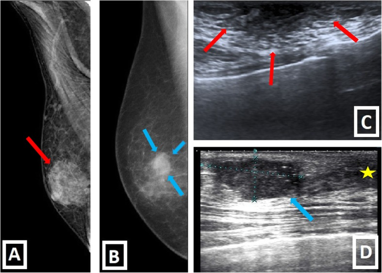
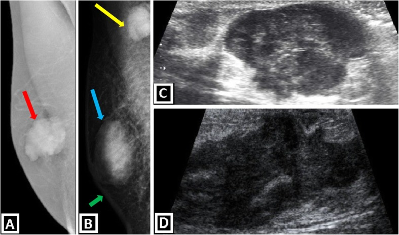
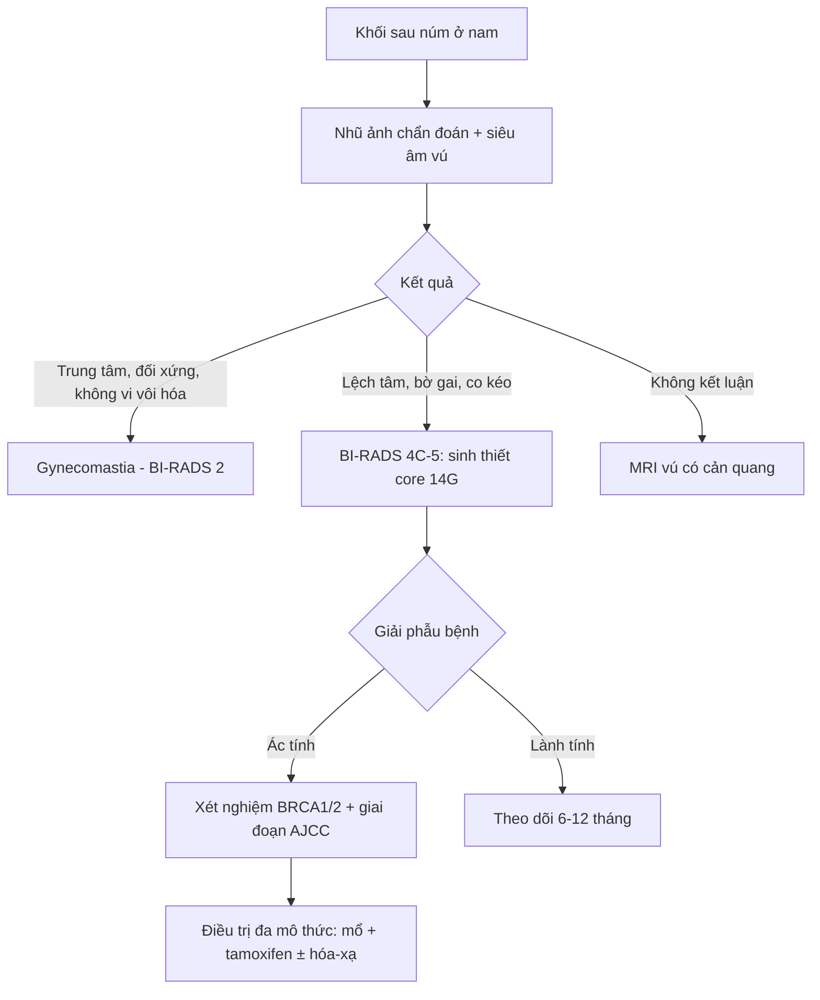

# 1791 — Ung thư vú ở nam giới / Male breast cancer (MBC)

**Tags:** `pattern:khoi-sau-num` `pattern:khoi-mot-ben` `pattern:vi-voi-hoa` `vung:vu` `score:BI-RADS` `protocol:nhu-anh` `protocol:US-vu` `protocol:MRI-vu`
**Mức chắc chắn (certainty):** tổng hợp y văn (literature synthesis) — số liệu lấy từ bài tổng quan hình ảnh vú nam (Insights into Imaging 2020, PMC7028902) + y văn MBC; các ngưỡng BI-RADS theo ACR 5th edition. Không gắn một ca nguyên văn duy nhất.

## 1. Tổng quan bệnh học – cơ chế hình ảnh

- **Dịch tễ:** MBC chiếm **~1%** toàn bộ ung thư vú và **< 1%** ung thư ở nam; tỷ lệ mắc **~1,0–1,5/100.000 nam/năm** (SEER, Mỹ). Tuổi trung vị **67–71**, muộn hơn nữ **~5 năm**. Đây là bệnh **hiếm nhưng không được bỏ qua**, vì khối sau núm ở nam thường bị quy ngay cho gynecomastia.
- **Yếu tố nguy cơ (có con số):**
  - **BRCA2** là gen mạnh nhất: nguy cơ ung thư vú suốt đời ở nam **~6–8%** (NCCN), và **10–15%** nam mắc MBC mang đột biến BRCA2; **BRCA1** thấp hơn nhiều (**~1–2%**).
  - **Hội chứng Klinefelter (47,XXY):** nguy cơ tăng **20–50 lần**, nguy cơ tuyệt đối **~5%**.
  - Phơi nhiễm tia xạ ngực, béo phì, xơ gan/rượu (tăng estrogen – giảm thanh thải), dùng estrogen ngoại sinh, tiền sử gia đình, **CHEK2/PALB2/PTEN**.
- **Vì sao hình ảnh khác nữ:** vú nam chỉ có **ống tuyến + mô đệm + mỡ**, **không có tiểu thùy** → thể mô học hay gặp là **ung thư biểu mô ống xâm lấn (IDC, ~90%)**; thể tiểu thùy gần như không có; **thể nhú (papillary)** chiếm **~5%** (hay chảy dịch núm). Thể tích vú nhỏ, núm sát khối → u **nhanh chóng xâm lấn da/núm**, nên **T4/da** gặp nhiều hơn nữ.
- **Sinh học thụ thể:** **ER+ 90–95%**, **PR+ ~80%**, **HER2+ chỉ ~5–15%** (thấp hơn nữ). Điều này giải thích vì sao **tamoxifen** là trụ cột nội tiết ở nam, còn **ức chế aromatase đơn thuần không được khuyến cáo** (thiếu dữ liệu, cần phối hợp ức chế trục sinh dục).
- **Vì sao khối ác tính trông đậm và gai trên nhũ ảnh:** tế bào u + **phản ứng xơ hóa mô đệm (desmoplasia)** làm mô đặc hơn mỡ xung quanh → **độ cản tia tăng**, bờ **gai (spiculated)** do dây xơ co kéo; vi vôi hóa do hoại tử ống tuyến. Trên siêu âm, mô u đặc – giàu tế bào – nhiều collagen → **giảm âm (hypoechoic)**, **bóng lưng (posterior shadowing)**, **không song song với da (not parallel)**, bờ không đều.
- **Ngược lại, gynecomastia** là **tăng sinh ống tuyến + mô đệm quanh ống** (không phải u đặc) → mô **hình quạt/đĩa** quanh núm, **đối xứng**, không co kéo, không bóng lưng. Đây là khác biệt vật lý cốt lõi giữa hai bệnh cảnh.
- **Tiên lượng theo giai đoạn (AJCC 8th):** sống 5 năm toàn bộ **~80–85%**; giai đoạn I **~95%**, II **~85–90%**, III **~60–70%**, IV **~20–25%**. MBC thường được chẩn đoán muộn (**~40% giai đoạn III–IV** trong nhiều loạt) vì tâm lý "đàn ông không bị ung thư vú".

## 2. Mẫu hình + chẩn đoán phân biệt theo vị trí (gamut)

- **Khối sau núm trung tâm, đối xứng, hai bên hoặc một bên:** gynecomastia (thể **nodular**, **dendritic**, **diffuse glandular**), pseudogynecomastia (chỉ mỡ), áp-xe/viêm tuyến vú, u mỡ, nang thượng bì.
- **Khối lệch tâm so với núm (eccentric), bờ không đều, một bên:** **IDC** (hay gặp nhất), **ung thư biểu mô thể nhú**, DCIS (hiếm, thường chỉ vi vôi hóa), lymphoma, **di căn** (tuyến tiền liệt, phổi, melanoma).
- **Chảy dịch núm (nhất là dịch máu) hoặc loét núm:** u nhú trong ống, **ung thư thể nhú**, **bệnh Paget** — không được theo dõi "gynecomastia" mà bỏ qua.
- **Khối nách đơn độc:** hạch di căn từ u vú ẩn, lymphoma, di căn ngoài vú; cần siêu âm + sinh thiết hạch, không mặc định "hạch phản ứng".
- **Mnemonic GAMUT khối vú nam:** **G**ynecomastia, **A**bscess/mastitis, **M**alignancy (IDC/papillary), **U**ncommon benign (lipoma, epidermal cyst, fat necrosis), **T**ransfer/metastasis (prostate, lymphoma).

## 3. Bảng so sánh phân biệt (ma trận đối chiếu)

| Thực thể (entity) | Hình ảnh điển hình (nhũ ảnh / siêu âm) | Chốt vào (rule-in) | Chốt loại (rule-out) | Gợi ý xác nhận |
|---|---|---|---|---|
| **Gynecomastia thể nốt** | Nhũ ảnh: **hình quạt/đĩa trung tâm sau núm**, đậm đều, không vi vôi hóa, thường hai bên. US: **mô giảm âm hình đĩa quanh núm**, bờ mờ, **không bóng lưng** | **Trung tâm + đối xứng + không co kéo da/núm + không vi vôi hóa** | **Lệch tâm + bờ gai + vi vôi hóa + co kéo** → loại gynecomastia | So sánh hai bên, hỏi thuốc (spironolactone, cimetidine, finasteride), chức năng gan/thận |
| **IDC (ung thư ống xâm lấn)** | Khối **đậm, lệch tâm**, bờ gai/không đều; US: **giảm âm, không song song, bóng lưng**, ± vi vôi hóa | **Lệch tâm so với núm + bờ gai + co kéo da/núm** | Tổn thương **thuần mỡ** (−40 đến −120 HU tương đương) → không phải IDC | Core biopsy 14G dưới siêu âm; BI-RADS 4C–5 |
| **Ung thư thể nhú** | Khối sau núm **bờ rõ**, có thể **dạng nang–đặc (complex cystic–solid)**, chảy dịch núm máu | **Dịch núm máu + khối nang–đặc sau núm** | Nang đơn thuần, không thành phần đặc → theo dõi | Siêu âm + chọc hút/sinh thiết; không phân biệt được với IDC chỉ bằng hình ảnh |
| **Áp-xe/viêm tuyến vú** | Da dày, phù mô mỡ, **ổ dịch có viền ngấm thuốc**, đau, sốt | **Ổ dịch + sốt/đau khu trú** | Khối đặc không dịch hóa → không phải áp-xe đơn thuần | Siêu âm + chọc hút; cấy mủ |
| **Hoại tử mỡ** | Tiền sử chấn thương/mổ; **nang dầu**, viền vôi hóa thô, không ngấm thuốc | **Bối cảnh chấn thương + tổn thương mỡ có viền** | Bờ gai tiến triển + ngấm thuốc → nghi ung thư | Theo dõi 3–6 tháng hoặc sinh thiết nếu không điển hình |
| **Nang thượng bì** | **Sát da, có lỗ trung tâm (punctum)**, giảm âm, có cặn; không mạch trong | **Liên tục với da + không tăng sinh mạch** | Thành phần đặc ngấm thuốc → loại nang đơn thuần | Siêu âm; mổ bóc nếu viêm tái diễn |
| **Di căn/lymphoma** | Nhiều khối, hai bên, phát triển nhanh; hạch nách lớn | **Tiền sử ung thư ngoài vú + nhiều tổn thương** | Tổn thương đơn độc điển hình IDC → vẫn phải mô học | Sinh thiết + hóa mô miễn dịch |

*Trái (A, C): gynecomastia thể nốt — đậm hình quạt trung tâm sau núm trên nhũ ảnh, mô giảm âm hình đĩa trên siêu âm (mũi tên đỏ). Phải (B, D): IDC — khối lệch tâm, bờ không đều, giảm âm có bóng lưng (mũi tên xanh). Nguồn: Insights into Imaging 2020 (PMC7028902), CC BY 4.0.*

*(A, B) Nhũ ảnh MLO: khối thùy sau núm đậm, không vi vôi hóa (mũi tên đỏ/xanh); (B) còn thấy hạch nách (mũi tên vàng) và dày da (mũi tên xanh lá). (C, D) Siêu âm: khối giảm âm không đồng nhất, bờ không đều. Nguồn: Insights into Imaging 2020 (PMC7028902), CC BY 4.0.*

## 4. Protocol chụp + hệ phân độ/điểm chuẩn hóa

- **Chỉ định:** nam có **khối sờ thấy, đau khu trú, chảy dịch núm, loét/co kéo núm** → **nhũ ảnh chẩn đoán + siêu âm vú cùng bên**, không dùng nhũ ảnh tầm soát đơn thuần.
- **Nhũ ảnh:** MLO + CC, **đánh dấu khối bằng marker trên da**, núm nhìn nghiêng; chụp phóng đại khi có vi vôi hóa. Ở nam, mô mỡ nhiều → **độ nhạy cao nhưng độ đặc hiệu thấp**; khối đậm nổi bật trên nền mỡ nhưng dễ nhầm với gynecomastia trung tâm.
- **Siêu âm:** đầu dò **12–15 MHz**, khảo sát **radial/antiradial**, đo **3 chiều + độ sâu từ da**, mô tả bờ, hướng (song song/không song song), bóng lưng, mạch; **luôn khảo sát nách** (hạch level I–II).
- **MRI vú:** không thường quy; cân nhắc khi nhũ ảnh + siêu âm không kết luận, vú rất đặc, hoặc theo dõi BRCA2. Động học DCE: **Type III (washout > 10%)** nghiêng ác; **ADC < 1,0–1,2 × 10⁻³ mm²/s** gợi ý ác nhưng không đủ loại trừ.
- **BI-RADS 5th edition (ACR):**
  - **BI-RADS 3:** nguy cơ ác **≤ 2%** → theo dõi **6 tháng** (và 12–24 tháng).
  - **BI-RADS 4:** **2–95%**; chia **4A 2–10%**, **4B 10–50%**, **4C 50–95%** → **bắt buộc sinh thiết**.
  - **BI-RADS 5:** **≥ 95%** ác → sinh thiết ± chụp giai đoạn.
- **Sinh thiết:** core kim **14G** dưới siêu âm; nếu chỉ có vi vôi hóa → **sinh thiết hút chân không (VABB) có định vị**.
- **Giai đoạn:** AJCC 8th giống nữ. Giai đoạn I–II: **không** chụp tầm soát di căn thường quy; giai đoạn III: **CT ngực–bụng–chậu + xạ hình xương hoặc PET/CT FDG**.
- **Di truyền:** **mọi nam mắc MBC đều được xét nghiệm BRCA1/2** (NCCN); nếu BRCA2 dương → tầm soát **tuyến tiền liệt** và **tụy** theo tuổi/gia đình.

## 5. Biến thể bình thường và cạm bẫy

- **Pseudogynecomastia:** chỉ là **mỡ**, không có mô tuyến; trên nhũ ảnh không có hình quạt đậm, trên siêu âm không có mô giảm âm sau núm — **không sinh thiết**.
- **Gynecomastia một bên (20–25%):** bất đối xứng **không đồng nghĩa ung thư**; nhưng nếu phần đậm **lệch tâm** khỏi núm thì phải siêu âm + sinh thiết.
- **Marker núm/da** có thể giả vi vôi hóa hoặc giả nốt — chụp lại không marker khi nghi ngờ.
- **Bỏ sót thứ hai (satisfaction of search):** thấy gynecomastia hai bên rồi dừng, bỏ khối lệch tâm nhỏ ở 1/4 trên–ngoài. Luôn **đọc từng 1/4 và nách**.
- **Dày da sau xạ trị** không phải tái phát; so phim cũ và đối chiếu vùng chiếu.
- **Cơ ngực lớn (pectoralis) nhô ra** ở thành ngực trước tạo "khối" giả trên siêu âm — nhận diện bằng cấu trúc sợi cơ và nghiệm pháp gồng cơ.
- **Vú nam bình thường có mô tuyến giảm âm sau núm** — đừng gọi mọi vùng giảm âm sau núm là ung thư; bờ, hướng và bóng lưng mới là chốt.
- **Nguy cơ vú đối bên ~5–10%** và **nguy cơ di căn xa muộn** → theo dõi lâm sàng lâu dài, không chỉ 5 năm.

## 6. Tự lượng giá — Blind Quiz ngay trên trang tĩnh

**Ca 1 — Nam, khối sau núm mềm, đối xứng hai bên, không chảy dịch núm.**

- Câu hỏi: Mô tả hình dạng tổn thương trên nhũ ảnh và siêu âm? Ba chẩn đoán phân biệt? Dấu hiệu nào loại ung thư?

<b>Bấm để hiện đáp án (findings + chẩn đoán)</b>

- **Findings:** (A) đám đậm **hình quạt/đĩa trung tâm sau núm**, đối xứng; (C) siêu âm mô **giảm âm hình đĩa**, bờ mờ, **không bóng lưng**, không có vi vôi hóa.
- **Chẩn đoán:** **gynecomastia thể nốt (nodular gynecomastia)** — tăng sinh ống tuyến + mô đệm, không phải u đặc.
- **Loại ung thư vì:** trung tâm – đối xứng – không co kéo – không vi vôi hóa – không bóng lưng.
- Nguồn: Insights into Imaging 2020 (PMC7028902), CC BY 4.0.

**Ca 2 — Nam 60–70 tuổi, khối cứng lệch tâm sau núm trái, núm co kéo.**

- Câu hỏi: Khối nằm trung tâm hay lệch tâm? Có dấu hiệu xâm lấn da/hạch không? Bước tiếp theo?

<b>Bấm để hiện đáp án (findings + chẩn đoán)</b>

- **Findings:** khối **thùy, đậm, lệch tâm** so với núm, bờ không đều (mũi tên đỏ/xanh); **(B)** có **hạch nách** (mũi tên vàng) và **dày da** (mũi tên xanh lá); siêu âm (C, D) khối **giảm âm không đồng nhất**, bờ không đều.
- **Chẩn đoán:** **ung thư biểu mô ống xâm lấn (IDC) vú nam**, có hạch nách → **BI-RADS 5**, cần **core biopsy 14G** + xét nghiệm **BRCA1/2** + đánh giá giai đoạn.
- **Vì sao:** phản ứng xơ hóa mô đệm làm khối đậm, gai, co kéo da/núm; hạch nách là tiêu chí N.
- Nguồn: Insights into Imaging 2020 (PMC7028902), CC BY 4.0.

**Câu 3 — Sau khi có giải phẫu bệnh ER+ ở nam giai đoạn II, nội tiết nào là chuẩn?**

<b>Bấm để hiện đáp án</b>

- **Tamoxifen 20 mg/ngày trong 5 năm** là lựa chọn hàng đầu ở nam (dữ liệu tốt, giảm tái phát và tử vong).
- **Ức chế aromatase đơn thuần không được khuyến cáo** ở nam vì thiếu dữ liệu và cần phối hợp ức chế trục sinh dục; không dùng thay tamoxifen theo quán tính từ phác đồ nữ.

## Bài liên quan chéo
- [500 – Tổng quan Hệ Vú & Sản Phụ khoa](../500-tong-quan-vu-san-phu-khoa/lesson.md)
- [510 – Vú: BI-RADS nhũ ảnh, siêu âm, MRI](../510-vu-BIRADS-nhu-anh-sieu-am-MRI/lesson.md)
- [516 – Hình ảnh vú sau điều trị: tái tạo, hoại tử mỡ, sẹo vs tái phát](../516-hinh-anh-vu-sau-dieu-tri/lesson.md)
- [1714 – Chảy dịch núm một ống](../1714-chay-dich-num-mot-ong/lesson.md)
- [1790 – Bùng phát viêm gan B khi điều trị ung thư vú](../1790-bung-phat-viem-gan-b-sau-hoa-tri/lesson.md)

## Ảnh
- `images/1791_PMC7028902_fig5.jpg` — gynecomastia vs IDC, Insights into Imaging 2020 (PMC7028902), CC BY 4.0.
- `images/1791_PMC7028902_fig11.jpg` — IDC vú nam (nhũ ảnh + siêu âm), cùng bài, CC BY 4.0.
- Nguồn + giấy phép từng ảnh: `images/CREDITS.md`.

> Không dùng để chẩn đoán độc lập khi chưa có người hướng dẫn.
